# PERANCANGAN BASIS DATA (SKEMA DAN ERD)

Dokumen ini memperbarui rancangan basis data prototipe Sistem Informasi Manajemen Operasional Bimbel Artha Balikpapan pada 25 Oktober 2026. Rancangan diselaraskan dengan audit sebelumnya, keputusan pengguna tentang WhatsApp dan kapasitas, serta kebutuhan integrasi pada Bab 1.

Skema terdiri atas **23 tabel rancangan** dengan MySQL dan mesin transaksi InnoDB sebagai DBMS sasaran. Versi implementasi belum dibekukan, sedangkan kamus data dan diagram ini belum merupakan migrasi SQL yang telah dieksekusi atau hasil pengujian aplikasi.

## 1. Dasar keputusan dan batas rancangan

WhatsApp menggunakan tombol yang menyiapkan nomor wali serta pesan tagihan lewat jatuh tempo, kemudian Admin mengirim melalui WhatsApp. Kelas hampir penuh menampilkan peringatan, kelas penuh menolak penambahan, dan tempat tersedia setelah keanggotaan diakhiri tanpa menghapus sejarah.

Pengajuan transfer oleh Admin Cabang dan keputusan oleh Super Admin dipakai sebagai rancangan kerja untuk divalidasi dengan mitra. Akses mutasi rekening, pemberi persetujuan potongan, prosedur tunai, ambang hampir penuh, serta pembayaran sebagian belum dinyatakan sebagai kebijakan mitra yang telah disahkan.

Model mendukung satu penerimaan untuk beberapa tagihan milik siswa dan cabang yang sama. Pembayaran sebagian belum diaktifkan pada rancangan awal, sehingga nominal tiap alokasi wajib sama dengan sisa tagihan yang dipilih sampai kebijakannya ditetapkan.

Pencocokan bank dibatasi pada satu dana masuk untuk satu transfer siswa atau satu setoran kelompok kas dengan nominal penuh. Pencocokan sebagian atau satu mutasi untuk beberapa sumber belum dipaksakan masuk ke rancangan inti, dan perbedaan nominal tetap ditampilkan untuk tindak lanjut.

| Pokok rancangan | Kedudukan dan penerapan |
| :--- | :--- |
| Dua peran pengguna | Admin Cabang dan Super Admin; tentor serta wali tidak memiliki akun dasbor inti |
| Kepemilikan cabang | Data operasional dibatasi penugasan; bills dan payments menyimpan cabang historis |
| Tarif dan diskon | Tarif disimpan per cakupan; potongan aktual disimpan pada tagihan tanpa nominal global |
| Kapasitas | Jumlah aktif dihitung dari interval keanggotaan; status penuh merupakan nilai turunan |
| Jadwal | Mata pelajaran berada pada sesi jadwal; konflik diperiksa menurut masa berlaku |
| Pembayaran | Penerimaan induk dipisahkan dari alokasi tagihan, pengajuan, dan keputusan |
| Kas dan bank | Penerimaan siswa, penyerahan ke pusat, setoran bank, dan pencocokan dibedakan |
| Templat WhatsApp | Berkas aplikasi berversi; Super Admin tidak dijanjikan penyunting templat melalui dasbor |
| Fitur di luar inti | Daftar tunggu otomatis, pengiriman otomatis, portal wali, kartu anggota, QRIS, dan peta publik ditunda |

Jumlah tabel mengikuti kebutuhan riwayat dan hubungan data, bukan sasaran pengurangan tabel. Nama learning_programs, capacity_rules, discount_rules, wa_templates, wa_logs, dan revenue_validations tidak digunakan sebagai tabel aktif pada skema revisi ini.

## 2. Entity Relationship Diagram

Diagram berikut menggambarkan seluruh tabel dan setiap kunci asing yang tercantum dalam kamus data. Kardinalitas opsional mengikuti kolom yang boleh kosong, sedangkan aturan gabungan dan validasi lintas tabel dijelaskan sesudah diagram.

```mermaid
erDiagram
    academic_years {
        bigint id PK
        varchar name UK
        date start_date
        date end_date
        boolean is_active
        datetime created_at
        datetime updated_at
    }
    branches {
        bigint id PK
        varchar code UK
        varchar name
        text address
        varchar phone_wa
        boolean is_active
        datetime created_at
        datetime updated_at
    }
    users {
        bigint id PK
        bigint branch_id FK
        varchar name
        varchar email UK
        varchar password_hash
        enum role
        boolean is_active
        datetime last_login_at
        datetime created_at
        datetime updated_at
    }
    subjects {
        bigint id PK
        varchar code UK
        varchar name
        boolean is_active
        datetime created_at
        datetime updated_at
    }
    fee_tariffs {
        bigint id PK
        bigint branch_id FK
        bigint academic_year_id FK
        varchar session_code
        enum learning_program
        enum grade_level
        tinyint class_grade_start
        tinyint class_grade_end
        enum fee_type
        enum billing_cycle
        decimal amount
        date valid_from
        date valid_until
        varchar description
        boolean is_active
        datetime created_at
        datetime updated_at
    }
    students {
        bigint id PK
        bigint branch_id FK
        bigint academic_year_id FK
        varchar registration_no UK
        varchar full_name
        date birth_date
        varchar parent_name
        varchar parent_phone_wa
        varchar school_origin
        enum grade_level
        tinyint class_grade
        text home_address
        enum learning_program
        varchar session_code
        varchar family_reference
        enum status
        datetime registered_at
        datetime created_at
        datetime updated_at
    }
    mentors {
        bigint id PK
        bigint branch_id FK
        varchar full_name
        varchar phone_wa
        boolean is_active
        datetime created_at
        datetime updated_at
    }
    mentor_subjects {
        bigint id PK
        bigint mentor_id FK
        bigint subject_id FK
        datetime created_at
    }
    class_rooms {
        bigint id PK
        bigint branch_id FK
        varchar room_name
        smallint physical_capacity
        boolean is_active
        datetime created_at
        datetime updated_at
    }
    classes {
        bigint id PK
        bigint branch_id FK
        bigint academic_year_id FK
        varchar class_name
        enum learning_program
        varchar session_code
        enum grade_level
        tinyint class_grade
        smallint max_students
        smallint near_full_remaining
        enum status
        datetime created_at
        datetime updated_at
    }
    class_schedules {
        bigint id PK
        bigint class_id FK
        bigint subject_id FK
        bigint mentor_id FK
        bigint room_id FK
        tinyint day_of_week
        time start_time
        time end_time
        date valid_from
        date valid_until
        boolean is_active
        datetime created_at
        datetime updated_at
    }
    class_enrollments {
        bigint id PK
        bigint class_id FK
        bigint student_id FK
        bigint created_by_user_id FK
        datetime joined_at
        datetime ended_at
        varchar end_reason
        datetime created_at
        datetime updated_at
    }
    bills {
        bigint id PK
        bigint student_id FK
        bigint branch_id FK
        bigint academic_year_id FK
        bigint fee_tariff_id FK
        bigint created_by_user_id FK
        enum fee_type
        enum billing_cycle
        varchar period_key
        date period_start
        date period_end
        decimal base_amount
        decimal discount_amount
        varchar discount_reason
        bigint discount_approved_by_user_id FK
        decimal total_amount
        date due_date
        enum status
        datetime created_at
        datetime updated_at
    }
    payments {
        bigint id PK
        bigint student_id FK
        bigint branch_id FK
        bigint submitted_by_user_id FK
        bigint bank_account_id FK
        bigint resubmission_of_id FK
        varchar submission_no UK
        varchar idempotency_key UK
        enum payment_method
        enum status
        decimal amount_paid
        datetime payment_date
        datetime submitted_at
        varchar proof_storage_key
        char proof_sha256
        varchar receipt_no UK
        datetime confirmed_at
        text notes
        datetime created_at
        datetime updated_at
    }
    payment_allocations {
        bigint id PK
        bigint payment_id FK
        bigint bill_id FK
        decimal amount
        datetime created_at
    }
    payment_reviews {
        bigint id PK
        bigint payment_id FK
        bigint reviewer_user_id FK
        enum decision
        text reason
        datetime reviewed_at
        datetime created_at
    }
    cash_batches {
        bigint id PK
        bigint branch_id FK
        bigint created_by_user_id FK
        bigint submitted_by_user_id FK
        bigint received_by_user_id FK
        bigint deposited_by_user_id FK
        bigint bank_account_id FK
        varchar batch_no UK
        enum status
        datetime submitted_at
        datetime received_at
        datetime deposited_at
        varchar handover_proof_key
        varchar deposit_proof_key
        text notes
        datetime created_at
        datetime updated_at
    }
    cash_batch_items {
        bigint id PK
        bigint cash_batch_id FK
        bigint payment_id FK
        decimal amount
        datetime created_at
    }
    bank_accounts {
        bigint id PK
        varchar bank_name
        varchar account_number UK
        varchar account_holder
        boolean is_active
        datetime created_at
        datetime updated_at
    }
    bank_entries {
        bigint id PK
        bigint bank_account_id FK
        bigint recorded_by_user_id FK
        varchar entry_reference
        date entry_date
        decimal amount
        varchar description
        varchar evidence_storage_key
        enum status
        varchar void_reason
        datetime created_at
        datetime updated_at
    }
    bank_matches {
        bigint id PK
        bigint bank_entry_id FK
        bigint payment_id FK
        bigint cash_batch_id FK
        bigint matched_by_user_id FK
        decimal matched_amount
        datetime matched_at
        varchar notes
        datetime created_at
    }
    reminder_actions {
        bigint id PK
        bigint bill_id FK
        bigint requested_by_user_id FK
        varchar recipient_phone
        text message_content
        decimal outstanding_amount
        varchar template_version
        datetime requested_at
        datetime created_at
    }
    activity_logs {
        bigint id PK
        bigint actor_user_id FK
        bigint branch_id FK
        varchar action
        varchar entity_type
        bigint entity_id
        json change_summary
        varchar request_id
        datetime occurred_at
        datetime created_at
    }
    branches |o--o{ users : "branch_id"
    branches ||--o{ fee_tariffs : "branch_id"
    academic_years ||--o{ fee_tariffs : "academic_year_id"
    branches ||--o{ students : "branch_id"
    academic_years ||--o{ students : "academic_year_id"
    branches |o--o{ mentors : "branch_id"
    mentors ||--o{ mentor_subjects : "mentor_id"
    subjects ||--o{ mentor_subjects : "subject_id"
    branches ||--o{ class_rooms : "branch_id"
    branches ||--o{ classes : "branch_id"
    academic_years ||--o{ classes : "academic_year_id"
    classes ||--o{ class_schedules : "class_id"
    subjects ||--o{ class_schedules : "subject_id"
    mentors ||--o{ class_schedules : "mentor_id"
    class_rooms ||--o{ class_schedules : "room_id"
    classes ||--o{ class_enrollments : "class_id"
    students ||--o{ class_enrollments : "student_id"
    users ||--o{ class_enrollments : "created_by_user_id"
    students ||--o{ bills : "student_id"
    branches ||--o{ bills : "branch_id"
    academic_years ||--o{ bills : "academic_year_id"
    fee_tariffs ||--o{ bills : "fee_tariff_id"
    users ||--o{ bills : "created_by_user_id"
    users |o--o{ bills : "discount_approved_by_user_id"
    students ||--o{ payments : "student_id"
    branches ||--o{ payments : "branch_id"
    users ||--o{ payments : "submitted_by_user_id"
    bank_accounts |o--o{ payments : "bank_account_id"
    payments |o--o| payments : "resubmission_of_id"
    payments ||--o{ payment_allocations : "payment_id"
    bills ||--o{ payment_allocations : "bill_id"
    payments ||--o| payment_reviews : "payment_id"
    users ||--o{ payment_reviews : "reviewer_user_id"
    branches ||--o{ cash_batches : "branch_id"
    users ||--o{ cash_batches : "created_by_user_id"
    users |o--o{ cash_batches : "submitted_by_user_id"
    users |o--o{ cash_batches : "received_by_user_id"
    users |o--o{ cash_batches : "deposited_by_user_id"
    bank_accounts |o--o{ cash_batches : "bank_account_id"
    cash_batches ||--o{ cash_batch_items : "cash_batch_id"
    payments ||--o| cash_batch_items : "payment_id"
    bank_accounts ||--o{ bank_entries : "bank_account_id"
    users ||--o{ bank_entries : "recorded_by_user_id"
    bank_entries ||--o| bank_matches : "bank_entry_id"
    payments |o--o| bank_matches : "payment_id"
    cash_batches |o--o| bank_matches : "cash_batch_id"
    users ||--o{ bank_matches : "matched_by_user_id"
    bills ||--o{ reminder_actions : "bill_id"
    users ||--o{ reminder_actions : "requested_by_user_id"
    users ||--o{ activity_logs : "actor_user_id"
    branches |o--o{ activity_logs : "branch_id"
```

Relasi pengguna atau tentor dengan cabang dapat bersifat opsional sesuai peran atau pangkalannya. Dua relasi sumber pada bank_matches masing-masing opsional, tetapi kendala gabungan mewajibkan tepat satu sumber terisi.

## 3. Kamus data

Setiap tabel mempunyai id sebagai kunci utama, sedangkan atribut FK menunjuk kunci pada tabel yang disebutkan. Kolom created_at mencatat waktu pembuatan, dan updated_at hanya dipakai pada objek yang mempunyai perubahan keadaan.

Nominal menggunakan DECIMAL, bukan bilangan pecahan biner, dengan satuan rupiah. Waktu kejadian disimpan dalam UTC dan ditampilkan sebagai Asia/Makassar, sedangkan tanggal jatuh tempo dan jam jadwal menggunakan kalender operasional Balikpapan.

Nilai ENUM merupakan pilihan rancangan untuk MySQL, bukan klaim portabilitas langsung ke PostgreSQL. Keterangan unik per kolom berbeda dari kunci unik gabungan yang dituliskan pada aturan tiap tabel.

### 3.1 academic_years: Tahun ajaran

Menyimpan rentang tahun ajaran yang dipakai kelas, tarif, dan tagihan. Arsip tahun sebelumnya tetap tersedia ketika tahun operasional berubah.

| Kolom | Tipe rancangan | Boleh kosong | Kunci atau rujukan | Keterangan |
| :--- | :--- | :---: | :--- | :--- |
| `id` | `BIGINT UNSIGNED` | Tidak | PK, AUTO_INCREMENT | Kunci utama, AUTO_INCREMENT |
| `name` | `VARCHAR(30)` | Tidak | Tidak ada FK; UNIQUE | Nama tahun ajaran |
| `start_date` | `DATE` | Tidak | Tidak ada FK | Tanggal mulai tahun ajaran |
| `end_date` | `DATE` | Tidak | Tidak ada FK | Tanggal akhir tahun ajaran |
| `is_active` | `BOOLEAN` | Tidak | Tidak ada FK | Penanda tahun operasional aktif, awal FALSE |
| `created_at` | `DATETIME(6)` | Tidak | Tidak ada FK | Waktu pencatatan, disimpan dalam UTC |
| `updated_at` | `DATETIME(6)` | Tidak | Tidak ada FK | Waktu perubahan terakhir, disimpan dalam UTC |

- Tanggal akhir tidak mendahului tanggal mulai. Pergantian tahun aktif dilakukan dalam transaksi yang mencegah lebih dari satu tahun aktif.
- Tanggal kalender tahun ajaran berasal dari ketentuan mitra. Aktivasi tahun baru tidak mengubah tingkat kelas pada tagihan historis.

### 3.2 branches: Cabang

Menyimpan identitas cabang untuk pemisahan data operasional. Jumlah ruang diperoleh dari data ruang aktif, sehingga tidak ditulis ulang sebagai penghitung bebas.

| Kolom | Tipe rancangan | Boleh kosong | Kunci atau rujukan | Keterangan |
| :--- | :--- | :---: | :--- | :--- |
| `id` | `BIGINT UNSIGNED` | Tidak | PK, AUTO_INCREMENT | Kunci utama, AUTO_INCREMENT |
| `code` | `VARCHAR(20)` | Tidak | Tidak ada FK; UNIQUE | Kode cabang |
| `name` | `VARCHAR(100)` | Tidak | Tidak ada FK | Nama cabang |
| `address` | `TEXT` | Ya | Tidak ada FK | Alamat cabang |
| `phone_wa` | `VARCHAR(20)` | Ya | Tidak ada FK | Kontak cabang dengan format internasional |
| `is_active` | `BOOLEAN` | Tidak | Tidak ada FK | Status operasional cabang |
| `created_at` | `DATETIME(6)` | Tidak | Tidak ada FK | Waktu pencatatan, disimpan dalam UTC |
| `updated_at` | `DATETIME(6)` | Tidak | Tidak ada FK | Waktu perubahan terakhir, disimpan dalam UTC |

- Cabang yang mempunyai transaksi dinonaktifkan, bukan dihapus. Lokasi pada peta publik tidak menjadi kebutuhan inti prototipe.

### 3.3 users: Akun pengguna

Menyimpan akun Admin Cabang dan Super Admin. Peran menentukan izin fungsi, sedangkan penugasan cabang membatasi objek yang dapat diakses.

| Kolom | Tipe rancangan | Boleh kosong | Kunci atau rujukan | Keterangan |
| :--- | :--- | :---: | :--- | :--- |
| `id` | `BIGINT UNSIGNED` | Tidak | PK, AUTO_INCREMENT | Kunci utama, AUTO_INCREMENT |
| `branch_id` | `BIGINT UNSIGNED` | Ya | FK ke `branches.id` | Cabang penugasan Admin Cabang; kosong untuk Super Admin |
| `name` | `VARCHAR(100)` | Tidak | Tidak ada FK | Nama pengguna |
| `email` | `VARCHAR(190)` | Tidak | Tidak ada FK; UNIQUE | Identitas masuk yang unik |
| `password_hash` | `VARCHAR(255)` | Tidak | Tidak ada FK | Hasil hash kata sandi, bukan kata sandi terbuka |
| `role` | `ENUM('branch_admin','super_admin')` | Tidak | Tidak ada FK | Peran yang diberikan melalui proses berwenang |
| `is_active` | `BOOLEAN` | Tidak | Tidak ada FK | Status akun aktif |
| `last_login_at` | `DATETIME(6)` | Ya | Tidak ada FK | Waktu masuk terakhir |
| `created_at` | `DATETIME(6)` | Tidak | Tidak ada FK | Waktu pencatatan, disimpan dalam UTC |
| `updated_at` | `DATETIME(6)` | Tidak | Tidak ada FK | Waktu perubahan terakhir, disimpan dalam UTC |

- Admin Cabang wajib mempunyai branch_id yang sah; Super Admin menggunakan branch_id kosong. Nilai cabang kosong pada akun tidak sah tidak memberikan hak Super Admin.
- Pemeriksaan izin dijalankan pada peladen untuk setiap objek. Mutasi akun tidak mengubah cabang pemilik transaksi lama atau menghapus jejak pelakunya.

### 3.4 subjects: Mata pelajaran

Menyediakan nama mata pelajaran yang dipakai pada jadwal. Mata pelajaran dilekatkan pada sesi jadwal agar satu kelompok belajar dapat mengikuti beberapa mata pelajaran.

| Kolom | Tipe rancangan | Boleh kosong | Kunci atau rujukan | Keterangan |
| :--- | :--- | :---: | :--- | :--- |
| `id` | `BIGINT UNSIGNED` | Tidak | PK, AUTO_INCREMENT | Kunci utama, AUTO_INCREMENT |
| `code` | `VARCHAR(20)` | Tidak | Tidak ada FK; UNIQUE | Kode mata pelajaran |
| `name` | `VARCHAR(100)` | Tidak | Tidak ada FK | Nama mata pelajaran |
| `is_active` | `BOOLEAN` | Tidak | Tidak ada FK | Status penggunaan mata pelajaran |
| `created_at` | `DATETIME(6)` | Tidak | Tidak ada FK | Waktu pencatatan, disimpan dalam UTC |
| `updated_at` | `DATETIME(6)` | Tidak | Tidak ada FK | Waktu perubahan terakhir, disimpan dalam UTC |

- Mata pelajaran yang sudah dipakai dinonaktifkan tanpa menghapus riwayat. Daftar mata pelajaran ditetapkan dari layanan yang benar-benar tersedia.

### 3.5 fee_tariffs: Tarif berdasarkan cabang dan sesi

Menyimpan tarif yang dapat dikelola Super Admin melalui aplikasi. Pemilihan tarif memperhitungkan cabang, sesi, jenjang, program, jenis biaya, dan periode pembayaran.

| Kolom | Tipe rancangan | Boleh kosong | Kunci atau rujukan | Keterangan |
| :--- | :--- | :---: | :--- | :--- |
| `id` | `BIGINT UNSIGNED` | Tidak | PK, AUTO_INCREMENT | Kunci utama, AUTO_INCREMENT |
| `branch_id` | `BIGINT UNSIGNED` | Tidak | FK ke `branches.id` | Cabang tempat tarif berlaku, tanpa tarif global implisit |
| `academic_year_id` | `BIGINT UNSIGNED` | Tidak | FK ke `academic_years.id` | Tahun ajaran tarif |
| `session_code` | `VARCHAR(30)` | Tidak | Tidak ada FK | Kode sesi belajar atau kode all yang dipilih secara eksplisit |
| `learning_program` | `ENUM('reguler','intensif','paket')` | Tidak | Tidak ada FK | Kategori program, bukan penentu otomatis siklus pembayaran |
| `grade_level` | `ENUM('TK','SD','SMP','SMA')` | Tidak | Tidak ada FK | Jenjang sasaran |
| `class_grade_start` | `TINYINT UNSIGNED` | Ya | Tidak ada FK | Tingkat awal; kosong untuk TK |
| `class_grade_end` | `TINYINT UNSIGNED` | Ya | Tidak ada FK | Tingkat akhir; kosong untuk TK |
| `fee_type` | `ENUM('tuition','module','registration')` | Tidak | Tidak ada FK | Komponen biaya |
| `billing_cycle` | `ENUM('monthly','semester','annual','once')` | Tidak | Tidak ada FK | Siklus kewajiban yang ditetapkan mitra |
| `amount` | `DECIMAL(14,2)` | Tidak | Tidak ada FK | Nominal tarif dasar yang positif |
| `valid_from` | `DATE` | Tidak | Tidak ada FK | Tanggal mulai berlaku |
| `valid_until` | `DATE` | Tidak | Tidak ada FK | Tanggal akhir berlaku |
| `description` | `VARCHAR(255)` | Ya | Tidak ada FK | Dasar atau nama paket |
| `is_active` | `BOOLEAN` | Tidak | Tidak ada FK | Status ketersediaan untuk tagihan baru |
| `created_at` | `DATETIME(6)` | Tidak | Tidak ada FK | Waktu pencatatan, disimpan dalam UTC |
| `updated_at` | `DATETIME(6)` | Tidak | Tidak ada FK | Waktu perubahan terakhir, disimpan dalam UTC |

- Tidak boleh ada dua tarif aktif dengan cakupan cabang, sesi, program, jenjang, komponen, siklus, tingkat, dan tanggal yang bertumpang tindih. Pemeriksaan rentang dilakukan pada aplikasi dalam transaksi.
- Tarif tidak dipilih melalui prioritas tersembunyi antara sesi tertentu dan all. Pengguna memilih cakupan yang sah dan sistem menolak kandidat ambigu.
- Perubahan tarif hanya memengaruhi tagihan baru. Tarif yang sudah dirujuk tidak diubah nominal atau cakupannya, melainkan diganti versi baris baru dengan masa berlaku yang tidak bertumpang tindih.
- Nilai yang sudah dikenakan disimpan pada bills bersama periode dan dasar penyesuaiannya. Identitas tarif sumber tetap dapat ditelusuri pada baris terdahulu.

### 3.6 students: Siswa dan kontak wali

Menyimpan identitas siswa yang dibutuhkan administrasi. Kontak wali menjadi tujuan pesan, sedangkan potongan biaya tidak dipatok sebagai nilai global pada profil siswa.

| Kolom | Tipe rancangan | Boleh kosong | Kunci atau rujukan | Keterangan |
| :--- | :--- | :---: | :--- | :--- |
| `id` | `BIGINT UNSIGNED` | Tidak | PK, AUTO_INCREMENT | Kunci utama, AUTO_INCREMENT |
| `branch_id` | `BIGINT UNSIGNED` | Tidak | FK ke `branches.id` | Cabang administratif siswa saat ini |
| `academic_year_id` | `BIGINT UNSIGNED` | Tidak | FK ke `academic_years.id` | Tahun ajaran pendaftaran pertama |
| `registration_no` | `VARCHAR(30)` | Tidak | Tidak ada FK; UNIQUE | Nomor pendaftaran unik |
| `full_name` | `VARCHAR(100)` | Tidak | Tidak ada FK | Nama lengkap siswa |
| `birth_date` | `DATE` | Ya | Tidak ada FK | Tanggal lahir jika dibutuhkan formulir |
| `parent_name` | `VARCHAR(100)` | Tidak | Tidak ada FK | Nama wali yang dihubungi |
| `parent_phone_wa` | `VARCHAR(20)` | Tidak | Tidak ada FK | Nomor WhatsApp wali tervalidasi formatnya |
| `school_origin` | `VARCHAR(150)` | Ya | Tidak ada FK | Sekolah asal |
| `grade_level` | `ENUM('TK','SD','SMP','SMA')` | Tidak | Tidak ada FK | Jenjang pendidikan |
| `class_grade` | `TINYINT UNSIGNED` | Ya | Tidak ada FK | Tingkat kelas; kosong untuk TK |
| `home_address` | `TEXT` | Ya | Tidak ada FK | Alamat atau kelurahan sesuai kebutuhan data |
| `learning_program` | `ENUM('reguler','intensif','paket')` | Tidak | Tidak ada FK | Program administratif saat ini |
| `session_code` | `VARCHAR(30)` | Tidak | Tidak ada FK | Sesi administratif untuk pemilihan tarif |
| `family_reference` | `VARCHAR(50)` | Ya | Tidak ada FK | Kode kelompok saudara setelah diperiksa admin |
| `status` | `ENUM('active','alumni','inactive')` | Tidak | Tidak ada FK | Status administratif siswa |
| `registered_at` | `DATETIME(6)` | Tidak | Tidak ada FK | Waktu pendaftaran |
| `created_at` | `DATETIME(6)` | Tidak | Tidak ada FK | Waktu pencatatan, disimpan dalam UTC |
| `updated_at` | `DATETIME(6)` | Tidak | Tidak ada FK | Waktu perubahan terakhir, disimpan dalam UTC |

- Tingkat TK kosong, SD satu sampai enam, SMP tujuh sampai sembilan, dan SMA sepuluh sampai dua belas. Kelengkapan akhir formulir dikonfirmasi kepada mitra.
- Kode keluarga mendukung lebih dari dua saudara tanpa menentukan diskon otomatis. Nominal, alasan, dan pemberi persetujuan potongan disimpan pada tagihan.
- Perpindahan cabang merupakan tindakan berwenang yang tercatat pada activity_logs dan mengakhiri keanggotaan lama bila diperlukan. Cabang tagihan dan penerimaan yang telah tercatat tidak ikut berubah.

### 3.7 mentors: Tentor

Menyimpan satu identitas tentor yang digunakan lintas cabang. Identitas ini memungkinkan pemeriksaan benturan tanpa menggandakan tentor pada setiap cabang.

| Kolom | Tipe rancangan | Boleh kosong | Kunci atau rujukan | Keterangan |
| :--- | :--- | :---: | :--- | :--- |
| `id` | `BIGINT UNSIGNED` | Tidak | PK, AUTO_INCREMENT | Kunci utama, AUTO_INCREMENT |
| `branch_id` | `BIGINT UNSIGNED` | Ya | FK ke `branches.id` | Cabang pangkalan, boleh kosong bagi tentor lintas cabang |
| `full_name` | `VARCHAR(100)` | Tidak | Tidak ada FK | Nama tentor |
| `phone_wa` | `VARCHAR(20)` | Ya | Tidak ada FK | Kontak tentor bila diperlukan |
| `is_active` | `BOOLEAN` | Tidak | Tidak ada FK | Status aktif tentor |
| `created_at` | `DATETIME(6)` | Tidak | Tidak ada FK | Waktu pencatatan, disimpan dalam UTC |
| `updated_at` | `DATETIME(6)` | Tidak | Tidak ada FK | Waktu perubahan terakhir, disimpan dalam UTC |

- Tentor tidak memperoleh akun dasbor dalam lingkup inti. Jumlah tentor tidak dipatok sebelum daftar mitra diperiksa.

### 3.8 mentor_subjects: Kompetensi mata pelajaran tentor

Menghubungkan tentor dengan mata pelajaran yang dapat diampunya. Hubungan ini dipakai saat penugasan jadwal dan tidak membentuk akun pengguna baru.

| Kolom | Tipe rancangan | Boleh kosong | Kunci atau rujukan | Keterangan |
| :--- | :--- | :---: | :--- | :--- |
| `id` | `BIGINT UNSIGNED` | Tidak | PK, AUTO_INCREMENT | Kunci utama, AUTO_INCREMENT |
| `mentor_id` | `BIGINT UNSIGNED` | Tidak | FK ke `mentors.id` | Tentor |
| `subject_id` | `BIGINT UNSIGNED` | Tidak | FK ke `subjects.id` | Mata pelajaran |
| `created_at` | `DATETIME(6)` | Tidak | Tidak ada FK | Waktu pencatatan, disimpan dalam UTC |

- Pasangan mentor_id dan subject_id unik. Penghapusan penugasan kompetensi tidak menghapus jadwal historis.

### 3.9 class_rooms: Ruang fisik

Menyimpan ruang dan daya tampung fisik pada suatu cabang. Data ini dibedakan dari kelompok belajar agar pemakaian ruang pada setiap jadwal dapat diperiksa.

| Kolom | Tipe rancangan | Boleh kosong | Kunci atau rujukan | Keterangan |
| :--- | :--- | :---: | :--- | :--- |
| `id` | `BIGINT UNSIGNED` | Tidak | PK, AUTO_INCREMENT | Kunci utama, AUTO_INCREMENT |
| `branch_id` | `BIGINT UNSIGNED` | Tidak | FK ke `branches.id` | Cabang pemilik ruang |
| `room_name` | `VARCHAR(60)` | Tidak | Tidak ada FK | Nama ruang yang unik dalam cabang |
| `physical_capacity` | `SMALLINT UNSIGNED` | Tidak | Tidak ada FK | Daya tampung fisik yang positif |
| `is_active` | `BOOLEAN` | Tidak | Tidak ada FK | Status ruang tersedia untuk penjadwalan |
| `created_at` | `DATETIME(6)` | Tidak | Tidak ada FK | Waktu pencatatan, disimpan dalam UTC |
| `updated_at` | `DATETIME(6)` | Tidak | Tidak ada FK | Waktu perubahan terakhir, disimpan dalam UTC |

- Pasangan branch_id dan room_name unik. Penurunan kapasitas ruang diperiksa terhadap seluruh kelas dan jadwal aktif yang masih berlaku sebelum disimpan.

### 3.10 classes: Kelompok belajar

Menyimpan identitas dan batas peserta kelompok belajar. Kondisi penuh dihitung dari keanggotaan aktif, sehingga tidak dicampur dengan status kelas ditutup.

| Kolom | Tipe rancangan | Boleh kosong | Kunci atau rujukan | Keterangan |
| :--- | :--- | :---: | :--- | :--- |
| `id` | `BIGINT UNSIGNED` | Tidak | PK, AUTO_INCREMENT | Kunci utama, AUTO_INCREMENT |
| `branch_id` | `BIGINT UNSIGNED` | Tidak | FK ke `branches.id` | Cabang penyelenggara kelas |
| `academic_year_id` | `BIGINT UNSIGNED` | Tidak | FK ke `academic_years.id` | Tahun ajaran kelas |
| `class_name` | `VARCHAR(100)` | Tidak | Tidak ada FK | Nama kelompok belajar |
| `learning_program` | `ENUM('reguler','intensif','paket')` | Tidak | Tidak ada FK | Kategori program kelas |
| `session_code` | `VARCHAR(30)` | Tidak | Tidak ada FK | Sesi kelompok belajar |
| `grade_level` | `ENUM('TK','SD','SMP','SMA')` | Tidak | Tidak ada FK | Jenjang kelompok belajar |
| `class_grade` | `TINYINT UNSIGNED` | Ya | Tidak ada FK | Tingkat kelas; kosong untuk TK |
| `max_students` | `SMALLINT UNSIGNED` | Tidak | Tidak ada FK | Batas peserta aktif yang positif |
| `near_full_remaining` | `SMALLINT UNSIGNED` | Tidak | Tidak ada FK | Ambang sisa tempat untuk peringatan, ditetapkan sebelum UAT |
| `status` | `ENUM('active','closed')` | Tidak | Tidak ada FK | Status operasional kelompok belajar |
| `created_at` | `DATETIME(6)` | Tidak | Tidak ada FK | Waktu pencatatan, disimpan dalam UTC |
| `updated_at` | `DATETIME(6)` | Tidak | Tidak ada FK | Waktu perubahan terakhir, disimpan dalam UTC |

- Nama kelas unik dalam cabang dan tahun ajaran. near_full_remaining bernilai paling sedikit satu dan tidak melebihi max_students; nilai aktual ditetapkan bersama mitra.
- current_students dan indikator almost_full atau full merupakan nilai turunan dari keanggotaan aktif, bukan kolom penghitung tersimpan. Kelas penuh tetap dapat berstatus active.
- Penerimaan anggota baru mensyaratkan sedikitnya satu jadwal aktif yang masih berlaku dengan ruang aktif. max_students tidak melebihi kapasitas setiap ruang pada jadwal aktif yang relevan.

### 3.11 class_schedules: Jadwal kelas

Menghubungkan kelas, mata pelajaran, tentor, dan ruang pada suatu rentang tanggal. Rentang tersebut mencegah jadwal lama atau nonaktif dianggap benturan yang masih berlaku.

| Kolom | Tipe rancangan | Boleh kosong | Kunci atau rujukan | Keterangan |
| :--- | :--- | :---: | :--- | :--- |
| `id` | `BIGINT UNSIGNED` | Tidak | PK, AUTO_INCREMENT | Kunci utama, AUTO_INCREMENT |
| `class_id` | `BIGINT UNSIGNED` | Tidak | FK ke `classes.id` | Kelompok belajar |
| `subject_id` | `BIGINT UNSIGNED` | Tidak | FK ke `subjects.id` | Mata pelajaran sesi |
| `mentor_id` | `BIGINT UNSIGNED` | Tidak | FK ke `mentors.id` | Tentor dengan kompetensi yang sesuai |
| `room_id` | `BIGINT UNSIGNED` | Tidak | FK ke `class_rooms.id` | Ruang yang berada pada cabang kelas |
| `day_of_week` | `TINYINT UNSIGNED` | Tidak | Tidak ada FK | Hari satu sampai tujuh, Senin sampai Minggu |
| `start_time` | `TIME` | Tidak | Tidak ada FK | Jam mulai pada zona waktu operasional |
| `end_time` | `TIME` | Tidak | Tidak ada FK | Jam selesai pada hari yang sama |
| `valid_from` | `DATE` | Tidak | Tidak ada FK | Tanggal awal jadwal berlaku |
| `valid_until` | `DATE` | Tidak | Tidak ada FK | Tanggal akhir jadwal berlaku |
| `is_active` | `BOOLEAN` | Tidak | Tidak ada FK | Status jadwal aktif |
| `created_at` | `DATETIME(6)` | Tidak | Tidak ada FK | Waktu pencatatan, disimpan dalam UTC |
| `updated_at` | `DATETIME(6)` | Tidak | Tidak ada FK | Waktu perubahan terakhir, disimpan dalam UTC |

- Jam selesai sesudah jam mulai dan tanggal akhir tidak mendahului tanggal awal. Jadwal wajib berada dalam rentang tahun ajaran kelas.
- Benturan diperiksa jika ada kejadian hari yang sama dalam irisan rentang tanggal dan jamnya beririsan. Pengubahan jadwal mengecualikan id jadwal yang sedang disunting.
- Benturan ditampilkan sebagai peringatan untuk ditinjau, bukan diklaim sebagai larangan mutlak yang telah disepakati mitra. Calon jadwal dapat disimpan nonaktif sampai penetapan ditinjau; aktivasi dengan konflik belum diaktifkan sebelum kebijakan mitra ditetapkan.
- Tentor diperiksa lintas cabang; ruang dan kelompok belajar diperiksa pada identitasnya. Admin Cabang hanya menerima informasi konflik yang diperlukan, tanpa memperoleh daftar lengkap data cabang lain.
- Perubahan ruang, jadwal, kapasitas kelas, dan kapasitas ruang menggunakan pemeriksaan yang saling konsisten. Penugasan tentor harus sesuai pasangan kompetensi mentor_subjects.

### 3.12 class_enrollments: Riwayat keanggotaan kelas

Mencatat setiap interval masuk dan keluar siswa pada kelompok belajar. Siswa yang kembali setelah keluar memperoleh baris interval baru agar sejarah sebelumnya tidak ditimpa.

| Kolom | Tipe rancangan | Boleh kosong | Kunci atau rujukan | Keterangan |
| :--- | :--- | :---: | :--- | :--- |
| `id` | `BIGINT UNSIGNED` | Tidak | PK, AUTO_INCREMENT | Kunci utama, AUTO_INCREMENT |
| `class_id` | `BIGINT UNSIGNED` | Tidak | FK ke `classes.id` | Kelompok belajar |
| `student_id` | `BIGINT UNSIGNED` | Tidak | FK ke `students.id` | Siswa yang menjadi anggota |
| `created_by_user_id` | `BIGINT UNSIGNED` | Tidak | FK ke `users.id` | Pengguna yang menempatkan siswa |
| `joined_at` | `DATETIME(6)` | Tidak | Tidak ada FK | Waktu mulai keanggotaan |
| `ended_at` | `DATETIME(6)` | Ya | Tidak ada FK | Waktu akhir keanggotaan; kosong ketika aktif |
| `end_reason` | `VARCHAR(255)` | Ya | Tidak ada FK | Alasan keluar atau selesai; wajib jika ended_at terisi |
| `created_at` | `DATETIME(6)` | Tidak | Tidak ada FK | Waktu pencatatan, disimpan dalam UTC |
| `updated_at` | `DATETIME(6)` | Tidak | Tidak ada FK | Waktu perubahan terakhir, disimpan dalam UTC |

- Satu siswa tidak boleh mempunyai dua interval aktif pada kelas yang sama. Baris lama boleh tetap ada untuk keanggotaan yang sudah berakhir.
- Jumlah peserta aktif diperoleh dari ended_at kosong; pengaktifan baru dimulai segera dan tidak dijadwalkan ke masa depan pada lingkup inti. Penempatan siswa pada cabang berbeda tidak diaktifkan sebelum kebijakannya ditetapkan.
- Semua jalur tambah dan keluar anggota mengunci baris kelas dalam transaksi. Indeks unik bersyarat melalui kolom generated yang bernilai NULL untuk interval berakhir dapat digunakan pada MySQL dan harus diuji saat migrasi fisik.

### 3.13 bills: Tagihan dan nilai historis

Menyimpan kewajiban yang diterbitkan untuk siswa pada cabang tertentu. Nilai dasar, potongan, periode, dan cabang pemilik merupakan rekaman historis saat penerbitan.

| Kolom | Tipe rancangan | Boleh kosong | Kunci atau rujukan | Keterangan |
| :--- | :--- | :---: | :--- | :--- |
| `id` | `BIGINT UNSIGNED` | Tidak | PK, AUTO_INCREMENT | Kunci utama, AUTO_INCREMENT |
| `student_id` | `BIGINT UNSIGNED` | Tidak | FK ke `students.id` | Siswa yang ditagih |
| `branch_id` | `BIGINT UNSIGNED` | Tidak | FK ke `branches.id` | Cabang pemilik tagihan yang tidak mengikuti mutasi siswa |
| `academic_year_id` | `BIGINT UNSIGNED` | Tidak | FK ke `academic_years.id` | Tahun ajaran tagihan |
| `fee_tariff_id` | `BIGINT UNSIGNED` | Tidak | FK ke `fee_tariffs.id` | Tarif sumber penerbitan |
| `created_by_user_id` | `BIGINT UNSIGNED` | Tidak | FK ke `users.id` | Penerbit tagihan |
| `fee_type` | `ENUM('tuition','module','registration')` | Tidak | Tidak ada FK | Salinan jenis kewajiban |
| `billing_cycle` | `ENUM('monthly','semester','annual','once')` | Tidak | Tidak ada FK | Salinan siklus kewajiban |
| `period_key` | `VARCHAR(30)` | Tidak | Tidak ada FK | Kode periode yang baku menurut siklus |
| `period_start` | `DATE` | Tidak | Tidak ada FK | Tanggal awal cakupan biaya |
| `period_end` | `DATE` | Tidak | Tidak ada FK | Tanggal akhir cakupan biaya |
| `base_amount` | `DECIMAL(14,2)` | Tidak | Tidak ada FK | Nilai dasar saat diterbitkan |
| `discount_amount` | `DECIMAL(14,2)` | Tidak | Tidak ada FK | Potongan aktual, awal nol |
| `discount_reason` | `VARCHAR(255)` | Ya | Tidak ada FK | Dasar potongan; wajib jika ada potongan |
| `discount_approved_by_user_id` | `BIGINT UNSIGNED` | Ya | FK ke `users.id` | Pemberi persetujuan potongan berwenang |
| `total_amount` | `DECIMAL(14,2)` | Tidak | Tidak ada FK | Nilai dasar dikurangi potongan |
| `due_date` | `DATE` | Tidak | Tidak ada FK | Jatuh tempo spesifik tagihan |
| `status` | `ENUM('issued','cancelled')` | Tidak | Tidak ada FK | Status penerbitan, berbeda dari pelunasan |
| `created_at` | `DATETIME(6)` | Tidak | Tidak ada FK | Waktu pencatatan, disimpan dalam UTC |
| `updated_at` | `DATETIME(6)` | Tidak | Tidak ada FK | Waktu perubahan terakhir, disimpan dalam UTC |

- Kunci bisnis unik adalah student_id, branch_id, academic_year_id, fee_type, billing_cycle, dan period_key. Satu komponen tidak ditagih dua kali untuk periode sama.
- Nilai dasar positif, potongan antara nol dan nilai dasar, serta total_amount sama dengan base_amount dikurangi discount_amount. Potongan positif memerlukan alasan serta pemberi persetujuan.
- Tarif sumber harus berasal dari cabang, tahun ajaran, jenjang, program, dan sesi yang sesuai pada saat penerbitan. Penugasan serta identitas historis tagihan tidak boleh mengikuti perubahan profil siswa secara otomatis.
- Kode bulanan menggunakan YYYY-MM; semester menggunakan kode tahun ajaran dan S1 atau S2; tahunan menggunakan tahun ajaran; sekali menggunakan kode kewajiban yang disepakati. Paket semester tidak diterbitkan setiap bulan.
- Status unpaid, partial, paid, dan penanda lewat jatuh tempo dihitung terpisah dari alokasi pembayaran sah. Pembatalan hanya boleh sebelum terdapat pembayaran sah atau pengajuan aktif yang terkait.

### 3.14 payments: Penerimaan atau pengajuan pembayaran

Menyimpan satu pembayaran untuk satu siswa, cabang historis, dan kanal. Satu bukti dapat dialokasikan ke beberapa tagihan melalui payment_allocations tanpa menggandakan penerimaan.

| Kolom | Tipe rancangan | Boleh kosong | Kunci atau rujukan | Keterangan |
| :--- | :--- | :---: | :--- | :--- |
| `id` | `BIGINT UNSIGNED` | Tidak | PK, AUTO_INCREMENT | Kunci utama, AUTO_INCREMENT |
| `student_id` | `BIGINT UNSIGNED` | Tidak | FK ke `students.id` | Siswa pemilik seluruh tagihan alokasi |
| `branch_id` | `BIGINT UNSIGNED` | Tidak | FK ke `branches.id` | Cabang pemilik seluruh tagihan alokasi |
| `submitted_by_user_id` | `BIGINT UNSIGNED` | Tidak | FK ke `users.id` | Admin yang mencatat atau mengajukan |
| `bank_account_id` | `BIGINT UNSIGNED` | Ya | FK ke `bank_accounts.id` | Rekening tujuan; wajib untuk transfer, kosong untuk tunai |
| `resubmission_of_id` | `BIGINT UNSIGNED` | Ya | FK ke `payments.id`; UNIQUE | Pengajuan returned yang diperbaiki; kosong untuk pengajuan awal |
| `submission_no` | `VARCHAR(40)` | Tidak | Tidak ada FK; UNIQUE | Nomor pencatatan atau pengajuan yang unik |
| `idempotency_key` | `VARCHAR(80)` | Tidak | Tidak ada FK; UNIQUE | Kunci permintaan agar kiriman ulang tidak membuat transaksi ganda |
| `payment_method` | `ENUM('cash','bank_transfer')` | Tidak | Tidak ada FK | Kanal inti prototipe |
| `status` | `ENUM('recorded','submitted','verified','returned')` | Tidak | Tidak ada FK | recorded hanya tunai; status lain mengikuti pemeriksaan transfer |
| `amount_paid` | `DECIMAL(14,2)` | Tidak | Tidak ada FK | Nominal penerimaan atau pengajuan positif |
| `payment_date` | `DATETIME(6)` | Tidak | Tidak ada FK | Waktu penerimaan tunai atau transfer menurut bukti |
| `submitted_at` | `DATETIME(6)` | Tidak | Tidak ada FK | Waktu pencatatan atau pengajuan disimpan |
| `proof_storage_key` | `VARCHAR(255)` | Ya | Tidak ada FK | Kunci berkas privat, wajib untuk transfer |
| `proof_sha256` | `CHAR(64)` | Ya | Tidak ada FK | Digest berkas untuk penelusuran, bukan bukti keaslian |
| `receipt_no` | `VARCHAR(40)` | Ya | Tidak ada FK; UNIQUE | Kuitansi resmi setelah recorded atau verified |
| `confirmed_at` | `DATETIME(6)` | Ya | Tidak ada FK | Waktu penerimaan sah; kosong sebelum konfirmasi |
| `notes` | `TEXT` | Ya | Tidak ada FK | Catatan transaksi |
| `created_at` | `DATETIME(6)` | Tidak | Tidak ada FK | Waktu pencatatan, disimpan dalam UTC |
| `updated_at` | `DATETIME(6)` | Tidak | Tidak ada FK | Waktu perubahan terakhir, disimpan dalam UTC |

- Seluruh rincian alokasi harus memiliki student_id dan branch_id yang sama dengan induk. Jumlah alokasi sama persis dengan amount_paid.
- Tunai recorded dan transfer verified dihitung sebagai penerimaan sah. Transfer submitted atau returned tidak mengurangi sisa tagihan dan tidak memperoleh kuitansi resmi.
- Bukti serta rincian pengajuan transfer tidak disunting setelah submitted. Perbaikan membuat baris baru yang merujuk pengajuan returned, sedangkan baris lama dan keputusan lamanya dipertahankan.
- Satu pengajuan returned mempunyai paling banyak satu pengajuan lanjutan langsung. Gunakan UNIQUE(resubmission_of_id), cegah siklus rujukan, dan izinkan rantai perbaikan melalui pengajuan berikutnya.
- Perubahan status dilakukan hanya melalui transaksi prosedur yang sah. Koreksi pembayaran yang sudah terkonfirmasi memerlukan prosedur koreksi berwenang tersendiri dan bukan penghapusan transaksi lama.

### 3.15 payment_allocations: Alokasi pembayaran ke tagihan

Mencatat pembagian satu pembayaran ke satu atau beberapa tagihan. Rincian ini membuat jumlah kuitansi dan jumlah penerimaan tetap satu meskipun mencakup beberapa periode.

| Kolom | Tipe rancangan | Boleh kosong | Kunci atau rujukan | Keterangan |
| :--- | :--- | :---: | :--- | :--- |
| `id` | `BIGINT UNSIGNED` | Tidak | PK, AUTO_INCREMENT | Kunci utama, AUTO_INCREMENT |
| `payment_id` | `BIGINT UNSIGNED` | Tidak | FK ke `payments.id` | Induk penerimaan atau pengajuan |
| `bill_id` | `BIGINT UNSIGNED` | Tidak | FK ke `bills.id` | Tagihan tujuan alokasi |
| `amount` | `DECIMAL(14,2)` | Tidak | Tidak ada FK | Nominal alokasi yang positif |
| `created_at` | `DATETIME(6)` | Tidak | Tidak ada FK | Waktu pencatatan, disimpan dalam UTC |

- Pasangan payment_id dan bill_id unik. Tagihan berbeda siswa atau cabang ditolak, serta total alokasi wajib sama dengan nominal induk.
- Alokasi hanya menuju tagihan issued dan tidak boleh melampaui sisa tagihan saat konfirmasi. Pembayaran sebagian secara bawaan tidak diaktifkan sebelum validasi mitra, sehingga setiap alokasi harus melunasi sisa tagihan yang dipilih.
- Pengajuan menunggu pemeriksaan tidak dianggap pelunasan dan tidak menjamin saldo masih tersedia. Saat disetujui, seluruh tagihan dikunci berurutan dan sisa dihitung ulang.

### 3.16 payment_reviews: Keputusan pemeriksaan transfer

Menyimpan keputusan pemeriksa atas satu pengajuan transfer. Keputusan lama tidak diganti ketika Admin membuat pengajuan perbaikan baru.

| Kolom | Tipe rancangan | Boleh kosong | Kunci atau rujukan | Keterangan |
| :--- | :--- | :---: | :--- | :--- |
| `id` | `BIGINT UNSIGNED` | Tidak | PK, AUTO_INCREMENT | Kunci utama, AUTO_INCREMENT |
| `payment_id` | `BIGINT UNSIGNED` | Tidak | FK ke `payments.id`; UNIQUE | Pengajuan yang diputuskan |
| `reviewer_user_id` | `BIGINT UNSIGNED` | Tidak | FK ke `users.id` | Super Admin dengan kewenangan yang telah ditetapkan |
| `decision` | `ENUM('verified','returned')` | Tidak | Tidak ada FK | Keputusan akhir untuk pengajuan tersebut |
| `reason` | `TEXT` | Ya | Tidak ada FK | Wajib untuk returned; catatan pemeriksaan untuk verified |
| `reviewed_at` | `DATETIME(6)` | Tidak | Tidak ada FK | Waktu keputusan disimpan |
| `created_at` | `DATETIME(6)` | Tidak | Tidak ada FK | Waktu pencatatan, disimpan dalam UTC |

- Hanya transfer submitted dapat diputuskan. Setiap pengajuan mempunyai paling banyak satu keputusan akhir, sedangkan tindak lanjut perbaikan menjadi pengajuan baru.
- Keputusan verified mensyaratkan bank_matches yang sah dan dibuat atomik bersama pembaruan status, alokasi, serta nomor kuitansi. Pengembalian tidak membuat pencocokan bank.

### 3.17 cash_batches: Penyerahan dan setoran kas

Mengelompokkan penerimaan tunai cabang untuk penyerahan kepada pusat dan penyetoran ke rekening. Penyerahan kepada pusat dibedakan dari masuknya uang ke bank.

| Kolom | Tipe rancangan | Boleh kosong | Kunci atau rujukan | Keterangan |
| :--- | :--- | :---: | :--- | :--- |
| `id` | `BIGINT UNSIGNED` | Tidak | PK, AUTO_INCREMENT | Kunci utama, AUTO_INCREMENT |
| `branch_id` | `BIGINT UNSIGNED` | Tidak | FK ke `branches.id` | Cabang asal seluruh pembayaran tunai |
| `created_by_user_id` | `BIGINT UNSIGNED` | Tidak | FK ke `users.id` | Penyusun kelompok penerimaan |
| `submitted_by_user_id` | `BIGINT UNSIGNED` | Ya | FK ke `users.id` | Penyerah yang mengajukan, kosong sebelum diserahkan |
| `received_by_user_id` | `BIGINT UNSIGNED` | Ya | FK ke `users.id` | Penerima pusat, kosong sebelum penerimaan dikonfirmasi |
| `deposited_by_user_id` | `BIGINT UNSIGNED` | Ya | FK ke `users.id` | Petugas pencatat setoran bank, kosong sebelum disetor |
| `bank_account_id` | `BIGINT UNSIGNED` | Ya | FK ke `bank_accounts.id` | Rekening tujuan setoran, wajib ketika deposited |
| `batch_no` | `VARCHAR(40)` | Tidak | Tidak ada FK; UNIQUE | Nomor kelompok kas yang unik |
| `status` | `ENUM('draft','submitted','received','deposited')` | Tidak | Tidak ada FK | Tahap penguasaan kas |
| `submitted_at` | `DATETIME(6)` | Ya | Tidak ada FK | Waktu penyerahan diajukan |
| `received_at` | `DATETIME(6)` | Ya | Tidak ada FK | Waktu penerimaan pusat dikonfirmasi |
| `deposited_at` | `DATETIME(6)` | Ya | Tidak ada FK | Waktu kas disetor ke bank |
| `handover_proof_key` | `VARCHAR(255)` | Ya | Tidak ada FK | Bukti penyerahan privat jika digunakan |
| `deposit_proof_key` | `VARCHAR(255)` | Ya | Tidak ada FK | Bukti setoran bank privat |
| `notes` | `TEXT` | Ya | Tidak ada FK | Catatan penyerahan atau selisih yang perlu ditindaklanjuti |
| `created_at` | `DATETIME(6)` | Tidak | Tidak ada FK | Waktu pencatatan, disimpan dalam UTC |
| `updated_at` | `DATETIME(6)` | Tidak | Tidak ada FK | Waktu perubahan terakhir, disimpan dalam UTC |

- Jumlah kelompok berasal dari penjumlahan cash_batch_items, bukan nilai target tagihan. Anggota hanya pembayaran tunai recorded dari cabang yang sama.
- Daftar anggota dapat diperbaiki pada draft; setelah submitted, daftar dikunci. Kolom petugas dan waktu tiap tahap wajib terisi berpasangan sesuai statusnya.
- Prototipe mengasumsikan satu kelompok disetor penuh dalam satu transaksi bank. Pemecahan atau penggabungan setoran lintas kelompok memerlukan perubahan kebutuhan dan alokasi yang belum diaktifkan.
- Penerimaan pusat dan pencocokan setoran tidak menghasilkan pendapatan siswa baru. Kelompok received yang belum deposited menunjukkan kas di pusat, bukan selisih bank otomatis.

### 3.18 cash_batch_items: Rincian asal kas

Menghubungkan kelompok kas dengan pembayaran tunai sumbernya. Hubungan ini memungkinkan pusat menelusuri nominal setoran sampai ke kuitansi siswa.

| Kolom | Tipe rancangan | Boleh kosong | Kunci atau rujukan | Keterangan |
| :--- | :--- | :---: | :--- | :--- |
| `id` | `BIGINT UNSIGNED` | Tidak | PK, AUTO_INCREMENT | Kunci utama, AUTO_INCREMENT |
| `cash_batch_id` | `BIGINT UNSIGNED` | Tidak | FK ke `cash_batches.id` | Kelompok penyerahan kas |
| `payment_id` | `BIGINT UNSIGNED` | Tidak | FK ke `payments.id`; UNIQUE | Pembayaran tunai sumber |
| `amount` | `DECIMAL(14,2)` | Tidak | Tidak ada FK | Seluruh nominal pembayaran tunai sumber |
| `created_at` | `DATETIME(6)` | Tidak | Tidak ada FK | Waktu pencatatan, disimpan dalam UTC |

- Satu pembayaran tunai hanya menjadi anggota satu kelompok kas. Nominal anggota harus sama dengan nominal pembayaran, tanpa pembagian setoran pada lingkup inti.
- Penghapusan anggota hanya diperbolehkan pada draft dan dicatat dalam jejak aktivitas. Anggota kelompok submitted atau sesudahnya tidak dihapus diam-diam.

### 3.19 bank_accounts: Rekening resmi

Menyimpan rekening resmi yang boleh menjadi tujuan pembayaran dan setoran. Data rekening dikelola Super Admin tanpa menyimpan kata sandi atau kredensial layanan bank.

| Kolom | Tipe rancangan | Boleh kosong | Kunci atau rujukan | Keterangan |
| :--- | :--- | :---: | :--- | :--- |
| `id` | `BIGINT UNSIGNED` | Tidak | PK, AUTO_INCREMENT | Kunci utama, AUTO_INCREMENT |
| `bank_name` | `VARCHAR(100)` | Tidak | Tidak ada FK | Nama bank |
| `account_number` | `VARCHAR(40)` | Tidak | Tidak ada FK; UNIQUE | Nomor rekening |
| `account_holder` | `VARCHAR(100)` | Tidak | Tidak ada FK | Nama pemilik rekening |
| `is_active` | `BOOLEAN` | Tidak | Tidak ada FK | Boleh digunakan untuk pengajuan baru |
| `created_at` | `DATETIME(6)` | Tidak | Tidak ada FK | Waktu pencatatan, disimpan dalam UTC |
| `updated_at` | `DATETIME(6)` | Tidak | Tidak ada FK | Waktu perubahan terakhir, disimpan dalam UTC |

- Rekening yang sudah dirujuk tidak dihapus dari sejarah. Kewenangan siapa yang boleh memeriksa mutasi rekening dikonfirmasi sebelum evaluasi mitra.

### 3.20 bank_entries: Rujukan dana masuk bank

Mencatat satu dana masuk dari mutasi yang diperiksa manual oleh petugas berwenang. Tabel ini tidak menyatakan adanya koneksi otomatis dengan bank atau penyimpanan seluruh rekening koran.

| Kolom | Tipe rancangan | Boleh kosong | Kunci atau rujukan | Keterangan |
| :--- | :--- | :---: | :--- | :--- |
| `id` | `BIGINT UNSIGNED` | Tidak | PK, AUTO_INCREMENT | Kunci utama, AUTO_INCREMENT |
| `bank_account_id` | `BIGINT UNSIGNED` | Tidak | FK ke `bank_accounts.id` | Rekening tempat dana diterima |
| `recorded_by_user_id` | `BIGINT UNSIGNED` | Tidak | FK ke `users.id` | Petugas berwenang yang menyalin rujukan |
| `entry_reference` | `VARCHAR(120)` | Tidak | Tidak ada FK | Referensi unik dalam rekening atau kode sumber yang dapat ditelusuri |
| `entry_date` | `DATE` | Tidak | Tidak ada FK | Tanggal dana masuk menurut mutasi |
| `amount` | `DECIMAL(14,2)` | Tidak | Tidak ada FK | Nominal dana masuk positif |
| `description` | `VARCHAR(255)` | Ya | Tidak ada FK | Uraian terbatas dari sumber yang diizinkan |
| `evidence_storage_key` | `VARCHAR(255)` | Ya | Tidak ada FK | Potongan bukti privat bila diizinkan |
| `status` | `ENUM('active','void')` | Tidak | Tidak ada FK | Keabsahan rujukan untuk pencocokan |
| `void_reason` | `VARCHAR(255)` | Ya | Tidak ada FK | Alasan pembatalan rujukan salah |
| `created_at` | `DATETIME(6)` | Tidak | Tidak ada FK | Waktu pencatatan, disimpan dalam UTC |
| `updated_at` | `DATETIME(6)` | Tidak | Tidak ada FK | Waktu perubahan terakhir, disimpan dalam UTC |

- Pasangan bank_account_id dan entry_reference unik. Jika mutasi tidak menyediakan nomor unik, petugas memakai kode sumber yang dapat ditemukan ulang pada dokumen dan memeriksa duplikasi tanggal serta nominal.
- Rujukan active yang sudah dicocokkan tidak disunting atau dibatalkan melalui alur biasa. Koreksi rujukan yang belum dipakai wajib mencatat alasan dan jejak pelaku.

### 3.21 bank_matches: Pencocokan penuh sumber dengan dana masuk

Menghubungkan satu rujukan dana masuk dengan satu sumber penerimaan. Sumber tersebut hanya boleh transfer siswa atau setoran satu kelompok kas, bukan keduanya.

| Kolom | Tipe rancangan | Boleh kosong | Kunci atau rujukan | Keterangan |
| :--- | :--- | :---: | :--- | :--- |
| `id` | `BIGINT UNSIGNED` | Tidak | PK, AUTO_INCREMENT | Kunci utama, AUTO_INCREMENT |
| `bank_entry_id` | `BIGINT UNSIGNED` | Tidak | FK ke `bank_entries.id`; UNIQUE | Dana masuk bank yang dipakai sekali |
| `payment_id` | `BIGINT UNSIGNED` | Ya | FK ke `payments.id`; UNIQUE | Transfer siswa sumber, kosong bila sumber kelompok kas |
| `cash_batch_id` | `BIGINT UNSIGNED` | Ya | FK ke `cash_batches.id`; UNIQUE | Kelompok kas sumber, kosong bila sumber transfer |
| `matched_by_user_id` | `BIGINT UNSIGNED` | Tidak | FK ke `users.id` | Pemeriksa pusat yang berwenang |
| `matched_amount` | `DECIMAL(14,2)` | Tidak | Tidak ada FK | Nominal cocok penuh yang positif |
| `matched_at` | `DATETIME(6)` | Tidak | Tidak ada FK | Waktu pencocokan |
| `notes` | `VARCHAR(255)` | Ya | Tidak ada FK | Penjelasan pemeriksaan jika diperlukan |
| `created_at` | `DATETIME(6)` | Tidak | Tidak ada FK | Waktu pencatatan, disimpan dalam UTC |

- Tepat satu dari payment_id dan cash_batch_id wajib terisi. Satu sumber dan satu bank_entry_id hanya dipakai satu kali pada lingkup pencocokan penuh.
- matched_amount sama dengan nominal bank_entries dan seluruh nominal sumber, serta rekening tujuan keduanya sama. Sumber payment harus transfer; sumber kelompok kas harus deposited.
- Pencocokan transfer dibuat dalam transaksi yang sama dengan keputusan verified dan penerbitan kuitansi. Setoran kas yang cocok hanya mengubah informasi penguasaan dana, bukan pendapatan.
- Pencocokan sebagian, satu mutasi untuk beberapa sumber, biaya bank, pengembalian dana, dan pembalikan pencocokan belum menjadi alur inti. Kasus demikian ditandai untuk tindak lanjut tanpa memaksa status cocok.

### 3.22 reminder_actions: Tindakan membuka tautan pengingat

Menyimpan konteks ketika Admin meminta tautan WhatsApp untuk tagihan lewat jatuh tempo. Data ini hanya membuktikan tindakan pada aplikasi, bukan pesan terkirim, diterima, atau dibaca.

| Kolom | Tipe rancangan | Boleh kosong | Kunci atau rujukan | Keterangan |
| :--- | :--- | :---: | :--- | :--- |
| `id` | `BIGINT UNSIGNED` | Tidak | PK, AUTO_INCREMENT | Kunci utama, AUTO_INCREMENT |
| `bill_id` | `BIGINT UNSIGNED` | Tidak | FK ke `bills.id` | Tagihan sumber pesan |
| `requested_by_user_id` | `BIGINT UNSIGNED` | Tidak | FK ke `users.id` | Admin yang meminta tautan |
| `recipient_phone` | `VARCHAR(20)` | Tidak | Tidak ada FK | Salinan nomor wali saat tindakan |
| `message_content` | `TEXT` | Tidak | Tidak ada FK | Pratinjau pesan yang disiapkan |
| `outstanding_amount` | `DECIMAL(14,2)` | Tidak | Tidak ada FK | Sisa tagihan pada waktu tindakan |
| `template_version` | `VARCHAR(30)` | Tidak | Tidak ada FK | Versi templat aplikasi yang dipakai |
| `requested_at` | `DATETIME(6)` | Tidak | Tidak ada FK | Waktu permintaan tautan dicatat |
| `created_at` | `DATETIME(6)` | Tidak | Tidak ada FK | Waktu pencatatan, disimpan dalam UTC |

- Tagihan harus issued, lewat jatuh tempo, dan masih mempunyai sisa saat tautan dibentuk. Nomor serta isi pesan diperiksa ulang sebelum admin mengirim melalui WhatsApp.
- Tidak ada sent_status, sent_at, atau penjadwal pengiriman otomatis. Templat dasar berada pada berkas aplikasi dan tidak dijanjikan dapat diedit Super Admin melalui dasbor.

### 3.23 activity_logs: Jejak tindakan penting

Mencatat pelaku dan perubahan penting untuk penelusuran operasional. Catatan ini membantu pemeriksaan riwayat tanpa mengklaim sebagai bukti keaslian hukum atau sistem audit yang lengkap.

| Kolom | Tipe rancangan | Boleh kosong | Kunci atau rujukan | Keterangan |
| :--- | :--- | :---: | :--- | :--- |
| `id` | `BIGINT UNSIGNED` | Tidak | PK, AUTO_INCREMENT | Kunci utama, AUTO_INCREMENT |
| `actor_user_id` | `BIGINT UNSIGNED` | Tidak | FK ke `users.id` | Pelaku terautentikasi |
| `branch_id` | `BIGINT UNSIGNED` | Ya | FK ke `branches.id` | Konteks cabang bila relevan |
| `action` | `VARCHAR(80)` | Tidak | Tidak ada FK | Jenis tindakan yang terdaftar |
| `entity_type` | `VARCHAR(80)` | Tidak | Tidak ada FK | Jenis objek dari daftar aplikasi yang dibatasi |
| `entity_id` | `BIGINT UNSIGNED` | Tidak | Tidak ada FK | Identitas objek; rujukan logis polimorfik, bukan FK fisik |
| `change_summary` | `JSON` | Tidak | Tidak ada FK | Ringkasan perubahan yang tidak memuat kata sandi atau bukti penuh |
| `request_id` | `VARCHAR(80)` | Tidak | Tidak ada FK | Penanda permintaan untuk penelusuran |
| `occurred_at` | `DATETIME(6)` | Tidak | Tidak ada FK | Waktu tindakan |
| `created_at` | `DATETIME(6)` | Tidak | Tidak ada FK | Waktu pencatatan, disimpan dalam UTC |

- Jejak aktivitas bersifat tambah saja melalui aplikasi. Pelaku tidak dapat mengubah log melalui fungsi administrasi biasa.
- Entity_type dan entity_id tidak digambarkan sebagai FK ke semua tabel. Ketergantungan objek divalidasi oleh aplikasi, sedangkan data rahasia dan kredensial tidak disalin ke log.

## 4. Aturan transaksi dan konsistensi

### 4.1 Penempatan siswa dan perubahan kapasitas

Penambahan anggota, pengakhiran keanggotaan, pengubahan kapasitas, serta penggantian ruang wajib mengikuti penguncian yang konsisten. Pemeriksaan antarmuka membantu pengguna, tetapi keputusan akhir tetap dilakukan ulang oleh peladen pada saat transaksi disimpan.

Urutan penempatan adalah memeriksa kewenangan, memulai transaksi, mengunci baris kelas, lalu menghitung anggota aktif. Sistem menolak kelas ditutup, tidak memiliki jadwal ruang aktif, tidak sesuai cabang atau jenjang, atau telah mencapai kapasitas.

Ketika masih tersedia tempat, satu interval keanggotaan ditambahkan dan jejak tindakan dicatat sebelum transaksi diselesaikan. Ketika siswa keluar, ended_at dan alasan diisi, sehingga hitungan aktif berkurang tanpa menghapus identitas siswa atau interval lama.

Kapasitas ruang diperiksa pada seluruh jadwal aktif yang masa berlakunya masih relevan. Penurunan batas kelas atau daya tampung ruang ditolak bila tidak memenuhi jumlah peserta aktif atau melanggar ruang yang digunakan.

### 4.2 Benturan jadwal

Benturan mensyaratkan jadwal aktif, rentang tanggal yang memiliki kejadian hari sama, serta waktu yang beririsan. Rumus irisan jam adalah mulai_lama < selesai_baru dan selesai_lama > mulai_baru, sehingga dua sesi yang bersentuhan tepat pada batas waktu tidak dianggap bertumpang tindih.

Pada penyuntingan, identitas jadwal sendiri dikecualikan dan masa berlaku diperiksa kembali. Pemeriksaan mencakup tentor lintas cabang, ruang yang sama, dan kelompok belajar yang sama tanpa mengumumkan seluruh rincian cabang lain.

Peringatan benturan menjadi bahan peninjauan pengelola, bukan bukti bahwa seluruh irisan selalu dilarang oleh mitra. Calon jadwal dapat disimpan dengan is_active bernilai FALSE selama peninjauan, sedangkan catatan keputusan dicatat pada activity_logs.

Jadwal yang telah diperbaiki diperiksa ulang sebelum ditetapkan aktif. Kebijakan mengaktifkan jadwal yang masih mempunyai konflik harus ditetapkan bersama mitra terlebih dahulu, sehingga prototipe belum menjanjikan pengabaian konflik secara sepihak.

Penyimpanan jadwal perlu mengunci objek tentor, ruang, dan kelas yang relevan dalam urutan tetap agar dua permintaan tidak lolos bersamaan. Jika pemeriksaan memakai rentang tanggal mingguan, pelaksanaan fisik harus memastikan irisan tersebut benar-benar memuat hari yang dimaksud, bukan hanya menganggap setiap irisan satu hari pasti benturan.

### 4.3 Pembayaran dan alokasi

Penerimaan tunai dicatat satu kali dengan status recorded, alokasi sah, dan nomor kuitansi. Pengajuan transfer diberi status submitted tanpa kuitansi resmi dan belum mengurangi sisa tagihan.

Persetujuan transfer dimulai dengan mengunci pengajuan, seluruh tagihan terkait dalam urutan id, dan rujukan mutasi. Sistem memeriksa status awal, rekening, nominal penuh, sisa tagihan, jumlah alokasi, kewenangan, serta penggunaan rujukan bank sebelum menyimpan bank_matches dan payment_reviews.

Pembaruan status verified, waktu konfirmasi, kuitansi, dan jejak aktivitas disimpan dalam transaksi yang sama. Permintaan ganda mengembalikan hasil yang sudah ada atau ditolak tanpa menambah alokasi sah dan pencocokan kedua.

Pengembalian pengajuan wajib mempunyai alasan dan tidak mencatat dana sebagai diterima. Perbaikan dibuat sebagai pengajuan baru yang merujuk baris returned, sehingga bukti dan keputusan sebelumnya tetap tersedia.

### 4.4 Kas, setoran, dan pencocokan

Kelompok kas hanya memuat pembayaran tunai yang sudah tercatat dari cabang yang sama. Status submitted menandai penyerahan yang diajukan, received menandai penerimaan pusat, dan deposited menandai kas disetor ke rekening resmi.

Pencocokan setoran dilakukan terhadap nominal penuh kelompok dan satu rujukan dana masuk. Satu pembayaran tunai tidak dapat dimasukkan kembali ke kelompok lain, dan satu mutasi tidak boleh dipakai ulang untuk transfer maupun setoran lain.

Uang tunai yang belum disetor tetap termasuk penerimaan siswa dan ditampilkan pada posisi penguasaan kas yang sesuai. Nominal setoran serta bank_matches tidak dijumlahkan lagi sebagai penerimaan siswa, sehingga pengalihan tempat uang tidak menambah pendapatan.

### 4.5 Perlindungan data dan riwayat

Kunci asing transaksi menggunakan pembatasan penghapusan objek yang telah dirujuk. Pengguna, siswa, cabang, tarif, serta rekening dinonaktifkan atau diberi status yang sesuai agar riwayat tetap dapat ditelusuri.

Bukti transfer dan potongan mutasi berada pada penyimpanan privat dengan pemeriksaan izin pada setiap pembacaan. Nomor rekening tidak disertai kredensial bank, dan log tidak menyalin kata sandi, berkas bukti penuh, atau rahasia sesi.

Tindakan penting mencatat pelaku, waktu, objek, dan ringkasan perubahan secara proporsional. Retensi data, akses bukti, serta penghapusan data setelah penelitian ditetapkan bersama mitra sebelum penggunaan data nyata.

## 5. Dasar penghitungan laporan

Penghitungan laporan memisahkan kewajiban siswa, penerimaan sah, dan keberadaan dana pada kas atau bank. Penyaringan periode memakai tanggal yang sesuai untuk ukuran yang dilaporkan, sehingga periode tagihan tidak dicampur dengan waktu penerimaan.

| Ukuran | Dasar penghitungan |
| :--- | :--- |
| Nilai kewajiban | Jumlah total_amount pada tagihan issued sesuai periode cakupan biaya |
| Alokasi sah | Alokasi dengan induk cash recorded atau bank_transfer verified |
| Sisa tagihan | Total tagihan dikurangi alokasi sah; tidak boleh negatif |
| Pelunasan | paid jika sisa nol termasuk pembebasan penuh; unpaid jika kewajiban positif tanpa alokasi; partial jika sisa positif setelah alokasi |
| Lewat jatuh tempo | Tagihan issued dengan sisa positif dan due_date sebelum tanggal operasional saat ini |
| Penerimaan cabang | Jumlah payments sah menurut branch_id historis dan payment_date, bukan jumlah baris setelah JOIN alokasi |
| Pengajuan tertunda | Jumlah transfer submitted, disajikan terpisah dari penerimaan sah |
| Tunai belum diserahkan | Pembayaran tunai yang belum masuk kelompok submitted atau sesudahnya |
| Kas dalam proses penyerahan | Kelompok submitted yang belum received |
| Kas di pusat | Kelompok received yang belum deposited |
| Setoran menunggu pencocokan | Kelompok deposited tanpa bank_matches |
| Dana masuk cocok | Jumlah bank_matches pada sumber yang tepat; bukan tambahan penerimaan siswa |
| Tindakan pengingat | Jumlah reminder_actions; bukan jumlah pesan terbukti terkirim |
| Beban tentor | Jumlah durasi sesi yang berlaku pada minggu yang diperiksa, tanpa label berlebih sebelum batas disepakati |

Laporan penerimaan dihitung pada tingkat induk pembayaran untuk mencegah penggandaan ketika satu pembayaran memiliki beberapa alokasi. Laporan per komponen biaya menggunakan alokasi, dengan agregasi yang menjaga jumlah total tetap sama dengan penerimaan induk.

Perbandingan penerimaan sah dan dana yang telah cocok bank menggunakan kelompok transaksi sumber serta periode penerimaan yang sama. Untuk kelompok kas lintas periode, rincian cash_batch_items ditelusuri ke payment_date sumber, sehingga tanggal pencocokan tidak langsung dibandingkan dengan periode penerimaan yang berbeda.

## 6. Hubungan dengan kebutuhan dan use case

Pemetaan berikut mengikuti penomoran use case revisi yang dipakai pada dokumen skenario dan Bab 3. Rumusan masalah ketiga diwujudkan melalui pengujian serta UAT atas kebutuhan, bukan melalui penambahan tabel operasional bernama UAT.

| Use case | Kelompok tabel utama | Kaitan kebutuhan |
| :--- | :--- | :--- |
| UC-00 Autentikasi | users, branches, activity_logs | Pembatasan akses seluruh fungsi |
| UC-01 Siswa | students, branches, academic_years, activity_logs | Integrasi data pendaftaran, RM 1 |
| UC-02 Kelas dan ruang | classes, class_rooms, branches, academic_years, activity_logs | Kapasitas dan wadah belajar, RM 1 |
| UC-03 Keanggotaan | class_enrollments, students, classes, class_schedules, class_rooms, activity_logs | Penempatan dan siswa keluar, RM 1 |
| UC-04 Jadwal | class_schedules, mentors, mentor_subjects, subjects, classes, class_rooms, activity_logs | Penjadwalan dan pencegahan irisan, RM 1 |
| UC-05 Tarif dan tagihan | fee_tariffs, bills, students, users, academic_years, branches, activity_logs | Kewajiban dan dasar biaya, RM 1 |
| UC-06 Tunai | payments, payment_allocations, bills, users, activity_logs | Penerimaan sah, RM 1 |
| UC-07 Pengajuan transfer | payments, payment_allocations, bills, bank_accounts, users, activity_logs | Pengajuan lintas peran, RM 1 dan RM 2 |
| UC-08 Pemeriksaan transfer | payment_reviews, payments, payment_allocations, bills, bank_entries, bank_matches, bank_accounts, users, activity_logs | Keputusan dan sumber dana, RM 2 |
| UC-09 Tautan WhatsApp | reminder_actions, bills, payment_allocations, payments, students, users | Pengingat manual berbasis tunggakan, RM 1 |
| UC-10 Kelompok kas | cash_batches, cash_batch_items, payments, bank_accounts, users, activity_logs | Penelusuran kas cabang sampai pusat, RM 2 |
| UC-11 Pencocokan bank | bank_entries, bank_matches, payments, cash_batches, cash_batch_items, bank_accounts, users, activity_logs | Pencocokan penerimaan, RM 2 |
| UC-12 Dasbor dan laporan | branches, students, classes, class_enrollments, class_schedules, mentors, subjects, bills, payments, payment_allocations, payment_reviews, cash_batches, cash_batch_items, bank_entries, bank_matches, reminder_actions | Konsolidasi cabang dan penelusuran sumber, RM 2 |
| UC-13 Data induk dan akun | academic_years, branches, users, subjects, mentors, mentor_subjects, bank_accounts, activity_logs | Fondasi seluruh fungsi |

Seluruh tabel mempunyai fungsi yang dapat ditelusuri, tetapi keberadaan rujukan tabel tidak membuktikan implementasi berhasil. Keterlacakan kebutuhan, cerita pengguna, iterasi, dan pengujian dijabarkan lebih lanjut pada matriks pendamping Bab 3.

## 7. Pemeriksaan yang diperlukan sebelum implementasi

Pemeriksaan dokumen memastikan kesamaan nama tabel, atribut, relasi, dan skenario yang direncanakan. Validasi fisik tetap memerlukan migrasi pada versi MySQL terpilih, data uji, serta pengujian transaksi serentak pada aplikasi.

| Pemeriksaan | Hasil yang harus diperiksa saat implementasi |
| :--- | :--- |
| Akun tanpa cabang yang sah | Tidak memperoleh hak Super Admin atau akses cabang lain |
| Dua penempatan pada tempat terakhir | Hanya satu interval aktif baru tersimpan |
| Keluar dan masuk kembali | Interval lama tetap ada dan tidak muncul dua keanggotaan aktif |
| Jadwal disunting atau nonaktif | Tidak berbenturan dengan dirinya sendiri atau jadwal lama yang tidak berlaku |
| Ruang berbeda cabang atau terlalu kecil | Penetapan ditolak dengan alasan yang dapat dipahami |
| Tarif ganda pada cakupan sama | Pemilihan ambigu ditolak sebelum tagihan diterbitkan |
| Paket semester | Tidak dibuat ulang sebagai kewajiban bulanan |
| Satu pembayaran dua tagihan | Alokasi seimbang dan penerimaan dihitung satu kali |
| Bukti dikembalikan lalu diajukan ulang | Rantai pengajuan dan keputusan lama tetap terlihat |
| Dua persetujuan untuk sisa tagihan sama | Konfirmasi kedua tidak melampaui sisa kewajiban |
| Rujukan bank dipakai ulang | Kendala unik dan transaksi menolak pencocokan kedua |
| Tunai diserahkan dan disetor | Tidak menambah penerimaan siswa untuk kedua kalinya |
| Siswa berpindah cabang | Tagihan dan penerimaan historis tetap pada cabang asalnya |
| Tautan WhatsApp dibuka | Log hanya mencatat permintaan tautan, tanpa mengklaim pesan terkirim |

Tidak ada hasil pengujian aplikasi yang dinyatakan lulus dalam dokumen rancangan ini. Bukti eksekusi migrasi, skenario uji, dan penerimaan mitra baru diisi setelah pelaksanaan.

## 8. Perubahan dari rancangan sebelumnya dan keputusan terbuka

Rancangan sebelumnya yang berisi enam belas tabel disimpan pada folder SEBELUM_REVISI untuk pembandingan. Revisi mempertahankan data operasional inti dan menambah hubungan yang diperlukan untuk alokasi, pemeriksaan, kas, bank, serta jejak tindakan.

| Bagian lama | Bentuk revisi |
| :--- | :--- |
| payments langsung ke satu bill | payments sebagai induk dan payment_allocations sebagai rincian beberapa tagihan |
| Penanda verifikasi tanpa riwayat pengembalian | payment_reviews dan resubmission_of_id pada pengajuan baru |
| revenue_validations membandingkan tagihan dengan penerimaan | bank_accounts, bank_entries, bank_matches, cash_batches, dan cash_batch_items |
| wa_logs berstatus terkirim | reminder_actions hanya mencatat permintaan tautan manual |
| Diskon global pada profil siswa | Potongan aktual, alasan, dan pemberi persetujuan pada bills |
| Kelas berstatus hampir penuh atau penuh tersimpan | classes.status active atau closed, dengan keterisian turunan |
| Satu baris siswa dan kelas seumur hidup | Interval keanggotaan yang dapat berulang setelah interval lama berakhir |
| Mata pelajaran langsung pada kelas | Mata pelajaran pada sesi class_schedules |
| Tarif tanpa pembeda cabang atau sesi | Tarif bercabang dan bersesi dengan masa berlaku serta siklus eksplisit |
| Klaim cakupan seratus persen | Pemeriksaan struktur yang dibatasi, diikuti pengujian implementasi yang belum dilaksanakan |

Kewenangan pemeriksa rekening, batas potongan, tarif berlaku, ambang hampir penuh, serta keterwakilan cabang pada UAT tetap dicatat sebagai keputusan terbuka. Kebijakan tersebut perlu ditetapkan sebelum fungsi terkait dibekukan dan digunakan sebagai dasar penerimaan.

Bab 1 yang lama masih menyatakan verifikasi transfer oleh Admin Cabang, sehingga perlu diselaraskan apabila rancangan pemeriksaan pusat dipilih. Perubahan Bab 1 tidak dilakukan diam-diam melalui dokumen basis data ini, dan status rancangan tersebut juga dinyatakan pada Bab 3.
