# 📐 PERANCANGAN BASIS DATA — SKEMA & ERD
**Sistem Informasi Manajemen Operasional Bimbel Artha**
**Metode: Personal Extreme Programming (PxP)**

---

**Penyusun**: Mahasiswa Tugas Akhir — Institut Teknologi Kalimantan (ITK)
**Tanggal Dibuat**: 6 Oktober 2026
**Terakhir Diperbarui**: 9 Oktober 2026
**Total Tabel**: 16 Tabel (5 Fondasi + 7 Operasional + 2 Keuangan + 2 Monitoring)
**DBMS Target**: MySQL 8.x / PostgreSQL 15+

---

## 📊 1. Entity Relationship Diagram (ERD) — Mermaid

```mermaid
erDiagram
    %% ============================================================
    %%  GRUP A - FONDASI & KONFIGURASI (5 TABEL)
    %% ============================================================

    academic_years {
        int id PK "ID unik tahun ajaran"
        varchar name "Nama tahun ajaran cth: 2026-2027"
        date start_date "Tanggal awal tahun ajaran"
        date end_date "Tanggal akhir tahun ajaran"
        boolean is_active "Status aktif tahun ajaran"
        datetime created_at "Waktu data dibuat"
        datetime updated_at "Waktu pembaruan data"
    }

    branches {
        int id PK "ID unik cabang"
        varchar branch_name "Nama cabang cth: Artha 1"
        varchar address "Alamat lengkap cabang"
        varchar phone_wa "Nomor WhatsApp cabang"
        varchar google_maps_url "Tautan Google Maps lokasi"
        int total_rooms "Jumlah ruang belajar"
        boolean is_active "Status operasional cabang"
        datetime created_at "Waktu data dibuat"
        datetime updated_at "Waktu pembaruan data"
    }

    users {
        int id PK "ID unik pengguna"
        int branch_id FK "ID cabang atau NULL untuk Super Admin"
        varchar name "Nama lengkap staf atau admin"
        varchar email UK "Email unik akun pengguna"
        varchar password_hash "Hash kata sandi bcrypt"
        enum role "super_admin atau branch_admin"
        boolean is_active "Status aktif akun pengguna"
        datetime last_login_at "Waktu terakhir login"
        datetime created_at "Waktu data dibuat"
        datetime updated_at "Waktu pembaruan data"
    }

    subjects {
        int id PK "ID unik mata pelajaran"
        varchar subject_name "Nama mapel cth: Matematika"
        text description "Deskripsi materi mapel"
        boolean is_active "Status aktif kurikulum"
        datetime created_at "Waktu data dibuat"
    }

    fee_tariffs {
        int id PK "ID unik tarif biaya"
        int academic_year_id FK "Relasi ke tahun ajaran"
        enum learning_program "reguler atau intensif atau paket"
        enum grade_level "TK atau SD atau SMP atau SMA"
        int class_grade_start "Tingkat kelas mulai"
        int class_grade_end "Tingkat kelas akhir"
        enum fee_type "spp_monthly atau module_semester atau registration"
        decimal amount "Besaran biaya tarif"
        varchar description "Keterangan tarif"
        boolean is_active "Status aktif tarif"
        datetime created_at "Waktu data dibuat"
        datetime updated_at "Waktu pembaruan data"
    }

    %% ============================================================
    %%  GRUP B - DATA OPERASIONAL (7 TABEL)
    %% ============================================================

    students {
        int id PK "ID unik data siswa"
        int branch_id FK "Cabang tempat siswa belajar"
        int academic_year_id FK "Tahun ajaran pendaftaran"
        varchar registration_no UK "Nomor induk registrasi unik"
        varchar full_name "Nama lengkap siswa"
        varchar birth_place "Kota tempat lahir siswa"
        date birth_date "Tanggal lahir siswa"
        enum gender "L atau P"
        varchar parent_name "Nama orang tua atau wali"
        varchar parent_phone_wa "Nomor WhatsApp aktif wali"
        varchar school_origin "Nama sekolah asal siswa"
        enum grade_level "TK atau SD atau SMP atau SMA"
        int class_grade "Tingkat kelas saat ini"
        text home_address "Alamat domisili rumah"
        enum learning_program "reguler atau intensif atau paket"
        int sibling_student_id FK "Relasi saudara kandung"
        decimal discount_amount "Nominal diskon per tagihan"
        enum status "active atau alumni atau inactive"
        datetime registered_at "Waktu pendaftaran siswa"
        datetime created_at "Waktu data dibuat"
        datetime updated_at "Waktu pembaruan data"
    }

    mentors {
        int id PK "ID unik tentor pengajar"
        int branch_id FK "Cabang pangkalan utama tentor"
        varchar full_name "Nama lengkap tentor"
        varchar phone_wa "Nomor WhatsApp aktif tentor"
        boolean is_active "Status aktif mengajar"
        datetime created_at "Waktu data dibuat"
        datetime updated_at "Waktu pembaruan data"
    }

    mentor_subjects {
        int id PK "ID unik keahlian tentor"
        int mentor_id FK "Relasi ke tentor pengajar"
        int subject_id FK "Relasi ke mata pelajaran"
        datetime created_at "Waktu data dibuat"
    }

    class_rooms {
        int id PK "ID unik ruang belajar"
        int branch_id FK "Cabang lokasi ruangan"
        varchar room_name "Nama ruangan cth: Ruang 1"
        enum room_type "standard atau large"
        int physical_capacity "Daya tampung meja kursi fisik"
        boolean is_active "Status ketersediaan ruang"
        datetime created_at "Waktu data dibuat"
        datetime updated_at "Waktu pembaruan data"
    }

    classes {
        int id PK "ID unik rombel kelas"
        int branch_id FK "Cabang lokasi rombel kelas"
        int academic_year_id FK "Tahun ajaran rombel aktif"
        int subject_id FK "Mata pelajaran yang diajarkan"
        enum learning_program "reguler atau intensif atau paket"
        varchar class_name "Nama rombel cth: 10 IPA 1"
        enum grade_level "TK atau SD atau SMP atau SMA"
        int class_grade "Tingkat kelas siswa"
        int max_students "Batas kuota kapasitas rombel"
        int current_students "Jumlah siswa terisi saat ini"
        enum status "open atau almost_full atau full atau closed"
        datetime created_at "Waktu data dibuat"
        datetime updated_at "Waktu pembaruan data"
    }

    class_schedules {
        int id PK "ID unik slot jadwal"
        int class_id FK "Relasi ke rombel kelas"
        int mentor_id FK "Tentor yang bertugas mengajar"
        int room_id FK "Ruangan yang dialokasikan"
        enum day_of_week "monday sampai sunday"
        time start_time "Waktu mulai sesi les"
        time end_time "Waktu selesai sesi les"
        boolean is_active "Status aktif jadwal sesi"
        datetime created_at "Waktu data dibuat"
        datetime updated_at "Waktu pembaruan data"
    }

    class_enrollments {
        int id PK "ID unik keanggotaan kelas"
        int class_id FK "Relasi ke rombel kelas"
        int student_id FK "Relasi ke siswa terdaftar"
        enum enrollment_status "active atau waiting_list atau completed atau dropped"
        datetime waiting_since "Waktu masuk daftar tunggu"
        datetime enrolled_at "Waktu efektif masuk kelas"
        datetime created_at "Waktu data dibuat"
        datetime updated_at "Waktu pembaruan data"
    }

    %% ============================================================
    %%  GRUP C - KEUANGAN & PEMBAYARAN (2 TABEL)
    %% ============================================================

    bills {
        int id PK "ID unik tagihan siswa"
        int student_id FK "Siswa penerima tagihan"
        int academic_year_id FK "Tahun ajaran tagihan"
        enum bill_type "spp_monthly atau module_semester atau registration"
        varchar bill_period "Periode cth: YYYY-MM"
        decimal base_amount "Nominal biaya dasar tarif"
        decimal discount_amount "Nominal potongan diskon"
        decimal total_amount "Total tagihan setelah diskon"
        enum payment_status "unpaid atau partial atau paid atau overdue"
        date due_date "Batas tanggal jatuh tempo"
        datetime created_at "Waktu tagihan terbit"
        datetime updated_at "Waktu pembaruan data"
    }

    payments {
        int id PK "ID unik transaksi bayar"
        int bill_id FK "Relasi ke tagihan dibayar"
        int verified_by_user_id FK "Staf kasir pemverifikasi"
        varchar receipt_no UK "Nomor kuitansi resmi unik"
        decimal amount_paid "Nominal uang yang disetor"
        enum payment_method "cash atau bank_transfer atau qris"
        varchar proof_image_url "Tautan foto bukti transfer"
        datetime payment_date "Waktu setoran diterima"
        datetime verified_at "Waktu diverifikasi kasir"
        text notes "Catatan transaksi pembayaran"
        datetime created_at "Waktu data dibuat"
    }

    %% ============================================================
    %%  GRUP D - MONITORING & LOG (2 TABEL)
    %% ============================================================

    wa_logs {
        int id PK "ID unik riwayat pesan WA"
        int bill_id FK "Relasi ke tagihan penagihan"
        int student_id FK "Relasi ke siswa terkait"
        varchar template_type "Jenis template pesan digunakan"
        varchar recipient_phone "Nomor telepon WA tujuan"
        text message_content "Teks pesan yang dikirimkan"
        enum sent_status "pending atau sent atau failed"
        datetime sent_at "Waktu pesan terkirim"
        datetime created_at "Waktu data dibuat"
    }

    revenue_validations {
        int id PK "ID unik rekonsiliasi bank"
        int branch_id FK "Cabang yang direkonsiliasi"
        varchar period_month "Bulan rekonsiliasi YYYY-MM"
        decimal expected_revenue "Total target penerimaan SPP"
        decimal actual_revenue "Penerimaan riil kasir"
        int validated_by_user_id FK "Bendahara pusat pemeriksa"
        enum validation_status "pending atau validated atau discrepancy"
        text notes "Catatan selisih mutasi bank"
        datetime validated_at "Waktu validasi disahkan"
        datetime created_at "Waktu data dibuat"
    }

    %% ============================================================
    %%  RELASI ANTAR TABEL
    %% ============================================================

    %% --- academic_years ---
    academic_years ||--o{ fee_tariffs : "memiliki tarif"
    academic_years ||--o{ classes : "memiliki kelas"
    academic_years ||--o{ bills : "memiliki tagihan"
    academic_years ||--o{ students : "tahun daftar"

    %% --- branches ---
    branches ||--o{ users : "memiliki admin"
    branches ||--o{ students : "mendaftar di"
    branches ||--o{ mentors : "bertugas di"
    branches ||--o{ class_rooms : "memiliki ruang"
    branches ||--o{ classes : "menjalankan kelas"
    branches ||--o{ revenue_validations : "divalidasi"

    %% --- users ---
    users ||--o{ payments : "memverifikasi"
    users ||--o{ revenue_validations : "memvalidasi"

    %% --- subjects & mentors ---
    subjects ||--o{ mentor_subjects : "diajarkan oleh"
    subjects ||--o{ classes : "mata pelajaran"
    mentors ||--o{ mentor_subjects : "mengajar"
    mentors ||--o{ class_schedules : "dijadwalkan"

    %% --- class_rooms ---
    class_rooms ||--o{ class_schedules : "dipakai di"

    %% --- classes ---
    classes ||--o{ class_schedules : "dijadwalkan"
    classes ||--o{ class_enrollments : "memiliki siswa"

    %% --- students ---
    students ||--o{ class_enrollments : "terdaftar di"
    students ||--o{ bills : "ditagihkan ke"
    students ||--o{ wa_logs : "dikirimi pesan"

    %% --- bills ---
    bills ||--o{ payments : "dibayar melalui"
    bills ||--o{ wa_logs : "reminder untuk"
```

> **Catatan**: Tabel `students` memiliki relasi *self-referencing* (`sibling_student_id → students.id`) untuk menghubungkan data saudara kandung (kakak-adik) yang terdaftar di bimbel. Relasi ini tidak digambarkan secara visual di diagram Mermaid karena keterbatasan *renderer*, namun tetap diimplementasikan sebagai *foreign key* di database.

---

## 🎯 2. Latar Belakang & Urgensi Perancangan 16 Tabel Basis Data

### 2.1 Dasar Pemikiran Arsitektur 16 Tabel

Perancangan basis data relasional pada sistem ini terdiri atas **16 entitas tabel** yang dikelompokkan ke dalam 4 pilar arsitektur: **Grup A (Fondasi & Konfigurasi — 5 Tabel)**, **Grup B (Data Operasional — 7 Tabel)**, **Grup C (Keuangan & Pembayaran — 2 Tabel)**, dan **Grup D (Monitoring & Log — 2 Tabel)**.

Jumlah 16 tabel ini merupakan hasil optimasi dari rancangan awal 20 tabel, dengan pertimbangan berikut:

| Aspek | Pertimbangan |
| :--- | :--- |
| **Metodologi PxP** | Personal Extreme Programming dikerjakan oleh pengembang tunggal, sehingga kompleksitas skema harus proporsional dengan kapasitas pengembangan. |
| **Cakupan Fitur Tetap Utuh** | Seluruh 27 fitur hasil wawancara mitra tetap terpenuhi tanpa pengurangan fungsionalitas. |
| **Perpindahan Logika** | 4 tabel konfigurasi (`capacity_rules`, `discount_rules`, `learning_programs`, `wa_templates`) dipindahkan menjadi konstanta/konfigurasi di lapisan kode aplikasi (Laravel config/enum). |

### 2.2 Justifikasi 4 Tabel yang Dioptimasi ke Kode Aplikasi

#### ❌ `learning_programs` → Diganti `ENUM` di 3 Tabel

| Sebelum | Sesudah |
| :--- | :--- |
| Tabel terpisah `learning_programs` (id, program_name, description, is_active) | Kolom `ENUM('reguler','intensif','paket')` langsung di `students`, `classes`, dan `fee_tariffs` |

**Alasan**: Program bimbingan di Bimbel Artha bersifat tetap dan stabil (Reguler, Intensif, Paket). Perubahan program hanya terjadi saat ada keputusan strategis manajemen, bukan operasional harian. Dengan hanya 3 opsi, overhead tabel + JOIN + CRUD terpisah tidak sebanding dengan frekuensi perubahannya. Jika di masa depan program bertambah, cukup tambahkan nilai ENUM baru melalui migrasi database.

#### ❌ `capacity_rules` → Logika di Kode Aplikasi

| Sebelum | Sesudah |
| :--- | :--- |
| Tabel terpisah `capacity_rules` (grade_level, room_type, max_students) | Logika validasi kapasitas di `App\Services\ClassCapacityService` (Laravel) + `classes.max_students` diisi langsung saat pembuatan kelas |

**Alasan**: Aturan kapasitas bersumber dari wawancara mitra dan bersifat pedagogis (SD Kelas 1: 5 siswa, SD 2: 7, SD 3–6: 10, SMP standar: 12, SMP besar: 14, SMA: 14). Aturan ini jarang berubah karena terikat pada filosofi pengajaran Bimbel Artha. Validasi cukup dijalankan oleh service class di backend saat Admin Cabang membuat rombel baru. Kolom `classes.max_students` tetap menyimpan batas kuota final per rombel.

#### ❌ `discount_rules` → Logika di Kode Aplikasi

| Sebelum | Sesudah |
| :--- | :--- |
| Tabel terpisah `discount_rules` (discount_name, discount_type, discount_value) | Logika diskon saudara kandung di `App\Services\DiscountService` (Laravel) + `students.discount_amount` menyimpan nominal diskon final |

**Alasan**: Kebijakan diskon saat ini hanya satu jenis, yaitu diskon saudara kandung (kakak-adik) dengan besaran tetap Rp 200.000. Relasi `students.sibling_student_id` sudah mencukupi untuk deteksi hubungan saudara, dan `students.discount_amount` menyimpan nominal pasti yang akan dipotongkan dari setiap tagihan. Tidak diperlukan tabel terpisah untuk satu aturan bisnis yang stabil.

#### ❌ `wa_templates` → File Konfigurasi di Backend

| Sebelum | Sesudah |
| :--- | :--- |
| Tabel terpisah `wa_templates` (template_name, template_type, message_body) | File konfigurasi `config/wa_templates.php` atau Blade template di Laravel |

**Alasan**: Template pesan WhatsApp berjumlah terbatas (reminder H-7, H-1, overdue H+3, konfirmasi registrasi, notifikasi waiting list). Perubahan redaksi jarang dilakukan dan dapat dikelola melalui file konfigurasi yang di-deploy bersama kode aplikasi. Tabel `wa_logs` tetap mencatat `template_type` (VARCHAR) sebagai penanda jenis template yang digunakan, sehingga auditabilitas tidak hilang.

---

### 2.3 Penjelasan Latar Belakang & Urgensi 16 Tabel

Setiap tabel dirancang untuk memecahkan problematika empiris yang telah berlangsung selama 29 tahun (sejak 10 Oktober 1997) di 8 cabang operasional Bimbel Artha Balikpapan, serta mengakomodasi batasan teknis yang disepakati bersama mitra dan dosen pembimbing.

---

### GRUP A: FONDASI & KONFIGURASI SISTEM (5 TABEL)

Kelompok tabel ini berfungsi sebagai parameter sistem (*system settings*) yang fleksibel. Tujuannya adalah memastikan sistem adaptif terhadap perubahan kebijakan manajemen tanpa memerlukan perombakan kode program (*hardcoding*).

#### 1. Tabel `academic_years` (Tahun Ajaran)
* **Latar Belakang Masalah Riil**: Siklus operasional lembaga bimbingan belajar tidak mengikuti kalender masehi (Januari s.d. Desember), melainkan mengikuti kalender akademik nasional dengan siklus **Juli s.d. Juni**. Setiap pergantian tahun ajaran memicu kenaikan tingkat kelas siswa, pembentukan rombel baru, serta evaluasi tarif SPP tahunan.
* **Urgensi Teknis & Bisnis**: Berfungsi sebagai *temporal anchor* (jangkar waktu) bagi seluruh entitas transaksional. Tabel ini mengisolasi data tagihan 12 bulan (`bills`), pendaftaran siswa (`students`), rombongan belajar (`classes`), dan struktur tarif (`fee_tariffs`). Hanya satu baris yang berstatus aktif (`is_active = TRUE`) untuk operasional berjalan, sementara data tahun ajaran terdahulu dipertahankan sebagai arsip historis.
* **Dampak Fatal jika Ditiadakan**: Tagihan SPP antar periode tahunan akan bercampur aduk (misalnya SPP bulan Juli 2026 tidak dapat dibedakan dari Juli 2027), riwayat kelulusan siswa menjadi rancu, dan sistem gagal mengarsipkan data akademik secara terstruktur.

#### 2. Tabel `branches` (Cabang Bimbel Artha)
* **Latar Belakang Masalah Riil**: Bimbel Artha mengoperasikan 8 cabang aktif di Kota Balikpapan (Artha 1 s.d. Artha 8) dengan skala kapasitas yang beragam (Artha 1 sebagai cabang induk menampung 400 hingga 450 siswa). Selama 29 tahun, setiap cabang beroperasi seperti pulau terisolasi (*data silo*) dengan pencatatan buku besar fisik masing-masing.
* **Urgensi Teknis & Bisnis**: Menjadi fondasi arsitektur multi-cabang (*multi-branch*). Tabel ini menyediakan partisi relasional untuk menautkan akun pengguna (`users`), siswa (`students`), inventaris ruangan (`class_rooms`), rombel (`classes`), tentor pangkal (`mentors`), dan validasi setoran kas (`revenue_validations`). Tabel ini juga menyimpan metadata publik (alamat lengkap, nomor WhatsApp resmi, dan tautan Google Maps) yang disinkronkan ke landing page publik.
* **Dampak Fatal jika Ditiadakan**: Sistem tidak mampu memisahkan hak akses dan data operasional per cabang. Super Admin kehilangan kemampuan memantau performa cabang secara komparatif, dan Admin Cabang berisiko mengakses atau mengacaukan data cabang lain.

#### 3. Tabel `users` (Akun Pengguna Sistem)
* **Latar Belakang Masalah Riil**: Berdasarkan hasil wawancara mitra dan keputusan bimbingan bersama Pak Arif, hak akses sistem dibatasi secara terfokus menjadi **2 peran (role)**: *Branch Admin* (frontdesk cabang) dan *Super Admin* (manajemen pusat: Ibu Emi, Om Tok, dan Bendahara Pak Subagio). Pembatasan ini disesuaikan dengan kesiapan SDM operasional lembaga.
* **Urgensi Teknis & Bisnis**: Mengatur autentikasi login terenkripsi (*bcrypt*) dan otorisasi kontrol (*Role-Based Access Control / RBAC*). Keterikatan kolom `branch_id` menentukan cakupan wewenang: jika bernilai ID cabang, staf terkunci hanya pada cabangnya; jika bernilai `NULL`, pengguna bertindak sebagai Super Admin lintas cabang. Kolom ini juga menjadi jejak audit verifikasi kasir (`verified_by_user_id`) dan validasi omzet cabang (`validated_by_user_id`).
* **Dampak Fatal jika Ditiadakan**: Tidak ada mekanisme keamanan data dan akuntabilitas kerja. Transaksi setoran kasir dapat dimanipulasi tanpa jejak identitas staf, dan data sensitif pendapatan seluruh cabang dapat diakses oleh pihak yang tidak berwenang.

#### 4. Tabel `subjects` (Mata Pelajaran)
* **Latar Belakang Masalah Riil**: Bimbel Artha menyelenggarakan bimbingan beragam mata pelajaran kurikulum sekolah (Matematika, Bahasa Inggris, IPA, Fisika, Kimia, Biologi, dan lainnya) untuk jenjang SD, SMP, hingga SMA.
* **Urgensi Teknis & Bisnis**: Melakukan normalisasi katalog kurikulum. Mencegah inkonsistensi penamaan akibat ketikan manual bebas (seperti redundansi antara "Matematika", "MTK", dan "Math"). Menjadi relasi acuan penentuan kompetensi mengajar tentor (`mentor_subjects`) dan pembentukan rombongan belajar (`classes`).
* **Dampak Fatal jika Ditiadakan**: Penamaan mapel pada jadwal les menjadi tidak beraturan, pencarian tentor berdasarkan spesialisasi mata pelajaran tidak dapat difilter secara akurat, dan pelaporan akademik menjadi tidak konsisten.

#### 5. Tabel `fee_tariffs` (Master Tarif Les Dinamis)
* **Latar Belakang Masalah Riil**: Struktur tarif SPP di Bimbel Artha bersifat dinamis dan bervariasi menurut jenjang (SD Rp 330.000 sampai Rp 340.000, SMP Rp 350.000, SMA Kelas 10-11 Rp 380.000, Paket SMA 12 Rp 2.250.000, dan Biaya Modul Rp 200.000). Manajemen pusat secara berkala melakukan penyesuaian nominal tarif pada tahun ajaran baru.
* **Urgensi Teknis & Bisnis**: Mengeliminasi *hardcoding* biaya dalam kode program aplikasi. Super Admin dapat memperbarui atau menambah tarif per jenjang, rentang kelas, program, dan tahun ajaran langsung melalui dashboard web. Kolom `learning_program` (ENUM) menggantikan relasi ke tabel `learning_programs` yang sebelumnya terpisah, karena kategori program bersifat tetap (Reguler, Intensif, Paket). Tabel ini menjadi rujukan otomatis (*lookup source*) saat sistem menerbitkan tagihan siswa (`bills`).
* **Dampak Fatal jika Ditiadakan**: Setiap ada penyesuaian tarif SPP atau penambahan biaya modul di tahun ajaran baru, pengembang harus mengubah kode sumber aplikasi (*source code*), yang berisiko memicu bug regresi dan menghambat proses penerimaan siswa baru.

---

### GRUP B: DATA OPERASIONAL HARIAN (7 TABEL)

Kelompok tabel ini menangani seluruh aktivitas inti lembaga, mulai dari registrasi peserta didik baru, penugasan tentor, pemakaian ruangan fisik, pengelompokan kelas, hingga slot jadwal belajar.

#### 6. Tabel `students` (Master Data Siswa)
* **Latar Belakang Masalah Riil**: Menyelesaikan **Rumusan Masalah 1 (Urgensi Kritis)**. Selama 29 tahun, data siswa dicatat di Buku Besar A4 fisik per cabang yang hanya memuat 5 kolom data dan sama sekali tidak mencatat alamat domisili. Dokumen fisik rentan lapuk, tercecer, dan sulit ditelusuri riwayatnya. Cabang Artha 1 sendiri menampung 400 hingga 450 siswa.
* **Urgensi Teknis & Bisnis**: Menjadi entitas sentral operasional bimbingan belajar. Menyimpan profil lengkap siswa, termasuk atribut baru yang esensial: alamat/kelurahan domisili (`home_address`) untuk pemetaan persebaran siswa, nomor WhatsApp aktif wali murid (`parent_phone_wa`) sebagai tujuan penagihan, relasi saudara kandung (`sibling_student_id`) untuk automasi diskon keluarga, serta status keaktifan (`active`, `alumni`, `inactive`). Kolom `learning_program` (ENUM) langsung menyimpan kategori program yang diikuti siswa, menggantikan relasi FK ke tabel terpisah.
* **Dampak Fatal jika Ditiadakan**: Sistem lumpuh total karena tidak memiliki entitas utama yang dilayani. Pencatatan pendaftaran kembali ke buku manual, penagihan SPP kehilangan subjek pembayaran, dan integrasi antar 8 cabang mustahil terwujud.

#### 7. Tabel `mentors` (Master Data Tentor / Pengajar)
* **Latar Belakang Masalah Riil**: Bimbel Artha menaungi lebih dari 60 tentor aktif yang mengajar di 8 cabang. Sesuai keputusan bimbingan bersama Pak Arif, tentor tidak diberikan akun login sistem demi simplifikasi penggunaan dan kesiapan pengguna lapangan, melainkan menerima cetak PDF jadwal resmi mingguan.
* **Urgensi Teknis & Bisnis**: Menyimpan data administratif seluruh tenaga pengajar. Entitas ini menjadi rujukan penugasan jadwal belajar (`class_schedules`), pemetaan keahlian mata pelajaran (`mentor_subjects`), dan kompilasi analitik beban mengajar mingguan di dashboard eksekutif Super Admin (Menu 2.3).
* **Dampak Fatal jika Ditiadakan**: Sistem tidak memiliki pencatatan tenaga pengajar resmi. Super Admin tidak dapat memantau distribusi jam mengajar tentor, sehingga ketimpangan beban kerja (tentor yang mengajar lebih dari 8 kelas/minggu versus yang kekurangan jam) tidak dapat dideteksi dan dievaluasi.

#### 8. Tabel `mentor_subjects` (Pemetaan Keahlian Tentor ↔ Mata Pelajaran)
* **Latar Belakang Masalah Riil**: Dalam operasional bimbingan belajar, seorang tentor seringkali memiliki kapabilitas mengajar lebih dari satu mata pelajaran (misalnya Matematika dan Fisika), dan satu mata pelajaran diampu oleh puluhan tentor yang berbeda.
* **Urgensi Teknis & Bisnis**: Mengimplementasikan relasi banyak-ke-banyak (*many-to-many*) antara `mentors` dan `subjects`. Tabel ini bertindak sebagai filter validasi saat Admin Cabang melakukan plotting jadwal: antarmuka sistem hanya memunculkan daftar tentor yang terbukti kompeten mengampu mata pelajaran pada rombel bersangkutan.
* **Dampak Fatal jika Ditiadakan**: Terjadi salah penugasan pengajar (*mismatching*), seperti tentor mata pelajaran Bahasa Indonesia ditugaskan mengajar Kimia SMA. Hal ini merusak reputasi akademik dan mutu bimbingan belajar Artha.

#### 9. Tabel `class_rooms` (Inventaris Ruang Kelas Fisik)
* **Latar Belakang Masalah Riil**: Setiap cabang Bimbel Artha memiliki fasilitas ruangan dengan kuantitas dan dimensi yang bervariasi (ruang tipe *standard* dan ruang tipe *large*).
* **Urgensi Teknis & Bisnis**: Mengelola data fisik ruang belajar per cabang beserta kapasitas meja-kursi nyatanya (`physical_capacity`). Tabel ini berpasangan dengan jadwal belajar (`class_schedules`) untuk menjalankan algoritma pencegahan bentrok penggunaan ruang fisik secara bersamaan di cabang yang sama.
* **Dampak Fatal jika Ditiadakan**: Dua rombongan belajar berbeda berpotensi dialokasikan pada satu ruangan yang sama di jam yang sama (*room collision*), memicu kekacauan operasional dan terganggunya proses belajar mengajar siswa.

#### 10. Tabel `classes` (Rombongan Belajar / Rombel)
* **Latar Belakang Masalah Riil**: Siswa bimbingan belajar tidak belajar secara privat individual melainkan dikelompokkan ke dalam rombongan belajar (rombel) berdasarkan jenjang sekolah, tingkat kelas, mata pelajaran, dan program les (contoh: "SD Kelas 5, Matematika, Artha 1 Sesi Pagi").
* **Urgensi Teknis & Bisnis**: Menjadi wadah agregasi akademik yang menghubungkan program bimbingan, mata pelajaran, tahun ajaran, dan kapasitas kuota. Kolom `learning_program` (ENUM) langsung menyimpan kategori program rombel. Kolom `max_students` diisi oleh Admin Cabang berdasarkan aturan kapasitas yang divalidasi oleh service class di backend (menggantikan tabel `capacity_rules` yang terpisah). Tabel ini dilengkapi *counter cache* `current_students` dan status kapasitas (`open`, `almost_full`, `full`, `closed`) yang menggerakkan indikator visual warna (🟢 Hijau, 🟡 Kuning, 🔴 Merah) pada dashboard operasional cabang.
* **Dampak Fatal jika Ditiadakan**: Pengelolaan jadwal harus dikaitkan langsung ke tiap siswa secara individual, menciptakan redundansi data masif dan menghilangkan konsep manajemen rombel kelas terstruktur.

#### 11. Tabel `class_schedules` (Slot Jadwal Pembelajaran)
* **Latar Belakang Masalah Riil**: Menyelesaikan **Rumusan Masalah 3 (Urgensi Tinggi)**. Pada operasional manual, pernah terjadi insiden seorang tentor dijadwalkan mengajar di dua cabang berbeda pada hari dan jam yang sama akibat koordinasi jadwal yang hanya mengandalkan percakapan grup WhatsApp.
* **Urgensi Teknis & Bisnis**: Menghubungkan rombel kelas (`classes`), pengajar (`mentors`), ruang fisik (`class_rooms`), hari (`day_of_week`), serta jam mulai dan selesai. Tabel ini menjadi kunci utama mesin *Collision Detection* (deteksi bentrok) dua arah: mendeteksi bentrok jadwal tentor di seluruh 8 cabang, serta mendeteksi bentrok pemakaian ruangan di cabang bersangkutan secara *real-time*.
* **Dampak Fatal jika Ditiadakan**: Terjadinya jadwal tumpang tindih (*schedule collision*) pada tentor dan ruangan yang merugikan waktu belajar siswa, memicu keluhan orang tua murid, dan mencoreng reputasi manajemen bimbel.

#### 12. Tabel `class_enrollments` (Keanggotaan Kelas & Antrian Waiting List)
* **Latar Belakang Masalah Riil**: Satu rombel kelas menampung banyak siswa, dan seorang siswa dapat mengambil lebih dari satu kelas bimbingan. Selain itu, rombel bimbingan favorit seringkali mengalami kelebihan peminat ketika kuota kelas sudah penuh.
* **Urgensi Teknis & Bisnis**: Mengakomodasi relasi banyak-ke-banyak (*many-to-many*) antara `classes` dan `students`. Tabel ini mencatat status keikutsertaan (`active`, `completed`, `dropped`) sekaligus mengelola antrian daftar tunggu (`waiting_list`) dengan timestamp pencatatan `waiting_since`. Saat ada siswa yang keluar, sistem secara adil (*FIFO*) memanggil antrian teratas dan menembakkan notifikasi ketersediaan slot via WhatsApp.
* **Dampak Fatal jika Ditiadakan**: Sistem tidak memiliki catatan siswa mana yang belajar di rombel apa. Siswa yang berminat pada kelas penuh akan tercecer begitu saja tanpa tindak lanjut (*lost potential students*).

---

### GRUP C: TRANSAKSI KEUANGAN & PEMBAYARAN (2 TABEL)

Kelompok tabel ini menopang pilar vital bisnis bimbel, mendigitalkan penagihan SPP bulanan, dan mencatat transaksi kasir secara transparan dan akuntabel.

#### 13. Tabel `bills` (Master Tagihan Keuangan Siswa)
* **Latar Belakang Masalah Riil**: Menyelesaikan **Rumusan Masalah 2 (Urgensi Kritis)**. Sebelumnya, penagihan SPP mengandalkan ingatan staf admin yang membuka buku besar catatan satu per satu. Akibatnya, keterlambatan pembayaran hingga 1 sampai 2 bulan lumrah terjadi karena orang tua lupa tanggal jatuh tempo dan tidak ada penagihan rutin yang terorganisir.
* **Urgensi Teknis & Bisnis**: Mencatat seluruh kewajiban finansial siswa (SPP bulanan 12 periode per tahun ajaran, biaya modul semester, dan biaya registrasi). Menyimpan rincian tarif dasar (`base_amount`), potongan diskon keluarga (`discount_amount`), total akhir (`total_amount`), tanggal jatuh tempo (`due_date`), serta status pelunasan (`unpaid`, `partial`, `paid`, `overdue`). Tabel ini menjadi pemicu otomatis jadwal pengiriman reminder WhatsApp (H-7, H-1, dan H+3).
* **Dampak Fatal jika Ditiadakan**: Lembaga tidak memiliki rekapitulasi piutang (*accounts receivable*). Manajemen tidak dapat mengetahui siswa mana yang telah membayar dan siapa yang menunggak, memicu kebocoran arus kas bimbingan belajar.

#### 14. Tabel `payments` (Transaksi Pembayaran Kasir & Kuitansi)
* **Latar Belakang Masalah Riil**: Berdasarkan arahan tegas Pak Arif pada bimbingan ke-3, sistem **tidak menggunakan payment gateway otomatis pihak ketiga** (seperti Midtrans atau DOKU) untuk menghindari biaya per transaksi dan kompleksitas rekening giro bimbel. Pembayaran dilakukan via tunai di meja frontdesk atau transfer bank manual/QRIS ke rekening resmi yayasan, yang diverifikasi manual oleh admin kasir cabang.
* **Urgensi Teknis & Bisnis**: Mencatat setiap setoran uang riil dari orang tua murid ke tagihan terkait (`bill_id`). Menyimpan nomor kuitansi unik resmi (`receipt_no`), nominal setoran (`amount_paid`), kanal pembayaran (`cash`, `bank_transfer`, `qris`), tautan foto bukti transfer (`proof_image_url`), waktu setor, serta identitas staf pemverifikasi (`verified_by_user_id`). Data ini menjadi sumber data cetak Kuitansi Pembayaran berformat PDF.
* **Dampak Fatal jika Ditiadakan**: Tidak ada pencatatan arus kas masuk (*cash inflow*). Uang setoran rawan digelapkan (*fraud*), kuitansi resmi tidak dapat diterbitkan, dan rekonsiliasi kas dengan rekening koran bank menjadi mustahil dilakukan.

---

### GRUP D: MONITORING, AUDIT & REKONSILIASI (2 TABEL)

Kelompok tabel ini memberikan transparansi, auditabilitas operasional komunikasi, dan validasi keuangan tingkat eksekutif.

#### 15. Tabel `wa_logs` (Jejak Audit Notifikasi WhatsApp)
* **Latar Belakang Masalah Riil**: Automasi pengiriman pesan WhatsApp melalui WhatsApp Gateway (Fonnte atau WA-Web) membutuhkan pengawasan transmisi jaringan agar kegagalan pengiriman akibat nomor salah atau kuota API habis dapat terdeteksi segera.
* **Urgensi Teknis & Bisnis**: Menyimpan riwayat seluruh pesan keluar dari sistem (reminder tagihan, notifikasi waiting list, konfirmasi registrasi). Menyimpan nomor tujuan, konten teks terkirim, status pengiriman (`pending`, `sent`, `failed`), dan waktu pengiriman riil. Kolom `template_type` (VARCHAR) mencatat jenis template yang digunakan (cth: `spp_reminder_h7`, `waitlist_available`) sebagai penanda audit, meskipun template itu sendiri disimpan di file konfigurasi backend. Tabel ini menjadi bukti audit legal bagi bimbel jika orang tua murid mengklaim tidak pernah menerima pemberitahuan jatuh tempo SPP.
* **Dampak Fatal jika Ditiadakan**: Sistem bekerja secara *blind operation* (tanpa jejak transmisi). Admin tidak mengetahui pesan mana yang gagal terkirim, sehingga siswa yang seharusnya diingatkan tetap tidak tertagih.

#### 16. Tabel `revenue_validations` (Rekonsiliasi Pendapatan Cabang ke Pusat)
* **Latar Belakang Masalah Riil**: Menyelesaikan **Rumusan Masalah 4 (Urgensi Tinggi)**. Selama 29 tahun, rekapitulasi pendapatan 8 cabang dilakukan manual dengan menyerahkan laporan kertas saat pertemuan rapat koordinasi mingguan setiap hari Sabtu di Artha 1. Ketua Yayasan (Ibu Emi) dan Bendahara (Pak Subagio) tidak dapat memverifikasi kesesuaian fisik kas dengan catatan pembukuan secara *real-time*.
* **Urgensi Teknis & Bisnis**: Menyediakan sarana rekonsiliasi dan otorisasi berkala per bulan per cabang. Membandingkan target pendapatan tagihan (`expected_revenue`) dengan penerimaan kasir riil (`actual_revenue`), status validasi (`pending`, `validated`, `discrepancy`), pencatatan selisih mutasi bank, dan tanda tangan digital otorisator (`validated_by_user_id`).
* **Dampak Fatal jika Ditiadakan**: Rekapitulasi pendapatan kembali mengandalkan laporan fisik mingguan yang lambat. Selisih atau kebocoran dana setoran kas cabang baru terdeteksi berminggu-minggu kemudian saat audit manual dilakukan.

---

## 📖 3. Kamus Data (Data Dictionary)

Bagian ini menjelaskan setiap kolom dari 16 tabel secara detail, mencakup tipe data, constraint, dan deskripsi fungsinya.

---

### GRUP A — FONDASI & KONFIGURASI

---

#### Tabel 1: `academic_years` — Tahun Ajaran

Menyimpan data tahun ajaran aktif. Siklus bimbel Artha mengikuti pola **Juli–Juni** (bukan Januari–Desember).

| No | Kolom | Tipe Data | Constraint | Nullable | Deskripsi |
| :-: | :--- | :--- | :--- | :---: | :--- |
| 1 | `id` | `INT` | PK, AUTO_INCREMENT | ❌ | ID unik tahun ajaran |
| 2 | `name` | `VARCHAR(20)` | — | ❌ | Nama periode, cth: "2026/2027" |
| 3 | `start_date` | `DATE` | — | ❌ | Tanggal mulai (cth: 2026-07-01) |
| 4 | `end_date` | `DATE` | — | ❌ | Tanggal berakhir (cth: 2027-06-30) |
| 5 | `is_active` | `BOOLEAN` | DEFAULT FALSE | ❌ | Hanya 1 baris yang bernilai TRUE (tahun berjalan) |
| 6 | `created_at` | `DATETIME` | DEFAULT CURRENT | ❌ | Timestamp dibuat |
| 7 | `updated_at` | `DATETIME` | ON UPDATE CURRENT | ❌ | Timestamp terakhir diperbarui |

---

#### Tabel 2: `branches` — Cabang Bimbel (8 Cabang Artha)

Menyimpan data master seluruh cabang Bimbel Artha (Artha 1 s.d. Artha 8). Terhubung ke landing page publik melalui URL peta.

| No | Kolom | Tipe Data | Constraint | Nullable | Deskripsi |
| :-: | :--- | :--- | :--- | :---: | :--- |
| 1 | `id` | `INT` | PK, AUTO_INCREMENT | ❌ | ID unik cabang |
| 2 | `branch_name` | `VARCHAR(50)` | — | ❌ | Nama cabang, cth: "Artha 1" |
| 3 | `address` | `VARCHAR(255)` | — | ❌ | Alamat lengkap cabang |
| 4 | `phone_wa` | `VARCHAR(20)` | — | ❌ | Nomor WhatsApp resmi cabang |
| 5 | `google_maps_url` | `VARCHAR(500)` | — | ✅ | URL embed Google Maps lokasi cabang |
| 6 | `total_rooms` | `INT` | DEFAULT 0 | ❌ | Jumlah ruang kelas fisik di cabang ini |
| 7 | `is_active` | `BOOLEAN` | DEFAULT TRUE | ❌ | Status aktif cabang |
| 8 | `created_at` | `DATETIME` | DEFAULT CURRENT | ❌ | Timestamp dibuat |
| 9 | `updated_at` | `DATETIME` | ON UPDATE CURRENT | ❌ | Timestamp terakhir diperbarui |

---

#### Tabel 3: `users` — Akun Pengguna Sistem (2 Role)

Menyimpan akun login untuk Admin Cabang dan Super Admin (Owner/Manajemen Pusat). Super Admin ditandai dengan `branch_id = NULL`.

| No | Kolom | Tipe Data | Constraint | Nullable | Deskripsi |
| :-: | :--- | :--- | :--- | :---: | :--- |
| 1 | `id` | `INT` | PK, AUTO_INCREMENT | ❌ | ID unik akun |
| 2 | `branch_id` | `INT` | FK → `branches.id` | ✅ | Cabang yang dikelola. **NULL = Super Admin** |
| 3 | `name` | `VARCHAR(100)` | — | ❌ | Nama lengkap pengguna |
| 4 | `email` | `VARCHAR(100)` | UNIQUE | ❌ | Email login (unik) |
| 5 | `password_hash` | `VARCHAR(255)` | — | ❌ | Hash password (bcrypt) |
| 6 | `role` | `ENUM('super_admin','branch_admin')` | — | ❌ | Peran akses pengguna |
| 7 | `is_active` | `BOOLEAN` | DEFAULT TRUE | ❌ | Status aktif akun (FALSE = dinonaktifkan) |
| 8 | `last_login_at` | `DATETIME` | — | ✅ | Timestamp terakhir login |
| 9 | `created_at` | `DATETIME` | DEFAULT CURRENT | ❌ | Timestamp dibuat |
| 10 | `updated_at` | `DATETIME` | ON UPDATE CURRENT | ❌ | Timestamp terakhir diperbarui |

---

#### Tabel 4: `subjects` — Mata Pelajaran

Master data mata pelajaran yang diajarkan di Bimbel Artha (Matematika, Bahasa Inggris, Fisika, dll.).

| No | Kolom | Tipe Data | Constraint | Nullable | Deskripsi |
| :-: | :--- | :--- | :--- | :---: | :--- |
| 1 | `id` | `INT` | PK, AUTO_INCREMENT | ❌ | ID unik mata pelajaran |
| 2 | `subject_name` | `VARCHAR(100)` | — | ❌ | Nama mapel, cth: "Matematika" |
| 3 | `description` | `TEXT` | — | ✅ | Keterangan tambahan |
| 4 | `is_active` | `BOOLEAN` | DEFAULT TRUE | ❌ | Status aktif |
| 5 | `created_at` | `DATETIME` | DEFAULT CURRENT | ❌ | Timestamp dibuat |

---

#### Tabel 5: `fee_tariffs` — Master Tarif Les

Menyimpan tarif SPP bulanan, biaya modul per semester, dan biaya pendaftaran. Tarif ditentukan berdasarkan **tahun ajaran + program + jenjang + kelas**, sehingga Super Admin dapat mengubah tarif tanpa menyentuh kode.

| No | Kolom | Tipe Data | Constraint | Nullable | Deskripsi |
| :-: | :--- | :--- | :--- | :---: | :--- |
| 1 | `id` | `INT` | PK, AUTO_INCREMENT | ❌ | ID unik tarif |
| 2 | `academic_year_id` | `INT` | FK → `academic_years.id` | ❌ | Tahun ajaran berlaku |
| 3 | `learning_program` | `ENUM('reguler','intensif','paket')` | — | ❌ | Program belajar (menggantikan FK ke tabel terpisah) |
| 4 | `grade_level` | `ENUM('TK','SD','SMP','SMA')` | — | ❌ | Jenjang pendidikan |
| 5 | `class_grade_start` | `INT` | — | ❌ | Kelas awal berlaku (cth: 1) |
| 6 | `class_grade_end` | `INT` | — | ❌ | Kelas akhir berlaku (cth: 6 untuk SD) |
| 7 | `fee_type` | `ENUM('spp_monthly','module_semester','registration')` | — | ❌ | Jenis biaya |
| 8 | `amount` | `DECIMAL(12,2)` | — | ❌ | Nominal tarif (cth: 330000.00) |
| 9 | `description` | `VARCHAR(255)` | — | ✅ | Keterangan tambahan |
| 10 | `is_active` | `BOOLEAN` | DEFAULT TRUE | ❌ | Status aktif |
| 11 | `created_at` | `DATETIME` | DEFAULT CURRENT | ❌ | Timestamp dibuat |
| 12 | `updated_at` | `DATETIME` | ON UPDATE CURRENT | ❌ | Timestamp terakhir diperbarui |

**Contoh Data:**

| academic_year | program | grade_level | grade | fee_type | amount |
| :--- | :--- | :--- | :--- | :--- | ---: |
| 2026/2027 | reguler | SD | 1–6 | spp_monthly | 330.000 |
| 2026/2027 | reguler | SMP | 7–9 | spp_monthly | 350.000 |
| 2026/2027 | reguler | SMA | 10–11 | spp_monthly | 380.000 |
| 2026/2027 | paket | SMA | 12 | spp_monthly | 2.250.000 |
| 2026/2027 | reguler | SD | 1–6 | module_semester | 200.000 |

---

### GRUP B — DATA OPERASIONAL

---

#### Tabel 6: `students` — Master Data Siswa

Tabel inti pengganti **Buku Besar A4** fisik yang selama 29 tahun dipakai manual di 8 cabang. Mencakup seluruh data pendaftaran siswa termasuk field baru yang sebelumnya tidak dicatat secara manual (alamat, no WA wali murid).

| No | Kolom | Tipe Data | Constraint | Nullable | Deskripsi |
| :-: | :--- | :--- | :--- | :---: | :--- |
| 1 | `id` | `INT` | PK, AUTO_INCREMENT | ❌ | ID unik siswa |
| 2 | `branch_id` | `INT` | FK → `branches.id` | ❌ | Cabang tempat mendaftar |
| 3 | `academic_year_id` | `INT` | FK → `academic_years.id` | ❌ | Tahun ajaran saat pendaftaran |
| 4 | `registration_no` | `VARCHAR(20)` | UNIQUE | ❌ | Nomor pendaftaran (auto-generate) |
| 5 | `full_name` | `VARCHAR(100)` | — | ❌ | Nama lengkap siswa |
| 6 | `birth_place` | `VARCHAR(100)` | — | ❌ | Tempat lahir |
| 7 | `birth_date` | `DATE` | — | ❌ | Tanggal lahir |
| 8 | `gender` | `ENUM('L','P')` | — | ❌ | Jenis kelamin |
| 9 | `parent_name` | `VARCHAR(100)` | — | ❌ | Nama wali murid / orang tua |
| 10 | `parent_phone_wa` | `VARCHAR(20)` | — | ❌ | **No. WhatsApp aktif wali murid** (wajib, untuk reminder SPP) |
| 11 | `school_origin` | `VARCHAR(100)` | — | ❌ | Asal sekolah yang sedang diikuti |
| 12 | `grade_level` | `ENUM('TK','SD','SMP','SMA')` | — | ❌ | Jenjang pendidikan |
| 13 | `class_grade` | `INT` | — | ❌ | Kelas (1 s.d. 12) |
| 14 | `home_address` | `TEXT` | — | ❌ | **Alamat / Kelurahan** *(field baru — tidak ada di buku manual)* |
| 15 | `learning_program` | `ENUM('reguler','intensif','paket')` | DEFAULT 'reguler' | ❌ | Program belajar yang diikuti (menggantikan FK ke tabel terpisah) |
| 16 | `sibling_student_id` | `INT` | FK → `students.id` | ✅ | **Self-reference** ke data saudara kandung yang juga terdaftar |
| 17 | `discount_amount` | `DECIMAL(12,2)` | DEFAULT 0 | ❌ | Nominal diskon yang diterapkan (cth: Rp 200.000 untuk kakak-adik) |
| 18 | `status` | `ENUM('active','alumni','inactive')` | DEFAULT 'active' | ❌ | Status keaktifan siswa |
| 19 | `registered_at` | `DATETIME` | — | ❌ | Tanggal & waktu pendaftaran |
| 20 | `created_at` | `DATETIME` | DEFAULT CURRENT | ❌ | Timestamp dibuat |
| 21 | `updated_at` | `DATETIME` | ON UPDATE CURRENT | ❌ | Timestamp terakhir diperbarui |

---

#### Tabel 7: `mentors` — Data Tentor / Pengajar

Menyimpan data seluruh tentor (60+ tentor aktif) yang mengajar di Bimbel Artha. Tentor tidak memiliki akun login ke sistem — informasi jadwal disebarkan melalui cetak PDF.

| No | Kolom | Tipe Data | Constraint | Nullable | Deskripsi |
| :-: | :--- | :--- | :--- | :---: | :--- |
| 1 | `id` | `INT` | PK, AUTO_INCREMENT | ❌ | ID unik tentor |
| 2 | `branch_id` | `INT` | FK → `branches.id` | ✅ | Cabang utama (NULL jika mengajar lintas cabang) |
| 3 | `full_name` | `VARCHAR(100)` | — | ❌ | Nama lengkap tentor |
| 4 | `phone_wa` | `VARCHAR(20)` | — | ✅ | Nomor WhatsApp tentor |
| 5 | `is_active` | `BOOLEAN` | DEFAULT TRUE | ❌ | Status aktif mengajar |
| 6 | `created_at` | `DATETIME` | DEFAULT CURRENT | ❌ | Timestamp dibuat |
| 7 | `updated_at` | `DATETIME` | ON UPDATE CURRENT | ❌ | Timestamp terakhir diperbarui |

---

#### Tabel 8: `mentor_subjects` — Pivot Tentor ↔ Mata Pelajaran

Tabel perantara relasi **many-to-many**: 1 tentor bisa mengajar beberapa mata pelajaran, dan 1 mata pelajaran bisa diajar beberapa tentor.

| No | Kolom | Tipe Data | Constraint | Nullable | Deskripsi |
| :-: | :--- | :--- | :--- | :---: | :--- |
| 1 | `id` | `INT` | PK, AUTO_INCREMENT | ❌ | ID unik |
| 2 | `mentor_id` | `INT` | FK → `mentors.id` | ❌ | ID tentor |
| 3 | `subject_id` | `INT` | FK → `subjects.id` | ❌ | ID mata pelajaran |
| 4 | `created_at` | `DATETIME` | DEFAULT CURRENT | ❌ | Timestamp dibuat |

> **Constraint**: `UNIQUE(mentor_id, subject_id)` — mencegah duplikasi pasangan tentor-mapel.

---

#### Tabel 9: `class_rooms` — Ruang Kelas Fisik

Menyimpan data ruang kelas fisik di setiap cabang beserta tipe dan kapasitas fisiknya (kursi/meja).

| No | Kolom | Tipe Data | Constraint | Nullable | Deskripsi |
| :-: | :--- | :--- | :--- | :---: | :--- |
| 1 | `id` | `INT` | PK, AUTO_INCREMENT | ❌ | ID unik ruangan |
| 2 | `branch_id` | `INT` | FK → `branches.id` | ❌ | Cabang pemilik ruangan |
| 3 | `room_name` | `VARCHAR(50)` | — | ❌ | Nama ruang, cth: "Ruang 1", "Ruang Besar A" |
| 4 | `room_type` | `ENUM('standard','large')` | — | ❌ | Tipe ruangan |
| 5 | `physical_capacity` | `INT` | — | ❌ | Kapasitas fisik (jumlah kursi/meja) |
| 6 | `is_active` | `BOOLEAN` | DEFAULT TRUE | ❌ | Status aktif |
| 7 | `created_at` | `DATETIME` | DEFAULT CURRENT | ❌ | Timestamp dibuat |
| 8 | `updated_at` | `DATETIME` | ON UPDATE CURRENT | ❌ | Timestamp terakhir diperbarui |

---

#### Tabel 10: `classes` — Rombongan Belajar

Merepresentasikan **kelompok belajar** (bukan ruang fisik). Contoh: "SD Kelas 5 — Matematika — Artha 1 (Sesi A)". Setiap kelas memiliki kuota maksimal siswa yang diisi Admin Cabang dan divalidasi oleh service class di backend berdasarkan aturan kapasitas pedagogis.

| No | Kolom | Tipe Data | Constraint | Nullable | Deskripsi |
| :-: | :--- | :--- | :--- | :---: | :--- |
| 1 | `id` | `INT` | PK, AUTO_INCREMENT | ❌ | ID unik kelas |
| 2 | `branch_id` | `INT` | FK → `branches.id` | ❌ | Cabang penyelenggara |
| 3 | `academic_year_id` | `INT` | FK → `academic_years.id` | ❌ | Tahun ajaran |
| 4 | `subject_id` | `INT` | FK → `subjects.id` | ❌ | Mata pelajaran |
| 5 | `learning_program` | `ENUM('reguler','intensif','paket')` | DEFAULT 'reguler' | ❌ | Program belajar rombel (menggantikan FK ke tabel terpisah) |
| 6 | `class_name` | `VARCHAR(100)` | — | ❌ | Nama kelas, cth: "SD 5 — Matematika (A)" |
| 7 | `grade_level` | `ENUM('TK','SD','SMP','SMA')` | — | ❌ | Jenjang |
| 8 | `class_grade` | `INT` | — | ❌ | Kelas (1–12) |
| 9 | `max_students` | `INT` | — | ❌ | Kuota maks (divalidasi oleh `ClassCapacityService` di backend) |
| 10 | `current_students` | `INT` | DEFAULT 0 | ❌ | Jumlah siswa aktif saat ini (counter cache) |
| 11 | `status` | `ENUM('open','almost_full','full','closed')` | DEFAULT 'open' | ❌ | Status kapasitas kelas |
| 12 | `created_at` | `DATETIME` | DEFAULT CURRENT | ❌ | Timestamp dibuat |
| 13 | `updated_at` | `DATETIME` | ON UPDATE CURRENT | ❌ | Timestamp terakhir diperbarui |

> **Logika Status Otomatis**: `open` (<80%), `almost_full` (80–99%), `full` (100%), `closed` (ditutup manual).
>
> **Validasi Kapasitas**: Aturan batas maksimal siswa (SD 1: 5, SD 2: 7, SD 3–6: 10, SMP standar: 12, SMP besar: 14, SMA: 14) dikelola di `App\Services\ClassCapacityService` (Laravel). Service ini memvalidasi nilai `max_students` saat Admin Cabang membuat atau mengedit rombel kelas.

---

#### Tabel 11: `class_schedules` — Jadwal Kelas

Menghubungkan **kelas + tentor + ruangan + hari + jam**. Tabel ini adalah **kunci utama untuk deteksi bentrok jadwal** (konflik tentor dan konflik ruangan).

| No | Kolom | Tipe Data | Constraint | Nullable | Deskripsi |
| :-: | :--- | :--- | :--- | :---: | :--- |
| 1 | `id` | `INT` | PK, AUTO_INCREMENT | ❌ | ID unik jadwal |
| 2 | `class_id` | `INT` | FK → `classes.id` | ❌ | Kelas yang dijadwalkan |
| 3 | `mentor_id` | `INT` | FK → `mentors.id` | ❌ | Tentor yang ditugaskan |
| 4 | `room_id` | `INT` | FK → `class_rooms.id` | ❌ | Ruangan yang dipakai |
| 5 | `day_of_week` | `ENUM('monday','tuesday','wednesday','thursday','friday','saturday','sunday')` | — | ❌ | Hari dalam seminggu |
| 6 | `start_time` | `TIME` | — | ❌ | Jam mulai (cth: 15:00) |
| 7 | `end_time` | `TIME` | — | ❌ | Jam selesai (cth: 16:30) |
| 8 | `is_active` | `BOOLEAN` | DEFAULT TRUE | ❌ | Status aktif jadwal |
| 9 | `created_at` | `DATETIME` | DEFAULT CURRENT | ❌ | Timestamp dibuat |
| 10 | `updated_at` | `DATETIME` | ON UPDATE CURRENT | ❌ | Timestamp terakhir diperbarui |

> **Validasi Bentrok**:
> - **Bentrok Tentor**: `SELECT * FROM class_schedules WHERE mentor_id = ? AND day_of_week = ? AND start_time < ? AND end_time > ?`
> - **Bentrok Ruangan**: `SELECT * FROM class_schedules WHERE room_id = ? AND day_of_week = ? AND start_time < ? AND end_time > ?`

---

#### Tabel 12: `class_enrollments` — Pendaftaran Siswa ke Kelas

Tabel perantara relasi **many-to-many** antara `students` dan `classes`. Mendukung **waiting list** dengan notifikasi WA otomatis saat slot terbuka.

| No | Kolom | Tipe Data | Constraint | Nullable | Deskripsi |
| :-: | :--- | :--- | :--- | :---: | :--- |
| 1 | `id` | `INT` | PK, AUTO_INCREMENT | ❌ | ID unik |
| 2 | `class_id` | `INT` | FK → `classes.id` | ❌ | ID kelas |
| 3 | `student_id` | `INT` | FK → `students.id` | ❌ | ID siswa |
| 4 | `enrollment_status` | `ENUM('active','waiting_list','completed','dropped')` | DEFAULT 'active' | ❌ | Status pendaftaran |
| 5 | `waiting_since` | `DATETIME` | — | ✅ | Tanggal masuk antrian waiting list (NULL jika langsung aktif) |
| 6 | `enrolled_at` | `DATETIME` | — | ❌ | Tanggal resmi terdaftar di kelas |
| 7 | `created_at` | `DATETIME` | DEFAULT CURRENT | ❌ | Timestamp dibuat |
| 8 | `updated_at` | `DATETIME` | ON UPDATE CURRENT | ❌ | Timestamp terakhir diperbarui |

> **Constraint**: `UNIQUE(class_id, student_id)` — 1 siswa hanya bisa terdaftar 1x di kelas yang sama.
>
> **Logika Waiting List**: Ketika siswa `active` berstatus `dropped` atau `completed`, sistem otomatis mencari siswa tertua di `waiting_list` (ORDER BY `waiting_since` ASC) lalu mengirim notifikasi WA menggunakan template `waitlist_available` dari file konfigurasi backend.

---

### GRUP C — KEUANGAN & PEMBAYARAN

---

#### Tabel 13: `bills` — Tagihan (SPP Bulanan + Modul Semester)

Menyimpan seluruh tagihan keuangan siswa: SPP bulanan (12x per tahun ajaran), biaya modul per semester, dan biaya pendaftaran. Format mirip dengan kolom 12 bulan di Buku Besar A4 manual, namun dalam bentuk digital.

| No | Kolom | Tipe Data | Constraint | Nullable | Deskripsi |
| :-: | :--- | :--- | :--- | :---: | :--- |
| 1 | `id` | `INT` | PK, AUTO_INCREMENT | ❌ | ID unik tagihan |
| 2 | `student_id` | `INT` | FK → `students.id` | ❌ | Siswa yang ditagih |
| 3 | `academic_year_id` | `INT` | FK → `academic_years.id` | ❌ | Tahun ajaran tagihan |
| 4 | `bill_type` | `ENUM('spp_monthly','module_semester','registration')` | — | ❌ | Jenis tagihan |
| 5 | `bill_period` | `VARCHAR(10)` | — | ❌ | Periode: "2026-07" (bulanan) atau "2026-S1" (semester) |
| 6 | `base_amount` | `DECIMAL(12,2)` | — | ❌ | Tarif dasar sebelum diskon |
| 7 | `discount_amount` | `DECIMAL(12,2)` | DEFAULT 0 | ❌ | Potongan diskon |
| 8 | `total_amount` | `DECIMAL(12,2)` | — | ❌ | Total tagihan (base - discount) |
| 9 | `payment_status` | `ENUM('unpaid','partial','paid','overdue')` | DEFAULT 'unpaid' | ❌ | Status pembayaran |
| 10 | `due_date` | `DATE` | — | ❌ | Tanggal jatuh tempo |
| 11 | `created_at` | `DATETIME` | DEFAULT CURRENT | ❌ | Timestamp dibuat |
| 12 | `updated_at` | `DATETIME` | ON UPDATE CURRENT | ❌ | Timestamp terakhir diperbarui |

---

#### Tabel 14: `payments` — Pembayaran & Kuitansi

Mencatat setiap transaksi pembayaran dari wali murid. Mendukung pembayaran tunai, transfer bank, dan QRIS — **tanpa payment gateway pihak ketiga** (sesuai arahan Pak Arif). Admin cabang memverifikasi bukti transfer secara manual.

| No | Kolom | Tipe Data | Constraint | Nullable | Deskripsi |
| :-: | :--- | :--- | :--- | :---: | :--- |
| 1 | `id` | `INT` | PK, AUTO_INCREMENT | ❌ | ID unik pembayaran |
| 2 | `bill_id` | `INT` | FK → `bills.id` | ❌ | Tagihan yang dibayar |
| 3 | `verified_by_user_id` | `INT` | FK → `users.id` | ✅ | Admin yang memverifikasi (NULL = belum diverifikasi) |
| 4 | `receipt_no` | `VARCHAR(30)` | UNIQUE | ❌ | Nomor kuitansi (auto-generate) |
| 5 | `amount_paid` | `DECIMAL(12,2)` | — | ❌ | Jumlah yang dibayarkan |
| 6 | `payment_method` | `ENUM('cash','bank_transfer','qris')` | — | ❌ | Metode pembayaran |
| 7 | `proof_image_url` | `VARCHAR(500)` | — | ✅ | URL foto bukti transfer (NULL jika tunai) |
| 8 | `payment_date` | `DATETIME` | — | ❌ | Tanggal & waktu pembayaran |
| 9 | `verified_at` | `DATETIME` | — | ✅ | Tanggal & waktu diverifikasi admin |
| 10 | `notes` | `TEXT` | — | ✅ | Catatan tambahan |
| 11 | `created_at` | `DATETIME` | DEFAULT CURRENT | ❌ | Timestamp dibuat |

---

### GRUP D — MONITORING & LOG

---

#### Tabel 15: `wa_logs` — Log Pesan WhatsApp Terkirim

Mencatat riwayat setiap pesan WhatsApp yang dikirim ke wali murid (reminder SPP H-7, H-1, H+3, notifikasi waiting list, dll.). Template pesan diambil dari file konfigurasi backend (`config/wa_templates.php`).

| No | Kolom | Tipe Data | Constraint | Nullable | Deskripsi |
| :-: | :--- | :--- | :--- | :---: | :--- |
| 1 | `id` | `INT` | PK, AUTO_INCREMENT | ❌ | ID unik log |
| 2 | `bill_id` | `INT` | FK → `bills.id` | ✅ | Tagihan terkait (NULL jika bukan reminder SPP) |
| 3 | `student_id` | `INT` | FK → `students.id` | ❌ | Siswa terkait |
| 4 | `template_type` | `VARCHAR(50)` | — | ✅ | Jenis template yang digunakan (cth: `spp_reminder_h7`, `waitlist_available`) |
| 5 | `recipient_phone` | `VARCHAR(20)` | — | ❌ | Nomor WA tujuan |
| 6 | `message_content` | `TEXT` | — | ❌ | Isi pesan yang terkirim (sudah di-render dari template) |
| 7 | `sent_status` | `ENUM('pending','sent','failed')` | DEFAULT 'pending' | ❌ | Status pengiriman |
| 8 | `sent_at` | `DATETIME` | — | ✅ | Waktu terkirim (NULL jika pending/failed) |
| 9 | `created_at` | `DATETIME` | DEFAULT CURRENT | ❌ | Timestamp dibuat |

---

#### Tabel 16: `revenue_validations` — Validasi Revenue Cabang

Digunakan Super Admin (Ibu Emi / Bendahara) untuk menandai laporan pendapatan bulanan setiap cabang sebagai "Sudah Divalidasi" setelah pengecekan rekening bank (Menu 2.2).

| No | Kolom | Tipe Data | Constraint | Nullable | Deskripsi |
| :-: | :--- | :--- | :--- | :---: | :--- |
| 1 | `id` | `INT` | PK, AUTO_INCREMENT | ❌ | ID unik validasi |
| 2 | `branch_id` | `INT` | FK → `branches.id` | ❌ | Cabang yang divalidasi |
| 3 | `period_month` | `VARCHAR(7)` | — | ❌ | Periode bulan, cth: "2026-07" |
| 4 | `expected_revenue` | `DECIMAL(14,2)` | — | ❌ | Pendapatan yang diharapkan (total tagihan) |
| 5 | `actual_revenue` | `DECIMAL(14,2)` | — | ❌ | Pendapatan aktual (total pembayaran masuk) |
| 6 | `validated_by_user_id` | `INT` | FK → `users.id` | ❌ | Super Admin yang memvalidasi |
| 7 | `validation_status` | `ENUM('pending','validated','discrepancy')` | DEFAULT 'pending' | ❌ | Status validasi |
| 8 | `notes` | `TEXT` | — | ✅ | Catatan (cth: selisih karena pembayaran belum masuk) |
| 9 | `validated_at` | `DATETIME` | — | ✅ | Tanggal & waktu divalidasi |
| 10 | `created_at` | `DATETIME` | DEFAULT CURRENT | ❌ | Timestamp dibuat |

---

## 📊 4. Ringkasan Statistik Skema

| Aspek | Jumlah |
| :--- | :---: |
| **Total Tabel** | 16 |
| **Relasi One-to-Many** | 16 |
| **Relasi Many-to-Many** (via pivot) | 2 (`mentor_subjects`, `class_enrollments`) |
| **Self-Referencing FK** | 1 (`students.sibling_student_id`) |
| **Enum Fields** | 15 |
| **Total Kolom (seluruh tabel)** | ~155 |
| **Tabel Fondasi & Konfigurasi** | 5 |
| **Tabel Operasional** | 7 |
| **Tabel Keuangan** | 2 |
| **Tabel Monitoring** | 2 |

---

## 🔄 5. Peta Migrasi: 20 Tabel → 16 Tabel

| No | Tabel Dihapus | Pengganti di Skema 16 Tabel | Lokasi Logika Baru |
| :-: | :--- | :--- | :--- |
| 1 | `learning_programs` | Kolom `ENUM('reguler','intensif','paket')` di `students`, `classes`, `fee_tariffs` | Database (ENUM column) |
| 2 | `capacity_rules` | Kolom `classes.max_students` + validasi di backend | `App\Services\ClassCapacityService` |
| 3 | `discount_rules` | Kolom `students.discount_amount` + `sibling_student_id` | `App\Services\DiscountService` |
| 4 | `wa_templates` | Kolom `wa_logs.template_type` (VARCHAR) + file template | `config/wa_templates.php` + Blade |

---

## ✅ 6. Validasi Silang terhadap Dokumen DISKUSI 1 (ACC MITRA)

| No | Fitur dari Dokumen Mitra & Pak Arif | Tabel/Mekanisme yang Mengakomodasi | Status |
| :-: | :--- | :--- | :---: |
| 1 | Pendaftaran siswa baru + seluruh field | `students` | ✅ |
| 2 | No. WhatsApp wali murid (wajib) | `students.parent_phone_wa` | ✅ |
| 3 | Alamat/kelurahan (field baru) | `students.home_address` | ✅ |
| 4 | Diskon kakak-adik otomatis | `students.sibling_student_id` + `students.discount_amount` + `DiscountService` | ✅ |
| 5 | Cetak bukti pendaftaran PDF | Query `students` → PDF | ✅ |
| 6 | Plotting kelas + validator kapasitas | `classes.max_students` + `class_enrollments` + `ClassCapacityService` | ✅ |
| 7 | Waiting list + WA notif slot terbuka | `class_enrollments.waiting_since` + `wa_logs` | ✅ |
| 8 | Deteksi bentrok jadwal tentor | `class_schedules` (cek mentor + day + time overlap) | ✅ |
| 9 | Filter tentor berdasarkan mata pelajaran | `mentor_subjects` + `subjects` | ✅ |
| 10 | Dashboard beban mengajar tentor | Aggregate `class_schedules` per `mentor_id` | ✅ |
| 11 | Kasir SPP + kuitansi PDF | `bills` + `payments` | ✅ |
| 12 | Transfer manual, tampilkan no. rekening | `payments.payment_method` (tanpa payment gateway) | ✅ |
| 13 | Upload bukti transfer | `payments.proof_image_url` | ✅ |
| 14 | WA reminder H-7, H-1, H+3 | `wa_logs` + `bills.due_date` + `config/wa_templates.php` | ✅ |
| 15 | Template WA kustom oleh Super Admin | `config/wa_templates.php` (dikelola via deployment) | ✅ |
| 16 | Tarif bisa diubah tanpa ubah kode | `fee_tariffs` (dikonfigurasi Super Admin via dashboard) | ✅ |
| 17 | Tarif beda per program (Reguler/Intensif/Paket) | `fee_tariffs.learning_program` (ENUM) | ✅ |
| 18 | Biaya modul per semester/tahun ajaran | `bills.bill_type = module_semester` | ✅ |
| 19 | Riwayat pembayaran 12 bulan per tahun ajaran | `bills` (12 baris per siswa per tahun ajaran) | ✅ |
| 20 | Monitoring revenue 8 cabang | Aggregate `payments` per `branches` | ✅ |
| 21 | Validasi rekonsiliasi revenue | `revenue_validations` | ✅ |
| 22 | Master data 8 cabang + peta Google Maps | `branches.google_maps_url` | ✅ |
| 23 | Manajemen akun pengguna (CRUD) | `users` (is_active, reset password) | ✅ |
| 24 | Tahun ajaran aktif | `academic_years.is_active` | ✅ |
| 25 | Ekspor Excel/CSV & cetak laporan PDF | Query-based (tanpa tabel tambahan) | ✅ |
| 26 | Status alumni (siswa yang selesai/keluar) | `students.status = 'alumni'` | ✅ |
| 27 | Cetak kartu siswa / kartu anggota PDF | Query `students` → PDF | ✅ |

> **Hasil**: **27/27 fitur terakomodasi** — tidak ada fitur yang terlewat dari dokumen DISKUSI 1 (ACC MITRA). Pengurangan 4 tabel dilakukan murni pada lapisan konfigurasi, bukan pada fungsionalitas.
