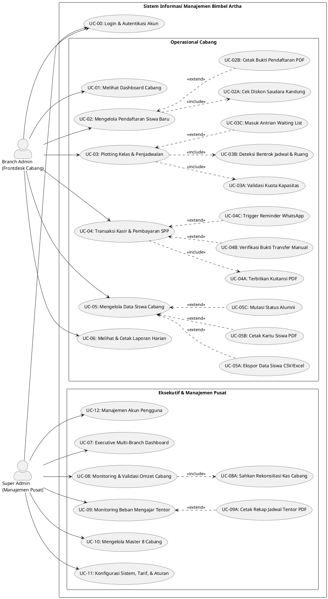

# 📐 PERANCANGAN USE CASE & SKENARIO SISTEM
**Sistem Informasi Manajemen Operasional Terintegrasi Bimbel Artha Balikpapan**  
**Metodologi: Personal Extreme Programming (PxP) — Sprint 0**

---

**Penyusun**: Mahasiswa Tugas Akhir (Institut Teknologi Kalimantan)  
**Mitra Penelitian**: Bimbingan Belajar Artha Balikpapan (8 Cabang Aktif)  
**Dosen Pembimbing**: Pak Arif (Pembimbing 1) & Bu Ayu (Pembimbing 2)  
**Tanggal Dokumen**: Oktober 2026  
**Jumlah Aktor**: 2 Aktor (Branch Admin & Super Admin)  
**Jumlah Use Case Utama**: 13 Use Case (Termasuk Autentikasi) + 11 Sub Use Case (Include / Extend)

---

## 📌 1. Deskripsi Aktor Sistem

Berdasarkan hasil kesepakatan bimbingan ke-3 bersama Pak Arif dan wawancara mitra, sistem dibatasi secara terfokus pada **2 peran (role) aktor**:

| No | Aktor | Karakteristik & Lingkup Akses | Subjek Nyata di Bimbel Artha |
|:--:|:---|:---|:---|
| 1 | **Branch Admin** (Admin Cabang) | Staf operasional/frontdesk yang bertugas di meja pendaftaran dan kasir cabang. Memiliki hak akses penuh pada data operasional cabang tempatnya ditugaskan (`branch_id` spesifik). Tidak dapat melihat atau memanipulasi data cabang lain. | Staf kasir dan admin meja depan di masing-masing cabang Artha 1 s.d. Artha 8. |
| 2 | **Super Admin** (Manajemen Pusat) | Pimpinan dan pengelola keuangan tingkat yayasan/pusat. Memiliki hak akses menyeluruh (*multi-branch access*, `branch_id = NULL`) untuk memantau performa 8 cabang, mengesahkan rekonsiliasi kas, mengatur konfigurasi sistem, dan mengelola akun pengguna. | Ibu Emi Ratnawati, S.E. (Ketua Yayasan), Bapak Miskam Yudianto / Om Tok (Wakil Ketua), dan Bapak Subagio, S.Sos. (Bendahara). |

> **Catatan Aktor**: Sesuai arahan Pak Arif, **Tentor** dan **Wali Murid** sengaja **tidak dijadikan aktor login sistem** (*non-user aktor*). Tentor menerima jadwal fisik dalam format cetak PDF, sedangkan Wali Murid berinteraksi secara pasif melalui kanal pesan WhatsApp Gateway dan kuitansi cetak. Hal ini menjaga sistem tetap sederhana dan ramah adaptasi bagi SDM lembaga.

---

## 📊 2. Diagram Use Case (Use Case Diagram)

### 2.1. Kode Diagram Mermaid (Dapat Ter-render Langsung di Markdown)

```mermaid
flowchart LR
    %% ============================================================
    %% DEFINISI AKTOR
    %% ============================================================
    Admin(["👤 Branch Admin<br/>(Frontdesk Cabang)"])
    SuperAdmin(["👑 Super Admin<br/>(Manajemen Pusat)"])

    %% ============================================================
    %% BOUNDARY SISTEM INFORMASI BIMBEL ARTHA
    %% ============================================================
    subgraph Sistem_Bimbel_Artha ["Sistem Informasi Manajemen Operasional Bimbel Artha"]

        %% Autentikasi
        UC_Auth(["UC-00: Autentikasi Login & Logout"]):::authStyle

        %% Paket Fungsionalitas Admin Cabang
        subgraph Modul_Admin ["Modul Operasional Cabang (Branch Admin)"]
            UC01(["UC-01: Melihat Dashboard Operasional Cabang"])
            UC02(["UC-02: Mengelola Pendaftaran Siswa Baru"])
            UC02A(["UC-02A: Memvalidasi Diskon Saudara Kandung"]):::subStyle
            UC02B(["UC-02B: Mencetak Bukti Registrasi PDF"]):::subStyle

            UC03(["UC-03: Mengelola Plotting Kelas & Jadwal"])
            UC03A(["UC-03A: Memvalidasi Batas Kapasitas Kuota"]):::subStyle
            UC03B(["UC-03B: Mendeteksi Bentrok Jadwal & Ruangan"]):::subStyle
            UC03C(["UC-03C: Mendaftarkan ke Waiting List"]):::subStyle

            UC04(["UC-04: Mengelola Pembayaran Kasir & SPP"])
            UC04A(["UC-04A: Menerbitkan Kuitansi PDF"]):::subStyle
            UC04B(["UC-04B: Memverifikasi Bukti Transfer Manual"]):::subStyle
            UC04C(["UC-04C: Mengirim Reminder WhatsApp"]):::subStyle

            UC05(["UC-05: Mengelola Master Data Siswa Cabang"])
            UC05A(["UC-05A: Mengekspor Data Siswa Excel/CSV"]):::subStyle
            UC05B(["UC-05B: Mencetak Kartu Siswa PDF"]):::subStyle
            UC05C(["UC-05C: Memperbarui Status Alumni"]):::subStyle

            UC06(["UC-06: Melihat & Mencetak Laporan Harian"])
        end

        %% Paket Fungsionalitas Super Admin
        subgraph Modul_SuperAdmin ["Modul Eksekutif & Manajemen Pusat (Super Admin)"]
            UC07(["UC-07: Memantau Executive Multi-Branch Dashboard"])
            UC08(["UC-08: Memonitor & Memvalidasi Revenue 8 Cabang"])
            UC08A(["UC-08A: Mengesahkan Rekonsiliasi Kas"]):::subStyle

            UC09(["UC-09: Memonitor Beban Mengajar Tentor"])
            UC09A(["UC-09A: Mencetak Rekap Jadwal Tentor PDF"]):::subStyle

            UC10(["UC-10: Mengelola Master Data 8 Cabang"])
            UC11(["UC-11: Mengelola Konfigurasi Sistem & Tarif"])
            UC12(["UC-12: Mengelola Akun Pengguna Sistem"])
        end

    end

    %% ============================================================
    %% RELASI ASOSIASI AKTOR KE USE CASE
    %% ============================================================
    Admin --- UC_Auth
    Admin --- UC01
    Admin --- UC02
    Admin --- UC03
    Admin --- UC04
    Admin --- UC05
    Admin --- UC06

    SuperAdmin --- UC_Auth
    SuperAdmin --- UC07
    SuperAdmin --- UC08
    SuperAdmin --- UC09
    SuperAdmin --- UC10
    SuperAdmin --- UC11
    SuperAdmin --- UC12

    %% ============================================================
    %% RELASI INCLUDE & EXTEND
    %% ============================================================
    UC02 -. "<<include>>" .-> UC02A
    UC02 -. "<<extend>>" .-> UC02B

    UC03 -. "<<include>>" .-> UC03A
    UC03 -. "<<include>>" .-> UC03B
    UC03 -. "<<extend>>" .-> UC03C

    UC04 -. "<<include>>" .-> UC04A
    UC04 -. "<<extend>>" .-> UC04B
    UC04 -. "<<extend>>" .-> UC04C

    UC05 -. "<<extend>>" .-> UC05A
    UC05 -. "<<extend>>" .-> UC05B
    UC05 -. "<<extend>>" .-> UC05C

    UC08 -. "<<include>>" .-> UC08A
    UC09 -. "<<extend>>" .-> UC09A

    %% STYLING
    classDef authStyle fill:#fef3c7,stroke:#d97706,stroke-width:2px;
    classDef subStyle fill:#f1f5f9,stroke:#64748b,stroke-dasharray: 5 5;
```

---

### 2.2. Kode Diagram Standar PlantUML (Untuk Export Visual Bab 3)

Bagi penyusunan lembar laporan Word Tugas Akhir, kode di bawah ini dapat di-copy langsung ke alat render PlantUML (seperti PlantText.com) untuk menghasilkan diagram standar OMG UML beresolusi tinggi:

---

## 📝 3. Skenario Use Case Rinci (Use Case Specification)

Bagian ini menyajikan dokumen spesifikasi skenario langkah demi langkah untuk setiap fungsionalitas sistem. Format disusun mengacu pada standar akademik perancangan perangkat lunak Tugas Akhir ITK.

---

### UC-00: Autentikasi Pengguna (Login & Logout)

| Komponen | Penjelasan |
|:---|:---|
| **Kode Use Case** | **UC-00** |
| **Nama Use Case** | Autentikasi Pengguna Sistem (Login & Logout) |
| **Aktor Utama** | Branch Admin, Super Admin |
| **Deskripsi** | Proses verifikasi kredensial pengguna (email dan password) untuk mendapatkan hak akses ke dashboard aplikasi sesuai peran dan cabang masing-masing. |
| **Pre-kondisi** | Pengguna telah memiliki akun terdaftar yang berstatus aktif (`is_active = TRUE`) pada tabel `users`. |
| **Post-kondisi** | Pengguna terautentikasi, sesi tersimpan, dan diarahkan ke dashboard yang sesuai (Dashboard Cabang untuk Admin atau Dashboard Eksekutif untuk Super Admin). |
| **Tabel Terkait** | `users`, `branches` |

#### Alur Normal (Main Success Scenario)
1. Pengguna membuka peramban web dan mengakses tautan `/admin`.
2. Sistem menampilkan antarmuka formulir login (input email dan password).
3. Pengguna memasukkan alamat email dan password yang terdaftar, lalu menekan tombol "Masuk".
4. Sistem memverifikasi kredensial dengan mencocokkan hash password bcrypt di basis data.
5. Sistem memeriksa peran pengguna:
   - Jika peran adalah `branch_admin`, sistem mengunci konteks sesi pada `branch_id` pengguna dan menampilkan Dashboard Cabang (Menu 1.1).
   - Jika peran adalah `super_admin`, sistem membuka akses lintas cabang dan menampilkan Executive Multi-Branch Dashboard (Menu 2.1).
6. Sistem memperbarui waktu terakhir login pada kolom `users.last_login_at`.

#### Alur Alternatif & Pengecualian
* **4a. Email atau Password Salah**:
  1. Sistem menolak autentikasi dan menampilkan pesan peringatan: *"Email atau kata sandi yang Anda masukkan salah."*
  2. Pengguna diminta menginput ulang data yang benar.
* **4b. Akun Berstatus Nonaktif (`is_active = FALSE`)**:
  1. Sistem menolak akses dan menampilkan pesan: *"Akun Anda telah dinonaktifkan oleh administrator pusat. Silakan hubungi manajemen."*

---

### UC-01: Melihat Dashboard Operasional Cabang

| Komponen | Penjelasan |
|:---|:---|
| **Kode Use Case** | **UC-01** |
| **Nama Use Case** | Melihat Dashboard Operasional Cabang |
| **Aktor Utama** | Branch Admin |
| **Deskripsi** | Menampilkan rangkuman statistik harian dan bulanan cabang yang dikelola secara ringkas (total siswa, pendaftar baru, tunggakan SPP, status kapasitas kelas, dan jadwal hari ini). |
| **Pre-kondisi** | Branch Admin berhasil login ke sistem. |
| **Post-kondisi** | Seluruh kartu KPI dan tabel jadwal kelas hari ini terkompilasi dan ditampilkan di layar. |
| **Tabel Terkait** | `students`, `bills`, `classes`, `class_schedules`, `mentors`, `class_rooms` |

#### Alur Normal
1. Admin memilih menu "Dashboard Cabang".
2. Sistem menjalankan kueri agregasi terfilter berdasarkan `branch_id` admin:
   - Menghitung total siswa aktif di cabang (`students.status = 'active'`).
   - Menghitung jumlah pendaftar baru bulan berjalan (`students.registered_at`).
   - Menghitung total siswa yang belum melunasi tagihan SPP bulan ini (`bills.payment_status != 'paid'`).
   - Menghitung rasio kelas penuh versus tersedia.
   - Mengambil daftar sesi les yang berjalan pada hari ini (`class_schedules.day_of_week = hari_ini`).
3. Sistem menampilkan kartu ringkasan KPI dan tabel kelas hari ini lengkap dengan nama tentor, jam, dan ruangan.

---

### UC-02: Mengelola Pendaftaran Siswa Baru

| Komponen | Penjelasan |
|:---|:---|
| **Kode Use Case** | **UC-02** |
| **Nama Use Case** | Mengelola Pendaftaran Siswa Baru (Pengganti Buku Besar A4) |
| **Aktor Utama** | Branch Admin |
| **Deskripsi** | Menginput data siswa baru yang mendaftar secara tatap muka (*walk-in*) ke frontdesk cabang, menghitung tarif les otomatis, menerapkan diskon saudara kandung bila ada, dan mencetak bukti registrasi. |
| **Pre-kondisi** | Admin berada di halaman menu "Pendaftaran Siswa Baru". Tahun ajaran aktif (`academic_years.is_active = TRUE`) telah terdefinisi. |
| **Post-kondisi** | Data siswa tersimpan di tabel `students`, tagihan awal diterbitkan di tabel `bills`, dan nomor registrasi unik diterbitkan. |
| **Tabel Terkait** | `students`, `branches`, `learning_programs`, `fee_tariffs`, `discount_rules`, `bills` |

#### Alur Normal
1. Admin membuka formulir pendaftaran siswa baru.
2. Admin mengisi data identitas siswa: Nama Lengkap, Tempat & Tanggal Lahir, Jenis Kelamin, Nama Wali Murid, Nomor WhatsApp Wali Murid (wajib), Asal Sekolah, Jenjang (SD/SMP/SMA), Tingkat Kelas (1 s.d. 12), dan Alamat/Kelurahan Domisili.
3. Admin memilih Program Belajar (Reguler/Intensif/Paket).
4. Sistem secara otomatis mencari tarif pada tabel `fee_tariffs` sesuai kombinasi tahun ajaran aktif, program, jenjang, dan kelas yang dipilih.
5. **(Include UC-02A)**: Admin memeriksa opsi "Apakah memiliki saudara kandung yang les di Artha?". Jika ya, admin memilih nama saudara kandung, sistem memverifikasi relasi dan menerapkan potongan biaya dari `discount_rules` (potongan Rp 200.000).
6. Sistem menampilkan kalkulasi rincian biaya pendaftaran dan SPP bulan pertama setelah dipotong diskon.
7. Admin menekan tombol "Simpan Pendaftaran".
8. Sistem melakukan validasi isian, meng-generate nomor registrasi unik (`registration_no`), menyimpan data ke tabel `students`, serta menerbitkan tagihan pertama di tabel `bills`.
9. **(Extend UC-02B)**: Sistem menawarkan opsi "Cetak Bukti Pendaftaran". Jika admin memilih tombol tersebut, sistem men-generate dokumen Bukti Pendaftaran resmi berformat PDF untuk diserahkan ke wali murid.

#### Alur Alternatif & Pengecualian
* **8a. Nomor WhatsApp Wali Murid Kosong atau Tidak Valid**:
  1. Sistem memblokir penyimpanan dan memberi penanda merah pada field WhatsApp: *"Nomor WhatsApp wali murid wajib diisi untuk keperluan pengingat tagihan SPP."*
  2. Admin melengkapi nomor WA sebelum menyimpan kembali.

---

### UC-03: Mengelola Plotting Kelas & Penjadwalan

| Komponen | Penjelasan |
|:---|:---|
| **Kode Use Case** | **UC-03** |
| **Nama Use Case** | Mengelola Plotting Kelas dan Penjadwalan Belajar |
| **Aktor Utama** | Branch Admin |
| **Deskripsi** | Memasukkan siswa ke dalam rombongan belajar (rombel), menugaskan tentor dan ruangan pada jadwal sesi, memvalidasi kuota kelas, serta mendeteksi bentrok jadwal. |
| **Pre-kondisi** | Siswa terdaftar aktif di basis data, rombel kelas telah dibentuk, dan tentor tersedia. |
| **Post-kondisi** | Siswa resmi terdaftar di rombel (`class_enrollments.enrollment_status = 'active'`) atau masuk daftar tunggu (`waiting_list`). |
| **Tabel Terkait** | `classes`, `class_enrollments`, `class_schedules`, `capacity_rules`, `mentors`, `mentor_subjects`, `class_rooms` |

#### Alur Normal
1. Admin membuka menu "Plotting Kelas & Jadwal".
2. Admin melihat daftar rombel kelas yang ditampilkan dalam bentuk kartu status visual warna:
   - 🟢 Hijau: Kuota terisi < 80% (`status = 'open'`).
   - 🟡 Kuning: Kuota hampir penuh 80–99% (`status = 'almost_full'`).
   - 🔴 Merah: Kuota penuh 100% (`status = 'full'`).
3. Admin memilih kelas tujuan dan memilih siswa yang akan dimasukkan ke kelas.
4. **(Include UC-03A)**: Sistem mengecek batasan kuota kelas berdasarkan `capacity_rules`:
   - Contoh: SD Kelas 1 dibatasi maksimal 5 siswa (calistung intensif).
   - Jika kuota masih tersedia, sistem mengizinkan penambahan siswa dan memperbarui kolom `classes.current_students`.
5. Saat menjadwalkan sesi les baru (menentukan tentor, ruangan, hari, dan jam):
   - Sistem memfilter daftar tentor berdasarkan kompetensi mapel dari tabel `mentor_subjects`.
   - **(Include UC-03B)**: Sistem menjalankan algoritma deteksi bentrok:
     - Memeriksa apakah tentor yang dipilih telah terjadwal di jam yang sama pada cabang manapun di 8 cabang Artha.
     - Memeriksa apakah ruangan yang dipilih pada cabang ini sedang digunakan oleh kelas lain pada jam yang sama.
   - Jika tidak ada bentrok, jadwal disimpan ke tabel `class_schedules`.

#### Alur Alternatif & Pengecualian
* **4a. Kuota Kelas Penuh (Extend UC-03C)**:
  1. Sistem menolak penambahan siswa ke rombel dan menampilkan dialog: *"Kelas ini telah mencapai kapasitas maksimal pedagogis. Apakah siswa ingin dimasukkan ke Waiting List?"*
  2. Jika Admin menyetujui, sistem mencatat siswa ke tabel `class_enrollments` dengan status `waiting_list` beserta waktu antri (`waiting_since`).
  3. Siswa akan diprioritaskan saat ada siswa lain yang mengundurkan diri atau pindah kelas.
* **5a. Terjadi Bentrok Jadwal Tentor**:
  1. Sistem menolak alokasi jadwal dan memunculkan peringatan merah: *"Bentrok Jadwal: Tentor [Nama] sudah dijadwalkan mengajar di Cabang [Artha X] pada hari [Hari] pukul [Jam]."*
  2. Admin memilih tentor pengganti yang memiliki kualifikasi mata pelajaran yang sama.
* **5b. Terjadi Bentrok Penggunaan Ruangan**:
  1. Sistem memunculkan peringatan: *"Ruangan [Nama Ruang] sudah terpakai oleh Kelas [Nama Kelas Lain] pada slot waktu ini."*
  2. Admin memilih ruangan lain yang masih kosong.

---

### UC-04: Mengelola Pembayaran Kasir & SPP

| Komponen | Penjelasan |
|:---|:---|
| **Kode Use Case** | **UC-04** |
| **Nama Use Case** | Mengelola Pembayaran Kasir dan Manajemen SPP |
| **Aktor Utama** | Branch Admin |
| **Deskripsi** | Melayani pembayaran SPP bulanan atau biaya modul, mencatat metode bayar (tunai, transfer bank manual, QRIS), memverifikasi bukti bayar, menerbitkan kuitansi resmi, dan memantau status pengingat WhatsApp. |
| **Pre-kondisi** | Tagihan siswa telah terbit pada tabel `bills`. |
| **Post-kondisi** | Status tagihan berubah menjadi `paid`, record transaksi tercatat di tabel `payments`, kuitansi ber-nomor unik terbit, dan kuitansi dapat dicetak. |
| **Tabel Terkait** | `bills`, `payments`, `users`, `wa_templates`, `wa_logs` |

#### Alur Normal
1. Admin membuka menu "Kasir & Pembayaran SPP".
2. Admin mengetikkan nama siswa pada kolom autocomplete. Sistem menampilkan riwayat buku besar digital tagihan 12 bulan siswa tersebut.
3. Admin memilih satu atau lebih periode bulan tagihan yang ingin dibayarkan.
4. Sistem mengkalkulasi total nominal yang harus disetor sesuai rincian tarif dasar dan potongan diskon.
5. Admin memilih metode pembayaran:
   - **Tunai (Cash)**: Admin menerima uang fisik di meja kasir.
   - **Transfer Bank / QRIS**: Sistem menampilkan nomor rekening resmi Bimbel Artha kepada wali murid.
6. **(Extend UC-04B)**: Jika pembayaran via Transfer/QRIS, Admin mengunggah foto struk/bukti transfer ke sistem (`proof_image_url`) dan menekan tombol konfirmasi verifikasi.
7. Admin menekan tombol "Proses Pembayaran".
8. Sistem menerbitkan nomor kuitansi unik (`receipt_no`), memperbarui status `bills.payment_status = 'paid'`, dan mencatat ID staf kasir pemverifikasi pada `payments.verified_by_user_id`.
9. **(Include UC-04A)**: Sistem secara otomatis menghasilkan lembar Kuitansi Resmi Pembayaran berformat PDF yang siap dicetak untuk diserahkan ke wali murid.
10. **(Extend UC-04C)**: Secara terjadwal di latar belakang (*background scheduler*), sistem memindai tagihan jatuh tempo dan mengirimkan pesan notifikasi WhatsApp reminder otomatis ke wali murid (H-7 sebelum jatuh tempo, H-1 jelang tempo, dan H+3 keterlambatan), serta mencatat riwayatnya pada tabel `wa_logs`.

#### Alur Alternatif & Pengecualian
* **6a. Bukti Transfer Tidak Cocok / Belum Masuk Rekening**:
  1. Admin menahan proses verifikasi kasir hingga mutasi rekening bank resmi terkonfirmasi.
  2. Status tagihan tetap `unpaid` sampai dana benar-benar valid.

---

### UC-05: Mengelola Master Data Siswa Cabang

| Komponen | Penjelasan |
|:---|:---|
| **Kode Use Case** | **UC-05** |
| **Nama Use Case** | Mengelola Master Data Siswa Cabang |
| **Aktor Utama** | Branch Admin |
| **Deskripsi** | Menampilkan tabel basis data seluruh siswa yang terdaftar di cabang tersebut, melakukan penyaringan (filter), melihat rekam jejak siswa, mengekspor data, mencetak kartu pelajar, dan memperbarui status alumni. |
| **Pre-kondisi** | Admin berada di menu "Data Siswa Cabang". |
| **Post-kondisi** | Informasi profil siswa dapat ditampilkan, diperbarui, diekspor, atau dicetak. |
| **Tabel Terkait** | `students`, `classes`, `class_enrollments`, `bills`, `payments` |

#### Alur Normal
1. Admin membuka halaman "Data Siswa Cabang".
2. Sistem menyajikan tabel data siswa cabang yang memuat kolom: No. Registrasi, Nama Lengkap, Jenjang & Kelas, Rombel/Tentor, Status SPP Bulan Ini, dan Opsi Aksi.
3. Admin dapat menyaring data menggunakan filter: Jenjang (SD/SMP/SMA), Status SPP (Lunas/Belum Lunas/Terlambat), dan Kelas.
4. Admin dapat mengklik salah satu baris siswa untuk melihat profil lengkap, riwayat kelas yang pernah diambil, dan rekapitulasi pembayaran SPP dari awal masuk.
5. **(Extend UC-05A)**: Admin menekan tombol "Ekspor Excel/CSV" untuk mengunduh rekapitulasi siswa ke format spreadsheet.
6. **(Extend UC-05B)**: Admin memilih opsi "Cetak Kartu Siswa" untuk menghasilkan dokumen Kartu Tanda Anggota bimbingan belajar berformat PDF.
7. **(Extend UC-05C)**: Jika siswa telah menyelesaikan masa bimbingan atau lulus sekolah, Admin mengubah status siswa menjadi `alumni` (data tetap dipertahankan di database sebagai arsip historis).

---

### UC-06: Melihat & Mencetak Laporan Harian Cabang

| Komponen | Penjelasan |
|:---|:---|
| **Kode Use Case** | **UC-06** |
| **Nama Use Case** | Melihat dan Mencetak Laporan Harian Cabang |
| **Aktor Utama** | Branch Admin |
| **Deskripsi** | Menyusun rekapitulasi transaksi kasir masuk dan ringkasan aktivitas siswa pada hari/bulan berjalan untuk keperluan pelaporan internal cabang. |
| **Pre-kondisi** | Terdapat transaksi yang terjadi pada periode berjalan. |
| **Post-kondisi** | Laporan harian/bulanan terkompilasi dan dapat diunduh dalam format PDF. |
| **Tabel Terkait** | `payments`, `bills`, `students`, `branches` |

#### Alur Normal
1. Admin memilih menu "Laporan Harian Cabang".
2. Admin menentukan tanggal atau rentang bulan yang ingin dilaporkan.
3. Sistem mengagregasi data pemasukan kasir riil, daftar siswa yang telah melunasi SPP versus yang menunggak, dan rekapitulasi kapasitas kelas terisi.
4. Admin meninjau kesesuaian fisik uang di laci kasir dengan laporan di layar.
5. Admin menekan tombol "Cetak Laporan PDF". Sistem men-generate dokumen resmi laporan harian cabang untuk arsip frontdesk.

---

### UC-07: Memantau Executive Multi-Branch Dashboard

| Komponen | Penjelasan |
|:---|:---|
| **Kode Use Case** | **UC-07** |
| **Nama Use Case** | Memantau Executive Multi-Branch Dashboard |
| **Aktor Utama** | Super Admin (Ibu Emi / Om Tok / Pak Subagio) |
| **Deskripsi** | Menampilkan gambaran kondisi menyeluruh dari 8 cabang Bimbel Artha secara *real-time* dalam satu layar visual terpadu. |
| **Pre-kondisi** | Super Admin berhasil login dengan kredensial pusat. |
| **Post-kondisi** | Seluruh metrik eksekutif, KPI cards, dan grafik analitik ter-render secara interaktif. |
| **Tabel Terkait** | `branches`, `students`, `payments`, `bills`, `classes` |

#### Alur Normal
1. Super Admin membuka halaman utama dashboard sistem.
2. Sistem mengompilasi data dari seluruh 8 cabang dan menampilkan:
   - **Kartu Ringkasan KPI**: Total Siswa Aktif Seluruh Cabang, Total Revenue Bulan Ini (gabungan 8 cabang), Cabang dengan Pendapatan Tertinggi, dan Total Siswa Menunggak.
   - **Grafik Tren Garis (*Line Chart*)**: Tren pemasukan bulanan per cabang sepanjang tahun ajaran berjalan.
   - **Grafik Batang (*Bar Chart*)**: Perbandingan jumlah siswa aktif antar 8 cabang (Artha 1 s.d. Artha 8).
   - **Diagram Donat (*Donut Chart*)**: Proporsi sebaran siswa menurut jenjang pendidikan (SD vs SMP vs SMA).
   - **Tabel Peta Tunggakan (*Heatmap*)**: Visualisasi cabang dan bulan mana yang memiliki persentase tunggakan SPP tertinggi.
3. Super Admin dapat menerapkan filter dinamis: Filter per Cabang tertentu, Filter per Periode Bulan/Tahun, atau Filter per Jenjang.

---

### UC-08: Memonitor & Memvalidasi Rekonsiliasi Revenue Cabang

| Komponen | Penjelasan |
|:---|:---|
| **Kode Use Case** | **UC-08** |
| **Nama Use Case** | Memonitor dan Memvalidasi Rekonsiliasi Revenue 8 Cabang |
| **Aktor Utama** | Super Admin (Bendahara Yayasan: Pak Subagio) |
| **Deskripsi** | Memeriksa detail setoran uang kasir setiap cabang secara harian/bulanan, mencocokkannya dengan mutasi rekening bank pusat, dan memberikan status pengesahan resmi (*validated*). |
| **Pre-kondisi** | Cabang telah mencatatkan transaksi kasir pada periode bersangkutan. |
| **Post-kondisi** | Rekonsiliasi bulanan cabang disahkan (`revenue_validations.validation_status = 'validated'`). |
| **Tabel Terkait** | `revenue_validations`, `branches`, `payments`, `bills`, `users` |

#### Alur Normal
1. Super Admin membuka menu "Monitoring & Validasi Revenue".
2. Sistem menyajikan tabel rekapitulasi 8 cabang dengan kolom: Nama Cabang, Target SPP Bulan Ini (`expected_revenue`), Setoran Riil Kasir (`actual_revenue`), Selisih Kas, Status Validasi, dan Opsi Aksi.
3. Super Admin mengklik salah satu cabang untuk melihat rincian transaksi harian dan membuka foto-foto bukti transfer bank yang diunggah kasir cabang.
4. Super Admin mencocokkan total setoran dengan mutasi rekening koran bank resmi yayasan.
5. **(Include UC-08A)**: Jika angka telah sesuai, Super Admin menekan tombol "Sahkan Validasi". Sistem memperbarui record pada `revenue_validations` menjadi `validation_status = 'validated'`, mencatat ID bendahara pada `validated_by_user_id`, serta membubuhkan timestamp pengesahan.
6. Super Admin dapat mengekspor laporan komparasi omzet 8 cabang ke format spreadsheet atau PDF untuk rapat evaluasi yayasan.

#### Alur Alternatif & Pengecualian
* **4a. Ditemukan Selisih Antara Kasir Cabang dan Rekening Bank**:
  1. Super Admin memilih status `discrepancy` (terdapat selisih) dan menuliskan catatan keterangan pada kolom `revenue_validations.notes`.
  2. Sistem menandai laporan cabang tersebut dengan label merah peringatan untuk diklarifikasi langsung kepada admin cabang bersangkutan pada rapat mingguan.

---

### UC-09: Memonitor Beban Mengajar Tentor Seluruh Cabang

| Komponen | Penjelasan |
|:---|:---|
| **Kode Use Case** | **UC-09** |
| **Nama Use Case** | Memonitor Beban Mengajar Tentor Seluruh Cabang |
| **Aktor Utama** | Super Admin |
| **Deskripsi** | Memvisualisasikan distribusi jam kerja dan jadwal mengajar lebih dari 60 tentor yang tersebar di 8 cabang untuk memastikan pemerataan beban kerja. |
| **Pre-kondisi** | Data jadwal pembelajaran telah terinput di tabel `class_schedules`. |
| **Post-kondisi** | Matriks beban mengajar tentor ditampilkan dengan indikator warna dan dapat dicetak ke format PDF. |
| **Tabel Terkait** | `mentors`, `class_schedules`, `classes`, `branches`, `subjects` |

#### Alur Normal
1. Super Admin membuka menu "Monitoring Beban Tentor".
2. Sistem mengagregasi seluruh slot jadwal mengajar pada `class_schedules` dan menyajikan tabel matriks tentor:
   - Nama Tentor, Cabang Tempat Mengajar, Total Jam Les per Minggu, dan Jumlah Rombel Aktif.
3. Sistem memberi label warna beban kerja secara otomatis:
   - 🟢 Hijau: Beban Normal (1 s.d. 5 kelas per minggu).
   - 🟡 Kuning: Beban Sedang (6 s.d. 8 kelas per minggu).
   - 🔴 Merah: Beban Berlebih (> 8 kelas per minggu, perlu didistribusikan ke tentor lain).
4. Super Admin melihat grafik perbandingan jam mengajar untuk mendeteksi tentor yang kekurangan jam atau kelebihan beban.
5. **(Extend UC-09A)**: Super Admin memilih opsi "Cetak Rekap Jadwal Tentor PDF" untuk mencetak lembar jadwal fisik resmi yang akan dibagikan kepada masing-masing tentor.

---

### UC-10: Mengelola Master Data 8 Cabang

| Komponen | Penjelasan |
|:---|:---|
| **Kode Use Case** | **UC-10** |
| **Nama Use Case** | Mengelola Master Data 8 Cabang (Master Cabang) |
| **Aktor Utama** | Super Admin |
| **Deskripsi** | Menambah, mengedit, atau menonaktifkan data master cabang Artha (Artha 1 s.d. Artha 8), meliputi alamat, nomor kontak WA, jumlah ruang belajar, dan URL tautan peta Google Maps. |
| **Pre-kondisi** | Super Admin memiliki hak akses penuh ke menu Master Cabang. |
| **Post-kondisi** | Data cabang pada tabel `branches` diperbarui dan disinkronkan ke peta lokasi pada Landing Page publik. |
| **Tabel Terkait** | `branches`, `class_rooms` |

#### Alur Normal
1. Super Admin membuka menu "Master Cabang".
2. Sistem menampilkan daftar 8 cabang aktif beserta detail alamat, kapasitas ruangan, kontak WhatsApp, dan status aktif.
3. Super Admin memilih cabang yang ingin disunting, lalu memperbarui nomor telepon WhatsApp, alamat baru, atau tautan Google Maps.
4. Super Admin menekan tombol "Simpan Perubahan".
5. Sistem memvalidasi data dan memperbarui tabel `branches`. Perubahan tautan peta secara otomatis tampil pada halaman publik website.

---

### UC-11: Mengelola Konfigurasi Sistem & Aturan Bisnis

| Komponen | Penjelasan |
|:---|:---|
| **Kode Use Case** | **UC-11** |
| **Nama Use Case** | Mengelola Konfigurasi Sistem, Tarif, dan Aturan Bisnis |
| **Aktor Utama** | Super Admin |
| **Deskripsi** | Mengatur seluruh parameter dinamis sistem tanpa perlu memodifikasi kode program, mencakup master tarif les, aturan diskon, aturan kuota kelas, templat WhatsApp, dan tahun ajaran aktif. |
| **Pre-kondisi** | Super Admin berada di halaman pengaturan konfigurasi sistem. |
| **Post-kondisi** | Konfigurasi parameter pada tabel terkait diperbarui secara aman. |
| **Tabel Terkait** | `fee_tariffs`, `discount_rules`, `capacity_rules`, `wa_templates`, `academic_years`, `learning_programs` |

#### Alur Normal
1. Super Admin membuka menu "Konfigurasi Sistem".
2. Super Admin dapat memilih sub-modul yang ingin dikonfigurasi:
   - **Sub-Modul Tarif Les (`fee_tariffs`)**: Menyesuaikan nominal SPP bulanan atau biaya modul per jenjang/kelas untuk tahun ajaran baru.
   - **Sub-Modul Aturan Diskon (`discount_rules`)**: Menambah atau mengubah nilai potongan diskon saudara kandung (nominal tetap atau persentase).
   - **Sub-Modul Batas Kapasitas (`capacity_rules`)**: Mengubah kuota maksimal per rombel (contoh: batasan calistung SD 1 atau kelas besar SMP).
   - **Sub-Modul Templat WhatsApp (`wa_templates`)**: Mengedit redaksi pesan pengingat tagihan SPP, menyisipkan placeholder dinamis (`{nama_siswa}`, `{nominal}`).
   - **Sub-Modul Tahun Ajaran (`academic_years`)**: Mengaktifkan tahun ajaran baru (Juli–Juni) dan mengarsipkan tahun ajaran sebelumnya.
3. Super Admin menyimpan perubahan. Sistem memvalidasi integritas data dan menerapkan konfigurasi secara global di seluruh cabang.

---

### UC-12: Mengelola Akun Pengguna Sistem

| Komponen | Penjelasan |
|:---|:---|
| **Kode Use Case** | **UC-12** |
| **Nama Use Case** | Mengelola Akun Pengguna Sistem (Manajemen User) |
| **Aktor Utama** | Super Admin |
| **Deskripsi** | Mengelola kredensial akun login untuk seluruh staf Admin yang bertugas di 8 cabang (tambah akun staf baru, mutasi cabang, nonaktifkan akun staf yang resign, dan reset password). |
| **Pre-kondisi** | Super Admin berada di menu manajemen akun pengguna. |
| **Post-kondisi** | Akun pengguna pada tabel `users` dibuat, diperbarui, dinonaktifkan, atau kata sandinya di-reset. |
| **Tabel Terkait** | `users`, `branches` |

#### Alur Normal
1. Super Admin membuka menu "Manajemen Akun Pengguna".
2. Sistem menyajikan daftar seluruh akun staf beserta nama, email, cabang yang dikelola (`branch_id`), peran (`role`), waktu terakhir login, dan status aktif.
3. Super Admin dapat:
   - **Menambah Akun Staf Baru**: Menginput nama staf, email login, memilih cabang penugasan, dan kata sandi sementara.
   - **Menonaktifkan Akun**: Mengubah status `is_active = FALSE` jika ada staf admin cabang yang mengundurkan diri atau diberhentikan (mencegah login tanpa menghapus riwayat transaksi lama).
   - **Reset Kata Sandi**: Menghasilkan kata sandi acak baru apabila admin cabang mengalami kendala lupa password.
4. Sistem mengenkripsi kata sandi baru menggunakan algoritma bcrypt dan menyimpan perubahan ke tabel `users`.

---

## 📋 4. Matriks Keterhubungan Use Case dengan Skema Database (20 Tabel)

Matriks berikut memastikan keterlacakan (*traceability*) 100% antara fungsionalitas sistem yang dimodelkan pada Use Case dengan struktur tabel relasional yang telah disahkan sebelumnya:

| Kode Use Case | Nama Use Case | Aktor | Tabel Basis Data yang Digunakan |
|:---:|:---|:---:|:---|
| **UC-00** | Autentikasi Pengguna (Login/Logout) | Admin, Super Admin | `users`, `branches` |
| **UC-01** | Dashboard Operasional Cabang | Branch Admin | `students`, `bills`, `classes`, `class_schedules`, `mentors`, `class_rooms` |
| **UC-02** | Pendaftaran Siswa Baru | Branch Admin | `students`, `branches`, `learning_programs`, `fee_tariffs`, `discount_rules`, `bills` |
| **UC-03** | Plotting Kelas & Penjadwalan | Branch Admin | `classes`, `class_enrollments`, `class_schedules`, `capacity_rules`, `mentors`, `mentor_subjects`, `class_rooms` |
| **UC-04** | Pembayaran Kasir & SPP | Branch Admin | `bills`, `payments`, `users`, `wa_templates`, `wa_logs` |
| **UC-05** | Master Data Siswa Cabang | Branch Admin | `students`, `classes`, `class_enrollments`, `bills`, `payments` |
| **UC-06** | Laporan Harian Cabang | Branch Admin | `payments`, `bills`, `students`, `branches` |
| **UC-07** | Executive Multi-Branch Dashboard | Super Admin | `branches`, `students`, `payments`, `bills`, `classes` |
| **UC-08** | Monitoring & Validasi Revenue | Super Admin | `revenue_validations`, `branches`, `payments`, `bills`, `users` |
| **UC-09** | Monitoring Beban Mengajar Tentor | Super Admin | `mentors`, `class_schedules`, `classes`, `branches`, `subjects` |
| **UC-10** | Kelola Data 8 Cabang | Super Admin | `branches`, `class_rooms` |
| **UC-11** | Konfigurasi Sistem & Tarif | Super Admin | `fee_tariffs`, `discount_rules`, `capacity_rules`, `wa_templates`, `academic_years`, `learning_programs` |
| **UC-12** | Manajemen Akun Pengguna | Super Admin | `users`, `branches` |

> **Status Integritas**: **20 dari 20 tabel basis data** telah terhubung secara penuh (*fully referenced*) ke dalam fungsionalitas Use Case di atas. Tidak ada entitas tabel yang terisolasi atau mubazir.
