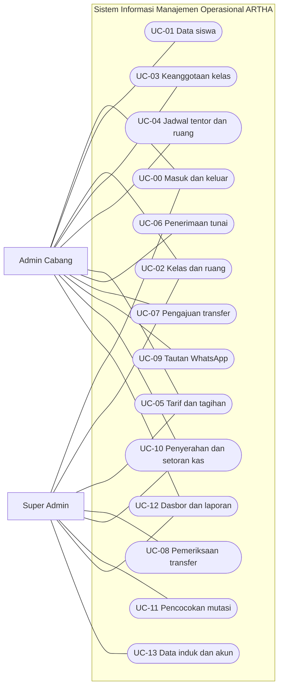
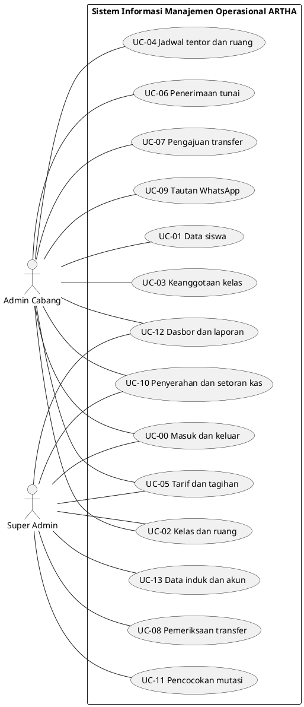

# Perancangan Use Case dan Skenario Sistem ARTHA

Dokumen ini memperbarui rancangan proses sistem informasi manajemen operasional Bimbel Artha Balikpapan pada 25 Oktober 2026. Rancangan digunakan sebagai pendamping Bab 3 dan dasar penyusunan pengujian, sehingga uraian alur belum merupakan laporan keberhasilan implementasi.

## 1. Dasar dan batas rancangan

Model menggunakan dua aktor aplikasi, yaitu Admin Cabang dan Super Admin, untuk mendukung operasional delapan cabang yang menjadi konteks penelitian. Identitas pegawai yang mewakili peran tersebut ditentukan bersama mitra dan tidak langsung diberikan berdasarkan nama seseorang dalam transkrip.

### 1.1 Kedudukan keputusan

| Kode | Dasar atau keputusan | Kedudukan dalam rancangan |
| :--- | :--- | :--- |
| DK-01 | Tombol WhatsApp dengan nomor terdaftar dan pesan tagihan terisi | Acuan pengguna; pengiriman dilakukan Admin Cabang |
| DK-02 | Peringatan hampir penuh, kelas penuh menolak peserta, dan tempat terbuka setelah siswa keluar | Acuan pengguna; batas hampir penuh ditetapkan per kelas setelah validasi |
| DK-03 | Admin mengajukan bukti transfer dan Super Admin memeriksa dana masuk | Usulan pengendalian yang digunakan untuk perancangan; kewenangan rekening dan pemeriksa masih perlu divalidasi |
| DK-04 | Satu penerimaan dapat dialokasikan ke beberapa tagihan satu siswa pada cabang yang sama | Pilihan pemodelan pembayaran beberapa periode; persetujuan proses mitra masih diperlukan |
| DK-05 | Alokasi melunasi sisa setiap tagihan yang dipilih | Batas operasional awal; pembayaran sebagian belum diaktifkan sebelum kebijakannya ditetapkan |
| DK-06 | Satu mutasi dicocokkan dengan satu transfer atau satu setoran kas dengan nominal penuh | Batas prototipe; penggabungan atau pemecahan sumber dicatat sebagai pengecualian |
| DK-07 | Penempatan memerlukan kelas dan jadwal aktif dengan ruangan layak | Usulan operasional untuk mencegah penempatan pada kelompok tanpa ruang belajar yang memenuhi kapasitas |
| DK-08 | Tarif dan potongan mengikuti cabang, sesi, periode, serta ketentuan berwenang | Nominal dan cakupan ditetapkan mitra; tidak mematok potongan Rp200.000 pada semua tagihan |
| DK-09 | Konflik jadwal memberi peringatan untuk ditinjau | Calon jadwal dapat disimpan nonaktif; pengaktifan dengan konflik belum diizinkan sebelum kebijakan mitra ditetapkan |

DK-03 sampai DK-09 merupakan pilihan rancangan yang akan dibahas melalui contoh kasus bersama mitra. Penggunaan pilihan tersebut dalam dokumen tidak berarti mitra telah menyetujui seluruh ketentuannya.

### 1.2 Cakupan

Fungsi inti meliputi siswa, kelas, keanggotaan, jadwal, tarif, tagihan, penerimaan, pengingat manual, rekap, serta pencocokan penerimaan. Daftar tunggu otomatis, WhatsApp terjadwal, akun wali atau tentor, kartu anggota, integrasi halaman publik, dan penyusunan jadwal otomatis berada di luar rancangan inti.

Rekap tunggakan dibedakan dari pencocokan mutasi bank. Pencocokan penerimaan tidak mencakup keseluruhan siklus akuntansi, biaya bank, bunga, pengembalian dana, dan rekonsiliasi seluruh saldo rekening.

### 1.3 Aktor dan akses

| Aktor | Kewenangan | Batas akses |
| :--- | :--- | :--- |
| Admin Cabang | Siswa, keanggotaan, jadwal, tagihan, tunai, pengajuan transfer, pengingat, dan penyerahan kas cabang | Cakupan berasal dari akun sah dan diperiksa peladen pada setiap permintaan |
| Super Admin | Data induk, akun, pemantauan, pemeriksaan transfer, penerimaan setoran, dan pencocokan mutasi | Akses rekening serta petugas pemeriksa ditetapkan mitra; koreksi mempertahankan riwayat |

Peran akun menjadi dasar kewenangan, sedangkan identitas cabang membatasi objek yang dapat diakses. Cabang kosong tidak memberikan hak Super Admin, dan akun cabang tanpa penugasan sah ditolak dari fungsi operasional.

Data tentor digunakan untuk penugasan dan pencegahan konflik jadwal. Nomor wali menjadi tujuan komunikasi manual, sehingga tentor dan wali tidak menjadi aktor yang masuk ke dasbor.

## 2. Katalog dan diagram kasus penggunaan

Empat belas kasus penggunaan disusun menurut tujuan pekerjaan pengguna. Pemeriksaan formulir, kapasitas, dan kewenangan menjadi langkah internal agar diagram tidak dipenuhi subkasus yang tidak mewakili tujuan terpisah.

| Kode | Tujuan pengguna | Aktor utama | Kebutuhan |
| :--- | :--- | :--- | :--- |
| UC-00 | Masuk dan keluar sistem | Kedua peran | KF-01 |
| UC-01 | Mengelola data siswa | Admin Cabang | KF-02 |
| UC-02 | Mengelola kelas dan ruang | Kedua peran sesuai kewenangan | KF-03 |
| UC-03 | Mengelola keanggotaan kelas | Admin Cabang | KF-04 |
| UC-04 | Mengelola jadwal tentor dan ruang | Admin Cabang | KF-05 |
| UC-05 | Mengelola tarif dan menerbitkan tagihan | Super Admin untuk tarif; Admin Cabang untuk tagihan | KF-06 |
| UC-06 | Mencatat penerimaan tunai | Admin Cabang | KF-07 |
| UC-07 | Mengajukan pembayaran transfer | Admin Cabang | KF-08 |
| UC-08 | Memeriksa pembayaran transfer | Super Admin | KF-09 |
| UC-09 | Membuka tautan pengingat WhatsApp | Admin Cabang | KF-10 |
| UC-10 | Menyerahkan, menerima, dan menyetor kas cabang | Kedua peran sesuai tahap | KF-11 |
| UC-11 | Mencocokkan penerimaan dengan mutasi bank | Super Admin | KF-13 |
| UC-12 | Memantau dasbor dan laporan | Kedua peran sesuai cakupan | KF-12 |
| UC-13 | Mengelola data induk dan akun | Super Admin | KF-14 |

### 2.1 Diagram hubungan aktor dan fungsi

Diagram berikut menunjukkan hubungan aktor dengan tujuan pekerjaan. Asosiasi pada kasus gabungan tidak memberikan seluruh tindakan kepada setiap aktor, sehingga rincian kewenangan tetap mengikuti skenario.

### 2.2 Sumber UML untuk laporan

PlantUML berikut mempertahankan katalog dan asosiasi yang sama dengan diagram di atas. Relasi *include* atau *extend* tidak dipaksakan untuk menjadikan setiap pemeriksaan internal sebagai kasus terpisah.

## 3. Skenario terperinci

Setiap skenario memuat tujuan, pelaksana, prakondisi, langkah, alternatif, dan keluaran yang dapat diperiksa. Pengujian turunannya belum dilaksanakan sampai tersedia aplikasi serta bukti pelaksanaan.

### UC-00. Masuk dan keluar sistem

| Unsur | Rancangan |
| :--- | :--- |
| Aktor | Kedua peran |
| Tujuan | Memperoleh sesi sesuai peran dan mengakhirinya. |
| Prakondisi | Akun aktif dengan peran dan penugasan sah. |
| Pascakondisi | Sesi sesuai kewenangan atau sesi telah diakhiri. |
| Data terkait | `users`, `branches`, `activity_logs` |

**Alur utama**

1. Pengguna membuka formulir masuk dan mengisi identitas akun serta kata sandi.
2. Sistem memeriksa kredensial, status akun, peran, dan cabang penugasannya.
3. Sistem membuat sesi dan menampilkan dasbor sesuai peran; waktu masuk dicatat tanpa menyimpan kata sandi asli.
4. Pada setiap permintaan berikutnya, peladen memeriksa sesi dan kewenangan terhadap objek.
5. Pengguna memilih Keluar; sistem mengakhiri sesi dan menolak permintaan berikutnya yang menggunakan sesi tersebut.

**Alur alternatif dan pengecualian**

| Kondisi | Tindakan atau keluaran |
| :--- | :--- |
| Kredensial salah atau akun nonaktif | Akses ditolak dan sesi berwenang tidak diterbitkan. |
| Akun cabang tanpa cabang sah | Fungsi operasional ditolak; cabang kosong tidak mengubah peran menjadi Super Admin. |
| Identitas objek cabang lain dikirim langsung | Peladen menolak dan tidak mengirim isi objek cabang lain. |

**Kriteria penerimaan:** Sesi yang diakhiri tidak dapat digunakan kembali, dan perubahan identitas objek tidak memberikan akses lintas cabang. Kriteria ini menjadi dasar kelompok pemeriksaan pada Bagian 5 dan belum dinyatakan lulus.

### UC-01. Mengelola data siswa

| Unsur | Rancangan |
| :--- | :--- |
| Aktor | Admin Cabang |
| Tujuan | Mencatat dan memperbarui identitas siswa serta kontak wali. |
| Prakondisi | Admin berwenang pada cabang aktif dan tahun pendaftaran tersedia. |
| Pascakondisi | Profil dan riwayat perubahan tersimpan pada cabang yang benar. |
| Data terkait | `students`, `branches`, `academic_years`, `activity_logs` |

**Alur utama**

1. Admin membuka daftar siswa cabangnya dan memilih Tambah Siswa atau rincian yang akan diperbarui.
2. Admin mengisi nama, jenjang TK/SD/SMP/SMA, tingkat sesuai jenjang, sekolah jika relevan, kontak wali, dan data lain yang ditetapkan wajib.
3. Sistem memvalidasi kelengkapan dan kontak; tingkat TK boleh kosong sesuai kamus data dan tidak dipaksa menjadi kelas satu.
4. Admin meninjau lalu menyimpan; sistem menerbitkan nomor registrasi unik untuk siswa baru dan mencatat perubahan.
5. Penonaktifan siswa memerlukan alasan dan penyelesaian atau pengakhiran keanggotaan melalui UC-03; tagihan serta pembayaran historis dipertahankan.

**Alur alternatif dan pengecualian**

| Kondisi | Tindakan atau keluaran |
| :--- | :--- |
| Data wajib tidak lengkap atau nomor tidak valid | Penyimpanan ditolak dengan penjelasan kolom terkait. |
| Kemungkinan siswa ganda | Kandidat ditampilkan untuk diperiksa; nama atau nomor wali sama tidak otomatis berarti siswa sama. |
| Perpindahan cabang | Gunakan koreksi berwenang dengan riwayat; kepemilikan cabang transaksi lama tetap. |

**Kriteria penerimaan:** Semua jenjang didukung, identitas tersimpan sesuai hasil pemeriksaan, dan penonaktifan tidak menghapus transaksi lama. Kriteria ini menjadi dasar kelompok pemeriksaan pada Bagian 5 dan belum dinyatakan lulus.

### UC-02. Mengelola kelas dan ruang

| Unsur | Rancangan |
| :--- | :--- |
| Aktor | Admin Cabang dan Super Admin sesuai kewenangan |
| Tujuan | Menyiapkan kelompok belajar dan ruang dengan kapasitas yang jelas. |
| Prakondisi | Cabang, tahun ajaran, dan parameter kelas telah ditinjau pihak berwenang. |
| Pascakondisi | Kelas serta ruang mempunyai batas kapasitas dan status operasional yang konsisten. |
| Data terkait | `classes`, `class_rooms`, `branches`, `academic_years`, `activity_logs` |

**Alur utama**

1. Super Admin mencatat ruangan cabang, kapasitas fisik, dan status aktif berdasarkan informasi yang diperiksa.
2. Admin Cabang menyiapkan kelas pada cabangnya dengan tahun ajaran, jenjang, sesi, dan nama; batas serta ambang sisa tempat mengikuti ketentuan berwenang.
3. Sistem memeriksa kapasitas positif dan ambang hampir penuh yang sah; penambahan peserta dilakukan terpisah pada UC-03.
4. Sistem menyimpan status operasional aktif/ditutup yang terpisah dari indikator keterisian berdasarkan peserta aktif.
5. Perubahan kapasitas atau ruangan diperiksa terhadap peserta dan semua jadwal aktif; perubahan yang membuat kapasitas tidak layak ditolak.

**Alur alternatif dan pengecualian**

| Kondisi | Tindakan atau keluaran |
| :--- | :--- |
| Batas diturunkan di bawah peserta aktif | Perubahan ditolak sampai peserta ditata ulang dengan riwayat. |
| Ruang lebih kecil dari batas kelas | Jadwal atau perubahan ruang ditolak; pilih ruang layak atau sesuaikan kelas secara sah. |
| Kelas ditutup | Keanggotaan baru ditolak dan riwayat tetap tersedia. |

**Kriteria penerimaan:** Jumlah peserta, kapasitas, sisa tempat, dan label keterisian konsisten tanpa persentase tetap yang belum disepakati. Kriteria ini menjadi dasar kelompok pemeriksaan pada Bagian 5 dan belum dinyatakan lulus.

### UC-03. Mengelola keanggotaan kelas

| Unsur | Rancangan |
| :--- | :--- |
| Aktor | Admin Cabang |
| Tujuan | Menempatkan siswa dan mengakhiri keikutsertaan tanpa menghapus riwayat. |
| Prakondisi | Siswa dan kelas aktif pada cabang yang diizinkan; jadwal aktif memakai ruang yang memenuhi batas kelas. |
| Pascakondisi | Keanggotaan baru aktif atau keanggotaan lama berakhir dengan waktu serta alasan. |
| Data terkait | `students`, `classes`, `class_enrollments`, `class_schedules`, `class_rooms`, `activity_logs` |

**Alur utama**

1. Admin memilih siswa dan kelas tujuan lalu melihat peserta aktif, kapasitas, sisa tempat, serta peringatan hampir penuh.
2. Sistem memeriksa cabang, status siswa/kelas, jadwal aktif, ruang layak, dan ketiadaan keanggotaan aktif ganda.
3. Saat Simpan, sistem menjalankan transaksi serta mengunci kelas melalui mekanisme yang digunakan seluruh jalur perubahan peserta.
4. Sistem menghitung ulang peserta aktif saat penyimpanan; keanggotaan baru dibuat dengan joined_at hanya jika masih ada tempat.
5. Untuk siswa keluar, admin memilih Akhiri Keanggotaan, mengisi ended_at dan end_reason; sistem menghitung kembali sisa tempat.
6. Jika siswa kembali, sistem membuat periode keanggotaan baru setelah pemeriksaan kapasitas diulang.

**Alur alternatif dan pengecualian**

| Kondisi | Tindakan atau keluaran |
| :--- | :--- |
| Kelas penuh | Penambahan ditolak tanpa menambah peserta aktif; pilih kelas lain, tanpa antrean otomatis. |
| Dua admin memperebutkan tempat terakhir | Hanya satu penambahan diterima; permintaan lain memperoleh keterangan kelas penuh. |
| Jadwal atau ruang belum layak | Penempatan ditolak sampai rancangan kelas dilengkapi. |
| Keanggotaan sudah berakhir | Tidak diakhiri atau dikurangi kembali untuk kedua kalinya. |

**Kriteria penerimaan:** Kapasitas tidak terlampaui, siswa keluar membuka satu tempat, dan siswa kembali mempunyai periode riwayat baru. Kriteria ini menjadi dasar kelompok pemeriksaan pada Bagian 5 dan belum dinyatakan lulus.

### UC-04. Mengelola jadwal tentor dan ruang

| Unsur | Rancangan |
| :--- | :--- |
| Aktor | Admin Cabang |
| Tujuan | Menyusun jadwal dengan pemeriksaan konflik tentor, kelas, dan ruangan. |
| Prakondisi | Kelas, tentor, mata pelajaran, dan ruang tersedia serta aktif. |
| Pascakondisi | Jadwal sah menyimpan periode berlaku, hari, jam, pengajar, mata pelajaran, dan ruang. |
| Data terkait | `class_schedules`, `classes`, `class_rooms`, `mentors`, `subjects`, `mentor_subjects`, `activity_logs` |

**Alur utama**

1. Admin memilih kelas, tentor, mata pelajaran sesi, ruang, hari, jam mulai/selesai, serta tanggal awal/akhir berlaku.
2. Sistem memeriksa akhir sesudah awal, periode berlaku, cabang ruang, dan kapasitas ruang sekurang-kurangnya batas kelas.
3. Sistem memeriksa jadwal aktif pada periode relevan untuk tentor lintas cabang, ruang, dan kelas; baris yang diedit dikecualikan.
4. Irisan jam terjadi jika mulai lama lebih awal daripada selesai baru dan selesai lama lebih akhir daripada mulai baru pada hari yang relevan.
5. Calon jadwal dengan konflik dapat disimpan nonaktif untuk peninjauan; jadwal diaktifkan setelah konflik diperbaiki dengan perlindungan permintaan serentak pada tentor/ruang/kelas terkait.

**Alur alternatif dan pengecualian**

| Kondisi | Tindakan atau keluaran |
| :--- | :--- |
| Konflik tentor lintas cabang | Peringatan dan waktu seperlunya ditampilkan tanpa data siswa/keuangan cabang lain; calon jadwal belum aktif sampai ditinjau dan diperbaiki. |
| Konflik ruang atau kelas | Peringatan ditampilkan dan calon jadwal tetap nonaktif sampai waktu atau penugasan diperbaiki. |
| Jadwal nonaktif atau periode berbeda | Tidak menghasilkan konflik palsu. |
| Sunting tanpa perubahan waktu | Tidak berbenturan dengan dirinya sendiri; batas jam bersebelahan diperbolehkan jika tidak ada aturan jeda tambahan. |

**Kriteria penerimaan:** Konflik yang benar memberi peringatan serta menahan aktivasi rancangan, sedangkan jadwal nonaktif, periode berbeda, dan baris sendiri tidak menghasilkan konflik palsu. Kriteria ini menjadi dasar kelompok pemeriksaan pada Bagian 5 dan belum dinyatakan lulus.

### UC-05. Mengelola tarif dan menerbitkan tagihan

| Unsur | Rancangan |
| :--- | :--- |
| Aktor | Super Admin untuk tarif/potongan; Admin Cabang untuk tagihan |
| Tujuan | Menetapkan tarif dan menerbitkan kewajiban siswa per periode. |
| Prakondisi | Siswa, cabang, sesi, tahun ajaran, jenis biaya, serta periode dapat ditentukan. |
| Pascakondisi | Tagihan unik menyimpan nilai historis tarif dan potongan berwenang. |
| Data terkait | `fee_tariffs`, `bills`, `students`, `branches`, `academic_years`, `users`, `activity_logs` |

**Alur utama**

1. Super Admin menetapkan tarif menurut cabang, sesi, program/jenjang, jenis biaya, siklus, masa berlaku, dan nominal.
2. Sistem memeriksa tumpang tindih tarif pada kombinasi yang sama; pemilihan harus menghasilkan satu dasar yang jelas.
3. Admin memilih siswa dan periode; sistem mengambil tarif sah serta menampilkan nilai sebelum dan sesudah penyesuaian.
4. Potongan dicatat berdasarkan persetujuan berwenang beserta nominal, alasan, cakupan, dan periode; potongan tanpa persetujuan tidak diterapkan.
5. Admin memeriksa tanggal jatuh tempo siswa lalu menerbitkan tagihan dengan nilai dasar, potongan, periode, dan cabang historis.
6. Sistem menolak kewajiban ganda; paket semester/tahunan tidak diterbitkan ulang sebagai SPP bulanan.

**Alur alternatif dan pengecualian**

| Kondisi | Tindakan atau keluaran |
| :--- | :--- |
| Tarif tidak ada atau lebih dari satu cocok | Penerbitan ditahan sampai parameter diperbaiki. |
| Potongan melebihi dasar atau belum disahkan | Penyimpanan ditolak; potongan positif memerlukan alasan dan persetujuan. |
| Tarif baru berlaku | Tagihan lama tidak dihitung ulang mengikuti tarif baru. |
| Tanggal jatuh tempo berbeda | Gunakan tanggal pada tagihan, bukan satu tanggal global untuk semua siswa. |

**Kriteria penerimaan:** Tagihan tidak ganda, paket tidak salah berulang, dan perubahan tarif/cabang siswa tidak mengubah nilai atau cabang tagihan lama. Kriteria ini menjadi dasar kelompok pemeriksaan pada Bagian 5 dan belum dinyatakan lulus.

### UC-06. Mencatat penerimaan tunai

| Unsur | Rancangan |
| :--- | :--- |
| Aktor | Admin Cabang |
| Tujuan | Mencatat uang yang benar-benar diterima dan menerbitkan kuitansi. |
| Prakondisi | Tagihan belum lunas milik satu siswa/cabang tersedia dan uang telah diterima. |
| Pascakondisi | Penerimaan recorded, alokasi sah, dan nomor kuitansi unik tersimpan. |
| Data terkait | `payments`, `payment_allocations`, `bills`, `students`, `users`, `activity_logs` |

**Alur utama**

1. Admin memilih siswa dan satu atau beberapa tagihan terbuka pada cabangnya.
2. Sistem menampilkan sisa masing-masing tagihan dan total; alokasi awal harus melunasi sisa setiap tagihan pilihan.
3. Admin menerima uang, mencatat tanggal dan nominal, lalu meninjau rincian sebelum menyimpan.
4. Sistem mengunci tagihan terkait, memeriksa ulang sisa serta kunci permintaan, lalu menyimpan penerimaan recorded dan alokasi dalam satu transaksi.
5. Sistem menerbitkan satu nomor kuitansi; cetak ulang memakai nomor yang sama.
6. Sisa dan rekap tunai diperbarui; penyerahan uang ke pusat dilaksanakan terpisah melalui UC-10.

**Alur alternatif dan pengecualian**

| Kondisi | Tindakan atau keluaran |
| :--- | :--- |
| Nominal tidak sesuai alokasi penuh | Proses ditolak atau tagihan pilihan diubah; cicilan belum diaktifkan sebelum kebijakannya disetujui. |
| Permintaan Simpan diulang | Kembalikan penerimaan yang sama tanpa transaksi/alokasi/kuitansi baru. |
| Tagihan dilunasi petugas lain | Validasi ulang dan tolak transaksi yang menyebabkan kelebihan bayar. |
| Perlu koreksi penerimaan sah | Gunakan koreksi berwenang dengan jejak; jangan menimpa riwayat. |

**Kriteria penerimaan:** Penerimaan dihitung sekali, alokasi sama dengan uang diterima, dan cetak ulang tidak menambah pendapatan. Kriteria ini menjadi dasar kelompok pemeriksaan pada Bagian 5 dan belum dinyatakan lulus.

### UC-07. Mengajukan pembayaran transfer

| Unsur | Rancangan |
| :--- | :--- |
| Aktor | Admin Cabang |
| Tujuan | Menyampaikan bukti transfer agar diperiksa pusat. |
| Prakondisi | Tagihan terbuka tersedia dan rekening resmi penerima ditetapkan. |
| Pascakondisi | Pengajuan submitted terlihat pada antrean tanpa melunasi tagihan. |
| Data terkait | `payments`, `payment_allocations`, `bills`, `students`, `bank_accounts`, `users`, `activity_logs` |

**Alur utama**

1. Admin memilih siswa dan tagihan pada cabangnya serta rekening tujuan resmi.
2. Admin mencatat nominal, tanggal transfer, bukti, serta alokasi pada tagihan pilihan.
3. Sistem memvalidasi kewenangan, berkas, total alokasi penuh, dan identitas permintaan; bukti disimpan privat.
4. Sistem menyimpan pengajuan submitted, pengaju, dan waktu; nominal belum menjadi penerimaan terkonfirmasi dan belum mengurangi sisa.
5. Pengajuan tampil sebagai pemberitahuan pada antrean dasbor Super Admin, tanpa janji pengiriman pesan otomatis.
6. Untuk memperbaiki pengajuan returned, admin membuat pengajuan baru dengan resubmission_of_id; data dan bukti lama dipertahankan.

**Alur alternatif dan pengecualian**

| Kondisi | Tindakan atau keluaran |
| :--- | :--- |
| Bukti tidak terbaca atau format tidak diterima | Ditolak sebelum penyimpanan atau dikembalikan pada UC-08 dengan alasan. |
| Pengajuan aktif identik sudah ada | Peringatkan duplikasi; tombol berulang tidak menggandakan pengajuan. |
| Sisa berubah saat menunggu | Periksa ulang alokasi pada persetujuan dan tolak kelebihan bayar. |

**Kriteria penerimaan:** Pengajuan menunggu terlihat oleh pemeriksa, tidak menghasilkan kuitansi final, dan versi perbaikan merujuk pengajuan lama. Kriteria ini menjadi dasar kelompok pemeriksaan pada Bagian 5 dan belum dinyatakan lulus.

### UC-08. Memeriksa pembayaran transfer

| Unsur | Rancangan |
| :--- | :--- |
| Aktor | Super Admin yang berwenang |
| Tujuan | Membandingkan pengajuan dengan dana masuk dan mengambil keputusan. |
| Prakondisi | Pengajuan submitted tersedia dan pemeriksa berwenang mengakses rekening serta rujukan mutasi. |
| Pascakondisi | Status verified dengan pencocokan sah atau returned dengan alasan dan keputusan tersimpan. |
| Data terkait | `payments`, `payment_reviews`, `payment_allocations`, `bills`, `bank_accounts`, `bank_entries`, `bank_matches`, `users`, `activity_logs` |

**Alur utama**

1. Pemeriksa membuka antrean dan memeriksa siswa, cabang, rekening, tanggal, bukti, serta alokasi pengajuan.
2. Pemeriksa memilih atau mencatat dana masuk dari mutasi yang diizinkan lalu membandingkan rekening serta nominal penuh.
3. Sistem memeriksa mutasi dan sumber belum pernah dicocokkan sesuai UC-11.
4. Jika sesuai, sistem mengunci pengajuan, tagihan, dan mutasi, lalu memeriksa ulang status serta sisa.
5. Sistem menyimpan bank_matches, payment_reviews, status verified, pemeriksa, dan kuitansi dalam satu transaksi; kegagalan satu bagian membatalkan keseluruhan persetujuan.
6. Jika tidak sesuai, pemeriksa memilih Kembalikan dengan alasan; pengajuan menjadi returned dan hanya dapat diperbaiki melalui versi baru.

**Alur alternatif dan pengecualian**

| Kondisi | Tindakan atau keluaran |
| :--- | :--- |
| Dana belum masuk atau bukti berbeda | Kembalikan dengan alasan tanpa pelunasan. |
| Mutasi sudah dipakai atau total tidak cocok | Tolak persetujuan dan catat pengecualian. |
| Persetujuan berulang atau serentak | Simpan satu keputusan efektif dan satu pencocokan tanpa alokasi ganda. |
| Tagihan dilunasi transaksi lain | Tahan persetujuan dan kembalikan pengajuan untuk penyesuaian. |

**Kriteria penerimaan:** Hanya dana terkonfirmasi mengurangi sisa, persetujuan mempunyai mutasi sumber, dan alasan serta versi bukti tetap tersedia. Kriteria ini menjadi dasar kelompok pemeriksaan pada Bagian 5 dan belum dinyatakan lulus.

### UC-09. Membuka tautan pengingat WhatsApp

| Unsur | Rancangan |
| :--- | :--- |
| Aktor | Admin Cabang |
| Tujuan | Membuka pesan penagihan berdasarkan tagihan lewat jatuh tempo. |
| Prakondisi | Tagihan belum lunas melewati jatuh tempo dan kontak wali tersedia. |
| Pascakondisi | Tindakan membuka tautan tercatat; pengiriman dilakukan pengguna pada WhatsApp. |
| Data terkait | `bills`, `payments`, `payment_allocations`, `students`, `reminder_actions`, `users` |

**Alur utama**

1. Admin membuka daftar tagihan lewat jatuh tempo dan memilih siswa.
2. Sistem menghitung sisa dari penerimaan sah serta menyiapkan nomor wali dan pesan berisi nama, periode, sisa, serta jatuh tempo.
3. Admin memeriksa pratinjau dan nomor tujuan dalam format internasional yang sesuai.
4. Admin menekan Buka WhatsApp; sistem menyiapkan tautan dengan pesan dikodekan dan mencatat pelaksana, waktu, nomor, serta salinan pesan.
5. Peramban atau WhatsApp dibuka; admin memeriksa percakapan lalu menekan Kirim di luar ARTHA.
6. ARTHA tetap mencatat tindakan membuka tautan tanpa mengeklaim pesan terkirim, diterima, atau dibaca.

**Alur alternatif dan pengecualian**

| Kondisi | Tindakan atau keluaran |
| :--- | :--- |
| Nomor kosong atau tidak valid | Tautan tidak dibuat sampai kontak diperbaiki berdasarkan informasi yang diperiksa. |
| Tagihan sudah lunas sebelum tindakan | Periksa ulang sisa dan jangan lanjutkan penagihan untuk tagihan lunas. |
| WhatsApp tidak tersedia atau dibatalkan | Tidak ada status terkirim; admin dapat mencoba perangkat sesuai. |

**Kriteria penerimaan:** Nomor, periode, sisa, dan tanggal sesuai tagihan tanpa penjadwal atau status pengiriman otomatis. Kriteria ini menjadi dasar kelompok pemeriksaan pada Bagian 5 dan belum dinyatakan lulus.

### UC-10. Menyerahkan, menerima, dan menyetor kas cabang

| Unsur | Rancangan |
| :--- | :--- |
| Aktor | Admin Cabang untuk penyiapan/penyerahan; Super Admin untuk penerimaan/setoran bank |
| Tujuan | Menelusuri perpindahan kas yang berasal dari penerimaan tunai. |
| Prakondisi | Penerimaan recorded tersedia dan belum terikat kelompok kas lain. |
| Pascakondisi | Kelompok kas merujuk sumber, penyerahan, penerimaan, dan penyetoran tanpa pendapatan ganda. |
| Data terkait | `cash_batches`, `cash_batch_items`, `payments`, `branches`, `bank_accounts`, `users`, `activity_logs` |

**Alur utama**

1. Admin memilih penerimaan tunai cabangnya dan melihat total berdasarkan rincian asal.
2. Sistem menyimpan kelompok draft dengan daftar penerimaan; satu penerimaan tidak boleh terikat pada dua kelompok.
3. Admin mencocokkan uang fisik dan mengajukan penyerahan dengan status submitted.
4. Petugas pusat berwenang memeriksa uang dan mencatat penerima serta waktu sehingga status received.
5. Setelah uang disetor ke bank, pihak berwenang mencatat rekening tujuan, tanggal, nominal, dan bukti sehingga status deposited.
6. Pencocokan mutasi dilakukan pada UC-11; penerimaan pusat dan setoran bank tidak membuat pembayaran siswa baru.

**Alur alternatif dan pengecualian**

| Kondisi | Tindakan atau keluaran |
| :--- | :--- |
| Uang tidak sesuai rincian | Penerimaan pusat belum disahkan; catat klarifikasi tanpa mengubah penerimaan asal. |
| Penerimaan masuk kelompok lain | Pemilihan ditolak agar sumber tidak diserahkan dua kali. |
| Diterima pusat tetapi belum ke bank | Status tetap received, bukan dana bank yang sudah cocok. |
| Draft perlu diperbaiki | Sesuaikan rincian sebelum submitted dengan jejak; setelah diserahkan, perubahan langsung tidak diperbolehkan. |

**Kriteria penerimaan:** Sumber dapat dibuka, penerimaan pusat dibedakan dari dana bank, dan setoran tidak menambah pendapatan. Kriteria ini menjadi dasar kelompok pemeriksaan pada Bagian 5 dan belum dinyatakan lulus.

### UC-11. Mencocokkan penerimaan dengan mutasi bank

| Unsur | Rancangan |
| :--- | :--- |
| Aktor | Super Admin yang berwenang |
| Tujuan | Menghubungkan dana masuk dengan satu sumber tertelusur. |
| Prakondisi | Rekening dan mutasi tersedia; sumber adalah transfer submitted atau kelompok kas deposited. |
| Pascakondisi | Satu mutasi terhubung ke satu sumber penuh, atau pengecualian dicatat tanpa pengesahan. |
| Data terkait | `bank_accounts`, `bank_entries`, `bank_matches`, `payments`, `payment_reviews`, `cash_batches`, `users`, `activity_logs` |

**Alur utama**

1. Pemeriksa membuka mutasi yang dicatat manual dari dokumen yang diizinkan dan memilih satu dana masuk.
2. Pemeriksa memilih tepat satu sumber, yaitu transfer siswa atau setoran kas, bukan keduanya.
3. Sistem membandingkan rekening dan nominal penuh; satu sumber cocok dengan satu mutasi dalam batas prototipe.
4. Sistem memeriksa sumber dan mutasi belum dipakai serta melindungi pemakaian tunggal dengan kendala unik dan transaksi.
5. Pencocokan transfer disimpan bersama keputusan UC-08 secara atomik; kelompok kas hanya dicocokkan setelah received dan deposited ke rekening terkait.
6. Pemeriksa menyimpan rujukan, waktu, dan keterangan; keadaan belum cocok atau pengecualian tetap dapat ditelusuri.

**Alur alternatif dan pengecualian**

| Kondisi | Tindakan atau keluaran |
| :--- | :--- |
| Satu mutasi mencakup banyak sumber atau sebaliknya | Catat pengecualian untuk klarifikasi; jangan diam-diam memecah model satu banding satu. |
| Nominal atau rekening berbeda | Jangan sahkan pencocokan; catat perbedaan. |
| Referensi atau sumber dipakai ulang | Tolak dan tampilkan pasangan lama kepada pemeriksa berwenang. |
| Mutasi bukan dana masuk | Tidak dipakai untuk pelunasan penerimaan dalam lingkup ini. |

**Kriteria penerimaan:** Pencocokan mempunyai satu sumber dan mutasi sah, sedangkan tunggakan tidak dilabeli selisih bank. Kriteria ini menjadi dasar kelompok pemeriksaan pada Bagian 5 dan belum dinyatakan lulus.

### UC-12. Memantau dasbor dan laporan

| Unsur | Rancangan |
| :--- | :--- |
| Aktor | Kedua peran sesuai cakupan |
| Tujuan | Memantau operasional dan menelusuri ringkasan ke sumber. |
| Prakondisi | Akun sah dan periode laporan dipilih, termasuk keadaan tanpa transaksi. |
| Pascakondisi | Ringkasan sesuai filter, status, periode, dan cabang historis. |
| Data terkait | `branches`, `students`, `classes`, `class_enrollments`, `class_schedules`, `mentors`, `bills`, `payments`, `payment_allocations`, `cash_batches`, `bank_entries`, `bank_matches`, `reminder_actions` |

**Alur utama**

1. Admin membuka dasbor cabangnya; Super Admin memilih satu atau seluruh cabang.
2. Pengguna menetapkan tanggal, tahun ajaran, kanal, dan status; sistem menjelaskan dasar periode laporan.
3. Sistem memisahkan siswa, kapasitas, jadwal, tunggakan, antrean transfer, penerimaan terkonfirmasi, posisi kas, dan pencocokan.
4. Pengguna membuka rincian angka ke sumber; submitted dan returned tidak masuk penerimaan terkonfirmasi.
5. Jam tentor dihitung dari durasi penugasan pada periode terpilih tanpa label beban berlebih yang belum disahkan.
6. Rekap dapat dicetak sesuai cakupan; data dimuat saat dibuka atau diperbarui setelah tindakan tanpa klaim pembaruan serentak tanpa pemuatan ulang.

**Alur alternatif dan pengecualian**

| Kondisi | Tindakan atau keluaran |
| :--- | :--- |
| Periode tanpa data | Tampilkan keadaan kosong dan nol sesuai objek, bukan hasil transaksi contoh. |
| Siswa pindah cabang | Laporkan penerimaan historis pada cabang pemilik transaksi asal. |
| Sebagian dan lewat jatuh tempo | Indikator pelunasan dan keterlambatan dapat bersamaan jika kondisi tersedia dari data sah. |
| Tanggal pembayaran berbeda dari periode kewajiban | Tampilkan dasar periode dan jangan mencampur pengertiannya. |

**Kriteria penerimaan:** Ringkasan sesuai sumber, setoran tidak menggandakan pendapatan, dan Admin Cabang tidak memperoleh data cabang lain. Kriteria ini menjadi dasar kelompok pemeriksaan pada Bagian 5 dan belum dinyatakan lulus.

### UC-13. Mengelola data induk dan akun

| Unsur | Rancangan |
| :--- | :--- |
| Aktor | Super Admin |
| Tujuan | Menyiapkan akun, cabang, tahun ajaran, tentor, mata pelajaran, dan rekening. |
| Prakondisi | Pengelola berwenang dan ketentuan data induk telah diperiksa. |
| Pascakondisi | Data induk serta akun tersimpan dengan rujukan sejarah tetap. |
| Data terkait | `academic_years`, `branches`, `users`, `mentors`, `subjects`, `mentor_subjects`, `bank_accounts`, `activity_logs` |

**Alur utama**

1. Pengelola memilih data yang akan ditambah, diperbarui, atau dinonaktifkan.
2. Untuk akun, pengelola menetapkan peran dan cabang sah; perubahan penugasan tidak mengubah pelaksana transaksi lama.
3. Untuk tentor, gunakan satu identitas lintas cabang dan kompetensi mata pelajaran bila dipakai pada penjadwalan.
4. Untuk tahun ajaran, sistem memeriksa tanggal dan satu tahun operasional aktif serta mempertahankan data tahun lalu.
5. Untuk rekening, pengelola mencatat rekening resmi yang disetujui dan membatasi rincian sesuai kewenangan.
6. Sistem memvalidasi ketergantungan dan menyimpan pelaksana perubahan; penonaktifan menghentikan pemakaian baru tanpa memutus sejarah.

**Alur alternatif dan pengecualian**

| Kondisi | Tindakan atau keluaran |
| :--- | :--- |
| Data dirujuk transaksi lama | Tolak penghapusan fisik; gunakan penonaktifan dan pengganti berwenang. |
| Peran cabang tanpa penugasan atau email ganda | Tolak dan perbaiki data. |
| Perubahan merusak jadwal aktif | Tata objek terkait sebelum perubahan diberlakukan. |
| Templat pesan diubah | Versi awal melalui konfigurasi aplikasi oleh pengembang; editor dasbor tidak dijanjikan. |

**Kriteria penerimaan:** Peran menentukan kewenangan, tentor lintas cabang tidak digandakan, dan perubahan penting dapat ditelusuri. Kriteria ini menjadi dasar kelompok pemeriksaan pada Bagian 5 dan belum dinyatakan lulus.

## 4. Aturan lintas proses dan penyimpanan

Aturan berikut berlaku pada seluruh skenario terkait, termasuk permintaan langsung ke layanan. Pemeriksaan tampilan saja tidak cukup untuk menentukan keabsahan perubahan data.

| Kode | Aturan rancangan |
| :--- | :--- |
| AT-01 | Peran dan objek cabang diperiksa peladen; cabang permintaan tidak dipercaya tanpa memeriksa akun |
| AT-02 | Peserta aktif dihitung dari class_enrollments; status operasional kelas dipisahkan dari indikator keterisian |
| AT-03 | Penambahan/pengakhiran peserta dan pembaruan kapasitas memakai transaksi serta penguncian kelas yang konsisten |
| AT-04 | Konflik memeriksa hari, periode, irisan jam, tentor, ruang, dan kelas; baris suntingan dikecualikan dan calon berkonflik tetap nonaktif untuk ditinjau |
| AT-05 | Nominal menggunakan desimal; total alokasi sama dengan penerimaan dan tidak melampaui sisa sah |
| AT-06 | Hanya tunai recorded dan transfer verified mengurangi sisa; submitted/returned belum terkonfirmasi |
| AT-07 | Pelunasan dihitung dari sisa; keterlambatan dari jatuh tempo dan sisa positif |
| AT-08 | Pengajuan yang telah dikirim tidak ditimpa; versi perbaikan merujuk pengajuan lama |
| AT-09 | Persetujuan transfer, mutasi, pemeriksaan, dan kuitansi disimpan atomik |
| AT-10 | Satu penerimaan tunai masuk satu kelompok kas; perpindahan kas tidak menambah pendapatan siswa |
| AT-11 | Cabang historis tagihan/penerimaan tidak berubah mengikuti profil siswa terbaru |
| AT-12 | Nilai tarif dan potongan tagihan dipertahankan; tidak ada potongan global tanpa dasar berwenang |
| AT-13 | Tepat satu sumber per mutasi, yaitu transfer atau kas; nominal dan rekening cocok penuh |
| AT-14 | Tindakan membuka WhatsApp dicatat tanpa klaim terkirim atau diterima |
| AT-15 | Bukti privat diakses melalui pemeriksaan kewenangan, bukan tautan publik bebas |
| AT-16 | Data bersejarah dinonaktifkan atau dikoreksi secara terlacak, bukan dihapus untuk membuka kapasitas |

Templat WhatsApp awal berada pada konfigurasi aplikasi, sedangkan kapasitas dan ambang sisa tempat berada pada data kelas. Potongan aktual berada pada tagihan beserta alasan serta persetujuannya, sehingga rancangan tidak bergantung pada empat tabel konfigurasi yang dihapus.

Pemberitahuan pemeriksaan diperoleh dari antrean pengajuan submitted pada dasbor. Rancangan inti tidak menjanjikan status notifikasi dibaca, surel otomatis, atau pesan WhatsApp otomatis yang membutuhkan mekanisme tambahan.

## 5. Keterlacakan kebutuhan dan pemeriksaan

Matriks menghubungkan kebutuhan, cerita pengguna, kasus penggunaan, data, iterasi, dan kelompok pemeriksaan. PU merupakan kelompok kondisi, sedangkan kasus rinci BB dan lembar tugas UAT dijabarkan dalam dokumen pendamping Bab 3.

| Kebutuhan | Cerita pengguna | Kasus penggunaan | Tabel terkait | Iterasi | Kelompok pemeriksaan |
| :--- | :--- | :--- | :--- | :--- | :--- |
| KF-01 Akses | US-01 | UC-00 | users, branches, activity_logs | I-01 | PU-01; UAT-01 |
| KF-02 Siswa | US-02 | UC-01 | students, branches, academic_years, activity_logs | I-01 | PU-02; UAT-02 |
| KF-03 Kelas dan ruang | US-03 | UC-02 | classes, class_rooms, branches, academic_years, activity_logs | I-01 | PU-03; UAT-03 |
| KF-04 Keanggotaan | US-04 | UC-03 | class_enrollments, classes, students, class_schedules, class_rooms, activity_logs | I-02 | PU-04; UAT-04 |
| KF-05 Jadwal | US-05 | UC-04 | class_schedules, classes, class_rooms, mentors, subjects, mentor_subjects, activity_logs | I-02 | PU-05; UAT-05 |
| KF-06 Tarif dan tagihan | US-06 | UC-05 | fee_tariffs, bills, students, branches, academic_years, users, activity_logs | I-01 | PU-06; UAT-06 |
| KF-07 Tunai | US-07 | UC-06 | payments, payment_allocations, bills, students, users, activity_logs | I-03 | PU-07; UAT-07 |
| KF-08 Pengajuan transfer | US-08 | UC-07 | payments, payment_allocations, bills, students, bank_accounts, users, activity_logs | I-03 | PU-08; UAT-08 |
| KF-09 Pemeriksaan transfer | US-09 | UC-08 | payments, payment_reviews, payment_allocations, bills, bank_accounts, bank_entries, bank_matches, users, activity_logs | I-03 | PU-09; UAT-09 |
| KF-10 WhatsApp manual | US-10 | UC-09 | reminder_actions, bills, students, payments, payment_allocations, users | I-03 | PU-10; UAT-10 |
| KF-11 Kas cabang | US-11 | UC-10 | cash_batches, cash_batch_items, payments, branches, bank_accounts, users, activity_logs | I-04 | PU-11; UAT-11 |
| KF-12 Dasbor dan laporan | US-12 | UC-12 | branches, students, classes, class_enrollments, class_schedules, mentors, bills, payments, payment_allocations, cash_batches, bank_entries, bank_matches, reminder_actions | I-04 | PU-12; UAT-12 |
| KF-13 Pencocokan | US-13 | UC-11 | bank_accounts, bank_entries, bank_matches, payments, payment_reviews, cash_batches, users, activity_logs | I-04 | PU-13; UAT-13 |
| KF-14 Data induk dan akun | US-14 | UC-13 | academic_years, branches, users, mentors, subjects, mentor_subjects, bank_accounts, activity_logs | I-01 | PU-14; UAT-14 |

Dependensi pencocokan minimum untuk UC-08 dikerjakan pada iterasi ketiga bersama pemeriksaan transfer. Penyempurnaan pencocokan kas serta tampilan lintas cabang dilanjutkan pada iterasi keempat, sehingga persetujuan transfer tetap mempunyai mutasi sumber sejak pertama diterapkan.

| Kelompok | Kondisi wajib | Status |
| :--- | :--- | :--- |
| PU-01 | Masuk/keluar, akun nonaktif, penugasan tidak sah, akses objek cabang lain | Belum dilaksanakan |
| PU-02 | Data wajib, TK, siswa ganda, penonaktifan, riwayat cabang | Belum dilaksanakan |
| PU-03 | Kapasitas sah, ambang hampir penuh, ruang terlalu kecil, kelas ditutup | Belum dilaksanakan |
| PU-04 | Tempat terakhir, kelas penuh, permintaan serentak, siswa keluar, masuk kembali | Belum dilaksanakan |
| PU-05 | Konflik lintas cabang, ruang/kelas, edit sendiri, nonaktif, jam bersebelahan | Belum dilaksanakan |
| PU-06 | Tarif cabang/sesi, paket semester/tahun, potongan, anti-duplikasi, nilai historis | Belum dilaksanakan |
| PU-07 | Beberapa tagihan, nominal tidak sesuai, permintaan berulang, cetak ulang | Belum dilaksanakan |
| PU-08 | Bukti privat, submitted belum melunasi, pengajuan ganda, versi perbaikan | Belum dilaksanakan |
| PU-09 | Dana cocok/tidak cocok, alasan returned, persetujuan serentak, kegagalan atomik | Belum dilaksanakan |
| PU-10 | Nomor, pesan, sisa, jatuh tempo, tagihan lunas, batas catatan membuka tautan | Belum dilaksanakan |
| PU-11 | Sumber tunggal, penyerahan, penerimaan pusat, setoran bank, pendapatan tidak ganda | Belum dilaksanakan |
| PU-12 | Filter, keadaan kosong, angka sesuai sumber, cabang historis | Belum dilaksanakan |
| PU-13 | Satu sumber per mutasi, nominal penuh, referensi berulang, pengecualian penggabungan/pemecahan | Belum dilaksanakan |
| PU-14 | Peran/cabang, penonaktifan, tahun aktif, rekening resmi, tentor lintas cabang | Belum dilaksanakan |

Seluruh dua puluh tiga tabel rancangan terhubung dengan setidaknya satu kebutuhan pada matriks ini. Cakupan tersebut menunjukkan hubungan dokumentasi, bukan bukti bahwa skema fisik, aplikasi, atau kebijakan bisnis telah lulus pengujian.

## 6. Hubungan dengan rumusan masalah Bab 1

Pemetaan menggunakan tiga rumusan masalah pada Bab 1 yang tersedia. Rumusan masalah ketiga dievaluasi melalui pengujian dan UAT, sehingga tidak memerlukan tabel operasional khusus bernama penelitian.

| Rumusan masalah | Dukungan rancangan | Bukti yang diperlukan |
| :--- | :--- | :--- |
| RM-1 Integrasi pendaftaran, pembayaran, dan jadwal multicabang | UC-00 sampai UC-09 dan UC-13 | Transaksi lintas modul serta pemeriksaan akses, kapasitas, jadwal, pembayaran |
| RM-2 Pemantauan pusat dan pencocokan penerimaan dengan mutasi | UC-08, UC-10, UC-11, UC-12 | Rekap sesuai sumber, keputusan pemeriksaan, pasangan sumber-mutasi |
| RM-3 Kesesuaian prototipe melalui pengujian dan penerimaan | PU-01 sampai PU-14 dan UAT-01 sampai UAT-14 | Hasil aktual, bukti, catatan peserta, keputusan, dan tindak lanjut |

Bab 1 lama menyebut verifikasi transfer oleh Admin Cabang, sedangkan dokumen ini menggunakan usulan pemeriksaan pusat. Batasan Bab 1 disesuaikan setelah kewenangan rekening dipastikan, bukan dengan menganggap rancangan baru sudah menjadi fakta proses berjalan.

## 7. Peta migrasi rancangan sebelumnya

Kode diperbarui untuk memisahkan tujuan yang sebelumnya bercampur. Peta ini membantu menelusuri gambar dan catatan lama, sehingga nomor terdahulu tidak dipakai bergantian dengan nomor baru tanpa keterangan.

| Kode lama | Rancangan baru | Perubahan |
| :--- | :--- | :--- |
| UC-00 | UC-00 | Alur keluar dan pemeriksaan objek dilengkapi |
| UC-01 | UC-12 | Dasbor sesuai cakupan kedua peran |
| UC-02, UC-02A, UC-02B | UC-01, UC-05 | Identitas terpisah dari tagihan; potongan tidak global; cetak bukti pendukung bila digunakan |
| UC-03, UC-03A, UC-03B | UC-02, UC-03, UC-04 | Kelas, keanggotaan, jadwal terpisah; validasi menjadi langkah |
| UC-03C | Di luar inti | Daftar tunggu/promosi otomatis belum ditetapkan |
| UC-04, UC-04A, UC-04B | UC-05, UC-06, UC-07, UC-08 | Tagihan, tunai, pengajuan, keputusan, kuitansi dibedakan |
| UC-04C | UC-09 | Tautan manual menggantikan pengingat otomatis |
| UC-05, UC-05C | UC-01, UC-03 | Status siswa dan keanggotaan terpisah |
| UC-05A, UC-05B | UC-12; kartu anggota di luar inti | Rekap pendukung tetap sesuai kebutuhan |
| UC-06, UC-07 | UC-12 | Filter dan dasar angka disamakan |
| UC-08, UC-08A | UC-08, UC-10, UC-11 | Verifikasi, kas, dan mutasi terpisah |
| UC-09, UC-09A | UC-04, UC-12 | Durasi tanpa ambang beban yang belum disahkan |
| UC-10 | UC-02, UC-13 | Data cabang/ruang tetap; integrasi publik di luar inti |
| UC-11 | UC-02, UC-05, UC-13 | Pengaturan sesuai penyimpanan tersedia; templat awal melalui konfigurasi |
| UC-12 | UC-13 | Akun dan penugasan terlacak |

Learning_programs, capacity_rules, discount_rules, dan wa_templates tidak lagi dirujuk sebagai tabel yang tersedia. Program menjadi atribut berkode, kapasitas berada pada kelas, potongan aktual pada tagihan, dan redaksi pesan awal pada konfigurasi aplikasi.

## 8. Klarifikasi mitra dan acuan pemeriksaan

| Topik belum final | Pertanyaan | Dampak |
| :--- | :--- | :--- |
| Pemeriksa transfer | Siapa berhak melihat rekening dan mengambil keputusan? | Penetapan pemeriksa dan batasan Bab 1 |
| Pembayaran sebagian | Apakah cicilan diperbolehkan dan untuk biaya apa? | Aturan alokasi dan kuitansi |
| Tarif | Faktor cabang, sesi, program, jenjang, dan periode mana yang berlaku? | Pemilihan tarif dan data uji |
| Potongan | Nominal, pemberi persetujuan, serta sekali atau berulang? | Nilai dan persetujuan pada tagihan |
| Kapasitas | Berapa batas kelas dan ambang sisa tempat? | Kelayakan ruang dan indikator |
| Kas | Siapa penyerah/penerima, bagaimana bukti, dan kapan masuk bank? | Pelaksana serta bukti cash_batches |
| Batas pencocokan | Apakah mutasi sering mencakup beberapa sumber atau sebaliknya? | Kelayakan satu banding satu dan kemungkinan perubahan lingkup |
| Lintas cabang | Apakah siswa boleh lintas cabang dan siapa memutuskan? | Keanggotaan dan riwayat transaksi |

Dasar pemeriksaan tersedia pada [audit kesesuaian sebelumnya](<C:/Users/ARIEL/OneDrive - MSFT/Documents/ARTHA/DOKUMEN MD/AUDIT_KESESUAIAN_2026-10-25/AUDIT KESESUAIAN USE CASE DAN BASIS DATA TERHADAP BAB 1.md>). Lokator wawancara mengenai tarif, diskon, kapasitas, laporan, bukti, dan jatuh tempo tersedia pada penunjuk bukti audit tersebut.

Penyimpanan mengikuti [rancangan basis data yang diperbarui](<C:/Users/ARIEL/OneDrive - MSFT/Documents/ARTHA/DOKUMEN MD/PERANCANGAN BASIS DATA (SKEMA & ERD).md>). Ringkasan kebutuhan, gambar, dan evaluasi ditempatkan pada [Bab 3](<C:/Users/ARIEL/OneDrive - MSFT/Documents/ARTHA/BAB 3 - RANCANGAN PROTOTIPE (DRAF 2026-10-25).md>), sedangkan skenario ini menjadi dokumen pendamping.
