# 📖 Panduan TA dan SITASI - Sistem Informasi ITK 2026

> **Sumber Dokumen**: `Panduan TA dan SITASI - Sistem Informasi ITK 2026.pdf`  
> **Total Halaman**: 91 Halaman  
> **Total Gambar Diekstrak**: 95 Gambar  
> **Catatan**: Seluruh isi teks disajikan secara verbatim (lengkap tanpa penambahan/pengurangan kalimat), terformat rapi per halaman dengan penyisipan gambar dan analisis penjelasannya.

---

## 📄 Halaman 1

i | P a n d u a n  P e l a k s a n a a n  T A  S i s t e m  I n f o r m a s i

### 🖼️ Gambar pada Halaman 1

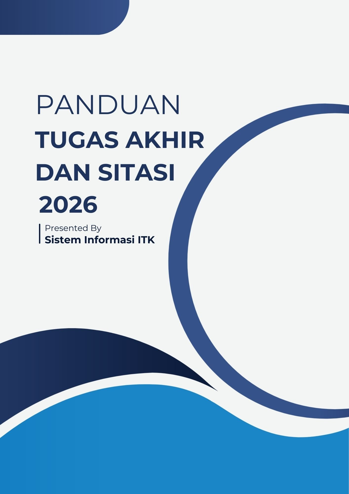

> **📷 Keterangan Gambar**: *Visual/Diagram pada i | P a n d u a n  P e l a k s a n a a n  T A  S i s t e m  I n f o r m a s i* (Dimensi: 1414x2000 px)  
> **🔍 Analisis & Arti Gambar**:  
> Gambar pendukung/ilustrasi visual pada Halaman 1 yang merepresentasikan bagan, panduan antarmuka, formulir, atau materi teknis sesuai konteks bahasan: 'Visual/Diagram pada i | P a n d u a n  P e l a k s a n a a n  T A  S i s t e m  I n f o r m a s i'.

---

## 📄 Halaman 2

ii | P a n d u a n  P e l a k s a n a a n  T A  S i s t e m  I n f o r m a s i  
 
 
Tim Penyusun 
Sri Rahayu Natasia, S.Kom., M.Si., M.Sc. 
Yuyun Tri Wiranti, S.Kom., M.MT. 
Dwi Nur Amalia, S.Kom., M.Kom. 
Aidil Saputra Kirsan, S.ST., M.Tr.Kom. 
Hendy Indrawan Sunardi, S.Kom., M.Eng. 
 
 
Dikeluarkan Oleh 
Program Studi Sistem Informasi 
Fakultas Sains dan Teknologi Informasi 
 
 
Tanggal dan tempat diumumkan untuk pertama kali: 9 Februari 2026 di Kota Balikpapan

---

## 📄 Halaman 3

iii | P a n d u a n  P e l a k s a n a a n  T A  S i s t e m  I n f o r m a s i  
 
KATA PENGANTAR 
 
Puji syukur atas kehadirat Allah SWT atas rahmat dan karunia-Nya sehingga 
kami dapat menyelesaikan buku Panduan Tugas Akhir Program Studi Sistem 
Informasi Institut Teknologi Kalimantan (ITK) yang disusun berdasarkan 
Pedoman Pelaksanaan Tugas Akhir ITK 2025 yang disahkan melalui Keputusan 
Rektor ITK Nomor 6886/IT10/AK.07/2025. 
Pedoman Pelaksanaan Tugas Akhir ITK disusun untuk memberikan panduan 
bagi mahasiswa dalam melaksanakan Tugas Akhir sesuai dengan ketentuan 
yang berlaku di ITK. Dalam dokumen tersebut menetapkan bahwa bentuk Tugas 
Akhir dapat berupa skripsi, proyek, atau prototipe berdasarkan Peraturan 
Akademik ITK Tahun 2024. Pada pelaksanaannya, program studi Sistem 
Informasi ITK memiliki perubahan dan penyesuaian dari pelaksanaan tugas 
akhir, sehingga dibutuhkannya panduan yang dapat sesuai dengan karakteristik 
program studi Sistem Informasi. 
Kami mengucapkan terima kasih kepada pihak-pihak yang terlibat dalam proses 
penyusunan Panduan Tugas Akhir Program Studi Sistem Informasi. 
Panduan ini mulai diimplementasikan pada Semester Genap Tahun Akademik 
2025/2026. Semoga buku panduan ini membawa manfaat. Kritik dan saran yang 
membangun sangat kami harapkan demi sempurnanya panduan ini. 
 
Balikpapan, Januari 2026 
 
 
Tim Penyusun

---

## 📄 Halaman 4

iv | P a n d u a n  P e l a k s a n a a n  T A  S i s t e m  I n f o r m a s i  
 
DAFTAR ISI 
 
KATA PENGANTAR ......................................................................................... iii 
DAFTAR ISI ...................................................................................................... iv 
BAB I KETENTUAN UMUM .............................................................................. 1 
1.1 
Definisi dan Pengertian ....................................................................... 1 
1.2 
Tujuan Tugas Akhir ............................................................................. 2 
1.3 
Fungsi Tugas Akhir ............................................................................. 2 
1.4 
Bentuk Tugas Akhir ............................................................................. 2 
1.4.1 
Skripsi ............................................................................................. 2 
1.4.2 
Proyek ............................................................................................. 3 
1.4.3 
Prototipe .......................................................................................... 3 
1.4.4 
Perbedaan Bentuk Tugas Akhir ....................................................... 4 
1.5 
Mata Kuliah Tugas Akhir ..................................................................... 5 
1.6 
Etika dan Integritas Akademik ............................................................. 5 
BAB II PROSEDUR PELAKSANAAN DAN BIMBINGAN .................................. 7 
2.1 
Garis Besar Pelaksanaan ................................................................... 7 
2.2 
Pra-pelaksanaan Tugas Akhir ............................................................. 8 
2.2.1 
Penentuan Topik dan Pembimbing Tugas Akhir .............................. 8 
2.2.2 
Penyusunan Proposal Tugas Akhir.................................................. 8 
2.2.3 
Pendaftaran Seminar Proposal Tugas Akhir .................................... 9 
2.2.4 
Persiapan Seminar Proposal Tugas Akhir ..................................... 10 
2.2.5 
Pelaksanaan Seminar Proposal Tugas Akhir ................................. 10 
2.2.6 
Revisi Proposal Tugas Akhir.......................................................... 11 
2.3 
Pelaksanaan Tugas Akhir ................................................................. 12 
2.3.1 
Pelaksanaan Tugas Akhir dan Pembimbingan .............................. 12

---

## 📄 Halaman 5

v | P a n d u a n  P e l a k s a n a a n  T A  S i s t e m  I n f o r m a s i  
 
2.3.2 
Penyusunan Laporan Tugas Akhir................................................. 12 
2.3.3 
Pendaftaran Sidang Tugas Akhir ................................................... 13 
2.3.4 
Persiapan Sidang Tugas Akhir ...................................................... 14 
2.3.5 
Pelaksanaan Sidang Tugas Akhir .................................................. 14 
2.4 
Pengumpulan dan Pelaporan Tugas Akhir ........................................ 16 
2.4.1 
Revisi Laporan Tugas Akhir........................................................... 16 
2.4.2 
Penyusunan Artikel Ilmiah dan Draft Hak Cipta/ Desain Industri/ 
Paten 16 
2.4.3 
Pengumpulan Laporan Tugas Akhir .............................................. 17 
2.4.4 
Pengumpulan Laporan Tugas Akhir dan Artikel Ilmiah atau draft Hak 
Cipta/Desain Industri/Paten Digital............................................................. 17 
2.4.5 
Penyelesaian TA ........................................................................... 18 
BAB III DOSEN PEMBIMBING DAN PENILAI................................................. 19 
3.1 
Pembimbing Tugas Akhir .................................................................. 19 
3.1.1 
Ketentuan Pembimbing Tugas Akhir ............................................. 19 
3.1.2 
Tugas dan Kewajiban Pembimbing Tugas Akhir............................ 20 
3.1.3 
Penggantian Pembimbing Tugas Akhir .......................................... 20 
3.2 
Penguji Tugas Akhir .......................................................................... 20 
3.2.1 
Ketentuan Tim Penguji Tugas Akhir .............................................. 20 
3.2.2 
Tugas dan Kewajiban Tim Penguji Tugas Akhir............................. 21 
BAB IV PENILAIAN DAN KONVERSI ............................................................. 22 
4.1 
Ketentuan Umum .............................................................................. 22 
4.2 
Komponen dan Bobot Penilaian ........................................................ 23 
4.3 
Konversi Kegiatan Pembelajaran di Luar Program Studi ................... 24 
BAB V USER MANUAL SITASI ...................................................................... 26 
A. PANDUAN PENGGUNA DOSEN .......................................................... 26 
1. 
Login ................................................................................................. 26

---

## 📄 Halaman 6

vi | P a n d u a n  P e l a k s a n a a n  T A  S i s t e m  I n f o r m a s i  
 
2. 
Menu Dashboard - Dosen ................................................................. 27 
3. 
Menu Profil ........................................................................................ 28 
4. 
Menu Daftar Judul ............................................................................. 30 
5. 
Menu Bimbingan ............................................................................... 32 
6. 
Menu Seminar Proposal.................................................................... 34 
7.1 
Ketika Periode Sempro Tidak Aktif .................................................... 34 
7.2 
Ketika Periode Sempro Aktif ............................................................. 35 
7. 
Menu Sidang TA ............................................................................... 36 
7.1 
Ketika Periode TA Tidak Aktif............................................................ 36 
7.2 
Ketika Periode TA Aktif ..................................................................... 37 
8. 
Pengumuman ................................................................................... 38 
9. 
Menu Prosedur TA ............................................................................ 39 
10. 
Menu Referensi TA ........................................................................... 39 
11. 
Menu Katalog TA .............................................................................. 41 
PANDUAN PENGGUNA MAHASISWA ..................................................... 42 
1. 
Login ................................................................................................. 42 
2. 
Menu Dashboard .............................................................................. 43 
3. 
Menu Profil ........................................................................................ 44 
4. 
Menu Pengajuan Judul ..................................................................... 46 
5. 
Menu Bimbingan ............................................................................... 48 
6. 
Menu Seminar Proposal - Mahasiswa ............................................... 50 
7. 
Menu Sidang TA ............................................................................... 52 
PANDUAN PENGGUNA ADMIN................................................................ 54 
1. 
Menu Periode ................................................................................... 54 
2. 
Periode Sempro ................................................................................ 54 
3. 
Periode TA ........................................................................................ 56

---

## 📄 Halaman 7

vii | P a n d u a n  P e l a k s a n a a n  T A  S i s t e m  I n f o r m a s i  
 
4. 
Menu Jadwal ..................................................................................... 58 
5. 
Jadwal Sempro ................................................................................. 58 
6. 
Jadwal TA ......................................................................................... 61 
7. 
Pengumuman ................................................................................... 64 
Cara Melihat Daftar Pengumuman ............................................................. 64 
Cara Membuat Pengumuman Baru ............................................................ 64 
Cara Mencari Pengumuman ...................................................................... 65 
Cara Memfilter Pengumuman .................................................................... 65 
Cara Mengubah Pengumuman .................................................................. 65 
Cara Menyematkan Pengumuman............................................................. 66 
Cara Menghapus Pengumuman ................................................................ 66 
8. 
Menu Prosedur TA ............................................................................ 66 
9. 
Menu Katalog TA .............................................................................. 68 
Lampiran 1 Rubrik Tugas Akhir ....................................................................... 71 
1. 
Rubrik Penilaian Bentuk Skripsi ........................................................ 71 
A. 
Rubrik Penilaian Seminar Proposal TA ............................................. 71 
B. 
Rubrik Penilaian Sidang TA .............................................................. 73 
2. 
Rubrik Penilaian Bentuk Proyek ........................................................ 76 
A. 
Rubrik Penilaian Seminar Proposal TA ............................................. 76 
B. 
Rubrik Penilaian Sidang TA .............................................................. 78 
3. 
Rubrik Penilaian Bentuk Prototipe ..................................................... 80 
A. 
Rubrik Penilaian Seminar Proposal TA ............................................. 80 
B. 
Rubrik Penilaian Sidang TA .............................................................. 82 
Lampiran 2 Panduan, Template Formulir, Cover, Proposal dan Laporan Tugas 
Akhir ............................................................................................................... 84

---

## 📄 Halaman 8

1 | P a n d u a n  P e l a k s a n a a n  T A  S i s t e m  I n f o r m a s i  
 
BAB I KETENTUAN UMUM 
 
1.1 Definisi dan Pengertian 
a. Tugas Akhir (TA), selanjutnya disebut TA merupakan karya ilmiah yang 
disusun oleh mahasiswa Institut Teknologi Kalimantan (ITK) dalam rangka 
menyelesaikan program studi sarjana yang disertai laporan tertulis dalam 
bentuk naskah akademik. 
b. Calon Peserta TA adalah mahasiswa aktif program studi yang telah 
memenuhi syarat akademik untuk memulai proses penyusunan tugas akhir 
namun belum terdaftar dalam Data Peserta TA. 
c. Peserta TA adalah mahasiswa aktif program studi yang telah terdaftar dalam 
Data Peserta TA. 
d. Data Peserta TA adalah database Peserta TA milik Fakultas yang minimal 
berisi identitas mahasiswa dan statusnya dalam pelaksanaan TA. 
e. Pembimbing TA adalah akademisi dan/atau praktisi yang ditugaskan untuk 
membimbing Peserta TA mahasiswa dalam melaksanakan TA. Pembimbing 
TA terdiri dari Pembimbing Utama dan Pembimbing Pendamping. 
Pembimbing TA juga bertindak sebagai Penguji TA saat Seminar Proposal 
TA dan Sidang TA. 
f. Penguji TA adalah akademisi dan/atau praktisi yang ditugaskan untuk 
melaksanakan penilaian akademik terhadap Peserta TA pada saat Seminar 
Proposal TA atau Sidang TA. Penguji TA terdiri dari Ketua Penguji dan 
Anggota Penguji. 
g. Tim Penguji TA adalah akademisi dan/atau praktisi yang ditugaskan untuk 
melaksanakan pembimbingan dan penilaian akademik terhadap Peserta TA, 
yang terdiri atas Pembimbing TA dan Penguji TA, yang melaksanakan tugas 
pada Seminar Proposal TA dan Sidang TA. 
h. Ketua Penguji adalah Penguji TA yang berkedudukan sebagai Penguji 1, 
yang bertugas memimpin pelaksanaan Seminar Proposal Tugas Akhir atau 
Sidang Tugas Akhir, mengoordinasikan proses pengujian, serta bertanggung

---

## 📄 Halaman 9

2 | P a n d u a n  P e l a k s a n a a n  T A  S i s t e m  I n f o r m a s i  
 
jawab atas ketertiban dan kelancaran pelaksanaan penilaian sesuai dengan 
ketentuan akademik yang berlaku. 
i. Anggota Penguji adalah Penguji TA selain Ketua Penguji yang bertugas 
melaksanakan penilaian akademik, memberikan masukan, pertanyaan, 
saran, dan pertimbangan akademik terhadap Tugas Akhir Peserta sesuai 
dengan bidang keahliannya. 
1.2 Tujuan Tugas Akhir 
a. Mengkaji implikasi pengembangan dan/atau implementasi ilmu pengetahuan 
dan teknologi berdasarkan kaidah, nilai, norma, tata cara, dan etika ilmiah. 
b. Menerapkan pemikiran logis, kritis, sistematis, dan inovatif dalam 
pengembangan dan/atau implementasi ilmu pengetahuan dan teknologi, 
dengan mempertimbangkan nilai-nilai humaniora yang relevan dengan 
bidang keahliannya. 
c. Menunjukkan kinerja secara mandiri, berkualitas, dan terukur dalam 
melaksanakan TA. 
d. Mendokumentasikan, 
menyimpan, 
mengamankan, 
dan 
melakukan 
penelusuran ulang data untuk menjamin keabsahan informasi serta 
mencegah terjadinya plagiarisme. 
1.3 Fungsi Tugas Akhir 
a. Sebagai syarat kelulusan bagi mahasiswa program sarjana 
b. Sebagai bukti kompetensi akademik mahasiswa di bidangnya 
c. Sebagai kontribusi akademik bagi pengembangan ilmu pengetahuan dan 
teknologi 
1.4 Bentuk Tugas Akhir 
a. TA dapat dilakukan dalam bentuk Skripsi, Proyek, atau Prototipe. 
b. TA dapat dilaksanakan secara Individu atau Kelompok. 
c. TA yang dilaksanakan secara Kelompok tetap dinilai secara Individu. 
1.4.1 Skripsi 
Skripsi merupakan Bentuk TA dengan luaran berupa karya tulis ilmiah yang 
disusun melalui proses penelitian yang sistematis. Skripsi dirancang untuk 
memanfaatkan atau mendemonstrasikan penguasaan mahasiswa atas

---

## 📄 Halaman 10

3 | P a n d u a n  P e l a k s a n a a n  T A  S i s t e m  I n f o r m a s i  
 
bidang keahlian program studi atau turunannya. TA dalam bentuk skripsi 
menghasilkan luaran berupa Laporan TA dan Artikel Ilmiah. TA dalam 
bentuk skripsi harus memuat secara jelas hal-hal berikut: 
1. Objek yang akan diteliti. 
2. Permasalahan yang diangkat serta tujuan penelitian. 
3. Metode penelitian yang digunakan. 
4. Hasil penelitian yang dapat dibuktikan secara teoritis, didukung oleh 
penyajian data yang sahih, dan dapat dipertanggungjawabkan. 
5. Kesimpulan dari permasalahan yang diteliti. 
6. Eksplorasi teori yang mendasari penelitian dan analisis 
1.4.2 Proyek 
Proyek merupakan bentuk TA dengan luaran berupa naskah akademik 
yang disusun berdasarkan kegiatan desain, studi kasus, analisis, atau 
penyelesaian masalah berbasis praktik keprofesian. Proyek dirancang 
untuk memanfaatkan atau mendemonstrasikan penguasaan mahasiswa 
atas bidang keahlian program studi atau turunannya. TA dalam bentuk 
proyek menghasilkan luaran berupa Laporan TA dan Artikel Ilmiah. TA 
dalam bentuk proyek harus memuat secara jelas hal-hal berikut: 
1. Objek yang menjadi fokus rancangan, kajian, atau analisis. 
2. Tujuan dan/atau manfaat dari proyek yang dilakukan. 
3. Metodologi yang digunakan dalam proses desain, studi, atau analisis. 
4. Evaluasi terhadap kinerja, kelayakan, atau efektivitas sistem, proses, 
atau kasus yang dikaji. 
5. Luaran berupa dokumen teknis, laporan studi, model desain, atau hasil 
analisis yang dapat dijadikan dasar implementasi atau pengambilan 
keputusan. 
6. Keterlibatan industri atau masyarakat dan/atau kolaborasi dengan mitra 
eksternal program studi. 
7. Kesimpulan mengenai capaian, temuan, dan tingkat keberhasilan atau 
rekomendasi dari proyek. 
1.4.3 Prototipe 
Prototipe merupakan bentuk TA dengan luaran berupa hasil rancang 
bangun perangkat lunak, perangkat keras, atau kombinasi keduanya.

---

## 📄 Halaman 11

4 | P a n d u a n  P e l a k s a n a a n  T A  S i s t e m  I n f o r m a s i  
 
Prototipe dirancang untuk memanfaatkan atau mendemonstrasikan 
penguasaan mahasiswa atas bidang keahlian tertentu dalam program 
studinya. Prototipe harus berada pada Tingkat Kesiapan Teknologi (TKT) 5 
dan bertujuan untuk menghasilkan inovasi teknis untuk menyelesaikan 
permasalahan atau memberikan manfaat. TA dalam bentuk prototipe 
menghasilkan luaran berupa Produk, Laporan TA, dan Artikel Ilmiah. TA 
dalam bentuk prototipe harus memuat secara jelas hal-hal berikut: 
1. Objek yang akan dirancang dan/atau dibangun. 
2. Tujuan dan/atau manfaat dari pengembangan prototipe. 
3. Metodologi perancangan atau rancang bangun. 
4. Pengujian atau evaluasi oleh mitra eksternal atau calon pengguna 
terhadap kinerja dan kelayakan prototipe. 
5. Hasil akhir berupa model fisik, perangkat lunak, atau sistem simulasi. 
6. Fokus utama pada pengembangan inovasi teknis atau produk terapan. 
7. Prototipe yang dihasilkan wajib didaftarkan sebagai Hak Kekayaan 
Intelektual (HKI). 
1.4.4 Perbedaan Bentuk Tugas Akhir 
Aspek 
Skripsi 
Proyek 
Prototipe 
Fokus Masalah Penyelesaian 
masalah melalui 
penelitian ilmiah, 
eksplorasi teori, 
atau 
pengembangan 
metode baru. 
Penyelesaian 
masalah praktis 
melalui 
perancangan 
solusi berbasis 
metode yang 
sudah dikenal. 
Penyelesaian 
masalah dengan 
pengembangan alat, 
sistem, atau 
perangkat untuk 
menguji solusi teknis. 
Pendekatan 
Eksperimen, 
simulasi, atau 
studi literatur 
mendalam. 
Desain, 
implementasi, 
dan evaluasi di 
dunia nyata. 
Pengembangan dan 
pengujian produk 
atau sistem yang 
dibuat/dikembangkan. 
Luaran Wajib 
Naskah 
akademik dan 
artikel ilmiah 
Naskah 
akademik dan 
artikel ilmiah 
Produk nyata dan 
naskah akademik 
(alat, sistem,

---

## 📄 Halaman 12

5 | P a n d u a n  P e l a k s a n a a n  T A  S i s t e m  I n f o r m a s i  
 
Aspek 
Skripsi 
Proyek 
Prototipe 
yang berisi hasil 
riset, analisis, 
dan kesimpulan. 
yang 
menjelaskan 
proses 
perancangan, 
solusi teknis 
dan 
implementasi 
terbatas (jika 
ada). 
software) dan 
dokumen teknis 
lengkap terkait proses 
pembuatan dan hasil 
uji coba. 
 
1.5 Mata Kuliah Tugas Akhir 
1. Mata kuliah (MK) Tugas Akhir diambil melalui SIM Akademik ITK pada saat 
perwalian semester dimana Nilai TA akan dilaporkan. 
2. Syarat mengambil MK Tugas Akhir adalah: 
a. Jumlah SKS lulus ≥ 120 SKS; 
b. Telah menempuh MK Prasyarat dengan nilai minimal C; dan 
c. Syarat lain yang ditentukan program studi (jika ada). 
3. MK Tugas Akhir dapat dibuka dalam bentuk 3 kelas: 
a. Tugas Akhir kelas A merupakan bentuk tugas akhir skripsi 
b. Tugas Akhir kelas B merupakan bentuk tugas akhir proyek 
c. Tugas Akhir kelas C merupakan bentuk tugas akhir prototipe 
1.6 Etika dan Integritas Akademik 
1. Mahasiswa wajib menjunjung tinggi: 
a. Etika akademik, sebagai pedoman moral dalam seluruh proses 
pelaksanaan tugas akhir. 
b. Kaidah keilmuan, yang mencakup pemikiran rasional, sistematis, berbasis 
bukti, serta terbuka terhadap evaluasi dan kritik yang membangun. 
c. Nilai-nilai integritas akademik, yang mencakup kejujuran, kepercayaan, 
keadilan, kehormatan, tanggung jawab, dan keteguhan hati dalam 
melaksanakan setiap tahapan tugas akhir. 
2. TA dilaksanakan untuk memajukan ilmu pengetahuan, meningkatkan 
kesejahteraan, menjaga martabat, dan mendukung peradaban manusia,

---

## 📄 Halaman 13

6 | P a n d u a n  P e l a k s a n a a n  T A  S i s t e m  I n f o r m a s i  
 
serta harus bebas dari praktik yang merugikan atau membahayakan pihak 
mana pun. 
3. ITK melarang segala bentuk kecurangan dalam pelaksanaan tugas akhir. 
4. Pelanggaran terhadap etika, kaidah keilmuan, dan integritas akademik, atau 
kecurangan dalam pelaksanaan TA dikenai sesuai ketentuan yang berlaku.

---

## 📄 Halaman 14

7 | P a n d u a n  P e l a k s a n a a n  T A  S i s t e m  I n f o r m a s i  
 
BAB II PROSEDUR PELAKSANAAN DAN BIMBINGAN 
2.1 Garis Besar Pelaksanaan 
 
Gambar 2. 1 Tahapan Tugas Akhir

### 🖼️ Gambar pada Halaman 14

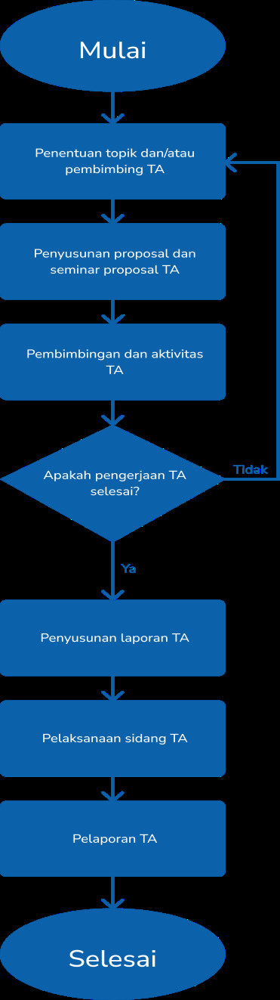

> **📷 Keterangan Gambar**: *Gambar 2. 1 Tahapan Tugas Akhir* (Dimensi: 371x1323 px)  
> **🔍 Analisis & Arti Gambar**:  
> Gambar pendukung/ilustrasi visual pada Halaman 14 yang merepresentasikan bagan, panduan antarmuka, formulir, atau materi teknis sesuai konteks bahasan: 'Gambar 2. 1 Tahapan Tugas Akhir'.

---

## 📄 Halaman 15

8 | P a n d u a n  P e l a k s a n a a n  T A  S i s t e m  I n f o r m a s i  
 
2.2 Pra-pelaksanaan Tugas Akhir 
2.2.1 Penentuan Topik dan Pembimbing Tugas Akhir 
1. Calon Peserta TA berkonsultasi dengan dosen wali atau dosen lain di 
program studinya untuk merencanakan Topik TA dan Pembimbing TA. 
2. Topik TA harus sesuai dengan bidang keilmuan program studi atau 
turunannya. 
3. Pembimbing TA diutamakan yang memiliki kesesuaian bidang 
keahlian dengan Topik TA. 
4. Program studi dapat menentukan dosen Pembimbing TA untuk 
mahasiswanya sesuai kebijaksanaan Koordinator Program Studi. 
5. Calon Peserta TA mendaftarkan diri beserta Topik TA dan 
Pembimbing TA dengan menyerahkan FormTA-01A/B ke Fakultas. 
6. Fakultas melakukan verifikasi data Calon Peserta TA maksimal 5 
(lima) hari kerja sejak FormTA-01A/B diterima. 
7. Calon Peserta TA yang terverifikasi akan dimasukkan dalam Data 
Peserta TA oleh Fakultas dan dapat memulai Penyusunan Proposal 
TA. 
8. Calon Peserta TA yang tidak terverifikasi wajib melengkapi 
kekurangannya. 
9. Dalam hal terjadi perubahan pembimbing TA, peserta TA wajib 
mengajukan kembali FormTA-01A/B ke Fakultas untuk memperbarui 
Data Peserta TA. 
2.2.2 Penyusunan Proposal Tugas Akhir 
1. Proposal TA adalah naskah akademik yang memaparkan rencana 
Pelaksanaan TA termasuk topik dan permasalahan yang diangkat 
sesuai bidang keilmuan Program Studi atau cabang ilmunya. 
2. Proposal TA ditulis sesuai Bentuk TA dan panduan kepenulisan yang 
berlaku. 
3. Peserta TA mendiskusikan topik, permasalahan, dan bentuk TA 
dengan Pembimbing TA. 
4. Peserta TA melakukan studi literatur dan melaksanakan proses 
penyusunan Proposal TA dalam bimbingan Pembimbing TA.

---

## 📄 Halaman 16

9 | P a n d u a n  P e l a k s a n a a n  T A  S i s t e m  I n f o r m a s i  
 
5. Proposal TA yang sudah selesai dan disetujui oleh Pembimbing TA 
dapat digunakan untuk mendaftar Seminar Proposal TA. 
2.2.3 Pendaftaran Seminar Proposal Tugas Akhir 
1. Seminar Proposal TA adalah forum akademik yang diselenggarakan 
untuk menguji kelayakan rencana dan memperoleh masukan sebelum 
Pelaksanaan TA. 
2. Syarat mendaftar Seminar Proposal TA adalah: 
a. Terdaftar sebagai Peserta TA dalam Data Peserta MK Proposal 
TA; 
b. Disetujui untuk melaksanakan Seminar Proposal TA oleh 
Pembimbing TA; dan 
c. Memenuhi syarat khusus yang ditentukan Fakultas/ Jurusan/ 
Program Studi jika ada. 
3. Peserta TA mendaftar Seminar Proposal TA dengan menyerahkan 
lampiran berikut: 
a. FormTA-01A atau FormTA-01B; 
b. FormTA-02; 
c. FormTA-03D terisi sebanyak 3 lembar; 
d. FormTA-04 dengan minimal terisi 5 kali sesi bimbingan; 
e. Salinan digital Proposal TA; 
f. Hasil pemeriksaan plagiarisme; dan 
g. Syarat khusus yang ditentukan Fakultas/ Jurusan/ Program Studi 
jika ada 
4. Fakultas melakukan verifikasi maksimal 5 (lima) hari kerja sejak 
pendaftaran diterima. 
5. Peserta TA yang tidak terverifikasi wajib melengkapi kekurangannya. 
6. Peserta TA yang terverifikasi akan masuk dalam proses penjadwalan 
Seminar Proposal TA. 
7. Koordinator Program Studi melakukan penjadwalan Seminar Proposal 
TA. 
8. Koordinator Program Studi mengumumkan jadwal Seminar Proposal 
TA.

---

## 📄 Halaman 17

10 | P a n d u a n  P e l a k s a n a a n  T A  S i s t e m  I n f o r m a s i  
 
2.2.4 Persiapan Seminar Proposal Tugas Akhir 
1. Peserta TA mengundang Penguji TA selambat-lambatnya 3 (tiga) hari 
kerja 
sebelum 
Seminar 
Proposal 
TA 
dilaksanakan 
dengan 
melampirkan hasil cetak (print-out) dan digital Proposal TA yang 
disetujui oleh Pembimbing TA untuk masing-masing Penguji TA. 
2. Peserta TA menyiapkan pemaparan Seminar Proposal TA untuk 
durasi 15 menit. 
3. Peserta TA menyiapkan peralatan mencatat dan FormTA-03C. 
4. Peserta TA mengundang audiens sebanyak minimal 10 orang. 
5. Peserta TA menyiapkan diri untuk menjalani Seminar Proposal TA. 
6. Peserta TA juga dapat menyiapkan hal-hal lain yang belum tersedia di 
ruangan Seminar Proposal TA untuk menunjang pemaparannya 
dengan sepengetahuan Pembimbing TA. 
2.2.5 Pelaksanaan Seminar Proposal Tugas Akhir 
1. Seminar Proposal TA dilakukan secara terbuka dan tertutup untuk 
Civitas Akademika ITK. 
2. Seminar Proposal TA dapat dimulai dengan syarat: 
a. Peserta TA siap melaksanakan Seminar Proposal TA; 
b. Tim Penguji TA siap menguji Seminar Proposal TA; dan 
c. Audiens yang hadir sebanyak minimal 10 orang siap berpartisipasi. 
3. Audiens tidak boleh masuk dan keluar ruangan ketika Seminar 
Proposal TA sudah dimulai. 
4. Rangkaian Seminar Proposal TA terdiri dari: 
a. Pembukaan oleh Ketua Penguji/ Penguji 1. 
b. Pemaparan oleh Peserta TA selama 15 menit. 
c. Sesi tanya jawab secara terbuka dengan audiens dimoderatori oleh 
Ketua Penguji. 
d. Sesi tanya jawab secara tertutup dengan Tim Penguji dimoderatori 
oleh Ketua Penguji. 
e. Penutup oleh Ketua Penguji. 
f. Total durasi kegiatan Seminar Proposal TA ditentukan oleh 
Program Studi pada saat penjadwalan. 
5. Penguji TA dalam menguji Seminar Proposal TA bertugas untuk:

---

## 📄 Halaman 18

11 | P a n d u a n  P e l a k s a n a a n  T A  S i s t e m  I n f o r m a s i  
 
a. Memastikan topik dan permasalahan yang diusulkan sesuai 
dengan bidang keilmuan Program Studi atau turunannya; 
b. Memastikan rencana Pelaksanaan TA yang diusulkan layak dan 
dapat diterapkan; 
c. Memastikan rencana Pelaksanaan TA yang diusulkan selaras 
dengan capaian pembelajaran yang diharapkan Program Studi; 
d. Memberikan rekomendasi terhadap Proposal TA yang diajukan; 
e. Memberikan 
penilaian 
akademik 
terhadap 
Proposal 
TA, 
pemahaman, dan performa Peserta TA; dan 
f. Memutuskan hasil Seminar Proposal Tugas Akhir. 
6. Performa Peserta TA dalam Seminar Proposal TA menjadi 
pertimbangan Penguji TA dalam: 
a. Menyetujui Proposal TA yang diajukan; dan 
b. Memberikan nilai Seminar Proposal TA. 
7. Hasil dari Seminar Proposal TA adalah 
a. Nilai Seminar Proposal TA; dan 
b. Keterangan "Diterima" atau "Tidak diterima". 
8. Proposal TA mendapatkan hasil "Tidak disetujui" apabila: 
a. Topik tidak sesuai dengan bidang keilmuan Program Studi atau 
turunannya; 
b. Kegiatan tidak sesuai dengan capaian pembelajaran yang 
diharapkan Program Studi; 
c. Mendapatkan nilai huruf D atau E; atau 
d. Hal lain yang mengharuskan Peserta TA untuk mengganti topik TA 
nya. 
9. Peserta TA dengan Proposal TA yang “Tidak disetujui” wajib 
mengulang pendaftaran Seminar Proposal TA dengan Proposal TA 
yang telah diperbarui. 
10. Fakultas memperbarui Data Peserta TA setelah Seminar Proposal TA 
dilaksanakan 
2.2.6 Revisi Proposal Tugas Akhir 
1. Peserta TA yang dinyatakan Diterima dengan revisi, wajib melakukan 
Revisi Proposal TA sesuai dengan catatan dan rekomendasi saat

---

## 📄 Halaman 19

12 | P a n d u a n  P e l a k s a n a a n  T A  S i s t e m  I n f o r m a s i  
 
Seminar Proposal TA dalam waktu 20 hari kerja setelah Seminar 
Proposal TA dilaksanakan. 
2. Revisi Proposal TA disusun sesuai  
2.3 Pelaksanaan Tugas Akhir 
2.3.1 Pelaksanaan Tugas Akhir dan Pembimbingan 
1. Peserta TA melaksanakan TA dengan menjunjung tinggi etika, kaidah 
ilmiah, integritas akademik, serta melawan segala bentuk kecurangan. 
2. Peserta TA melaksanakan TA sesuai dengan topik dan permasalahan 
yang disetujui dalam Seminar Proposal TA serta memperhatikan 
rekomendasi. 
3. Peserta TA melaksanakan TA dalam bimbingan Pembimbing TA. 
4. Peserta TA mengisi FormTA-04 setiap mengikuti sesi bimbingan 
dengan Pembimbing TA. 
5. Peserta TA wajib mengikuti sesi bimbingan dengan Pembimbing TA 
minimal 10 kali dihitung setelah Proposal TA “Disetujui” pada Seminar 
Proposal TA 
6. Sesi bimbingan dengan jadwal bebas atau ditentukan oleh 
Pembimbing TA. 
7. Peserta TA dan Pembimbing TA mengutamakan kegiatan bimbingan 
yang dilakukan secara tatap muka. 
2.3.2 Penyusunan Laporan Tugas Akhir 
1. Laporan TA adalah naskah akademik yang menyajikan hasil lengkap 
Pelaksanaan TA. 
2. Laporan TA disusun sesuai panduan penulisan yang berlaku. 
3. Laporan 
TA 
disusun 
dengan 
mempertahankan 
topik 
dan 
permasalahan yang disetujui saat Seminar Proposal TA. Pembimbing 
TA / Ketua Penguji TA / Koordinator Program Studi dapat mewajibkan 
Peserta TA untuk mengulang Seminar Proposal TA jika ditemukan 
terdapat perubahan Topik atau Permasalahan secara substantif. 
4. Laporan TA disusun oleh Peserta TA berdasarkan hasil pelaksanaan 
yang telah dilakukan.

---

## 📄 Halaman 20

13 | P a n d u a n  P e l a k s a n a a n  T A  S i s t e m  I n f o r m a s i  
 
2.3.3 Pendaftaran Sidang Tugas Akhir 
1. Sidang TA adalah forum akademik yang diselenggarakan untuk 
menguji dan menilai hasil akhir pelaksanaan tugas akhir dan 
kemampuan Peserta TA dalam mempertahankan hasil karyanya 
secara ilmiah. 
2. Syarat mendaftar Sidang TA adalah: 
a. Memenuhi syarat mengambil MK Tugas Akhir; 
b. Disetujui untuk melaksanakan Sidang TA oleh Pembimbing TA; 
dan 
c. Memenuhi syarat khusus yang ditentukan Fakultas/ Jurusan/ 
Program Studi jika ada. 
3. Peserta TA mendaftar Sidang TA dengan menyerahkan lampiran 
berikut: 
a. Lembar Persetujuan Revisi Proposal TA; 
b. FormTA-04 dengan minimal terisi 5 kali sesi bimbingan setelah 
revisi Proposal TA disetujui; 
c. FormTA-05; 
d. Salinan digital Laporan TA; 
e. Hasil pemeriksaan plagiarisme; dan 
f. Syarat khusus yang ditentukan Fakultas/Jurusan/Program Studi 
jika ada. 
4. Fakultas melakukan verifikasi maksimal 5 (lima) hari kerja sejak 
pendaftaran diterima. 
5. Peserta TA yang tidak terverifikasi wajib melengkapi kekurangannya. 
6. Peserta TA yang terverifikasi akan masuk dalam proses penjadwalan 
Sidang TA. 
7. Koordinator Program Studi melakukan penjadwalan Sidang TA. 
8. Koordinator Program Studi mengumumkan jadwal Sidang TA. 
9. Ketentuan penjadwalan Sidang TA adalah sebagai berikut: 
a. paling cepat 14 minggu sejak Seminar Proposal TA; dan 
b. paling lambat 45 minggu sejak Seminar Proposal TA 
10. Mahasiswa yang tidak melaksanakan Sidang TA dalam batas waktu 
yang ditentukan, dinyatakan Tidak Lulus dan wajib mengulang seluruh 
tahap pelaksanaan tugas akhir.

---

## 📄 Halaman 21

14 | P a n d u a n  P e l a k s a n a a n  T A  S i s t e m  I n f o r m a s i  
 
2.3.4 Persiapan Sidang Tugas Akhir 
1. Peserta TA mengundang Penguji TA selambat-lambatnya 3 (tiga) hari 
kerja sebelum Sidang TA dilaksanakan dengan melampirkan hasil 
cetak (print-out) dan salinan digital Laporan TA yang disetujui oleh 
Pembimbing TA untuk masing-masing Penguji TA. 
2. Peserta TA menyiapkan pemaparan Sidang TA untuk durasi 15 menit. 
3. Peserta TA menyiapkan peralatan mencatat. 
4. Peserta TA menyiapkan diri untuk menjalani Sidang TA. 
5. Peserta TA juga dapat menyiapkan hal-hal lain yang belum tersedia di 
ruangan Sidang TA untuk menunjang pemaparannya dengan 
sepengetahuan Pembimbing TA. 
2.3.5 Pelaksanaan Sidang Tugas Akhir 
1. Sidang TA dilakukan secara tertutup. 
2. Peserta TA wajib mematuhi aturan pakaian Sidang TA sebagai berikut: 
a. Pria: kemeja lengan panjang polos rapi, dasi, celana kain berwarna 
gelap, ikat pinggang, sepatu tertutup dengan kaos kaki, serta 
menjaga kerapian rambut. 
b. Wanita: kemeja atau blus lengan panjang polos rapi, rok atau 
celana kain panjang kain berwarna gelap, sepatu tertutup dengan 
kaos kaki, serta menjaga kerapian rambut. Bagi yang berhijab, 
wajib menggunakan hijab dengan warna polos. 
3. Sidang TA dapat dimulai dengan syarat: 
a. Peserta TA siap melaksanakan Sidang TA; dan 
b. Tim Penguji TA siap menguji Sidang TA. 
4. Rangkaian Sidang TA terdiri dari: 
5. Penguji TA dalam menguji Sidang TA bertugas untuk: 
a. Memeriksa kesesuaian substansi Tugas Akhir dengan bidang 
keilmuan program studi atau turunannya. 
b. Menilai kelayakan ilmiah, keaslian, dan kontribusi hasil penelitian 
terhadap pengembangan ilmu atau aplikasi di bidang terkait; 
c. Menguji pemahaman mahasiswa terhadap teori, metode, hasil, dan 
pembahasan penelitian melalui tanya jawab; 
d. Menilai ketercapaian capaian pembelajaran yang diharapkan 
Program Studi;

---

## 📄 Halaman 22

15 | P a n d u a n  P e l a k s a n a a n  T A  S i s t e m  I n f o r m a s i  
 
e. Memberikan rekomendasi terhadap Laporan TA yang diajukan; 
f. Memberikan 
penilaian 
akademik 
terhadap 
Laporan 
TA, 
pemahaman, dan performa Peserta TA; dan 
g. Memutuskan hasil Sidang Tugas Akhir. 
6. Performa Peserta TA dalam Sidang TA menjadi pertimbangan Penguji 
TA dalam: 
a. Memberikan nilai Sidang TA; dan 
b. Menentukan kelulusan Peserta TA. 
7. Hasil dari Sidang TA adalah: 
a. Nilai Sidang TA; dan 
b. Keterangan "Lulus" atau "Tidak Lulus". 
8. Peserta TA yang dinyatakan "Lulus" wajib: 
a. Melakukan revisi Laporan TA sesuai dengan catatan saat Sidang 
TA; dan 
b. Menyusun Artikel Ilmiah untuk bentuk skripsi dan proyek, dan draft 
Hak Cipta/Desain Industri/Paten untuk bentuk prototipe. 
9. Peserta TA dinyatakan "Tidak lulus" apabila: 
a. Topik tidak sesuai dengan bidang keilmuan Program Studi atau 
turunannya; 
b. Peserta TA tidak menunjukkan kelayakan ilmiah, keaslian, atau 
kontribusi hasil penelitian yang cukup terhadap pengembangan 
ilmu atau aplikasi di bidang terkait; 
c. Peserta TA tidak menunjukkan pemahaman yang cukup terhadap 
teori, metode, hasil, dan pembahasan penelitian; 
d. Peserta TA tidak menunjukkan kemampuan yang cukup dalam 
menyajikan dan mempertahankan argumen secara ilmiah, baik 
secara lisan maupun tertulis; 
e. Peserta TA tidak menunjukkan ketercapaian capaian pembelajaran 
yang diharapkan Program Studi; 
f. Peserta TA mendapatkan nilai Sidang TA dengan grade D atau E; 
atau 
g. Hal lain yang mengharuskan Peserta TA untuk mengulangi 
kegiatan TA. 
10. Peserta TA dengan Proposal TA yang “Tidak lulus” wajib mengulang 
Sidang TA dengan jadwal pelaksanaan ditentukan oleh tim penguji TA.

---

## 📄 Halaman 23

16 | P a n d u a n  P e l a k s a n a a n  T A  S i s t e m  I n f o r m a s i  
 
2.4 Pengumpulan dan Pelaporan Tugas Akhir 
2.4.1 Revisi Laporan Tugas Akhir 
1. Peserta TA yang dinyatakan Lulus Sidang TA wajib melakukan Revisi 
Laporan TA sesuai dengan catatan dan rekomendasi saat Sidang TA. 
2. Revisi Laporan TA disusun sesuai panduan penulisan yang berlaku 
untuk Laporan TA. 
3. Nilai mata kuliah tugas akhir Peserta TA diunggah setelah Revisi 
Laporan TA diselesaikan. Jika mahasiswa tidak menyelesaikan revisi 
TA sampai dengan batas akhir input nilai mata kuliah tugas akhir, maka 
mahasiswa wajib mengambil ulang mata kuliah tugas akhir pada 
semester berikutnya. 
4. Revisi Laporan TA disusun dalam bimbingan Pembimbing TA. 
5. Revisi Laporan TA wajib disetujui oleh Penguji TA. 
6. Revisi Laporan TA wajib menghasilkan Laporan TA (bagian isi) dengan 
nilai kesamaan (similarity score) maksimal 25%. 
7. Peserta TA mengajukan pengukuran nilai kesamaan sesuai prosedur 
yang ditentukan oleh Fakultas. 
8. Revisi Laporan TA dijilid softcover sebanyak 1 (satu) rangkap dan 
hardcover sebanyak 1 (satu) rangkap serta wajib ditandatangani oleh 
Tim Penguji. 
9. Revisi Laporan TA dapat disimpan dalam bentuk digital oleh 
Peserta TA. 
2.4.2 Penyusunan Artikel Ilmiah dan Draft Hak Cipta/ Desain Industri/ 
Paten 
1. Peserta TA yang dinyatakan Lulus Sidang TA wajib menyusun Artikel 
Ilmiah untuk bentuk skripsi dan proyek, dan draft Hak Cipta/Desain 
Industri/Paten untuk bentuk Prototipe. 
2. Artikel Ilmiah dan draft Hak Cipta/Desain Industri/Paten disusun sesuai 
panduan penulisan yang berlaku. 
3. Artikel Ilmiah dan draft Hak Cipta/Desain Industri/Paten disusun dalam 
bimbingan Pembimbing TA. 
4. Artikel Ilmiah dan draft Hak Cipta/Desain Industri/Paten disusun 
dengan nilai kesamaan (similarity score) maksimal 20%.

---

## 📄 Halaman 24

17 | P a n d u a n  P e l a k s a n a a n  T A  S i s t e m  I n f o r m a s i  
 
5. Peserta TA mengajukan pengukuran nilai kesamaan sesuai prosedur 
yang ditentukan oleh Fakultas. 
6. Artikel Ilmiah dan draft Hak Cipta/Desain Industri/Paten dapat 
disimpan dalam bentuk digital oleh Peserta TA. 
2.4.3 Pengumpulan Laporan Tugas Akhir 
1. Laporan TA digital didistribusikan oleh Peserta TA kepada:  
a. Program Studi sebanyak 1 (satu) salinan melalui Sistem Informasi 
Manajemen Tugas Akhir Program Studi; dan 
b. Fakultas sebanyak 1 (satu) salinan melalui Layanan Fakultas. 
2. Laporan TA dicetak berwarna dan dijilid softcover/hardcover sesuai 
panduan kepenulisan TA yang berlaku;  
3. Laporan TA cetak didistribusikan oleh Peserta TA kepada:  
a. Program Studi sebanyak 1 (satu) eksemplar softcover; dan 
b. Perpustakaan ITK sebanyak 1 (satu) eksemplar hardcover. 
4. Fakultas dan Perpustakaan ITK melakukan verifikasi maksimal 5 (lima) 
hari kerja sejak pelaporan diterima.  
5. Peserta TA mendapatkan Tanda Terima dari Fakultas dan 
Perpustakaan ITK;  
6. Prosedur Pengumpulan Laporan TA Cetak diatur oleh Fakultas dan 
Perpustakaan ITK. 
2.4.4 Pengumpulan Laporan Tugas Akhir dan Artikel Ilmiah atau draft Hak 
Cipta/Desain Industri/Paten Digital 
1. Laporan TA dan Artikel Ilmiah atau draft Hak Cipta/Desain 
Industri/Paten disimpan dalam bentuk digital sesuai panduan yang 
berlaku; 
2. Laporan TA dan Artikel Ilmiah atau draft Hak Cipta/Desain 
Industri/Paten dalam bentuk digital diunggah melalui: 
a. Program Studi; 
b. Fakultas; dan 
c. Perpustakaan ITK. 
3. Program Studi, Fakultas, dan Perpustakaan ITK melakukan verfikasi 
maksimal 5 (lima) hari kerja sejak pelaporan diterima;

---

## 📄 Halaman 25

18 | P a n d u a n  P e l a k s a n a a n  T A  S i s t e m  I n f o r m a s i  
 
4. Peserta TA mendapatkan Tanda Terima dari Fakultas dan 
Perpustakaan ITK; 
5. Prosedur Pengumpulan Laporan TA dan Artikel Ilmiah atau draft Hak 
Cipta/Desain 
Industri/Paten 
Digital 
diatur 
oleh 
Fakultas 
dan 
Perpustakaan ITK. 
2.4.5 Penyelesaian TA 
1. Peserta TA dinyatakan selesai TA ketika: 
a. Mendapatkan Nilai TA minimal C. 
b. Memiliki Tanda Terima Berkas TA dari Fakultas. 
c. Memiliki Tanda Terima Berkas TA dari Perpustakaan ITK. 
2. Peserta TA melaporkan penyelesaian TA dengan mengunggah berkas 
TA pada Sistem Informasi Manajemen Tugas Akhir Program Studi dan 
Layanan Fakultas. 
3. Fakultas melakukan verifikasi maksimal 5 (lima) hari kerja sejak 
pelaporan diterima. 
4. Peserta TA yang tidak terverifikasi wajib melengkapi kekurangannya. 
5. Peserta TA yang terverifikasi dinyatakan selesai TA. 
6. Fakultas mengupdate Data Peserta TA.

---

## 📄 Halaman 26

19 | P a n d u a n  P e l a k s a n a a n  T A  S i s t e m  I n f o r m a s i  
 
BAB III DOSEN PEMBIMBING DAN PENILAI 
3.1 Pembimbing Tugas Akhir 
3.1.1 Ketentuan Pembimbing Tugas Akhir 
1. Pembimbing TA terdiri atas : 
a. 1 (satu) orang Pembimbing Utama; dan 
b. 1 (satu) atau 2 (dua) orang Pembimbing Pendamping. 
2. Syarat Pembimbing Utama: 
a. Merupakan dosen pada Program Studi yang sama dengan Peserta 
TA. 
b. Minimal bergelar Magister (S-2). 
c. Minimal memiliki jabatan akademik Asisten Ahli. 
3. Syarat Pembimbing Pendamping: 
a. Dari kalangan dosen dalam/luar ITK: minimal bergelar Magister (S-
2). 
b. Dari kalangan peneliti: minimal bergelar Magister (S-2) dan 
memiliki jabatan akademik minimal Peneliti Ahli Pertama. 
c. Dari kalangan perekayasa: minimal bergelar Magister (S-2) dan 
memiliki jabatan akademik minimal Perekayasa Pertama. 
d. Dari kalangan praktisi: minimal bergelar Sarjana (S-1), memiliki 
pengalaman kerja minimal 5 (lima) tahun di bidangnya, dan pernah 
melakukan supervisi. 
4. Pembimbing TA secara resmi membimbing Peserta TA terverifikasi 
dan terdaftar dalam Data Peserta TA. 
5. Jumlah mahasiswa yang dibimbing sebagai Pembimbing Utama 
ditetapkan oleh Program Studi dengan memperhatikan beban kerja 
dosen dan pemerataan rasio bimbingan antar dosen. 
6. Jumlah mahasiswa yang dibimbing sebagai Pembimbing Pendamping 
ditetapkan oleh Program Studi dengan memperhatikan beban kerja 
dosen dan pemerataan rasio bimbingan antar dosen. 
7. Jumlah mahasiswa luar program studi yang dibimbing menjadi 
tanggung jawab masing-masing dosen dengan memperhatikan jumlah 
keseluruhan bimbingannya

---

## 📄 Halaman 27

20 | P a n d u a n  P e l a k s a n a a n  T A  S i s t e m  I n f o r m a s i  
 
3.1.2 Tugas dan Kewajiban Pembimbing Tugas Akhir 
1. Membimbing 
mahasiswa 
mulai 
dari 
penyusunan 
proposal, 
pelaksanaan penelitian/proyek, hingga penulisan dan persetujuan 
Laporan Tugas Akhir sesuai kode etik akademik. 
2. Memberikan arahan pada aspek metodologi, substansi, dan tata tulis, 
serta memotivasi mahasiswa untuk menyelesaikan Tugas Akhir tepat 
waktu. 
3. Menyediakan 
waktu 
konsultasi, 
memeriksa 
kemajuan, 
dan 
memastikan kesesuaian topik dengan capaian pembelajaran Program 
Studi. 
4. Menghadiri Seminar Proposal dan Sidang Tugas Akhir secara luring. 
3.1.3 Penggantian Pembimbing Tugas Akhir 
Pembimbing TA dapat diganti apabila memenuhi salah satu kondisi 
berikut: 
1. Pembimbing mendapat tugas belajar atau penugasan di luar kampus 
dengan durasi lebih dari 4 (empat) bulan. 
2. Pembimbing sakit atau berhalangan tetap. 
3. Pembimbing mengundurkan diri dengan alasan yang dapat diterima 
oleh Program Studi. 
4. Mahasiswa mengganti judul atau materi Tugas Akhir sehingga tidak 
lagi relevan dengan bidang keilmuan pembimbing yang bersangkutan. 
5. Pembimbing tidak menjalankan kewajiban dalam melaksanakan tugas 
bimbingan sesuai ketentuan. 
3.2 Penguji Tugas Akhir 
3.2.1 Ketentuan Tim Penguji Tugas Akhir 
1. Tim Penguji terdiri atas: 
a. 1 (satu) orang Ketua Penguji; dan 
b. 3 (tiga) sampai 5 (lima) orang Anggota Penguji. 
2. Ketua Penguji harus berasal dari program studi yang sama dengan 
Peserta TA yang diuji. 
3. Pada saat Seminar Proposal TA atau Sidang TA, Pembimbing TA 
merangkap sebagai Anggota Penguji dan dihitung dalam jumlah Tim 
Penguji TA.

---

## 📄 Halaman 28

21 | P a n d u a n  P e l a k s a n a a n  T A  S i s t e m  I n f o r m a s i  
 
4. Tim Penguji TA diusulkan oleh Koordinator Program Studi pada saat 
penjadwalan Seminar Proposal TA atau Sidang TA. 
5. Apabila pada pelaksanaan Seminar Proposal TA, seorang atau lebih 
penguji berhalangan hadir maka Koordinator Program Studi dapat 
menunjuk pengganti seketika dan melaporkan penggantian tersebut 
pada Fakultas. 
3.2.2 Tugas dan Kewajiban Tim Penguji Tugas Akhir 
1. Mempelajari draft Proposal dan/atau Laporan TA sebelum ujian. 
2. Hadir tepat waktu sesuai jadwal Program Studi. 
3. Mengajukan pertanyaan dan masukan yang relevan dan tidak 
menyimpang dari ruang lingkup TA. 
4. Memberikan penilaian objektif sesuai standar/rubrik yang berlaku dan 
menetapkan rekomendasi hasil ujian. 
5. Ketua 
Penguji 
memimpin, 
membuka, 
dan 
menutup 
ujian; 
mengoordinasikan tanya jawab; menghimpun penilaian; serta 
menandatangani berita acara bersama anggota.

---

## 📄 Halaman 29

22 | P a n d u a n  P e l a k s a n a a n  T A  S i s t e m  I n f o r m a s i  
 
BAB IV PENILAIAN DAN KONVERSI 
 
4.1 Ketentuan Umum 
1. Penilaian TA ditujukan untuk mengukur ketercapaian capaian pembelajaran 
yang diharapkan oleh Program Studi. 
2. Penilaian TA dilakukan 2 kali, yaitu pada saat Seminar Proposal TA dan 
Sidang TA. 
3. Penilaian TA memiliki Komponen, Sub-komponen, dan Bobot yang ditetapkan 
oleh ITK. 
4. Komponen Profesionalisme hanya dinilai oleh Pembimbing TA. 
5. Penilaian Seminar Proposal TA dan Sidang TA dilakukan secara terpisah 
sehingga setiap mahasiswa memiliki: 
a. Nilai Seminar Proposal TA 
b. Nilai Sidang TA 
6. Tim Penguji TA dapat melakukan penilaian pada FormTA-03A dan FormTA-
06A dengan mengisi salah satu opsi berikut: 
a. Nilai Sub-komponen yang merupakan rincian dari nilai komponen; atau 
b. Nilai Komponen yang merupakan rerata dari Sub-komponen yang sesuai 
7. Ketua Tim Penguji melakukan rekapitulasi nilai Komponen pada FormTA-03B 
dan FormTA-06B untuk mendapatkan nilai akhir Seminar Proposal TA dan 
Sidang TA.  
8. Nilai akhir Seminar Proposal TA dan Sidang TA adalah sebagai berikut: 
Nilai Angka 
Nilai Huruf 
Predikat 
86 ≤ 𝑁𝑖𝑙𝑎𝑖 ≤ 100 
A 
Sangat Baik 
76 ≤ 𝑁𝑖𝑙𝑎𝑖 < 86 
AB 
Baik Sekali 
66 ≤ 𝑁𝑖𝑙𝑎𝑖 < 76 
B 
Baik 
56 ≤ 𝑁𝑖𝑙𝑎𝑖 < 66 
BC 
Cukup Baik 
51 ≤ 𝑁𝑖𝑙𝑎𝑖 < 56 
C 
Cukup 
41 ≤ 𝑁𝑖𝑙𝑎𝑖 < 51 
D 
Kurang 
0 ≤ 𝑁𝑖𝑙𝑎𝑖 < 41 
E 
Sangat Kurang

---

## 📄 Halaman 30

23 | P a n d u a n  P e l a k s a n a a n  T A  S i s t e m  I n f o r m a s i  
 
4.2 Komponen dan Bobot Penilaian 
Tabel Komponen Penilaian TA 
Komponen 
Seminar Proposal TA 
Sidang TA 
Korelasi CPL 
Pemaparan 
15% 
20% 
CPL 1 
Penulisan 
30% 
10% 
CPL 1 
Substansi 
55% 
55% 
CPL 2 dan CPL Prodi 
Profesionalisme 
- 
15% 
CPL 4 
Total 
100% 
100% 
- 
Tabel Sub-komponen pemaparan, penulisan, dan profesionalisme 
Komponen 
Sub-Komponen 
Bobot 
Korelasi CPL 
Penulisan 
Struktur & Sistematika Penulisan 
60 
CPL 1 
Kepatuhan Format & Tata Tulis 
40 
CPL 1 
Pemaparan 
Media Presentasi (PPT/Visual) 
40 
CPL 1 
Komunikasi Verbal 
30 
CPL 1 
Komunikasi Non-Verbal & Attitude 
30 
CPL 1 
Profesionalisme 
Etika dan Komunikasi 
40 
CPL 4 
Kemandirian & Daya Juang 
60 
CPL 4 
Tabel Sub-komponen substansi 
Komponen 
Sub-komponen 
Bobot 
Korelasi 
CPL 
Proposal 
Sidang 
Skripsi 
Proyek 
Prototipe 
Substansi 
Pemahaman 
Materi & Topik 
Pemahaman 
Materi & 
Topik 
30 
30 
30 
CPL 
Prodi 
Rumusan 
Masalah & 
Relevansi 
Eksekusi 
Metode 
dan 
Relevansi 
Masalah 
10 
10 
10 
CPL 2 
Relevansi 
Metode dengan 
Masalah 
Validitas 
Data dan 
Analisis 
20 
20 
20 
CPL 2 
Kelayakan 
Rencana TA 
Argumentasi 
dan 
25 
25 
25 
CPL 2

---

## 📄 Halaman 31

24 | P a n d u a n  P e l a k s a n a a n  T A  S i s t e m  I n f o r m a s i  
 
untuk 
Diimplementasika 
n 
Penarikan 
Kesimpulan 
Relevansi 
Rencana Luaran 
dan Potensi 
Dampak 
Luaran, 
Dampak, & 
Kelayakan 
15 
15 
15 
CPL 2 
4.3 Konversi Kegiatan Pembelajaran di Luar Program Studi 
Aktivitas pembelajaran di luar program studi yang dapat dikonversi sebagai 
tugas akhir diantara lain: 
Tabel Aktivitas Pembelajaran di Luar Prodi yang dapat dikonversi TA 
Jenis Kegiatan 
Deskripsi 
Contoh/ Catatan 
Kompetisi 
Mahasiswa 
Kegiatan kompetisi/perlombaan 
(terdanai/juara) tingkat nasional dan/atau 
internasional yang diadakan oleh instansi 
pemerintah dan/atau swasta disertai 
dengan supervisi. 
Contoh: PKM, Gemastik, 
lomba inovasi, hackathon, 
business plan competition, 
dll. 
Pertukaran 
Mahasiswa 
Kegiatan pertukaran mahasiswa antar 
universitas baik dalam maupun luar 
negeri yang berbasiskan penelitian. 
Contoh: IISMA, program joint 
research exchange, student 
mobility berfokus riset. 
Magang 
Keprofesian 
Kegiatan magang kerja yang dilakukan 
pada instansi pemerintah dan/atau 
swasta disertai dengan supervisi. 
Contoh: Magang di BUMN, 
perusahaan teknologi, 
kementerian, NGO, dll. 
Magang Riset 
Kegiatan penelitian yang dilakukan di 
dalam dan/atau di luar ITK bekerja sama 
dengan instansi pemerintah dan/atau 
swasta baik dalam maupun luar negeri 
disertai dengan supervisi. 
Contoh: Penelitian kolaboratif 
dengan BRIN, universitas 
lain, atau perusahaan riset. 
Kewirausahaan 
Kegiatan kewirausahaan yang dilakukan 
atas inisiatif mandiri atau berkelompok 
dengan berbasiskan teknologi disertai 
dengan supervisi. 
Contoh: Mendirikan startup 
teknologi, usaha rintisan 
berbasis digital, 
technopreneurship. 
Proyek 
Kemanusiaan 
Kegiatan pengabdian kepada masyarakat 
atau proyek kemanusiaan yang 
mempunyai kontribusi ilmu pengetahuan 
dan teknologi disertai dengan supervisi. 
Contoh: Program bantuan 
pasca-bencana, penyuluhan 
berbasis IPTEK, 
pemberdayaan masyarakat. 
Kuliah Kerja 
Nyata Tematik 
Kegiatan yang memberikan pengalaman 
belajar untuk hidup di tengah masyarakat 
di luar kampus, terutama di daerah 3T, 
Contoh: KKN Tematik di 
daerah tertinggal, 
pengembangan desa digital,

---

## 📄 Halaman 32

25 | P a n d u a n  P e l a k s a n a a n  T A  S i s t e m  I n f o r m a s i  
 
Jenis Kegiatan 
Deskripsi 
Contoh/ Catatan 
dan bersama masyarakat 
mengidentifikasi potensi serta menangani 
masalah dan memberikan solusi. 
Mendukung program kerja Kementerian 
Desa PDTT dan/atau stakeholder sejenis. 
pendampingan UMKM desa, 
revitalisasi daerah. 
 
Kegiatan pembelajaran di luar program studi yang dapat dikonversi menjadi 
tugas akhir minimal memenuhi persyaratan: 
a. Memenuhi syarat dan ketentuan pelaksanaan tugas akhir. 
b. Merupakan kegiatan yang telah selesai dilaksanakan. 
c. Kegiatan yang dikonversi harus sesuai bidang keilmuan dengan rekomendasi 
6 SKS dan mengacu pada panduan pembelajaran di luar prodi. 
d. Memiliki pembahasan yang layak sehingga dapat digunakan sebagai naskah 
akademik untuk dikonversikan menjadi tugas akhir. 
e. Mendapatkan persetujuan dari Pembimbing, Kepala Pusat Pembelajaran di 
luar program studi dan Koordinator Program Studi.

---

## 📄 Halaman 33

26 | P a n d u a n  P e l a k s a n a a n  T A  S i s t e m  I n f o r m a s i  
 
BAB V USER MANUAL SITASI 
 
A. PANDUAN PENGGUNA DOSEN 
1. Login 
Akses website SITASI melalui link s.itk.ac.id/sitasi_itk 
Masukkan username berupa Email ITK dan Password berupa Nomor Induk. 
 
Pada halaman ini terdapat checkbox Remember Me dan link Lupa Password. 
Fitur Remember Me digunakan untuk mengingat sesi atau identitas pengguna, 
sehingga pengguna tidak perlu login kembali saat mengakses sistem dari 
perangkat yang sama. Fitur Lupa Password digunakan untuk membantu 
pengguna mengatur ulang kata sandi apabila lupa.

### 🖼️ Gambar pada Halaman 33

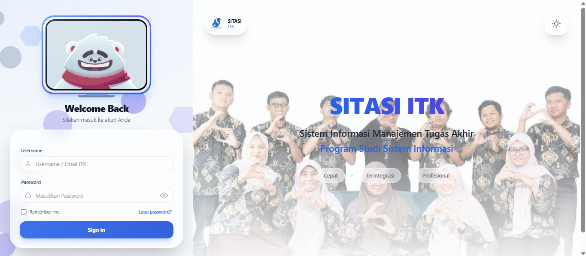

> **📷 Keterangan Gambar**: *Visual/Diagram pada 26 | P a n d u a n  P e l a k s a n a a n  T A  S i s t e m  I n f o r m a s i* (Dimensi: 1365x597 px)  
> **🔍 Analisis & Arti Gambar**:  
> Gambar ini merupakan tangkapan layar (screenshot) implementasi antarmuka pengguna (UI) sistem informasi, memperlihatkan tata letak visual, form input, tabel ringkasan data, dan navigasi menu.

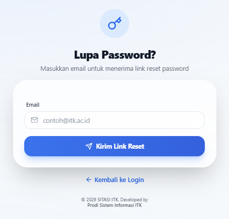

> **📷 Keterangan Gambar**: *Visual/Diagram pada 26 | P a n d u a n  P e l a k s a n a a n  T A  S i s t e m  I n f o r m a s i* (Dimensi: 454x433 px)  
> **🔍 Analisis & Arti Gambar**:  
> Gambar ini merupakan tangkapan layar (screenshot) implementasi antarmuka pengguna (UI) sistem informasi, memperlihatkan tata letak visual, form input, tabel ringkasan data, dan navigasi menu.

---

## 📄 Halaman 34

27 | P a n d u a n  P e l a k s a n a a n  T A  S i s t e m  I n f o r m a s i  
 
Pengguna dapat mengakses fitur Lupa Password dengan menekan link Lupa 
Password pada halaman login. Pada halaman Lupa Password, pengguna 
memasukkan email ITK dan menekan tombol Kirim Link Reset. Sistem akan 
mengirimkan link reset password ke email pengguna. Selanjutnya, pengguna 
dapat menekan link tersebut. Link tersebut akan mengarahkan pengguna untuk 
membuat password baru. Dan pengguna dapat Login kembali menggunakan 
password yang baru. Setelah berhasil login, pengguna akan diarahkan ke 
halaman utama yaitu Dashboard. 
 
2. Menu Dashboard - Dosen

### 🖼️ Gambar pada Halaman 34

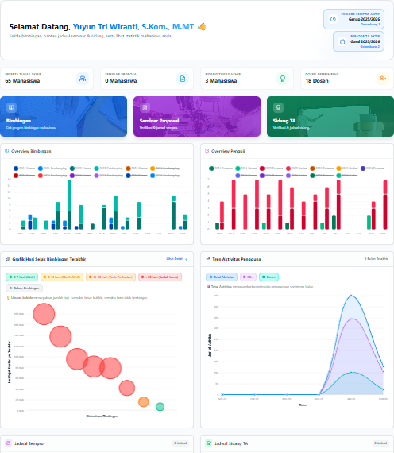

> **📷 Keterangan Gambar**: *Visual/Diagram pada 27 | P a n d u a n  P e l a k s a n a a n  T A  S i s t e m  I n f o r m a s i* (Dimensi: 496x570 px)  
> **🔍 Analisis & Arti Gambar**:  
> Gambar ini merupakan tangkapan layar (screenshot) implementasi antarmuka pengguna (UI) sistem informasi, memperlihatkan tata letak visual, form input, tabel ringkasan data, dan navigasi menu.

---

## 📄 Halaman 35

28 | P a n d u a n  P e l a k s a n a a n  T A  S i s t e m  I n f o r m a s i  
 
Dashboard Dosen menampilkan informasi mengenai Nama Pengguna, Periode 
Seminar Proposal dan/atau Periode Tugas Akhir yang aktif, jumlah Peserta 
Tugas Akhir, jumlah Peserta Seminar Proposal, jumlah Peserta Sidang TA, 
jumlah Dosen Pembimbing, grafik Pembimbingan, grafik Pengujian, Tren 
Aktivitas Pengguna, Jadwal Sempro, Jadwal Sidang, serta progress angkatan 
mahasiswa yang bisa dikelompokkan berdasarkan Seminar Proposal TA dan 
Sidang TA. 
Pada bagian kiri halaman, terdapat navigasi 
halaman yang mencakup: 
1. Dashboard 
2. Data Pengajuan 
a. Daftar Judul 
b. Bimbingan 
c. Seminar Proposal 
d. Sidang TA 
3. Prosedur TA 
4. Referensi TA 
5. Katalog TA 
 
 
 
 
 
 
 
 
3. Menu Profil

### 🖼️ Gambar pada Halaman 35

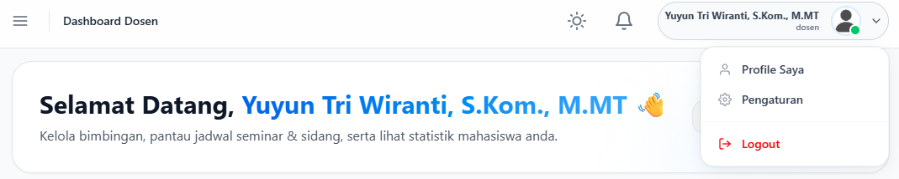

> **📷 Keterangan Gambar**: *Visual/Diagram pada 28 | P a n d u a n  P e l a k s a n a a n  T A  S i s t e m  I n f o r m a s i* (Dimensi: 1069x214 px)  
> **🔍 Analisis & Arti Gambar**:  
> Gambar ini menyajikan visualisasi hasil pengujian fungsionalitas perangkat lunak atau grafik evaluasi pengguna terhadap prototipe sistem yang dibangun.

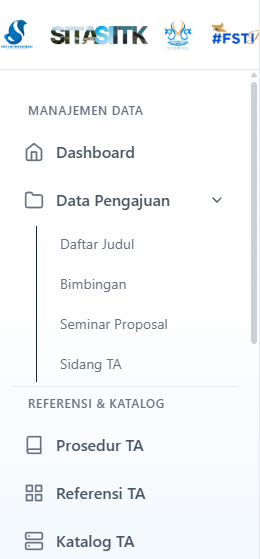

> **📷 Keterangan Gambar**: *Visual/Diagram pada 28 | P a n d u a n  P e l a k s a n a a n  T A  S i s t e m  I n f o r m a s i* (Dimensi: 260x559 px)  
> **🔍 Analisis & Arti Gambar**:  
> Gambar ini menyajikan visualisasi hasil pengujian fungsionalitas perangkat lunak atau grafik evaluasi pengguna terhadap prototipe sistem yang dibangun.

---

## 📄 Halaman 36

29 | P a n d u a n  P e l a k s a n a a n  T A  S i s t e m  I n f o r m a s i  
 
Untuk mengakses Menu Profil Pengguna 
1. Pastikan telah login ke sistem. 
2. Perhatikan bagian pojok kanan atas halaman. 
3. Klik nama pengguna dan ikon profil. 
4. Sistem akan menampilkan menu dropdown Profil Pengguna. 
5. Pada menu dropdown, klik Profile Saya. 
6. Sistem akan mengarahkan pengguna ke halaman Profil Saya. 
7. Pada halaman ini, pengguna dapat melihat dan/atau memperbarui foto profil 
dan tanda tangan. 
 
Untuk keluar dari Sistem (Logout) 
1. Pada menu dropdown Profil Pengguna, klik tombol Logout. 
2. Sistem akan mengakhiri sesi pengguna. 
3. Pengguna akan diarahkan kembali ke halaman login. 
 
Untuk Update Foto Profil 
1. Klik tombol Pilih Foto Profile. 
2. Pilih file foto dengan format JPG, JPEG, atau PNG dan ukuran file tidak 
melebihi 2 MB. 
3. Setelah file dipilih, pratinjau foto akan ditampilkan pada area foto profil. 
4. Klik tombol Perbarui Foto untuk menyimpan foto profil yang telah dipilih. 
5. Sistem akan memperbarui dan menampilkan foto profil terbaru sebagai foto 
profil aktif pengguna.

### 🖼️ Gambar pada Halaman 36

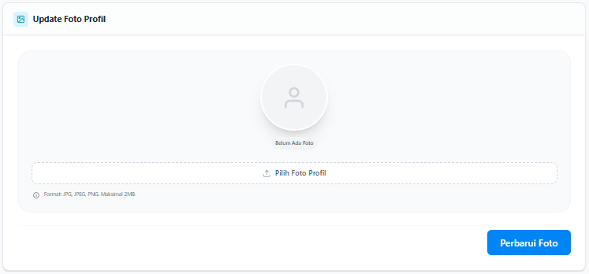

> **📷 Keterangan Gambar**: *Visual/Diagram pada 29 | P a n d u a n  P e l a k s a n a a n  T A  S i s t e m  I n f o r m a s i* (Dimensi: 747x348 px)  
> **🔍 Analisis & Arti Gambar**:  
> Gambar ini merupakan logo resmi institusi (Institut Teknologi Kalimantan / ITK) yang berfungsi sebagai identitas formal pada halaman judul/sampul laporan tugas akhir.

---

## 📄 Halaman 37

30 | P a n d u a n  P e l a k s a n a a n  T A  S i s t e m  I n f o r m a s i  
 
 
Untuk Mengunggah Tanda Tangan 
1. Klik tombol Pilih File Tanda Tangan. 
2. Pilih file gambar tanda tangan dengan format JPG, JPEG, atau PNG, dengan 
latar belakang gambar berwarna putih polos, dan ukuran file tidak melebihi 
1 MB. 
3. Setelah file dipilih, pratinjau tanda tangan akan ditampilkan pada area 
Signature. 
4. Klik tombol Simpan Perubahan untuk menyimpan tanda tangan. 
5. Sistem akan menyimpan tanda tangan dan menampilkannya sebagai tanda 
tangan aktif pengguna. 
 
4. Menu Daftar Judul 
Halaman Data Pengajuan menampilkan Nama dan NIM mahasiswa, Judul TA, 
Nama Dosen Pembimbing 1 dan Pembimbing 2, status, serta aksi. Halaman 
Daftar Judul digunakan oleh Dosen Pembimbing untuk melihat daftar pengajuan 
judul TA mahasiswa serta melakukan proses persetujuan atau penolakan judul 
yang diajukan. Untuk melakukan persetujuan judul TA klik tombol Setujui, 
sementara untuk melakukan penolakan judul TA klik tombol Tolak.

### 🖼️ Gambar pada Halaman 37

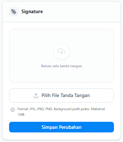

> **📷 Keterangan Gambar**: *Visual/Diagram pada 30 | P a n d u a n  P e l a k s a n a a n  T A  S i s t e m  I n f o r m a s i* (Dimensi: 244x281 px)  
> **🔍 Analisis & Arti Gambar**:  
> Gambar ini memuat lembar tanda tangan atau cap pengesahan resmi dari dosen pembimbing, penguji, atau koordinator program studi yang membuktikan keabsahan dokumen tugas akhir.

---

## 📄 Halaman 38

31 | P a n d u a n  P e l a k s a n a a n  T A  S i s t e m  I n f o r m a s i  
 
 
Ketika Dosen Pembimbing menekan tombol Setujui pada halaman Daftar Judul 
TA akan muncul Popup Konfirmasi Persetujuan. Popup ini berfungsi sebagai 
konfirmasi akhir sebelum sistem menetapkan judul sebagai disetujui secara 
permanen. Klik Setujui untuk menyetujui judul TA. Atau klik Tutup untuk 
membatalkan proses persetujuan. Sistem akan menutup popup dan 
memperbarui status sesuai pilihan pengguna. 
 
Setelah judul TA disetujui, halaman Daftar Judul akan menampilkan daftar 
pengajuan judul TA mahasiswa yang telah diproses. Pada tampilan ini, aksi 
persetujuan telah dilakukan sebelumnya sehingga pengguna hanya dapat 
melihat status tanpa melakukan perubahan data.

### 🖼️ Gambar pada Halaman 38

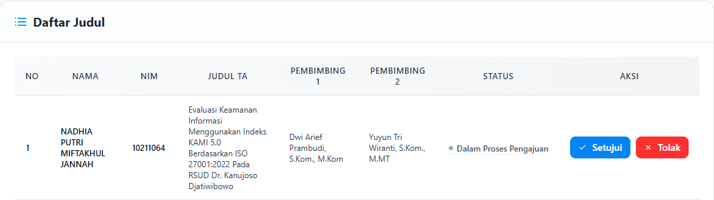

> **📷 Keterangan Gambar**: *Visual/Diagram pada 31 | P a n d u a n  P e l a k s a n a a n  T A  S i s t e m  I n f o r m a s i* (Dimensi: 1042x293 px)  
> **🔍 Analisis & Arti Gambar**:  
> Gambar ini memuat lembar tanda tangan atau cap pengesahan resmi dari dosen pembimbing, penguji, atau koordinator program studi yang membuktikan keabsahan dokumen tugas akhir.

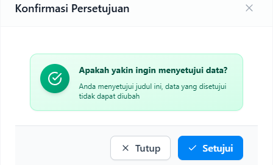

> **📷 Keterangan Gambar**: *Visual/Diagram pada 31 | P a n d u a n  P e l a k s a n a a n  T A  S i s t e m  I n f o r m a s i* (Dimensi: 448x271 px)  
> **🔍 Analisis & Arti Gambar**:  
> Gambar ini memuat lembar tanda tangan atau cap pengesahan resmi dari dosen pembimbing, penguji, atau koordinator program studi yang membuktikan keabsahan dokumen tugas akhir.

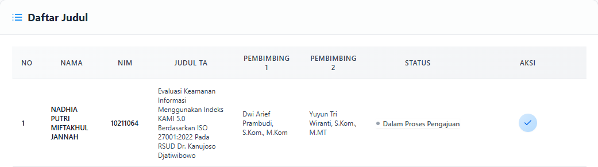

> **📷 Keterangan Gambar**: *Visual/Diagram pada 31 | P a n d u a n  P e l a k s a n a a n  T A  S i s t e m  I n f o r m a s i* (Dimensi: 1041x291 px)  
> **🔍 Analisis & Arti Gambar**:  
> Gambar ini memuat lembar tanda tangan atau cap pengesahan resmi dari dosen pembimbing, penguji, atau koordinator program studi yang membuktikan keabsahan dokumen tugas akhir.

---

## 📄 Halaman 39

32 | P a n d u a n  P e l a k s a n a a n  T A  S i s t e m  I n f o r m a s i  
 
5. Menu Bimbingan 
Dosen Pembimbing dapat mengakses detail bimbingan setiap mahasiswa pada 
halaman Bimbingan. Halaman Bimbingan TA menampilkan daftar mahasiswa 
yang sedang atau telah melakukan proses bimbingan TA dan Reminder 
Bimbingan. Untuk memberikan persetujuan bimbingan, Dosen Pembimbing 
dapat mencari mahasiswa berdasarkan Nama, NIM, atau Judul TA. Kemudian 
klik tombol View pada baris mahasiswa yang dipilih. Selanjutnya sistem akan 
menampilkan Halaman Riwayat Bimbingan  yang berisi detail proses bimbingan 
mahasiswa tersebut. 
Halaman Riwayat Bimbingan digunakan untuk menampilkan detail identitas 
mahasiswa serta daftar riwayat bimbingan Tugas Akhir yang telah dilakukan. 
Pada halaman ini, Dosen Pembimbing dapat meninjau hasil bimbingan dan 
memberikan persetujuan terhadap catatan bimbingan mahasiswa. Persetujuan 
dilakukan dengan klik tombol Setujui pada bimbingan yang telah sesuai. 
 
Ketika Dosen Pembimbing menekan tombol Setujui pada halaman Riwayat 
Bimbingan TA akan muncul pop-up Konfirmasi Persetujuan Bimbingan. Pop-
up ini berfungsi sebagai konfirmasi akhir sebelum sistem menetapkan status 
bimbingan sebagai disetujui secara permanen.

### 🖼️ Gambar pada Halaman 39

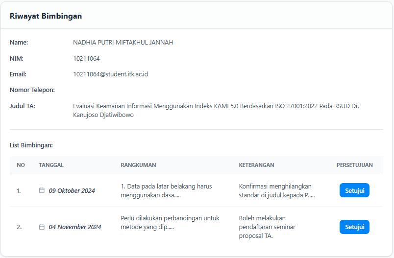

> **📷 Keterangan Gambar**: *Visual/Diagram pada 32 | P a n d u a n  P e l a k s a n a a n  T A  S i s t e m  I n f o r m a s i* (Dimensi: 804x527 px)  
> **🔍 Analisis & Arti Gambar**:  
> Gambar ini memuat lembar tanda tangan atau cap pengesahan resmi dari dosen pembimbing, penguji, atau koordinator program studi yang membuktikan keabsahan dokumen tugas akhir.

---

## 📄 Halaman 40

33 | P a n d u a n  P e l a k s a n a a n  T A  S i s t e m  I n f o r m a s i  
 
 
Atau klik Tutup untuk membatalkan persetujuan bimbingan. Sistem akan 
menutup pop-up dan memperbarui status sesuai pilihan pengguna. 
 
Bagian Reminder Bimbingan menampilkan informasi pengingat terkait aktivitas 
bimbingan mahasiswa yang berada di bawah Pembimbing Utama. 
 
Klik aksi untuk mengirimkan pengingat kepada mahasiswa agar 
segera melakukan bimbingan.

### 🖼️ Gambar pada Halaman 40

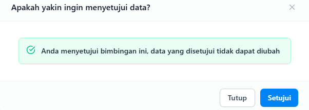

> **📷 Keterangan Gambar**: *Visual/Diagram pada 33 | P a n d u a n  P e l a k s a n a a n  T A  S i s t e m  I n f o r m a s i* (Dimensi: 602x216 px)  
> **🔍 Analisis & Arti Gambar**:  
> Gambar ini memuat lembar tanda tangan atau cap pengesahan resmi dari dosen pembimbing, penguji, atau koordinator program studi yang membuktikan keabsahan dokumen tugas akhir.

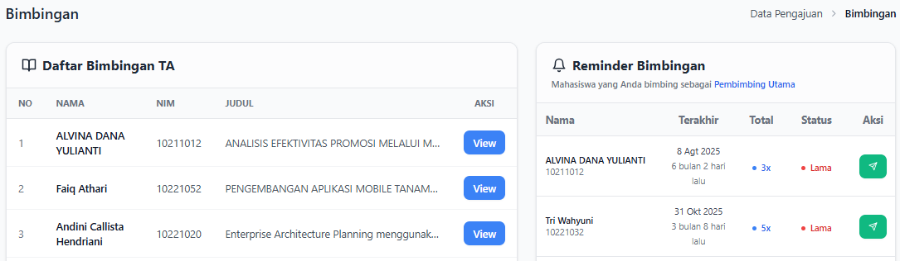

> **📷 Keterangan Gambar**: *Visual/Diagram pada 33 | P a n d u a n  P e l a k s a n a a n  T A  S i s t e m  I n f o r m a s i* (Dimensi: 1085x316 px)  
> **🔍 Analisis & Arti Gambar**:  
> Gambar ini memuat lembar tanda tangan atau cap pengesahan resmi dari dosen pembimbing, penguji, atau koordinator program studi yang membuktikan keabsahan dokumen tugas akhir.

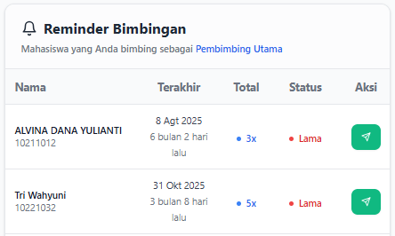

> **📷 Keterangan Gambar**: *Visual/Diagram pada 33 | P a n d u a n  P e l a k s a n a a n  T A  S i s t e m  I n f o r m a s i* (Dimensi: 444x266 px)  
> **🔍 Analisis & Arti Gambar**:  
> Gambar ini memuat lembar tanda tangan atau cap pengesahan resmi dari dosen pembimbing, penguji, atau koordinator program studi yang membuktikan keabsahan dokumen tugas akhir.

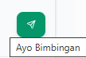

> **📷 Keterangan Gambar**: *Visual/Diagram pada 33 | P a n d u a n  P e l a k s a n a a n  T A  S i s t e m  I n f o r m a s i* (Dimensi: 108x73 px)  
> **🔍 Analisis & Arti Gambar**:  
> Gambar ini memuat lembar tanda tangan atau cap pengesahan resmi dari dosen pembimbing, penguji, atau koordinator program studi yang membuktikan keabsahan dokumen tugas akhir.

---

## 📄 Halaman 41

34 | P a n d u a n  P e l a k s a n a a n  T A  S i s t e m  I n f o r m a s i  
 
Selanjutnya, sistem akan menampilkan pop-up Kirim Reminder Bimbingan 
untuk mengonfirmasi bahwa pengingat bimbingan akan dikirimkan kepada 
mahasiswa melalui email resmi institusi. Klik tombol Kirim Reminder untuk 
menyetujui aksi. Atau klik tombol Batal untuk membatalkan aksi. 
 
 
6. Menu Seminar Proposal 
Menu Seminar Proposal digunakan untuk menampilkan daftar mahasiswa yang 
akan maupun telah melaksanakan seminar proposal Tugas Akhir. Terdapat dua 
aksi berbeda yang dapat dilakukan oleh Dosen Pembimbing pada halaman ini, 
yaitu: 
7.1 Ketika Periode Sempro Tidak Aktif 
Dosen Pembimbing hanya dapat memberikan persetujuan seminar proposal 
dan memilih bentuk TA mahasiswa yang dibimbing. Persetujuan dilakukan 
dengan klik tombol Setujui pada bimbingan yang telah sesuai.

### 🖼️ Gambar pada Halaman 41

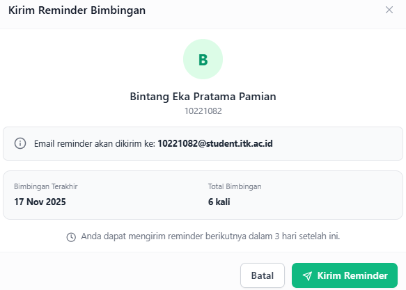

> **📷 Keterangan Gambar**: *Visual/Diagram pada 34 | P a n d u a n  P e l a k s a n a a n  T A  S i s t e m  I n f o r m a s i* (Dimensi: 583x417 px)  
> **🔍 Analisis & Arti Gambar**:  
> Gambar ini memuat lembar tanda tangan atau cap pengesahan resmi dari dosen pembimbing, penguji, atau koordinator program studi yang membuktikan keabsahan dokumen tugas akhir.

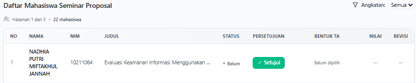

> **📷 Keterangan Gambar**: *Visual/Diagram pada 34 | P a n d u a n  P e l a k s a n a a n  T A  S i s t e m  I n f o r m a s i* (Dimensi: 843x169 px)  
> **🔍 Analisis & Arti Gambar**:  
> Gambar ini memuat lembar tanda tangan atau cap pengesahan resmi dari dosen pembimbing, penguji, atau koordinator program studi yang membuktikan keabsahan dokumen tugas akhir.

---

## 📄 Halaman 42

35 | P a n d u a n  P e l a k s a n a a n  T A  S i s t e m  I n f o r m a s i  
 
Selanjutnya akan muncul pop-up Form Seminar Proposal TA. Pop-up ini 
berfungsi sebagai konfirmasi akhir sebelum sistem menetapkan status 
seminar proposal sebagai disetujui secara permanen. 
 
Setelah Seminar Proposal TA mahasiswa disetujui oleh Pembimbing, sistem 
akan menghasilkan Formulir Persetujuan Seminar Proposal Tugas Akhir 
(Form TA-02). 
Untuk Bentuk TA hanya dapat dilakukan oleh Dosen Pembimbing Utama. 
Aksi ini dapat dilakukan sebelum maupun setelah mahasiswa melaksanakan 
Seminar Proposal TA dengan memilih bentuk TA Skripsi, Proyek, atau 
Prototipe dengan TKT 5. 
 
 
7.2 Ketika Periode Sempro Aktif 
Dosen Pembimbing dapat memberikan penilaian seminar proposal TA dan 
persetujuan revisi Proposal TA kepada mahasiswa yang dibimbing pada tab 
Mahasiswa Bimbingan. Sementara Dosen Penguji dapat memberikan 
penilaian seminar proposal TA dan persetujuan revisi Proposal TA kepada 
mahasiswa yang diuji pada tab Mahasiswa Uji. Untuk memberikan penilaian 
seminar proposal TA dan persetujuan revisi Proposal TA, Dosen dapat 
mencari mahasiswa berdasarkan Nama, NIM, atau Judul TA. Kemudian klik 
tombol 
 untuk memberikan penilaian sesuai dengan kriteria Penilaian

### 🖼️ Gambar pada Halaman 42

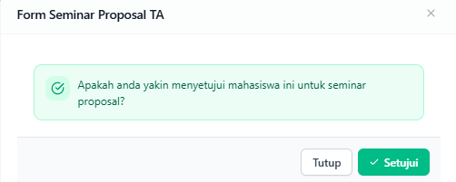

> **📷 Keterangan Gambar**: *Visual/Diagram pada 35 | P a n d u a n  P e l a k s a n a a n  T A  S i s t e m  I n f o r m a s i* (Dimensi: 502x201 px)  
> **🔍 Analisis & Arti Gambar**:  
> Gambar ini memuat lembar tanda tangan atau cap pengesahan resmi dari dosen pembimbing, penguji, atau koordinator program studi yang membuktikan keabsahan dokumen tugas akhir.

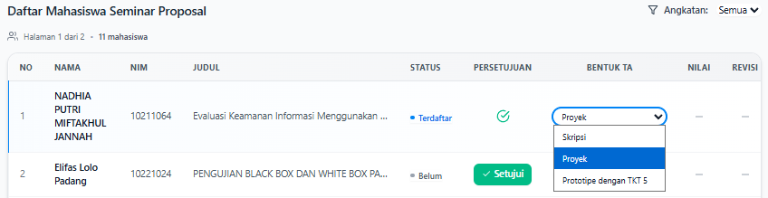

> **📷 Keterangan Gambar**: *Visual/Diagram pada 35 | P a n d u a n  P e l a k s a n a a n  T A  S i s t e m  I n f o r m a s i* (Dimensi: 848x219 px)  
> **🔍 Analisis & Arti Gambar**:  
> Gambar ini memuat lembar tanda tangan atau cap pengesahan resmi dari dosen pembimbing, penguji, atau koordinator program studi yang membuktikan keabsahan dokumen tugas akhir.

---

## 📄 Halaman 43

36 | P a n d u a n  P e l a k s a n a a n  T A  S i s t e m  I n f o r m a s i  
 
Seminar Proposal TA atau klik tombol 
 untuk memberikan persetujuan 
revisi. 
 
Setelah revisi Proposal TA disetujui oleh Tim Penguji, sistem akan 
menghasilkan Lembar Persetujuan Revisi Proposal TA. 
 
 
7. Menu Sidang TA 
Menu Sidang TA digunakan untuk menampilkan daftar mahasiswa yang akan 
maupun telah melaksanakan sidang Tugas Akhir. Menu ini terdiri dari dua tab 
yaitu tab Mahasiswa Bimbingan dan Mahasiswa Uji. 
 
 
Terdapat dua aksi berbeda yang dapat dilakukan oleh Dosen Pembimbing pada 
halaman ini, yaitu: 
7.1 Ketika Periode TA Tidak Aktif 
Dosen Pembimbing hanya dapat memberikan persetujuan sidang TA 
mahasiswa yang dibimbing. Persetujuan dilakukan dengan klik tombol 
Setujui pada bimbingan yang telah sesuai. 
 
 
Selanjutnya akan muncul pop-up Form Seminar Proposal TA. Pop-up ini 
berfungsi sebagai konfirmasi akhir sebelum sistem menetapkan status 
seminar proposal sebagai disetujui secara permanen.

### 🖼️ Gambar pada Halaman 43

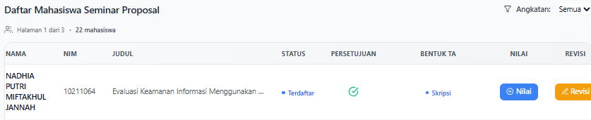

> **📷 Keterangan Gambar**: *Visual/Diagram pada 36 | P a n d u a n  P e l a k s a n a a n  T A  S i s t e m  I n f o r m a s i* (Dimensi: 837x171 px)  
> **🔍 Analisis & Arti Gambar**:  
> Gambar ini memuat lembar tanda tangan atau cap pengesahan resmi dari dosen pembimbing, penguji, atau koordinator program studi yang membuktikan keabsahan dokumen tugas akhir.

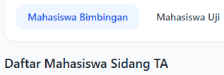

> **📷 Keterangan Gambar**: *Visual/Diagram pada 36 | P a n d u a n  P e l a k s a n a a n  T A  S i s t e m  I n f o r m a s i* (Dimensi: 317x106 px)  
> **🔍 Analisis & Arti Gambar**:  
> Gambar ini memuat lembar tanda tangan atau cap pengesahan resmi dari dosen pembimbing, penguji, atau koordinator program studi yang membuktikan keabsahan dokumen tugas akhir.

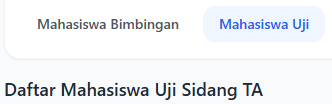

> **📷 Keterangan Gambar**: *Visual/Diagram pada 36 | P a n d u a n  P e l a k s a n a a n  T A  S i s t e m  I n f o r m a s i* (Dimensi: 332x104 px)  
> **🔍 Analisis & Arti Gambar**:  
> Gambar ini memuat lembar tanda tangan atau cap pengesahan resmi dari dosen pembimbing, penguji, atau koordinator program studi yang membuktikan keabsahan dokumen tugas akhir.

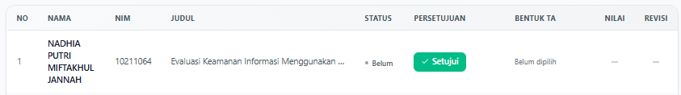

> **📷 Keterangan Gambar**: *Visual/Diagram pada 36 | P a n d u a n  P e l a k s a n a a n  T A  S i s t e m  I n f o r m a s i* (Dimensi: 843x118 px)  
> **🔍 Analisis & Arti Gambar**:  
> Gambar ini memuat lembar tanda tangan atau cap pengesahan resmi dari dosen pembimbing, penguji, atau koordinator program studi yang membuktikan keabsahan dokumen tugas akhir.

---

## 📄 Halaman 44

37 | P a n d u a n  P e l a k s a n a a n  T A  S i s t e m  I n f o r m a s i  
 
 
Setelah Sidang TA mahasiswa disetujui oleh Pembimbing, sistem akan 
menghasilkan Formulir Persetujuan Sidang Tugas Akhir  (Form TA-05). 
 
7.2 Ketika Periode TA Aktif 
Dosen Pembimbing dapat memberikan penilaian Sidang TA dan 
persetujuan revisi kepada mahasiswa yang dibimbing pada tab Mahasiswa 
Bimbingan. Sementara Dosen Penguji dapat memberikan penilaian Sidang 
TA dan persetujuan revisi kepada mahasiswa yang diuji pada tab Mahasiswa 
Uji. Untuk memberikan penilaian Sidang TA dan persetujuan revisi Proposal 
TA, Dosen dapat mencari mahasiswa berdasarkan Nama, NIM, atau Judul 
TA. Kemudian klik tombol 
 untuk memberikan penilaian sesuai dengan 
kriteria Penilaian Seminar Proposal TA atau klik tombol 
 untuk 
memberikan persetujuan revisi. 
 
 
Setelah revisi TA disetujui oleh Tim Penguji, sistem akan menghasilkan Lembar 
Pengesahan Tugas Akhir.

### 🖼️ Gambar pada Halaman 44

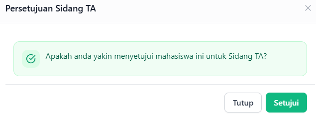

> **📷 Keterangan Gambar**: *Visual/Diagram pada 37 | P a n d u a n  P e l a k s a n a a n  T A  S i s t e m  I n f o r m a s i* (Dimensi: 635x231 px)  
> **🔍 Analisis & Arti Gambar**:  
> Gambar ini memuat lembar tanda tangan atau cap pengesahan resmi dari dosen pembimbing, penguji, atau koordinator program studi yang membuktikan keabsahan dokumen tugas akhir.

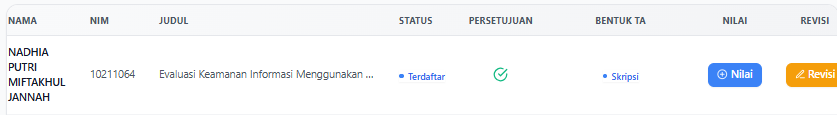

> **📷 Keterangan Gambar**: *Visual/Diagram pada 37 | P a n d u a n  P e l a k s a n a a n  T A  S i s t e m  I n f o r m a s i* (Dimensi: 837x115 px)  
> **🔍 Analisis & Arti Gambar**:  
> Gambar ini memuat lembar tanda tangan atau cap pengesahan resmi dari dosen pembimbing, penguji, atau koordinator program studi yang membuktikan keabsahan dokumen tugas akhir.

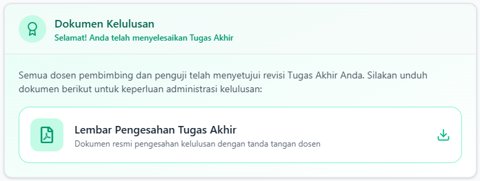

> **📷 Keterangan Gambar**: *Visual/Diagram pada 37 | P a n d u a n  P e l a k s a n a a n  T A  S i s t e m  I n f o r m a s i* (Dimensi: 696x263 px)  
> **🔍 Analisis & Arti Gambar**:  
> Gambar ini memuat lembar tanda tangan atau cap pengesahan resmi dari dosen pembimbing, penguji, atau koordinator program studi yang membuktikan keabsahan dokumen tugas akhir.

---

## 📄 Halaman 45

38 | P a n d u a n  P e l a k s a n a a n  T A  S i s t e m  I n f o r m a s i  
 
8. Pengumuman 
Menu Pengumuman digunakan untuk menyampaikan informasi resmi terkait 
pelaksanaan Tugas Akhir, seperti jadwal seminar proposal, sidang Tugas Akhir, 
batas waktu revisi, maupun informasi akademik lainnya. Seluruh pengguna 
(Dosen dan Mahasiswa) dapat melihat daftar pengumuman yang telah 
dipublikasikan. 
 
Cara Mencari Pengumuman 
1. Klik pada kolom Cari pengumuman.  
2. Masukkan kata kunci yang ingin dicari, misalnya:  
• 
Seminar Proposal 
• 
Sidang TA 
• 
Umum  
3. Sistem akan menampilkan pengumuman yang sesuai dengan kata kunci 
tersebut. 
Cara Memfilter Pengumuman 
1. Klik daftar pilihan pada bagian Semua Kategori.  
2. Pilih kategori yang diinginkan.  
3. Sistem akan menampilkan pengumuman sesuai kategori yang dipilih.  
• 
Umum 
• 
Sidang TA  
• 
Seminar Proposal  
• 
Bimbingan

### 🖼️ Gambar pada Halaman 45

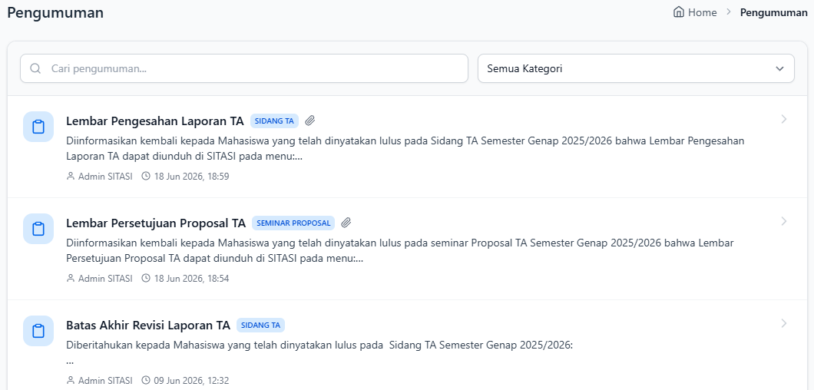

> **📷 Keterangan Gambar**: *Visual/Diagram pada 38 | P a n d u a n  P e l a k s a n a a n  T A  S i s t e m  I n f o r m a s i* (Dimensi: 1060x508 px)  
> **🔍 Analisis & Arti Gambar**:  
> Gambar pendukung/ilustrasi visual pada Halaman 45 yang merepresentasikan bagan, panduan antarmuka, formulir, atau materi teknis sesuai konteks bahasan: 'Visual/Diagram pada 38 | P a n d u a n  P e l a k s a n a a n  T A  S i s t e m  I n f o r m a s i'.

---

## 📄 Halaman 46

39 | P a n d u a n  P e l a k s a n a a n  T A  S i s t e m  I n f o r m a s i  
 
• 
Beasiswa  
Cara Membuka Detail Pengumuman 
1. Pilih pengumuman yang ingin dibaca.  
2. Klik ikon panah (>) pada sisi kanan daftar pengumuman.  
3. Sistem akan menampilkan halaman detail pengumuman yang berisi 
informasi lengkap. 
 
9. Menu Prosedur TA 
Halaman Prosedur Tugas Akhir digunakan mendokumentasikan prosedur atau 
tahapan pelaksanaan Tugas Akhir yang berlaku pada ITK dan Program Studi 
Sistem Informasi. Informasi yang dimasukkan pada halaman ini akan menjadi 
panduan resmi bagi mahasiswa dalam melaksanakan Tugas Akhir. Pada 
halaman ini dapat melihat daftar prosedur. Pada halaman ini, pengguna dapat 
melihat detail prosedur, membuka tautan dokumen pendukung, serta melakukan 
pengelolaan data seperti mengedit atau menghapus prosedur. 
 
Cara Melihat Detail Prosedur 
1. Buka menu Prosedur TA. 
2. Klik ikon panah untuk menampilkan detail prosedur. 
3. Klik tautan yang tersedia apabila ingin membuka dokumen panduan. 
 
10. Menu Referensi TA 
Halaman Referensi TA digunakan untuk menampilkan daftar referensi judul atau 
topik Tugas Akhir yang telah ditambahkan oleh Dosen. Informasi yang tersedia 
meliputi bidang minat, judul/topik, dosen pembimbing, kontak dosen, serta status 
ketersediaan topik.

### 🖼️ Gambar pada Halaman 46

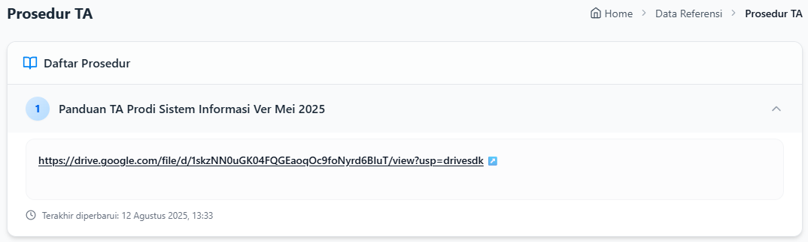

> **📷 Keterangan Gambar**: *Visual/Diagram pada 39 | P a n d u a n  P e l a k s a n a a n  T A  S i s t e m  I n f o r m a s i* (Dimensi: 1074x323 px)  
> **🔍 Analisis & Arti Gambar**:  
> Gambar pendukung/ilustrasi visual pada Halaman 46 yang merepresentasikan bagan, panduan antarmuka, formulir, atau materi teknis sesuai konteks bahasan: 'Visual/Diagram pada 39 | P a n d u a n  P e l a k s a n a a n  T A  S i s t e m  I n f o r m a s i'.

---

## 📄 Halaman 47

40 | P a n d u a n  P e l a k s a n a a n  T A  S i s t e m  I n f o r m a s i  
 
Halaman ini membantu mahasiswa dalam menentukan topik penelitian sesuai 
minat dan dosen pembimbing yang tersedia. 
 
Dosen dapat menambah Referensi Topik TA dengan memperhatikan bagian 
pojok kanan atas halaman kemudian klik nama pengguna dan ikon profil dan 
Pengaturan. 
 
Selanjutnya, sistem akan menampilkan halaman Referensi Topik TA dan Dosen 
dapat menambah Referensi Topik TA dengan klik tombol Tambah Referensi. 
 
Ketika tombol Tambah Referensi diklik, Form Detail Referensi Topik akan 
ditampilkan. Untuk menambah Referensi Topik TA, Dosen harus mengisi Bidang 
Minat, Judul / Topik TA, dan memilih Status Ketersediaan ”Ya”. Selanjutnya 
Klik Simpan Referensi dan pastikan data muncul pada tabel Referensi Topik

### 🖼️ Gambar pada Halaman 47

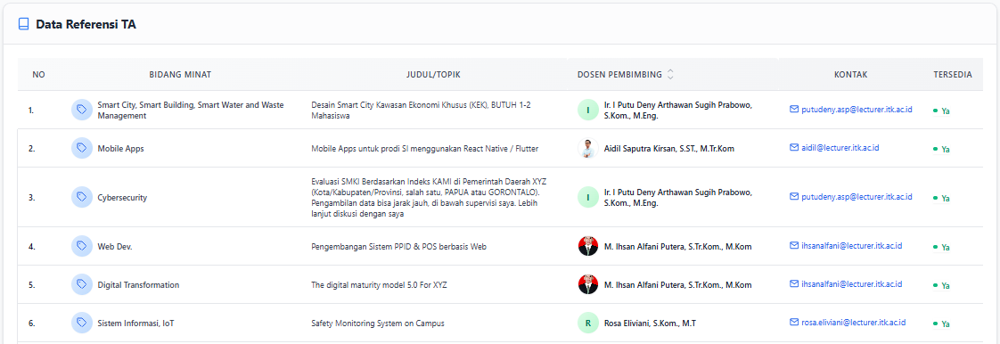

> **📷 Keterangan Gambar**: *Visual/Diagram pada 40 | P a n d u a n  P e l a k s a n a a n  T A  S i s t e m  I n f o r m a s i* (Dimensi: 1122x386 px)  
> **🔍 Analisis & Arti Gambar**:  
> Gambar pendukung/ilustrasi visual pada Halaman 47 yang merepresentasikan bagan, panduan antarmuka, formulir, atau materi teknis sesuai konteks bahasan: 'Visual/Diagram pada 40 | P a n d u a n  P e l a k s a n a a n  T A  S i s t e m  I n f o r m a s i'.

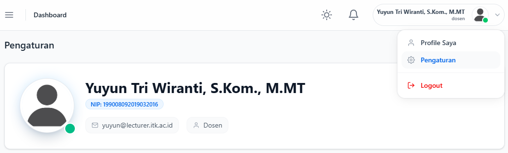

> **📷 Keterangan Gambar**: *Visual/Diagram pada 40 | P a n d u a n  P e l a k s a n a a n  T A  S i s t e m  I n f o r m a s i* (Dimensi: 1059x319 px)  
> **🔍 Analisis & Arti Gambar**:  
> Gambar pendukung/ilustrasi visual pada Halaman 47 yang merepresentasikan bagan, panduan antarmuka, formulir, atau materi teknis sesuai konteks bahasan: 'Visual/Diagram pada 40 | P a n d u a n  P e l a k s a n a a n  T A  S i s t e m  I n f o r m a s i'.

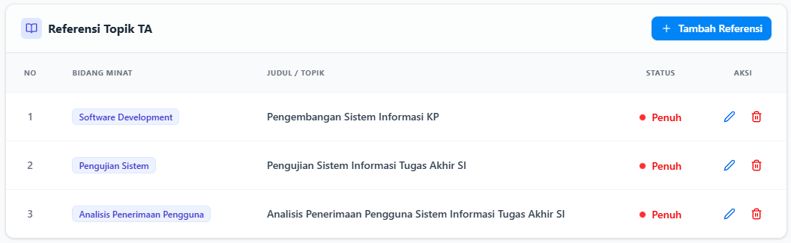

> **📷 Keterangan Gambar**: *Visual/Diagram pada 40 | P a n d u a n  P e l a k s a n a a n  T A  S i s t e m  I n f o r m a s i* (Dimensi: 1055x325 px)  
> **🔍 Analisis & Arti Gambar**:  
> Gambar pendukung/ilustrasi visual pada Halaman 47 yang merepresentasikan bagan, panduan antarmuka, formulir, atau materi teknis sesuai konteks bahasan: 'Visual/Diagram pada 40 | P a n d u a n  P e l a k s a n a a n  T A  S i s t e m  I n f o r m a s i'.

---

## 📄 Halaman 48

41 | P a n d u a n  P e l a k s a n a a n  T A  S i s t e m  I n f o r m a s i  
 
TA. Dosen dapat mengubah Detail Referensi Topik dengan klik icon Pensil dan 
menghapus Referensi Topik dengan klik icon tempat sampah. 
 
 
11. Menu Katalog TA 
Halaman Katalog TA berfungsi sebagai media referensi daftar judul Tugas Akhir 
yang telah diinput oleh mahasiswa yang sudah menyelesaikan TA. Data pada 
halaman ini dapat digunakan sebagai bahan referensi oleh mahasiswa yang 
akan mengambil TA.

### 🖼️ Gambar pada Halaman 48

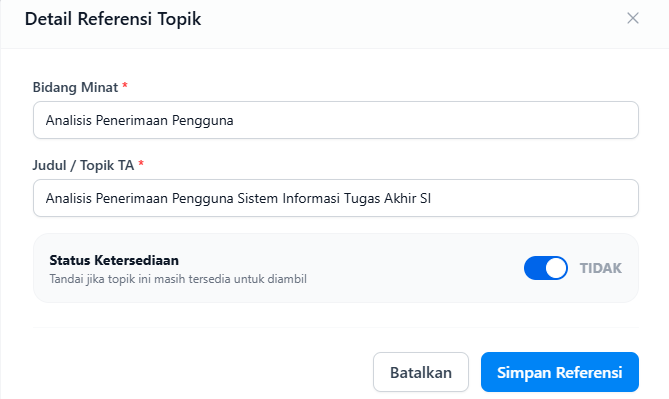

> **📷 Keterangan Gambar**: *Visual/Diagram pada 41 | P a n d u a n  P e l a k s a n a a n  T A  S i s t e m  I n f o r m a s i* (Dimensi: 669x399 px)  
> **🔍 Analisis & Arti Gambar**:  
> Gambar pendukung/ilustrasi visual pada Halaman 48 yang merepresentasikan bagan, panduan antarmuka, formulir, atau materi teknis sesuai konteks bahasan: 'Visual/Diagram pada 41 | P a n d u a n  P e l a k s a n a a n  T A  S i s t e m  I n f o r m a s i'.

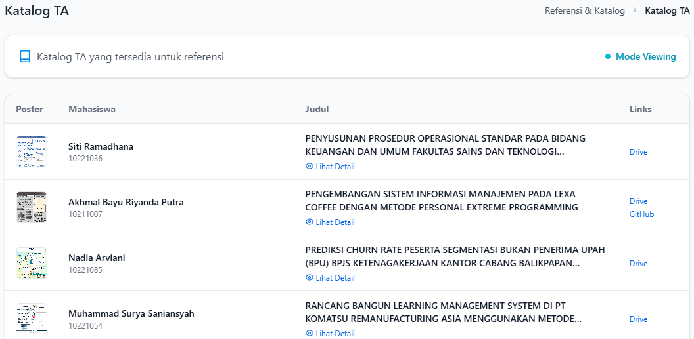

> **📷 Keterangan Gambar**: *Visual/Diagram pada 41 | P a n d u a n  P e l a k s a n a a n  T A  S i s t e m  I n f o r m a s i* (Dimensi: 1056x517 px)  
> **🔍 Analisis & Arti Gambar**:  
> Gambar pendukung/ilustrasi visual pada Halaman 48 yang merepresentasikan bagan, panduan antarmuka, formulir, atau materi teknis sesuai konteks bahasan: 'Visual/Diagram pada 41 | P a n d u a n  P e l a k s a n a a n  T A  S i s t e m  I n f o r m a s i'.

---

## 📄 Halaman 49

42 | P a n d u a n  P e l a k s a n a a n  T A  S i s t e m  I n f o r m a s i  
 
Tabel katalog menampilkan data dengan kolom berikut: 
a. Poster: Menampilkan gambar/poster pendukung Tugas Akhir (jika tersedia). 
b. Mahasiswa: Menampilkan nama mahasiswa dan NIM yang mengajukan 
Tugas Akhir. 
c. Judul: Menampilkan judul Tugas Akhir. Judul panjang akan dipotong dan 
dapat dilihat lengkap melalui fitur detail. Pada kolom judul tersedia opsi “Lihat 
Detail” yang berfungsi untuk menampilkan abstrak dan laporan Tugas Akhir. 
d. Links: Berisi tautan dokumen pendukung, seperti Google Drive atau GitHub 
yang digunakan untuk mengakses file proposal, laporan, atau source code. 
 
PANDUAN PENGGUNA MAHASISWA 
1. Login 
Akses website SITASI melalui link s.itk.ac.id/sitasi_itk 
Masukkan username berupa Email ITK dan Password berupa Nomor Induk. 
 
Pada halaman ini terdapat checkbox Remember Me dan link Lupa Password. 
Fitur Remember Me digunakan untuk mengingat sesi atau identitas pengguna, 
sehingga pengguna tidak perlu login kembali saat mengakses sistem dari 
perangkat yang sama. Fitur Lupa Password digunakan untuk membantu 
pengguna mengatur ulang kata sandi apabila lupa.

### 🖼️ Gambar pada Halaman 49

> **📷 Keterangan Gambar**: *Visual/Diagram pada 42 | P a n d u a n  P e l a k s a n a a n  T A  S i s t e m  I n f o r m a s i* (Dimensi: 1365x597 px)  
> **🔍 Analisis & Arti Gambar**:  
> Gambar ini merupakan tangkapan layar (screenshot) implementasi antarmuka pengguna (UI) sistem informasi, memperlihatkan tata letak visual, form input, tabel ringkasan data, dan navigasi menu.

---

## 📄 Halaman 50

43 | P a n d u a n  P e l a k s a n a a n  T A  S i s t e m  I n f o r m a s i  
 
 
 
Pengguna dapat mengakses fitur Lupa Password dengan menekan link Lupa 
Password pada halaman login. Pada halaman Lupa Password, pengguna 
memasukkan email ITK dan menekan tombol Kirim Link Reset. Sistem akan 
mengirimkan link reset password ke email pengguna. Selanjutnya, pengguna 
dapat menekan link tersebut. Link tersebut akan mengarahkan pengguna untuk 
membuat password baru. Dan pengguna dapat Login kembali menggunakan 
password yang baru. Setelah berhasil login, pengguna akan diarahkan ke 
halaman utama yaitu Dashboard. 
2. Menu Dashboard

### 🖼️ Gambar pada Halaman 50

> **📷 Keterangan Gambar**: *Visual/Diagram pada 43 | P a n d u a n  P e l a k s a n a a n  T A  S i s t e m  I n f o r m a s i* (Dimensi: 454x433 px)  
> **🔍 Analisis & Arti Gambar**:  
> Gambar ini merupakan tangkapan layar (screenshot) implementasi antarmuka pengguna (UI) sistem informasi, memperlihatkan tata letak visual, form input, tabel ringkasan data, dan navigasi menu.

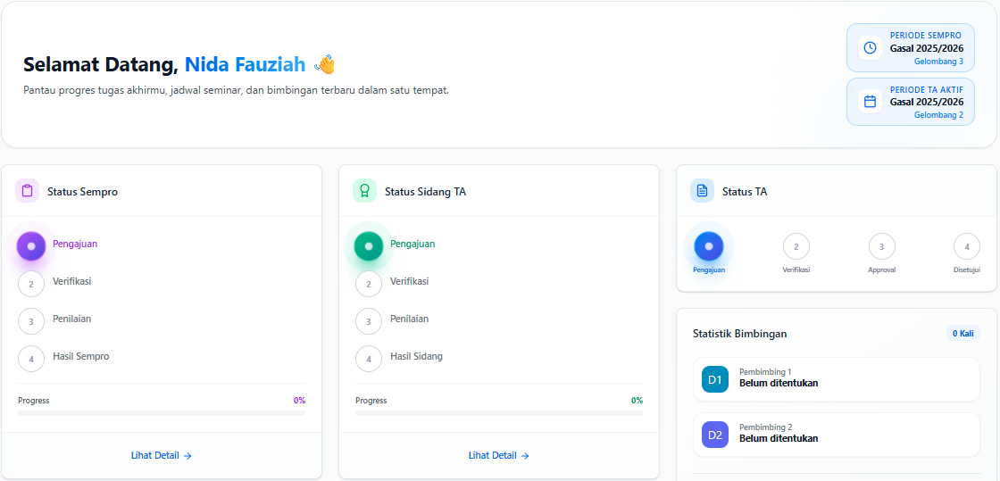

> **📷 Keterangan Gambar**: *Visual/Diagram pada 43 | P a n d u a n  P e l a k s a n a a n  T A  S i s t e m  I n f o r m a s i* (Dimensi: 1120x539 px)  
> **🔍 Analisis & Arti Gambar**:  
> Gambar ini merupakan tangkapan layar (screenshot) implementasi antarmuka pengguna (UI) sistem informasi, memperlihatkan tata letak visual, form input, tabel ringkasan data, dan navigasi menu.

---

## 📄 Halaman 51

44 | P a n d u a n  P e l a k s a n a a n  T A  S i s t e m  I n f o r m a s i  
 
Dashboard Mahasiswa menampilkan informasi mengenai Nama Pengguna, 
Periode Seminar Proposal dan/atau Periode Tugas Akhir yang aktif, Status 
Sempro, Status Sidang TA, Status TA, Statistik Bimbingan, Hasil Penilaian, dan 
Mahasiswa Teraktif Bimbingan. 
Pada bagian kiri halaman, terdapat navigasi 
halaman yang mencakup: 
1. Dashboard 
2. Pengajuan TA 
a. Pengajuan Judul 
b. Bimbingan 
c. Seminar Proposal 
d. Sidang TA 
3. Prosedur TA 
4. Referensi TA 
5. Katalog TA 
 
 
 
 
 
 
 
 
3. Menu Profil 
 
Untuk mengakses Menu Profil Pengguna 
1. Pastikan telah login ke sistem. 
2. Perhatikan bagian pojok kanan atas halaman. 
3. Klik nama pengguna dan ikon profil. 
4. Sistem akan menampilkan menu dropdown Profil Pengguna.

### 🖼️ Gambar pada Halaman 51

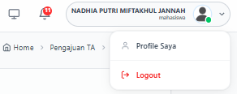

> **📷 Keterangan Gambar**: *Visual/Diagram pada 44 | P a n d u a n  P e l a k s a n a a n  T A  S i s t e m  I n f o r m a s i* (Dimensi: 292x116 px)  
> **🔍 Analisis & Arti Gambar**:  
> Gambar ini merupakan tangkapan layar (screenshot) implementasi antarmuka pengguna (UI) sistem informasi, memperlihatkan tata letak visual, form input, tabel ringkasan data, dan navigasi menu.

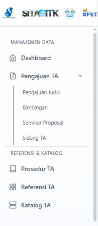

> **📷 Keterangan Gambar**: *Visual/Diagram pada 44 | P a n d u a n  P e l a k s a n a a n  T A  S i s t e m  I n f o r m a s i* (Dimensi: 195x448 px)  
> **🔍 Analisis & Arti Gambar**:  
> Gambar ini merupakan tangkapan layar (screenshot) implementasi antarmuka pengguna (UI) sistem informasi, memperlihatkan tata letak visual, form input, tabel ringkasan data, dan navigasi menu.

---

## 📄 Halaman 52

45 | P a n d u a n  P e l a k s a n a a n  T A  S i s t e m  I n f o r m a s i  
 
5. Pada menu dropdown, klik Profile Saya. 
6. Sistem akan mengarahkan pengguna ke halaman Profil Saya. 
7. Pada halaman ini, pengguna dapat melihat dan/atau memperbarui foto profil 
dan tanda tangan. 
 
Untuk keluar dari Sistem (Logout) 
1. Pada menu dropdown Profil Pengguna, klik tombol Logout. 
2. Sistem akan mengakhiri sesi pengguna. 
3. Pengguna akan diarahkan kembali ke halaman login. 
 
Untuk Update Foto Profil 
1. Klik tombol Pilih Foto Profile. 
2. Pilih file foto dengan format JPG, JPEG, atau PNG dan ukuran file tidak 
melebihi 2 MB. 
3. Setelah file dipilih, pratinjau foto akan ditampilkan pada area foto profil. 
4. Klik tombol Perbarui Foto untuk menyimpan foto profil yang telah dipilih. 
5. Sistem akan memperbarui dan menampilkan foto profil terbaru sebagai foto 
profil aktif pengguna.

### 🖼️ Gambar pada Halaman 52

> **📷 Keterangan Gambar**: *Visual/Diagram pada 45 | P a n d u a n  P e l a k s a n a a n  T A  S i s t e m  I n f o r m a s i* (Dimensi: 747x348 px)  
> **🔍 Analisis & Arti Gambar**:  
> Gambar ini merupakan logo resmi institusi (Institut Teknologi Kalimantan / ITK) yang berfungsi sebagai identitas formal pada halaman judul/sampul laporan tugas akhir.

---

## 📄 Halaman 53

46 | P a n d u a n  P e l a k s a n a a n  T A  S i s t e m  I n f o r m a s i  
 
 
Untuk Mengunggah Tanda Tangan 
1. Klik tombol Pilih File Tanda Tangan. 
2. Pilih file gambar tanda tangan dengan format JPG, JPEG, atau PNG, dengan 
latar belakang gambar berwarna putih polos, dan ukuran file tidak melebihi 
1 MB. 
3. Setelah file dipilih, pratinjau tanda tangan akan ditampilkan pada area 
Signature. 
4. Klik tombol Simpan Perubahan untuk menyimpan tanda tangan. 
5. Sistem akan menyimpan tanda tangan dan menampilkannya sebagai tanda 
tangan aktif pengguna. 
 
4. Menu Pengajuan Judul 
Menu Pengajuan Judul menampilkan Data Pengajuan TA dan Riwayat 
Pengajuan. Pengajuan TA dilakukan dengan mengisi Judul Skripsi dan Bidang 
Penelitian, memilih Nama Dosen Pembimbing 1 dan Pembimbing 2 yang 
sesuai, serta mencentang checkbox pernyataan “Saya sudah berkonsultasi 
dengan kedua dosen pembimbing dan mereka menyetujui judul serta 
bersedia membimbing penelitian saya”. Untuk mengajukan judul, pengguna 
harus: 
a. Melengkapi tanda tangan terlebih dahulu melalui Menu Profil. 
b. Dosen pembimbing sudah bersedia membimbing TA.

### 🖼️ Gambar pada Halaman 53

> **📷 Keterangan Gambar**: *Visual/Diagram pada 46 | P a n d u a n  P e l a k s a n a a n  T A  S i s t e m  I n f o r m a s i* (Dimensi: 244x281 px)  
> **🔍 Analisis & Arti Gambar**:  
> Gambar ini memuat lembar tanda tangan atau cap pengesahan resmi dari dosen pembimbing, penguji, atau koordinator program studi yang membuktikan keabsahan dokumen tugas akhir.

---

## 📄 Halaman 54

47 | P a n d u a n  P e l a k s a n a a n  T A  S i s t e m  I n f o r m a s i  
 
c. Sudah melakukan konsultasi dengan Dosen Pembimbing Utama dan Dosen 
Pembimbing Pendamping. 
d. Judul sudah disetujui oleh Dosen Pembimbing Utama dan Dosen 
Pembimbing Pendamping. 
 
Setelah terisi, klik tombol Simpan Pengajuan untuk mengajukan TA. Pastikan 
muncul notifikasi Konfirmasi Pengajuan. Kemudian klik tombol Ya, Ajukan 
Judul. 
 
 
Judul TA yang diajukan mahasiswa akan muncul pada Riwayat Pengajuan. 
Halaman Riwayat Pengajuan digunakan untuk menampilkan histori atau status 
proses pengajuan Tugas Akhir yang telah dilakukan oleh mahasiswa. Halaman

### 🖼️ Gambar pada Halaman 54

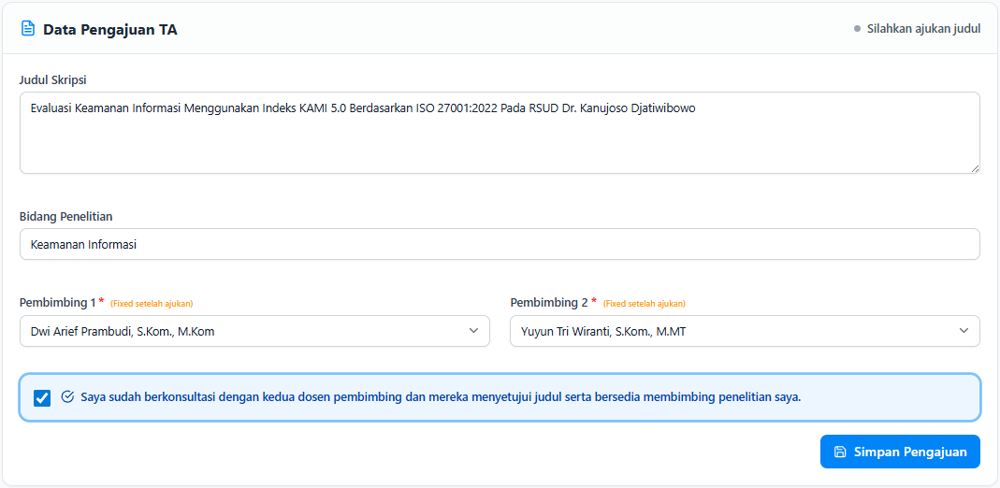

> **📷 Keterangan Gambar**: *Visual/Diagram pada 47 | P a n d u a n  P e l a k s a n a a n  T A  S i s t e m  I n f o r m a s i* (Dimensi: 1069x522 px)  
> **🔍 Analisis & Arti Gambar**:  
> Gambar pendukung/ilustrasi visual pada Halaman 54 yang merepresentasikan bagan, panduan antarmuka, formulir, atau materi teknis sesuai konteks bahasan: 'Visual/Diagram pada 47 | P a n d u a n  P e l a k s a n a a n  T A  S i s t e m  I n f o r m a s i'.

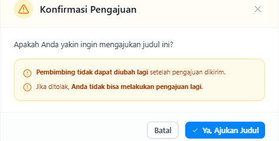

> **📷 Keterangan Gambar**: *Visual/Diagram pada 47 | P a n d u a n  P e l a k s a n a a n  T A  S i s t e m  I n f o r m a s i* (Dimensi: 461x233 px)  
> **🔍 Analisis & Arti Gambar**:  
> Gambar pendukung/ilustrasi visual pada Halaman 54 yang merepresentasikan bagan, panduan antarmuka, formulir, atau materi teknis sesuai konteks bahasan: 'Visual/Diagram pada 47 | P a n d u a n  P e l a k s a n a a n  T A  S i s t e m  I n f o r m a s i'.

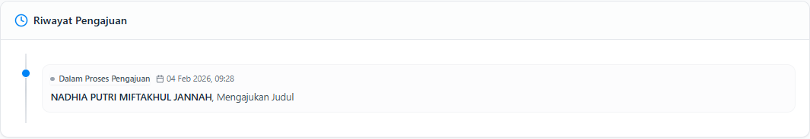

> **📷 Keterangan Gambar**: *Visual/Diagram pada 47 | P a n d u a n  P e l a k s a n a a n  T A  S i s t e m  I n f o r m a s i* (Dimensi: 1065x184 px)  
> **🔍 Analisis & Arti Gambar**:  
> Gambar pendukung/ilustrasi visual pada Halaman 54 yang merepresentasikan bagan, panduan antarmuka, formulir, atau materi teknis sesuai konteks bahasan: 'Visual/Diagram pada 47 | P a n d u a n  P e l a k s a n a a n  T A  S i s t e m  I n f o r m a s i'.

---

## 📄 Halaman 55

48 | P a n d u a n  P e l a k s a n a a n  T A  S i s t e m  I n f o r m a s i  
 
ini membantu mahasiswa memantau perkembangan pengajuan TA secara 
kronologis. 
 
Setelah Pengajuan TA mahasiswa disetujui oleh Dosen, sistem akan 
menghasilkan Formulir Kesediaan Membimbing Tugas Akhir (Form TA-01A). 
5. Menu Bimbingan 
 
Halaman Bimbingan digunakan untuk mengelola dan memantau proses 
bimbingan Tugas Akhir antara mahasiswa dan dosen pembimbing. Halaman ini 
menampilkan identitas mahasiswa, daftar dosen pembimbing, riwayat 
bimbingan, serta fasilitas pencatatan dan monitoring bimbingan. Mahasiswa 
dapat menambah riwayat pembimbingan dengan klik tombol Tambah Baru.

### 🖼️ Gambar pada Halaman 55

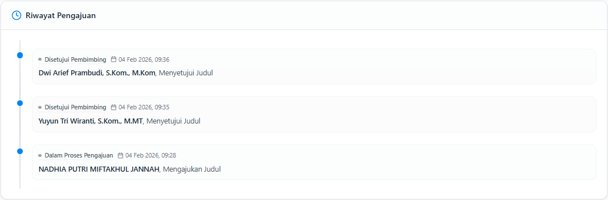

> **📷 Keterangan Gambar**: *Visual/Diagram pada 48 | P a n d u a n  P e l a k s a n a a n  T A  S i s t e m  I n f o r m a s i* (Dimensi: 1067x353 px)  
> **🔍 Analisis & Arti Gambar**:  
> Gambar pendukung/ilustrasi visual pada Halaman 55 yang merepresentasikan bagan, panduan antarmuka, formulir, atau materi teknis sesuai konteks bahasan: 'Visual/Diagram pada 48 | P a n d u a n  P e l a k s a n a a n  T A  S i s t e m  I n f o r m a s i'.

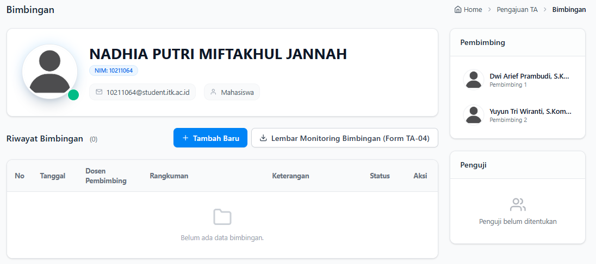

> **📷 Keterangan Gambar**: *Visual/Diagram pada 48 | P a n d u a n  P e l a k s a n a a n  T A  S i s t e m  I n f o r m a s i* (Dimensi: 1096x487 px)  
> **🔍 Analisis & Arti Gambar**:  
> Gambar pendukung/ilustrasi visual pada Halaman 55 yang merepresentasikan bagan, panduan antarmuka, formulir, atau materi teknis sesuai konteks bahasan: 'Visual/Diagram pada 48 | P a n d u a n  P e l a k s a n a a n  T A  S i s t e m  I n f o r m a s i'.

---

## 📄 Halaman 56

49 | P a n d u a n  P e l a k s a n a a n  T A  S i s t e m  I n f o r m a s i  
 
 
Ketika tombol Tambah Baru diklik, akan muncul Form Bimbingan Tugas Akhir. 
Untuk menambah riwayat bimbingan, mahasiswa harus mengisi Tanggal 
bimbingan, memilih Dosen Pembimbing, mengisi Rangkuman hasil bimbingan, 
dan menambahkan Keterangan. Selanjutnya Klik Simpan Data dan pastikan 
data muncul pada tabel Riwayat Bimbingan.

### 🖼️ Gambar pada Halaman 56

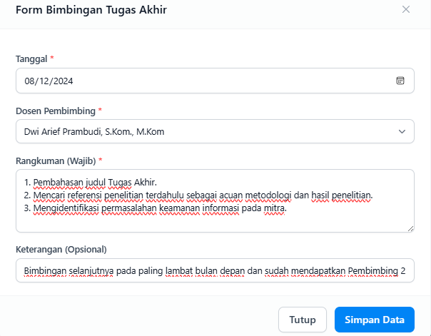

> **📷 Keterangan Gambar**: *Visual/Diagram pada 49 | P a n d u a n  P e l a k s a n a a n  T A  S i s t e m  I n f o r m a s i* (Dimensi: 604x471 px)  
> **🔍 Analisis & Arti Gambar**:  
> Gambar pendukung/ilustrasi visual pada Halaman 56 yang merepresentasikan bagan, panduan antarmuka, formulir, atau materi teknis sesuai konteks bahasan: 'Visual/Diagram pada 49 | P a n d u a n  P e l a k s a n a a n  T A  S i s t e m  I n f o r m a s i'.

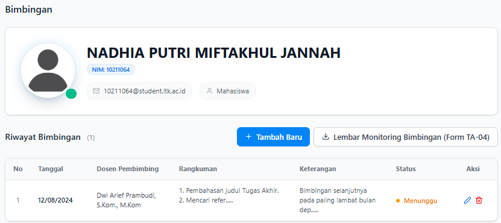

> **📷 Keterangan Gambar**: *Visual/Diagram pada 49 | P a n d u a n  P e l a k s a n a a n  T A  S i s t e m  I n f o r m a s i* (Dimensi: 831x370 px)  
> **🔍 Analisis & Arti Gambar**:  
> Gambar pendukung/ilustrasi visual pada Halaman 56 yang merepresentasikan bagan, panduan antarmuka, formulir, atau materi teknis sesuai konteks bahasan: 'Visual/Diagram pada 49 | P a n d u a n  P e l a k s a n a a n  T A  S i s t e m  I n f o r m a s i'.

---

## 📄 Halaman 57

50 | P a n d u a n  P e l a k s a n a a n  T A  S i s t e m  I n f o r m a s i  
 
 
 
Setelah riwayat pembimbingan mahasiswa disetujui oleh Pembimbing, sistem 
akan menghasilkan Lembar Monitoring Bimbingan (Form TA-04). 
 
6. Menu Seminar Proposal - Mahasiswa 
Menu Seminar Proposal digunakan oleh mahasiswa untuk melakukan 
pendaftaran seminar proposal TA ketika Periode Sempro Aktif. Mahasiswa 
mendaftar Seminar Proposal TA dengan melampirkan: 
a. Formulir Kesediaan Membimbing Tugas Akhir (Form TA-01A): dihasilkan 
oleh sistem setelah Dosen menyetujui Judul TA mahasiswa. 
b. Formulir Persetujuan Seminar Proposal Tugas Akhir (Form TA-02): 
dihasilkan oleh sistem setelah Pembimbing memberikan persetujuan 
pelaksanaan seminar proposal. 
c. Lembar Monitoring Bimbingan (Form TA-04): dihasilkan oleh sistem 
setelah Pembimbing memberikan persetujuan riwayat bimbingan. 
d. Lembar Bukti Kehadiran Seminar Proposal TA (Form TA-03D):  
Klik tombol Choose File pada bagian Lembar Bukti Kehadiran Seminar 
Proposal TA (Form TA-03D) untuk mengunggah dokumen bukti kehadiran 
seminar proposal dalam format PDF dan ukuran file tidak melebihi 5 MB. 
e. Proposal Tugas Akhir

### 🖼️ Gambar pada Halaman 57

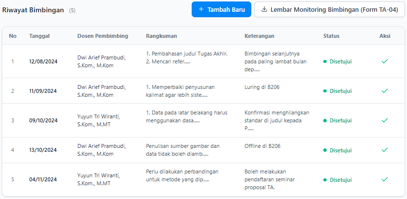

> **📷 Keterangan Gambar**: *Visual/Diagram pada 50 | P a n d u a n  P e l a k s a n a a n  T A  S i s t e m  I n f o r m a s i* (Dimensi: 826x405 px)  
> **🔍 Analisis & Arti Gambar**:  
> Gambar ini memuat lembar tanda tangan atau cap pengesahan resmi dari dosen pembimbing, penguji, atau koordinator program studi yang membuktikan keabsahan dokumen tugas akhir.

---

## 📄 Halaman 58

51 | P a n d u a n  P e l a k s a n a a n  T A  S i s t e m  I n f o r m a s i  
 
Klik tombol Choose File pada bagian Proposal Tugas Akhir untuk 
mengunggah file proposal Tugas Akhir dalam format PDF dan ukuran file 
tidak melebihi 10 MB. 
f. Bukti Plagiasi (Turnitin) 
Klik tombol Choose File pada bagian Bukti Plagiasi (Turnitin) untuk 
mengunggah hasil pengecekan plagiasi dalam format PDF dan ukuran file 
tidak melebihi 10 MB. 
 
 
 
Setelah semua komponen terisi, klik tombol Submit untuk mengirimkan 
pendaftaran seminar proposal. Sistem akan memproses data dan memperbarui 
status pendaftaran seminar proposal.

### 🖼️ Gambar pada Halaman 58

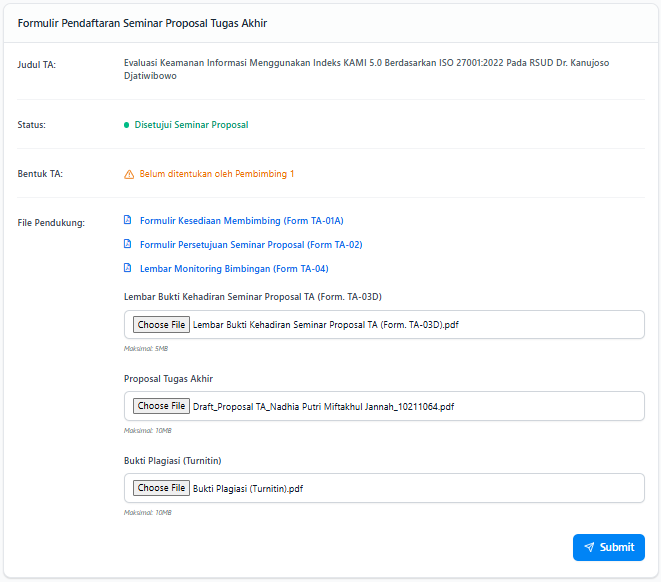

> **📷 Keterangan Gambar**: *Visual/Diagram pada 51 | P a n d u a n  P e l a k s a n a a n  T A  S i s t e m  I n f o r m a s i* (Dimensi: 661x582 px)  
> **🔍 Analisis & Arti Gambar**:  
> Gambar pendukung/ilustrasi visual pada Halaman 58 yang merepresentasikan bagan, panduan antarmuka, formulir, atau materi teknis sesuai konteks bahasan: 'Visual/Diagram pada 51 | P a n d u a n  P e l a k s a n a a n  T A  S i s t e m  I n f o r m a s i'.

---

## 📄 Halaman 59

52 | P a n d u a n  P e l a k s a n a a n  T A  S i s t e m  I n f o r m a s i  
 
Ketika Program Studi sudah melakukan penjadwalan, mahasiswa dapat melihat 
Pembimbing TA, Penguji TA, serta Waktu dan Tempat pelaksanaan Seminar 
Proposal TA. 
 
7. Menu Sidang TA 
Menu Sidang TA digunakan oleh mahasiswa untuk melakukan pendaftaran 
Sidang TA ketika Periode TA Aktif. Mahasiswa mendaftar Sidang TA dengan 
melampirkan: 
a. Lembar Persetujuan Revisi Proposal TA: dihasilkan oleh sistem setelah 
Dosen memberikan persetujuan revisi Proposal TA mahasiswa. 
b. Lembar Monitoring Bimbingan (Form TA-04): dihasilkan oleh sistem 
setelah Pembimbing memberikan persetujuan riwayat bimbingan. 
c. Formulir Persetujuan Sidang Tugas Akhir (Form TA-05): dihasilkan oleh 
sistem setelah Pembimbing memberikan persetujuan pelaksanaan Sidang 
TA. 
d. Draft Laporan Tugas Akhir  
Klik tombol Choose File pada bagian Draft Laporan Tugas Akhir untuk 
mengunggah file proposal Tugas Akhir dalam format PDF dan ukuran file 
tidak melebihi 14 MB. 
e. Bukti Plagiasi (Turnitin) 
Klik tombol Choose File pada bagian Bukti Plagiasi (Turnitin) untuk 
mengunggah hasil pengecekan plagiasi dalam format PDF dan ukuran file 
tidak melebihi 10 MB. 
Setelah semua komponen terisi, klik tombol Submit Pendaftaran untuk 
mengirimkan pendaftaran Sidang TA. Sistem akan memproses data dan 
memperbarui status pendaftaran Sidang TA.

### 🖼️ Gambar pada Halaman 59

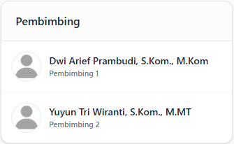

> **📷 Keterangan Gambar**: *Visual/Diagram pada 52 | P a n d u a n  P e l a k s a n a a n  T A  S i s t e m  I n f o r m a s i* (Dimensi: 335x206 px)  
> **🔍 Analisis & Arti Gambar**:  
> Gambar ini memuat lembar tanda tangan atau cap pengesahan resmi dari dosen pembimbing, penguji, atau koordinator program studi yang membuktikan keabsahan dokumen tugas akhir.

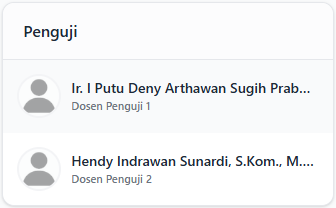

> **📷 Keterangan Gambar**: *Visual/Diagram pada 52 | P a n d u a n  P e l a k s a n a a n  T A  S i s t e m  I n f o r m a s i* (Dimensi: 336x208 px)  
> **🔍 Analisis & Arti Gambar**:  
> Gambar ini memuat lembar tanda tangan atau cap pengesahan resmi dari dosen pembimbing, penguji, atau koordinator program studi yang membuktikan keabsahan dokumen tugas akhir.

> **📷 Keterangan Gambar**: *Visual/Diagram pada 52 | P a n d u a n  P e l a k s a n a a n  T A  S i s t e m  I n f o r m a s i* (Dimensi: 334x265 px)  
> **🔍 Analisis & Arti Gambar**:  
> Gambar ini memuat lembar tanda tangan atau cap pengesahan resmi dari dosen pembimbing, penguji, atau koordinator program studi yang membuktikan keabsahan dokumen tugas akhir.

---

## 📄 Halaman 60

53 | P a n d u a n  P e l a k s a n a a n  T A  S i s t e m  I n f o r m a s i  
 
 
Ketika Program Studi sudah melakukan penjadwalan, mahasiswa dapat melihat 
Pembimbing TA, Penguji TA, serta Waktu dan Tempat pelaksanaan Sidang TA. 
 
Setelah revisi TA disetujui oleh Tim Penguji, sistem akan menghasilkan Lembar 
Pengesahan Tugas Akhir.

### 🖼️ Gambar pada Halaman 60

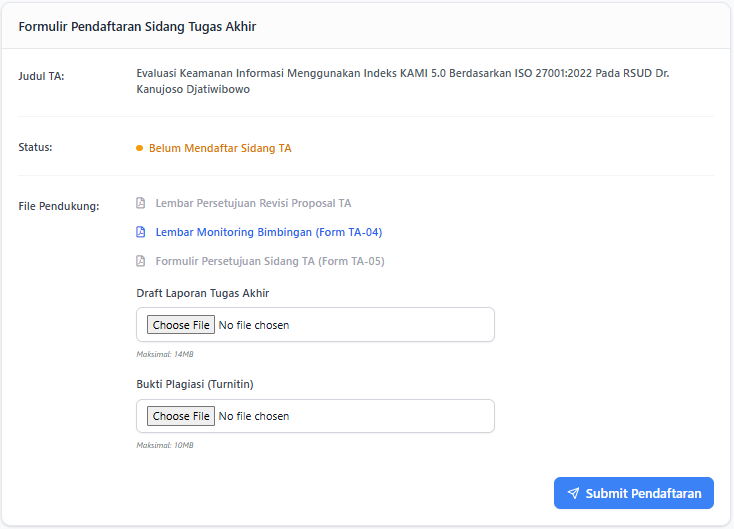

> **📷 Keterangan Gambar**: *Visual/Diagram pada 53 | P a n d u a n  P e l a k s a n a a n  T A  S i s t e m  I n f o r m a s i* (Dimensi: 734x529 px)  
> **🔍 Analisis & Arti Gambar**:  
> Gambar ini memuat lembar tanda tangan atau cap pengesahan resmi dari dosen pembimbing, penguji, atau koordinator program studi yang membuktikan keabsahan dokumen tugas akhir.

> **📷 Keterangan Gambar**: *Visual/Diagram pada 53 | P a n d u a n  P e l a k s a n a a n  T A  S i s t e m  I n f o r m a s i* (Dimensi: 335x206 px)  
> **🔍 Analisis & Arti Gambar**:  
> Gambar ini memuat lembar tanda tangan atau cap pengesahan resmi dari dosen pembimbing, penguji, atau koordinator program studi yang membuktikan keabsahan dokumen tugas akhir.

> **📷 Keterangan Gambar**: *Visual/Diagram pada 53 | P a n d u a n  P e l a k s a n a a n  T A  S i s t e m  I n f o r m a s i* (Dimensi: 336x208 px)  
> **🔍 Analisis & Arti Gambar**:  
> Gambar ini memuat lembar tanda tangan atau cap pengesahan resmi dari dosen pembimbing, penguji, atau koordinator program studi yang membuktikan keabsahan dokumen tugas akhir.

> **📷 Keterangan Gambar**: *Visual/Diagram pada 53 | P a n d u a n  P e l a k s a n a a n  T A  S i s t e m  I n f o r m a s i* (Dimensi: 334x265 px)  
> **🔍 Analisis & Arti Gambar**:  
> Gambar ini memuat lembar tanda tangan atau cap pengesahan resmi dari dosen pembimbing, penguji, atau koordinator program studi yang membuktikan keabsahan dokumen tugas akhir.

> **📷 Keterangan Gambar**: *Visual/Diagram pada 53 | P a n d u a n  P e l a k s a n a a n  T A  S i s t e m  I n f o r m a s i* (Dimensi: 696x263 px)  
> **🔍 Analisis & Arti Gambar**:  
> Gambar ini memuat lembar tanda tangan atau cap pengesahan resmi dari dosen pembimbing, penguji, atau koordinator program studi yang membuktikan keabsahan dokumen tugas akhir.

---

## 📄 Halaman 61

54 | P a n d u a n  P e l a k s a n a a n  T A  S i s t e m  I n f o r m a s i  
 
PANDUAN PENGGUNA ADMIN 
1. Menu Periode 
Menu Periode digunakan untuk memilih tahapan TA 
dalam sistem. Pada menu Periode terdapat dua 
submenu yaitu Periode Sempro dan Periode TA. 
 
2. Periode Sempro 
Periode Sempro digunakan untuk aktivitas yang berkaitan dengan Pendaftaran 
Seminar Proposal TA yaitu menambahkan periode sempro dan melakukan 
verifikasi terhadap berkas persyaratan sempro yang dimiliki mahasiswa. Periode 
Sempro dapat ditambahkan dengan klik tombol Tambah Periode. 
 
Periode diisi dengan memilih Semester (Gasal atau Genap), mengisi Periode 
tahun akademik yang sedang berjalan, dan gelombang berapa. Selanjutnya klik 
tombol Simpan Data. 
 
Periode Sempro yang telah tersimpan juga dapat dilakukan pengeditan 
dan penghapusan dengan menekan tombol pada kolom Aksi.

### 🖼️ Gambar pada Halaman 61

> **📷 Keterangan Gambar**: *Visual/Diagram pada 54 | P a n d u a n  P e l a k s a n a a n  T A  S i s t e m  I n f o r m a s i* (Dimensi: 1058x290 px)  
> **🔍 Analisis & Arti Gambar**:  
> Gambar pendukung/ilustrasi visual pada Halaman 61 yang merepresentasikan bagan, panduan antarmuka, formulir, atau materi teknis sesuai konteks bahasan: 'Visual/Diagram pada 54 | P a n d u a n  P e l a k s a n a a n  T A  S i s t e m  I n f o r m a s i'.

> **📷 Keterangan Gambar**: *Visual/Diagram pada 54 | P a n d u a n  P e l a k s a n a a n  T A  S i s t e m  I n f o r m a s i* (Dimensi: 527x306 px)  
> **🔍 Analisis & Arti Gambar**:  
> Gambar pendukung/ilustrasi visual pada Halaman 61 yang merepresentasikan bagan, panduan antarmuka, formulir, atau materi teknis sesuai konteks bahasan: 'Visual/Diagram pada 54 | P a n d u a n  P e l a k s a n a a n  T A  S i s t e m  I n f o r m a s i'.

> **📷 Keterangan Gambar**: *Visual/Diagram pada 54 | P a n d u a n  P e l a k s a n a a n  T A  S i s t e m  I n f o r m a s i* (Dimensi: 181x95 px)  
> **🔍 Analisis & Arti Gambar**:  
> Gambar pendukung/ilustrasi visual pada Halaman 61 yang merepresentasikan bagan, panduan antarmuka, formulir, atau materi teknis sesuai konteks bahasan: 'Visual/Diagram pada 54 | P a n d u a n  P e l a k s a n a a n  T A  S i s t e m  I n f o r m a s i'.

---

## 📄 Halaman 62

55 | P a n d u a n  P e l a k s a n a a n  T A  S i s t e m  I n f o r m a s i  
 
 
Selanjutnya, untuk proses verifikasi berkas pendaftaran seminar proposal TA 
mahasiswa dapat dilakukan dengan klik tombol Lihat Mahasiswa pada Periode 
Sempro yang sesuai. Selanjutnya, sistem akan menampilkan List Pendaftar 
Seminar Proposal sesuai dengan gelombang yang dipilih. 
 
 
Pada halaman List Pendaftar Seminar Proposal sistem menawarkan tiga 
pilihan aksi. Pilih aksi Terima jika berkas pendaftaran sudah sesuai. Pilih aksi 
Tolak jika terdapat kesalahan mayor pada berkas pendaftaran, misalnya 
melakukan kecurangan. Dan pilih aksi Revisi jika terdapat kekurangan minor 
pada berkas pendaftaran.

### 🖼️ Gambar pada Halaman 62

> **📷 Keterangan Gambar**: *Visual/Diagram pada 55 | P a n d u a n  P e l a k s a n a a n  T A  S i s t e m  I n f o r m a s i* (Dimensi: 517x296 px)  
> **🔍 Analisis & Arti Gambar**:  
> Gambar pendukung/ilustrasi visual pada Halaman 62 yang merepresentasikan bagan, panduan antarmuka, formulir, atau materi teknis sesuai konteks bahasan: 'Visual/Diagram pada 55 | P a n d u a n  P e l a k s a n a a n  T A  S i s t e m  I n f o r m a s i'.

> **📷 Keterangan Gambar**: *Visual/Diagram pada 55 | P a n d u a n  P e l a k s a n a a n  T A  S i s t e m  I n f o r m a s i* (Dimensi: 1116x439 px)  
> **🔍 Analisis & Arti Gambar**:  
> Gambar pendukung/ilustrasi visual pada Halaman 62 yang merepresentasikan bagan, panduan antarmuka, formulir, atau materi teknis sesuai konteks bahasan: 'Visual/Diagram pada 55 | P a n d u a n  P e l a k s a n a a n  T A  S i s t e m  I n f o r m a s i'.

> **📷 Keterangan Gambar**: *Visual/Diagram pada 55 | P a n d u a n  P e l a k s a n a a n  T A  S i s t e m  I n f o r m a s i* (Dimensi: 172x78 px)  
> **🔍 Analisis & Arti Gambar**:  
> Gambar pendukung/ilustrasi visual pada Halaman 62 yang merepresentasikan bagan, panduan antarmuka, formulir, atau materi teknis sesuai konteks bahasan: 'Visual/Diagram pada 55 | P a n d u a n  P e l a k s a n a a n  T A  S i s t e m  I n f o r m a s i'.

---

## 📄 Halaman 63

56 | P a n d u a n  P e l a k s a n a a n  T A  S i s t e m  I n f o r m a s i  
 
 
Jika aksi Revisi dipilih, maka sistem akan menampilkan pop-up yang meminta 
alasan revisi. Setelah alasan revisi diisi, klik tombol Submit. Atau klik Tutup 
untuk membatalkan revisi. Sistem akan menutup pop-up dan memperbarui status 
sesuai pilihan pengguna. 
 
 
3. Periode TA 
Periode TA digunakan untuk aktivitas yang berkaitan dengan Pendaftaran 
Sidang TA yaitu menambahkan periode TA dan melakukan verifikasi terhadap 
berkas persyaratan Sidang TA yang dimiliki mahasiswa. Periode TA dapat 
ditambahkan dengan klik tombol Tambah Periode.

### 🖼️ Gambar pada Halaman 63

> **📷 Keterangan Gambar**: *Visual/Diagram pada 56 | P a n d u a n  P e l a k s a n a a n  T A  S i s t e m  I n f o r m a s i* (Dimensi: 492x242 px)  
> **🔍 Analisis & Arti Gambar**:  
> Gambar pendukung/ilustrasi visual pada Halaman 63 yang merepresentasikan bagan, panduan antarmuka, formulir, atau materi teknis sesuai konteks bahasan: 'Visual/Diagram pada 56 | P a n d u a n  P e l a k s a n a a n  T A  S i s t e m  I n f o r m a s i'.

> **📷 Keterangan Gambar**: *Visual/Diagram pada 56 | P a n d u a n  P e l a k s a n a a n  T A  S i s t e m  I n f o r m a s i* (Dimensi: 1132x365 px)  
> **🔍 Analisis & Arti Gambar**:  
> Gambar pendukung/ilustrasi visual pada Halaman 63 yang merepresentasikan bagan, panduan antarmuka, formulir, atau materi teknis sesuai konteks bahasan: 'Visual/Diagram pada 56 | P a n d u a n  P e l a k s a n a a n  T A  S i s t e m  I n f o r m a s i'.

> **📷 Keterangan Gambar**: *Visual/Diagram pada 56 | P a n d u a n  P e l a k s a n a a n  T A  S i s t e m  I n f o r m a s i* (Dimensi: 1068x292 px)  
> **🔍 Analisis & Arti Gambar**:  
> Gambar pendukung/ilustrasi visual pada Halaman 63 yang merepresentasikan bagan, panduan antarmuka, formulir, atau materi teknis sesuai konteks bahasan: 'Visual/Diagram pada 56 | P a n d u a n  P e l a k s a n a a n  T A  S i s t e m  I n f o r m a s i'.

---

## 📄 Halaman 64

57 | P a n d u a n  P e l a k s a n a a n  T A  S i s t e m  I n f o r m a s i  
 
Periode diisi dengan memilih Semester (Gasal atau Genap), mengisi Periode 
tahun akademik yang sedang berjalan, dan gelombang berapa. Selanjutnya klik 
tombol Simpan Data. 
 
 
Periode TA yang telah tersimpan juga dapat dilakukan pengeditan 
dan penghapusan dengan menekan tombol pada kolom Aksi. 
 
Selanjutnya, untuk proses verifikasi berkas pendaftaran Sidang TA mahasiswa 
dapat dilakukan dengan klik tombol Lihat Mahasiswa pada Periode TA yang 
sesuai. Selanjutnya, sistem akan menampilkan List Pendaftar Sidang TA 
sesuai dengan gelombang yang dipilih. 
 
 
Pada halaman List Pendaftar Sidang TA sistem menawarkan tiga pilihan aksi. 
Pilih aksi Terima jika berkas pendaftaran sudah sesuai. Pilih aksi Tolak jika

### 🖼️ Gambar pada Halaman 64

> **📷 Keterangan Gambar**: *Visual/Diagram pada 57 | P a n d u a n  P e l a k s a n a a n  T A  S i s t e m  I n f o r m a s i* (Dimensi: 508x289 px)  
> **🔍 Analisis & Arti Gambar**:  
> Gambar pendukung/ilustrasi visual pada Halaman 64 yang merepresentasikan bagan, panduan antarmuka, formulir, atau materi teknis sesuai konteks bahasan: 'Visual/Diagram pada 57 | P a n d u a n  P e l a k s a n a a n  T A  S i s t e m  I n f o r m a s i'.

> **📷 Keterangan Gambar**: *Visual/Diagram pada 57 | P a n d u a n  P e l a k s a n a a n  T A  S i s t e m  I n f o r m a s i* (Dimensi: 517x296 px)  
> **🔍 Analisis & Arti Gambar**:  
> Gambar pendukung/ilustrasi visual pada Halaman 64 yang merepresentasikan bagan, panduan antarmuka, formulir, atau materi teknis sesuai konteks bahasan: 'Visual/Diagram pada 57 | P a n d u a n  P e l a k s a n a a n  T A  S i s t e m  I n f o r m a s i'.

> **📷 Keterangan Gambar**: *Visual/Diagram pada 57 | P a n d u a n  P e l a k s a n a a n  T A  S i s t e m  I n f o r m a s i* (Dimensi: 990x174 px)  
> **🔍 Analisis & Arti Gambar**:  
> Gambar pendukung/ilustrasi visual pada Halaman 64 yang merepresentasikan bagan, panduan antarmuka, formulir, atau materi teknis sesuai konteks bahasan: 'Visual/Diagram pada 57 | P a n d u a n  P e l a k s a n a a n  T A  S i s t e m  I n f o r m a s i'.

---

## 📄 Halaman 65

58 | P a n d u a n  P e l a k s a n a a n  T A  S i s t e m  I n f o r m a s i  
 
terdapat kesalahan mayor pada berkas pendaftaran, misalnya melakukan 
kecurangan. Dan pilih aksi Revisi jika terdapat kekurangan minor pada berkas 
pendaftaran. 
 
 
Jika aksi Revisi dipilih, maka sistem akan menampilkan pop-up yang meminta 
alasan revisi. Setelah alasan revisi diisi, klik tombol Submit. Atau klik Tutup 
untuk membatalkan revisi. Sistem akan menutup pop-up dan memperbarui status 
sesuai pilihan pengguna. 
 
 
 
4. Menu Jadwal 
Menu Jadwal digunakan untuk memilih penjadwalan 
TA dalam sistem. Pada menu Jadwal terdapat dua 
submenu yaitu Jadwal Sempro dan Jadwal TA. 
 
5. Jadwal Sempro 
Jadwal Sempro digunakan untuk mengatur jadwal pelaksanaan Seminar 
Proposal TA dan status penayangan jadwal. Informasi yang ditampilkan pada 
halaman ini meliputi: 
a. No: Nomor urut data gelombang. 
b. Periode: Tahun akademik pelaksanaan seminar. 
c. Gelombang: Nomor gelombang seminar.

### 🖼️ Gambar pada Halaman 65

> **📷 Keterangan Gambar**: *Visual/Diagram pada 58 | P a n d u a n  P e l a k s a n a a n  T A  S i s t e m  I n f o r m a s i* (Dimensi: 172x78 px)  
> **🔍 Analisis & Arti Gambar**:  
> Gambar pendukung/ilustrasi visual pada Halaman 65 yang merepresentasikan bagan, panduan antarmuka, formulir, atau materi teknis sesuai konteks bahasan: 'Visual/Diagram pada 58 | P a n d u a n  P e l a k s a n a a n  T A  S i s t e m  I n f o r m a s i'.

> **📷 Keterangan Gambar**: *Visual/Diagram pada 58 | P a n d u a n  P e l a k s a n a a n  T A  S i s t e m  I n f o r m a s i* (Dimensi: 492x202 px)  
> **🔍 Analisis & Arti Gambar**:  
> Gambar pendukung/ilustrasi visual pada Halaman 65 yang merepresentasikan bagan, panduan antarmuka, formulir, atau materi teknis sesuai konteks bahasan: 'Visual/Diagram pada 58 | P a n d u a n  P e l a k s a n a a n  T A  S i s t e m  I n f o r m a s i'.

> **📷 Keterangan Gambar**: *Visual/Diagram pada 58 | P a n d u a n  P e l a k s a n a a n  T A  S i s t e m  I n f o r m a s i* (Dimensi: 346x338 px)  
> **🔍 Analisis & Arti Gambar**:  
> Gambar pendukung/ilustrasi visual pada Halaman 65 yang merepresentasikan bagan, panduan antarmuka, formulir, atau materi teknis sesuai konteks bahasan: 'Visual/Diagram pada 58 | P a n d u a n  P e l a k s a n a a n  T A  S i s t e m  I n f o r m a s i'.

> **📷 Keterangan Gambar**: *Visual/Diagram pada 58 | P a n d u a n  P e l a k s a n a a n  T A  S i s t e m  I n f o r m a s i* (Dimensi: 201x113 px)  
> **🔍 Analisis & Arti Gambar**:  
> Gambar pendukung/ilustrasi visual pada Halaman 65 yang merepresentasikan bagan, panduan antarmuka, formulir, atau materi teknis sesuai konteks bahasan: 'Visual/Diagram pada 58 | P a n d u a n  P e l a k s a n a a n  T A  S i s t e m  I n f o r m a s i'.

---

## 📄 Halaman 66

59 | P a n d u a n  P e l a k s a n a a n  T A  S i s t e m  I n f o r m a s i  
 
d. Jadwal: Tombol untuk mengatur dan melihat detail jadwal Seminar Proposal 
TA. 
e. Tampilkan Jadwal: Sakelar (toggle) untuk mengatur penayangan jadwal. 
Aktif (ON) untuk menampilkan jadwal kepada mahasiswa dan memunculkan 
jadwal pada dashboard Dosen. Nonaktif (OFF) untuk menyembunyikan 
jadwal. 
f. Status: Menunjukkan status gelombang (Active atau Nonactive). 
 
 
Untuk mengatur jadwal Seminar Proposal TA: 
6. Klik tombol Lihat Jadwal pada Periode Sempro yang sesuai. 
7. Sistem akan menampilkan List Mahasiswa Pendaftar sesuai dengan 
gelombang yang dipilih. 
8. Klik tombol Edit. 
9. Pilih Penguji 1 dan Penguji 2. 
10. Pilih tanggal serta tentukan waktu mulai dan waktu selesai pelaksanaan 
Seminar Proposal TA. 
11. Klik tombol Simpan. 
 
 
Selain mengatur dan melihat jadwal Seminar Proposal TA, pada menu Jadwal 
Sempro juga dapat dilakukan:

### 🖼️ Gambar pada Halaman 66

> **📷 Keterangan Gambar**: *Visual/Diagram pada 59 | P a n d u a n  P e l a k s a n a a n  T A  S i s t e m  I n f o r m a s i* (Dimensi: 1096x313 px)  
> **🔍 Analisis & Arti Gambar**:  
> Gambar pendukung/ilustrasi visual pada Halaman 66 yang merepresentasikan bagan, panduan antarmuka, formulir, atau materi teknis sesuai konteks bahasan: 'Visual/Diagram pada 59 | P a n d u a n  P e l a k s a n a a n  T A  S i s t e m  I n f o r m a s i'.

> **📷 Keterangan Gambar**: *Visual/Diagram pada 59 | P a n d u a n  P e l a k s a n a a n  T A  S i s t e m  I n f o r m a s i* (Dimensi: 1115x302 px)  
> **🔍 Analisis & Arti Gambar**:  
> Gambar pendukung/ilustrasi visual pada Halaman 66 yang merepresentasikan bagan, panduan antarmuka, formulir, atau materi teknis sesuai konteks bahasan: 'Visual/Diagram pada 59 | P a n d u a n  P e l a k s a n a a n  T A  S i s t e m  I n f o r m a s i'.

---

## 📄 Halaman 67

60 | P a n d u a n  P e l a k s a n a a n  T A  S i s t e m  I n f o r m a s i  
 
a. Klik tombol Riwayat Kelulusan untuk melihat Nilai dan Status Kelulusan 
mahasiswa serta Berita Acara Seminar Proposal Tugas Akhir (FormTA-03B). 
 
 
b. Klik tombol Export Excel untuk ekspor jadwal ke file Excel. 
 
 
c. Klik tombol Monitoring Status untuk memantau proses Seminar Proposal TA

### 🖼️ Gambar pada Halaman 67

> **📷 Keterangan Gambar**: *Visual/Diagram pada 60 | P a n d u a n  P e l a k s a n a a n  T A  S i s t e m  I n f o r m a s i* (Dimensi: 1129x502 px)  
> **🔍 Analisis & Arti Gambar**:  
> Gambar pendukung/ilustrasi visual pada Halaman 67 yang merepresentasikan bagan, panduan antarmuka, formulir, atau materi teknis sesuai konteks bahasan: 'Visual/Diagram pada 60 | P a n d u a n  P e l a k s a n a a n  T A  S i s t e m  I n f o r m a s i'.

> **📷 Keterangan Gambar**: *Visual/Diagram pada 60 | P a n d u a n  P e l a k s a n a a n  T A  S i s t e m  I n f o r m a s i* (Dimensi: 1365x436 px)  
> **🔍 Analisis & Arti Gambar**:  
> Gambar pendukung/ilustrasi visual pada Halaman 67 yang merepresentasikan bagan, panduan antarmuka, formulir, atau materi teknis sesuai konteks bahasan: 'Visual/Diagram pada 60 | P a n d u a n  P e l a k s a n a a n  T A  S i s t e m  I n f o r m a s i'.

> **📷 Keterangan Gambar**: *Visual/Diagram pada 60 | P a n d u a n  P e l a k s a n a a n  T A  S i s t e m  I n f o r m a s i* (Dimensi: 1122x533 px)  
> **🔍 Analisis & Arti Gambar**:  
> Gambar pendukung/ilustrasi visual pada Halaman 67 yang merepresentasikan bagan, panduan antarmuka, formulir, atau materi teknis sesuai konteks bahasan: 'Visual/Diagram pada 60 | P a n d u a n  P e l a k s a n a a n  T A  S i s t e m  I n f o r m a s i'.

---

## 📄 Halaman 68

61 | P a n d u a n  P e l a k s a n a a n  T A  S i s t e m  I n f o r m a s i  
 
 
d. Klik tombol Download Jadwal untuk ekspor jadwal ke file PDF. 
 
 
6. Jadwal TA 
Jadwal TA digunakan untuk mengatur jadwal pelaksanaan Sidang TA dan status 
penayangan jadwal. Informasi yang ditampilkan pada halaman ini meliputi: 
a. No: Nomor urut data gelombang. 
b. Periode: Tahun akademik pelaksanaan Sidang TA. 
c. Gelombang: Nomor gelombang Sidang TA. 
d. Jadwal: Tombol untuk mengatur dan melihat detail jadwal Sidang TA. 
e. Tampilkan Jadwal: Sakelar (toggle) untuk mengatur penayangan jadwal. 
Aktif (ON) untuk menampilkan jadwal kepada mahasiswa dan memunculkan 
jadwal pada dashboard Dosen. Nonaktif (OFF) untuk menyembunyikan 
jadwal. 
f. Status: Menunjukkan status gelombang (Active atau Nonactive).

### 🖼️ Gambar pada Halaman 68

> **📷 Keterangan Gambar**: *Visual/Diagram pada 61 | P a n d u a n  P e l a k s a n a a n  T A  S i s t e m  I n f o r m a s i* (Dimensi: 1299x552 px)  
> **🔍 Analisis & Arti Gambar**:  
> Gambar pendukung/ilustrasi visual pada Halaman 68 yang merepresentasikan bagan, panduan antarmuka, formulir, atau materi teknis sesuai konteks bahasan: 'Visual/Diagram pada 61 | P a n d u a n  P e l a k s a n a a n  T A  S i s t e m  I n f o r m a s i'.

> **📷 Keterangan Gambar**: *Visual/Diagram pada 61 | P a n d u a n  P e l a k s a n a a n  T A  S i s t e m  I n f o r m a s i* (Dimensi: 1126x254 px)  
> **🔍 Analisis & Arti Gambar**:  
> Gambar pendukung/ilustrasi visual pada Halaman 68 yang merepresentasikan bagan, panduan antarmuka, formulir, atau materi teknis sesuai konteks bahasan: 'Visual/Diagram pada 61 | P a n d u a n  P e l a k s a n a a n  T A  S i s t e m  I n f o r m a s i'.

---

## 📄 Halaman 69

62 | P a n d u a n  P e l a k s a n a a n  T A  S i s t e m  I n f o r m a s i  
 
Untuk mengatur jadwal Sidang TA: 
1. Klik tombol Lihat Jadwal pada Periode TA yang sesuai. 
2. Sistem akan menampilkan List Mahasiswa Pendaftar sesuai dengan 
gelombang yang dipilih. 
3. Klik tombol Edit. 
4. Pilih Penguji 1 dan Penguji 2. 
5. Pilih tanggal serta tentukan waktu mulai dan waktu selesai pelaksanaan 
Seminar Proposal TA. 
6. Klik tombol Simpan. 
 
 
Selain mengatur dan melihat jadwal Sidang TA, pada menu Jadwal TA juga dapat 
dilakukan: 
a. Klik tombol Riwayat Kelulusan untuk melihat Nilai dan Status Kelulusan 
mahasiswa serta Berita Acara Sidang Tugas Akhir (FormTA-06A).

### 🖼️ Gambar pada Halaman 69

> **📷 Keterangan Gambar**: *Visual/Diagram pada 62 | P a n d u a n  P e l a k s a n a a n  T A  S i s t e m  I n f o r m a s i* (Dimensi: 972x374 px)  
> **🔍 Analisis & Arti Gambar**:  
> Gambar pendukung/ilustrasi visual pada Halaman 69 yang merepresentasikan bagan, panduan antarmuka, formulir, atau materi teknis sesuai konteks bahasan: 'Visual/Diagram pada 62 | P a n d u a n  P e l a k s a n a a n  T A  S i s t e m  I n f o r m a s i'.

> **📷 Keterangan Gambar**: *Visual/Diagram pada 62 | P a n d u a n  P e l a k s a n a a n  T A  S i s t e m  I n f o r m a s i* (Dimensi: 1121x407 px)  
> **🔍 Analisis & Arti Gambar**:  
> Gambar pendukung/ilustrasi visual pada Halaman 69 yang merepresentasikan bagan, panduan antarmuka, formulir, atau materi teknis sesuai konteks bahasan: 'Visual/Diagram pada 62 | P a n d u a n  P e l a k s a n a a n  T A  S i s t e m  I n f o r m a s i'.

---

## 📄 Halaman 70

63 | P a n d u a n  P e l a k s a n a a n  T A  S i s t e m  I n f o r m a s i  
 
b. Klik tombol Export Excel untuk ekspor jadwal ke file Excel. 
 
 
c. Klik tombol Monitoring Status untuk memantau proses Sidang TA 
 
 
d. Klik tombol Download Jadwal untuk ekspor jadwal ke file PDF.

### 🖼️ Gambar pada Halaman 70

> **📷 Keterangan Gambar**: *Visual/Diagram pada 63 | P a n d u a n  P e l a k s a n a a n  T A  S i s t e m  I n f o r m a s i* (Dimensi: 1365x227 px)  
> **🔍 Analisis & Arti Gambar**:  
> Gambar pendukung/ilustrasi visual pada Halaman 70 yang merepresentasikan bagan, panduan antarmuka, formulir, atau materi teknis sesuai konteks bahasan: 'Visual/Diagram pada 63 | P a n d u a n  P e l a k s a n a a n  T A  S i s t e m  I n f o r m a s i'.

> **📷 Keterangan Gambar**: *Visual/Diagram pada 63 | P a n d u a n  P e l a k s a n a a n  T A  S i s t e m  I n f o r m a s i* (Dimensi: 1120x520 px)  
> **🔍 Analisis & Arti Gambar**:  
> Gambar pendukung/ilustrasi visual pada Halaman 70 yang merepresentasikan bagan, panduan antarmuka, formulir, atau materi teknis sesuai konteks bahasan: 'Visual/Diagram pada 63 | P a n d u a n  P e l a k s a n a a n  T A  S i s t e m  I n f o r m a s i'.

> **📷 Keterangan Gambar**: *Visual/Diagram pada 63 | P a n d u a n  P e l a k s a n a a n  T A  S i s t e m  I n f o r m a s i* (Dimensi: 1366x582 px)  
> **🔍 Analisis & Arti Gambar**:  
> Gambar pendukung/ilustrasi visual pada Halaman 70 yang merepresentasikan bagan, panduan antarmuka, formulir, atau materi teknis sesuai konteks bahasan: 'Visual/Diagram pada 63 | P a n d u a n  P e l a k s a n a a n  T A  S i s t e m  I n f o r m a s i'.

---

## 📄 Halaman 71

64 | P a n d u a n  P e l a k s a n a a n  T A  S i s t e m  I n f o r m a s i  
 
7. Pengumuman 
Menu Daftar Pengumuman digunakan untuk mengelola seluruh pengumuman 
yang dipublikasikan pada Sistem Informasi Manajemen Tugas Akhir. Melalui 
menu ini, pengguna yang memiliki hak akses dapat membuat, mencari, 
memfilter, mengubah, mengarsipkan, maupun menghapus pengumuman. 
 
Cara Melihat Daftar Pengumuman 
1. Login ke sistem.  
2. Pilih menu Pengumuman.  
3. Sistem akan menampilkan seluruh daftar pengumuman yang telah dibuat. 
Informasi yang ditampilkan meliputi: 
• Judul pengumuman  
• Kategori  
• Sasaran pengumuman  
• Pembuat pengumuman  
• Tanggal publikasi  
• Status pengumuman  
 
Cara Membuat Pengumuman Baru 
1. Klik tombol Buat Pengumuman.  
2. Isi seluruh informasi pengumuman, seperti:  
• Judul  
• Kategori  
• Isi pengumuman

### 🖼️ Gambar pada Halaman 71

> **📷 Keterangan Gambar**: *Visual/Diagram pada 64 | P a n d u a n  P e l a k s a n a a n  T A  S i s t e m  I n f o r m a s i* (Dimensi: 1051x423 px)  
> **🔍 Analisis & Arti Gambar**:  
> Gambar ini merupakan tangkapan layar (screenshot) implementasi antarmuka pengguna (UI) sistem informasi, memperlihatkan tata letak visual, form input, tabel ringkasan data, dan navigasi menu.

---

## 📄 Halaman 72

65 | P a n d u a n  P e l a k s a n a a n  T A  S i s t e m  I n f o r m a s i  
 
• Sasaran penerima  
3. Klik tombol Publikasikan.  
4. Sistem akan menyimpan dan menampilkan pengumuman pada daftar 
pengumuman.  
 
Cara Mencari Pengumuman 
1. Klik kolom Cari judul/isi.  
2. Masukkan kata kunci yang ingin dicari.  
3. Sistem akan menampilkan pengumuman yang sesuai dengan kata kunci 
tersebut.  
 
Cara Memfilter Pengumuman 
Filter Berdasarkan Kategori 
1. Klik Semua Kategori.  
2. Pilih kategori yang diinginkan.  
3. Sistem akan menampilkan pengumuman sesuai kategori.  
 
Filter Berdasarkan Angkatan 
1. Klik Semua Angkatan.  
2. Pilih angkatan mahasiswa.  
3. Sistem akan menampilkan pengumuman yang ditujukan untuk angkatan 
tersebut.  
 
Filter Berdasarkan Status 
1. Klik Status.  
2. Pilih status yang diinginkan, misalnya:  
• Aktif  
• Tidak Aktif  
• Arsip  
3. Sistem akan memperbarui daftar pengumuman sesuai filter yang dipilih.  
 
Cara Mengubah Pengumuman 
1. Pilih pengumuman yang akan diubah.

---

## 📄 Halaman 73

66 | P a n d u a n  P e l a k s a n a a n  T A  S i s t e m  I n f o r m a s i  
 
2. Klik ikon Edit.  
3. Lakukan perubahan data.  
4. Klik Simpan Perubahan.  
5. Sistem akan memperbarui informasi pengumuman.  
 
Cara Menyematkan Pengumuman 
1. Pilih pengumuman.  
2. Klik ikon Pin.  
3. Konfirmasi proses penyematan.  
4. Status pengumuman akan berubah menjadi Arsip atau Nonaktif.  
 
Cara Menghapus Pengumuman 
1. Pilih pengumuman yang akan dihapus.  
2. Klik ikon Hapus.  
3. Sistem akan menampilkan dialog konfirmasi.  
4. Klik Hapus apabila yakin ingin menghapus data.  
5. Pengumuman akan dihapus dari sistem. 
 
8. Menu Prosedur TA 
Halaman 
Prosedur 
Tugas 
Akhir 
digunakan 
untuk 
mengelola 
dan 
mendokumentasikan prosedur atau tahapan pelaksanaan Tugas Akhir yang 
berlaku pada ITK dan Program Studi Sistem Informasi. Informasi yang 
dimasukkan pada halaman ini akan menjadi panduan resmi bagi mahasiswa 
dalam melaksanakan Tugas Akhir. Pada halaman ini dapat dilakukan 
penambahan prosedur TA dan melihat daftar prosedur. 
Untuk menambahkan Prosedur TA dapat dilakukan pada halaman Prosedur TA. 
a. Pada kolom Judul, masukkan judul prosedur yang sesuai. 
b. Pada bagian Content, tuliskan isi prosedur Tugas Akhir secara lengkap dan 
sistematis. 
c. Gunakan fitur editor teks apabila diperlukan untuk memperjelas format isi 
prosedur. 
d. Setelah semua data diisi dengan benar, klik tombol Submit.

---

## 📄 Halaman 74

67 | P a n d u a n  P e l a k s a n a a n  T A  S i s t e m  I n f o r m a s i  
 
e. Sistem akan menyimpan data dan prosedur TA siap ditampilkan atau 
digunakan. 
 
Sedangkan halaman Daftar Prosedur berfungsi untuk menampilkan daftar 
prosedur Tugas Akhir yang telah tersimpan di dalam sistem. Pada halaman ini, 
pengguna dapat melihat detail prosedur, membuka tautan dokumen pendukung, 
serta melakukan pengelolaan data seperti mengedit atau menghapus prosedur. 
 
A. Melihat Detail Prosedur 
4. Buka halaman Daftar Prosedur. 
5. Klik ikon panah untuk menampilkan detail prosedur. 
6. Klik tautan yang tersedia apabila ingin membuka dokumen panduan. 
B. Mengedit Prosedur 
1. Pilih prosedur yang ingin diubah. 
2. Klik tombol Edit. 
3. Perbarui judul atau isi prosedur sesuai kebutuhan. 
4. Simpan perubahan. 
C. Menghapus Prosedur 
1. Pilih prosedur yang ingin dihapus. 
2. Klik tombol Hapus. 
3. Konfirmasikan penghapusan apabila diminta oleh sistem.

### 🖼️ Gambar pada Halaman 74

> **📷 Keterangan Gambar**: *Visual/Diagram pada 67 | P a n d u a n  P e l a k s a n a a n  T A  S i s t e m  I n f o r m a s i* (Dimensi: 1123x389 px)  
> **🔍 Analisis & Arti Gambar**:  
> Gambar pendukung/ilustrasi visual pada Halaman 74 yang merepresentasikan bagan, panduan antarmuka, formulir, atau materi teknis sesuai konteks bahasan: 'Visual/Diagram pada 67 | P a n d u a n  P e l a k s a n a a n  T A  S i s t e m  I n f o r m a s i'.

> **📷 Keterangan Gambar**: *Visual/Diagram pada 67 | P a n d u a n  P e l a k s a n a a n  T A  S i s t e m  I n f o r m a s i* (Dimensi: 1120x243 px)  
> **🔍 Analisis & Arti Gambar**:  
> Gambar pendukung/ilustrasi visual pada Halaman 74 yang merepresentasikan bagan, panduan antarmuka, formulir, atau materi teknis sesuai konteks bahasan: 'Visual/Diagram pada 67 | P a n d u a n  P e l a k s a n a a n  T A  S i s t e m  I n f o r m a s i'.

---

## 📄 Halaman 75

68 | P a n d u a n  P e l a k s a n a a n  T A  S i s t e m  I n f o r m a s i  
 
 
9. Menu Katalog TA 
Halaman Katalog TA berfungsi sebagai media referensi daftar judul Tugas Akhir 
yang telah diinput oleh mahasiswa yang sudah menyelesaikan TA. Data pada 
halaman ini dapat digunakan sebagai bahan referensi oleh mahasiswa yang 
akan mengambil TA. 
Tabel katalog menampilkan data dengan kolom berikut: 
a. Poster: Menampilkan gambar/poster pendukung Tugas Akhir (jika tersedia). 
b. Mahasiswa: Menampilkan nama mahasiswa dan NIM yang mengajukan 
Tugas Akhir. 
c. Judul: Menampilkan judul Tugas Akhir. Judul panjang akan dipotong dan 
dapat dilihat lengkap melalui fitur detail. Pada kolom judul tersedia opsi “Lihat 
Detail” yang berfungsi untuk menampilkan abstrak dan laporan Tugas Akhir. 
d. Links: Berisi tautan dokumen pendukung, seperti Google Drive atau GitHub 
yang digunakan untuk mengakses file proposal, laporan, atau source code. 
e. Source: yang menunjukkan sumber data katalog. 
f. Action: Kolom aksi berisi ikon: 
• 
  Edit → Mengubah data katalog TA 
• 
  Hapus → Menghapus data katalog TA 
 
 
Penambahan Katalog TA dapat dilakukan menggunakan fitur tambah dan impor.

### 🖼️ Gambar pada Halaman 75

> **📷 Keterangan Gambar**: *Visual/Diagram pada 68 | P a n d u a n  P e l a k s a n a a n  T A  S i s t e m  I n f o r m a s i* (Dimensi: 1054x449 px)  
> **🔍 Analisis & Arti Gambar**:  
> Gambar pendukung/ilustrasi visual pada Halaman 75 yang merepresentasikan bagan, panduan antarmuka, formulir, atau materi teknis sesuai konteks bahasan: 'Visual/Diagram pada 68 | P a n d u a n  P e l a k s a n a a n  T A  S i s t e m  I n f o r m a s i'.

---

## 📄 Halaman 76

69 | P a n d u a n  P e l a k s a n a a n  T A  S i s t e m  I n f o r m a s i  
 
 
Klik tombol Tambah Katalog untuk menambahkan katalog secara manual. 
Setelah tombol diklik, sistem akan menampilkan Form Tambah Katalog. 
Komponen yang perlu diisi adalah: 
a. Poster TA: digunakan untuk mengunggah poster Tugas Akhir dengan format 
JPG/JPEG dan ukuran maksimal 5 MB. 
b. Nama: diisi dengan nama lengkap mahasiswa. 
c. NIM: diisi dengan Nomor Induk Mahasiswa. 
d. Judul: diisi dengan judul lengkap Tugas Akhir.    
e. Abstrak: diisi ringkasan singkat mengenai Tugas Akhir. 
f. Keyword: diisi kata kunci penelitian yang dipisahkan dengan koma atau titik 
koma. 
g. Link Produk dan Poster TA: diisi dengan link Google Drive yang memuat 
poster resolusi tinggi dan produk hasil TA. 
h. Link Source Code atau Lainnya: diisi dengan link repository source code 
(opsional).  
i. Buku TA Final: digunakan untuk mengunggah dokumen laporan Tugas Akhir 
final dalam format PDF dengan ukuran maksimal 15 MB.

### 🖼️ Gambar pada Halaman 76

> **📷 Keterangan Gambar**: *Visual/Diagram pada 69 | P a n d u a n  P e l a k s a n a a n  T A  S i s t e m  I n f o r m a s i* (Dimensi: 1054x93 px)  
> **🔍 Analisis & Arti Gambar**:  
> Gambar pendukung/ilustrasi visual pada Halaman 76 yang merepresentasikan bagan, panduan antarmuka, formulir, atau materi teknis sesuai konteks bahasan: 'Visual/Diagram pada 69 | P a n d u a n  P e l a k s a n a a n  T A  S i s t e m  I n f o r m a s i'.

---

## 📄 Halaman 77

70 | P a n d u a n  P e l a k s a n a a n  T A  S i s t e m  I n f o r m a s i  
 
 
Setelah semua komponen terisi, klik tombol Simpan Data untuk menyimpan data 
katalog Tugas Akhir ke dalam sistem. Atau klik tombol Tutup untuk menutup form 
tanpa menyimpan data. 
Impor Katalog TA digunakan untuk menambahkan data katalog TA dari template 
file excel. Template pengisian dapat diunduh dengan klik link template katalog. 
 
Template diisi dengan Nama, NIM, Judul, dan Abstrak sesuai Laporan TA yang 
telah disetujui oleh Tim Penguji.

### 🖼️ Gambar pada Halaman 77

> **📷 Keterangan Gambar**: *Visual/Diagram pada 70 | P a n d u a n  P e l a k s a n a a n  T A  S i s t e m  I n f o r m a s i* (Dimensi: 342x556 px)  
> **🔍 Analisis & Arti Gambar**:  
> Gambar pendukung/ilustrasi visual pada Halaman 77 yang merepresentasikan bagan, panduan antarmuka, formulir, atau materi teknis sesuai konteks bahasan: 'Visual/Diagram pada 70 | P a n d u a n  P e l a k s a n a a n  T A  S i s t e m  I n f o r m a s i'.

> **📷 Keterangan Gambar**: *Visual/Diagram pada 70 | P a n d u a n  P e l a k s a n a a n  T A  S i s t e m  I n f o r m a s i* (Dimensi: 480x201 px)  
> **🔍 Analisis & Arti Gambar**:  
> Gambar pendukung/ilustrasi visual pada Halaman 77 yang merepresentasikan bagan, panduan antarmuka, formulir, atau materi teknis sesuai konteks bahasan: 'Visual/Diagram pada 70 | P a n d u a n  P e l a k s a n a a n  T A  S i s t e m  I n f o r m a s i'.

---

## 📄 Halaman 78

71 | P a n d u a n  P e l a k s a n a a n  T A  S i s t e m  I n f o r m a s i  
 
 
Setelah terisi, simpan template lalu unggah ke sistem dengan klik tombol Choose 
File. Setelah berhasil diimpor, klik tombol Import Data. Atau klik tombol Tutup 
untuk menutup form tanpa menyimpan data. 
 
Lampiran 1 Rubrik Tugas Akhir 
1. Rubrik Penilaian Bentuk Skripsi 
A. Rubrik Penilaian Seminar Proposal TA 
 
Kriteria 
Sangat Baik 
(86-100) 
Baik 
(66-85) 
Cukup 
(51-65) 
Kurang 
(0-50) 
Penulisan 
Struktur dan 
Sistematika 
Penulisan 
Penulisan ditulis 
dengan jelas, 
didukung dengan 
argumentasi yang 
kuat berdasarkan 
studi literatur yang 
relevan, menuliskan 
pustaka (quotation) 
yang diambil 
dengan tepat, 
paragraf yang ditulis 
mengalir dengan 
jelas, kalimat yang 
ditulis dalam 
paragraf mengalir 
dengan jelas. 
Penulisan ditulis 
dengan jelas, ada 
bagian yang tidak 
didukung dengan 
argumentasi yang 
kuat berdasarkan 
studi literatur yang 
relevan, ada bagian 
yang tidak 
menuliskan pustaka 
(quotation) yang 
diambil, ada 
paragraf yang ditulis 
kurang mengalir 
dengan jelas, ada 
kalimat yang ditulis 
dalam paragraf 
kurang mengalir 
dengan jelas. 
Penulisan kurang 
jelas, ada bagian 
yang tidak 
didukung dengan 
argumentasi yang 
kuat berdasarkan 
studi literatur yang 
relevan, ada 
bagian yang tidak 
menuliskan 
pustaka (quotation) 
yang diambil, ada 
paragraf yang 
ditulis tidak 
mengalir dengan 
jelas, banyak 
kalimat yang ditulis 
dalam paragraf 
tidak mengalir 
dengan jelas. 
Penulisan tidak 
jelas, tidak 
didukung dengan 
argumentasi 
yang kuat, studi 
literatur yang 
tidak relevan, 
tidak menuliskan 
pustaka 
(quotation) yang 
diambil, paragraf 
dan kalimat yang 
ditulis tidak 
mengalir dengan 
jelas. 
Nama
NIM
Judul
Abstrak
Nurul Adinda Thalia Salsabila
10221075
OPTIMALISASI EMPLOYEE INFORMATION SYSTEM MELALUI BUSINESS 
PROCESS IMPROVEMENT (BPI) DALAM TRANSFORMASI WEB APPLICATION
beradaptasi, terutama dalam pengelolaan sumber daya manusia. PT 
Fathoni Fairuz Ramadhan
10211031
Pembangunan Sistem Informasi Pengajuan Cuti Pegawai Pada Balai Besar 
Karantina Hewan Ikan dan Tumbuhan Kalimantan Timur Menggunakan
Tumbuhan Kalimantan Timur (BBKHIT KalTim) sebelumnya masih dilakukan 
Muh. Fadillah
10201059
Service Solution Berbasis Web Menggunakan Scrum
pengajuan cuti berbasis web di PT. Fluid Service Solution (FSS) untuk 
Abdul Rizal Pratama
10211002
Analisis Prediksi Faktor Pengaruh Fluktuasi Harga Tanah Di Kota Balikpapan 
Menggunakan Metode Regresi Linear Berganda Dan Vector Autoregressive
berdampak langsung pada Kota Balikpapan sebagai kota penyangga utama. 
Nana Aulia Tabita
10211068
Evaluasi Keamanan Informasi Menggunakan Indeks KAMI 5.0 Berdasarkan 
ISO/IEC 27001:2022 Pada KPPBC TMP B Kota Balikpapan (Kantor
Kantor Pengawasan dan Pelayanan Bea dan Cukai Tipe Madya Pabean B 
Balikpapan yang disingkat dengan KPPBC TMP B Balikpapan merupakan
Muhammad Barra Firdaus
10211056
Pembangunan Aplikasi Fleet Management System Berbasis Mobile 
Menggunakan Metode Personal Extreme Programming Pada PT Kaltim Prima terbesar di dunia yang beroperasi secara open-pit di Kabupaten Kutai Timur, 
Jein Ananda
10221031
Perancangan UI/UX Aplikasi Employee Information System Pada PT Komatsu 
Remanufacturing Asia Menggunakan Metode Design Sprint
Transformasi digital pada sektor industri menuntut sistem informasi internal 
yang tidak hanya fungsional tetapi juga mudah diakses dan memberikan
Nahdiah Asrani
10211065
Tambang Meranti Mulia Sejahtera Menggunakan Metode Simple Additive 
PT Tambang Meranti Mulia Sejahtera (TMMS) merupakan perusahaan yang 
bergerak di bidang jasa pertambangan Proses penentuan kenaikan upah
Muhammad Fadhiil Nur Faridhza
10211057
Implementasi Business Intelligence Berbasis Dashboard Penjualan 
Menggunakan Metode BI Roadmap Pada PT Solo Swa Lestari
penjualan produk kebutuhan sehari-hari. Permasalahan utama yang 
Sayid Rifqy Adhitya
10211085
Implementasi Business Intelligence Menggunakan Metode BI Roadmap 
Pada Yamaha Citra Mahakam Abadi
Dealer Yamaha Citra Mahakam Abadi sebagai upaya meningkatkan 
Reylanda Aran Apriza
10211079
Rancang Bangun Sistem Informasi Monitoring Stunting Daerah Pada 
Puskesmas Gn Sari Ulu Kota Balikpapan Menggunakan Metode Prototype
Kota Balikpapan yang memiliki peran penting dalam pelayanan kesehatan 
Randi Khairul Jamil
10211074
Pembangunan Aplikasi Absensi Pegawai Menggunakan Geolocation 
Berbasis Mobile Dengan Metode Personal Extreme Programming
(BBKHIT Kaltim) merupakan lembaga pemerintah yang bertugas menjamin 
Ramadhan Hari Nurmawan
10211073
Pengujian Sistem Keamanan Pada Subdomain Dinas Komunikasi dan 
Informatika Kota Balikpapan Menggunakan Framework Penetration Testing
Seiring dengan meningkatnya pengguna internet di Indonesia dan pesatnya 
Alfian Pabannu
10211011
Pengembangan Sistem Informasi Course Pada PT Tanamin Bumi Nusantara 
Menggunakan Metode Waterfall
menyediakan media pembelajaran yang lebih mudah diakses, termasuk PT 
Muhammad Hafidh Ma'ruf
10211059
Optimalisasi Pengelolaan Sistem Monitoring Data Energi Listrik Pada Smart 
Home System Untuk Saklar Listrik Menggunakan Metode Extreme
memberikan kemudahan dalam kehidupan sehari harinya, salah satu 
Afriani Maya Arinda
10211005
Evaluasi Tingkat Kesiapan Keamanan Informasi menggunakan Indeks KAMI 
5 0 (PT SatNetCom Balikpapan)
teknologi informasi untuk berbagai sektor industri, dengan fokus pada

### 🖼️ Gambar pada Halaman 78

> **📷 Keterangan Gambar**: *Visual/Diagram pada 71 | P a n d u a n  P e l a k s a n a a n  T A  S i s t e m  I n f o r m a s i* (Dimensi: 479x202 px)  
> **🔍 Analisis & Arti Gambar**:  
> Gambar pendukung/ilustrasi visual pada Halaman 78 yang merepresentasikan bagan, panduan antarmuka, formulir, atau materi teknis sesuai konteks bahasan: 'Visual/Diagram pada 71 | P a n d u a n  P e l a k s a n a a n  T A  S i s t e m  I n f o r m a s i'.

---

## 📄 Halaman 79

72 | P a n d u a n  P e l a k s a n a a n  T A  S i s t e m  I n f o r m a s i  
 
 
Kriteria 
Sangat Baik 
(86-100) 
Baik 
(66-85) 
Cukup 
(51-65) 
Kurang 
(0-50) 
 
Kepatuhan 
Format dan Tata 
Tulis 
Proposal ditulis 
dengan sangat 
lengkap dan benar; 
hasil gambar dan 
tabel ditampilkan 
secara sempurna 
dengan 
mengandung kedua 
unsur informatif dan 
komprehensif; serta 
penulisan proposal 
telah memenuhi 
semua kaidah karya 
ilmiah, yaitu 
penggunaan 
bahasa Indonesia 
baku sesuai EYD, 
penggunaan istilah 
asing yang tepat, 
dan penyajian 
materi dengan 
kalimat sempurna. 
Proposal ditulis 
dengan lengkap dan 
benar pada format; 
hasil gambar dan 
tabel yang 
ditampilkan 
mengandung kedua 
unsur, yaitu 
informatif dan 
komprehensif; serta 
penulisan proposal 
telah memenuhi dua 
kaidah karya ilmiah, 
yakni penggunaan 
bahasa Indonesia 
baku sesuai EYD, 
penggunaan istilah 
asing yang tepat, 
atau penyajian 
materi dengan 
kalimat sempurna. 
Proposal ditulis 
dengan tidak 
lengkap dan masih 
terdapat kesalahan 
pada format; hasil 
gambar dan tabel 
yang ditampilkan 
hanya memenuhi 
salah satu unsur 
informatif atau 
komprehensif; dan 
penulisan proposal 
baru memenuhi 
salah satu kaidah 
karya ilmiah, yaitu 
penggunaan 
bahasa Indonesia 
baku sesuai EYD, 
penggunaan istilah 
asing, atau 
penyajian materi 
dengan kalimat 
sempurna. 
Pro posal ditulis 
dengan tidak 
lengkap dan 
mengandung 
banyak 
kesalahan pada 
format; hasil 
gambar dan 
tabel yang 
ditampilkan tidak 
informatif 
maupun 
komprehensif; 
selain itu, 
penulisan tidak 
memenuhi 
kaidah karya 
ilmiah karena 
tidak 
menggunakan 
bahasa 
Indonesia baku 
sesuai EYD, 
terdapat 
penggunaan 
istilah asing yang 
tidak tepat, serta 
penyajian materi 
tidak diuraikan 
dengan kalimat 
sempurna. 
Pemaparan 
Media 
Presentasi 
(PPT/Visual) 
Peserta TA 
memaparkan semua 
poin penting yang 
didukung 
argumentasi, ide, 
dan data yang tepat; 
seluruh slide 
berfokus pada satu 
ide dengan isi yang 
padat; setiap slide 
dilengkapi gambar 
berkualitas yang 
membantu 
pemahaman 
audiens; serta tata 
letak ditampilkan 
dengan menarik. 
Peserta TA 
memaparkan poin- 
poin penting dengan 
sebagian didukung 
argumentasi, ide, 
dan data yang tepat; 
sebagian besar 
slide menampilkan 
satu ide namun 
berisi terlalu banyak 
kata; serta gambar 
yang digunakan 
sesuai proporsi 
dengan tata letak 
yang berstruktur. 
Peserta TA hanya 
memaparkan 
sedikit topik atau 
tidak menekankan 
poin- poin penting, 
dengan sebagian 
besar slide berisi 
terlalu banyak ide 
dan kata, 
meskipun gambar 
yang ditampilkan 
sudah sesuai 
proporsi dan tata 
letak terlihat 
berstruktur. 
Peserta TA 
hanya 
memaparkan 
sedikit topik 
tanpa 
menyampaikan 
poin-poin 
penting, 
menggunakan 
slide yang tidak 
menampilkan ide 
utama dan berisi 
terlalu banyak 
kata, disertai 
gambar yang 
mengganggu 
serta tata letak 
yang berantakan 
dan 
membingungkan. 
 
Komunikasi 
Verbal 
Peserta TA 
menggunakan 
Bahasa Indonesia 
formal dengan 
volume suara yang 
sangat jelas serta 
intonasi yang baik, 
mampu 
mengkomunikasikan 
ide dengan antusias 
menggunakan 
bahasa yang tepat, 
suara yang jelas, 
dan penyampaian 
yang mudah 
dimengerti. 
Peserta TA 
menggunakan 
Bahasa Indonesia 
formal dengan 
volume suara yang 
jelas, mampu 
mengkomunikasikan 
ide dengan baik, 
serta menunjukkan 
cukup persiapan 
sehingga 
penyampaian dapat 
dimengerti. 
Peserta TA 
menggunakan 
Bahasa Indonesia 
formal dengan 
volume suara 
kurang jelas, 
cukup kesulitan 
dalam 
menyampaikan 
ide- ide, serta 
menunjukkan 
kurang persiapan 
dengan pekerjaan 
yang tidak 
lengkap. 
Peserta TA 
menggunakan 
Bahasa 
Indonesia yang 
tidak formal 
dengan volume 
suara kurang 
jelas, sangat 
kesulitan dalam 
menyampaika n 
ide-ide, serta 
menunjukkan 
sedikit persiapan 
dengan hasil 
pekerjaan yang 
tidak lengkap. 
 
Komunikasi 
Non-Verbal & 
Attitude 
Peserta TA bersikap 
sopan, percaya diri, 
dan tenang dengan 
Peserta TA bersikap 
sopan dan percaya 
diri dengan hampir 
Peserta TA kurang 
bersikap sopan 
dan percaya diri, 
Peserta TA tidak 
bersikap sopan 
dan percaya diri,

---

## 📄 Halaman 80

73 | P a n d u a n  P e l a k s a n a a n  T A  S i s t e m  I n f o r m a s i  
 
 
Kriteria 
Sangat Baik 
(86-100) 
Baik 
(66-85) 
Cukup 
(51-65) 
Kurang 
(0-50) 
selalu melakukan 
kontak mata serta 
tidak pernah melihat 
catatan. 
selalu melakukan 
kontak mata serta 
hanya sesekali 
melihat catatan. 
hanya sedikit 
melakukan kontak 
mata, dan 
terkadang melihat 
catatan. 
hanya sedikit 
melakukan 
kontak mata, dan 
selalu melihat 
catatan. 
Substansi 
Pemahaman 
Materi dan Topik 
Memahami seluruh 
materi/topik dengan 
sangat baik, 
penjelasan jelas, 
tepat, dan 
meyakinkan. 
Sebagian besar 
materi/topik 
dipahami dengan 
baik, penjelasan 
cukup jelas. 
Memahami 
sebagian kecil 
materi/topik, 
penjelasan masih 
banyak kekeliruan. 
Tidak memahami 
materi/topik, 
penjelasan tidak 
tepat dan 
membingungkan. 
 
Rumusan 
Masalah & 
Relevansi 
Rumusan masalah 
sangat jelas, fokus, 
dan sangat relevan 
dengan topik. 
Rumusan masalah 
cukup jelas, relevan 
dengan topik 
meskipun belum 
komprehensif. 
Rumusan masalah 
kurang jelas, 
relevansi dengan 
topik lemah. 
Rumusan 
masalah tidak 
jelas, tidak 
relevan dengan 
topik. 
 
Relevansi 
Metode dengan 
Masalah 
Metode sangat 
relevan, dipilih 
dengan tepat, dan 
dijelaskan dengan 
jelas serta logis. 
Metode sesuai 
dengan masalah 
dan sebagian 
dijelaskan dengan 
benar. 
Metode cukup 
sesuai tetapi tidak 
dijelaskan dengan 
tepat. 
Metode yang 
dipilih tidak 
sesuai dengan 
masalah 
penelitian. 
 
Kelayakan 
Rencana TA 
untuk 
Diimplementasik 
an 
Rencana penelitian 
sangat layak, 
realistis, dan dapat 
diimplementasikan 
dengan baik. 
Rencana penelitian 
cukup layak dan 
sebagian besar 
dapat 
diimplementasikan. 
Rencana penelitian 
kurang layak dan 
butuh banyak 
perbaikan agar 
dapat 
diimplementasikan. 
Rencana 
penelitian tidak 
layak dan sulit 
diimplementa 
sikan. 
 
Relevansi 
Rencana Luaran 
dan Potensi 
Dampak 
Rencana luaran 
sangat relevan dan 
memiliki potensi 
dampak yang 
signifikan. 
Rencana luaran 
cukup relevan dan 
berpotensi 
memberikan 
dampak positif 
terbatas. 
Rencana luaran 
kurang relevan dan 
potensi 
dampaknya 
rendah. 
Rencana luaran 
tidak jelas, tidak 
relevan, dan 
tidak memiliki 
potensi dampak. 
 
B. Rubrik Penilaian Sidang TA 
 
Kriteria 
Sangat Baik 
(86-100) 
Baik 
(66-85) 
Cukup 
(51-65) 
Kurang 
(0-50) 
Penulisan 
Struktur dan 
Sistematika 
Penulisan 
Penulisan jelas, 
padat, dan runtut 
dengan argumen 
kuat berdasarkan 
literatur relevan; 
pustaka 
dicantumkan tepat; 
paragraf dan 
kalimat mengalir. 
Desain eksperimen 
tepat sesuai tujuan 
dan menguji 
hipotesis penelitian. 
Variabel sesuai 
bidang, didukung 
literatur, dengan 
hubungan hasil 
yang jelas. 
Pembahasan 
menunjukkan 
peningkatan 
performa signifikan 
(atau analisa kuat 
jika tidak), 
kesimpulan sesuai 
serta memberi 
saran 
pengembangan. 
Pustaka relevan, 
Penulisan jelas 
sesuai topik, meski 
ada bagian kurang 
argumentatif dan 
alur paragraf kurang 
mengalir. Pustaka 
dicantumkan 
dengan tepat 
namun belum 
sepenuhnya kuat. 
Desain eksperimen 
tepat sesuai tujuan, 
meski uji masih 
menyisakan 
pertanyaan. 
Variabel sesuai 
bidang ilmu dengan 
hubungan hasil 
yang relevan. 
Pembahasan 
menunjukkan 
peningkatan 
performa atau 
disertai analisa 
penyebab jika tidak 
meningkat. 
Kesimpulan sesuai 
tetapi saran 
penelitian lanjutan 
Penulisan 
cukup 
jelas namun 
masih ada 
bagian 
tidak sesuai 
topik, kurang 
argumentasi 
dari 
literatur 
relevan, 
dan tidak 
semua 
pustaka 
dicantumkan. 
Desain 
eksperimen 
sesuai tujuan 
tetapi belum 
diuji 
lengkap, 
hubungan 
variabel masih 
logis tanpa 
bukti 
kuat. 
Pembahasan 
belum 
menunjukkan 
Penulisan tidak 
jelas, banyak 
bagian tidak 
sesuai 
topik, kurang 
argumentasi, 
serta 
literatur tidak 
relevan dan tidak 
dicantumkan 
dengan benar. 
Desain 
eksperimen 
tidak sesuai 
tujuan 
dan tanpa 
hipotesis. 
Pembahasan 
tidak 
menunjukkan 
peningkatan 
performa 
maupun 
analisis yang 
baik. 
Kesimpulan tidak 
tepat serta tidak 
memberi saran

---

## 📄 Halaman 81

74 | P a n d u a n  P e l a k s a n a a n  T A  S i s t e m  I n f o r m a s i  
 
 
Kriteria 
Sangat Baik 
(86-100) 
Baik 
(66-85) 
Cukup 
(51-65) 
Kurang 
(0-50) 
terkini (≥5 tahun 
terakhir), mayoritas 
berasal dari jurnal 
nasional dan 
internasional 
masih terbatas. 
Pustaka relevan, 
sebagian besar ≤10 
tahun terakhir, 
jumlah jurnal 
nasional dan 
internasional masih 
kurang. 
peningkatan 
performa meski 
ada analisis 
penyebab 
masalah. 
Kesimpulan 
sesuai namun 
tanpa saran 
penelitian 
lanjutan. 
Pustaka 
sebagian 
kurang 
relevan, 
mayoritas ≤10 
tahun terakhir, 
jumlah jurnal 
nasional dan 
internasional 
masih sedikit. 
penelitian 
lanjutan. 
Pustaka 
mayoritas 
usang (>10 
tahun) 
dan jumlah jurnal 
nasional maupun 
internasional 
sangat sedikit. 
 
Kepatuhan 
Format dan 
Tata Tulis 
Laporan ditulis 
dengan sangat 
lengkap dan benar; 
hasil gambar dan 
tabel ditampilkan 
secara sempurna 
dengan 
mengandung kedua 
unsur informatif dan 
komprehensif; serta 
penulisan laporan 
telah memenuhi 
semua kaidah karya 
ilmiah, yaitu 
penggunaan 
bahasa Indonesia 
baku sesuai EYD, 
penggunaan istilah 
asing yang tepat, 
dan penyajian 
materi dengan 
kalimat sempurna. 
Laporan ditulis 
dengan lengkap dan 
benar pada format; 
hasil gambar dan 
tabel yang 
ditampilkan 
mengandung kedua 
unsur, yaitu 
informatif dan 
komprehensif; serta 
penulisan Laporan 
telah memenuhi dua 
kaidah karya ilmiah, 
yakni penggunaan 
bahasa Indonesia 
baku sesuai EYD, 
penggunaan istilah 
asing yang tepat, 
atau penyajian 
materi dengan 
kalimat sempurna. 
Laporan ditulis 
dengan tidak 
lengkap dan 
masih terdapat 
kesalahan pada 
format; hasil 
gambar dan 
tabel yang 
ditampilkan 
hanya 
memenuhi 
salah satu 
unsur informatif 
atau 
komprehensif; 
dan penulisan 
Laporan baru 
memenuhi 
salah satu 
kaidah karya 
ilmiah, yaitu 
penggunaan 
bahasa 
Indonesia baku 
sesuai EYD, 
penggunaan 
istilah 
asing, atau 
penyajian 
materi dengan 
kalimat 
sempurna. 
Laporan ditulis 
dengan tidak 
lengkap dan 
mengandung 
banyak 
kesalahan pada 
format; hasil 
gambar dan 
tabel yang 
ditampilkan tidak 
informatif 
maupun 
komprehensif; 
selain itu, 
penulisan tidak 
memenuhi 
kaidah karya 
ilmiah karena 
tidak 
menggunakan 
bahasa 
Indonesia baku 
sesuai EYD, 
terdapat 
penggunaan 
istilah asing yang 
tidak tepat, serta 
penyajian materi 
tidak diuraikan 
dengan kalimat 
sempurna. 
Pemaparan 
Media 
Presentasi 
(PPT/Visual) 
Peserta TA 
memaparkan semua 
poin penting yang 
didukung 
argumentasi, ide, 
dan data yang tepat; 
seluruh slide 
berfokus pada satu 
ide dengan isi yang 
padat; setiap slide 
dilengkapi gambar 
berkualitas yang 
membantu 
pemahaman 
audiens; serta tata 
letak ditampilkan 
dengan menarik. 
Peserta TA 
memaparkan poin- 
poin penting dengan 
sebagian didukung 
argumentasi, ide, 
dan data yang tepat; 
sebagian besar 
slide menampilkan 
satu ide namun 
berisi terlalu banyak 
kata; serta gambar 
yang digunakan 
sesuai proporsi 
dengan tata letak 
yang berstruktur. 
Peserta TA 
hanya 
memaparkan 
sedikit topik 
atau tidak 
menekankan 
poin-poin 
penting, 
dengan 
sebagian besar 
slide berisi 
terlalu banyak 
ide dan kata, 
meskipun 
gambar yang 
ditampilkan 
sudah sesuai 
proporsi dan 
Peserta TA 
hanya 
memaparkan 
sedikit topik 
tanpa 
menyampaikan 
poin-poin 
penting, 
menggunakan 
slide yang tidak 
menampilkan ide 
utama dan berisi 
terlalu banyak 
kata, disertai 
gambar yang 
mengganggu 
serta tata letak 
yang berantakan

---

## 📄 Halaman 82

75 | P a n d u a n  P e l a k s a n a a n  T A  S i s t e m  I n f o r m a s i  
 
 
Kriteria 
Sangat Baik 
(86-100) 
Baik 
(66-85) 
Cukup 
(51-65) 
Kurang 
(0-50) 
tata letak 
terlihat 
berstruktur. 
dan 
membingungkan. 
 
Komunikasi 
Verbal 
Peserta TA 
menggunakan 
Bahasa Indonesia 
formal dengan 
volume suara yang 
sangat jelas serta 
intonasi yang baik, 
mampu 
mengkomunikasikan 
ide dengan antusias 
menggunakan 
bahasa yang tepat, 
suara yang jelas, 
dan penyampaian 
yang mudah 
dimengerti. 
Peserta TA 
menggunakan 
Bahasa Indonesia 
formal dengan 
volume suara yang 
jelas, mampu 
mengkomunikasikan 
ide dengan baik, 
serta menunjukkan 
cukup persiapan 
sehingga 
penyampaian dapat 
dimengerti. 
Peserta TA 
menggunakan 
Bahasa 
Indonesia 
formal dengan 
volume suara 
kurang jelas, 
cukup kesulitan 
dalam 
menyampaikan 
ide- ide, serta 
menunjukkan 
kurang 
persiapan 
dengan 
pekerjaan yang 
tidak lengkap. 
Peserta TA 
menggunakan 
Bahasa 
Indonesia yang 
tidak formal 
dengan volume 
suara kurang 
jelas, sangat 
kesulitan dalam 
menyampaika n 
ide-ide, serta 
menunjukkan 
sedikit persiapan 
dengan hasil 
pekerjaan yang 
tidak lengkap. 
 
Komunikasi 
Non-Verbal 
& Attitude 
Peserta TA bersikap 
sopan, percaya diri, 
dan tenang dengan 
selalu melakukan 
kontak mata serta 
tidak pernah melihat 
catatan. 
Peserta TA bersikap 
sopan dan percaya 
diri dengan hampir 
selalu melakukan 
kontak mata serta 
hanya sesekali 
melihat catatan. 
Peserta TA 
kurang 
bersikap sopan 
dan percaya 
diri, hanya 
sedikit 
melakukan 
kontak mata, 
dan terkadang 
melihat catatan. 
Peserta TA tidak 
bersikap sopan 
dan percaya diri, 
hanya sedikit 
melakukan 
kontak mata, dan 
selalu melihat 
catatan. 
Substansi 
Pemahaman 
Materi dan 
Topik 
Memahami materi 
secara menyeluruh, 
semua penjelasan 
tepat, logis, dan 
mendalam. 
Memahami materi 
dengan baik, 
sebagian besar 
penjelasan tepat 
dan logis. 
Memahami 
materi secara 
terbatas, 
beberapa 
penjelasan 
tepat 
namun masih 
kurang jelas. 
Kurang 
memahami 
materi dan topik, 
penjelasan tidak 
tepat dan kurang 
logis. 
 
Eksekusi 
Metode dan 
Relevansi 
Masalah 
Metode sangat 
relevan, eksekusi 
tepat dan menjawab 
tujuan penelitian 
sepenuhnya. 
Metode relevan 
Dengan masalah 
dan eksekusi 
sebagian besar 
tepat. 
Metode   cukup 
relevan tetapi 
eksekusi belum 
lengkap   atau 
masih ada 
kesalahan. 
Metode tidak 
sesuai dengan 
masalah dan 
tujuan penelitian. 
 
Validitas 
Data 
dan Analisis 
Data sangat valid, 
analisis 
logis, 
mendalam, dan 
mendukung 
kesimpulan 
sepenuhnya. 
Data valid, analisis 
sebagian besar 
logis dan 
mendukung 
kesimpulan. 
Data cukup 
valid, analisis 
sebagian logis 
namun kurang 
mendukung 
kesimpulan. 
Data kurang 
valid, analisis 
tidak logis atau 
tidak sesuai. 
 
Argumentasi 
dan 
Penarikan 
Kesimpulan 
Argumentasi kuat, 
kesimpulan tepat, 
logis, dan 
mendukung tujuan 
penelitian 
sepenuhnya. 
Argumentasi baik, 
kesimpulan 
sebagian besar 
tepat dan relevan. 
. 
Argumentasi 
cukup, 
kesimpulan 
sebagian tepat 
namun masih 
terbatas. 
Argumentasi 
lemah, 
kesimpulan tidak 
tepat atau tidak 
mendukung 
tujuan penelitian. 
 
Luaran, 
Dampak, & 
Kelayakan 
Luaran sangat jelas, 
dampak signifikan, 
dan kelayakan 
tinggi. 
Luaran 
jelas, 
dampak dan 
kelayakan baik. 
Luaran cukup 
jelas, dampak 
dan kelayakan 
masih terbatas. 
Luaran   kurang 
jelas, dampak 
terbatas, 
kelayakan 
rendah. 
Profesionalisme 
Etika dan 
Komunikasi 
Mampu 
berkomunikasi 
secara lisan 
maupun tertulis 
dalam pekerjaan 
atau saat bimbingan 
dengan sangat baik, 
disertai sikap sopan 
Mampu 
berkomunikasi 
secara lisan 
maupun tertulis 
dalam pekerjaan 
atau saat 
bimbingan dengan 
baik serta bersikap 
sopan dan 
Mampu 
berkomunikasi 
secara lisan 
maupun 
tertulis dalam 
pekerjaan 
atau saat 
bimbingan 
dengan cukup 
Kurang mampu 
berkomunikasi 
secara lisan 
maupun tertulis 
dalam 
pekerjaan atau 
saat 
bimbingan, 
serta kurang

---

## 📄 Halaman 83

76 | P a n d u a n  P e l a k s a n a a n  T A  S i s t e m  I n f o r m a s i  
 
 
Kriteria 
Sangat Baik 
(86-100) 
Baik 
(66-85) 
Cukup 
(51-65) 
Kurang 
(0-50) 
dan penuh 
tanggung jawab. 
bertanggung jawab. 
baik serta 
menunjukkan 
sikap yang 
cukup sopan 
dan 
bertanggung 
jawab. 
menunjukkan 
sikap sopan 
dan tanggung 
jawab. 
 
Kemandirian 
dan 
Daya Juang 
Peserta TA sangat 
mandiri dalam 
menyampaikan ide, 
menyelesaikan 
tugas tepat waktu, 
berpikir kritis, 
kreatif, dan analitis, 
beradaptasi baik, 
menguasai 
kemampuan teknis, 
serta menghasilkan 
pekerjaan 
memuaskan dan 
berkontribusi dalam 
penelitian. 
Peserta TA cukup 
mandiri, beberapa 
kali menyampaikan 
ide, menyelesaikan 
tugas tepat waktu 
namun kurang 
tuntas, berpikir 
kritis, kreatif, dan 
analitis dengan baik, 
beradaptasi baik, 
serta menguasai 
kemampuan teknis 
dasar untuk 
melaksanakan TA 
Peserta TA 
kurang mandiri, 
sedikit 
menyampaikan 
ide, 
menyelesaikan 
tugas kurang 
tepat waktu dan 
tidak tuntas, 
berpikir kritis, 
kreatif, dan 
analitis secara 
terbatas, 
beradaptasi 
cukup baik, 
cukup 
menguasai 
kemampuan 
teknis dasar, 
serta 
menghasilkan 
pekerjaan tidak 
memuaskan 
dengan 
kontribusi 
penelitian yang 
minim. 
Peserta TA tidak 
mandiri, tidak 
menyampaikan 
ide, 
menyelesaikan 
tugas tidak tepat 
waktu dan tidak 
tuntas, kurang 
berpikir kritis, 
kreatif, dan 
analitis, 
beradaptasi 
kurang baik, 
kurang 
menguasai 
kemampuan 
teknis dasar, 
serta 
menghasilkan 
pekerjaan tidak 
memuaskan dan 
kontribusi 
penelitian yang 
minim. 
 
2. Rubrik Penilaian Bentuk Proyek 
A. Rubrik Penilaian Seminar Proposal TA 
 
Kriteria 
Sangat Baik 
(86-100) 
Baik 
(66-85) 
Cukup 
(51-65) 
Kurang 
(0-50) 
Penulisan 
Struktur dan 
Sistematika 
Penulisan 
Proposal sangat 
komprehensif: latar 
belakang kuat dan 
logis, rumusan 
masalah jelas dan 
fokus, tujuan 
spesifik dan terukur. 
Metodologi sangat 
rinci, tahapan kerja 
realistis. Manfaat 
proyek nyata dan 
inovatif 
Proposal cukup 
baik: latar belakang, 
rumusan masalah 
dan tujuan sudah 
sesuai, metodologi 
ada meskipun tidak 
terlalu rinci. Ada 
manfaat proyek 
meski tidak terlalu 
signifikan. 
Proposal umum: 
latar belakang 
kurang jelas, 
rumusan masalah 
dan tujuan masih 
terlalu luas atau 
tidak spesifik. 
Metodologi masih 
kurang tepat. 
Proposal 
lemah: latar 
belakang, 
rumusan 
masalah dan 
tujuan tidak 
sinkron. 
Metodologi tidak 
memadai dan 
arah 
pengembangan 
proyek tidak 
realistis. 
 
Kepatuhan 
Format dan Tata 
Tulis 
Struktur dokumen 
sesuai panduan 
kepenulisan TA. 
Bahasa ilmiah 
digunakan 
konsisten, ejaan 
dan tata bahasa 
benar. 
Sitasi dan daftar 
pustaka lengkap 
dan mutakhir. 
Struktur sesuai 
panduan 
kepenulisan TA, 
namun ada sedikit 
kesalahan format 
dalam penulisan. 
Bahasa ilmiah 
digunakan cukup 
konsisten, masih 
ada kesalahan 
pada ejaan dan 
tata bahasa. Sitasi 
Struktur tidak 
sesuai 
panduan 
kepenulisan TA, 
banyak kekeliruan 
dalam 
penggunaan 
bahasa dan ejaan. 
Daftar pustaka 
kurang lengkap. 
Struktur tidak 
sesuai 
panduan 
kepenulisan 
TA, bahasa 
tidak ilmiah, 
banyak 
kesalahan 
ejaan, daftar 
pustaka tidak 
memadai.

---

## 📄 Halaman 84

77 | P a n d u a n  P e l a k s a n a a n  T A  S i s t e m  I n f o r m a s i  
 
 
Kriteria 
Sangat Baik 
(86-100) 
Baik 
(66-85) 
Cukup 
(51-65) 
Kurang 
(0-50) 
dan daftar pustaka 
cukup lengkap. 
Pemaparan 
Media 
Presentasi 
(PPT/Visual) 
Media presentasi 
sangat menarik, 
profesional, dan 
estetis; Gambar, 
grafik, dan animasi 
digunakan efektif 
untuk memperjelas 
informasi tanpa 
mengganggu fokus 
audiens. Slide berisi 
poin-poin ringkas, 
ilustrasi mendukung 
pemahaman. 
Konsistensi visual 
terjaga sepanjang 
presentasi. 
Media presentasi 
menarik dan cukup 
konsisten. Ada 
penggunaan 
gambar/grafik 
yang membantu, 
walau ada sedikit 
ketidakseimbangan 
antara teks dan 
visual. Tata letak 
cukup rapi dan 
poin-poin isi 
mudah dipahami. 
Media kurang 
menarik, banyak 
teks di slide, 
sedikit 
atau tidak ada 
ilustrasi 
pendukung. 
Tata letak dan 
konsistensi 
warna/gaya masih 
belum optimal 
sehingga 
mengganggu 
visual 
dan poin-poin 
penyampaian. 
Media 
presentasi 
tidak 
terstruktur 
dengan baik, 
membingungk 
an, banyak 
teks panjang, 
gambar tidak 
relevan atau 
tidak ada, 
serta 
penggunaan 
warna tidak 
konsisten, 
sehingga sulit 
dipahami 
audiens. 
 
Komunikasi 
Verbal 
Bahasa lisan sangat 
jelas dan mudah 
dipahami, artikulasi 
sempurna. Kontak 
mata aktif dengan 
audiens, ekspresi 
wajah mendukung 
komunikasi, gestur 
alami. Pengelolaan 
waktu sangat baik, 
presentasi 
diselesaikan tepat 
waktu tanpa 
terburu-buru atau 
berlarut-larut. 
Bahasa cukup jelas, 
meskipun kadang 
terdengar terbata-
bata. 
Kontak mata 
dilakukan sesekali, 
ekspresi cukup 
mendukung. 
Waktu presentasi 
sedikit melewati 
batas yang 
dianjurkan. 
Bahasa kurang 
jelas, sering 
melakukan jeda, 
kontak mata 
minim, ekspresi 
monoton. Waktu 
presentasi kurang 
terkontrol sehingga 
terasa tergesa-
gesa atau terlalu 
lama. 
Bahasa tidak 
formal, banyak 
kalimat tidak 
selesai, artikulasi 
buruk. Tidak ada 
kontak mata 
dengan audiens, 
postur tubuh 
kaku. Waktu 
tidak sesuai 
dengan alokasi, 
presentasi jauh 
lebih pendek 
atau jauh lebih 
lama dari 
ketentuan. 
 
Komunikasi 
Non-Verbal & 
Attitude 
Peserta TA bersikap 
sopan, percaya diri, 
dan tenang dengan 
selalu melakukan 
kontak mata serta 
tidak pernah melihat 
catatan. 
Peserta TA bersikap 
sopan dan percaya 
diri dengan hampir 
selalu melakukan 
kontak mata serta 
hanya sesekali 
melihat catatan. 
Peserta TA kurang 
bersikap sopan 
dan percaya diri, 
hanya sedikit 
melakukan kontak 
mata, dan 
terkadang melihat 
catatan. 
Peserta TA tidak 
bersikap sopan 
dan percaya diri, 
hanya sedikit 
melakukan 
kontak mata, dan 
selalu melihat 
catatan. 
Substansi 
Pemahaman 
Materi dan Topik 
Menunjukkan 
pemahaman 
mendalam terhadap 
materi dan topik. 
Dapat menjelaskan 
hubungan teori dan 
aplikasi praktis, 
menjawab 
pertanyaan audiens 
dengan cepat, tepat, 
dan analitis. 
Memahami 
sebagian besar 
materi dan topik. 
Menjawab 
pertanyaan cukup 
baik, tetapi ada 
keterbatasan dalam 
detail teknis atau 
elaborasi ide. 
Memahami 
sebagian materi 
dasar. Jawaban 
kadang ragu atau 
tidak konsisten. 
Tidak 
memahami 
materi dan topik. 
Jawaban salah 
atau kosong. 
 
Rumusan 
Masalah & 
Relevansi 
Rumusan masalah 
jelas, spesifik, 
relevan dengan 
topik, dan 
menunjukkan 
urgensi serta 
kontribusi proyek. 
Rumusan masalah 
cukup jelas dan 
relevan, tetapi 
kurang spesifik atau 
belum sepenuhnya 
menunjukkan 
urgensi. 
Rumusan masalah 
umum, relevansi 
kurang kuat, tidak 
sepenuhnya terkait 
topik. 
Rumusan 
masalah tidak 
jelas, tidak 
relevan dengan 
topik. 
 
Relevansi 
Metode dengan 
Masalah 
Metode yang 
digunakan sangat 
sesuai dengan 
masalah yang 
dirumuskan dan 
mampu menjawab 
pertanyaan 
Metode cukup 
sesuai dengan 
masalah, tetapi ada 
beberapa 
keterbatasan dalam 
penerapan atau 
efektivitasnya. 
Metode kurang 
sesuai atau hanya 
sebagian relevan 
dengan masalah. 
Metode tidak 
relevan atau 
tidak dapat 
menjawab 
masalah.

---

## 📄 Halaman 85

78 | P a n d u a n  P e l a k s a n a a n  T A  S i s t e m  I n f o r m a s i  
 
 
Kriteria 
Sangat Baik 
(86-100) 
Baik 
(66-85) 
Cukup 
(51-65) 
Kurang 
(0-50) 
penelitian secara 
efektif. 
 
Kelayakan 
Rencana TA 
untuk 
Diimplementasik 
an 
Rencana TA sangat 
layak untuk 
diimplementasikan; 
sumber daya, 
waktu, dan prosedur 
jelas dan realistis. 
Rencana TA cukup 
layak, tetapi ada 
beberapa aspek 
yang perlu 
diperbaiki untuk 
implementasi.. 
Rencana TA 
memiliki kelayakan 
terbatas; beberapa 
aspek tidak 
realistis atau sulit 
diimplementasikan. 
Rencana TA 
tidak layak untuk 
diimplementa 
sikan, banyak 
aspek tidak 
realistis. 
 
Relevansi 
Rencana Luaran 
dan Potensi 
Dampak 
Rencana luaran 
proyek jelas, 
relevan, dan 
memiliki potensi 
dampak tinggi bagi 
bidang ilmu, 
masyarakat, atau 
industri. 
Rencana luaran 
proyek cukup jelas 
dan relevan, 
dampaknya cukup 
signifikan tetapi 
terbatas. 
Rencana luaran 
proyek kurang 
jelas, relevansi 
terbatas, dan 
potensi dampak 
rendah. 
Rencana luaran 
proyek tidak 
jelas, tidak 
relevan, dan 
tidak memiliki 
potensi dampak. 
 
B. Rubrik Penilaian Sidang TA 
 
Kriteria 
Sangat Baik 
(86-100) 
Baik 
(66-85) 
Cukup 
(51-65) 
Kurang 
(0-50) 
Penulisan 
Struktur dan 
Sistematika 
Penulisan 
Laporan 
menggambarkan 
seluruh proses 
proyek 
secara 
komprehensif 
dengan dilengkapi 
analisis kritis. Hasil 
proyek sesuai 
dengan 
tujuan awal yang 
ditetapkan. 
Memberikan refleksi 
dan rekomendasi 
berharga. 
Laporan 
menggambarkan 
hasil proyek dengan 
cukup baik, analisis 
cukup memadai, 
evaluasi cukup baik 
meskipun tidak 
mendalam. 
Laporan hasil 
proyek 
dilaporkan 
namun analisis 
dan evaluasi 
lemah. 
Laporan hanya 
deskriptif tanpa 
analisis, hasil 
proyek tidak 
jelas, evaluasi 
tidak dilakukan. 
 
Kepatuhan 
Format dan 
Tata Tulis 
Struktur dokumen 
sesuai panduan 
kepenulisan TA. 
Bahasa ilmiah 
digunakan 
konsisten, ejaan 
dan tata bahasa 
benar. Sitasi dan 
daftar pustaka 
lengkap dan 
mutakhir. 
Struktur sesuai 
panduan 
kepenulisan TA, 
namun ada sedikit 
kesalahan format 
dalam penulisan. 
Bahasa ilmiah 
digunakan cukup 
konsisten, masih 
ada kesalahan pada 
ejaan dan tata 
bahasa. Sitasi dan 
daftar pustaka 
cukup lengkap. 
Struktur tidak 
sesuai panduan 
kepenulisan 
TA, banyak 
kekeliruan 
dalam 
penggunaan 
bahasa dan 
ejaan. Daftar 
pustaka kurang 
lengkap. 
Struktur tidak 
sesuai panduan 
kepenulisan TA, 
bahasa tidak 
ilmiah, banyak 
kesalahan ejaan, 
daftar pustaka 
tidak memadai. 
Pemaparan 
Media 
Presentasi 
(PPT/Visual) 
Media presentasi 
sangat menarik, 
profesional, dan 
estetis; Gambar, 
grafik, 
dan animasi 
digunakan 
efektif untuk 
memperjelas 
informasi 
tanpa mengganggu 
fokus audiens. Slide 
berisi poin-poin 
ringkas, ilustrasi 
mendukung 
pemahaman.  
Konsistensi visual 
Media presentasi 
menarik dan cukup 
konsisten. Ada 
penggunaan 
gambar/grafik yang 
membantu, walau 
ada sedikit 
ketidakseimbangan 
antara teks dan 
visual. Tata letak 
cukup rapi dan 
poinpoin isi mudah 
dipahami. 
Media kurang 
menarik, 
banyak 
teks di slide, 
sedikit atau 
tidak ada 
ilustrasi 
pendukung. 
Tata 
letak dan 
konsistensi 
warna/gaya 
masih belum 
optimal 
sehingga 
mengganggu 
Media 
presentasi tidak 
terstruktur 
dengan baik, 
membingungkan 
, banyak teks 
panjang, gambar 
tidak relevan 
atau tidak ada, 
serta 
penggunaan 
warna tidak 
konsisten,  
sehingga sulit 
dipahami 
audiens

---

## 📄 Halaman 86

79 | P a n d u a n  P e l a k s a n a a n  T A  S i s t e m  I n f o r m a s i  
 
 
Kriteria 
Sangat Baik 
(86-100) 
Baik 
(66-85) 
Cukup 
(51-65) 
Kurang 
(0-50) 
terjaga sepanjang 
presentasi. 
visual dan 
poinpoin 
penyampaian. 
 
Komunikasi 
Verbal 
Bahasa lisan sangat 
jelas dan mudah 
dipahami, artikulasi 
sempurna. Kontak 
mata aktif dengan 
audiens, ekspresi 
wajah mendukung 
komunikasi, gestur 
alami. Pengelolaan 
waktu sangat baik, 
presentasi 
diselesaikan tepat 
waktu tanpa 
terburuburu atau 
berlarutlarut. 
Bahasa cukup jelas, 
meskipun kadang 
terdengar 
terbatabata. Kontak 
mata 
dilakukan sesekali, 
ekspresi cukup 
mendukung. Waktu 
presentasi sedikit 
melewati batas 
yang dianjurkan. 
Bahasa kurang 
jelas, sering 
melakukan 
jeda, 
kontak mata 
minim, ekspresi 
monoton. 
Waktu 
presentasi 
kurang 
terkontrol 
sehingga 
terasa 
tergesa-gesa 
atau terlalu 
lama. 
Bahasa tidak 
formal, banyak 
kalimat tidak 
selesai, 
artikulasi buruk. 
Tidak ada 
kontak mata 
dengan audiens, 
postur tubuh 
kaku. Waktu 
tidak sesuai 
dengan alokasi, 
presentasi jauh 
lebih pendek 
atau jauh lebih 
lama dari 
ketentuan. 
 
Komunikasi 
Non-Verbal 
& Attitude 
Peserta TA bersikap 
sopan, percaya diri, 
dan tenang dengan 
selalu melakukan 
kontak mata serta 
tidak pernah melihat 
catatan. 
Peserta TA bersikap 
sopan dan percaya 
diri dengan hampir 
selalu melakukan 
kontak mata serta 
hanya sesekali 
melihat catatan. 
Peserta TA 
kurang 
bersikap sopan 
dan percaya 
diri, hanya 
sedikit 
melakukan 
kontak mata, 
dan terkadang 
melihat catatan. 
Peserta TA tidak 
bersikap sopan 
dan percaya diri, 
hanya sedikit 
melakukan 
kontak mata, dan 
selalu melihat 
catatan. 
Substansi 
Pemahaman 
Materi dan 
Topik 
Menunjukkan 
pemahaman 
mendalam terhadap 
seluruh aspek 
proyek 
dan mampu 
menjelaskan 
hubungan teori 
dengan aplikasi 
praktis. 
Memahami 
sebagian besar 
aspek proyek, 
penjelasan cukup 
baik, tetapi ada 
keterbatasan dalam 
detail teknis atau 
pengembangan ide. 
Hanya 
memahami 
bagian dasar 
proyek, 
menjawab 
pertanyaan 
dengan 
jawaban 
umum, kadang 
ragu-ragu. 
Tidak 
memahami 
konsep inti 
proyek dan tidak 
mampu 
menjawab 
pertanyaan 
dengan tepat. 
 
Eksekusi 
Metode dan 
Relevansi 
Masalah 
Metode sangat 
relevan, eksekusi 
tepat dan menjawab 
tujuan penelitian 
sepenuhnya. 
Metode relevan 
Dengan masalah 
dan eksekusi 
sebagian besar 
tepat. 
Metode   cukup 
relevan tetapi 
eksekusi belum 
lengkap   atau 
masih ada 
kesalahan. 
Metode tidak 
sesuai dengan 
masalah dan 
tujuan penelitian. 
 
Validitas 
Data 
dan Analisis 
Data sangat valid, 
analisis 
logis, 
mendalam, dan 
mendukung 
kesimpulan 
sepenuhnya. 
Data valid, analisis 
sebagian besar 
logis dan 
mendukung 
kesimpulan. 
Data cukup 
valid, analisis 
sebagian logis 
namun kurang 
mendukung 
kesimpulan. 
Data kurang 
valid, analisis 
tidak logis atau 
tidak sesuai. 
 
Argumentasi 
dan 
Penarikan 
Kesimpulan 
Argumentasi kuat, 
kesimpulan tepat, 
logis, dan 
mendukung tujuan 
penelitian 
sepenuhnya. 
Argumentasi baik, 
kesimpulan 
sebagian besar 
tepat dan relevan. 
. 
Argumentasi 
cukup, 
kesimpulan 
sebagian tepat 
namun masih 
terbatas. 
Argumentasi 
lemah, 
kesimpulan tidak 
tepat atau tidak 
mendukung 
tujuan penelitian. 
 
Luaran, 
Dampak, & 
Kelayakan 
Luaran proyek 
sangat 
jelas, dampak 
signifikan, dan 
kelayakan tinggi. 
Luaran proyek jelas, 
dampak dan 
kelayakan baik. 
Luaran proyek 
cukup jelas, 
dampak dan 
kelayakan 
masih 
terbatas. 
Luaran proyek 
kurang jelas, 
dampak 
terbatas, 
kelayakan 
rendah. 
Profesionalisme 
Etika dan 
Komunikasi 
Mampu 
berkomunikasi 
secara lisan 
maupun tertulis 
dalam pekerjaan 
atau saat bimbingan 
Mampu 
berkomunikasi 
secara lisan 
maupun tertulis 
dalam pekerjaan 
atau saat 
Mampu 
berkomunikasi 
secara lisan 
maupun 
tertulis dalam 
pekerjaan 
Kurang mampu 
berkomunikasi 
secara lisan 
maupun tertulis 
dalam 
pekerjaan atau

---

## 📄 Halaman 87

80 | P a n d u a n  P e l a k s a n a a n  T A  S i s t e m  I n f o r m a s i  
 
 
Kriteria 
Sangat Baik 
(86-100) 
Baik 
(66-85) 
Cukup 
(51-65) 
Kurang 
(0-50) 
dengan sangat baik, 
disertai sikap sopan 
dan penuh 
tanggung jawab. 
bimbingan dengan 
baik serta bersikap 
sopan dan 
bertanggung jawab. 
atau saat 
bimbingan 
dengan cukup 
baik serta 
menunjukkan 
sikap yang 
cukup sopan 
dan 
bertanggung 
jawab. 
saat 
bimbingan, 
serta kurang 
menunjukkan 
sikap sopan 
dan tanggung 
jawab. 
 
Kemandirian 
dan 
Daya Juang 
Aktif mencari solusi 
saat menemui 
masalah, 
mengerjakan 
TA sesuai timeline 
yang telah 
disepakati 
dengan hasil 
melebihi 
ekspektasi. 
Cukup mandiri 
tetapi kadang butuh 
arahan dari dosen. 
Menyelesaikan TA 
sesuai timeline yang 
telah disepakati 
dengan hasil yang 
selaras dengan 
tujuan 
Kurang mandiri 
sehingga sering 
membutuhkan 
bimbingan 
intensif. TA 
selesai sesuai 
timeline namun 
kurang 
supervisi 
secara 
mendalam. 
Tidak mandiri, 
tidak 
bertanggung 
jawab, jumlah 
bimbingan 
sangat minim, 
TA tidak 
diselesaikan 
sesuai timeline. 
 
3. Rubrik Penilaian Bentuk Prototipe 
A. Rubrik Penilaian Seminar Proposal TA 
 
Kriteria 
Sangat Baik 
(86-100) 
Baik 
(66-85) 
Cukup 
(51-65) 
Kurang 
(0-50) 
Penulisan 
Struktur dan 
Sistematika 
Penulisan 
Penjelasan isi 
proposal beserta 
konsep desain 
prototipe yang akan 
dibuat ditulis 
lengkap serta 
didukung dengan 
referensi 5 tahun 
terakhir minimal 10 
pustaka 
Penjelasan isi 
proposal beserta 
konsep desain 
prototipe yang akan 
dibuat ditulis 
lengkap serta 
didukung dengan 
referensi tidak 5 
tahun terakhir 
minimal 10 pustaka 
Penjelasan isi 
proposal beserta 
konsep desain 
prototipe yang 
akan dibuat tidak 
ditulis lengkap 
serta didukung 
dengan referensi 
tidak 5 tahun 
terakhir minimal 10 
pustaka atau 
Penjelasan isi 
laporan beserta 
konsep desain 
prototipe yang 
akan dibuat ditulis 
lengkap serta 
didukung dengan 
referensi 5 tahun 
terakhir kurang 
dari 10 pustaka 
Penjelasan isi 
proposal beserta 
konsep desain 
prototipe yang 
akan dibuat tidak 
ditulis lengkap 
serta didukung 
dengan referensi 
tidak 5 tahun 
terakhir dan 
kurang dari 10 
pustaka 
 
Kepatuhan 
Format dan Tata 
Tulis 
Proposal ditulis 
sesuai dengan 
format penulisan 
dan lengkap serta 
menggunakan 
Bahasa Indonesia 
yang baku dan 
ilmiah, tidak 
terdapat kesalahan 
dalam penulisan 
(ejaan, kalimat, 
paragraf) serta 
penggunaan sitasi 
yang benar. 
Proposal ditulis 
sesuai dengan 
format penulisan 
dan lengkap serta 
menggunakan 
Bahasa Indonesia 
yang baku dan 
ilmiah, terdapat 
kesalahan dalam 
penulisan (ejaan, 
kalimat, paragraf) 
serta penggunaan 
sitasi yang benar. 
Proposal tidak 
ditulis sesuai 
dengan format 
penulisan dan/atau 
tidak lengkap serta 
menggunakan 
Bahasa Indonesia 
yang baku dan 
ilmiah, terdapat 
kesalahan dalam 
penulisan (ejaan, 
kalimat, paragraf) 
serta penggunaan 
sitasi yang benar. 
Proposal tidak 
ditulis sesuai 
dengan format 
penulisan 
dan/atau tidak 
lengkap serta 
tidak 
menggunakan 
Bahasa 
Indonesia yang 
baku dan ilmiah, 
terdapat 
kesalahan dalam 
penulisan (ejaan, 
kalimat, 
paragraf) serta 
penggunaan.

---

## 📄 Halaman 88

81 | P a n d u a n  P e l a k s a n a a n  T A  S i s t e m  I n f o r m a s i  
 
 
Kriteria 
Sangat Baik 
(86-100) 
Baik 
(66-85) 
Cukup 
(51-65) 
Kurang 
(0-50) 
Pemaparan 
Media 
Presentasi 
(PPT/Visual) 
Media presentasi 
sangat menarik, 
profesional, dan 
estetis; Gambar, 
grafik, dan animasi 
digunakan efektif 
untuk memperjelas 
informasi tanpa 
mengganggu fokus 
audiens. Slide berisi 
poin-poin ringkas, 
ilustrasi mendukung 
pemahaman. 
Konsistensi visual 
terjaga sepanjang 
presentasi. 
Media presentasi 
menarik dan cukup 
konsisten. Ada 
penggunaan 
gambar/grafik yang 
membantu, walau 
ada sedikit 
ketidakseimbangan 
antara teks dan 
visual. Tata letak 
cukup rapi dan poin-
poin isi mudah 
dipahami. 
Media kurang 
menarik, banyak 
teks di slide, 
sedikit atau tidak 
ada ilustrasi 
pendukung. Tata 
letak dan 
konsistensi 
warna/gaya masih 
belum optimal 
sehingga 
mengganggu 
visual dan poin-
poin penyampaian. 
Media presentasi 
tidak terstruktur 
dengan baik, 
membingungkan, 
banyak teks 
panjang, gambar 
tidak relevan 
atau tidak ada, 
serta 
penggunaan 
warna tidak 
konsisten, 
sehingga sulit 
dipahami 
audiens 
 
Komunikasi 
Verbal 
Komunikatif, 
penyampaian 
efektif, efisien, jelas, 
dan menarik. 
Komunikatif, 
penyampaian 
efektif, jelas, tetapi 
ada keterbatasan 
dalam elaborasi ide. 
Komunikatif tetapi 
penyampaian 
kurang efektif dan 
kadang kurang 
jelas. 
Tidak 
komunikatif atau 
sulit dipahami. 
 
Komunikasi 
Non-Verbal & 
Attitude 
Bahasa tubuh alami, 
tidak berlebihan, 
mendukung 
penyampaian, 
menarik audiens. 
Bahasa tubuh agak 
kaku tetapi masih 
mendukung 
penyampaian. 
Bahasa tubuh 
terbatas, kurang 
mendukung 
penyampaian. 
Bahasa tubuh 
tidak sesuai, 
mengganggu, 
atau tidak 
mendukung 
penyampaian. 
Substansi 
Pemahaman 
Materi dan Topik 
Pemahaman materi 
kuat, penjelasan 
sangat jelas, 
jawaban tepat dan 
jelas. 
Pemahaman materi 
terlihat, penjelasan 
jelas, jawaban tepat. 
Pemahaman 
materi terlihat, 
penjelasan jelas, 
jawaban tidak 
selalu tepat. 
Pemahaman 
kurang jelas 
dan/atau 
jawaban 
sebagian besar 
salah. 
 
Rumusan 
Masalah & 
Relevansi 
Gagasan belum 
banyak yang 
mengembangkan, 
unik, kreatif, dan 
inovatif 
Gagasan belum 
banyak yang 
mengembangkan 
dan inovatif 
Gagasan sudah 
banyak yang 
mengembangkan 
tetapi ada inovasi 
Gagasan sudah 
banyak yang 
mengembangka 
n dan tidak ada 
inovasi 
 
Relevansi 
Metode dengan 
Masalah 
Menggunakan 
IPTEKS yang 
relevan, spesifik, 
dan mutakhir serta 
memadukan dari 
beberapa IPTEKS 
Menggunakan 
IPTEKS yang 
relevan, spesifik, 
dan mutakhir 
Menggunakan 
IPTEKS yang 
relevan, umum, 
dan mutakhir 
Menggunakan 
IPTEKS yang 
relevan dan 
umum tetapi 
tidak mutakhir 
(lama) 
 
Kelayakan 
Rencana TA 
untuk 
Diimplementasik 
an 
Prototipe memiliki 
dampak luas dan 
potensial untuk 
pengembangan 
IPTEKS, sosial 
dan/atau ekonomi 
Prototipe memiliki 
manfaat tetapi 
dampaknya tidak 
luas serta potensial 
untuk 
pengembangan 
IPTEKS, sosial 
dan/atau ekonomi 
Prototipe memiliki 
manfaat tetapi 
dampaknya tidak 
luas serta 
potensial untuk 
pengembangan 
IPTEKS, sosial 
dan/atau ekonomi 
Prototipe 
memiliki manfaat 
tetapi 
dampaknya tidak 
luas serta tidak 
memiliki 
potensial untuk 
pengembangan 
IPTEKS, sosial 
dan/atau 
ekonomi 
 
Relevansi 
Rencana Luaran 
dan Potensi 
Dampak 
Rancangan 
prototipe memiliki 
keunggulan 
dibandingkan 
dengan 
implementasi yang 
telah ada serta 
dijelaskan secara 
rinci dan jelas 
Rancangan 
prototipe memiliki 
keunggulan 
dibandingkan 
dengan 
implementasi yang 
telah ada dan 
dijelaskan secara 
umum 
Rancangan 
prototipe memiliki 
keunggulan 
dibandingkan 
dengan 
implementasi yang 
telah ada tetapi 
penjelasan tidak 
jelas 
Rancangan 
prototipe 
memiliki 
keunggulan 
dibandingkan 
dengan 
implementasi 
yang telah ada 
tetapi tidak ada 
penjelasan

---

## 📄 Halaman 89

82 | P a n d u a n  P e l a k s a n a a n  T A  S i s t e m  I n f o r m a s i  
 
B. Rubrik Penilaian Sidang TA 
 
Kriteria 
Sangat Baik 
(86-100) 
Baik 
(66-85) 
Cukup 
(51-65) 
Kurang 
(0-50) 
Penulisan 
Struktur dan 
Sistematika 
Penulisan 
Penjelasan isi 
laporan beserta 
desain prototipe 
yang dibuat ditulis 
lengkap serta 
didukung dengan 
referensi 5 tahun 
terakhir minimal 10 
pustaka 
Penjelasan isi 
laporan beserta 
desain prototipe 
yang dibuat ditulis 
lengkap serta 
didukung dengan 
referensi tidak 5 
tahun terakhir 
minimal 10 pustaka 
Penjelasan isi 
laporan beserta 
desain prototipe 
yang dibuat tidak 
ditulis lengkap 
serta didukung 
dengan referensi 
tidak 5 tahun 
terakhir minimal 
10 pustaka atau 
Penjelasan isi 
laporan beserta 
desain prototipe 
yang dibuat 
ditulis lengkap 
serta didukung 
dengan referensi 
5 tahun terakhir 
kurang dari 10 
pustaka 
Penjelasan isi 
laporan beserta 
desain prototipe 
yang dibuat tidak 
ditulis lengkap 
serta didukung 
dengan referensi 
tidak 5 tahun 
terakhir dan 
kurang dari 10 
pustaka 
 
Kepatuhan 
Format dan 
Tata Tulis 
Laporan ditulis 
sesuai dengan 
format penulisan 
dan lengkap serta 
menggunakan 
Bahasa Indonesia 
yang baku dan 
ilmiah, tidak 
terdapat kesalahan 
dalam penulisan 
(ejaan, kalimat, 
paragraf) serta 
penggunaan sitasi 
yang benar 
Laporan ditulis 
sesuai dengan 
format penulisan 
dan lengkap serta 
menggunakan 
Bahasa Indonesia 
yang baku dan 
ilmiah, terdapat 
kesalahan dalam 
penulisan (ejaan, 
kalimat, paragraf) 
serta penggunaan 
sitasi yang benar 
Laporan tidak 
ditulis sesuai 
dengan format 
penulisan 
dan/atau tidak 
lengkap serta 
menggunakan 
Bahasa 
Indonesia yang 
baku dan ilmiah, 
terdapat 
kesalahan dalam 
penulisan (ejaan, 
kalimat, 
paragraf) serta 
penggunaan 
sitasi yang benar 
Laporan tidak 
ditulis sesuai 
dengan format 
penulisan 
dan/atau tidak 
lengkap serta 
tidak 
menggunakan 
Bahasa 
Indonesia yang 
baku dan ilmiah, 
terdapat 
kesalahan dalam 
penulisan (ejaan, 
kalimat, 
paragraf) serta 
penggunaan 
sitasi yang benar 
Pemaparan 
Media 
Presentasi 
(PPT/Visual) 
Media presentasi 
sangat menarik, 
profesional, dan 
estetis; Gambar, 
grafik, 
dan animasi 
digunakan 
efektif untuk 
memperjelas 
informasi 
tanpa mengganggu 
fokus audiens. 
Slide 
berisi poin-poin 
ringkas, ilustrasi 
mendukung 
pemahaman.  
Konsistensi visual 
terjaga sepanjang 
presentasi. 
Media presentasi 
menarik dan cukup 
konsisten. Ada 
penggunaan 
gambar/grafik yang 
membantu, walau 
ada sedikit 
ketidakseimbangan 
antara teks dan 
visual. Tata letak 
cukup rapi dan 
poinpoin isi mudah 
dipahami. 
Media kurang 
menarik, banyak 
teks di slide, 
sedikit atau 
tidak ada 
ilustrasi 
pendukung. Tata 
letak dan 
konsistensi 
warna/gaya 
masih belum 
optimal 
sehingga 
mengganggu 
visual dan 
poinpoin 
penyampaian. 
Media 
presentasi tidak 
terstruktur 
dengan baik, 
membingungkan 
, banyak teks 
panjang, gambar 
tidak relevan 
atau tidak ada, 
serta 
penggunaan 
warna tidak 
konsisten,  
sehingga sulit 
dipahami 
audiens. 
 
Komunikasi 
Verbal 
Komunikatif, 
penyampaian 
efektif, efisien, 
jelas, dan menarik. 
Komunikatif, 
penyampaian 
efektif, jelas, tetapi 
ada keterbatasan 
dalam elaborasi 
ide. 
Komunikatif 
tetapi 
penyampaian 
kurang efektif 
dan kadang 
kurang jelas. 
Tidak 
komunikatif atau 
sulit dipahami. 
 
Komunikasi 
Non-Verbal 
& Attitude 
Bahasa tubuh 
alami, tidak 
berlebihan, 
mendukung 
Bahasa tubuh agak 
kaku tetapi masih 
mendukung 
penyampaian. 
Bahasa tubuh 
terbatas, kurang 
mendukung 
penyampaian. 
Bahasa tubuh 
tidak sesuai, 
mengganggu, 
atau tidak

---

## 📄 Halaman 90

83 | P a n d u a n  P e l a k s a n a a n  T A  S i s t e m  I n f o r m a s i  
 
 
Kriteria 
Sangat Baik 
(86-100) 
Baik 
(66-85) 
Cukup 
(51-65) 
Kurang 
(0-50) 
penyampaian, 
menarik audiens. 
mendukung 
penyampaian. 
Substansi 
Pemahaman 
Materi dan 
Topik 
Penguasaan 
materi terlihat kuat, 
penjelasan sangat 
jelas, dan jawaban 
benar serta jelas 
baik saat penilaian 
akhir maupun 
bimbingan 
Penguasaan materi 
terlihat, penjelasan 
jelas, dan jawaban 
benar baik saat 
penilaian akhir 
maupun bimbingan 
Penguasaan 
materi terlihat, 
penjelasan jelas, 
dan jawaban 
tidak selalu 
benar baik saat 
penilaian akhir 
maupun 
bimbingan 
Penjelasan jelas 
dan/atau 
jawaban 
sebagian 
besar 
salah baik saat 
penilaian 
akhir 
maupun 
bimbingan 
 
Eksekusi 
Metode dan 
Relevansi 
Masalah 
Prototipe belum 
banyak yang 
mengembangkan, 
unik, kreatif, dan 
inovatif 
Prototipe belum 
banyak yang 
mengembangkan 
dan inovatif 
Prototipe sudah 
banyak yang 
mengembangkan 
tetapi ada 
inovasi 
Prototipe sudah 
banyak yang 
mengembangkan 
dan tidak ada 
inovasi 
 
Validitas 
Data 
dan Analisis 
Menggunakan 
IPTEKS yang 
relevan, spesifik, 
dan mutakhir serta 
memadukan dari 
beberapa IPTEKS 
Menggunakan 
IPTEKS yang 
relevan, spesifik, 
dan mutakhir 
Menggunakan 
IPTEKS yang 
relevan, umum, 
dan mutakhir 
Menggunakan 
IPTEKS yang 
relevan dan 
umum tetapi 
tidak mutakhir 
(lama) 
 
Argumentasi 
dan 
Penarikan 
Kesimpulan 
Menarik 
kesimpulan 
dengan tepat, 
logis, dan didukung 
analisis data yang 
kuat; saran untuk 
pengembangan 
penelitian 
disampaikan jelas 
Menarik kesimpulan 
dengan tepat dan 
logis, namun 
analisis data kurang 
mendalam; saran 
untuk 
pengembangan 
penelitian 
disampaikan 
terbatas 
Kesimpulan 
sebagian tepat 
dan logis, 
analisis data 
kurang 
mendukung; 
saran untuk 
pengembangan 
penelitian kurang 
jelas 
Kesimpulan tidak 
tepat atau tidak 
logis, analisis 
data lemah atau 
tidak ada; tidak 
memberikan 
saran untuk 
pengembangan 
penelitian 
 
Luaran, 
Dampak, & 
Kelayakan 
Prototipe berfungsi 
optimal, lengkap, 
dikemas rapi, 
memberikan 
kontribusi nyata, 
dan memiliki 
potensi dampak 
luas untuk 
IPTEKS, sosial, 
dan/atau ekonomi 
Prototipe berfungsi 
dan lengkap tetapi 
tidak dikemas rapi; 
memberikan 
kontribusi dan 
potensi dampak 
terbatas 
Prototipe 
berfungsi tetapi 
tidak dikemas 
atau prototipe 
tidak berfungsi 
tetapi disertai 
dokumen analisis 
kegagalan; 
dampak terbatas 
Prototipe tidak 
berfungsi dan 
tidak disertai 
dokumen 
analisis; tidak 
memberikan 
kontribusi atau 
dampak nyata 
Profesionalisme 
Etika dan 
Komunikasi 
Mampu 
berkomunikasi 
secara lisan 
maupun tertulis 
dalam pekerjaan 
atau saat 
bimbingan dengan 
sangat baik, 
disertai sikap 
sopan dan penuh 
tanggung jawab. 
Mampu 
berkomunikasi 
secara lisan 
maupun tertulis 
dalam pekerjaan 
atau saat 
bimbingan dengan 
baik serta 
bersikap sopan 
dan 
bertanggung jawab. 
Mampu 
berkomunikasi 
secara lisan 
maupun tertulis 
dalam 
pekerjaan atau 
saat bimbingan 
dengan cukup 
baik serta 
menunjukkan 
sikap yang 
cukup sopan 
dan 
bertanggung 
jawab. 
Kurang mampu 
berkomunikasi 
secara lisan 
maupun tertulis 
dalam 
pekerjaan atau 
saat bimbingan, 
serta kurang 
menunjukkan 
sikap sopan 
dan tanggung 
jawab. 
 
Kemandirian 
dan 
Daya Juang 
Sangat aktif, 
mandiri, proaktif 
dalam mencari 
solusi, disiplin, 
serta selalu 
menunjukkan 
progress saat 
bimbingan. 
Aktif, mandiri, 
disiplin, serta 
menunjukkan 
progress saat 
bimbingan. 
Disiplin, serta 
tidak selalu 
menunjukkan 
progress saat 
bimbingan. 
Tidak selalu 
menunjukkan 
progress saat 
bimbingan, tidak 
disiplin.

---

## 📄 Halaman 91

84 | P a n d u a n  P e l a k s a n a a n  T A  S i s t e m  I n f o r m a s i  
 
Lampiran 2 Panduan, Template Formulir, Cover, 
Proposal dan Laporan Tugas Akhir 
 
Pedoman Pelaksanaan TA ITK: s.itk.ac.id/pelaksanaan_ta 
Panduan Penulisan TA ITK: s.itk.ac.id/panduanpenulisan_ta 
Template Formulir Tugas Akhir: s.itk.ac.id/formpelaksanaan_ta 
Template Cover: s.itk.ac.id/cover_ta 
Template Bentuk Skripsi: s.itk.ac.id/template_skripsi 
Template Bentuk Proyek: s.itk.ac.id/template_proyek 
Template Prototipe: s.itk.ac.id/template_prototipe

---

