# 📖 Laporan Tugas Akhir Prototipe Final - Anggara Kurniawan

> **Sumber Dokumen**: `10221074_Anggara Kurniawan_Laporan Tugas Akhir Prototipe Final.pdf`  
> **Total Halaman**: 270 Halaman  
> **Total Gambar Diekstrak**: 78 Gambar  
> **Catatan**: Seluruh isi teks disajikan secara verbatim (lengkap tanpa penambahan/pengurangan kalimat), terformat rapi per halaman dengan penyisipan gambar dan analisis penjelasannya.

---

## 📄 Halaman 1

1 
 
 
 
LAPORAN 
TUGAS AKHIR PROTOTIPE 
 
RANCANG BANGUN SISTEM INFORMASI 
LAYANAN UNTUK TRANSFORMASI DIGITAL PADA 
STMIK SAMARINDA MENGGUNAKAN METODE 
PERSONAL EXTREME PROGRAMMING 
 
ANGGARA KURNIAWAN 
10221074 
 
Program Studi Sistem Informasi 
Jurusan Teknik Elektro Informatika dan Bisnis 
Fakultas Sains dan Teknologi Informasi 
Institut Teknologi Kalimantan 
Balikpapan, 2026

### 🖼️ Gambar pada Halaman 1

> **📷 Keterangan Gambar**: *Visual/Diagram pada LAPORAN* (Dimensi: 1448x2048 px)  
> **🔍 Analisis & Arti Gambar**:  
> Gambar pendukung/ilustrasi visual pada Halaman 1 yang merepresentasikan bagan, panduan antarmuka, formulir, atau materi teknis sesuai konteks bahasan: 'Visual/Diagram pada LAPORAN'.

---

## 📄 Halaman 2

2 
 
 
 
 
 
LAPORAN 
TUGAS AKHIR PROTOTIPE 
RANCANG BANGUN SISTEM INFORMASI LAYANAN 
UNTUK TRANSFORMASI DIGITAL PADA STMIK 
SAMARINDA MENGGUNAKAN METODE PERSONAL 
EXTREME PROGRAMMING 
Disusun untuk memenuhi salah satu syarat kelulusan memperoleh Gelar Sarjana 
Komputer 
ANGGARA KURNIAWAN 
NIM. 10221074 
Dosen Pembimbing 
Sri Rahayu Natasia, S.Kom, M.Si., M.Sc 
Vika Fitratunanny Insanittaqwa, S.Kom., M.Kom 
 
Program Studi Sistem Informasi 
Jurusan Teknik Elektro Informatika dan Bisnis 
Fakultas Sains dan Teknologi Informasi 
Institut Teknologi Kalimantan 
Balikpapan, 2026

### 🖼️ Gambar pada Halaman 2

> **📷 Keterangan Gambar**: *Visual/Diagram pada LAPORAN* (Dimensi: 1448x2048 px)  
> **🔍 Analisis & Arti Gambar**:  
> Gambar pendukung/ilustrasi visual pada Halaman 2 yang merepresentasikan bagan, panduan antarmuka, formulir, atau materi teknis sesuai konteks bahasan: 'Visual/Diagram pada LAPORAN'.

---

## 📄 Halaman 3

i 
 
 
PERNYATAAN ORISINALITAS TUGAS AKHIR 
 
Dengan ini saya menyatakan bahwa isi sebagian maupun keseluruhan 
Tugas Akhir saya dengan judul Rancang Bangun Sistem Informasi 
Layanan Untuk Transformasi Digital Laboratorium pada STMIK 
Samarinda menggunakan Metode Personal Extreme Programming (PXP) 
adalah benar-benar hasil karya intelektual mandiri, diselesaikan tanpa 
menggunakan bahan-bahan yang tidak diizinkan dan bukan merupakan karya 
pihak lain yang saya akui sebagai karya sendiri. Semua referensi yang dikutip 
maupun dirujuk telah ditulis secara lengkap pada daftar pustaka. Apabila 
ternyata pernyataan ini tidak benar, saya bersedia menerima sanksi sesuai 
peraturan yang berlaku.  
 
        Balikpapan, 2 Juli 2026 
 
 
Anggara Kurniawan 
NIM. 10221074

### 🖼️ Gambar pada Halaman 3

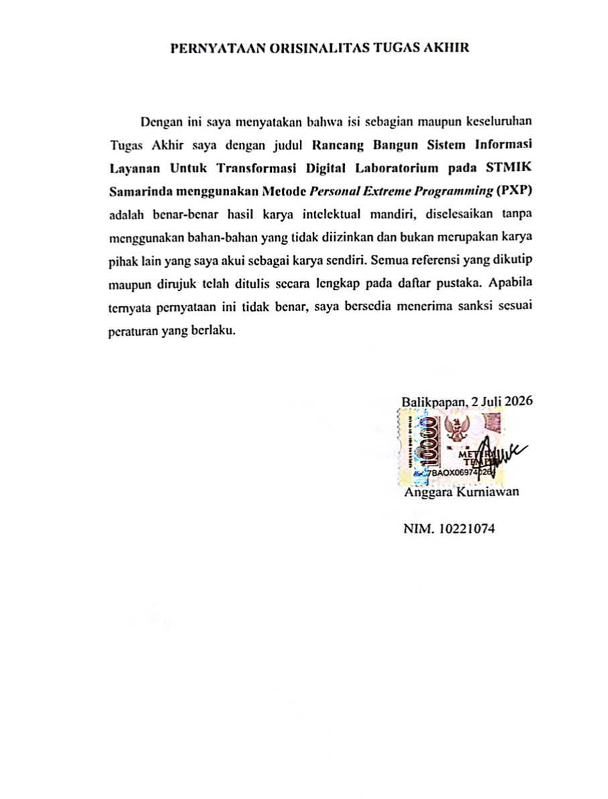

> **📷 Keterangan Gambar**: *Visual/Diagram pada PERNYATAAN ORISINALITAS TUGAS AKHIR* (Dimensi: 908x1192 px)  
> **🔍 Analisis & Arti Gambar**:  
> Gambar pendukung/ilustrasi visual pada Halaman 3 yang merepresentasikan bagan, panduan antarmuka, formulir, atau materi teknis sesuai konteks bahasan: 'Visual/Diagram pada PERNYATAAN ORISINALITAS TUGAS AKHIR'.

---

## 📄 Halaman 4

ii 
 
Halaman ini sengaja dikosongkan

---

## 📄 Halaman 5

iii 
 
PERNYATAAN PERSETUJUAN PUBLIKASI TUGAS AKHIR UNTUK 
KEPENTINGAN AKADEMIS  
Sebagai sivitas akademik Institut Teknologi Kalimantan, saya yang bertanda 
tangan di bawah ini : 
Nama 
 
 
: Anggara Kurniawan 
NIM 
 
 
: 10221074 
Program Studi  
: Sistem Informasi 
Jurusan  
 
: Teknik Elektro, Informatika dan Bisnis 
Fakultas  
 
: Sains dan Teknologi Informasi 
Demi pengembangan ilmu pengetahuan, menyetujui untuk memberikan 
kepada Institut Teknologi Kalimantan Hak Bebas Royalti Non-eksklusif 
(Non-exclusive Royalty Free Right) atas karya ilmiah saya yang berjudul:  
Rancang Bangun Sistem Informasi Layanan Untuk Transformasi 
Digital Laboratorium pada STMIK Samarinda menggunakan Metode 
Personal Extreme Programming (PXP) 
Beserta perangkat yang ada (jika diperlukan). Dengan Hak Bebas Royalti 
Non-eksklusi ini, Institut Teknologi Kalimantan berhak menyimpan, 
mengalihmediakan, mengelola dalam bentuk pangkalan data (database), 
merawat, dan memublikasikan Tugas Akhir saya selama tetap mencantumkan 
nama saya sebagai penulis/pencipta dan sebagai pemilik Hak Cipta. 
Demikian pernyataan ini saya buat dengan sebenarnya.  
        Balikpapan, 2 Juli 2026 
 
 
 
 Anggara Kurniawan  
NIM. 10221074

### 🖼️ Gambar pada Halaman 5

> **📷 Keterangan Gambar**: *Visual/Diagram pada PERNYATAAN PERSETUJUAN PUBLIKASI TUGAS AKHIR UNTUK* (Dimensi: 230x167 px)  
> **🔍 Analisis & Arti Gambar**:  
> Gambar ini memuat lembar tanda tangan atau cap pengesahan resmi dari dosen pembimbing, penguji, atau koordinator program studi yang membuktikan keabsahan dokumen tugas akhir.

---

## 📄 Halaman 6

iv 
 
Halaman ini sengaja dikosongkan

---

## 📄 Halaman 7

v 
 
LEMBAR PENGESAHAN

### 🖼️ Gambar pada Halaman 7

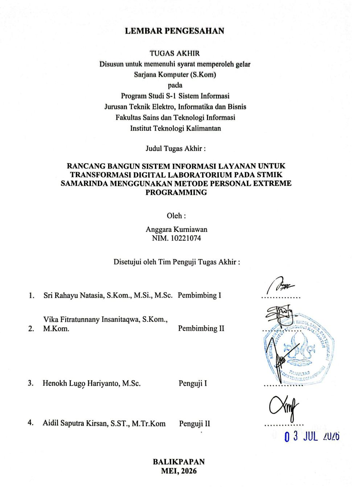

> **📷 Keterangan Gambar**: *Visual/Diagram pada LEMBAR PENGESAHAN* (Dimensi: 970x1342 px)  
> **🔍 Analisis & Arti Gambar**:  
> Gambar ini memuat lembar tanda tangan atau cap pengesahan resmi dari dosen pembimbing, penguji, atau koordinator program studi yang membuktikan keabsahan dokumen tugas akhir.

---

## 📄 Halaman 8

vi 
 
Halaman ini sengaja dikosongkan

---

## 📄 Halaman 9

vii 
 
KATA PENGANTAR 
 
Puji syukur kepada Tuhan Yang Maha Esa atas berkat dan anugerah-
Nya sehingga kami dapat menyelesaikan laporan Tugas Akhir yang 
berjudul: 
“RANCANG BANGUN SISTEM INFORMASI LAYANAN UNTUK 
TRANSFORMASI DIGITAL LABORATORIUM PADA STMIK 
SAMARINDA MENGGUNAKAN METODE PERSONAL EXTREME 
PROGRAMMING” 
Laporan Tugas Akhir ini merupakan salah satu syarat yang harus 
ditempuh untuk menyelesaikan Program Sarjana di Program Studi Sistem 
Informasi,  Jurusan Teknik Elektro, Informatika dan Bisnis, Institut 
Teknologi Kalimantan (ITK) Balikpapan. Untuk itu kami mengucapkan 
terima kasih yang sebesar-besarnya kepada: 
1. Orang Tua, yang selalu memberikan dukungan baik secara moral 
maupun spritiual, memberikan semangat dan selalu memberikan 
motivasi yang tiada henti selama proses pengerjaan Tugas Akhir 
dan perkuliahan. 
2. Ibu Sri Rahayu Natasia, S.Kom., M.Si., M.Sc.  selaku Dosen 
Pembimbing Utama dan Ibu Vika Fitratunanny Insanittaqwa, 
S.Kom., M.Kom. selaku Dosen Pembimbing Pendamping. 
3. Ibu Sri Rahayu Natasia, S.Kom., M.Si., M.Sc. selaku Koordinator 
Program Studi Sistem Informasi Jurusan Teknik Elektro, 
Informatika dan Bisnis ITK. 
4. Bapak M. Ihsan Alfani Putera, S. Tr.Kom., M.Kom. selaku Ketua 
Fakultas Sains dan Teknologi Informasi Program Studi Sistem 
Informasi ITK. 
5. STMIK Samarinda yang telah memberikan kesempatan, dukungan, 
kerja sama, serta kepercayaan selama proses penyusunan Tugas

---

## 📄 Halaman 10

viii 
 
Akhir. 
6. Bapak/Ibu Dosen Program Studi Sistem Informasi Jurusan Teknik 
Elektro, Informatika dan Bisnis ITK. 
Penyusun menyadari bahwa penyusunan laporan Tugas Akhir ini 
masih jauh dari sempurna, karena itu kami mengharapkan segala kritik dan 
saran yang membangun. Semoga Tugas Akhir ini dapat bermanfaat bagi 
kita semua. Atas perhatiannya kami ucapkan terima kasih. 
 
      Balikpapan, 2 Juli 2026 
 
 
   Penyusun

---

## 📄 Halaman 11

ix 
 
RANCANG BANGUN SISTEM INFORMASI LAYANAN UNTUK 
TRANSFORMASI DIGITAL PADA STMIK SAMARINDA DENGAN 
MENGGUNAKAN METODE PERSONAL EXTREME 
PROGRAMMING 
 
Nama Mahasiswa                    
: Anggara Kurniawan 
NIM                       
: 10221074 
Dosen Pembimbing Utama 
: Sri Rahayu Natasia, S.Kom., M.Si., M.Sc 
Dosen Pembimbing Pendamping 
: Vika Fitratunanny Insanittaqwa, S.Kom., 
  M.Kom. 
ABSTRAK 
Laboratorium komputer merupakan komponen vital akademik di STMIK 
Samarinda, namun pengelolaan layanannya masih manual menggunakan formulir 
fisik dan Microsoft Excel. Kondisi ini menyebabkan keterlambatan validasi, risiko 
tumpang tindih jadwal, dan ketiadaan pelacakan status terpusat. Penelitian ini 
bertujuan merancang Sistem Informasi Layanan Laboratorium (SIMLAB) berbasis 
web untuk mendigitalisasi empat layanan utama, sertifikasi kompetensi, izin 
penelitian, peminjaman ruangan, dan surat bebas laboratorium. Dampak fungsional 
sistem ini adalah meningkatkan efisiensi birokrasi dan akurasi data akademik. 
Konsep desain sistem menggunakan arsitektur Model-View-Controller (MVC) 
dengan framework Laravel, antarmuka Vue.js dan Tailwind CSS, serta basis data 
Mysql. Metode implementasi yang digunakan adalah Personal Extreme 
Programming (PXP) yang adaptif untuk pengembang individu, menghasilkan 24 
user Story melalui lima iterasi. Fitur kritis yang dibangun meliputi deteksi 
tanggungan lintas modul, pengecekan tumpang tindih jadwal secara real-time, dan 
alur persetujuan berjenjang bagi empat aktor pengguna. Pengujian sistem melalui 
unit Testing dengan PHPUnit (97 test case) dan Black Box Testing (35 skenario) 
berhasil mencapai kelulusan 100%. Evaluasi melalui User Acceptance Testing 
(UAT) menghasilkan skor 4,56 dari skala 5,00 (91,2%), yang termasuk dalam 
kategori sangat baik. Kesimpulannya, penerapan metode PXP efektif untuk 
pengembangan mandiri, dan SIMLAB terbukti mampu mendigitalisasi seluruh 
layanan laboratorium secara terstruktur, akurat, serta sangat layak diterima oleh 
pengguna. 
Kata kunci: Personal Extreme Programming, sistem informasi laboratorium, 
transformasi digital, Laravel, User Acceptance Testing

---

## 📄 Halaman 12

x 
 
Halaman ini sengaja dikosongkan

---

## 📄 Halaman 13

xi 
 
DESIGN AND BUILD A SERVICE INFORMATION 
SYSTEM FOR DIGITAL TRANSFORMATION AT STMIK 
SAMARINDA USING THE PERSONAL EXTREME 
PROGRAMMING METHOD 
 
By                                       : Anggara Kurniawan 
Student Identity Number    : 10221074 
Supervisor                          : Sri Rahayu Natasia, S.Kom., M.Si., M.Sc 
Co-Supervisor                    : Vika Fitratunanny Insanittaqwa, S.Kom., M.Kom. 
 
ABSTRACT  
Computer laboratories are a vital academic component at STMIK 
Samarinda, yet their service management remains manual, relying on physical 
forms and Microsoft Excel. This condition leads to validation delays, scheduling 
overlaps, and a lack of centralized status tracking. This study aims to Design and 
develop a web-based Laboratory Service Information System (SIMLAB) to 
digitalize four core services: competency certification, research permits, room 
reservations, and laboratory clearance letters. The functional impact of this System 
is to enhance bureaucratic efficiency and academic data accuracy. The System's 
Design concept utilizes the Model-View-Controller (MVC) architecture with the 
Laravel framework, a user Interface powered by Vue.js and Tailwind CSS, and a 
Mysql database. The implementation method employs Personal Extreme 
Programming (PXP), an adaptive methodology for individual developers, which 
generated 24 user stories across five Iterations. Critical features built into the 
System include cross-module obligation detection, real-time schedule overlap 
checks, and multi-tier approval workflows for four user actors. System Testing via 
unit Testing with PHPUnit (97 test cases) and black-box Testing (35 scenarios) 
achieved a 100% success rate. Evaluation through User Acceptance Testing (UAT) 
yielded an average score of 4.56 out of 5.00 (91.2%), categorizing it as excellent. 
In conclusion, the application of the PXP method is highly effective for independent 
development, and SIMLAB successfully digitalizes all laboratory services in a 
structured, accurate, and highly acceptable manner for users. 
Keywords: Personal Extreme Programming, laboratory information System, 
digital transformation, Laravel, User Acceptance Testing

---

## 📄 Halaman 14

xii 
 
Halaman ini sengaja dikosongkan

---

## 📄 Halaman 15

xiii 
 
DAFTAR ISI  
 
 
PERNYATAAN ORISINALITAS TUGAS AKHIR .............................................. i 
PERNYATAAN PERSETUJUAN PUBLIKASI TUGAS AKHIR UNTUK 
KEPENTINGAN AKADEMIS ............................................................................. iii 
LEMBAR PENGESAHAN .................................................................................... v 
KATA PENGANTAR .......................................................................................... vii 
ABSTRAK ............................................................................................................. ix 
ABSTRACT ........................................................................................................... xi 
DAFTAR ISI ........................................................................................................ xiii 
DAFTAR GAMBAR ......................................................................................... xviii 
DAFTAR TABEL ................................................................................................ xxi 
BAB 1 ..................................................................................................................... 1 
PENDAHULUAN .................................................................................................. 1 
1.1.  Latar Belakang ............................................................................................ 1 
1.2. Rumusan Masalah dan/atau Obyek yang Dirancang ................................... 7 
1.3. Tujuan  ......................................................................................................... 7 
1.4. Batasan Rancangan ...................................................................................... 7 
1.5. Manfaat ........................................................................................................ 8 
1.6. Potensi Dampak Fungsional/Komersial ...................................................... 8 
1.7. Kerangka Tugas Akhir ................................................................................ 9 
BAB 2 ................................................................................................................... 11 
TINJAUAN PUSTAKA ....................................................................................... 11 
2. 1. Kajian Teknologi atau Metode Terkait ..................................................... 11 
2.1.1 Personal Extreme Programming (PXP) .............................................. 11 
2.1.2 User Story ............................................................................................ 15 
2.1.3 Story Point ........................................................................................... 16 
2.1.4 MoSCoW ............................................................................................. 17 
2.1.5 Use Case Diagram .............................................................................. 17

---

## 📄 Halaman 16

xiv 
 
2.1.6 Entity Relationship Diagram (ERD) .................................................... 19 
2.1.7 Blackbox Testing .................................................................................. 21 
2.1.8 Laravel  ............................................................................................... 22 
2.1.9 PHPUnit ............................................................................................... 23 
2.1.10 Vue Js  ............................................................................................... 23 
2.1.11 Inertia Js ............................................................................................ 24 
2.1.12 Tailwind CSS...................................................................................... 24 
2.1.13 PrimeVue ........................................................................................... 25 
2.1.14 Vite 
 ............................................................................................... 25 
2.1.15 Mysql 25 
2.1.16 User Acceptance Testing (UAT) ....................................................... 26 
2. 2. Penelitian Terdahulu ................................................................................. 26 
2. 3. Dasar Teori Pendukung ............................................................................. 39 
2.3.1 Transformasi Digital ............................................................................ 39 
2.3.2 Software Development Life Cycle (SDLC) ......................................... 39 
2.3.3 Perbandingan Metode SDLC ............................................................... 40 
2.3.4 Unified Model Language (UML) ......................................................... 44 
2.3.5 Model-View-Controller (MVC) ........................................................... 44 
BAB 3 .................................................................................................................... 47 
DESAIN DAN IMPLEMENTASI ........................................................................ 47 
3. 1 Konsep Desain ........................................................................................... 47 
3.1.1 Proses Bisnis As-is ................................................................................... 47 
3.3.1 Identifikasi Masalah ............................................................................. 60 
3.3.2 Studi Literatur ...................................................................................... 60 
3.3.3 Requirement ......................................................................................... 60

---

## 📄 Halaman 17

xv 
 
3.3.4 Planning ............................................................................................... 65 
3.3.5 Iteration Initialization .......................................................................... 70 
3.3.6 Design  ............................................................................................... 71 
3.3.7 Implementasi ....................................................................................... 71 
3.3.8 System Testing ..................................................................................... 72 
3.3.9 Retrospective ....................................................................................... 72 
3.3.10 Deployment ........................................................................................ 72 
3.3.11 User Training .................................................................................... 72 
3.3.12 Kesimpulan dan Saran ....................................................................... 73 
3. 4 Metode Implementasi ................................................................................ 73 
3.4.1 Requirement ............................................................................................. 73 
3.4.1.1 Aktor  ............................................................................................... 74 
3.4.2 Planning ................................................................................................... 85 
3.4.3 Iterasi 1 Autentikasi System .................................................................... 89 
3.4.3.1 Iteration Initialization 1 ................................................................... 90 
3.4.3.2 Design 1 ............................................................................................ 90 
3.4.3.3 Implementation 1 .............................................................................. 93 
3.4.3.4 System Testing 1 ............................................................................. 101 
3.4.3.5 Retrospective 1 ............................................................................... 101 
3.4.4 Iterasi 2 Layanan Sertifikasi Kompetensi ............................................. 102 
3.4.4.1 Iteration Initialization 2 .................................................................. 103 
3.4.4.2 Design 2 .......................................................................................... 104 
3.4.4.3 Implementation 2 ............................................................................ 106 
3.4.4.4 System Testing 2 ............................................................................. 122

---

## 📄 Halaman 18

xvi 
 
3.4.4.5 Retrospective 2 ............................................................................... 124 
3.4.5 Iterasi 3 Layanan Surat Bebas Laboratorium ........................................ 124 
3.4.5.1 Iteration Initialization 3 .................................................................. 125 
3.4.5.2 Design 3 .......................................................................................... 126 
3.4.5.3 Implementation 3 ............................................................................ 128 
3.4.5.4 System Testing 3 .............................................................................. 141 
3.4.5.5 Retrospective 3 ............................................................................... 144 
3.4.6 Iterasi 4 Layanan Izin Penelitian ............................................................ 145 
3.4.6.1 Iteration Initialization 4 .................................................................. 145 
3.4.6.2 Design 4 .......................................................................................... 146 
3.4.6.3 Implementation 4 ............................................................................ 148 
3.4.6.4 System Testing 4 .............................................................................. 163 
3.4.6.5 Retrospective 4 ............................................................................... 165 
3.4.7 Iterasi 5 Layanan Peminjaman Laboratorium ........................................ 166 
3.4.7.1 Iteration Initialization 5 .................................................................. 168 
3.4.7.2 Design 5 .......................................................................................... 169 
3.4.7.3 Implementation 5 ............................................................................ 171 
3.4.7.4 System Testing 5 .............................................................................. 188 
3.4.7.5 Retrospective 5 ............................................................................... 192 
3.4.8 Deployment ....................................................................................... 193 
3.4.9 User Training ................................................................................... 193 
BAB 4 .................................................................................................................. 197 
PENGUJIAN DAN EVALUASI......................................................................... 197 
4.1 Metode Pengujian ..................................................................................... 197 
4.1.1 Pengujian Fungsionalitas ................................................................... 197

---

## 📄 Halaman 19

xvii 
 
4.1.2 Pengujian Penerimaan Pengguna ...................................................... 198 
4.2 Pengujian Fungsionalitas dan Ketepatan Output...................................... 198 
4.2.1 Hasil Unit Testing .............................................................................. 198 
4.2.2 Hasil Black Box Testing .................................................................... 200 
4.2.3 Analisis Hasil Pengujian Fungsionalitas ........................................... 209 
4.3 Pengujian User Acceptance Testing (UAT) ............................................. 210 
4.3.1 Pelaksanaan UAT .............................................................................. 210 
4.3.2 Hasil Pengujian Variabel Fungsionalitas dan Kinerja Sistem ........... 211 
4.3.3 Hasil Pengujian Variabel Pengalaman dan Tampilan Antarmuka .... 214 
4.3.4 Rekapitulasi Hasil UAT dan Saran Responden ................................. 215 
4.4 Evaluasi Pencapaian Sistem terhadap Rumusan Masalah ........................ 215 
BAB 5 ................................................................................................................. 217 
PENUTUP ........................................................................................................... 217 
5.1 Kesimpulan ............................................................................................... 217 
5.2 Rekomendasi ............................................................................................ 218 
DAFTAR PUSTAKA ......................................................................................... 221 
LAMPIRAN A .................................................................................................... A-1 
LAMPIRAN B .................................................................................................... B-1 
LAMPIRAN C .................................................................................................... C-1 
LAMPIRAN D .................................................................................................... D-1 
LAMPIRAN E ..................................................................................................... E-1

---

## 📄 Halaman 20

xviii 
 
DAFTAR GAMBAR  
 
Gambar 1. 1 Diagram Fishbone ............................................................................... 9 
 
 
Gambar 2. 1 Metode PXP (Ardianzah, 2022) ....................................................... 13 
 
Gambar 3. 1 Proses Bisnis As-Is Sertifikasi Laboratorium Komputer.................. 48 
Gambar 3. 2 Proses Bisnis As-Is Layanan Bebas Laboratorium ........................... 49 
Gambar 3. 3 Proses Bisnis As-Is Pengajuan Ijin Penelitian Lab Komputer.......... 50 
Gambar 3. 4 Proses Bisnis As-Is Peminjaman Laboratorium Komputer .............. 51 
Gambar 3. 5 Use case diagram Sementara............................................................ 52 
Gambar 3. 6 Entity Relationship Diagram (ERD) ................................................. 54 
Gambar 3. 7 Desain Antarmuka Sementara Layanan Sertifikat Iterasi 2 .............. 55 
Gambar 3. 8 Desain Antarmuka Sementara Layanan Surat Bebas Laboratorium 
Iterasi 3 .................................................................................................................. 56 
Gambar 3. 9 Desain Antarmuka Sementara Layanan Izin Penelitian Iterasi 4 ..... 56 
Gambar 3. 10 Desain Antarmuka Sementara Layanan Peminjaman Laboratorium 
Iterasi 5 .................................................................................................................. 57 
Gambar 3. 11 Diagram Alir Penelitian .................................................................. 59 
Gambar 3. 12 Use Case Diagram .......................................................................... 78 
Gambar 3. 13 Proses Bisnis To-Be Layanan Izin Penelitian ................................. 81 
Gambar 3. 14 Proses Bisnis To-Be Surat Bebas Laboratorium ............................. 82 
Gambar 3. 15 Proses Bisnis To-Be Surat Bebas Laboratorium ............................. 83

---

## 📄 Halaman 21

xix 
 
Gambar 3. 16 Proses Bisnis To-Be Peminjaman Laboratorium ............................. 84 
Gambar 3. 17 ERD Iterasi 1 ................................................................................... 91 
Gambar 3. 18 Mockup Antarmuka Login .............................................................. 92 
Gambar 3. 19 Mockup Antarmuka Dashboard Admin ......................................... 92 
Gambar 3. 20 Hasil Unit Testing 1 (7 Test, 7 Passed) ........................................... 97 
Gambar 3. 21 Halaman Login SIMLAB ................................................................ 99 
Gambar 3. 22 Halaman Registrasi SIMLAB ....................................................... 100 
Gambar 3. 23 ERD Iterasi 2 ................................................................................. 105 
Gambar 3. 24 Mockup Antarmuka Pendaftaran Sertifikasi ................................. 106 
Gambar 3. 25 Hasil Unit Testing 2 (20 tests, 20 Passed) .................................... 117 
Gambar 3. 26 Halaman Daftar Sertifikasi ............................................................ 119 
Gambar 3. 27 Halaman Manajemen Sertifikasi Admin ....................................... 120 
Gambar 3. 28 Halaman Menambahkan Jadwal Sertifikasi .................................. 120 
Gambar 3. 29 Halaman Penilaian Kepala Lab ..................................................... 121 
Gambar 3. 30 Hasil Cetak Sertifikat .................................................................... 121 
Gambar 3. 31 ERD Iterasi 3 ................................................................................. 126 
Gambar 3. 32 Mockup Antarmuka Surat Bebas Lab ........................................... 127 
Gambar 3. 33 Hasil Unit Testing 3 (20 Tests, 20 Passed) ................................... 137 
Gambar 3. 34 Halaman Pengajuan Surat Bebas Lab ........................................... 139 
Gambar 3. 35 Halaman Verifikasi Surat Bebas Lab Admin ................................ 140 
Gambar 3. 36 Halaman Persetujuan Kepala Lab ................................................. 140

---

## 📄 Halaman 22

xx 
 
Gambar 3. 37 ERD Iterasi 4 ................................................................................ 147 
Gambar 3. 38 Mockup Antarmuka Pengajuan Izin Penelitian ............................ 148 
Gambar 3. 39 Hasil Unit Testing 4 (23 Test, 23 Passed) .................................... 158 
Gambar 3. 40 Halaman Pengajuan Izin Penelitian .............................................. 161 
Gambar 3. 41 Halaman Manajemen Izin Penelitian Admin ................................ 161 
Gambar 3. 42 Halaman Manajemen Izin Penelitian Kepala Lab ........................ 162 
Gambar 3. 43 ERD Iterasi 5 ................................................................................ 170 
Gambar 3. 44 Mockup Antarmuka Form Peminjaman Laboratorium ................ 171 
Gambar 3. 45 Hasil Unit Testing 5 (27 Tests, 27 Passed) .................................. 182 
Gambar 3. 46 Halaman Form Peminjaman Laboratorium .................................. 185 
Gambar 3. 47 Halaman Verifikasi Admin ........................................................... 186 
Gambar 3. 48 Halaman Verifikasi Kepala Lab ................................................... 186 
Gambar 3. 49 Link Halaman Website SIMLAB ................................................. 194

---

## 📄 Halaman 23

xxi 
 
DAFTAR TABEL  
 
Tabel 2. 1 Format User Story ................................................................................ 16 
Tabel 2. 2 Simbol Use Case Diagram ................................................................... 18 
Tabel 2. 3 Entity Relationship Diagram (ERD) .................................................... 20 
Tabel 2. 4 Format Black Box Testing .................................................................... 22 
Tabel 2. 5 Penelitian Terdahulu ............................................................................ 27 
Tabel 2. 6 Perbandingan Metode .......................................................................... 40 
Tabel 3. 1 Deskripsi Use case diagram Sementara...............................................53 
 
Tabel 3. 2 Daftar Aktor Sistem Informasi Lab Komputer STMIK Samarinda ...... 61 
Tabel 3. 3 User Story Sementara............................................................................ 63 
Tabel 3. 4 Penentuan Story Point Sementara ......................................................... 66 
Tabel 3. 5 Rencana Iterasi Sementara .................................................................... 67 
Tabel 3. 6 Rencana Iterasi Pengembangan Sistem................................................. 70 
Tabel 3. 7 Daftar Aktor Sistem Informasi Lab Komputer STMIK Samarinda ...... 74 
Tabel 3. 8 User Story ............................................................................................. 75 
Tabel 3. 9 User Story ............................................................................................. 85 
Tabel 3. 10 Rencana Iterasi .................................................................................... 87 
Tabel 3. 11 User Story Iterasi 1 ............................................................................. 89 
Tabel 3. 12 Iteration Initialization 1 ...................................................................... 90 
Tabel 3. 13 Kode Unit Testing 1 Autentikasi ......................................................... 93 
Tabel 3. 14 PseudoCode Autentikasi ..................................................................... 97 
Tabel 3. 15 Penjelasan PseudoCode Autentikasi ................................................... 99 
Tabel 3. 16 System Testing 1 ................................................................................ 101

---

## 📄 Halaman 24

xxii 
 
Tabel 3. 17 Hasil Retrospective 1 ........................................................................ 102 
Tabel 3. 18 User Story Iterasi 2 ........................................................................... 102 
Tabel 3. 19 Iteration Initialization 2 .................................................................... 103 
Tabel 3. 20 Kode Unit Testing 2 Sertifikasi ........................................................ 106 
Tabel 3. 21 PseudoCode Sertifikasi ..................................................................... 117 
Tabel 3. 22 Penjelasan PseudoCode Sertifikasi................................................... 119 
Tabel 3. 23 System Testing 2 Layanan Sertifikasi Laboratorium ........................ 122 
Tabel 3. 24 Hasil Retrospective 2 ........................................................................ 124 
Tabel 3. 25 User Story Iterasi 3 ........................................................................... 125 
Tabel 3. 26 Iteration Initialization 3 .................................................................... 125 
Tabel 3. 27 Kode Unit Testing 3 Surat Bebas Lab .............................................. 128 
Tabel 3. 28 PseudoCode Surat Bebas Laboratorium ........................................... 137 
Tabel 3. 29 Penjelasan PseudoCode Surat Bebas Lab......................................... 138 
Tabel 3. 30 System Testing 3  Surat Bebas Laboratorium ................................... 142 
Tabel 3. 31 Hasil Retrospective 3 ........................................................................ 144 
Tabel 3. 32 User Story Iterasi 4 ........................................................................... 145 
Tabel 3. 33 Iteration Initialization 4 .................................................................... 146 
Tabel 3. 34 Kode Unit Testing 4 Izin Penelitian ................................................. 149 
Tabel 3. 35 PseudoCode Izin Penelitian .............................................................. 159 
Tabel 3. 36 Penjelasan PseudoCode Izin Penelitian ............................................ 160 
Tabel 3. 37 System Testing 4 Izin Penelitian ....................................................... 163 
Tabel 3. 38 Hasil Retrospective 4 ........................................................................ 166 
Tabel 3. 39 User Story Iterasi 5 ........................................................................... 167 
Tabel 3. 40 Iteration Initialization 5 .................................................................... 168

---

## 📄 Halaman 25

xxiii 
 
Tabel 3. 41 Kode Unit Testing 5  Peminjaman Laboratorium ............................. 172 
Tabel 3. 42 PseudoCode Peminjaman Laboratorium ........................................... 183 
Tabel 3. 43 Penjelasan PseudoCode Peminjaman Laboratorium......................... 184 
Tabel 3. 44 Refactor 5  Controller Surat Bebas Lab ............................................ 187 
Tabel 3. 45 Refactor 5 Surat Bebas Lab Service ................................................. 187 
Tabel 3. 46 System Testing 5 Peminjaman Laboratorium .................................... 189 
Tabel 3. 47 Hasil Retrospective 5 ........................................................................ 192 
Tabel 4. 1 Hasil Unit Testing Keseluruhan............................................................199 
 
Tabel 4. 2 Rekapitulasi Hasil Black Box Testing Keseluruhan Iterasi ................ 200 
Tabel 4. 3 Hasil Pengujian Blackbox Keseluruhan ............................................. 201 
Tabel 4. 4 Interpretasi Skor Persentase UAT ...................................................... 211 
Tabel 4. 5 Hasil Persentase Variabel Fungsionalitas dan Kinerja Sistem........... 211 
Tabel 4. 6 Hasil Persentase Variabel Pengalaman dan Tampilan Antarmuka .... 214 
Tabel 4. 7 Rekapitulasi Hasil Pengujian UAT .................................................... 215

---

## 📄 Halaman 26

*(Halaman ini tidak memuat teks tertulis, berisi konten visual / lampiran)*

---

## 📄 Halaman 27

1 
 
BAB 1 
PENDAHULUAN  
 
Pada bab ini akan dibahas mengenai hal-hal dasar yang menjadi landasan 
dalam pelaksanaan penelitian. Penjelasan mencakup latar belakang permasalahan 
yang mendorong dilakukannya penelitian, rumusan masalah yang dirumuskan 
secara spesifik, tujuan yang ingin dicapai, manfaat yang diperoleh dari hasil 
penelitian, serta kerangka pemikiran yang menjelaskan alur berpikir peneliti dalam 
menyelesaikan permasalahan. Bab ini berperan sebagai pengantar awal untuk 
memahami fokus dan arah dari penelitian yang dilakukan.  
1.1. 
Latar Belakang  
Laboratorium komputer merupakan komponen penting dalam menunjang 
sarana dan prasarana di perguruan tinggi, khususnya dalam bidang teknologi dan 
informatika. Sarana mencakup perlengkapan pembelajaran yang dapat dipindahkan 
seperti komputer, proyektor, dan perangkat jaringan, sedangkan prasarana 
mencakup infrastruktur dasar seperti ruang laboratorium itu sendiri. Kedua elemen 
ini saling melengkapi dan berperan penting dalam menciptakan lingkungan belajar 
yang kondusif dan produktif (Hana dan Sukwatus., 2021) Oleh karena itu, 
pengelolaan sarana dan prasarana laboratorium secara terstruktur dan digital sangat 
diperlukan agar dapat mendukung efektivitas pelayanan akademik (Ully dan 
Nugraheni, 2024). Seiring dengan berkembangnya teknologi informasi, kebutuhan 
akan sistem yang mampu mengelola sarana dan prasarana secara efisien pun 
semakin meningkat dan seharusnya dapat dikelola dengan baik (Khafid & Fahmi, 
2022). Integrasi teknologi dalam pengelolaan laboratorium tidak hanya 
mempermudah administrasi dan dokumentasi, tetapi juga berkontribusi pada 
peningkatan mutu layanan yang adaptif, responsif, dan berkelanjutan (Sari & 
Munir, 2024) 
Sebagai bentuk nyata dari integrasi tersebut, adalah pengembangan sistem 
informasi. Sistem informasi merupakan seperangkat prosedur yang dirancang untuk 
mengumpulkan, mengolah, menyimpan, dan mendistribusikan informasi kepada

---

## 📄 Halaman 28

2 
 
pihak-pihak yang membutuhkan (Pradana, 2024). Dalam konteks pendidikan 
tinggi, sistem informasi memiliki peran penting dalam menunjang kegiatan 
operasional, administratif, hingga layanan akademik. Contoh implementasinya 
adalah sistem informasi laboratorium komputer yang melayani di bidang 
pendidikan tinggi adalah pengelolaan sarana dan prasarana, khususnya 
laboratorium. Laboratorium merupakan komponen vital dalam mendukung 
kegiatan akademik, seperti praktikum, penelitian, dan pengembangan keterampilan 
mahasiswa, terutama di program studi berbasis teknologi informasi. Oleh karena 
itu, layanan laboratorium perlu dikelola secara terstruktur dan terdigitalisasi agar 
mampu mendukung pencapaian capaian pembelajaran secara optimal (Rokhim, 
Asrori dan Widarti, 2020). 
Salah satu Sekolah Tinggi yang terus berupaya mengembangkan layanan 
berbasis sistem informasi adalah STMIK Samarinda, perguruan tinggi swasta di 
Kalimantan Timur yang beralamat di Jl. Banggeris, Karang Anyar, Samarinda. 
Berdiri sejak tahun 1989, institusi ini menjadi pelopor pendidikan tinggi di bidang 
teknologi informasi di luar Pulau Jawa. Saat ini, STMIK Samarinda memiliki 
sekitar 50 Mahasiswa Aktif  dan 14 Dosen Tetap. Laboratorium komputer 
merupakan salah satu fasilitas utama yang mendukung aktivitAs akademik di 
lingkungan kampus, dengan layanan seperti peminjaman ruang laboratorium, izin 
penelitian, pendaftaran sertifikasi, dan surat bebas laboratorium. Namun, dengan 
struktur organisasi yang relatif sederhana dan rasio dosen terhadap mahasiswa 
sebesar 1:4, tantangan dalam penyediaan layanan yang efektif dan efisien menjadi 
nyata. Oleh karena itu, pengembangan sistem informasi laboratorium berbasis web 
menjadi langkah strategis yang mendesak untuk dilakukan. Upaya ini juga sejalan 
dengan Peraturan BAN-PT Nomor 1 Tahun 2022 Pasal 3, yang menekankan 
pentingnya pemanfaatan sistem informasi dalam menunjang layanan perguruan 
tinggi secara akuntabel dan transparan (Peraturan BAN-PT, 2022). Serta hal 
tersebut tercantum pada peraturan Permendikbudristek Nomor 53 Tahun 2023 Pasal 
48 pada Ayat 1-6 menegaskan bahwa standar sarana dan prasarana pendidikan 
tinggi mencakup pemanfaatan sistem informasi yang andal sebagai bagian dari 
penyelenggaraan pendidikan yang efektif (Permendikbudristek, 2023).

---

## 📄 Halaman 29

3 
 
Sebagai bagian dari upaya pemenuhan standar mutu institusi, transformasi 
digital layanan pada laboratorium menjadi kebutuhan mendesak, termasuk di 
lingkungan STMIK Samarinda. Sebagai institusi pendidikan tinggi berbasis 
teknologi informasi, STMIK Samarinda memiliki urgensi lebih dalam 
menghadirkan sistem informasi yang mendukung pengelolaan dan pelayanan 
laboratorium. Berdasarkan hasil wawancara dengan Kepala Laboratorium STMIK 
Samarinda, Ibu Risna, S.Kom., M.Kom., diketahui bahwa berbagai layanan 
laboratorium hingga saat ini masih dijalankan secara manual. Mahasiswa yang 
ingin mengakses layanan seperti peminjaman ruang laboratorium, pengajuan izin 
penelitian, pendaftaran sertifikasi laboratorium, maupun pengurusan surat bebas 
laboratorium, harus datang langsung ke kampus dan mengajukan permohonan 
secara lisan atau formulir kepada admin. Seluruh permohonan tersebut kemudian 
dicatat secara manual menggunakan Excel dan diteruskan ke kepala laboratorium 
untuk validasi. Prosedur manual seperti ini tidak hanya memakan waktu dan 
menyulitkan mahasiswa, tetapi juga menyimpan banyak potensi permasalahan 
administratif, seperti risiko kesalahan pada data, keterlambatan validasi, hingga 
kesalahan pencatatan. Di sisi lain, sistem informasi yang terdigitalisasi belum 
tersedia hingga saat ini. Padahal, menurut Ibu Risna, digitalisasi pelayanan 
laboratorium tidak harus menunggu jumlah mahasiswa yang banyak. Justru, 
digitalisasi harus dimulai lebih awal sebagai bagian dari investasi jangka panjang 
institusi dalam menyongsong tantangan akreditasi dan pengelolaan kampus modern 
(Lampiran A). 
Salah satu layanan yang paling terdampak adalah pengurusan Surat Bebas 
Laboratorium. Surat ini merupakan dokumen penting dan wajib dipenuhi oleh 
mahasiswa sebagai salah satu syarat kelulusan atau yudisium. Keterlambatan 
pengurusannya dapat menyebabkan mahasiswa tidak dapat mengikuti proses 
yudisium tepat waktu. Permasalahan serupa juga terjadi pada layanan-layanan 
laboratorium lainnya. Misalnya, dalam proses peminjaman ruang laboratorium, 
mahasiswa masih harus datang langsung dan mencatat pengajuan secara manual 
kepada admin. Hal ini kerap menimbulkan tumpang tindih jadwal penggunaan 
ruang karena tidak adanya sistem yang secara otomatis memeriksa ketersediaan 
ruang. Demikian pula, pengajuan izin penelitian di laboratorium dilakukan tanpa

---

## 📄 Halaman 30

4 
 
sistem pelacakan yang jelas, sehingga proses validasi menjadi lambat dan tidak 
terdokumentasi dengan baik. Padahal, layanan ini sangat penting bagi mahasiswa 
yang sedang dalam tahap menyelesaikan Tugas Akhir atau penelitian. Tanpa izin 
resmi dari laboratorium, mahasiswa tidak dapat memulai penelitian, pengujian, atau 
pengumpulan data yang menjadi inti dari proses penelitian mereka. Keterlambatan 
dalam memperoleh izin ini dapat berdampak langsung pada keterlambatan 
penyelesaian studi, karena penelitian merupakan komponen krusial dalam 
menyelesaikan skripsi atau proyek akhir. Selain itu, Layanan sertifikasi 
laboratorium juga menjadi aspek penting, proses pendaftaran dan pencatatan 
peserta dilakukan secara luring menggunakan formulir, sehingga rawan kesalahan, 
duplikasi, dan Kesalahan pada data. Padahal, sertifikasi ini tidak hanya menjadi 
bukti keikutsertaan pelatihan, tetapi juga berfungsi menilai apakah mahasiswa telah 
memenuhi capaian pembelajaran, seperti kemampuan dasar penggunaan aplikasi 
Microsoft Word, Excel, atau perangkat lunak lain yang relevan. Tanpa sistem 
digital yang mendokumentasikan riwayat sertifikasi secara terintegrasi, program 
studi kesulitan memastikan kompetensi mahasiswa secara valid. Dalam beberapa 
kasus, bahkan ditemukan mahasiswa tingkat akhir yang belum menguasai 
keterampilan dasar karena tidak terpantau sejak awal. Kondisi ini berisiko 
menurunkan mutu lulusan (Lampiran A). 
Menyikapi kendala tersebut, pemilihan platform berbasis web untuk sistem 
informasi laboratorium didasarkan pada pertimbangan teknis, operasional, dan 
keberlanjutan sistem. Sistem berbasis web memungkinkan manajemen layanan 
secara menyeluruh dari validasi dan verifikasi dokumen, hingga penyimpanan data 
historis yang aman dan terstruktur serta lebih mudah diakses oleh semua pemangku 
kepentingan, baik kepala laboratorium, admin, maupun mahasiswa. Dalam konteks 
perguruan tinggi, keberlanjutan sistem menjadi sangat penting. Sistem web 
memungkinkan pemeliharaan dan pembaruan secara terpusat tanpa mengganggu 
pengguna. Selain itu, pendekatan ini memungkinkan integrasi langsung dengan 
infrastruktur kampus seperti server internal, sistem akademik, dan layanan email 
resmi. Dari sisi pengembangan, web juga lebih cepat dan efisien dikembangkan 
secara individu, sesuai dengan karakteristik Tugas Akhir ini. Oleh karena itu, sistem 
informasi berbasis web bukan hanya pilihan praktis, tetapi juga strategis untuk

---

## 📄 Halaman 31

5 
 
mendukung 
digitalisasi 
layanan 
kampus 
secara 
jangka 
panjang 
dan 
berkesinambungan. Pada sistem informasi laboratorium ini akan terdiri dari 
beberapa layanan utama yang dirancang untuk mempermudah pengelolaan dan 
akses informasi secara digital. Pada sistem informasi manajemen laboratorium 
terdapat modul dan Company profile yang menampilkan informasi laboratorium 
seperti struktur, fasilitas, dan berita yang dikelola admin. Layanan Sertifikasi 
memungkinkan mahasiswa mendaftar, diverifikasi admin, diuji, dan mencetak 
sertifikat jika lulus. Pada layanan Surat Bebas Laboratorium dan Izin Penelitian, 
mahasiswa mengajukan secara daring, diverifikasi admin, disetujui kepala lab, lalu 
mencetak surat. Semua layanan berjalan secara digital dan efisien. 
Sejumlah penelitian sebelumnya menunjukkan efektivitas penggunaan 
sistem informasi laboratorium berbasis web dalam meningkatkan efisiensi dan 
kualitas layanan akademik. Widharma berhasil mengembangkan sistem dengan 
fitur manajemen profil, jadwal, dan inventaris laboratorium yang mendapat 
kepuasan tinggi dari pengguna (Widharma dkk., 2022). Passa Putra merancang 
website laboratorium fisika yang mampu mengintegrasikan data aset, modul, dan 
jadwal laboratorium secara efisien dan terstruktur (Passa Putra, Yuniawan dan 
Lopulalan, 2021). Sadria membangun sistem informasi laboratorium pengelolaan 
inventaris, jadwal, dan distribusi modul praktikum (Sadria, Hamza dan Sudin, 
2023). I Nengah Sweden  mengembangkan sistem informasi manajemen 
laboratorium dengan hasil kualitas sistem yang sangat baik dari aspek usability dan 
reliability (I Nengah Sweden dkk., 2022). Sementara Arif Ramadan,  berhasil 
mempercepat pengelolaan dokumen dan meningkatkan efisiensi aktivitas 
laboratorium (Arif Ramadan, Taufiq Subagio dan Fahrudin, 2024). Selain itu, 
beberapa penelitian menerapkan metode Personal Extreme Programming (PXP) 
untuk mengembangkan sistem informasi yang sesuai kebutuhan pengguna. Ika 
Lestari membangun website company profile riset dengan pendekatan PXP dalam 
dua iterasi, menyelesaikan 27 user Story prioritas, dan menampilkan fokus riset 
secara menyeluruh (Lestari et al., 2023b). Dana Heris Ardianzah mengembangkan 
sistem peminjaman auditorium yang mendigitalisasi proses manual dan 
memungkinkan pemantauan jadwal secara real-time (Ardianzah, Nuryasin dan 
Wiyono, 2022). Moch. Hendra Admaja dan Anang Pramono merancang e-learning

---

## 📄 Halaman 32

6 
 
berbasis Laravel dengan fitur pengiriman nilai via WhatsApp, yang meski perlu 
penyempurnaan antarmuka, terbukti fungsional (Hendra Admaja & Pramono, 
2025). Sementara itu, Muhammad Kharisma membangun sistem surat menyurat 
berbasis web menggunakan PXP, mendukung transparansi, efisiensi, dan prinsip 
Good University Governance (GUG) di kampus (Muhammad Kharisma, 
Fathurrohim dan Catur Apriadi, 2023). 
Dalam konteks ini, metode Personal Extreme Programming (PXP) karena 
cocok untuk proyek individu, memungkinkan pengembang tunggal menangani 
seluruh proses dari eksplorasi hingga pengujian (Raditya & Sembiring, 2024), 
menekankan iterasi pendek, pengembangan Minimum Viable Product (MVP), dan 
penyempurnaan sistem berdasarkan masukan langsung dari pengguna seperti admin 
dan kepala lab, serta cepat disesuaikan dengan alur kerja kampus (Lestari, Rhodiyah 
LD dan Alfani Putera, 2023). Fleksibilitasnya tinggi, cocok untuk institusi seperti 
STMIK Samarinda yang sedang bertransformasi digital. Mitra dapat memberikan 
masukan rutin tanpa harus terlibat secara teknis, sehingga cocok dengan 
keterbatasan waktu mereka. Dengan pendekatan iteratif dan continuous feedback, 
kebutuhan baru bisa langsung direspons. PXP juga mengedepankan kesederhanaan, 
desain evolusioner, dan dokumentasi minimal tanpa mengorbankan kualitas 
(Apriyanti, Fitri Ana Wati dan Rezha Efrat Najaf, 2024). Selain itu, PXP juga 
mengedepankan prinsip simplicity, evolutionary Design, dan pengurangan 
dokumentasi yang berlebihan, namun tetap menjaga kualitas sistem secara 
keseluruhan (Fahrijal dan Hartawan, 2024). Dengan demikian, penggunaan metode 
PXP mendukung kolaborasi praktis bersama mitra dan mendorong percepatan 
transformasi digital yang sesuai dengan karakteristik STMIK Samarinda. 
Dengan mempertimbangkan kebutuhan digitalisasi di STMIK Samarinda 
serta berbagai kendala layanan manual yang masih berlangsung, pengembangan 
sistem informasi laboratorium berbasis web menjadi langkah strategis dan 
mendesak. Sistem ini tidak hanya mempermudah proses layanan akademik internal, 
tetapi juga menjadi representasi konkret dari transformasi digital yang berorientasi 
pada peningkatan mutu, efisiensi, dan akuntabilitas institusi. Oleh karena itu, 
penelitian ini diarahkan untuk merancang dan membangun sistem informasi

---

## 📄 Halaman 33

7 
 
laboratorium yang sesuai dengan kebutuhan pengguna aktual serta mendukung 
capaian standar mutu perguruan tinggi melalui pendekatan metode Personal 
Extreme Programming (PXP). 
1.2. 
Rumusan Masalah dan/atau Obyek yang Dirancang 
Berdasarkan latar belakang yang telah dijelaskan sebelumnya, penelitian ini 
dirancang 
untuk 
menjawab 
permasalahan 
utama 
yaitu 
bagaimana 
mengimplementasikan 
sistem 
informasi 
berbasis 
website 
yang 
mampu 
mendigitalisasi layanan laboratorium serta menampilkan company profile 
laboratorium STMIK Samarinda secara terstruktur dan terintegrasi dengan 
menggunakan metode Personal Extreme Programming (PXP) untuk meningkatkan 
efisiensi dan pengelolaan data laboratorium? 
1.3. 
Tujuan 
Adapun tujuan dari penelitian ini adalah untuk mengimplementasikan 
sistem informasi laboratorium berbasis website yang dapat memfasilitasi layanan 
administratif seperti surat bebas laboratorium, izin penelitian, sertifikasi, dan 
peminjaman laboratorium, sekaligus menampilkan company profile laboratorium 
STMIK Samarinda secara digital penelitian ini menerapkan metode Personal 
Extreme Programming (PXP) dalam proses pengembangan sistem guna 
memastikan pendekatan yang iteratif, fleksibel, dan sesuai dengan kondisi 
pengembangan sistem yang dilakukan secara individu. 
1.4. 
Batasan Rancangan  
Agar penelitian ini dapat dilakukan secara terarah dan sesuai dengan ruang 
lingkup Tugas Akhir, maka terdapat beberapa batasan masalah sebagai berikut: 
1. 
Pengguna Sistem dibatasi pada tiga peran utama, yaitu: 
a. Mahasiswa dan Dosen sebagai pengguna layanan. 
b. Admin Laboratorium sebagai pengelola data dan verifikasi data 
awal 
c. Kepala Laboratorium sebagai pihak yang memberikan persetujuan 
akhir atas layanan

---

## 📄 Halaman 34

8 
 
2. 
Sistem yang dikembangkan dalam penelitian ini difokuskan hanya pada 4    
fitur   utama   yaitu   layanan   sertifikasi,   izin   penelitian,   peminjaman  
laboratorium, dan surat bebas laboratorium.  
3. 
Sistem yang dikembangkan berbasis website dan diakses melalui browser, 
tidak mencakup aplikasi Mobile (Android/iOS) 
4. 
Framework Laravel digunakan sebagai dasar pengembangan sistem. 
5. 
Penelitian ini tidak membahAs aspek keamanan data secara mendalam 
seperti enkripsi lanjutan, otentikasi multi-faktor, atau audit log detail, 
namun tetap menerapkan validasi data dasar dan autentikasi pengguna 
sederhana sesuai kebutuhan fungsional 
 
1.5. 
Manfaat 
Penelitian ini diharapkan dapat memberikan manfaat bagi berbagai pihak, 
antara lain: 
1. Bagi STMIK Samarinda membantu dalam digitalisasi dan modernisasi 
pengelolaan laboratorium agar lebih efisien dan meningkatkan transparansi 
dan kemudahan akses informasi terkait fasilitas dan kegiatan laboratorium. 
2. Bagi Mahasiswa mempermudah proses peminjaman laboratorium dan 
pengajuan email kampus secara online dan memudahkan akses terhadap 
informasi laboratorium, modul praktik, dan berita kegiatan. 
3. Bagi Peneliti Selanjutnya menjadi referensi bagi penelitian di bidang sistem 
informasi manajemen laboratorium berbasis web dan memberikan wawasan 
tentang penerapan metode Personal Extreme Programming (PXP) dalam 
pengembangan perangkat lunak. 
 
1.6. 
Potensi Dampak Fungsional/Komersial  
Sistem ini tidak hanya mempermudah proses layanan akademik internal, 
tetapi juga menjadi representasi konkret dari transformasi digital yang berorientasi 
pada peningkatan mutu, efisiensi, dan akuntabilitas institusi. Kehadiran sistem ini

---

## 📄 Halaman 35

9 
 
diharapkan dapat meningkatkan kualitas layanan laboratorium dan mendukung 
percepatan transformasi digital di STMIK Samarinda. Pengembangan website 
manajemen laboratorium ini menjadi solusi digital yang mampu mengakomodasi 
kebutuhan pencatatan, pelaporan, dan pengelolaan data layanan lab secara lebih 
optimal dan mendukung transformasi digital.  
1.7. 
Kerangka Tugas Akhir  
Berikut adalah Fishbone Diagram untuk Kerangka Pemikiran Penelitian. 
Diagram ini menunjukkan hubungan antara state of the art (penelitian sebelumnya), 
permasalahan yang dihadapi, metode yang digunakan, serta novelty (kebaruan) 
 
Gambar 1. 1 Diagram Fishbone 
Pada Gambar 1.1 merupakan kerangka pemikiran yang menggambarkan 
pentingnya pengembangan website manajemen transformasi digital untuk layanan 
laboratorium. Diagram ini disusun berdasarkan pendekatan diagram fishbone atau 
sebab-akibat, yang menunjukkan empat faktor utama penyebab permasalahan yaitu 
Man, Machine, Material, dan Method. 
Pada kategori Man, permasalahan yang dihadapi adalah mahasiswa harus 
datang langsung ke kampus untuk menggunakan layanan laboratorium. Selain itu, 
admin laboratorium mengalami kesulitan dalam melakukan pencatatan karena 
seluruh proses masih dilakukan secara manual. Hal ini menyebabkan proses 
layanan menjadi kurang efisien dan rawan kesalahan pencatatan.

### 🖼️ Gambar pada Halaman 35

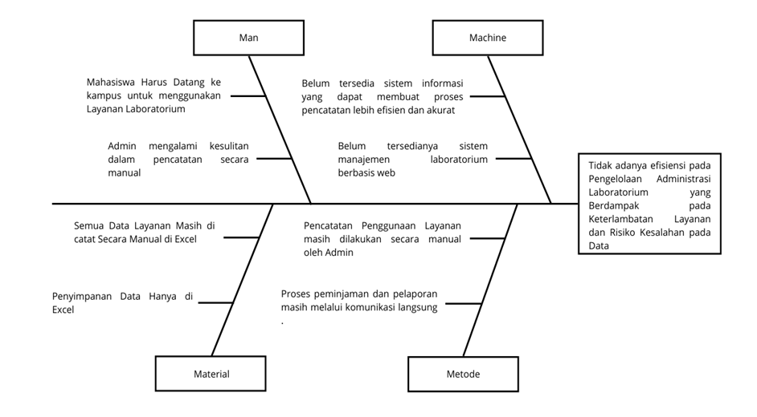

> **📷 Keterangan Gambar**: *Gambar 1. 1 Diagram Fishbone* (Dimensi: 942x520 px)  
> **🔍 Analisis & Arti Gambar**:  
> Gambar pendukung/ilustrasi visual pada Halaman 35 yang merepresentasikan bagan, panduan antarmuka, formulir, atau materi teknis sesuai konteks bahasan: 'Gambar 1. 1 Diagram Fishbone'.

---

## 📄 Halaman 36

10 
 
Faktor Machine mengindikasikan bahwa belum tersedia sistem informasi 
yang dapat menunjang efisiensi dan akurasi proses pencatatan. Selain itu, tidak 
adanya sistem manajemen laboratorium berbasis web membuat proses pengelolaan 
layanan laboratorium menjadi terhambat dan tidak terdigitalisasi. 
Pada faktor Material, seluruh data layanan masih dicatat secara manual 
menggunakan excel. Proses penyimpanan data pun hanya mengandalkan media 
fisik tersebut, sehingga rawan terhadap Kesalahan pada data dan sulit untuk 
ditelusuri kembali apabila dibutuhkan. 
Sedangkan pada faktor Method, pencatatan penggunaan layanan dan proses 
pelaporan masih dilakukan secara manual oleh admin. Komunikasi layanan seperti 
peminjaman alat atau laporan kerusakan juga masih dilakukan secara langsung, 
sehingga berisiko menimbulkan keterlambatan atau miskomunikasi. 
Berdasarkan identifikasi dari keempat faktor tersebut, dapat disimpulkan 
bahwa inti dari permasalahan adalah belum adanya sistem informasi manajemen 
laboratorium yang dapat mendukung proses pencatatan, pelaporan, dan pengelolaan 
layanan secara efisien, akurat, dan terorganisir. Oleh karena itu, dalam penelitian 
ini akan dikembangkan website manajemen laboratorium sebagai solusi digital 
yang mampu mengakomodasi kebutuhan pencatatan, pelaporan, dan pengelolaan 
data layanan lab secara lebih optimal dan mendukung transformasi digital.

---

## 📄 Halaman 37

11 
 
BAB 2 
TINJAUAN PUSTAKA 
 
Pada Bab ini berisi kajian pustaka yang relevan dengan topik penelitian. 
Tinjauan pustaka mencakup teori-teori dasar, konsep-konsep penting, dan hasil-
hasil penelitian terdahulu yang digunakan sebagai dasar dalam pengembangan 
sistem dan penyusunan skripsi. Tinjauan ini membantu peneliti untuk memahami 
konteks penelitian serta menemukan celah (gap) yang dapat diisi oleh penelitian 
ini. Selain itu, dalam bab ini juga dijelaskan landasan teori dan analisis penelitian 
terdahulu yang menjadi acuan dalam merancang sistem informasi laboratorium.  
2. 1. 
Kajian Teknologi atau Metode Terkait  
2.1.1 Personal Extreme Programming (PXP) 
Personal 
Extreme 
Programming 
(PXP) 
adalah 
proses 
pengembangan perangkat lunak dirancang untuk diterapkan oleh 
pengembang perangkat lunak secara individu. PXP menjaga prinsip dasar 
mengurangi jumlah dokumentasi dan upaya pemeliharaan. Proses 
pengembangan PXP bersifat fleksibel dan responsif atas perubahan. 
Metodologi ini ditujukan untuk meningkatkan kinerja pengembang dan 
mempersingkat pengkodean dan waktu yang digunakan untuk mendukung 
sistem perangkat lunak (Kusmiawati & Suharto, 2023). Metodologi PXP 
didasarkan pada prinsip-prinsip berikut : 
1. Memerlukan pendekatan disiplin, pengembang bertanggung jawab 
untuk mengikuti proses, dan menerapkan praktik PXP. 
2. Pengembang harus mengukur, melacak, dan menganalisis pekerjaan 
sehari-hari 
3. Pengembang harus belajar dari variasi kinerja dan memperbaiki proses 
berdasarkan data proyek yang terkumpul 
4. PXP melibatkan pengujian terus menerus

---

## 📄 Halaman 38

12 
 
5. Pengembang harus mencoba mengotomatisasi sebanyak mungkin 
selama hari pengembang kerja 
Proses PXP bersifat iteratif dan terdiri dari beberapa iterasi dan 
siklus. Perencanaan persyaratan dan tugas biasanya dilakukan untuk 
keseluruhan proyek, karena biasanya persyaratan ditentukan terlebih dahulu 
dan tetap stabil selama implementasi. Selama fase Requirement, dokumen 
dengan persyaratan fungsional dan nonfungsional untuk sistem dibuat. 
Dalam fase planning, pengembang menyusun serangkaian tugas 
berdasarkan dokumen daftar persyaratan. Setiap tugas dapat terdiri dari 
tugas-tugas yang lebih kecil yang dikategorikan. Pada Iteration 
initialization, menunjukkan awal setiap iterasi. Iterasi dimulai dengan 
pemilihan tugas, yang akan menjadi fokus iterasi. Panjang iterasi dapat 
bervariasi dari 1 hingga 3 minggu tergantung pada cakupan proyek. Pada 
fase Design, pengembang otonom memodelkan modul dan kelas sistem 
yang akan diimplementasikan dalam iterasi yang sedang berlangsung. Pada 
fase implementation adalah tempat pembuatan kode yang sebenarnya 
terjadi. 
Pengembang 
mengimplementasikan 
semua 
objek 
yang 
didefinisikan dalam fase desain sebelumnya dan mengujinya. Dan fasi 
retrospective menandai akhir dari iterasi proses. Analisis data yang 
dikumpulkan selama fase lainnya sedang dilakukan.

---

## 📄 Halaman 39

13 
 
 
Gambar 2. 1 Metode PXP (D. heris Ardianzah, 2022) 
1.    
Requirement 
Pada tahap ini pengembang mengidentifikasi kebutuhan fungsional 
dan non-fungsional sistem melalui diskusi dengan stakeholder. Hasil 
identifikasi kebutuhan sistem didefinisikan secara rinci dalam bentuk 
dokumen persyaratan. Luaran pada tahap ini berupa dokumen persyaratan 
sistem yang berfungsi sebagai spesifikasi sistem yang dibangun. Persyaratan 
sistem berupa user Story sebagai fitur yang dibutuhkan dalam pengembangan 
(Hasan et al., 2024) 
2.            
Planning 
Pada tahap planning, pengembang menyusun daftar user Story yang 
telah diperoleh dari tahap Requirements. Setiap user Story akan dianalisis 
menggunakan metode MoSCoW Prioritization untuk menentukan prioritas 
pengembangan, dan diberikan bobot Story point menggunakan urutan 
bilangan Fibonacci. Rangkaian user Story tersebut kemudian dikelompokkan 
ke dalam beberapa iterasi pengembangan dengan beban kerja yang relatif

### 🖼️ Gambar pada Halaman 39

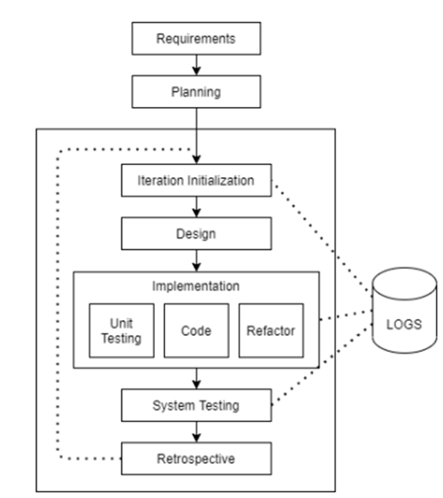

> **📷 Keterangan Gambar**: *Gambar 2. 1 Metode PXP (D. heris Ardianzah, 2022)* (Dimensi: 555x624 px)  
> **🔍 Analisis & Arti Gambar**:  
> Gambar ini menyajikan diagram alur tahapan metode Personal Extreme Programming (PxP), yang mencakup fase Requirements, Planning, Iteration (Design, Coding, Refactoring, Testing), dan Production, menunjukkan siklus pengembangan oleh pengembang tunggal.

---

## 📄 Halaman 40

14 
 
seimbang. Penjadwalan setiap iterasi juga memperhatikan urgensi dan 
keterkaitan antar fitur sistem (Hasan dkk., 2024). 
3.           Iteration Initialization 
Pada tahap ini menunjukkan awal dari setiap iterasi. Setiap iterasi 
yang berlangsung diawali dengan pemilihan tugas yang menjadi fokus iterasi. 
Durasi waktu iterasi dapat berbeda dari satu hingga tiga minggu, tergantung 
pada lingkup proyek (Hasan dkk., 2024). 
4.           Design 
Pada tahap ini pengembang melakukan pemodelan terkait kelas sistem 
yang akan diimplementasikan dalam pengembangan selama iterasi 
berlangsung. Desain sistem yang dimodelkan sesuai dengan persyaratan 
kebutuhan dan pengembang dapat memilih metode yang digunakan, namun 
disarankan menggunakan alat yang sederhana. Pemodelan sistem 
menggunakan undified modelling language yang mencakup use case diagram 
dan entity relationship diagram (Lestari dkk., 2023). 
5.            Implementation 
Pada tahap ini berlangsungnya siklus pengembangan kode program. 
Pengembang melakukan implementasi terhadap semua objek kelas yang telah 
ditetapkan di tahap desain. Tahapan implementasi terdiri dari pengujian unit, 
pembuatan kode, dan pemfaktoran ulang kode. Unit Testing menghasilkan 
kode program yang berupa function atau object class, kemudian penulisan 
kode sistem untuk menghasilkan fitur pada user Story, dan pemfaktoran 
bertujuan mengoptimasi kode program. Tahap implementasi dinyatakan 
selesai setelah seluruh kode dapat berfungsi dan semua pengujian unit berhasil 
(Hasan dkk., 2024),

---

## 📄 Halaman 41

15 
 
6.            
System Testing 
Pada tahap ini semua fitur yang telah dikembangkan diuji. Tujuan dari 
tahap ini pengembang memverifikasi terkait solusi yang dihasilkan apakah 
telah memenuhi persyaratan awal proyek. Tahap pengujian sistem 
menghasilkan catatan pengujian dan dilakukan perbaikan untuk sistem (Hasan 
dkk., 2024). 
7.            
Retrospective 
Pada tahap ini masuk ke fase akhir dari proses iterasi. Tahap ini 
dilakukan evaluasi antara waktu perencanaan tugas dengan waktu aktualnya 
dan menemukan potensi terjadinya penundaan yang berdampak pada 
perkiraan waktu dalam pengembangan berikutnya. Selain itu, tahap 
retrospektif dapat menandai akhir pengembangan sebuah proyek ketika semua 
kebutuhan sistem telah terpenuhi dan tidak ada kesalahan yang belum 
terselesaikan (Hasan dkk., 2024). 
2.1.2 User Story 
User Story merupakan elemen penting dalam pengembangan 
perangkat lunak berbasis Agile. Konsep ini mengacu pada proses 
identifikasi permasalahan atau kebutuhan yang telah ada sebelumnya, yang 
kemudian dituangkan dalam bentuk deskripsi singkat dan jelas (Febrianto 
& Wulansari, 2020) Tujuan dari user Story adalah untuk menggambarkan 
kebutuhan sistem dari sudut pandang pengguna akhir (end-user), sehingga 
tim pengembang dapat memahami konteks yang diinginkan pengguna 
dengan lebih baik. 
Dalam praktiknya, user Story merupakan notasi singkat yang 
mengekspresikan kebutuhan sistem secara ringkas dalam metode Agile. 
User Story biasanya menjadi format kebutuhan yang paling sering 
digunakan dalam proyek-proyek Agile karena bersifat fleksibel dan mudah 
dipahami oleh semua pihak, baik teknis maupun non-teknis. User Story 
memiliki tiga komponen dasar yang penting, yaitu:

---

## 📄 Halaman 42

16 
 
1. Teks pendek yang secara ringkas menggambarkan & mewakili cerita 
pengguna 
2. Percakapan atau diskusi antara stakeholder untuk bertukar perspektif dan 
memperjelas kebutuhan pengguna secara menyeluruh. 
3. Acceptance criteria, yaitu seperangkat kriteria yang digunakan untuk 
menentukan apakah suatu user Story telah selesai dan sesuai. Acceptance 
criteria mencakup karakteristik kualitas, fungsi sistem, skenario 
penggunaan, aturan bisnis, antarmuka eksternal, batasan sistem, hingga 
definisi data yang digunakan. 
Dengan adanya struktur ini, user Story tidak hanya memfasilitasi 
komunikasi yang efektif antar anggota tim, tetapi juga memastikan bahwa 
kebutuhan pengguna benar-benar dipahami dan diterapkan dengan tepat dalam 
proses pengembangan perangkat lunak.(Rama Febrianto dkk., 2020) 
 
Tabel 2. 1 Format User Story 
Kode 
  
User Story 
Aktor 
I Want To 
So That I can 
US-01 
Admin Melakukan Login 
Masuk kedalam sistem untuk 
mengelola informasi pariwisata 
US-02 
Admin Melihat Dashboard 
Mengetahui visualisasi sektor 
pariwisata 
 
2.1.3 Story Point 
Story point adalah mengukur kompleksitAs atau upaya yang 
dibutuhkan untuk menyelesaikan setiap user Story, bukan waktu spesifik. 
Story points dinyatakan dalam angka seperti 1, 2, 3, 5, 8, dan 13 (angka dari 
Fibonacci Sequence). Nilai Story points mempertimbangkan beberapa 
faktor yaitu tingkat kompleksitas berupa fitur yang membutuhkan alur 
logika yang kompleks, seperti penanganan banyak pengguna atau interaksi

---

## 📄 Halaman 43

17 
 
yang detail akan memiliki Story points lebih tinggi. Estimasi ini dilakukan 
berdasarkan faktor-faktor seperti tingkat kesulitan, risiko teknis, dan waktu 
pengerjaan yang dibutuhkan. Dalam metode PXP, penggunaan Story point 
membantu pengembang dalam mengatur beban kerja secara lebih efektif, 
sehingga setiap tugas dapat diselesaikan sesuai prioritas dan dalam waktu 
yang optimal (Kadek dkk., 2025). 
2.1.4  MoSCoW 
MoSCoW merupakan metode yang digunakan untuk menyusun 
daftar kebutuhan secara efisien dan sistematis, serta mampu menghasilkan 
urutan prioritas 
yang tepat. 
Dalam pendekatan ini, kebutuhan 
diklasifikasikan ke dalam empat tingkat prioritas, yaitu Must Have, should 
have, could have, dan won’t have. Kategori Must Have menempati posisi 
prioritas tertinggi, sementara should have, could have, dan won’t have 
memiliki tingkat kepentingan yang lebih rendah secara berturut-turut 
(Zuhairunisa, Muslimah Az-Zahra dan Syawli, 2025). 
2.1.5 Use Case Diagram 
Use Case Diagram merupakan salah satu jenis diagram dalam 
Unified Modeling Language (UML) yang digunakan untuk memodelkan 
interaksi antara sistem dengan aktor yang terlibat (Basmallah Ramadhani 
Aisyah Putri, 2024). Diagram ini memberikan gambaran menyeluruh 
mengenai bagaimana sistem akan digunakan oleh pengguna atau entitas lain 
yang berinteraksi dengannya. 
Use case diagram digunakan untuk mendeskripsikan tipe-tipe 
interaksi yang mungkin terjadi antara pengguna (aktor) dengan sistem. 
Diagram ini menyajikan skenario yang menunjukkan bagaimana sistem 
merespons tindakan pengguna berdasarkan kebutuhan atau tujuan tertentu. 
Use case adalah teknik yang digunakan untuk mencatat atau 
merekam persyaratan fungsional dari sebuah sistem. Use case 
menggambarkan interaksi tipikal yang terjadi antara pengguna sistem dan

---

## 📄 Halaman 44

18 
 
sistem itu sendiri dalam bentuk narasi yang mudah dipahami. Melalui use 
case, pengembang dapat memahami kebutuhan pengguna secara fungsional 
serta menyusun dokumentasi awal yang penting dalam perencanaan dan 
pengembangan sistem(Hasanah, 2020). 
Dengan demikian, use case diagram tidak hanya berfungsi sebagai 
alat bantu komunikasi antara pengembang dan pengguna, tetapi juga sebagai 
panduan dalam proses perancangan sistem agar sesuai dengan kebutuhan 
yang telah diidentifikasi. 
Tabel 2. 2 Simbol Use Case Diagram 
Nama 
Simbol 
Deskripsi 
  
  
  
Aktor 
 
Aktor adalah peran yang dimainkan 
oleh pengguna ketika berinteraksi 
dengan sistem. Pada umumnya aktor 
dapat berupa individu, proses, atau 
sistem lain yang berinteraksi dengan 
sistem yang dikembangkan. Aktor 
juga mendeskripsikan orang yang 
memiliki akses terhadap fitur untuk 
dapat berinteraksi dengan 
sistem. 
  
  
Use Case 
 
Fungsionalitas yang disediakan sistem 
sebagai unit-unit yang saling bertukar 
pesan antar unit atau aktor. Use Case 
dinyatakan dengan menggunakan kata 
kerja 
di awal frasa. 
  
  
Association 
 
Garis yang menghubungkan antara 
aktor dengan use case di dalam sistem. 
Assosiasi menunjukkan bahwa aktor 
dapat berinteraksi dengan sistem yang 
ditunjukkan oleh Use Case.

### 🖼️ Gambar pada Halaman 44

> **📷 Keterangan Gambar**: *Tabel 2. 2 Simbol Use Case Diagram* (Dimensi: 157x79 px)  
> **🔍 Analisis & Arti Gambar**:  
> Gambar ini menyajikan diagram Use Case (UML) yang memetakan hubungan antara aktor pengguna dengan fungsionalitas sistem informasi yang dirancang, mendefinisikan batasan interaksi pengguna.

---

## 📄 Halaman 45

19 
 
Nama 
Simbol 
Deskripsi 
  
  
  
Extend 
 
Fungsi extend menambahkan sebuah 
use case yang dapat berdiri sendiri 
sehingga 
mirip 
dengan 
prinsip 
inheritance 
pada 
pemrograman 
berorientasi 
objek. 
Dalam 
penerapannya use case tambahan 
memiliki nama depan 
yang sama dengan use case yang 
ditambahkan. 
 
Generalization 
 
Hubungan 
generalisasi 
dan 
spesialisasi antara dua use case yang 
menunjukkan 
salah 
satu 
fungsi 
merupakan fungsi yang 
lebih umum dari yang lainnya. 
  
Include 
 
Relasi use case ke sebuah use case 
tambahan dan memerlukan use case 
awal untuk menjalankan fungsinya 
sebagai use case tambahan. 
 
2.1.6 Entity Relationship Diagram (ERD) 
Entity Relationship Diagram (ERD) merupakan sala satu alat bantu 
dalam perancangan basis data yang digunakan untuk menggambarkan 
hubungan antara entitas di dalam suatu sistem. Setiap entitas dalam ERD 
mewakili objek dunia nyata yang memiliki karakteristik atau atribut tertentu 
yang relevan dengan sistem yang sedang dikembangkan. 
ERD berfungsi untuk memvisualisasikan struktur logis dari basis 
data, termasuk entitas, atribut, serta relasi antar entitas tersebut. Dengan 
demikian, ERD dapat membantu perancang sistem memahami keterkaitan 
data, serta merancang skema database yang lebih terstruktur, sistematis, dan 
mudah dipahami. 
Penggunaan ERD dalam tahap perancangan sistem informasi sangat 
penting karena dapat menggambarkan alur data secara keseluruhan serta

---

## 📄 Halaman 46

20 
 
membantu dalam menentukan kunci utama (primary key), kunci asing 
(foreign key), dan jenis hubungan (relasi) antar entitas. Dengan desain ERD 
yang baik, pengembangan database menjadi lebih efektif, efisien, dan 
minim kesalahan logika (Antar et al., 2025). 
Tabel 2. 3 Entity Relationship Diagram (ERD) 
Simbol 
Keterangan 
 
 
Entity : Mewakili objek yang dapat 
disimpan dalam basis data 
  
Weak Entity : Entitas yang tidak memiliki 
kunci utama dan bergantung dengan 
entitas lain 
  
Relationship : Menunjukkan hubungan 
atau keterkaitan antara dua entitas 
  
Attribute : Menunjukkan atribut atau 
karakteristik dari entitas 
 
 
Multivalue Attribute : Menunjukkan 
atribut yang dapat memuat lebih dari satu 
nilai. 
Hubungan ERD dengan Model Relasional, Model relasional adalah 
representasi logis dari data yang berasal dari ERD ke dalam bentuk tabel-
tabel (relasi). Setiap entitas pada ERD akan dikonversi menjadi sebuah 
tabel, dengan atribut-atribut menjadi kolom tabel tersebut. Hubungan antar 
entitAs akan direpresentasikan dalam bentuk kunci asing (foreign key) atau

### 🖼️ Gambar pada Halaman 46

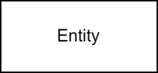

> **📷 Keterangan Gambar**: *Tabel 2. 3 Entity Relationship Diagram (ERD)* (Dimensi: 158x73 px)  
> **🔍 Analisis & Arti Gambar**:  
> Gambar ini menyajikan diagram skema struktural perangkat lunak (Class Diagram / ERD) yang mendefinisikan struktur tabel/kelas, atribut kolom, method, dan relasi kardinalitas antar entitas basis data.

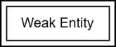

> **📷 Keterangan Gambar**: *Tabel 2. 3 Entity Relationship Diagram (ERD)* (Dimensi: 165x67 px)  
> **🔍 Analisis & Arti Gambar**:  
> Gambar ini menyajikan diagram skema struktural perangkat lunak (Class Diagram / ERD) yang mendefinisikan struktur tabel/kelas, atribut kolom, method, dan relasi kardinalitas antar entitas basis data.

> **📷 Keterangan Gambar**: *Tabel 2. 3 Entity Relationship Diagram (ERD)* (Dimensi: 133x66 px)  
> **🔍 Analisis & Arti Gambar**:  
> Gambar ini menyajikan diagram skema struktural perangkat lunak (Class Diagram / ERD) yang mendefinisikan struktur tabel/kelas, atribut kolom, method, dan relasi kardinalitas antar entitas basis data.

> **📷 Keterangan Gambar**: *Tabel 2. 3 Entity Relationship Diagram (ERD)* (Dimensi: 152x62 px)  
> **🔍 Analisis & Arti Gambar**:  
> Gambar ini menyajikan diagram skema struktural perangkat lunak (Class Diagram / ERD) yang mendefinisikan struktur tabel/kelas, atribut kolom, method, dan relasi kardinalitas antar entitas basis data.

> **📷 Keterangan Gambar**: *Tabel 2. 3 Entity Relationship Diagram (ERD)* (Dimensi: 148x67 px)  
> **🔍 Analisis & Arti Gambar**:  
> Gambar ini menyajikan diagram skema struktural perangkat lunak (Class Diagram / ERD) yang mendefinisikan struktur tabel/kelas, atribut kolom, method, dan relasi kardinalitas antar entitas basis data.

---

## 📄 Halaman 47

21 
 
tabel relasi tambahan, tergantung pada jenis hubungan (one-to-one, one-to-
many, many-to-many). 
Langkah-langkah konversi dari ERD ke model relasional antara lain: 
1. Mengubah entitas menjadi tabel: Setiap entitas direpresentasikan sebagai 
sebuah tabel. 
2. Mengubah atribut menjadi kolom: Setiap atribut entitas menjadi kolom 
dalam tabel, termasuk menentukan primary key. 
3. Menangani hubungan antar entitas: 
a. One-to-one: dapat direpresentasikan dalam salah satu tabel dengan 
menambahkan kunci asing. 
b. One-to-many: kunci utama dari entitas “one” menjadi kunci asing 
di entitas “many”. 
c. Many-to-many: dibutuhkan tabel relasi tambahan yang memuat 
kunci asing dari kedua entitas yang terlibat. 
2.1.7 Blackbox Testing 
Black Box Testing merupakan metode pengujian perangkat lunak 
yang berfokus pada pemeriksaan fungsionalitas suatu sistem tanpa 
mempertimbangkan struktur internal atau logika program yang digunakan. 
Dalam metode ini, penguji hanya mengamati input dan output dari sistem, 
serta membandingkannya dengan spesifikasi yang telah ditentukan, tanpa 
mengetahui bagaimana proses tersebut dilakukan secara internal oleh 
perangkat lunak. 
Validitas dari pengujian ini dijamin melalui pemetaan yang 
konsisten antara spesifikasi sistem dan hasil keluaran yang diharapkan. 
Dengan demikian, Black Box Testing bertujuan untuk memastikan bahwa 
semua fungsi dalam sistem berjalan sesuai dengan kebutuhan pengguna dan 
tidak terjadi kesalahan pada hasil yang ditampilkan. 
Pendekatan ini sering digunakan dalam tahap akhir pengembangan 
perangkat lunak, terutama untuk melakukan pengujian sistem secara

---

## 📄 Halaman 48

22 
 
menyeluruh dari sudut pandang pengguna (end user) (Hendartie, Jayanti dan 
Sutejo, 2023). 
Tabel 2. 4 Format Black Box Testing 
Fitur 
Scenario Case 
Hasil Yang 
Diharapkan 
Hasil 
Pengujian 
Kesimpulan 
US-02 
Login 
Mengisi username 
dan Password 
dengan benar, lalu 
klik tombol masuk 
Dapat masuk 
kedalam sistem, 
lalu ditampilkan 
halaman Dashboard 
Sesuai 
Valid 
2.1.8 Laravel 
Laravel merupakan salah satu framework PHP yang bersifat open 
source dan menggunakan lisensi MIT. Framework ini dibangun dengan 
pendekatan arsitektur Model-View-Controller (MVC), yang bertujuan untuk 
memisahkan logika aplikasi, antarmuka pengguna, dan manipulasi data, 
sehingga menghasilkan struktur kode yang lebih terorganisir dan mudah 
dipelihara. 
Laravel dirancang untuk mempermudah dan mempercepat proses 
pengembangan aplikasi web. Dengan sintaksis yang elegan dan ekspresif, 
Laravel memungkinkan pengembang menulis kode yang bersih, terbaca, 
dan efisien. Framework ini juga menawarkan berbagai fitur canggih seperti 
routing yang fleksibel, template engine Blade, ORM (Eloquent), serta 
sistem autentikasi dan keamanan yang kuat. 
Dengan menggunakan paradigma MVC, Laravel tidak hanya 
meningkatkan kualitas perangkat lunak, tetapi juga mampu mengurangi 
biaya pengembangan dan perawatan aplikasi. Selain itu, Laravel 
menyediakan dokumentasi yang lengkap serta komunitas yang besar dan 
aktif, yang semakin mendukung pengembang dalam menyelesaikan 
berbagai tantangan pengembangan aplikasi web modern (Nugraha dkk., 
2024).

---

## 📄 Halaman 49

23 
 
2.1.9 PHPUnit 
PHPUnit 
adalah 
sebuah 
kerangka 
kerja 
pengujian 
yang 
dikembangkan oleh Sebastian Bergmann dan termasuk dalam keluarga 
xUnit. Framework ini dirancang khusus untuk pengujian perangkat lunak 
yang ditulis dalam bahasa PHP. Konsep dasar dari PHPUnit adalah 
membantu pengembang dalam mendeteksi kesalahan pada kode yang baru 
ditulis, serta memastikan bahwa tidak terjadi regresi dalam basis kode. 
PHPUnit mampu menghasilkan keluaran dalam berbagai format, seperti 
JUnit XML dan TestDox. Dibandingkan dengan alat pengujian lainnya 
seperti Codeception dan SimpleTest, PHPUnit menonjol dalam aspek 
fungsionalitas, efisiensi, keandalan, dan portabilitas (Kesuma dan Kholifah, 
2019). 
2.1.10 Vue Js 
Vue Js merupakan sebuah framework JavaScript yang digunakan 
untuk membangun antarmuka pengguna (user Interface) berbasis web 
secara interaktif dan reaktif. Vue.js dirancang dengan pendekatan 
component-based, di mana antarmuka aplikasi dibagi ke dalam komponen-
komponen kecil yang dapat digunakan kembali, sehingga memudahkan 
pengembangan dan pemeliharaan sistem. Framework ini juga menerapkan 
konsep reactive data binding yang memungkinkan perubahan data secara 
otomatis diperbarui pada tampilan tanpa perlu manipulasi DOM secara 
manual. Selain itu, Vue.js mendukung integrasi dengan berbagai teknologi 
backend serta mampu digunakan untuk membangun aplikasi Single Page 
Application (SPA) yang dinamis dan responsif. Karena kemudahan 
penggunaan, fleksibilitas, dan performanya yang baik, Vue.js menjadi salah 
satu framework frontend yang banyak digunakan dalam pengembangan 
aplikasi web modern (Perdana, Supratman dan Saputra, 2024).

---

## 📄 Halaman 50

24 
 
2.1.11 Inertia Js 
Inertia.js merupakan sebuah library yang berfungsi sebagai 
penghubung antara backend framework dan frontend framework dalam 
pengembangan aplikasi web. Inertia.js memungkinkan pembuatan aplikasi 
Single Page Application (SPA) tanpa memerlukan pemisahan arsitektur 
antara frontend dan backend melalui REST API. Dengan Inertia.js, proses 
routing dan pengolahan data tetap dilakukan pada sisi backend, sementara 
tampilan antarmuka dikelola menggunakan framework frontend seperti 
Vue.js. Pendekatan ini memberikan kemudahan dalam pengembangan 
aplikasi karena struktur sistem menjadi lebih sederhana, terintegrasi, serta 
mampu meningkatkan efisiensi komunikasi antara frontend dan backend. 
Inertia.js juga mendukung pengiriman data secara dinamis sehingga 
pengalaman pengguna menjadi lebih optimal (Zulkahfi, Afirianto dan 
Akbar, 2025).  
2.1.12 Tailwind CSS 
Tailwind CSS merupakan sebuah framework CSS dengan 
pendekatan utility-first yang menyediakan berbagai kelas utilitas untuk 
mengatur tampilan antarmuka secara langsung pada elemen HTML. 
Framework ini memungkinkan pengembang untuk mengelola desain dan 
gaya visual tanpa harus menulis CSS secara terpisah, sehingga 
mempercepat proses pengembangan antarmuka. Tailwind CSS memberikan 
fleksibilitas tinggi dalam perancangan tampilan karena tidak bergantung 
pada komponen bawaan tertentu, serta mendukung pembuatan desain yang 
konsisten dan responsif. Dengan pendekatan tersebut, Tailwind CSS 
mempermudah pemeliharaan kode dan meningkatkan efisiensi dalam 
pengembangan front-end aplikasi web ((Azhariyah & Muhammad Mukhlis, 
2024).

---

## 📄 Halaman 51

25 
 
2.1.13 PrimeVue 
PrimeVue merupakan sebuah library komponen UI pengguna 
berbasis Vue Js yang menyediakan berbagai elemen siap pakai seperti tabel, 
formulir, tombol, dialog, dan komponen interaktif lainnya. Library ini 
dirancang untuk membantu pengembang dalam membangun UI pengguna 
secara cepat dan konsisten tanpa harus membuat komponen dari awal. 
PrimeVue mendukung pengembangan aplikasi web modern dengan 
menyediakan komponen yang fleksibel, mudah dikustomisasi, serta 
kompatibel dengan framework Vue.js. Dengan adanya PrimeVue, proses 
pengembangan antarmuka menjadi lebih efisien dan terstruktur (PrimeVue 
Documentation).  
2.1.14 Vite 
Vite merupakan sebuah build tool modern yang digunakan dalam 
proses pengembangan aplikasi frontend berbasis JavaScript. Vite dirancang 
untuk memberikan kecepatan dalam proses pengembangan melalui 
mekanisme hot module replacement (HMR), sehingga perubahan kode 
dapat langsung diterapkan tanpa memuat ulang seluruh aplikasi. Selain itu, 
Vite mendukung pengelolaan modul secara efisien serta kompatibel dengan 
framework 
modern 
seperti 
Vue.js. 
Penggunaan 
Vite 
membantu 
meningkatkan produktivitas pengembang dan mempercepat proses 
pembangunan aplikasi web modern (Vite Documentation). 
2.1.15 Mysql 
Mysql merupakan perangkat lunak manajemen basis data relasional 
(RDBMS) yang bersifat sumber terbuka (open source). Sebagai salah satu 
RDBMS yang paling populer, Mysql digunakan secara luas dalam berbagai 
aplikasi web dan sistem informasi. Sifat open source dari Mysql 
memungkinkan siapa saja untuk mengunduh, menggunakan, serta 
memodifikasi kode sumbernya sesuai kebutuhan.

---

## 📄 Halaman 52

26 
 
Mysql bersifat lintas platform, sehingga dapat dijalankan di berbagai 
sistem operasi seperti Windows, Linux, dan macOS. Program ini 
menyediakan kemampuan untuk menyimpan dan mengelola data dalam 
jumlah besar maupun kecil, serta memungkinkan integrasi yang baik 
dengan aplikasi web melalui penggunaan bahasa pemrograman seperti PHP. 
Dalam konteks pengembangan sistem informasi, Mysql memiliki 
peran penting terutama dalam hal penyimpanan data dari formulir online, 
pengolahan transaksi, serta penyajian data secara dinamis pada halaman 
web. Dengan kemampuan performa tinggi, skalabilitas, dan kestabilan, 
Mysql menjadi pilihan utama dalam pengembangan aplikasi berbasis data 
(Yudin dkk., 2025)  
2.1.16 User Acceptance Testing (UAT) 
User Acceptance Testing (UAT) merupakan proses verifikasi bahwa 
solusi yang dibuat dalam sistem sudah sesuai untuk pengguna. Proses ini 
berbeda dengan pengujian sistem (memastikan software tidak crash dan 
sesuai dengan dokumen permintaan pengguna), melainkan memastikan 
bahwa solusi dalam sistem tersebut akan bekerja untuk pengguna (yaitu, tes 
bahwa pengguna menerima solusi di dalam sistem) (Hermansah dkk.) 
2. 2.  Penelitian Terdahulu  
Berikut adalah rangkuman hasil penelitian terdahulu yang memiliki 
keterkaitan dengan penelitian yang telah dilakukan

---

## 📄 Halaman 53

27 
 
 
Tabel 2. 5 Penelitian Terdahulu 
No 
Nama dan Tahun Publikasi*) 
Permasalahan 
Metode 
Hasil Penelitian 
1 
IG Suputra Widharma, PG 
Sukarata, IM Sajayasa, ING 
Sangka, IN Sunaya (2022) 
Penelitian ini membahas 
permasalahan pada laboratorium 
otomasi yang pengelolaannya 
masih dilakukan secara manual 
dan belum terintegrasi. 
Pengelolaan laboratorium masih 
dilakukan secara manual 
sehingga menghambat efisiensi 
operasional dan penyampaian 
informasi. 
Prototype 
Untuk 
mengatasi 
hal 
ini, 
peneliti 
merancang sistem informasi laboratorium 
berbasis web dengan metode prototype 
yang mencakup fitur manajemen profil, 
jadwal, 
inventaris, 
dan 
laboratorium 
virtual. Hasil pengujian menunjukkan 
tingkat kepuasan pengguna yang tinggi 
dengan skor rata-rata 80–90%. 
2 
Aang Fajar ,Kristian 
Lopulalan, 
Dani 
Yuniawan  (2021) 
Jadwal laboratorium bentrok 
karena belum terdokumentasi 
Waterfall 
dan VOC 
(Voice of 
Customer) , 
QFD 
(Quality 
Function 
Deployment) 
Menghasilkan 
website 
informasi 
laboratorium fisika yang membantu 
penyampaian data aset, modul, jadwal, 
dan 
kegiatan 
akademik 
secara 
terintegrasi. 
Sistem 
informasi 
penjadwalan 
berbasis 
web 
untuk 
Laboratorium 
Komputasi 
Industri. 
Meningkatkan koordinasi dan efisiensi 
jadwal. Kepuasan pengguna mencapai 
100% puas dan sangat puas.

---

## 📄 Halaman 54

28 
 
Halaman ini sengaja dikosongkan

---

## 📄 Halaman 55

29 
 
No 
Nama dan Tahun Publikasi*) 
Permasalahan 
Metode 
Hasil Penelitian 
3 
Dandy 
Sadria, 
Sahriar 
Hamza, dan Sakinah Sudin 
(2023) 
 
 
Modul praktik dan inventaris 
laboratorium tidak 
terdokumentasi dengan baik 
karena masih menggunakan 
Word dan Excel secara manual. 
Pengembang
an sistem 
berbasis 
Python dan 
Mysql 
Permasalahan utama dalam penelitian 
adalah 
tidak 
tersentralisasinya 
inform
jadwal, pengelolaan modul, dan data inventa
Peneliti mengembangkan sistem inform
berbasis Python dan Mysql untuk digitalis
layanan laboratorium. Sistem yang dihasilk
mampu menyediakan akses Login adm
pengelolaan jadwal, inventaris, dan distrib
modul praktikum secara terpusat dan efisien
4 
I Nengah Sweden1, Anak 
Agung 
Gede 
Maharta 
Pemayun, 
Kadek 
Suar 
Wibawa, I Kadek Dwi 
Yatna Prayoga, I Dewa 
Made Laksana Putra, Ni 
Luh 
Gede 
Midya 
Frangginie 
(2022) 
 
 
Kurangnya media informasi 
digital dan belum adanya 
sistem yang mendukung 
manajemen laboratorium secara 
menyeluruh. 
Research and 
Development 
dengan uji 
kualitas 
berbasis ISO 
9126 
  
Kurangnya informasi laboratorium dan 
layanan masih manual. Penyelesaian yang 
dilakukan dengan mengembangkan sistem 
informasi laboratorium berbasis web dan 
menguji kualitasnya dengan standar ISO 
9126 (reliability, usability, dll). dengan 
hasil sistem mendapat nilai tinggi dari hasil 
uji 
WAPT 
dan 
GTMetrix; 
Sistem 
informasi laboratorium berbasis Laravel 
dinyatakan sangat baik berdasarkan uji 
performa GTMetrix dan uji WAPT dengan 
kelayakan tinggi pada aspek usability dan 
reliability.

---

## 📄 Halaman 56

30 
 
Halaman ini sengaja dikosongkan

---

## 📄 Halaman 57

31 
 
No 
Nama dan Tahun Publikasi*) 
Permasalahan 
Metode 
Hasil Penelitian 
5 
Fadli Arif Ramadan, Ridho 
taufiq 
Subagio, 
Rifqi 
Fahrudin (2024) 
Kurangnya media informasi 
digital dan belum adanya 
sistem yang mendukung 
manajemen laboratorium secara 
menyeluruh. Arsip dan 
penjadwalan laboratorium 
manual, menyebabkan bentrok 
jadwal dan sulitnya pelacakan 
kegiatan 
Rapid 
Application 
Development 
(RAD) 
Penulis 
menyelesaikan 
dengan 
membangun 
sistem 
manajemen 
laboratorium berbasis Laravel untuk 
dokumentasi, jadwal, dan pelacakan 
aktivitas lab. Dengan hasil sistem 
mempermudah 
pengelolaan 
dan 
meningkatkan efisiensi kegiatan lab. 
Hasil uji black box menunjukkan fungsi 
berjalan baik. Sistem SiMaLab berbasis 
web 
mampu 
mengotomatisasi 
manajemen 
dokumen 
dan 
jadwal 
laboratorium. Pengujian black box 
menyatakan 
seluruh 
fungsi 
sistem 
berjalan dengan baik. 
6 
Ika 
Lestari, 
Kamilina 
Rhodiyah LD, M. Ihsan 
Alfani Putera (2023) 
Penelitian ini menyoroti belum 
tersedianya media informasi 
digital yang menampilkan 
profil riset secara menyeluruh. 
Personal 
Extreme 
Programmin
g (PXP) 
Solusinya 
adalah 
pengembangan 
website company profile menggunakan 
metode 
PXP 
dalam 
dua 
iterasi, 
berdasarkan hasil user Story. Sistem 
yang dihasilkan mampu menampilkan 
informasi fokus riset dengan fitur sesuai 
kebutuhan, menyelesaikan 27 user Story 
prioritas 
dan 
dinilai 
layak 
untuk 
publikasi internal kampus.

---

## 📄 Halaman 58

32 
 
Halaman ini sengaja dikosongkan

---

## 📄 Halaman 59

33 
 
 
 
 
No 
Nama dan Tahun 
Publikasi*) 
Permasalahan 
Metode 
Hasil Penelitian 
7 
Dana 
Heris 
Ardianzah, 
Ilyas Nuryasin, Briansyah 
Setio 
Wiyono 
(2022)   
 
 
Proses peminjaman auditorium 
masih dilakukan secara manual, 
menyebabkan tidak efisien, 
rawan kehilangan data, dan 
keterlambatan pendataan. 
Tidak adanya sistem yang 
mendukung kebutuhan pihak 
perlengkapan. 
Personal 
Extreme 
Programmin
g (PXP) 
  
Membangun 
sistem 
pengelolaan 
peminjaman auditorium di Universitas 
Muhammadiyah 
Malang. 
Sistem 
efektif dalam mendigitalisasi proses 
manual peminjaman. Menghasilkan 
sistem 
informasi 
peminjaman 
auditorium berbasis web menggunakan 
Laravel 
dan 
Mysql. 
Sistem 
mempermudah proses peminjaman, 
mempercepat 
pencarian 
data, 
mengurangi kesalahan pencatatan, dan 
memberikan 
akses 
bagi 
ketua 
perlengkapan untuk memantau jadwal 
secara 
real-time. 
Penerapan 
PXP 
dilakukan dalam dua iterasi yang 
melibatkan kebutuhan klien secara 
langsung. Sistem dinyatakan berhasil 
dan diterima oleh pihak pengguna.

---

## 📄 Halaman 60

34 
 
Halaman ini sengaja dikosongkan

---

## 📄 Halaman 61

35 
 
 
 
No 
Nama dan Tahun 
Publikasi*) 
Permasalahan 
Metode 
Hasil Penelitian 
8 
 
Moch. Hendra Admaja, 
Anang Pramono (2025) 
Pembelajaran masih 
konvensional, tidak interaktif 
Personal 
Extreme 
Programmin
g (PXP) 
 
Mengembangkan sistem e-learning 
berbasis 
Laravel 
di 
SMPN 
1 
Kedungadem. 
Fitur 
inovatif: 
pengiriman 
nilai 
via 
WhatsApp. 
Sistem 
e-learning 
berbasis 
web 
dengan fitur pengiriman nilai via 
WhatsApp. Nilai SUS 62,3 (kategori 
"Marginal") menunjukkan perlunya 
perbaikan antarmuka, tetapi sistem 
efektif secara fungsional. 
9 
Muhammad Kharisma, 
Muhammad 
Fathurrohim, 
Bima 
Catur Aprriadi (2023) 
 
 
Permasalahan dalam penelitian 
ini adalah proses surat menyurat 
yang masih dilakukan secara 
manual, tidak efisien, dan 
kurang transparan. 
Personal 
Extreme 
Programmin
g (PXP) 
Peneliti membangun sistem surat 
menyurat berbasis web menggunakan 
metode PXP, dengan fitur pengajuan 
surat, verifikasi, serta tanda tangan 
digital. Sistem mendukung efisiensi, 
integrasi, 
dan 
transparansi, 
serta 
memperkuat penerapan prinsip Good 
University Governance (GUG) di 
lingkungan kampus.

---

## 📄 Halaman 62

36 
 
Halaman ini sengaja dikosongkan

---

## 📄 Halaman 63

37 
 
 
 
No 
Nama dan Tahun 
Publikasi*) 
Permasalahan 
Metode 
Hasil Penelitian 
10 
Afdal, 
Novri, 
Dwiny 
Meidelfi, Tri Lestari(2021) 
Proses peminjaman 
laboratorium 
masih 
dilakukan 
secara 
konvensional menggunakan 
formulir kertas yang rawan 
hilang. 
Pengemba
ngan Web 
dan 
Mobile 
App 
Peminjaman 
laboratorium 
masih 
manual dan menggunakan kertas, 
rawan 
kehilangan 
data. 
 Penyelesaian: 
Pengembangan 
aplikasi web dan Mobile untuk 
manajemen 
peminjaman 
dan 
informasi 
laboratorium. 
Sistem 
menggantikan sistem manual dan 
mempermudah pengelolaan data serta 
meminimalkan kehilangan informasi. 
Aplikasi berbasis web dan Android 
berhasil 
dikembangkan 
untuk 
mengelola peminjaman lab secara 
digital. Sistem meningkatkan efisiensi 
dan meminimalisasi kehilangan data.

---

## 📄 Halaman 64

38 
 
Halaman ini sengaja dikosongkan

---

## 📄 Halaman 65

39 
 
 
2. 3.  Dasar Teori Pendukung  
2.3.1 
Transformasi Digital 
Transformasi digital merupakan sebuah proses evolusi yang bersifat 
radikal, di mana organisasi memanfaatkan seluruh sumber daya yang 
dimiliki, termasuk teknologi digital, guna meningkatkan efisiensi dan daya 
saing. Dalam konteks perkembangan zaman yang semakin menekankan 
pentingnya digitalisasi, transformasi digital (Digital Transformation/DT) 
menjadi suatu keniscayaan yang tidak dapat dihindari. (Hadiono, Candra dan 
Santi, 2020). 
Perubahan kondisi lingkungan, baik secara sosial, ekonomi, maupun 
teknologi, mendorong organisasi untuk merespon secara adaptif. Hal ini 
menuntut organisasi untuk tidak hanya mengadopsi teknologi digital secara 
pasif, melainkan juga secara aktif mengintegrasikannya ke dalam proses 
bisnis, strategi operasional, hingga model pelayanan. Oleh karena itu, 
kesiapan dalam menghadapi transformasi digital menjadi hal krusial. 
Organisasi yang mampu beradaptasi dengan cepat akan memiliki peluang 
yang lebih besar untuk bertahan dan berkembang dalam persaingan yang 
semakin ketat. 
Transformasi digital tidak sekadar soal penggunaan teknologi, tetapi 
juga melibatkan perubahan budaya kerja, pola pikir, serta struktur organisasi. 
Hal ini mencerminkan bahwa transformasi digital bersifat multidimensional 
dan memerlukan komitmen dari seluruh elemen organisasi. 
2.3.2 
Software Development Life Cycle (SDLC) 
Software Development Life Cycle (SDLC) atau siklus hidup 
pengembangan perangkat lunak dalam rekayasa sistem dan rekayasa 
perangkat lunak merupakan proses pembuatan dan pengubahan sistem serta 
model dan metodologi yang digunakan dalam mengembangkan sistem-

---

## 📄 Halaman 66

40 
 
sistem tersebut. SDLC juga merupakan pola untuk mengembangkan sistem 
perangkat lunak yang terdiri dari tahapan perencanaan (planning), analisis 
(analyst), desain (Design), implementasi (implementation), uji coba 
(Testing) dan pengelolaan (maintenance) . Software Development Life Cycle 
(SDLC) merupakan aktivitas layaknya mendefinisikan, mengembangkan, 
menguji, mengirim, mengoperasikan, serta memelihara perangkat lunak 
(software) atau sebuah sistem informasi (Nova, Widodo dan Warsito, 2022). 
2.3.3 
Perbandingan Metode SDLC 
Dalam membangun Sistem Informasi Manajemen Laboratorium 
STMIK Samarinda, peneliti telah melakukan penentuan metode yang akan 
diterapkan dalam pada proses pengembangan melalui beberapa studi literatur, 
penelitian terdahulu, serta menyesuaikan Requirement dari STMIK 
Samarinda. Beberapa metode yang digunakan secara umum dan menjadi 
pertimbangan diantaranya metode Personal Extreme Programming (PXP),  
Rapid Application Development (RAD), Protoype dan Waterfall (Pricillia & 
Zulfachmi, 2021). Perbandingan dari metode SDLC dapat dilihat pada Tabel 
2.6. 
Tabel 2. 6 Perbandingan Metode 
Aspek 
Perbandingan 
PXP (Personal 
Extreme 
Programming) 
Waterfall 
Prototype 
RAD (Rapid 
Application 
Development) 
Perencanaan 
Sistem (Systems 
Planning) 
Berawal 
dari 
kebutuhan 
Berawal 
dari 
kebutuhan 
Berawal 
dari 
kebutuhan 
Berawal 
dari 
kebutuhan

---

## 📄 Halaman 67

41 
 
Aspek 
Perbandingan 
PXP (Personal 
Extreme 
Programming) 
Waterfall 
Prototype 
RAD (Rapid 
Application 
Development) 
Analisis Sistem 
Kebutuhan data 
bisa ditambah 
maupun 
dikurangi sesuai 
dengan 
kebutuhan dari 
pengguna 
ketika 
dilakukan 
pengujian 
  
  
Kebutuhan 
data harus 
dianalisis 
diawal 
secara 
lengkap 
dan 
menyeluruh 
  
Kebutuha
n 
data dapat 
ditambah 
ataupun 
dikurangi 
sesuai 
dengan 
kebutuhan 
user, 
ketika 
dilakukan 
Testing. 
Kebutuhan data 
dapat 
ditambah 
ataupun 
dikurangi 
sesuai 
dengan 
kebutuhan 
user, 
ketika 
dilakukan 
Testing. 
  
Perubahan data 
dapat 
dilakukan, 
Penyesuaian 
dapat dilakukan 
pada 
perencanaan 
kebutuhan 
fungsional 
sesuai 
kebutuhan yang 
diperlukan 
oleh user. 
Perubahan 
data 
ataupun 
fungsional 
akan 
merubah 
keseluruh 
proses 
pada 
tahapan 
berikutnya. 
Perubahan 
dapat 
dilakukan 
selama 
sistem 
atau 
perangkat 
lunak 
masih 
dalam 
bentuk 
prototype 
  
Kebutuhan fungsi 
mayor dapat di 
modulkan dalam 
waktu tertentu 
dan dapat 
dibicarakan oleh tim 
RAD yang 
terpisah 
Perancangan 
Sistem 
Perancangan 
sistem dapat 
disesuaikan 
dengan pilihan 
pengguna yang 
dapat 
menggunakan 
prototype atau 
hanya sebatas 
desain 
wireframe atau 
mock-up. 
  
Tidak dapat 
memberikan 
gambaran 
yang jelas 
mengenai 
sistem yang 
dibangun, 
sebab sistem 
dapat dilihat 
jika semua 
tahapan 
telah 
dilakukan 
  
Memberik
an 
prototype 
sebagai 
gambaran 
sistem 
yang akan 
dibangun, 
sehingga 
pengguna 
dapat 
menyaksik
an serta 
berinterak
si secara 
langsung 
dengan 
gambaran 
sistem. 
Memberikan 
prototype 
sebagai gambaran 
sistem 
yang akan dibangun, 
sehingga pengguna 
dapat 
menyaksikan serta 
berinteraksi secara 
langsung dengan 
gambaran 
sistem.

---

## 📄 Halaman 68

42 
 
Aspek 
Perbandingan 
PXP (Personal 
Extreme 
Programming) 
Waterfall 
Prototype 
RAD (Rapid 
Application 
Development) 
Implementasi 
Evaluasi 
dilakukan 
ketika 
terdapat 
kesalahan 
desain, bahkan 
ketika terdapat 
kesalahan pada 
tahap 
implementasi 
yakni pada 
saat penyusunan 
kode. 
Evaluasi 
dilakukan 
apabila 
sistem telah 
dibangun 
  
Evaluasi 
dilakukan 
ketika 
prototype 
dibangun 
  
Evaluasi dilakukan 
ketika 
prototype dibangun 
  
Pemeliharaan 
Disesuaikan 
dengan 
kesepakatan 
Disesuaikan 
dengan 
kesepakatan 
Disesuaik
an dengan 
kesepakat
an 
Disesuaikan dengan 
kesepakatan 
Sumber : (Pricillia & Zulfachmi, 2021) 
Berdasarkan 
perbandingan 
yang 
ditinjau 
dari 
tahapan 
pengembangan setiap metode, berikut juga disertakan kelebihan serta 
kekurangan dari setiap metode yang ada, seperti yang terdapat pada Tabel 
2.2. Metode SDLC berdasarkan karakteristik dari Tahap Pengembangan 
Dalam pengembangan perangkat lunak, pemilihan metode sangat 
bergantung pada skala proyek, jumlah tim, serta fleksibilitas yang 
dibutuhkan. Empat metode yang umum digunakan adalah Personal Extreme 
Programming (PXP), Rapid Application Development (RAD), Protoype, 
dan Waterfall masing-masing dengan karakteristik dan keunggulan yang 
berbeda. Personal Extreme Programming (PXP) adalah turunan dari 
Extreme Programming (XP) yang dirancang khusus untuk pengembang 
tunggal. Metode ini cocok untuk proyek skala kecil seperti Tugas Akhir 
mahasiswa, 
karena 
mengedepankan 
iterasi 
pendek, 
pengujian 
berkelanjutan, serta fleksibilitas tinggi terhadap perubahan kebutuhan. 
Tidak seperti Rapid Application Development (RAD) atau Protoype yang 
menuntut keterlibatan aktif pengguna setiap waktu, Personal Extreme

---

## 📄 Halaman 69

43 
 
Programming (PXP) lebih realistis diterapkan dalam kondisi seperti di 
STMIK Samarinda, di mana pihak pengguna (admin atau kepala 
laboratorium) tidak memungkinkan untuk terlibat dalam pertemuan harian 
atau sesi validasi yang terlalu intensif. Komunikasi dalam Personal Extreme 
Programming (PXP) cukup dilakukan secara berkala di setiap akhir iterasi, 
sehingga tetap menjaga arah pengembangan sesuai kebutuhan pengguna. 
Rapid 
Application 
Development 
(RAD) 
menekankan 
kecepatan 
pengembangan melalui prototyping dan kolaborasi intensif, namun 
membutuhkan waktu dan komitmen tinggi dari pengguna untuk 
memberikan umpan balik cepat dan terus-menerus. Hal ini sulit dicapai jika 
pengguna memiliki keterbatasan waktu, seperti dalam kasus STMIK 
Samarinda. Prototype, gambaran sistem lebih cepat melalui model awal 
yang dapat diuji langsung oleh pengguna. Waterfall, dengan pendekatan 
linier dan berurutan, unggul dalam dokumentasi dan perencanaan awal, 
tetapi tidak fleksibel terhadap perubahan kebutuhan di tengah jalan. Ini 
menjadi hambatan tersendiri dalam proyek ini, mengingat fitur-fitur yang 
dibutuhkan oleh laboratorium STMIK Samarinda masih memungkinkan 
berubah seiring diskusi dan validasi lapangan. 
Berdasarkan analisis tersebut, Personal Extreme Programming 
(PXP) menjadi metode paling tepat untuk diterapkan dalam pengembangan 
sistem 
informasi 
laboratorium 
STMIK 
Samarinda. 
Metode 
ini 
memungkinkan pengembang bekerja mandiri dengan tetap mengakomodasi 
masukan dari stakeholder secara bertahap. Selain itu, Personal Extreme 
Programming (PXP) tidak membebani pihak pengguna dengan keterlibatan 
yang terlalu intens, namun tetap menjamin sistem berkembang sesuai 
kebutuhan. Dalam praktiknya, pengembang akan rutin mengkomunikasikan 
progress sistem di setiap iterasi kepada kepala laboratorium, serta 
menyesuaikan pengembangan dengan feedback yang diterima. Dengan 
pendekatan ini, sistem dibangun bukan berdasarkan asumsi pengembang, 
melainkan benar-benar mencerminkan kebutuhan pengguna. Perencanaan 
waktu juga diatur berdasarkan jadwal riset agar proses pengerjaan tetap 
terarah dan selesai sesuai target.

---

## 📄 Halaman 70

44 
 
2.3.4 Unified Model Language (UML) 
Unified Modeling Language (UML) merupakan bahasa standar yang 
digunakan untuk memodelkan perangkat lunak dalam bentuk visual atau 
gambar. UML berfungsi sebagai alat bantu dalam memvisualisasikan, 
menentukan, membangun, dan mendokumentasikan sistem perangkat lunak 
yang kompleks. Pendekatan ini sangat efektif dalam mendukung 
pengembangan sistem berbasis objek (object-oriented), karena mampu 
merepresentasikan berbagai aspek dari sistem secara terstruktur dan 
sistematis. 
Secara filosofis, kemunculan UML terinspirasi oleh pendekatan 
Object-Oriented (OO), yang menganalogikan sistem perangkat lunak 
sebagai kumpulan objek seperti halnya objek dalam kehidupan nyata. 
Pendekatan ini memungkinkan sistem divisualisasikan dengan simbol-
simbol khusus yang bersifat spesifik dan universal, serta mendukung proses 
pengembangan yang bersifat standar dan independen(Aulia, 2022). 
UML dikembangkan dari kombinasi tiga metode pemodelan 
terkenal, yaitu: 
1.       Grady Booch dengan notasi Object-Oriented Design (OOD), 
2.       Jim Rumbaugh dengan Object Modeling Technique (OMT), 
3.        Ivar Jacobson dengan Object-Oriented Software Engineering (OOSE). 
Tujuan utama penggunaan diagram UML adalah untuk membantu 
tim 
pengembang 
dalam 
memahami 
sistem 
secara 
menyeluruh, 
mengeksplorasi berbagai kemungkinan desain, serta memverifikasi dan 
memvalidasi arsitektur sistem yang dirancang 
2.3.5 Model-View-Controller (MVC) 
Model-View-Controller (MVC) adalah sebuah teknik pemrograman 
atau pola arsitektur perangkat lunak yang memisahkan business logic (alur 
proses aplikasi), data logic (pengelolaan dan penyimpanan data), serta 
Interface logic (antarmuka aplikasi). Secara sederhana, MVC memisahkan

---

## 📄 Halaman 71

45 
 
antara desain, data, dan proses dalam sebuah aplikasi. Konsep ini mengatur 
arsitektur aplikasi agar lebih terstruktur dan mudah dikelola. 
Umumnya, aplikasi yang dibangun dengan konsep MVC merupakan 
aplikasi berskala menengah hingga besar, karena salah satu keunggulan 
utama MVC adalah kemudahan dalam proses pemeliharaan (maintenance) 
dan pengembangan aplikasi. Dalam penelitian ini, Framework Laravel 
digunakan karena menerapkan konsep MVC secara ketat dengan 
memisahkan kode pengelolaan basis data ke dalam folder Model, kode 
proses dan logika aplikasi ke dalam folder Controller, serta kode tampilan 
antarmuka ke dalam folder View (Rahmawati dan Sumarsono, 2024).

---

## 📄 Halaman 72

46 
 
Halaman ini Sengaja dikosongkan

---

## 📄 Halaman 73

47 
 
BAB 3 
DESAIN DAN IMPLEMENTASI 
Pada bab ini akan dijelaskan secara rinci mengenai metode yang digunakan 
dalam pelaksanaan penelitian. Metode penelitian mencakup pendekatan dan 
langkah-langkah yang dilakukan dalam proses perancangan dan pembangunan 
sistem informasi manajemen layanan laboratorium STMIK Samarinda. Penelitian 
ini menggunakan metode Personal Extreme Programming (PXP), yang merupakan 
adaptasi dari metode Agile yang sesuai untuk pengembangan sistem berbasis 
individu.  
3. 1 
Konsep Desain  
Konsep desain merupakan tahapan penerjemahan kebutuhan pengguna ke 
dalam rancangan sistem. Dalam pengembangan SIMLAB, konsep desain 
difokuskan pada transformasi layanan laboratorium yang semula bersifat manual 
menjadi terdigitalisasi untuk memperjelas perubahan tersebut, berikut diuraikan 
proses bisnis saat ini (As-is). 
3.1.1 Proses Bisnis As-is 
Terdapat proses bisnis As-Is yang berjalan pada di Laboratorium STMIK 
Samarinda yang diperoleh berdasarkan hasil wawancara dengan pihak Kepala 
Laboratorium STMIK Samarinda. 
Proses bisnis layanan sertifikasi di STMIK Samarinda yaitu : 
a.       
Proses Bisnis Sertifikasi Laboratorium 
Proses bisnis sertifikasi saat ini masih berjalan secara luring dan manual. 
Mahasiswa yang ingin mendaftar sertifikasi harus datang langsung ke laboratorium 
untuk mengisi formulir fisik dan menyerahkan berkas persyaratan kepada Admin. 
Admin kemudian mencatat data pendaftar ke dalam file Excel dan melakukan 
pengecekan kuota secara manual. Setelah itu, Admin meneruskan data peserta 
kepada Kepala Laboratorium untuk proses penilaian ujian. Jika dinyatakan lulus,

---

## 📄 Halaman 74

48 
 
Kepala Laboratorium akan menandatangani sertifikat fisik, yang kemudian 
diserahkan kembali oleh Admin kepada mahasiswa. Alur manual ini sangat rentan 
terhadap duplikasi data, pencatatan kuota yang tidak akurat, dan risiko hilangnya 
dokumen fisik. 
 
Gambar 3. 1 Proses Bisnis As-Is Sertifikasi Laboratorium Komputer 
Pada gambar 3.1, dijelaskan tentang proses sertifikasi laboratorium secara 
manual di STMIK Samarinda yang melibatkan tiga pihak utama mahasiswa, admin, 
dan kepala laboratorium. Proses dimulai saat mahasiswa datang ke laboratorium 
untuk menanyakan jadwal sertifikasi dan memilih skema yang tersedia. Setelah itu, 
mahasiswa mengisi data identitas melalui form offline dan admin memasukkan ke 
dalam excel kemudian memeriksa kelengkapan data peserta. Setelah verifikasi 
selesai, menunggu sesuai dengan jadwal yang ditentukan kemudian mahasiswa 
datang ke laboratorium untuk menerima soal sertifikasi diberikan kepada 
mahasiswa. Hasil ujian dan data peserta kemudian diserahkan ke kepala 
laboratorium untuk dinilai. Jika peserta lulus, sertifikat akan dicetak oleh admin dan 
diserahkan langsung kepada mahasiswa. Namun, jika tidak lulus, proses berhenti 
tanpa pencetakan sertifikat.

### 🖼️ Gambar pada Halaman 74

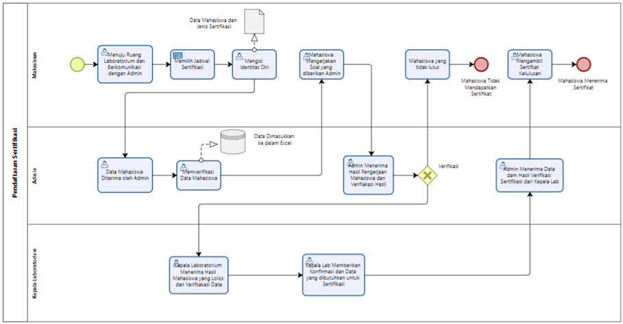

> **📷 Keterangan Gambar**: *Gambar 3. 1 Proses Bisnis As-Is Sertifikasi Laboratorium Komputer* (Dimensi: 909x474 px)  
> **🔍 Analisis & Arti Gambar**:  
> Gambar pendukung/ilustrasi visual pada Halaman 74 yang merepresentasikan bagan, panduan antarmuka, formulir, atau materi teknis sesuai konteks bahasan: 'Gambar 3. 1 Proses Bisnis As-Is Sertifikasi Laboratorium Komputer'.

---

## 📄 Halaman 75

49 
 
b.  Proses Bisnis Layanan Bebas Laboratorium 
 
Gambar 3. 2 Proses Bisnis As-Is Layanan Bebas Laboratorium 
Pada gambar 3.2, dijelaskan proses pengajuan Surat Bebas Laboratorium 
secara manual di STMIK Samarinda yang melibatkan mahasiswa, admin, dan 
kepala laboratorium. Proses dimulai saat mahasiswa datang ke laboratorium untuk 
mengajukan surat bebas laboratorium, mengisi data identitas, dan menyampaikan 
permohonan secara lisan atau formulir. Admin mencatat data pengajuan secara 
manual di excel dan memeriksa apakah mahasiswa masih memiliki pinjaman yang 
belum diselesaikan. Jika masih ada proses peminjaman maka pengajuan ditolak dan 
proses dihentikan. Jika tidak ada pinjaman yang tertunda, admin melanjutkan 
dengan memvalidasi data dan menyusun surat pengantar jika diperlukan, lalu 
meneruskan pengajuan ke kepala laboratorium untuk verifikasi akhir. Kepala 
laboratorium memeriksa data mahasiswa, riwayat penggunaan laboratorium, dan 
memastikan tidak ada pelanggaran atau tanggungan. Jika data valid, surat bebas 
laboratorium 
disetujui. 
Setelah 
disetujui, 
admin 
mencetak 
surat 
dan 
menyerahkannya kepada mahasiswa untuk keperluan administrasi seperti kelulusan 
atau yudisium.

### 🖼️ Gambar pada Halaman 75

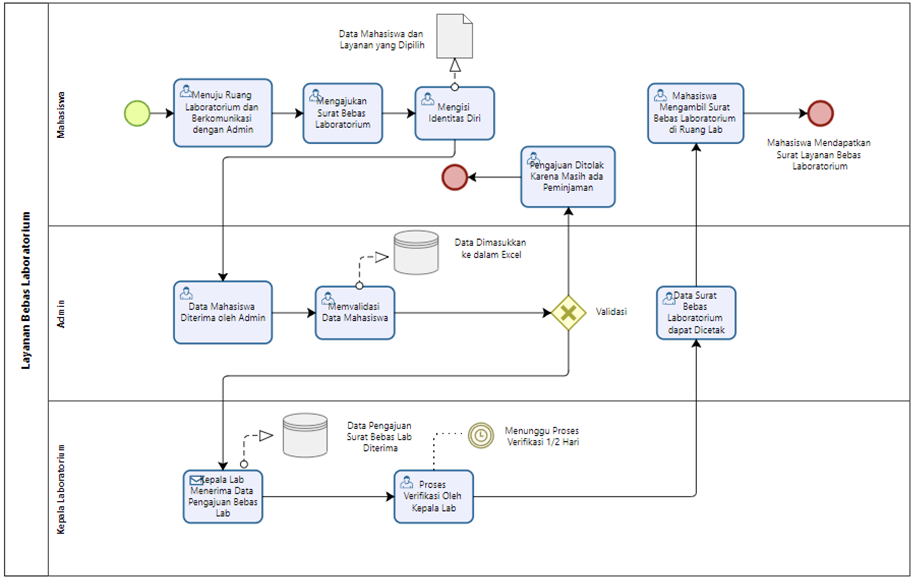

> **📷 Keterangan Gambar**: *Gambar 3. 2 Proses Bisnis As-Is Layanan Bebas Laboratorium* (Dimensi: 914x578 px)  
> **🔍 Analisis & Arti Gambar**:  
> Gambar pendukung/ilustrasi visual pada Halaman 75 yang merepresentasikan bagan, panduan antarmuka, formulir, atau materi teknis sesuai konteks bahasan: 'Gambar 3. 2 Proses Bisnis As-Is Layanan Bebas Laboratorium'.

---

## 📄 Halaman 76

50 
 
c.      Proses Bisnis Izin Penelitian 
 
Gambar 3. 3 Proses Bisnis As-Is Pengajuan Ijin Penelitian Lab Komputer 
Pada gambar 3.3, dijelaskan proses pengajuan izin penelitian secara manual 
di STMIK Samarinda yang dilakukan mahasiswa langsung kepada admin 
laboratorium. Proses dimulai saat mahasiswa datang ke laboratorium untuk 
mengajukan permohonan izin penelitian, menyampaikan kebutuhan penelitian, 
jadwal pelaksanaan, serta mengisi identitas secara manual melalui formulir. Admin 
mencatat data permohonan ke dalam excel. Setelah itu, permohonan menunggu 
validasi awal dari admin sebelum diteruskan ke kepala laboratorium. Kepala 
laboratorium melakukan verifikasi untuk memastikan jadwal tidak berbenturan 
dengan kegiatan lain dan bahwa mahasiswa memenuhi syarat. Jika ada masalah 
lain, mahasiswa diminta untuk mengajukan ulang. Jika semua data valid dan tidak 
ada kendala, kepala laboratorium menyetujui pengajuan tersebut. Admin kemudian 
mencetak surat izin penelitian dan menyerahkannya kepada mahasiswa, yang 
digunakan sebagai dokumen resmi untuk izin penelitiannya.

### 🖼️ Gambar pada Halaman 76

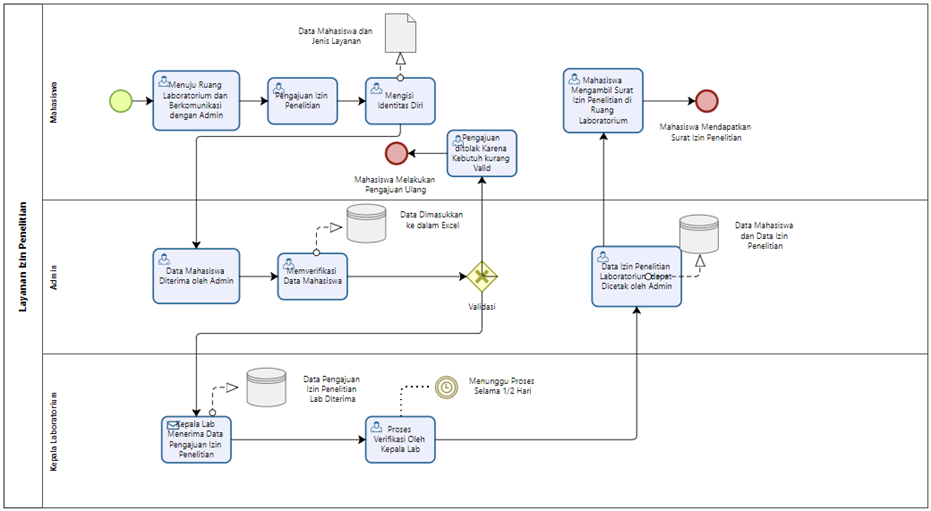

> **📷 Keterangan Gambar**: *Gambar 3. 3 Proses Bisnis As-Is Pengajuan Ijin Penelitian Lab Komputer* (Dimensi: 931x511 px)  
> **🔍 Analisis & Arti Gambar**:  
> Gambar pendukung/ilustrasi visual pada Halaman 76 yang merepresentasikan bagan, panduan antarmuka, formulir, atau materi teknis sesuai konteks bahasan: 'Gambar 3. 3 Proses Bisnis As-Is Pengajuan Ijin Penelitian Lab Komputer'.

---

## 📄 Halaman 77

51 
 
d.     Proses Bisnis Peminjaman Laboratorium 
 
Gambar 3. 4 Proses Bisnis As-Is Peminjaman Laboratorium Komputer 
Pada gambar 3.4, dijelaskan proses peminjaman laboratorium komputer 
secara manual di STMIK Samarinda. Proses dimulai dengan interaksi langsung 
antara mahasiswa dan admin laboratorium. Mahasiswa datang ke laboratorium 
untuk mengajukan kebutuhan peminjaman ruang laboratorium dan memilih 
ruangan serta jadwal berdasarkan informasi yang diberikan admin. Admin 
kemudian mencatat data peminjaman secara manual dalam excel, yang selanjutnya 
diteruskan ke kepala laboratorium untuk persetujuan. Kepala laboratorium 
memberikan keputusan, dan jika disetujui, surat keterangan peminjaman diserahkan 
kepada mahasiswa. 
Kemudian lanjut ke Tahapan desain yang dimana fokus pada dua elemen 
utama, yaitu desain antarmuka pengguna dan perancangan struktur sistem. 
Perancangan antarmuka dilakukan dengan prinsip user-friendly agar pengguna 
dapat mengoperasikan sistem tanpa pelatihan teknis yang mendalam. Mockup 
dibuat untuk setiap halaman sistem, termasuk halaman Dashboard, form 
pengajuan, dan halaman cetak dokumen. 
Sistem ini akan melibatkan empat aktor utama, yaitu admin, kepala 
laboratorium, mahasiswa dan dosen. Masing-masing memiliki peran yang saling

### 🖼️ Gambar pada Halaman 77

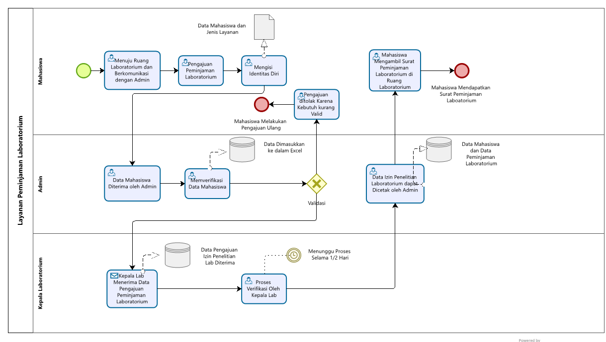

> **📷 Keterangan Gambar**: *Gambar 3. 4 Proses Bisnis As-Is Peminjaman Laboratorium Komputer* (Dimensi: 1219x689 px)  
> **🔍 Analisis & Arti Gambar**:  
> Gambar ini memuat lembar tanda tangan atau cap pengesahan resmi dari dosen pembimbing, penguji, atau koordinator program studi yang membuktikan keabsahan dokumen tugas akhir.

---

## 📄 Halaman 78

52 
 
terkait dalam proses pelayanan, mulai dari pengajuan layanan, verifikasi data, 
hingga proses persetujuan dan pencetakan dokumen secara digital. Interaksi antara 
pengguna dan sistem ini dipetakan ke dalam Use Case Diagram Sementara. 
 
Gambar 3. 5 Use case diagram Sementara

### 🖼️ Gambar pada Halaman 78

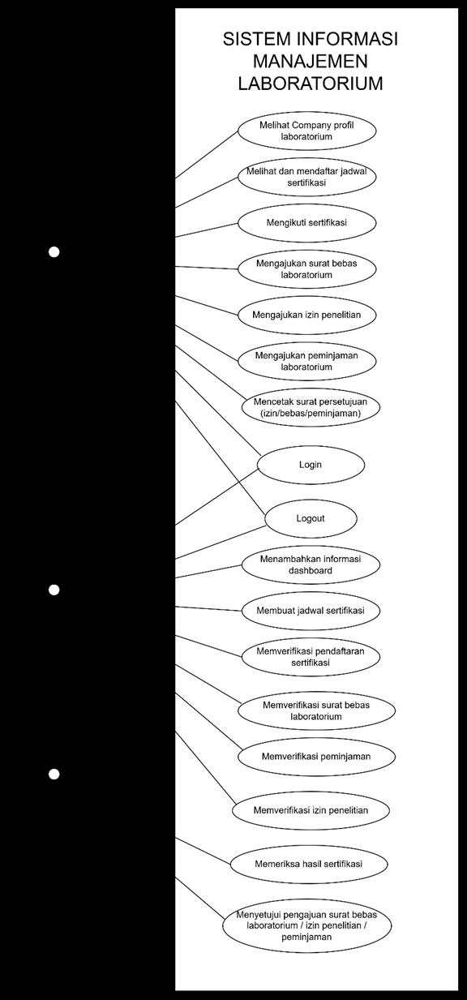

> **📷 Keterangan Gambar**: *Gambar 3. 5 Use case diagram Sementara* (Dimensi: 576x1233 px)  
> **🔍 Analisis & Arti Gambar**:  
> Gambar ini memuat lembar tanda tangan atau cap pengesahan resmi dari dosen pembimbing, penguji, atau koordinator program studi yang membuktikan keabsahan dokumen tugas akhir.

---

## 📄 Halaman 79

53 
 
Pada Gambar 3.5 merupakan use case diagram sementara yang dapat 
digunakan untuk mengidentifikasi berbagai fungsi yang ada pada sistem. Fungsi-
fungsi tersebut dijabarkan secara detail melalui Tabel 3.1 
Tabel 3. 1 Deskripsi Use Case Diagram Sementara 
No Use Case 
Deskripsi 
Tujuan 
1 
Login 
Mahasiswa dan Dosen masuk ke 
sistem menggunakan akun yang 
terdaftar 
Mengakses 
layanan 
laboratorium 
2 
Melihat 
informasi 
profil 
laboratorium 
Melihat berita, modul praktik, 
struktur organisasi, dan fasilitas 
Mengetahui 
informasi 
laboratorium 
3 
Melihat 
& 
mendaftar 
sertifikasi 
Mahasiswa dan Dosen memilih 
skema sertifikasi dan mendaftar 
Mengikuti 
sertifikasi 
sesuai kebutuhan 
4 
Mengikuti 
sertifikasi 
Mengerjakan 
soal/ujian 
sertifikasi secara daring 
Menyelesaikan 
proses 
sertifikasi 
5 
Mencetak 
sertifikat 
Mengunduh/mencetak sertifikat 
setelah dinyatakan lulus 
Memiliki 
bukti 
resmi 
keikutsertaan 
6 
Mengajukan 
surat bebas lab 
Mengisi form digital pengajuan 
surat bebas 
Memenuhi 
syarat 
kelulusan/yudisium 
7 
Mengajukan 
izin penelitian 
Mengisi 
permohonan 
izin 
penelitian di laboratorium 
Mendapat izin penelitian 
dari laboratorium 
8 
Mengajukan 
peminjaman 
lab 
Mengajukan 
penggunaan 
ruangan 
untuk 
kegiatan 
akademik 
Mendapat 
izin 
penggunaan fasilitas 
9 
Mencetak 
surat 
persetujuan 
Mengunduh 
surat 
bebas/izin/peminjaman 
setelah 
disetujui 
Melengkapi administrasi 
10 
Logout 
Keluar dari sistem 
Menutup 
sesi 
dengan 
aman

---

## 📄 Halaman 80

54 
 
Di sisi lain, desain struktur sistem meliputi perancangan basis data dan 
diagram relasi antar entitas (ERD) secara keseluruhan untuk menjamin bahwa alur 
penyimpanan dan pengolahan data berjalan selaras dengan kebutuhan proses bisnis 
Laboratorium. ERD yang dirancang sejumlah dengan entitas utama seperti Users, 
Izin Penelitian, Pendaftaran Sertifikasi, Sertifikasi, Modul, Peminjaman 
Laboratorium, Surat Bebas Laboratorium, Struktur Organisasi, serta Berita pada 
Gambar 3.6 Berikut. 
 
Selain daftar user Story, proses perencanaan sistem juga mencakup 
perancangan struktur basis data untuk menjamin bahwa alur penyimpanan dan 
pengolahan data berjalan selaras dengan kebutuhan proses bisnis Laboratorium. 
Perancangan basis data tersebut divisualisasikan melalui Entity Relationship 
Diagram (ERD) pada gambar 3.6 yang berfungsi untuk menggambarkan hubungan 
antar entitas yang terlibat dalam sistem informasi. ERD yang dirancang sejumlah 
dengan entitas utama seperti Users, Izin Penelitian, Pendaftaran Sertifikasi, 
Sertifikasi, Modul, Peminjaman Laboratorium, Surat Bebas Laboratorium, Struktur 
Organisasi, serta Berita. Setiap entitas memiliki atribut yang merepresentasikan 
data penting yang akan disimpan, serta dihubungkan melalui relasi yang 
Gambar 3. 6 Entity Relationship Diagram (ERD)

### 🖼️ Gambar pada Halaman 80

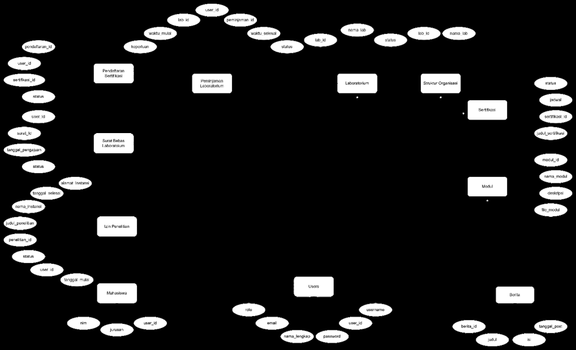

> **📷 Keterangan Gambar**: *Gambar 3.6 Berikut.* (Dimensi: 946x576 px)  
> **🔍 Analisis & Arti Gambar**:  
> Gambar ini menyajikan bagan hierarki struktur organisasi pada instansi/lokasi studi kasus, menggambarkan pembagian wewenang, bidang, dan tanggung jawab kerja para pemangku kepentingan.

---

## 📄 Halaman 81

55 
 
mencerminkan interaksi nyata antar proses bisnis. Sebagai contoh, entitas Users 
berperan sebagai pusat karena berhubungan dengan berbagai aktivitas seperti 
pengajuan izin penelitian, pendaftaran sertifikasi, peminjaman laboratorium, 
hingga pengelolaan modul dan berita. Entitas Sertifikasi terhubung dengan 
Pendaftaran Sertifikasi, sementara Modul terkait dengan kegiatan pengelolaan 
materi. Begitu pula entitas Surat Bebas Laboratorium yang merepresentasikan 
proses administrasi akhir mahasiswa sebelum kelulusan. 
Dengan adanya ERD ini, struktur data yang digunakan sistem menjadi lebih 
terorganisir, mudah dipahami, dan dapat dikembangkan secara konsisten. Diagram 
ini juga memastikan setiap kebutuhan informasi telah terakomodasi dengan baik 
dan mendukung fungsionalitas sistem secara menyeluruh. Adapun Desain 
Antarmuka Sementara, proses implementasi dapat berjalan lebih terarah dan 
efisien. Adapun konsep awal desain dari setiap iterasi adalah sebagai berikut. 
Adapun konsep awal desain dari setiap iterasi adalah sebagai berikut. 
 
Gambar 3. 7 Desain Antarmuka Sementara Layanan Sertifikat Iterasi 2

### 🖼️ Gambar pada Halaman 81

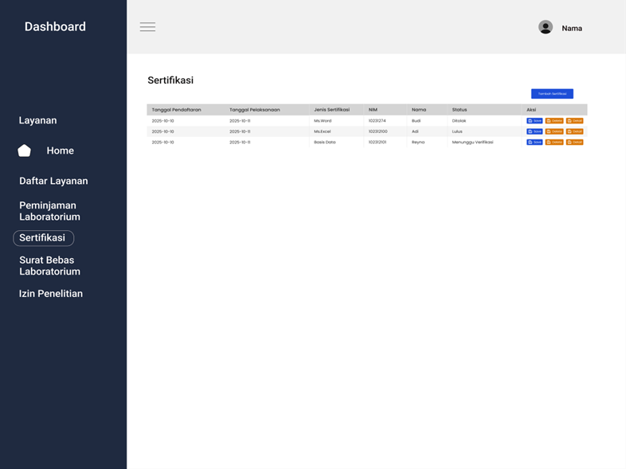

> **📷 Keterangan Gambar**: *Gambar 3. 7 Desain Antarmuka Sementara Layanan Sertifikat Iterasi 2* (Dimensi: 786x589 px)  
> **🔍 Analisis & Arti Gambar**:  
> Gambar ini merupakan tangkapan layar (screenshot) implementasi antarmuka pengguna (UI) sistem informasi, memperlihatkan tata letak visual, form input, tabel ringkasan data, dan navigasi menu.

---

## 📄 Halaman 82

56 
 
 
Gambar 3. 8 Desain Antarmuka Sementara Layanan Surat Bebas Laboratorium 
Iterasi 3 
Gambar 3. 9 Desain Antarmuka Sementara Layanan Izin Penelitian Iterasi 4

### 🖼️ Gambar pada Halaman 82

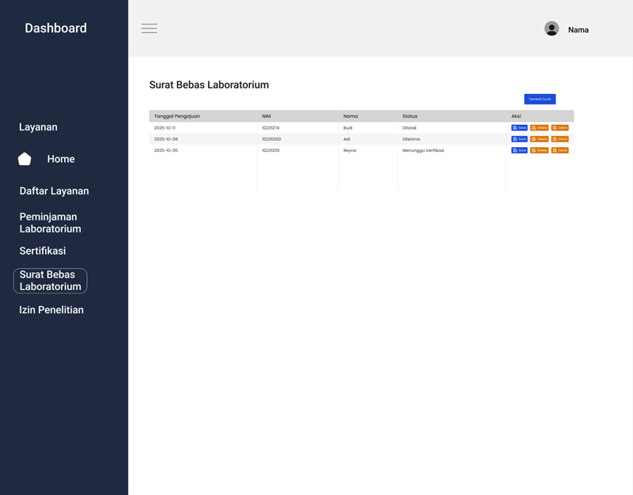

> **📷 Keterangan Gambar**: *Gambar 3. 8 Desain Antarmuka Sementara Layanan Surat Bebas Laboratorium* (Dimensi: 800x626 px)  
> **🔍 Analisis & Arti Gambar**:  
> Gambar ini merupakan tangkapan layar (screenshot) implementasi antarmuka pengguna (UI) sistem informasi, memperlihatkan tata letak visual, form input, tabel ringkasan data, dan navigasi menu.

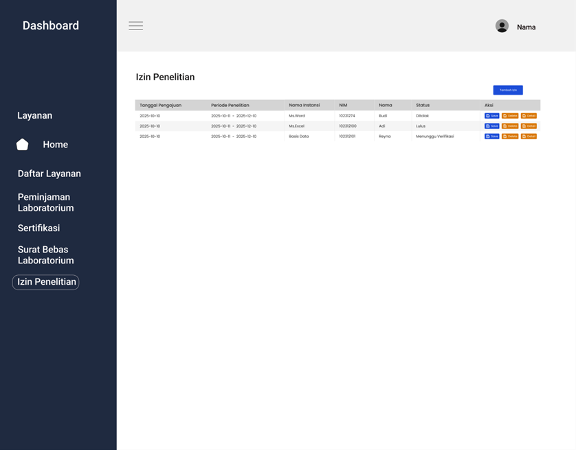

> **📷 Keterangan Gambar**: *Gambar 3. 9 Desain Antarmuka Sementara Layanan Izin Penelitian Iterasi 4* (Dimensi: 838x656 px)  
> **🔍 Analisis & Arti Gambar**:  
> Gambar ini merupakan tangkapan layar (screenshot) implementasi antarmuka pengguna (UI) sistem informasi, memperlihatkan tata letak visual, form input, tabel ringkasan data, dan navigasi menu.

---

## 📄 Halaman 83

57 
 
 
 
 
3. 2 
Spesifikasi Teknis  
Sistem 
informasi 
manajemen 
laboratorium 
ini 
dirancang 
untuk 
mendigitalisasi proses administrasi yang sebelumnya manual. Sistem yang 
dikembangkan difokuskan hanya pada 4 fitur utama yaitu layanan sertifikasi, izin 
penelitian, peminjaman laboratorium, dan surat bebas laboratorium. 
Sistem yang dikembangkan berbasis web dan diakses melalui browser, tidak 
mencakup aplikasi Mobile (Android/iOS). Framework Laravel digunakan sebagai 
dasar pengembangan aplikasi secara back-end, dengan memanfaatkan metode 
Model-View-Controller 
(MVC). 
Basis 
data 
(database) 
dikembangkan 
menggunakan dukungan Mysql untuk menyimpan dan mengelola data dalam 
jumlah besar maupun kecil. Antarmuka pengguna (front-end) dirancang secara 
responsif menggunakan Tailwind CSS dan Vue.js sesuai dengan kebutuhan 
operasional di STMIK Samarinda. 
 
 
Gambar 3. 10 Desain Antarmuka Sementara Layanan Peminjaman 
Laboratorium Iterasi 5

### 🖼️ Gambar pada Halaman 83

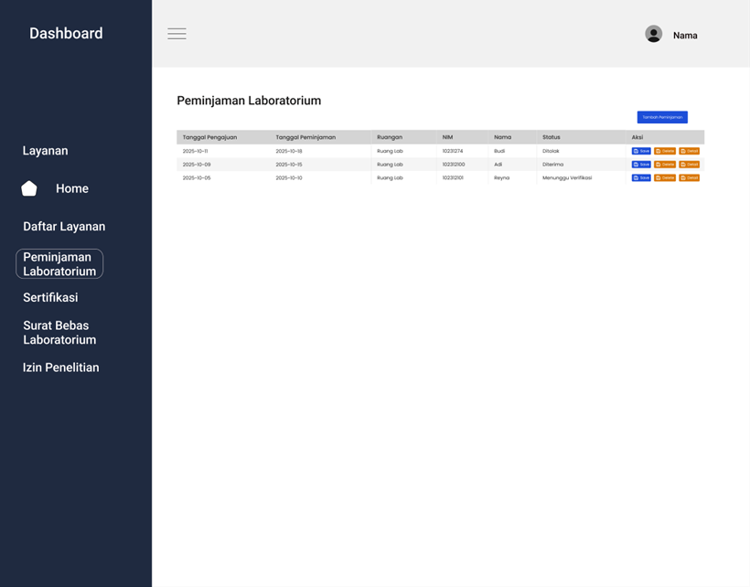

> **📷 Keterangan Gambar**: *Gambar 3. 10 Desain Antarmuka Sementara Layanan Peminjaman* (Dimensi: 820x642 px)  
> **🔍 Analisis & Arti Gambar**:  
> Gambar ini merupakan tangkapan layar (screenshot) implementasi antarmuka pengguna (UI) sistem informasi, memperlihatkan tata letak visual, form input, tabel ringkasan data, dan navigasi menu.

---

## 📄 Halaman 84

58 
 
3. 3 
Tahapan Pembuatan Prototipe  
Penelitian ini menggunakan metode Personal Extreme Programming (PXP) 
sebagai pendekatan utama dalam pengembangan sistem informasi manajemen 
laboratorium berbasis web. Berikut adalah gambar diagram alir dari penelitian 
rancang bangun sistem manajemen laboratorium di STMIK Samarinda 
menggunakan metode PXP:

---

## 📄 Halaman 85

59 
 
 
Gambar 3. 11 Diagram Alir Penelitian

### 🖼️ Gambar pada Halaman 85

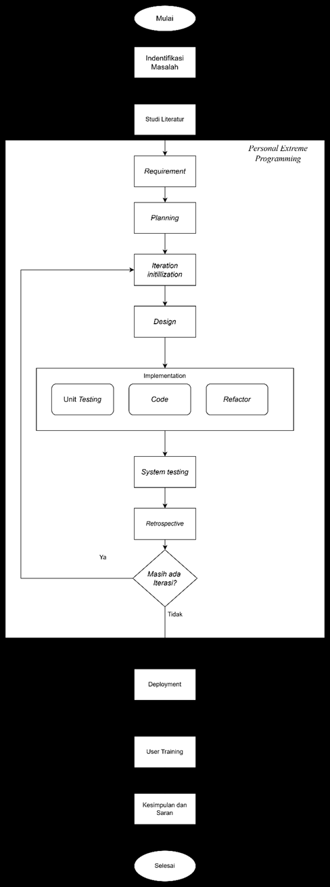

> **📷 Keterangan Gambar**: *Gambar 3. 11 Diagram Alir Penelitian* (Dimensi: 488x1305 px)  
> **🔍 Analisis & Arti Gambar**:  
> Gambar pendukung/ilustrasi visual pada Halaman 85 yang merepresentasikan bagan, panduan antarmuka, formulir, atau materi teknis sesuai konteks bahasan: 'Gambar 3. 11 Diagram Alir Penelitian'.

---

## 📄 Halaman 86

60 
 
3.3.1 Identifikasi Masalah 
Tahap identifikasi masalah diawali dengan observasi langsung dan 
wawancara dengan calon pengguna sistem, yaitu admin, dan kepala laboratorium 
STMIK Samarinda terhadap proses manajemen laboratorium yang saat ini masih 
dilakukan secara manual di STMIK Samarinda. Data dikumpulkan untuk 
memahami alur kerja yang berjalan, mulai dari proses pengajuan peminjaman alat, 
pengaturan jadwal praktikum, hingga pembuatan surat izin penelitian. Dari hasil 
studi pendahuluan, ditemukan berbagai kendala, seperti ketidakteraturan dokumen, 
keterlambatan validasi, dan kesulitan dalam monitoring kegiatan laboratorium. 
Permasalahan tersebut menjadi dasar utama untuk mengembangkan sistem 
informasi yang mampu mengotomatisasi proses administrasi laboratorium secara 
lebih efisien dan terstruktur. 
3.3.2 Studi Literatur 
Tahap studi literatur penting untuk dilakukan pada penelitian karena dapat 
mengumpulkan informasi yang relevan dengan bidang penelitian. Studi literatur 
diperoleh melalui berbagai pustaka seperti e-book, artikel, jurnal, atau penelitian 
terdahulu. Peneliti melakukan studi literatur untuk memperoleh informasi secara 
luas terhadap masalah yang serupa sehingga memahami solusi yang diambil oleh 
penelitian terdahulu. Selain itu studi literatur dilakukan untuk mengetahui 
persyaratan dan metode dalam pengembangan sistem berbasis website. 
3.3.3 Requirement 
Setelah masalah teridentifikasi, langkah selanjutnya adalah melakukan 
analisis kebutuhan sistem untuk merumuskan fitur-fitur yang akan dikembangkan. 
Informasi kebutuhan ini diperoleh melalui wawancara dengan calon pengguna 
sistem, yaitu admin laboratorium dan kepala laboratorium STMIK Samarinda. 
Selain itu, pengumpulan data juga dilakukan melalui dokumen-dokumen 
pendukung yang memuat profil, visi-misi, tujuan, serta fungsi laboratorium, guna 
memahami proses kerja dan ruang lingkup tiap unit di dalamnya. Kebutuhan sistem 
dikelompokkan menjadi dua kategori utama. Pertama, kebutuhan fungsional yaitu

---

## 📄 Halaman 87

61 
 
sistem Login pengguna, Dashboard layanan, pengajuan peminjaman laboratorium, 
pendaftaran sertifikasi, permohonan surat izin penelitian, serta pengajuan surat 
bebas laboratorium. Kedua, kebutuhan non-fungsional yang mencakup aspek 
keamanan data, responsivitas sistem, serta kemudahan penggunaan antarmuka. 
Seluruh kebutuhan tersebut kemudian didokumentasikan dalam bentuk user Story, 
yang bertujuan sebagai acuan dalam proses perancangan dan pengembangan 
sistem. Tahapan ini penting untuk memastikan bahwa sistem yang dibangun benar-
benar menjawab permasalahan yang ada. Selanjutnya, user Story tersebut 
diterjemahkan ke dalam use case diagram untuk menggambarkan interaksi antara 
pengguna dan sistem. Sistem ini akan melibatkan tiga aktor utama, yaitu admin, 
kepala laboratorium, dan mahasiswa. Masing-masing memiliki peran yang saling 
terkait dalam proses pelayanan, mulai dari pengajuan layanan, verifikasi data, 
hingga proses persetujuan dan pencetakan dokumen secara digital. Penjabaran 
masing-masing peran dan wewenang dari aktor-aktor tersebut dapat dilihat pada 
tabel 3.2 berikut: 
Tabel 3. 2 Daftar Aktor Sistem Informasi Lab Komputer STMIK Samarinda 
Aktor 
Definisi 
Admin 
  
Admin memiliki akses terhadap sistem untuk 
mengelola data pengguna, memverifikasi pengajuan 
layanan seperti surat bebas laboratorium, izin 
penelitian, dan pendaftaran sertifikasi serta pengajuan 
peminjaman 
laboratorium. 
Admin 
juga 
dapat 
menambahkan informasi company profile seperti 
berita, jadwal sertifikasi, dan modul praktik. 
Kepala  
Laboratorium 
Kepala laboratorium memiliki wewenang untuk 
menyetujui pengajuan layanan yang telah diverifikasi 
oleh admin, seperti surat bebas laboratorium dan izin 
penelitian serta pengajuan peminjaman laboratorium. 
Selain itu, kepala laboratorium memeriksa hasil 
sertifikasi mahasiswa dan menentukan kelulusan.

---

## 📄 Halaman 88

62 
 
Aktor 
Definisi 
Mahasiswa 
Mahasiswa memiliki akses untuk mengajukan layanan 
laboratorium seperti surat bebas, izin penelitian, dan 
pendaftaran sertifikasi serta mengajukan peminjaman 
laboratorium. Mahasiswa juga dapat melihat company 
profile, berita laboratorium, jadwal kegiatan, serta
mencetak dokumen yang telah disetujui. 
Dosen 
Dosen memiliki akses untuk mengajukan layanan 
laboratorium, izin penelitian dan menambahkan modul. 
Dosen juga dapat melihat company profile, berita 
laboratorium, jadwal kegiatan, serta mencetak dokumen
yang telah disetujui.  
Setelah melaksanakan wawancara dan pengumpulan data dokumen dalam 
mengidentifikasi serta mengumpulkan informasi terkait permasalahan yang 
dihadapi oleh mitra, maka disusunlah user Story yang merepresentasikan kebutuhan 
fungsional dari Sistem Informasi Laboratorium. Penyusunan user Story dilakukan 
dengan menggunakan pendekatan user-centered, sehingga setiap kebutuhan 
dirumuskan dalam format yang mudah dipahami baik oleh pengembang maupun 
oleh pengguna akhir. 
Format penyusunan user Story terdiri dari tiga bagian utama, yaitu: 
●           Persona: Menjelaskan siapa yang menjadi aktor dalam sistem (misalnya: 
Admin, Mahasiswa dan Dosen, Kepala Laboratorium). 
●      
I Want To: Menyatakan apa yang ingin dilakukan oleh aktor tersebut 
(fitur/fungsi). 
●      
So That I can: Menyatakan tujuan atau hasil dari fitur tersebut yang 
memberikan manfaat kepada aktor. 
Adapun daftar kebutuhan fungsional sistem informasi lab STMIK 
Samarinda berupa user Story sementara ditampilkan pada Tabel 3.3 berikut:

---

## 📄 Halaman 89

63 
 
Tabel 3. 3 User Story Sementara 
No 
Kode 
Persona 
User Story 
I Want To 
So That I can 
1 
US-01 
Semua 
Aktor 
Login ke sistem 
Mengakses layanan sesuai 
peran 
2 
US-02 
Semua 
Aktor 
Logout dari sistem 
Mengakhiri sesi 
penggunaan sistem 
3 
US-03 
Admin 
Menambahkan 
informasi di 
Dashboard 
Menampilkan informasi 
ke halaman depan 
company profile 
4 
US-04 
Pengguna 
Melihat company 
profile 
Mengetahui informasi lab 
seperti modul, struktur 
organisasi, dan berita 
5 
US-05 
Admin 
Membuat jadwal 
sertifikasi 
Mahasiswa dapat melihat 
dan mendaftar sertifikasi 
6 
US-06 
Mahasiswa  Melihat dan 
mendaftar 
sertifikasi 
Mengikuti program 
sertifikasi sesuai skema 
7 
US-07 
Admin 
Memverifikasi 
pendaftaran 
sertifikasi 
Menentukan kelayakan 
mahasiswa mengikuti 
sertifikasi 
8 
US-08 
Mahasiswa  Mengikuti 
sertifikasi 
Dapat dinilai dan 
memperoleh sertifikat 
9 
US-09 
Kepala Lab Menilai hasil 
sertifikasi 
Menentukan kelulusan 
peserta 
10 
US-10 
Mahasiswa  Mencetak 
sertifikat 
Mendapat bukti resmi 
kelulusan sertifikasi 
11 
US-11 
Mahasiswa  Mengajukan surat 
bebas lab 
Memenuhi syarat 
administratif yudisium 
12 
US-12 
Admin 
Memverifikasi 
surat bebas lab 
Memastikan kelengkapan 
sebelum ke kepala lab

---

## 📄 Halaman 90

64 
 
No 
Kode 
Persona 
User Story 
I Want To 
So That I can 
13 
US-13 
Kepala Lab Menyetujui surat 
bebas lab 
Mahasiswa bisa mencetak 
surat 
14 
US-14 
Mahasiswa 
dan Dosen  
Mengajukan izin 
penelitian 
Mendapat persetujuan 
resmi melakukan 
penelitian di lab 
15 
US-15 
Admin 
Memverifikasi izin 
penelitian 
Memastikan data dan 
tujuan penelitian lengkap 
16 
US-16 
Kepala Lab Menyetujui izin 
penelitian 
Mahasiswa bisa mencetak 
surat izin 
17 
US-17 
Mahasiswa 
dan Dosen  
Mengajukan 
peminjaman 
laboratorium 
Menggunakan lab untuk 
kegiatan akademik 
18 
US-18 
Admin 
Memverifikasi 
peminjaman 
laboratorium 
Memastikan jadwal dan 
fasilitas tersedia 
19 
US-19 
Kepala Lab Menyetujui 
peminjaman 
laboratorium 
Memberikan izin 
penggunaan lab 
20 
US-20 
Mahasiswa  
dan Dosen  
Mencetak surat 
persetujuan 
peminjaman 
Mendapat bukti resmi 
peminjaman lab 
21 
US-21 
Mahasiswa 
dan Dosen 
Mengembalikan 
peminjaman 
laboratorium 
Mengembalikan ruangan 
laboratorium 
22 
US-22 
Admin 
Memverifikasi 
pengembalian 
laboratorium 
Memastikan ruangan 
laboratorium tersedia 
23 
US-23 
Mahasiswa 
dan Dosen 
Mencetak surat 
pengembalian 
Mendapat bukti resmi 
pengembalian ruangan 
laboratorium

---

## 📄 Halaman 91

65 
 
No 
Kode 
Persona 
User Story 
I Want To 
So That I can 
ruangan 
laboratorium 
Setelah menetapkan User Story sementara pada tabel 3.3, dilakukan 
pemodelan user Story ke dalam bentuk use case diagram, dengan tujuan agar dapat 
melihat interaksi antara pengguna (user) terhadap sistem, serta memetakan 
kebutuhan dari sistem informasi kelurahan. Berikut use case diagram sementara 
yang disajikan pada Gambar 3.2. 
3.3.4 Planning 
Pada tahap planning, setiap user Story yang telah diperoleh dari tahapan 
Requirement dianalisis lebih lanjut untuk menentukan tingkat prioritas dan 
kompleksitas pengerjaannya. Penentuan prioritas dilakukan dengan menggunakan 
metode MoSCoW Prioritization, yang mengelompokkan kebutuhan ke dalam 
empat kategori utama: Must Have, Should Have, Could Have, dan Won’t Have. 
Kategori Must Have menunjukkan fitur atau fungsi yang wajib tersedia dalam 
sistem agar dapat beroperasi sesuai kebutuhan dasar. Should Have merujuk pada 
fitur penting, tetapi masih dapat ditunda sementara jika waktu pengembangan 
terbatas. Could Have adalah fitur tambahan yang bersifat pelengkap dan dapat 
dikerjakan jika waktu memungkinkan. Sementara Won’t Have merupakan fitur 
yang tidak menjadi prioritas untuk iterasi saat ini. 
Setiap user Story juga diberikan nilai Story point yang mencerminkan 
tingkat usaha dan kompleksitas penyelesaiannya berdasarkan penilaian 
pengembang. Penetapan Story point mengacu pada skala bilangan Fibonacci, yakni 
1, 2, 3, 5, 8, dan seterusnya, untuk menggambarkan tingkatan usaha relatif antar 
user Story. Sebagai contoh, jika satu user Story bernilai 3, maka tingkat kesulitan 
atau waktu pengerjaannya diperkirakan dua kali lebih besar dari user Story bernilai 
1.

---

## 📄 Halaman 92

66 
 
Tabel 3. 4 Penentuan Story Point Sementara 
No 
Kode 
User Story 
Prioritas 
(MoSCoW) 
Story 
Point 
1 
US-01 
Pengguna melihat company profil lab 
Must Have 
3 
2 
US-02 
Pengguna melakukan Login 
Must Have 
3 
3 
US-03 
Pengguna masuk ke halaman 
Dashboard 
Should 
Have 
5 
4 
US-04 
Pengguna melakukan logout 
Must Have 
1 
5 
US-05 
Admin menambahkan informasi 
company profile 
Should 
Have 
5 
6 
US-06 
Admin membuat jadwal sertifikasi 
Must Have 
5 
7 
US-07 
Mahasiswa dan Dosen melihat dan 
mendaftar sertifikasi 
Must Have 
3 
8 
US-08 
Admin memverifikasi pendaftaran 
sertifikasi 
Must Have 
3 
9 
US-09 
Mahasiswa mengikuti sertifikasi 
Must Have 
1 
10 
US-10 
Kepala Lab memeriksa hasil 
sertifikasi 
Must Have 
3 
11 
US-11 
Mahasiswa dan mencetak sertifikat 
Must Have 
3 
12 
US-12 
Mahasiswa mengajukan surat bebas 
lab 
Must Have 
5 
13 
US-13 
Admin memverifikasi pengajuan surat 
bebas lab 
Must Have 
5 
14 
US-14 
Kepala Lab menyetujui pengajuan 
surat bebas lab 
Must Have 
5 
15 
US-15 
Mahasiswa dan Dosen mengajukan 
izin penelitian 
Must Have 
5 
16 
US-16 
Admin memverifikasi izin penelitian 
Must Have 
3 
17 
US-17 
Kepala Lab menyetujui izin penelitian 
Must Have 
5 
18 
US-18 
Mahasiswa dan Dosen mengajukan 
peminjaman laboratorium 
Must Have 
3

---

## 📄 Halaman 93

67 
 
No 
Kode 
User Story 
Prioritas 
(MoSCoW) 
Story 
Point 
19 
US-19 
Admin memverifikasi peminjaman 
laboratorium 
Must Have 
3 
20 
US-20 
Kepala Lab menyetujui peminjaman 
laboratorium 
Must Have 
3 
21 
US-21 
Mahasiswa dan Dosen mencetak surat 
persetujuan peminjaman 
Must Have 
3 
22 
US-22 
Mahasiswa dan Dosen melakukan 
pengembalian ruangan laboratorium 
Must Have 
3 
23 
US-23 
Admin memverifikasi pengembalian 
ruangan laboratorium 
Must Have 
3 
Setelah menentukan prioritas, berikutnya adalah merencanakan iterasi - 
iterasi. Setiap iterasi berisi kumpulkan user Story yang akan dikerjakan dalam 
estimasi waktu tertentu. Penentuan user Story yang akan dikerjakan dalam satu 
iterasi ditentukan berdasarkan prioritas serta memperhatikan relasi maupun 
ketergantungan dan alur pengembangan dari setiap user Story. Setiap iterasi 
diharapkan memiliki jumlah Story point yang kurang lebih sama. Iterasi yang 
direncanakan akan terdiri dari 5 iterasi dengan masing-masing iterasi memuat 5 
user Story yang akan dikerjakan. Adapun pembagian iterasi dijabarkan pada Tabel 
3.4. 
Tabel 3. 5 Rencana Iterasi Sementara 
Iterasi 1 
Kode 
User Story 
Deskripsi User Story 
Prioritas 
(MoSCoW) 
Story 
Point 
US-01 
Pengguna dapat melihat Company profile 
Lab 
Must Have 
3 
US-02 
Pengguna melakukan Login 
Must Have 
1 
US-03 
Pengguna masuk ke halaman Dashboard Should Have 
5 
US-04 
Pengguna melakukan logout 
Should Have 
3

---

## 📄 Halaman 94

68 
 
US-05 
Admin 
menambahkan 
informasi 
company profile 
Must Have 
5 
  
Total Story Point 
  
17 
Iterasi 2 
Kode 
User Story 
Deskripsi User Story 
Prioritas 
(MoSCoW) 
Story 
Point 
US-06 
Admin membuat jadwal sertifikasi 
Must Have 
5 
US-07 
Mahasiswa 
melihat 
dan 
mendaftar 
sertifikasi 
Must Have 
3 
US-08 
Admin 
memverifikasi 
pendaftaran 
sertifikasi 
Must Have 
3 
US-09 
Mahasiswa mengikuti sertifikasi 
Must Have 
1 
US-10 
Kepala Lab memeriksa hasil sertifikasi 
Must Have 
3 
US-11 
Mahasiswa mencetak sertifikat 
Must Have 
3 
  
Total Story Point 
  
18 
Iterasi 3 
Kode 
User Story 
Deskripsi User Story 
Prioritas 
(MoSCoW) 
Story 
Point 
US-12 
Mahasiswa mengajukan surat bebas lab 
Must Have 
5 
US-13 
Admin memverifikasi pengajuan surat 
bebas lab 
Must Have 
5 
US-14 
Kepala Lab menyetujui pengajuan surat 
bebas lab 
Must Have 
5 
 
Total Story Point 
  
15 
Iterasi 4 
Kode 
User Story 
Deskripsi User Story 
Prioritas 
(MoSCoW) 
Story 
Point 
US-15 
Mahasiswa dan Dosen mengajukan izin 
penelitian 
Must Have 
5 
US-16 
Admin memverifikasi izin penelitian 
Must Have 
3 
US-17 
Kepala Lab menyetujui izin penelitian 
Must Have 
5

---

## 📄 Halaman 95

69 
 
  
Total Story Point 
  
13 
Iterasi 5 
Kode 
User Story 
Deskripsi User Story 
Prioritas 
(MoSCoW) 
Story 
Point 
US-18 
Mahasiswa dan Dosen mengajukan 
peminjaman laboratorium 
Must Have 
3 
US-19 
Admin 
memverifikasi 
peminjaman 
laboratorium 
Must Have 
3 
US-20 
Kepala Lab menyetujui peminjaman 
laboratorium 
Must Have 
3 
US-21 
Mahasiswa dan Dosen mencetak surat 
persetujuan peminjaman 
Must Have 
3 
US-22 
Mahasiswa 
dan 
Dosen 
melakukan 
pengembalian ruangan laboratorium 
Must Have 
3 
US-23 
Admin 
memverifikasi 
pengembalian 
ruangan laboratorium 
Must Have 
3 
  
Total Story Point 
  
18 
  
Total User Story 
  
81 
Berdasarkan hasil analisis kebutuhan pengguna dan tingkat prioritas 
fungsionalitas sistem, pengembangan sistem informasi laboratorium STMIK 
Samarinda dibagi ke dalam lima iterasi. Penentuan pembagian iterasi ini didasarkan 
pada prinsip keterkaitan antar user Story, urgensi layanan, dan estimasi tingkat 
kompleksitas (Story point) yang diperlukan untuk mengembangkan masing-masing 
fitur. Prioritas ditentukan dengan pendekatan MoSCoW Prioritization, yang 
membagi user Story menjadi kategori Must Have dan should have, serta diberi 
bobot Story point menggunakan pendekatan deret Fibonacci. Dari total 23 user 
Story, seluruhnya dibagi ke dalam lima iterasi dengan beban kerja yang seimbang 
dan progresif. Iterasi pertama difokuskan pada pembangunan fungsionalitas dasar, 
yaitu Login, logout, dan pengelolaan informasi Dashboard yang menjadi titik 
masuk sistem. Iterasi kedua diarahkan pada fitur layanan sertifikasi, yang 
merupakan kebutuhan utama pengguna dan memiliki kompleksitas tertinggi dengan

---

## 📄 Halaman 96

70 
 
total 18 Story point. Iterasi ketiga mencakup fitur layanan surat bebas laboratorium 
yang sangat krusial untuk proses akademik, seperti yudisium dan kelulusan 
mahasiswa. Iterasi keempat dan kelima masing-masing mencakup layanan izin 
penelitian dan peminjaman laboratorium, yang berperan penting dalam mendukung 
aktivitas praktikum dan riset mahasiswa. Total keseluruhan Story point dari seluruh 
iterasi adalah 81 Story point. Rata-rata estimasi waktu pengerjaan per iterasi 
direncanakan sekitar 14–18 hari, sehingga pengembangan sistem diperkirakan 
dapat diselesaikan dalam kurun waktu 70–90 hari. Dengan pendekatan iteratif ini, 
pengembangan sistem akan lebih fleksibel dan dapat diadaptasi sesuai perubahan 
kebutuhan mitra, sejalan dengan prinsip metode Personal Extreme Programming 
(PXP) yang digunakan dalam penelitian ini. 
3.3.5 Iteration Initialization 
Pada tahap ini, proses pengembangan dimulai secara bertahap melalui siklus 
iteratif. Setiap iterasi memiliki tujuan spesifik, Tahap Iteration Initialization 
merupakan langkah awal dalam siklus iteratif pengembangan sistem berbasis 
metode Personal Extreme Programming (PXP). Pada tahap ini, peneliti 
menentukan jumlah siklus iterasi, tujuan setiap iterasi, dan fitur-fitur yang akan 
dikembangkan secara bertahap. Pendekatan ini memungkinkan evaluasi dan 
perbaikan sistem dilakukan secara terus-menerus hingga sistem mencapai bentuk 
optimal. 
Dalam penelitian ini, proses pengembangan sistem dirancang dalam tiga 
iterasi utama, di mana masing-masing iterasi memiliki fokus dan keluaran 
(deliverable) yang spesifik. Pembagian iterasi bertujuan untuk menyelesaikan 
bagian-bagian penting dari sistem secara modular dan dapat diuji serta divalidasi 
langsung oleh pengguna pada setiap akhir iterasi. Dengan demikian, sistem 
dikembangkan dengan pendekatan build–test–refine secara berulang. 
Tabel 3. 6 Rencana Iterasi Pengembangan Sistem 
Iterasi 
Tujuan / Fokus Utama 
Fitur yang Dikembangkan 
1 
Pengembangan 
fitur 
autentikasi dan tampilan 
awal 
Login, Logout, Dashboard Admin, 
Company profile Laboratorium

---

## 📄 Halaman 97

71 
 
Iterasi 
Tujuan / Fokus Utama 
Fitur yang Dikembangkan 
2 
Pengelolaan 
layanan 
sertifikasi laboratorium 
Jadwal Sertifikasi, Pendaftaran dan 
Verifikasi, 
Pelaksanaan 
Sertifikasi, 
Cetak Sertifikat 
3 
Layanan pengajuan surat 
bebas lab 
Pengajuan Surat Bebas Lab, Verifikasi 
Admin, 
Persetujuan 
Kepala 
Lab, 
Verifikasi, Cetak Surat 
4 
Pengajuan 
izin 
dan 
peminjaman laboratorium 
Izin Penelitian dan Peminjaman Lab: 
Pengajuan, 
Verifikasi, 
Persetujuan, 
Cetak Surat 
5 
Pengajuan 
peminjaman 
laboratorium 
Izin Penelitian dan Peminjaman Lab: 
Pengajuan, 
Verifikasi, 
Persetujuan, 
Cetak Surat 
3.3.6 Design 
Tahap desain fokus pada dua elemen utama, yaitu desain antarmuka 
pengguna dan perancangan struktur sistem. Perancangan antarmuka dilakukan 
dengan prinsip user-friendly agar pengguna dapat mengoperasikan sistem tanpa 
pelatihan teknis yang mendalam. Mockup dibuat untuk setiap halaman sistem, 
termasuk halaman Dashboard, form pengajuan, dan halaman cetak dokumen. Di 
sisi lain, desain struktur sistem meliputi perancangan basis data, diagram relasi 
antar entitas (ERD) secara keseluruhan dan Desain Antarmuka Sementara, proses 
implementasi dapat berjalan lebih terarah dan efisien. Adapun konsep awal desain 
dari setiap iterasi ada pada Gambar 3.7 sampai Gambar 3.10. 
3.3.7  Implementasi 
 
Implementasi 
dimulai 
dengan 
pengkodean 
modul-modul 
sistem 
berdasarkan desain yang telah dibuat. Setiap modul diuji secara mandiri melalui 
proses unit Testing untuk memastikan fungsionalitasnya sesuai dengan user Story 
dengan menggunakan PHPUnit. Implementasi juga melibatkan proses refactoring, 
yakni penyempurnaan struktur kode agar lebih ringkas dan mudah dipelihara. 
Framework Laravel digunakan sebagai dasar pengembangan aplikasi.

---

## 📄 Halaman 98

72 
 
3.3.8 System Testing 
Setelah seluruh modul selesai diimplementasikan, dilakukan pengujian 
sistem secara menyeluruh. Pengujian dilakukan menggunakan metode blackbox 
Testing dengan melibatkan pihak STMIK Samarinda kepala laboratorium Pada 
blackbox Testing setiap user Story yang telah di implementasi pada iterasi diuji 
dengan mendefinisikan input dan output yang diharapkan untuk memastikan fitur 
yang dihasilkan telah memenuhi harapan. 
3.3.9 Retrospective 
Tahap retrospective dilakukan sebagai evaluasi dari setiap iterasi yang telah 
dijalankan. Evaluasi ini mencakup peninjauan fitur-fitur yang telah diuji, 
perbandingan estimasi waktu dengan realisasi pengerjaan, serta identifikasi 
masalah atau error yang masih muncul. Jika ditemukan kekurangan atau kebutuhan 
baru dari pengguna, maka dilakukan iterasi tambahan untuk menyempurnakan 
sistem. Pendekatan ini memungkinkan sistem berkembang secara adaptif hingga 
benar-benar memenuhi kebutuhan pengguna dan siap digunakan dalam lingkungan 
laboratorium STMIK Samarinda. Tahap ini, dilakukan dengan melibatkan pihak 
STMIK Samarinda yaitu kepala laboratorium. 
3.3.10 Deployment 
Pada Tahap ini dilakukan dengan menyerahkan Sistem Informasi 
Laboratorium kepada Pihak Kepala Laboratorium STMIK Samarinda. Di Tahap 
Deployment ini dilakukan hosting Sistem Informasi Laboratorium untuk STMIK 
Samarinda. Selain itu, dilakukan pembuatan dokumen guidebook digital yang berisi 
tata cara pengajuan melalui sistem ini, serta video tutorial yang menjelaskan 
langkah-langkah penggunaannya.  
3.3.11 User Training 
Pada tahap User Training dilakukan dengan memberikan pelatihan 
penggunaan Sistem Informasi Layanan Website kepada Kepala Laboratorium, 
Admin dan  Mahasiswa dan Dosen di STMIK Samarinda. Proses pelatihan ini

---

## 📄 Halaman 99

73 
 
dilakukan dengan demonstrasi sistem kepada STMIK Samarinda. Selain itu juga 
melakukan penyerahan User Manual Sistem Informasi Layanan yang berfungsi 
untuk menjadi panduan dalam penggunaan Sistem. 
Kemudian dilakukan User Acceptance Testing (UAT) dengan pihak STMIK 
Samarinda untuk mengukur kesesuaian sistem dengan tingkat kebutuhan terhadap 
pengguna mengenai Website. User Acceptance Testing (UAT) akan dilakukan 
dengan menyebar pertanyaan melalui google forms.  
3.3.12  Kesimpulan dan Saran 
Pada tahap akhir, disusun kesimpulan dari hasil pengembangan sistem 
informasi manajemen laboratorium yang telah dilakukan. Kesimpulan mencakup 
pencapaian tujuan penelitian, efektivitas penerapan metode PXP, serta kehandalan 
sistem dalam mendukung proses administrasi laboratorium. Selain itu, disampaikan 
pula saran untuk pengembangan lebih lanjut, seperti penambahan fitur Mobile 
access, integrasi dengan sistem akademik kampus, dan penguatan aspek keamanan 
data. Saran ini diharapkan dapat menjadi dasar bagi pengembangan sistem di masa 
mendatang agar semakin sesuai dengan dinamika kebutuhan institusi. 
3. 4 
Metode Implementasi  
Implementasi merupakan tahap wujud sistem dari desain menjadi bentuk 
digital. Implementasi dimulai dengan pengkodean modul-modul sistem 
berdasarkan desain yang telah dibuat. Framework Laravel digunakan sebagai dasar 
pengembangan aplikasi. 
3.4.1 Requirement 
Tahap Pertama dalam metode Personal Extreme Programming (PXP)  
adalah Requirement, yaitu adalah melakukan analisis kebutuhan sistem untuk 
merumuskan fitur-fitur yang akan dikembangkan. Informasi kebutuhan ini 
diperoleh melalui wawancara dengan calon pengguna sistem, yaitu admin 
laboratorium dan kepala laboratorium STMIK Samarinda. Selain itu, pengumpulan 
data juga dilakukan melalui dokumen-dokumen pendukung yang memuat profil, 
visi-misi, tujuan, serta fungsi laboratorium, guna memahami proses kerja dan ruang

---

## 📄 Halaman 100

74 
 
lingkup tiap unit di dalamnya. Pada tahap Requirement ini, pertemuan dilakukan 
dengan google meet dengan mitra STMIK Samarinda pada tanggal 21 Februari 
2025. 
3.4.1.1 Aktor 
 
Berdasarkan hasil wawancara, sistem yang dibangun melibatkan 4 aktor 
utama, yaitu Admin, Kepala Laboratorium, Dosen, dan Mahasiswa. Masing-masing 
aktor memiliki peran dan tanggung jawab yang berbeda dalam menjalankan alur 
proses yang terdapat di dalam sistem. Penjelasan lebih lanjut mengenai aktor yang 
terdapat dalam sistem ini disajikan pada Tabel 3.7. 
Tabel 3. 7 Daftar Aktor Sistem Informasi Lab Komputer STMIK Samarinda 
Aktor 
Definisi 
Admin 
  
Admin memiliki akses terhadap sistem untuk mengelola 
data pengguna, memverifikasi pengajuan layanan seperti 
surat bebas laboratorium, izin penelitian, dan pendaftaran 
sertifikasi serta pengajuan peminjaman laboratorium. 
Admin juga dapat menambahkan informasi company profile 
seperti berita, dan jadwal sertifikasi. 
Kepala  
Laboratorium 
Kepala laboratorium memiliki wewenang untuk menyetujui 
pengajuan layanan yang telah diverifikasi oleh admin, 
seperti surat bebas laboratorium dan izin penelitian serta 
pengajuan peminjaman laboratorium. Selain itu, kepala 
laboratorium memeriksa hasil sertifikasi mahasiswa dan 
menentukan kelulusan. 
Mahasiswa 
Mahasiswa memiliki akses untuk mengajukan layanan 
laboratorium seperti surat bebas, izin penelitian, dan 
pendaftaran sertifikasi serta mengajukan peminjaman 
laboratorium. Mahasiswa juga dapat melihat company 
profile, berita laboratorium, jadwal kegiatan, serta mencetak 
dokumen yang telah disetujui.

---

## 📄 Halaman 101

75 
 
Aktor 
Definisi 
Dosen 
Dosen 
memiliki 
akses 
untuk 
mengajukan 
layanan 
laboratorium, izin penelitian dan menambahkan modul. 
Dosen juga dapat melihat company profile, berita 
laboratorium, jadwal kegiatan, serta mencetak dokumen yang 
telah disetujui.  
3.4.1.2 User Story 
 
Berdasarkan hasil Requirement yang telah dilakukan, diperoleh 24 user 
Story yang diimplementasikan ke dalam pengembangan sistem layanan. Pada tahap 
awal pengembangan, fokus utama yaitu pada halaman company profile dan 
autentikasi Login sesuai dengan role masing-masing aktor. Rincian penyusunan 
user Story dapat dilihat pada Tabel 3.8 berikut. 
Tabel 3. 8 User Story 
Kode 
As a 
I Want 
So That 
US-01 
Semua Aktor 
Saya ingin melihat 
company profile 
laboratorium 
Saya dapat melihat 
company profile 
laboratorium 
US-02 
Semua Aktor 
Saya ingin melakukan 
Login dari sistem 
Saya dapat masuk ke 
dalam sistem (sesuai 
dengan hak akses user 
yang diberikan) 
US-03 
Semua Aktor 
Saya ingin masuk ke 
halaman Dashboard 
Saya dapat melihat 
halaman Dashboard 
setelah masuk ke dalam 
sistem (sesuai dengan 
hak akses user yang 
diberikan) 
US-04 
Semua Aktor 
Saya ingin melakukan 
logout dari sistem 
Saya dapat keluar dari 
sistem 
US-05 
Admin 
Saya ingin 
menambahkan data 
Saya dapat mengelola 
data berita, jadwal,

---

## 📄 Halaman 102

76 
 
Kode 
As a 
I Want 
So That 
berita, jadwal 
sertifikasi, dan modul 
praktik 
sertifikasi, dan modul 
praktik 
US-06 
Admin 
Saya ingin membuat 
jadwal sertifikasi 
Saya dapat mengatur 
waktu dan kuota peserta 
ujian 
US-07 
Mahasiswa 
Saya ingin melihat dan 
mendaftar sertifikasi 
Saya dapat mengikuti 
ujian sertifikasi yang 
tersedia 
US-08 
Admin 
Saya ingin 
memverifikasi 
pendaftaran sertifikasi 
Saya dapat memeriksa 
kelengkapan berkas 
peserta 
US-09 
Mahasiswa 
Saya ingin mengikuti 
sertifikasi 
Saya dapat 
menggunakan token 
ujian yang diberikan 
admin 
US-10 
Kepala Lab 
Saya ingin memeriksa 
hasil sertifikasi 
Saya dapat menentukan 
kelulusan peserta ujian 
US-11 
Mahasiswa 
Saya ingin mencetak 
sertifikat 
Saya dapat memiliki 
bukti kelulusan 
sertifikasi secara resmi 
 US-12 
Mahasiswa 
Saya ingin 
mengajukan surat 
bebas lab 
Saya dapat 
mendapatkan bukti 
tidak memiliki 
tanggungan di 
laboratorium 
 US-13 
Admin 
Saya ingin 
memvalidasi 
permohonan surat 
bebas lab 
Saya dapat memeriksa 
dan memproses 
permohonan mahasiswa 
 US-14 
Kepala Lab 
Saya ingin menyetujui 
atau menolak surat 
bebas lab 
Saya dapat memberikan 
keputusan akhir atas 
permohonan

---

## 📄 Halaman 103

77 
 
Kode 
As a 
I Want 
So That 
 US-15 
Mahasiswa dan 
Dosen 
Saya ingin 
mengajukan izin 
penelitian di 
laboratorium 
Saya dapat melakukan 
riset/TA di fasilitas 
laboratorium/eksternal 
secara resmi 
 US-16 
Admin 
Saya ingin 
memverifikasi 
permohonan izin 
penelitian 
Saya dapat memeriksa 
kelengkapan berkas 
permohonan 
 US-17 
Kepala Lab 
Saya ingin menyetujui 
atau menolak izin 
penelitian 
Saya dapat memberikan 
keputusan akhir atas 
permohonan penelitian 
 US-18 
Mahasiswa dan 
Dosen 
Saya ingin 
mengajukan 
peminjaman ruangan 
laboratorium 
Saya dapat 
menggunakan fasilitas 
lab sesuai kebutuhan 
 US-19 
Admin 
Saya ingin 
memverifikasi dan 
peminjaman 
Saya dapat mengelola 
penggunaan ruangan 
laboratorium 
 US-20 
Kepala Lab 
Saya ingin menyetujui 
peminjaman 
laboratorium 
Saya dapat memberikan 
keputusan akhir atas 
peminjaman 
laboratorium 
 US-21 
Mahasiswa dan 
Dosen 
Saya ingin mencetak 
bukti peminjaman 
Saya dapat bukti telah 
meminjam laboratorium  
US-22 
Mahasiswa dan 
Dosen 
Saya ingin melaporkan 
pengembalian ruangan 
Saya dapat 
menginformasikan 
bahwa ruangan telah 
selesai digunakan 
 US-23 
Admin 
Saya ingin 
memverifikasi 
pengembalian ruangan 
laboratorium 
Saya dapat mengelola 
pengembalian ruangan 
laboratorium 
 US-24 
Mahasiswa dan 
Dosen 
Saya ingin mencetak 
bukti pengembalian 
ruangan 
Saya dapat bukti telah 
mengembalikan 
laboratorium

---

## 📄 Halaman 104

78 
 
Setelah menetapkan User Story, dilakukan pemodelan user Story ke dalam 
bentuk use case diagram, dengan tujuan agar dapat melihat interaksi antara 
pengguna (user) terhadap sistem, serta memetakan kebutuhan dari sistem informasi 
kelurahan. Berikut use case diagram yang disajikan pada Gambar 3.12. 
 
Gambar 3. 12 Use Case Diagram

### 🖼️ Gambar pada Halaman 104

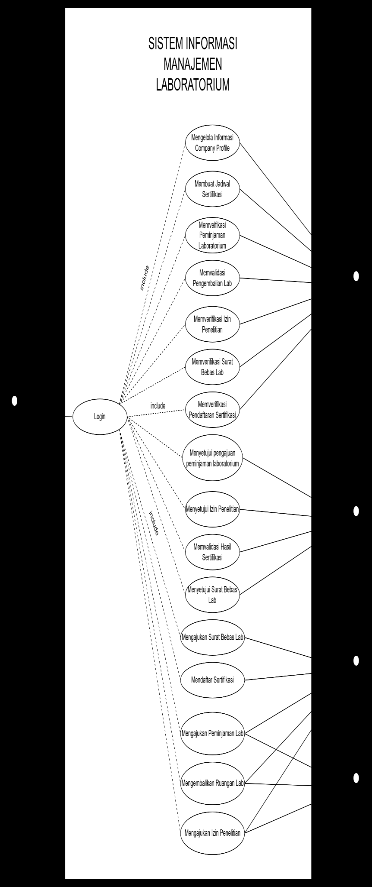

> **📷 Keterangan Gambar**: *Gambar 3.12.* (Dimensi: 862x2048 px)  
> **🔍 Analisis & Arti Gambar**:  
> Gambar ini menyajikan diagram Use Case (UML) yang memetakan hubungan antara aktor pengguna dengan fungsionalitas sistem informasi yang dirancang, mendefinisikan batasan interaksi pengguna.

---

## 📄 Halaman 105

79 
 
Use case diagram pada sistem informasi manajemen laboratorium 
menggambarkan interaksi antara pengguna dengan sistem dalam menjalankan 
layanan laboratorium secara digital. Diagram ini menunjukkan hak akses dan fungsi 
yang dapat dilakukan oleh masing-masing aktor sesuai dengan perannya di dalam 
sistem. 
Pada sistem ini terdapat empat aktor utama, yaitu: 
1. Admin 
2. Kepala Laboratorium 
3. Mahasiswa 
4. Dosen 
Seluruh aktor diwajibkan melakukan proses Login terlebih dahulu 
sebelum dapat mengakses fitur sistem sesuai hak akses masing-masing. 
1. Aktor Admin 
Admin memiliki hak akses untuk mengelola dan melakukan verifikasi 
terhadap layanan laboratorium. Aktivitas yang dapat dilakukan admin 
meliputi: 
a. Mengelola informasi company profile laboratorium 
b. Membuat jadwal sertifikasi 
c. Memverifikasi peminjaman laboratorium 
d. Memvalidasi pengembalian laboratorium 
e. Memverifikasi izin penelitian 
f. Memverifikasi surat bebas laboratorium 
g. Memverifikasi pendaftaran sertifikasi 
 
2. Aktor Kepala Laboratorium 
Kepala laboratorium memiliki hak akses untuk melakukan persetujuan dan 
validasi akhir terhadap layanan laboratorium. Aktivitas yang dapat 
dilakukan meliputi:

---

## 📄 Halaman 106

80 
 
a. Menyetujui pengajuan peminjaman laboratorium 
b. Menyetujui izin penelitian 
c. Memvalidasi hasil sertifikasi 
d. Menyetujui surat bebas laboratorium 
 
3. Aktor Mahasiswa 
Mahasiswa merupakan pengguna layanan laboratorium yang dapat 
melakukan beberapa pengajuan layanan melalui sistem, meliputi: 
a. Mengajukan surat bebas laboratorium 
b. Mendaftar sertifikasi 
c. Mengajukan peminjaman laboratorium 
d. Mengajuakn izin penelitian 
 
4.  Aktor Dosen 
Dosen memiliki hak akses untuk menggunakan layanan laboratorium 
tertentu yang berkaitan dengan kegiatan akademik. Aktivitas yang dapat 
dilakukan meliputi: 
a. Mengembalikan ruang laboratorium 
b. Mengajukan izin penelitian 
c. Menambahkan modul pembelajaran 
Use case diagram ini digunakan sebagai gambaran umum kebutuhan 
fungsional sistem dan menjadi dasar dalam proses perancangan serta 
implementasi sistem informasi manajemen laboratorium berbasis website. 
3.4.1.3 Proses Bisnis Layanan To-Be 
Pada Gambar 3.1, Gambar 3.2, Gambar 3.3 dan Gambar 3.4 dijelaskan 
mengenai proses bisnis as-is, yaitu proses bisnis yang sebelumnya berjalan secara 
manual. Berdasarkan hasil wawancara mengenai layanann yaang ada di STMIK 
Samarinda yang dilakukan mahasiswa belum melalui sistem informasi. Proses ini

---

## 📄 Halaman 107

81 
 
kemudian diteruskan secara manual kepada pihak laboratorium untuk dilakukan 
pengecekan dan verifikasi, mengharuskan mahasiswa datang langsung ke kampus 
untuk mengajukan layanan yang dibutuhkan, yang mana membutuhkan waktu dan 
biaya lebih dan juga belum terdapat dokumentasi berkas secara digital sehingga 
menyebabkan kesulitan dalam melakukan rekap data pengajuan. Untuk mengatasi 
permasalahan pada proses bisnis as-is tersebut, dilakukan pembangunan sistem 
informasi dengan fitur alur pelayanan secara digital. Sebelum pembangunan 
dilakukan, terlebih dahulu perlu dipahami alur dan konsep proses bisnis secara 
menyeluruh, mulai dari awal hingga akhir, agar implementasi dalam sistem sesuai 
dengan kebutuhan yang ada. Proses bisnis To-Be yang telah dirancang 
menggambarkan alur kerja setelah sistem diterapkan. Perubahan ini bertujuan untuk 
memudahkan pelaksanaan program serta memperjelAs alur tanggung jawab antar 
aktor yang terlibat 
A. Proses Bisnis To-Be Layanan Izin Penelitian  
 
Gambar 3. 13 Proses Bisnis To-Be Layanan Izin Penelitian 
Pada Gambar 3.13 ditunjukkan proses bisnis To-Be layanan izin penelitian 
yang telah terdigitalisasi pada sistem informasi laboratorium STMIK Samarinda. 
Proses dimulai ketika mahasiswa atau dosen melakukan pengajuan izin penelitian

### 🖼️ Gambar pada Halaman 107

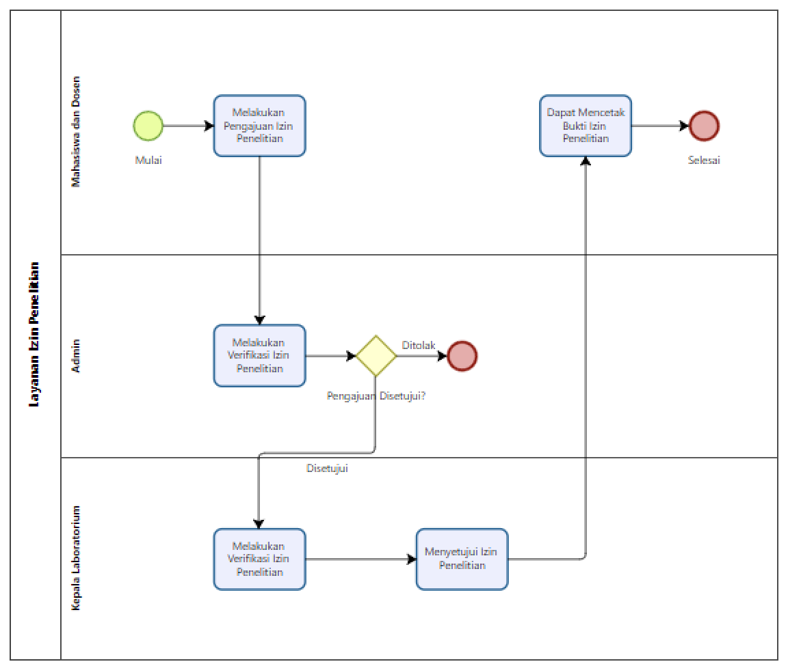

> **📷 Keterangan Gambar**: *Gambar 3. 13 Proses Bisnis To-Be Layanan Izin Penelitian* (Dimensi: 1152x972 px)  
> **🔍 Analisis & Arti Gambar**:  
> Gambar pendukung/ilustrasi visual pada Halaman 107 yang merepresentasikan bagan, panduan antarmuka, formulir, atau materi teknis sesuai konteks bahasan: 'Gambar 3. 13 Proses Bisnis To-Be Layanan Izin Penelitian'.

---

## 📄 Halaman 108

82 
 
melalui sistem dengan mengisi data penelitian yang diperlukan. Setelah pengajuan 
dikirim, admin laboratorium melakukan verifikasi awal terhadap data dan dokumen 
yang diajukan. Selanjutnya sistem memberikan keputusan apakah pengajuan 
ditolak atau diteruskan kepada kepala laboratorium untuk dilakukan verifikasi 
lanjutan. Jika pengajuan ditolak, maka proses berhenti dan pengguna tidak dapat 
melanjutkan ke tahap berikutnya. Namun apabila pengajuan disetujui, kepala 
laboratorium memberikan persetujuan akhir terhadap izin penelitian tersebut. 
Setelah proses persetujuan selesai, pengguna dapat mencetak bukti izin penelitian 
secara langsung melalui sistem. Dengan adanya proses digitalisasi ini, layanan izin 
penelitian menjadi lebih terstruktur, terdokumentasi, dan memudahkan proses 
monitoring status pengajuan secara daring. 
B. Proses Bisnis To-Be Layanan Sertifikasi 
 
Gambar 3. 14 Proses Bisnis To-Be Surat Bebas Laboratorium 
Pada Gambar 3.14 ditunjukkan proses bisnis To-Be layanan sertifikasi yang 
telah terdigitalisasi melalui sistem informasi laboratorium STMIK Samarinda. 
Proses dimulai ketika admin menambahkan skema sertifikasi serta membuat jadwal 
dan kuota peserta. Setelah jadwal tersedia, mahasiswa melakukan pendaftaran 
dengan mengunggah dokumen persyaratan. Admin kemudian memverifikasi 
pendaftaran dan menghasilkan token ujian. Setelah itu, mahasiswa mengerjakan 
ujian melalui sistem. Hasil ujian kemudian dinilai oleh kepala laboratorium dengan

### 🖼️ Gambar pada Halaman 108

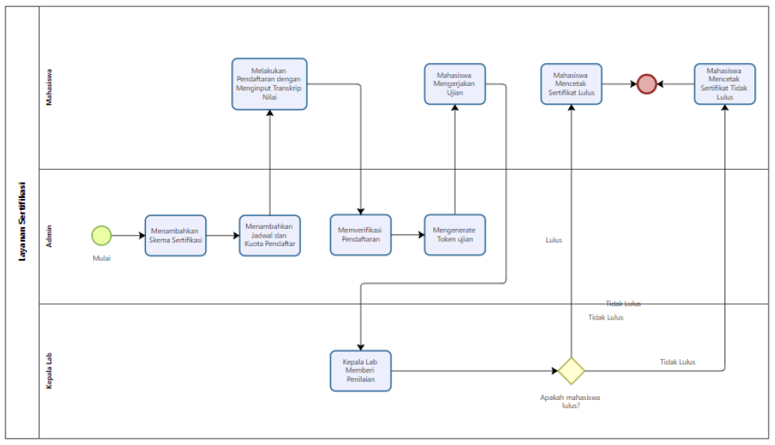

> **📷 Keterangan Gambar**: *Gambar 3. 14 Proses Bisnis To-Be Surat Bebas Laboratorium* (Dimensi: 982x564 px)  
> **🔍 Analisis & Arti Gambar**:  
> Gambar ini memuat lembar tanda tangan atau cap pengesahan resmi dari dosen pembimbing, penguji, atau koordinator program studi yang membuktikan keabsahan dokumen tugas akhir.

---

## 📄 Halaman 109

83 
 
memasukkan nilai dan menentukan status kelulusan. Setelah penilaian selesai, 
mahasiswa dapat melihat hasil sertifikasi dan mencetak sertifikat atau dokumen 
hasil sertifikasi, baik dengan status lulus maupun tidak lulus. Dengan adanya 
digitalisasi ini, proses sertifikasi menjadi lebih terstruktur, cepat, dan memudahkan 
admin, kepala laboratorium, serta mahasiswa dalam mengelola seluruh tahapan 
sertifikasi. 
C.  Proses Bisnis To-Be Layanan Surat Bebas Lab
 
Gambar 3. 15 Proses Bisnis To-Be Surat Bebas Laboratorium 
Pada Gambar 3.15 ditunjukkan proses bisnis To-Be layanan surat bebas 
laboratorium yang telah terdigitalisasi melalui sistem informasi laboratorium 
STMIK Samarinda. Proses dimulai ketika mahasiswa mengajukan surat bebas 
laboratorium melalui sistem dengan melengkapi data yang diperlukan. 
Setelah pengajuan dilakukan, sistem secara otomatis melakukan pengecekan 
terhadap status peminjaman laboratorium mahasiswa. Jika mahasiswa masih 
memiliki peminjaman laboratorium yang belum diselesaikan atau belum 
dikembalikan, maka pengajuan surat bebas laboratorium akan ditolak secara 
otomatis oleh sistem. Namun apabila mahasiswa tidak memiliki tanggungan

### 🖼️ Gambar pada Halaman 109

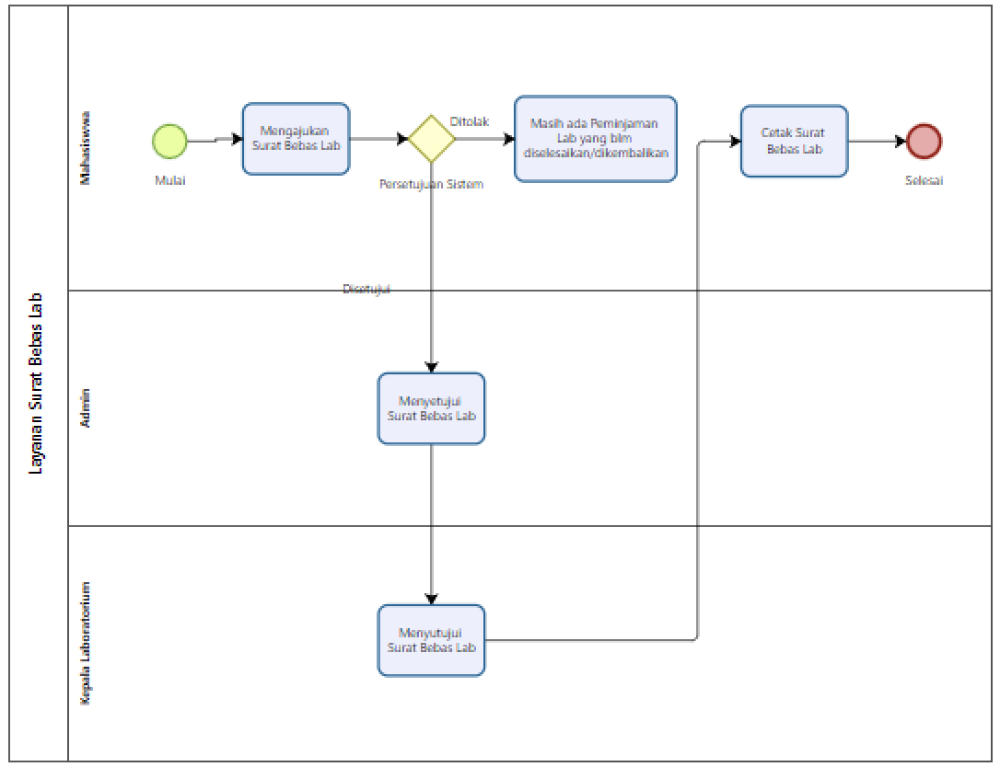

> **📷 Keterangan Gambar**: *Gambar 3. 15 Proses Bisnis To-Be Surat Bebas Laboratorium* (Dimensi: 1086x834 px)  
> **🔍 Analisis & Arti Gambar**:  
> Gambar pendukung/ilustrasi visual pada Halaman 109 yang merepresentasikan bagan, panduan antarmuka, formulir, atau materi teknis sesuai konteks bahasan: 'Gambar 3. 15 Proses Bisnis To-Be Surat Bebas Laboratorium'.

---

## 📄 Halaman 110

84 
 
peminjaman laboratorium, maka pengajuan akan diteruskan kepada admin 
laboratorium untuk dilakukan verifikasi. Setelah proses verifikasi admin selesai, 
kepala laboratorium melakukan persetujuan akhir terhadap pengajuan surat bebas 
laboratorium. Setelah pengajuan disetujui, mahasiswa dapat mencetak surat bebas 
laboratorium secara langsung melalui sistem. Dengan adanya proses digitalisasi ini, 
layanan surat bebas laboratorium menjadi lebih cepat, terstruktur, dan 
meminimalkan kesalahan dalam proses validasi data mahasiswa. 
D. Proses Bisnis To-Be Layanan Peminjaman Laboratorium 
 
Gambar 3. 16 Proses Bisnis To-Be Peminjaman Laboratorium 
Pada Gambar 3.16 ditunjukkan proses bisnis To-Be layanan peminjaman 
laboratorium yang telah terdigitalisasi melalui sistem informasi laboratorium 
STMIK Samarinda. Proses dimulai ketika mahasiswa atau dosen melakukan 
pengajuan peminjaman laboratorium melalui sistem dengan memilih jadwal dan 
ruang laboratorium yang tersedia. Setelah pengajuan dikirim, admin laboratorium 
melakukan verifikasi awal terhadap data peminjaman yang diajukan. Selanjutnya 
pengajuan diteruskan kepada kepala laboratorium untuk dilakukan verifikasi 
lanjutan dan persetujuan akhir. Apabila pengajuan ditolak, maka proses 
peminjaman dihentikan dan pengguna tidak dapat melanjutkan ke tahap berikutnya.

### 🖼️ Gambar pada Halaman 110

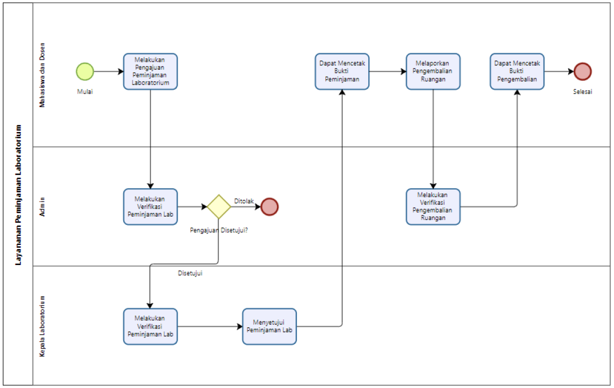

> **📷 Keterangan Gambar**: *Gambar 3. 16 Proses Bisnis To-Be Peminjaman Laboratorium* (Dimensi: 1102x697 px)  
> **🔍 Analisis & Arti Gambar**:  
> Gambar ini memuat lembar tanda tangan atau cap pengesahan resmi dari dosen pembimbing, penguji, atau koordinator program studi yang membuktikan keabsahan dokumen tugas akhir.

---

## 📄 Halaman 111

85 
 
Namun jika pengajuan disetujui, pengguna dapat mencetak bukti peminjaman 
laboratorium melalui sistem. Setelah penggunaan laboratorium selesai, pengguna 
diwajibkan melakukan pelaporan pengembalian ruang laboratorium melalui sistem. 
Admin laboratorium kemudian melakukan verifikasi pengembalian ruang sebelum 
pengguna dapat mencetak bukti pengembalian laboratorium. Dengan adanya proses 
digitalisasi ini, layanan peminjaman laboratorium menjadi lebih terstruktur, 
mempermudah proses monitoring jadwal penggunaan laboratorium, serta 
membantu mencegah terjadinya benturan jadwal peminjaman. 
3.4.2 Planning 
Pada tahap Planning, dilakukan pengelompokan user Story ke dalam 
rencana iterasi pengembangan sistem berdasarkan pertimbangan kebutuhan sistem 
yang paling mendesak untuk segera diimplementasikan. User Story  prioritas 
ditentukan melalui hasil wawancara dan diskusi dengan mitra, serta 
mempertimbangkan urgensi fungsionalitas sistem. Iterasi pengembangan 
direncanakan berlangsung selama dua minggu untuk setiap iterasi. Durasi ini 
ditentukan berdasarkan penyesuaian terhadap ritme kerja pengembang serta hasil 
kesepakatan bersama dengan pihak mitra. Rincian perencanaan iterasi dapat dilihat 
pada Tabel 3.9 berikut. 
Tabel 3. 9 User Story 
Kode 
User Story 
As a 
Deskripsi User Story 
Prioritas 
(MoSCoW) 
Story 
Point 
US-01 
Semua 
Aktor 
Pengguna dapat melihat 
Company profile Lab 
Must Have 
3 
US-02 
Semua 
Aktor 
Pengguna melakukan Login 
Must Have 
1 
US-03 
Semua 
Aktor 
Pengguna masuk ke halaman 
Dashboard 
Should Have 
5 
US-04 
Semua 
Aktor 
Pengguna melakukan logout 
Should Have 
3

---

## 📄 Halaman 112

86 
 
Kode 
User Story 
As a 
Deskripsi User Story 
Prioritas 
(MoSCoW) 
Story 
Point 
US-05 
Admin 
Admin menambahkan informasi 
company profile 
Must  
Have 
5 
US-06 
Admin 
Admin membuat jadwal 
sertifikasi 
Must Have 
5 
US-07 
Mahasiswa 
Mahasiswa melihat dan 
mendaftar sertifikasi 
Must Have 
3 
US-08 
Admin 
Admin memverifikasi 
pendaftaran sertifikasi 
Must Have 
3 
US-09 
Mahasiswa 
Mahasiswa dan mengikuti 
sertifikasi 
Must Have 
1 
US-10 
Kepala Lab 
Kepala Lab memeriksa hasil 
sertifikasi 
Must Have 
3 
US-11 
Mahasiswa 
Mahasiswa mencetak sertifikat 
Must Have 
3 
US-12 
Mahasiswa 
Mahasiswa mengajukan surat 
bebas lab 
Must Have 
5 
US-13 
Admin 
Admin memverifikasi 
pengajuan surat bebas lab 
Must Have 
5 
US-14 
Kepala Lab 
Kepala Lab menyetujui 
pengajuan surat bebas lab 
Must Have 
5 
US-15 
Mahasiswa 
dan Dosen 
Mahasiswa dan Dosen 
mengajukan izin penelitian 
Must Have 
5 
US-16 
Admin 
Admin memverifikasi izin 
penelitian 
Must Have 
3 
US-17 
Kepala Lab 
Kepala Lab menyetujui izin 
penelitian 
Must Have 
5 
US-18 
Mahasiswa 
dan Dosen 
Mahasiswa dan Dosen 
mengajukan peminjaman 
laboratorium 
Must Have 
3

---

## 📄 Halaman 113

87 
 
Kode 
User Story 
As a 
Deskripsi User Story 
Prioritas 
(MoSCoW) 
Story 
Point 
US-19 
Admin 
Admin memverifikasi 
peminjaman laboratorium 
Must Have 
3 
US-20 
Kepala Lab 
Kepala Lab menyetujui 
peminjaman laboratorium 
Must Have 
3 
US-21 
Mahasiswa 
dan Dosen 
Mahasiswa dan Dosen 
mencetak surat persetujuan 
peminjaman 
Must Have 
3 
US-22 
Mahasiswa 
dan Dosen 
Mahasiswa dan Dosen 
melakukan pengembalian 
ruangan laboratorium 
Must Have 
3 
US-23 
Admin 
Admin memverifikasi 
pengembalian ruangan 
laboratorium 
Must Have 
3 
US-24 
Mahasiswa 
dan Dosen 
Mahasiswa dan Dosen 
mencetak surat pengembalian 
ruangan 
Must Have 
3 
  
 
Total User Story 
  
84 
Tahapan Selanjutnya adalah membagi User Story menjadi 5 iterasi. Rincian 
pembagian per iterasi dapat dilihat pada Tabel 3.10 berikut. 
Tabel 3. 10 Rencana Iterasi 
     Iterasi 1 
Kode User 
Story 
Deskripsi User Story 
Prioritas 
(MoSCoW) 
Story 
Point 
US-01 
Pengguna dapat melihat Company 
profile Lab 
Must Have 
3 
US-02 
Pengguna melakukan Login 
Must Have 
1 
US-03 
Pengguna masuk ke halaman 
Dashboard 
Should Have 
5 
US-04 
Pengguna melakukan logout 
Should Have 
3

---

## 📄 Halaman 114

88 
 
US-05 
Admin menambahkan informasi 
company profile 
Must  
Have 
5 
  
Total Story Point 
  
17 
Iterasi 2 
Kode User 
Story 
Deskripsi User Story 
Prioritas 
(MoSCoW) 
Story 
Point 
US-06 
Admin membuat jadwal sertifikasi 
Must Have 
5 
US-07 
Mahasiswa melihat dan mendaftar 
sertifikasi 
Must Have 
3 
US-08 
Admin memverifikasi pendaftaran 
sertifikasi 
Must Have 
3 
US-09 
Mahasiswa mengikuti sertifikasi 
Must Have 
1 
US-10 
Kepala Lab memeriksa hasil 
sertifikasi 
Must Have 
3 
US-11 
Mahasiswa mencetak sertifikat 
Must Have 
3 
  
Total Story Point 
  
18 
Iterasi 3 
Kode User 
Story 
Deskripsi User Story 
Prioritas 
(MoSCoW) 
Story 
Point 
US-12 
Mahasiswa mengajukan surat bebas 
lab 
Must Have 
5 
US-13 
Admin memverifikasi pengajuan 
surat bebas lab 
Must Have 
5 
US-14 
Kepala Lab menyetujui pengajuan 
surat bebas lab 
Must Have 
5 
 
Total Story Point 
  
15 
Iterasi 4 
Kode User 
Story 
Deskripsi User Story 
Prioritas 
(MoSCoW) 
Story 
Point 
US-15 
Mahasiswa dan Dosen mengajukan 
izin penelitian 
Must Have 
5 
US-16 
Admin memverifikasi izin penelitian 
Must Have 
3 
US-17 
Kepala Lab menyetujui izin 
penelitian 
Must Have 
5 
  
Total Story Point 
  
13 
Iterasi 5 
Kode User 
Story 
Deskripsi User Story 
Prioritas 
(MoSCoW) 
Story 
Point 
US-18 
Mahasiswa dan Dosen mengajukan 
peminjaman laboratorium 
Must Have 
3

---

## 📄 Halaman 115

89 
 
US-19 
Admin memverifikasi peminjaman 
laboratorium 
Must Have 
3 
US-20 
Kepala Lab menyetujui peminjaman 
laboratorium 
Must Have 
3 
US-21 
Mahasiswa dan Dosen mencetak 
surat persetujuan peminjaman 
Must Have 
3 
US-22 
Mahasiswa dan Dosen melakukan 
pengembalian ruangan laboratorium 
Must Have 
3 
US-23 
Admin memverifikasi pengembalian 
ruangan laboratorium 
Must Have 
3 
US-24 
Mahasiswa dan Dosen mencetak 
surat pengembalian ruangan 
Must Have 
3 
  
Total Story Point 
  
21 
  
Total User Story 
  
84 
3.4.3 Iterasi 1 Autentikasi System 
Iterasi pertama membangun fondasi sistem mencakup halaman company 
profile laboratorium yang dapat diakses publik. halaman Dashboard untuk setiap 
peran pengguna, serta fitur admin untuk mengelola company profile. Iterasi ini 
merupakan prasyarat sebelum layanan dikembangkan pada iterasi berikutnya. 
Tabel 3. 11 User Story Iterasi 1 
Kode 
As a 
I Want 
So That 
US-01 
Pengguna 
Saya ingin dapat melihat 
Company profile Lab 
Saya dapat mengetahui 
informasi laboratorium 
US-02 
Pengguna 
Saya ingin dapat 
melakukan Login 
Saya dapat mengakses fitur 
sesuai peran saya 
US-03 
Pengguna 
Saya ingin dapat masuk 
ke halaman Dashboard 
Saya dapat menggunakan 
fitur yang tersedia 
US-04 
Pengguna 
Saya ingin dapat 
melakukan logout 
Saya dapat keluar dari 
sistem dengan aman 
US-05 
Admin 
Saya ingin 
menambahkan informasi 
company profile 
Saya dapat mengelola 
informasi yang ditampilkan 
ke publik

---

## 📄 Halaman 116

90 
 
3.4.3.1 Iteration Initialization 1 
Tahap Iteration initialization merupakan langkah awal dari setiap iterasi 
dalam pengembangan sistem. Pada tahap ini, pengembang menentukan user Story 
yang akan dikerjakan serta menyusun daftar tugas yang perlu diselesaikan. Untuk 
iterasi pertama, fitur yang dikembangkan difokuskan pada fungsionalitAs awal 
yang cukup lengkap. Rincian user Story yang dikerjakan pada iterasi pertama 
ditampilkan pada Tabel 3.12 berikut. 
Tabel 3. 12 Iteration Initialization 1 
Kode 
User Story 
Task 
Story 
Point 
US-01 
Melihat 
Company profile 
Lab 
Membuat halaman beranda, profil lab, 
dan berita yang dapat diakses publik 
tanpa Login 
3 
US-02 
Melakukan Login 
Membuat halaman Login dan logika 
autentikasi berbasis peran dengan 
validasi domain email 
1 
US-03 
Masuk ke 
halaman 
Dashboard 
Membuat Dashboard untuk masing-
masing peran Admin, Kepala Lab, 
Mahasiswa, dan Dosen 
5 
US-04 
Melakukan 
logout 
Mengimplementasikan fungsi logout 
dan penghapusan sesi pengguna 
3 
US-05 
Menambahkan 
informasi 
company profile 
Membuat halaman CRUD company 
profile untuk admin (berita, profil lab, 
pengumuman) 
5 
Total 
  
  
17 
3.4.3.2 Design 1 
Tahap perancangan pada iterasi pertama meliputi pembuatan Entity 
Relationship Diagram (ERD) dan rancangan antarmuka pengguna (user Interface) 
dari fitur-fitur yang dikembangkan. Desain ini mengacu pada user Story yang telah 
ditentukan di iterasi pertama, yaitu halaman company pofile, Login ke dalam sistem, 
logout dari sistem, masuk ke halaman Dashboard,  serta menyunting akun 
pengguna.

---

## 📄 Halaman 117

91 
 
A.  
Entity Relationship Diagram 1 
Gambar 3.7 dibawah ini menunjukkan Entity Relationship Diagram (ERD) 
pada iterasi pertama menggambarkan entitas inti sistem. 
 
Gambar 3. 17 ERD Iterasi 1 
Pada Gambar 3.17 merupakan Entity Relationship Diagram (ERD) yang 
dirancang untuk iterasi pertama. Pada iterasi ini terdapat 8 entitas, yaitu users, 
site_settings, 
ruangans, 
program_studis, 
profile_settings, 
beritas, 
struktur_organisasi 
 dan moduls.  
B.  
User Interface 1 
Rancangan antarmuka pada iterasi pertama mencakup halaman Login, dan 
halaman Dashboard.

### 🖼️ Gambar pada Halaman 117

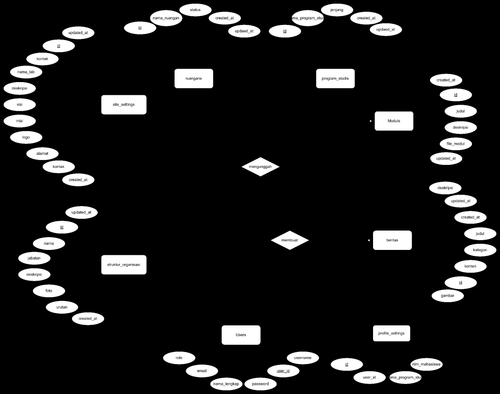

> **📷 Keterangan Gambar**: *Gambar 3.7 dibawah ini menunjukkan Entity Relationship Diagram (ERD)* (Dimensi: 1217x960 px)  
> **🔍 Analisis & Arti Gambar**:  
> Gambar ini menyajikan bagan hierarki struktur organisasi pada instansi/lokasi studi kasus, menggambarkan pembagian wewenang, bidang, dan tanggung jawab kerja para pemangku kepentingan.

---

## 📄 Halaman 118

92 
 
 
Gambar 3. 18 Mockup Antarmuka Login 
Pada Gambar 3.18 menampilkan mockup antarmuka halaman Login SILAB 
STMIK Samarinda yang berfungsi sebagai gerbang masuk pengguna ke dalam 
sistem. Halaman ini menampilkan Alamat Email dan Password, untuk pemulihan 
kata sandi, dan tombol utama "Masuk ke Akun" untuk memproses otentikasi 
pengguna. 
 
Gambar 3. 19 Mockup Antarmuka Dashboard Admin 
Pada gambar 3.19 menampilkan mockup antarmuka halaman Dashboard 
utama yang diakses setelah pengguna berhasil masuk ke dalam sistem. Halaman ini

### 🖼️ Gambar pada Halaman 118

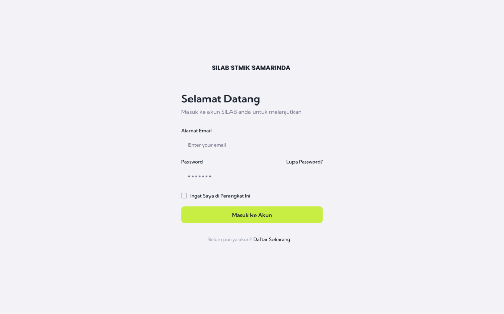

> **📷 Keterangan Gambar**: *Gambar 3. 18 Mockup Antarmuka Login* (Dimensi: 984x613 px)  
> **🔍 Analisis & Arti Gambar**:  
> Gambar ini merupakan tangkapan layar (screenshot) implementasi antarmuka pengguna (UI) sistem informasi, memperlihatkan tata letak visual, form input, tabel ringkasan data, dan navigasi menu.

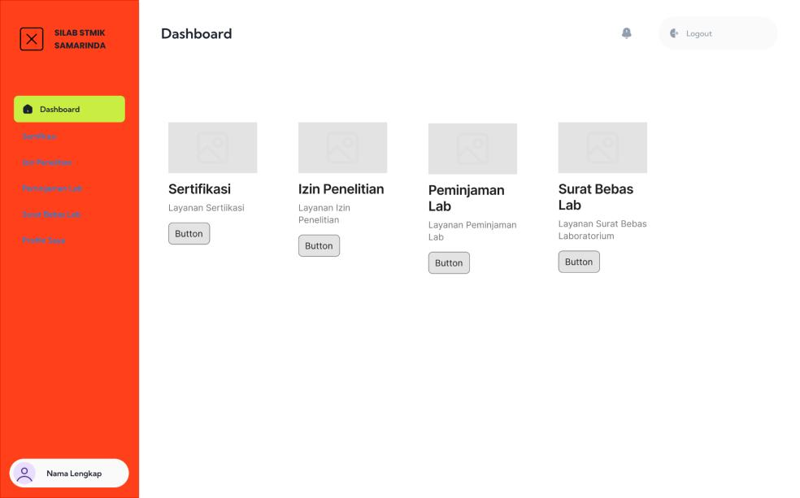

> **📷 Keterangan Gambar**: *Gambar 3.18 menampilkan mockup antarmuka halaman Login SILAB* (Dimensi: 984x613 px)  
> **🔍 Analisis & Arti Gambar**:  
> Gambar ini merupakan tangkapan layar (screenshot) implementasi antarmuka pengguna (UI) sistem informasi, memperlihatkan tata letak visual, form input, tabel ringkasan data, dan navigasi menu.

---

## 📄 Halaman 119

93 
 
memiliki sidebar navigasi di sisi kiri dan menyajikan empat menu layanan utama 
laboratorium, yaitu Sertifikasi, Izin Penelitian, Peminjaman Lab, dan Surat Bebas 
Lab yang masing-masing dilengkapi dengan layanan masing-masing. 
3.4.3.3 Implementation 1 
Tahap implementasi merupakan langkah untuk merealisasikan rancangan 
sistem yang telah disusun pada tahap sebelumnya. Pada fase ini, proses 
pengembangan dimulai dengan pelaksanaan unit Testing menggunakan PHPUnit 
yang tersedia dalam framework Laravel. Setelah pengujian awal dilakukan, 
pengembang mulai menulis kode program sesuai dengan kebutuhan fungsional 
sistem. 
Implementasi pada iterasi pertama difokuskan pada pengembangan fitur 
autentikasi dan company profile laboratorium. Fitur ini dikembangkan untuk 
mengatasi permasalahan akses layanan laboratorium yang sebelumnya belum 
terdigitalisasi dan belum memiliki sistem autentikasi berbasis peran pengguna. 
A.  
Unit Testing 1 
Pada tahap unit Testing, pengujian unit dilakukan menggunakan PHPUnit 
untuk memastikan bahwa fungsi-fungsi pada iterasi pertama berjalan sesuai dengan 
kebutuhan yang telah dirancang. Sebagai contoh, pengujian dilakukan terhadap 
fitur autentikasi pada AuthenticatedSessionController untuk memverifikasi bahwa 
proses autentikasi berfungsi dengan benar dalam berbagai skenario. Tabel berikut 
menampilkan salah satu contoh kode pengujian unit yang dilakukan pada iterasi 
pertama. Pada contoh ini, pengembang menggunakan salah satu fitur sebagai objek 
pengujian, yaitu fitur autentikasi dalam memastikan bahwa fungsi berjalan sesuai 
dengan perilaku yang telah dirancang. 
Tabel 3. 13 Kode Unit Testing 1 Autentikasi 
tests/Unit/Controllers/Auth/AuthenticatedSessionControllerTest. 
php 
001: <?php 
002:  
003: namespace Tests\Unit\Controllers\Auth;

---

## 📄 Halaman 120

94 
 
tests/Unit/Controllers/Auth/AuthenticatedSessionControllerTest. 
php 
004:  
005: use App\Models\User; 
006: use Illuminate\Foundation\Testing\RefreshDatabase; 
007: use Tests\TestCase; 
008:  
009: class AuthenticatedSessionControllerTest extends TestCase 
010: { 
011:     use RefreshDatabase; 
012:  
013:     public function test_it_shows_the_Login_page() 
014:     { 
015:         $response = $this->get(route('Login')); 
016:         $response->assertStatus(200); 
017:     } 
018:  
019:     public function 
test_it_fails_Login_with_wrong_credentials() 
020:     { 
021:         $response = $this->post(route('Login'), [ 
022:             'email'    => 'salah@stmik.ac.id', 
023:             'Password' => 'wrongPassword', 
024:         ]); 
025:         $response->assertSessionHasErrors(['email']); 
026:     } 
027:  
028:     public function 
test_it_logs_in_as_admin_and_redirects_to_Dashboard() 
029:     { 
030:         $user = User::factory()->create([ 
031:             'email'    => 'admin@stmik.ac.id', 
032:             'Password' => bcrypt('Password123'), 
033:             'role'     => 'admin', 
034:         ]); 
035:  
036:         $response = $this->post(route('Login'), [ 
037:             'email'    => 'admin@stmik.ac.id', 
038:             'Password' => 'Password123',

---

## 📄 Halaman 121

95 
 
tests/Unit/Controllers/Auth/AuthenticatedSessionControllerTest. 
php 
039:         ]); 
040:  
041:         $response->assertRedirect('/Dashboard'); 
042:         $this->assertAuthenticatedAs($user); 
043:         $this->get('/Dashboard')-
>assertRedirect('/admin/Dashboard'); 
044:     } 
045:  
046:     public function 
test_it_logs_in_as_mahasiswa_and_redirects_to_Dashboard() 
047:     { 
048:         $user = User::factory()->create([ 
049:             'email'    => 'mahasiswa@mhs.stmik.ac.id', 
050:             'Password' => bcrypt('Password123'), 
051:             'role'     => 'mahasiswa', 
052:         ]); 
053:  
054:         $response = $this->post(route('Login'), [ 
055:             'email'    => 'mahasiswa@mhs.stmik.ac.id', 
056:             'Password' => 'Password123', 
057:         ]); 
058:  
059:         $response->assertRedirect('/Dashboard'); 
060:         $this->assertAuthenticatedAs($user); 
061:         $this->get('/Dashboard')-
>assertRedirect('/mahasiswa/Dashboard'); 
062:     } 
063:  
064:     public function 
test_it_logs_in_as_kepala_lab_and_redirects_to_Dashboard() 
065:     { 
066:         $user = User::factory()->create([ 
067:             'email'    => 'kepala@stmik.ac.id', 
068:             'Password' => bcrypt('Password123'), 
069:             'role'     => 'kepala_lab', 
070:         ]); 
071:

---

## 📄 Halaman 122

96 
 
tests/Unit/Controllers/Auth/AuthenticatedSessionControllerTest. 
php 
072:         $response = $this->post(route('Login'), [ 
073:             'email'    => 'kepala@stmik.ac.id', 
074:             'Password' => 'Password123', 
075:         ]); 
076:  
077:         $response->assertRedirect('/Dashboard'); 
078:         $this->assertAuthenticatedAs($user); 
079:         $this->get('/Dashboard')-
>assertRedirect('/kepala_lab/Dashboard'); 
080:     } 
081:  
082:     public function 
test_it_logs_in_as_dosen_and_redirects_to_Dashboard() 
083:     { 
084:         $user = User::factory()->create([ 
085:             'email'    => 'dosen@stmik.ac.id', 
086:             'Password' => bcrypt('Password123'), 
087:             'role'     => 'dosen', 
088:         ]); 
089:  
090:         $response = $this->post(route('Login'), [ 
091:             'email'    => 'dosen@stmik.ac.id', 
092:             'Password' => 'Password123', 
093:         ]); 
094:  
095:         $response->assertRedirect('/Dashboard'); 
096:         $this->assertAuthenticatedAs($user); 
097:         $this->get('/Dashboard')-
>assertRedirect('/dosen/Dashboard'); 
098:     } 
099:  
100:     public function 
test_it_logs_out_and_redirects_to_Login() 
101:     { 
102:         $user = User::factory()->create(); 
103:         $this->actingAs($user); 
104:

---

## 📄 Halaman 123

97 
 
tests/Unit/Controllers/Auth/AuthenticatedSessionControllerTest. 
php 
105:         $response = $this->post(route('logout')); 
106:  
107:         $response->assertRedirect('/'); 
108:         $this->assertGuest(); 
109:     } 
110: } 
Pengujian ini dilakukan untuk memastikan proses autentikasi berfungsi dalam 
berbagai kondisi, halaman Login dapat ditampilkan sistem menolak kredensial yang 
salah, serta melakukan pengalihan ke Dashboard yang sesuai berdasarkan peran 
pengguna setelah Login berhasil. 
 
Gambar 3. 20 Hasil Unit Testing 1 (7 Test, 7 Passed) 
Hasil pengujian pada gambar 3.20 di atas menunjukkan status “Pass” pada 
seluruh skenario uji yang dibuat, yang menandakan setiap fungsi autentikasi bekerja 
sesuai yang diharapkan. 
B.  
Code 1 
Setelah unit Testing, langkah berikutnya adalah pengembangan kode untuk 
fitur-fitur yang direncanakan pada iterasi pertama. Berikut adalah contoh 
pseudoCode untuk logika autentikasi dan registrasi pengguna pada SIMLAB. 
Tabel 3. 14 PseudoCode Autentikasi 
// FUNCTION: authenticate 
// Tujuan: Memvalidasi kredensial pengguna saat Login 
// Input 
request (berisi email dan Password) 
 
// Proses 
validasi email dan Password

### 🖼️ Gambar pada Halaman 123

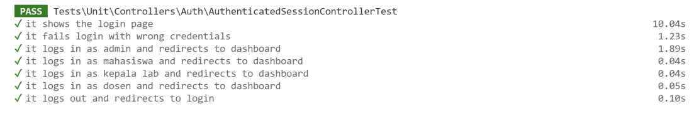

> **📷 Keterangan Gambar**: *Gambar 3. 20 Hasil Unit Testing 1 (7 Test, 7 Passed)* (Dimensi: 1103x183 px)  
> **🔍 Analisis & Arti Gambar**:  
> Gambar ini merupakan logo resmi institusi (Institut Teknologi Kalimantan / ITK) yang berfungsi sebagai identitas formal pada halaman judul/sampul laporan tugas akhir.

---

## 📄 Halaman 124

98 
 
user = cari User berdasarkan email 
 
if (user tidak ditemukan atau Password tidak cocok) then 
    redirect kembali dengan pesan error "Email atau Password 
salah" 
end if 
 
buat session Login untuk user 
 
if (user.role == 'admin') then 
    redirect ke halaman Dashboard admin 
else if (user.role == 'kepala_lab') then 
    redirect ke halaman Dashboard kepala lab 
else if (user.role == 'dosen') then 
    redirect ke halaman Dashboard dosen 
else 
    redirect ke halaman Dashboard mahasiswa 
end if 
 
 
// FUNCTION: register 
// Tujuan: Membuat akun mahasiswa baru 
// Input 
request (berisi name, email, Password) 
 
// Proses 
ambil konfigurasi domain email dari site_settings 
validasi name, email, dan Password 
validasi email harus sesuai domain institusi 
 
if (email tidak sesuai domain mahasiswa) then 
    redirect kembali dengan pesan error "Domain email tidak 
sesuai" 
end if 
 
user = buat User baru dengan name, email, Password, dan role 
'mahasiswa' 
Login user yang baru dibuat

---

## 📄 Halaman 125

99 
 
redirect ke halaman Dashboard mahasiswa 
 
Tabel 3.14 di atas merupakan PseudoCode untuk fungsi melakukan Login. 
Penjelasan lebih lanjut mengenai PseudoCode tersebut disajikan pada Tabel 3.15 
berikut, yang menguraikan fungsi dalam implementasi tersebut. 
Tabel 3. 15 Penjelasan PseudoCode Autentikasi 
Proses 
Penjelasan (Output) 
Validasi Login 
Sistem memeriksa email dan Password. Jika tidak cocok, 
pesan error ditampilkan. 
Redirect berbasis 
peran 
Setelah berhasil 
Login, pengguna diarahkan ke 
Dashboard sesuai role-nya masing-masing. 
Validasi domain 
registrasi 
Sistem memeriksa domain email terhadap konfigurasi 
domain yang tersimpan di site_settings. 
Pembuatan akun 
baru 
Data pengguna disimpan ke tabel users dengan status 
profile belum terisi. 
 
 
Gambar 3. 21 Halaman Login SIMLAB

### 🖼️ Gambar pada Halaman 125

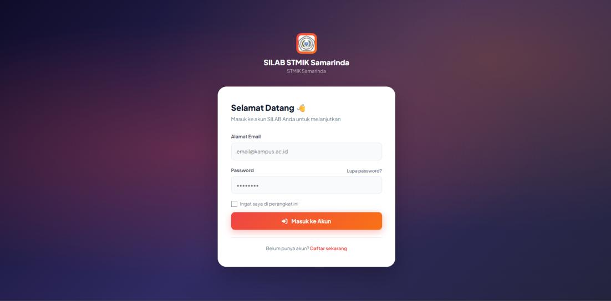

> **📷 Keterangan Gambar**: *Gambar 3. 21 Halaman Login SIMLAB* (Dimensi: 1102x544 px)  
> **🔍 Analisis & Arti Gambar**:  
> Gambar ini merupakan tangkapan layar (screenshot) implementasi antarmuka pengguna (UI) sistem informasi, memperlihatkan tata letak visual, form input, tabel ringkasan data, dan navigasi menu.

---

## 📄 Halaman 126

100 
 
Pada Gambar 3.21 menampilkan antarmuka halaman Login sistem 
SIMLAB STMIK Samarinda yang berfungsi sebagai autentikasi awal pengguna. 
serta input Alamat Email dan Password, tautan lupa Password, tombol Masuk ke 
Akun serta tautan menuju halaman registrasi bagi pengguna baru. 
 
Gambar 3. 22 Halaman Registrasi SIMLAB 
Pada Gambar 3.22 menampilkan antarmuka halaman registrasi atau 
pembuatan akun baru pada sistem SIMLAB STMIK Samarinda. Halaman ini 
menyajikan formulir pendaftaran terstruktur yang mewajibkan pengguna untuk 
mengisi beberapa data identitas penting, meliputi Nama Lengkap, Alamat Email, 
serta Konfirmasi Password, Buat Akun untuk menyimpan kredensial ke dalam 
sistem. 
C.  
Refactor 1 
 Pada tahap refactor di iterasi pertama, dilakukan pemeriksaan terhadap 
seluruh kode yang telah diimplementasikan untuk memastikan apakah ada bagian 
yang perlu diperbaiki atau disederhanakan. Setelah ditinjau, tidak ditemukan kode 
yang perlu diubah atau dioptimalkan karena semua fungsi sudah berjalan dengan 
baik dan sesuai kebutuhan. Oleh karena itu, pada iterasi ini tidak dilakukan proses 
refactoring atau pengoptimalan kode.

### 🖼️ Gambar pada Halaman 126

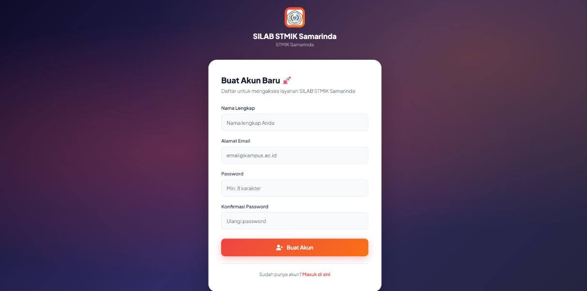

> **📷 Keterangan Gambar**: *Gambar 3.21 menampilkan antarmuka halaman Login sistem* (Dimensi: 1213x604 px)  
> **🔍 Analisis & Arti Gambar**:  
> Gambar ini merupakan tangkapan layar (screenshot) implementasi antarmuka pengguna (UI) sistem informasi, memperlihatkan tata letak visual, form input, tabel ringkasan data, dan navigasi menu.

---

## 📄 Halaman 127

101 
 
3.4.3.4 System Testing 1 
Pengujian fungsionalitas sistem dilakukan menggunakan metode Black Box 
Testing, yaitu dengan menjalankan sistem dan mengevaluasi apakah hasil yang 
diperoleh telah sesuai dengan kebutuhan yang diharapkan. Pada tahap System 
Testing iterasi pertama, pengujian dilakukan secara langsung oleh pengembang 
terhadap fitur autentikasi pada sistem informasi laboratorium. Pengujian dilakukan 
untuk memastikan bahwa proses Login, registrasi pengguna, validasi domain email 
institusi, serta pengalihan Dashboard berdasarkan role pengguna dapat berjalan 
sesuai dengan kebutuhan sistem. Terdapat beberapa skenario pengujian pada iterasi 
pertama, dan Tabel 3.16 menampilkan salah satu skenario pengujian System Testing 
1 pada fitur autentikasi pengguna. 
Tabel 3. 16 System Testing 1 
No 
Test Case 
System Role 
System 
Navigation 
Testing 
Data 
Expected 
Result 
Status 
1 
Melakukan 
Login 
sistem 
Admin, 
Mahasiswa, 
Dosen, 
Kepala 
Laboratorium 
1. Membuka 
halaman Login  
2. Mengisi email 
dan Password  
3. Klik tombol 
Login 
Email dan 
Password 
pengguna 
Pengguna 
berhasil 
masuk 
ke 
Dashboard 
sesuai role 
masing-
masing 
Passed 
2 
Melakukan 
registrasi 
akun 
Mahasiswa 
1. Membuka 
halaman registrasi 
2. Mengisi data 
akun  
3. Klik tombol 
registrasi 
Nama, 
email 
institusi, 
Password 
Sistem 
berhasil 
membuat 
akun 
Passed 
 
3.4.3.5 Retrospective 1 
Setelah menyelesaikan iterasi pertama, dapat disimpulkan bahwa seluruh 6 
user Story berhasil diimplementasikan sesuai rencana. Fondasi sistem berhasil

---

## 📄 Halaman 128

102 
 
dibangun mencakup autentikasi, manajemen pengguna, dan data master. Rincian 
faktor keberhasilan dan hambatan selama iterasi 1 dapat dilihat pada Tabel 3.17. 
Tabel 3. 17 Hasil Retrospective 1 
Faktor Keberhasilan 
Faktor Hambatan 
Fitur Autentikasi berhasil diterapkan, 
sehingga pengguna dapat melakukan 
Login, Registrasi dan Logout serta 
sistem 
dapat 
membedakan 
akses 
pengguna sesuai dengan role nya 
masing-masing. 
Terdapat 
penambahan 
untuk 
mahasiswa dapat melengkapi profile 
terlebih 
dahulu 
sebelum 
bisa 
mengajukan layanan. 
 
Retrospective pada iterasi pertama tidak dapat dilakukan karena pihak mitra 
berhalangan hadir pada jadwal yang telah ditentukan. Di samping itu, cakupan 
pengembangan pada iterasi pertama masih terbatas pada fitur autentikasi dan 
pengelolaan profil pengguna, sehingga belum memberikan gambaran yang 
memadai mengenai fungsionalitas sistem dan alur layanan. Oleh karena itu, 
retrospective iterasi pertama digabungkan dengan retrospective iterasi kedua agar 
mitra dapat mengevaluasi sistem berdasarkan implementasi fitur yang ada dan 
memberikan umpan balik yang lebih relevan terhadap pengembangan sistem. 
3.4.4  Iterasi 2 Layanan Sertifikasi Kompetensi 
Iterasi kedua merupakan kelanjutan dari pengembangan sistem setelah 
fondasi pada iterasi pertama berhasil dibangun. Fokus iterasi ini adalah 
pengembangan Daftar Sertifikasi Kompetensi, mencakup manajemen sertifikasi, 
jadwal ujian, pendaftaran sertifikasi, serta proses verifikasi dan pencatatan hasil 
oleh kepala lab. 
Tabel 3. 18 User Story Iterasi 2 
Kode 
As a 
I Want 
So That 
US-06 
Admin 
Saya ingin membuat 
jadwal sertifikasi 
Saya dapat mengatur waktu 
dan kuota peserta ujian

---

## 📄 Halaman 129

103 
 
Kode 
As a 
I Want 
So That 
US-07 
Mahasiswa 
Saya ingin melihat dan 
mendaftar sertifikasi 
Saya dapat mengikuti ujian 
sertifikasi yang tersedia 
US-08 
Admin 
Saya ingin 
memverifikasi 
pendaftaran sertifikasi 
Saya dapat memeriksa 
kelengkapan berkas peserta 
US-09 
Mahasiswa 
Saya ingin mengikuti 
sertifikasi 
Saya dapat menggunakan 
token ujian yang diberikan 
admin 
US-10 
Kepala Lab 
Saya ingin memeriksa 
hasil sertifikasi 
Saya dapat menentukan 
kelulusan peserta ujian 
US-11 
Mahasiswa 
Saya ingin mencetak 
sertifikat 
Saya dapat memiliki bukti 
kelulusan sertifikasi secara 
resmi 
3.4.4.1 Iteration Initialization 2  
Setelah seluruh proses pada iterasi pertama selesai dilaksanakan dan 
dievaluasi pada tahap Retrospective, proses pengembangan sistem dilanjutkan ke 
iterasi kedua. Tahap Iteration Initialization pada iterasi kedua bertujuan untuk 
menentukan fokus tugas serta memilih user Story yang akan diimplementasikan 
berdasarkan prioritas yang telah disusun pada tahap Planning. Total terdapat 6 user 
Story yang dikembangkan pada iterasi ini, sebagaimana ditampilkan pada Tabel 
3.19 berikut: 
Tabel 3. 19 Iteration Initialization 2 
Kode 
User Story 
Task 
Story 
Point 
US-06 
Membuat jadwal 
sertifikasi 
Membuat halaman CRUD jadwal 
sertifikasi beserta manajemen kuota 
peserta 
5 
US-07 
Melihat dan 
mendaftar 
sertifikasi 
Membuat halaman daftar jadwal, 
form pendaftaran dengan upload 
berkas, dan halaman riwayat 
3 
US-08 
Memverifikasi 
pendaftaran 
Membuat halaman admin untuk 
verifikasi berkas dan generate token 
ujian otomatis 
3

---

## 📄 Halaman 130

104 
 
Kode 
User Story 
Task 
Story 
Point 
US-09 
Mengikuti 
sertifikasi 
Mengimplementasikan alur 
penggunaan token ujian oleh 
mahasiswa pada hari ujian 
1 
US-10 
Memeriksa hasil 
sertifikasi 
Membuat halaman Kepala Lab untuk 
pencatatan hasil lulus/tidak lulus 
3 
US-11 
Mencetak 
sertifikat 
Membuat fitur cetak sertifikat 
berbasis Blade PDF untuk 
mahasiswa yang lulus 
3 
Total 
  
  
18 
3.4.4.2 Design 2 
Pada tahap Design di iterasi kedua, dimulai dengan pembuatan ERD, serta 
rancangan antarmuka pengguna (user Interface) dari fitur-fitur yang akan 
dikembangkan. Desain ini mengacu pada user Story yang telah ditentukan pada 
iterasi kedua, yaitu layanan sertfikasi, mengelola daftar sertifikasi, jadwal 
sertifikasi, pendaftar sertifikasi dan hasil sertifikasi. 
A.  
Entity Relationship Diagram 2 
Gambar 3.23 di bawh ini menunjukkan Entity Relationship Diagram (ERD) 
yang dirancang untuk iterasi kedua dalam proses pengembangan. ERD ini disusun 
berdasarkan user Story yang telah direncanakan untuk dikerjakan pada iterasi 
kedua.

---

## 📄 Halaman 131

105 
 
 
Gambar 3. 23 ERD Iterasi 2 
Berdasarkan Gambar 3.23, terdapat penambahan entitas baru pada basis 
data untuk mendukung fitur yang dikembangkan. Entitas skema_sertifikasi, 
jadwal_sertifikasi, dan pendaftaran_sertifikasi. 
B.  
User Interface 2 
Berikut ini merupakan salah satu rancangan tampilan antarmuka yang 
dirancang pada iterasi ini mencakup halaman pendaftaran sertifikasi yang 
disesuaikan dengan user Story yang dikerjakan pada iterasi kedua.

### 🖼️ Gambar pada Halaman 131

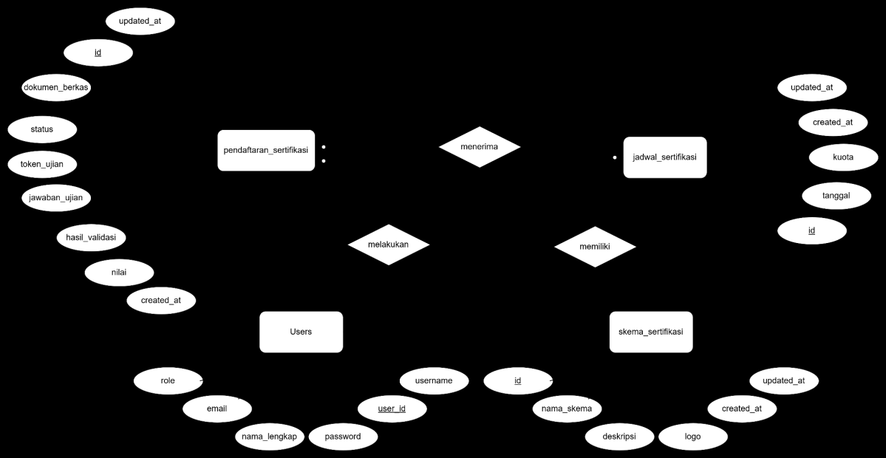

> **📷 Keterangan Gambar**: *Gambar 3. 23 ERD Iterasi 2* (Dimensi: 1199x620 px)  
> **🔍 Analisis & Arti Gambar**:  
> Gambar ini menyajikan diagram skema struktural perangkat lunak (Class Diagram / ERD) yang mendefinisikan struktur tabel/kelas, atribut kolom, method, dan relasi kardinalitas antar entitas basis data.

---

## 📄 Halaman 132

106 
 
 
Gambar 3. 24 Mockup Antarmuka Pendaftaran Sertifikasi 
Pada gambar 3.24 menampilkan halaman Pendaftaran Sertifikasi yang 
diakses setelah pengguna berhasil masuk ke dalam sistem. Halaman ini pengguna 
dapat mendaftar sertifikasi yang ada dan memasukkan data yang dibutuhkan untuk 
mendaftar serta menampilkan alur pendaftaran sertifikasi. 
3.4.4.3 Implementation 2 
Tahap implementasi iterasi kedua merealisasikan rancangan modul 
sertifikasi. Pengujian unit dilakukan terlebih dahulu sebelum penulisan kode utama 
untuk memastikan setiap fungsi berjalan sesuai rancangan. 
A.  
Unit Testing 2 
Pengujian dilakukan terhadap SertfikasiTest yang digunakan untuk 
memverifikasi alur pendaftaran dan verifikasi sertifikasi. 
Tabel 3. 20 Kode Unit Testing 2 Sertifikasi 
tests/Unit/Controllers/SertifikasiTest.php 
001: <?php 
002: 
003: namespace Tests\Feature; 
004: 
005: use App\Models\JadwalSertifikasi;

### 🖼️ Gambar pada Halaman 132

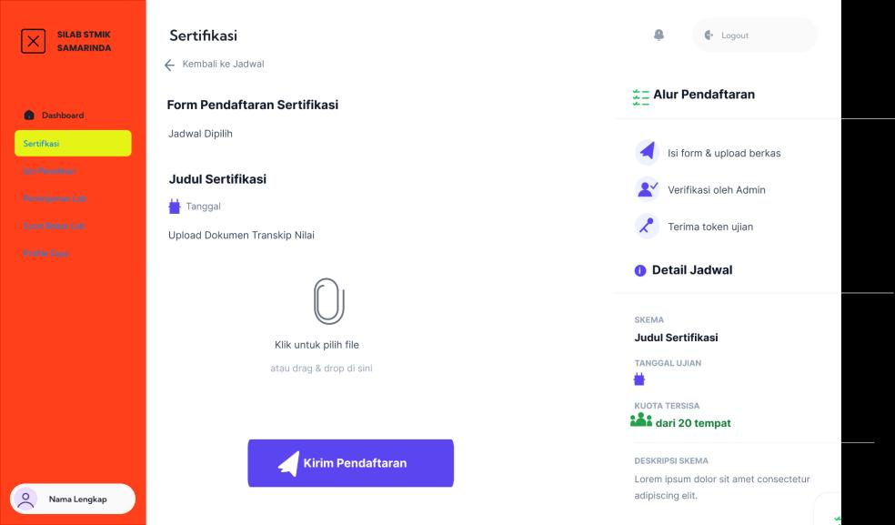

> **📷 Keterangan Gambar**: *Gambar 3. 24 Mockup Antarmuka Pendaftaran Sertifikasi* (Dimensi: 984x577 px)  
> **🔍 Analisis & Arti Gambar**:  
> Gambar ini merupakan tangkapan layar (screenshot) implementasi antarmuka pengguna (UI) sistem informasi, memperlihatkan tata letak visual, form input, tabel ringkasan data, dan navigasi menu.

---

## 📄 Halaman 133

107 
 
tests/Unit/Controllers/SertifikasiTest.php 
006: use App\Models\PendaftaranSertifikasi; 
007: use App\Models\User; 
008: use Illuminate\Foundation\Testing\RefreshDatabase; 
009: use Illuminate\Http\UploadedFile; 
010: use Illuminate\Support\Facades\Notification; 
011: use Illuminate\Support\Facades\Storage; 
012: use Tests\TestCase; 
013: 
014: class SertifikasiTest extends TestCase 
015: { 
016:     use RefreshDatabase; 
017: 
018:     protected function setUp(): void 
019:     { 
020:         parent::setUp(); 
021:         Notification::fake(); 
022:         Storage::fake('public'); 
023:     } 
024: 
025:     private function makeMahasiswa(bool $complete = true): 
User 
026:     { 
027:         /** @var User $user */ 
028:         $user = User::factory()->create([ 
029:             'role'              => 'mahasiswa', 
030:             'profile_completed' => $complete, 
031:             'nim_nip'           => $complete ? '20210001' : 
null, 
032:             'jurusan'           => $complete ? 'Teknik 
Informatika' : null, 
033:             'foto_profil'       => $complete ? 
'foto_profil/test.jpg' : null, 
034:         ]); 
035:         return $user; 
036:     } 
037:

---

## 📄 Halaman 134

108 
 
tests/Unit/Controllers/SertifikasiTest.php 
038:     public function 
test_mahasiswa_lengkap_bisa_lihat_jadwal_sertifikasi(): void 
039:     { 
040:         $this->actingAs($this->makeMahasiswa()); 
041:         $this->get(route('mahasiswa.sertifikasi.index'))-
>assertOk(); 
042:     } 
043: 
044:     public function 
test_mahasiswa_profil_belum_lengkap_diredirect_ke_profil(): void 
045:     { 
046:         $this->actingAs($this->makeMahasiswa(false)); 
047:         $this->get(route('mahasiswa.sertifikasi.index')) 
048:             ->assertRedirect(route('profile.edit')); 
049:     } 
050: 
051:     public function 
test_bukan_mahasiswa_tidak_bisa_akses_halaman_sertifikasi(): 
void 
052:     { 
053:         /** @var User $dosen */ 
054:         $dosen = User::factory()->create(['role' => 
'dosen']); 
055:         $this->actingAs($dosen); 
056:         $this->get(route('mahasiswa.sertifikasi.index'))-
>assertForbidden(); 
057:     } 
058: 
059:     public function test_tamu_diredirect_ke_Login(): void 
060:     { 
061:         $this->get(route('mahasiswa.sertifikasi.index')) 
062:             ->assertRedirect(route('Login')); 
063:     } 
064: 
065:     public function 
test_mahasiswa_berhasil_daftar_ke_jadwal(): void 
066:     {

---

## 📄 Halaman 135

109 
 
tests/Unit/Controllers/SertifikasiTest.php 
067:         $user = $this->makeMahasiswa(); 
068:         $jadwal = JadwalSertifikasi::factory()-
>create(['kuota' => 10]); 
069:         $this->actingAs($user); 
070: 
071:         $response = $this-
>post(route('mahasiswa.sertifikasi.daftar.store', $jadwal), [ 
072:             'dokumen_berkas' => UploadedFile::fake()-
>create('berkas.pdf', 200, 'application/pdf'), 
073:         ]); 
074: 
075:         $response-
>assertRedirect(route('mahasiswa.sertifikasi.riwayat')); 
076: 
077:         $this->assertDatabaseHas('pendaftaran_sertifikasi', 
[ 
078:             'user_id'   => $user->id, 
079:             'jadwal_id' => $jadwal->id, 
080:             'status'    => 'menunggu', 
081:         ]); 
082:     } 
083: 
084:     public function 
test_daftar_sertifikasi_wajib_upload_dokumen(): void 
085:     { 
086:         $user = $this->makeMahasiswa(); 
087:         $jadwal = JadwalSertifikasi::factory()-
>create(['kuota' => 5]); 
088:         $this->actingAs($user); 
089: 
090:         $this-
>post(route('mahasiswa.sertifikasi.daftar.store', $jadwal), []) 
091:             ->assertSessionHasErrors(['dokumen_berkas']); 
092:     } 
093: 
094:     public function 
test_mahasiswa_bisa_lihat_riwayat_sertifikasi(): void

---

## 📄 Halaman 136

110 
 
tests/Unit/Controllers/SertifikasiTest.php 
095:     { 
096:         $this->actingAs($this->makeMahasiswa()); 
097:         $this->get(route('mahasiswa.sertifikasi.riwayat'))-
>assertOk(); 
098:     } 
099: 
100:     public function 
test_cetak_diizinkan_jika_status_lulus(): void 
101:     { 
102:         $user = $this->makeMahasiswa(); 
103:         $pendaftaran = PendaftaranSertifikasi::factory()-
>create([ 
104:             'user_id' => $user->id, 
105:             'status' => 'lulus', 
106:         ]); 
107:         $this->actingAs($user); 
108:         $this->get(route('mahasiswa.sertifikasi.cetak', 
$pendaftaran))->assertOk(); 
109:     } 
110: 
111:     public function 
test_cetak_diizinkan_jika_status_tidak_lulus(): void 
112:     { 
113:         $user = $this->makeMahasiswa(); 
114:         $pendaftaran = PendaftaranSertifikasi::factory()-
>create([ 
115:             'user_id' => $user->id, 
116:             'status' => 'tidak_lulus', 
117:         ]); 
118:         $this->actingAs($user); 
119:         $this->get(route('mahasiswa.sertifikasi.cetak', 
$pendaftaran))->assertOk(); 
120:     } 
121: 
122:     public function 
test_cetak_diblokir_jika_status_menunggu(): void 
123:     {

---

## 📄 Halaman 137

111 
 
tests/Unit/Controllers/SertifikasiTest.php 
124:         $user = $this->makeMahasiswa(); 
125:         $pendaftaran = PendaftaranSertifikasi::factory()-
>create([ 
126:             'user_id' => $user->id, 
127:             'status' => 'menunggu', 
128:         ]); 
129:         $this->actingAs($user); 
130:         $this->get(route('mahasiswa.sertifikasi.cetak', 
$pendaftaran))->assertForbidden(); 
131:     } 
132: 
133:     public function 
test_cetak_diblokir_jika_status_diverifikasi(): void 
134:     { 
135:         $user = $this->makeMahasiswa(); 
136:         $pendaftaran = PendaftaranSertifikasi::factory()-
>create([ 
137:             'user_id' => $user->id, 
138:             'status' => 'diverifikasi', 
139:         ]); 
140:         $this->actingAs($user); 
141:         $this->get(route('mahasiswa.sertifikasi.cetak', 
$pendaftaran))->assertForbidden(); 
142:     } 
143: 
144:     public function 
test_mahasiswa_tidak_bisa_cetak_milik_orang_lain(): void 
145:     { 
146:         $user1 = $this->makeMahasiswa(); 
147:         $user2 = $this->makeMahasiswa(); 
148:         $pendaftaran = PendaftaranSertifikasi::factory()-
>create([ 
149:             'user_id' => $user2->id, 
150:             'status' => 'lulus', 
151:         ]); 
152:         $this->actingAs($user1);

---

## 📄 Halaman 138

112 
 
tests/Unit/Controllers/SertifikasiTest.php 
153:         $this->get(route('mahasiswa.sertifikasi.cetak', 
$pendaftaran))->assertForbidden(); 
154:     } 
155: 
156:     private function makeAdmin(): User 
157:     { 
158:         /** @var User $user */ 
159:         $user = User::factory()->create(['role' => 
'admin']); 
160:         return $user; 
161:     } 
162: 
163:     public function 
test_admin_bisa_lihat_daftar_pendaftaran_sertifikasi(): void 
164:     { 
165:         $this->actingAs($this->makeAdmin()); 
166:         $this->get(route('admin.sertifikasi.index'))-
>assertOk(); 
167:     } 
168: 
169:     public function 
test_non_admin_tidak_bisa_akses_sertifikasi_admin(): void 
170:     { 
171:         $mahasiswa = $this->makeMahasiswa(); 
172:         $this->actingAs($mahasiswa); 
173:         $this->get(route('admin.sertifikasi.index'))-
>assertForbidden(); 
174:     } 
175: 
176:     public function 
test_admin_berhasil_verifikasi_pendaftaran(): void 
177:     { 
178:         $admin = $this->makeAdmin(); 
179:         $pendaftaran = PendaftaranSertifikasi::factory()-
>create([ 
180:             'status' => 'menunggu', 
181:         ]);

---

## 📄 Halaman 139

113 
 
tests/Unit/Controllers/SertifikasiTest.php 
182:         $this->actingAs($admin); 
183: 
184:         $this->patch(route('admin.sertifikasi.verifikasi', 
$pendaftaran)) 
185:             ->assertRedirect(); 
186: 
187:         $this->assertDatabaseHas('pendaftaran_sertifikasi', 
[ 
188:             'id' => $pendaftaran->id, 
189:             'status' => 'diverifikasi', 
190:         ]); 
191:     } 
192: 
193:     public function 
test_admin_diblokir_dari_route_nilai_kepala_lab(): void 
194:     { 
195:         $admin = $this->makeAdmin(); 
196:         $pendaftaran = PendaftaranSertifikasi::factory()-
>create([ 
197:             'status' => 'diverifikasi', 
198:         ]); 
199:         $this->actingAs($admin); 
200: 
201:         $this->patch(route('kepala_lab.sertifikasi.nilai', 
$pendaftaran), [ 
202:             'status' => 'lulus', 
203:             'nilai' => 85, 
204:         ])->assertForbidden(); 
205:     } 
206: 
207: 
208:  
209:   
210: 
211:     private function makeKepalaLab(): User 
212:     { 
213:         /** @var User $user */

---

## 📄 Halaman 140

114 
 
tests/Unit/Controllers/SertifikasiTest.php 
214:         $user = User::factory()->create(['role' => 
'kepala_lab']); 
215:         return $user; 
216:     } 
217: 
218:     public function 
test_kepala_lab_bisa_lihat_daftar_sertifikasi(): void 
219:     { 
220:         $this->actingAs($this->makeKepalaLab()); 
221:         $this->get(route('kepala_lab.sertifikasi.index'))-
>assertOk(); 
222:     } 
223: 
224:     public function 
test_kepala_lab_dapat_memberi_nilai_lulus(): void 
225:     { 
226:         $kepala = $this->makeKepalaLab(); 
227:         $pendaftaran = PendaftaranSertifikasi::factory()-
>create([ 
228:             'status' => 'diverifikasi', 
229:         ]); 
230:         $this->actingAs($kepala); 
231: 
232:         $this->patch(route('kepala_lab.sertifikasi.nilai', 
$pendaftaran), [ 
233:             'status' => 'lulus', 
234:             'nilai' => 85, 
235:         ])->assertRedirect(); 
236: 
237:         $this->assertDatabaseHas('pendaftaran_sertifikasi', 
[ 
238:             'id' => $pendaftaran->id, 
239:             'status' => 'lulus', 
240:             'nilai' => 85, 
241:         ]); 
242:     } 
243:

---

## 📄 Halaman 141

115 
 
tests/Unit/Controllers/SertifikasiTest.php 
244:     public function 
test_kepala_lab_dapat_memberi_nilai_tidak_lulus(): void 
245:     { 
246:         $kepala = $this->makeKepalaLab(); 
247:         $pendaftaran = PendaftaranSertifikasi::factory()-
>create([ 
248:             'status' => 'diverifikasi', 
249:         ]); 
250:         $this->actingAs($kepala); 
251: 
252:         $this->patch(route('kepala_lab.sertifikasi.nilai', 
$pendaftaran), [ 
253:             'status' => 'tidak_lulus', 
254:             'nilai' => 40, 
255:         ])->assertRedirect(); 
256: 
257:         $this->assertDatabaseHas('pendaftaran_sertifikasi', 
[ 
258:             'id' => $pendaftaran->id, 
259:             'status' => 'tidak_lulus', 
260:         ]); 
261:     } 
262: 
263:     public function test_nilai_wajib_diisi(): void 
264:     { 
265:         $kepala = $this->makeKepalaLab(); 
266:         $pendaftaran = PendaftaranSertifikasi::factory()-
>create([ 
267:             'status' => 'diverifikasi', 
268:         ]); 
269:         $this->actingAs($kepala); 
270: 
271:         $this->patch(route('kepala_lab.sertifikasi.nilai', 
$pendaftaran), [ 
272:             'status' => 'lulus', 
273:         ])->assertSessionHasErrors(['nilai']); 
274:     }

---

## 📄 Halaman 142

116 
 
tests/Unit/Controllers/SertifikasiTest.php 
275: 
276:     public function 
test_status_nilai_harus_lulus_atau_tidak_lulus(): void 
277:     { 
278:         $kepala = $this->makeKepalaLab(); 
279:         $pendaftaran = PendaftaranSertifikasi::factory()-
>create([ 
280:             'status' => 'diverifikasi', 
281:         ]); 
282:         $this->actingAs($kepala); 
283: 
284:         $this->patch(route('kepala_lab.sertifikasi.nilai', 
$pendaftaran), [ 
285:             'status' => 'menunggu', 
286:             'nilai' => 75, 
287:         ])->assertSessionHasErrors(['status']); 
288:     } 
289: 
290:     public function 
test_mahasiswa_tidak_bisa_akses_kepala_lab_sertifikasi(): void 
291:     { 
292:         $mahasiswa = $this->makeMahasiswa(); 
293:         $this->actingAs($mahasiswa); 
294: 
295:         $this->get(route('kepala_lab.sertifikasi.index'))-
>assertForbidden(); 
296:     } 
297: } 
Pengujian ini dilakukan untuk memastikan layanan sertifikasi berjalan sesuai 
rolenya masing-masing, sistem berhasil melakukan pendaftaran mahasiswa dan 
verifikasi admin dan hasil sertifikasi yang dinilai oleh kepala lab serta berhasil 
mencetak sertifikasi dan sistem menolak pendaftaran tanpa dokumen.

---

## 📄 Halaman 143

117 
 
 
Gambar 3. 25 Hasil Unit Testing 2 (20 tests, 20 Passed) 
 
Hasil pengujian pada Gambar 3.25 di atas menunjukkan stasus “Pass” pada 
seluruh skema uji yang dibuat, yang menandakan bahwa setiap fungsi yang diuji 
telah bekerja sebagimana mestinya. 
B.  
Code 2 
Setelah tahap unit Testing, langkah selanjutnya adalah pengembangan kode 
untuk fitu-fitur yang telah direncanakan pada iterasi kedua. Pada tahap ini, 
pengembang menulis kode untuk mengimplementasikan fungsionalitas sesuai 
dengan kebutuhan sistem yang telah ditentukan sebelumnya. Berikut ini merupakan 
salah satu contoh implementasi pada iterasi kedua yang direpresentasikan dalam 
bentuk pseudocode sebagai gambaran logika untuk fitur sertifikasi.  
Tabel 3. 21 PseudoCode Sertifikasi 
FUNCTION daftarStore(jadwal_id, dokumen_berkas) 
    VALIDASI dokumen_berkas 
        dokumen_berkas wajib diunggah 
        format dokumen harus pdf, jpg, atau png 
        ukuran maksimal dokumen 2 MB 
 
    SIMPAN dokumen_berkas ke storage sertifikasi/public 
 
    BUAT data PendaftaranSertifikasi baru 
        user_id = id mahasiswa yang sedang Login 
        jadwal_id = jadwal sertifikasi yang dipilih 
        dokumen_berkas = path file yang telah disimpan

### 🖼️ Gambar pada Halaman 143

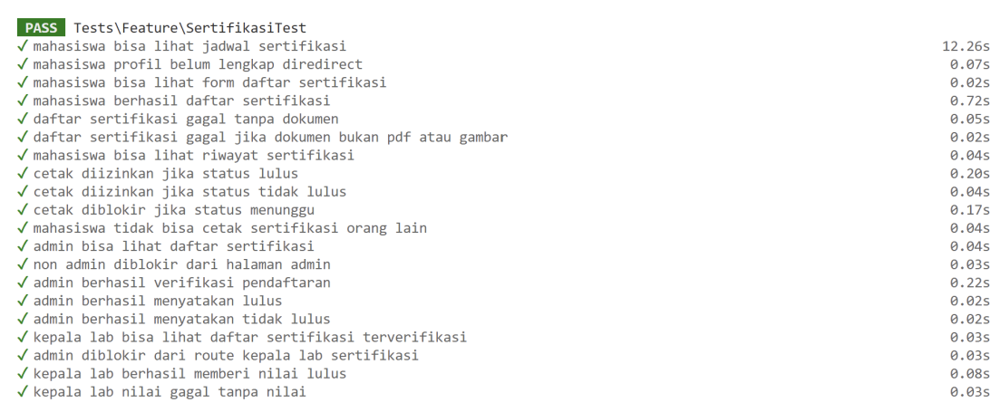

> **📷 Keterangan Gambar**: *Gambar 3. 25 Hasil Unit Testing 2 (20 tests, 20 Passed)* (Dimensi: 1103x455 px)  
> **🔍 Analisis & Arti Gambar**:  
> Gambar ini merupakan tangkapan layar (screenshot) implementasi antarmuka pengguna (UI) sistem informasi, memperlihatkan tata letak visual, form input, tabel ringkasan data, dan navigasi menu.

---

## 📄 Halaman 144

118 
 
        status = "menunggu" 
 
    REDIRECT ke halaman riwayat sertifikasi 
    TAMPILKAN pesan sukses 
END FUNCTION 
 
 
FUNCTION verifikasi(pendaftaran_id) 
    CARI data PendaftaranSertifikasi berdasarkan pendaftaran_id 
 
    GENERATE token_ujian sebanyak 6 karakter acak huruf kapital 
 
    UPDATE data PendaftaranSertifikasi 
        status = "diverifikasi" 
        token_ujian = token_ujian yang telah dibuat 
 
    REDIRECT kembali ke halaman sebelumnya 
    TAMPILKAN pesan "Diverifikasi. Token: [TOKEN]" 
END FUNCTION 
 
 
FUNCTION hasilLulus(pendaftaran_id) 
    CARI data PendaftaranSertifikasi berdasarkan pendaftaran_id 
 
    UPDATE data PendaftaranSertifikasi 
        status = "lulus" 
 
    REDIRECT kembali ke halaman sebelumnya 
    TAMPILKAN pesan konfirmasi kelulusan 
END FUNCTION 
 
 
FUNCTION hasilTidakLulus(pendaftaran_id) 
    CARI data PendaftaranSertifikasi berdasarkan pendaftaran_id 
 
    UPDATE data PendaftaranSertifikasi 
        status = "tidak_lulus" 
 
    REDIRECT kembali ke halaman sebelumnya

---

## 📄 Halaman 145

119 
 
    TAMPILKAN pesan konfirmasi tidak lulus 
END FUNCTION 
 
Tabel 3.21 di atas merupakan PseudoCode untuk Layanan sertifikasi. 
Penjelasan lebih lanjut mengenai PseudoCode tersebut disajikan pada Tabel 3.22 
berikut, yang menguraikan fungsi dalam implementasi tersebut. 
Tabel 3. 22 Penjelasan PseudoCode Sertifikasi 
Proses 
Penjelasan (Output) 
Pendaftaran 
oleh 
mahasiswa 
File berkas disimpan ke storage dan record pendaftaran 
dibuat dengan status menunggu. 
Verifikasi 
oleh 
admin 
Token ujian unik (6 karakter) digenerate secara otomatis 
dan status berubah menjadi diverifikasi. 
Pencatatan hasil 
Kepala Lab dapat menandai peserta sebagai lulus atau 
tidak_lulus setelah ujian berlangsung. 
Cetak sertifikat 
Mahasiswa dapat mencetak sertifikat hasil jika status 
sudah lulus. 
 
Gambar 3. 26 Halaman Daftar Sertifikasi

### 🖼️ Gambar pada Halaman 145

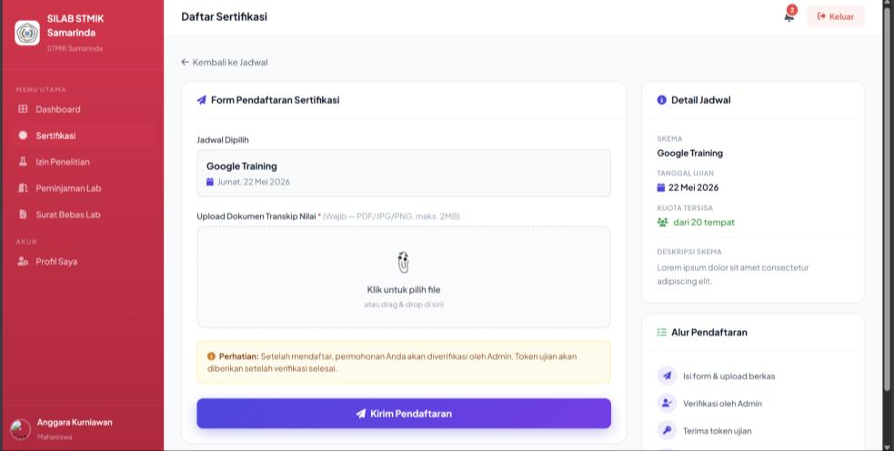

> **📷 Keterangan Gambar**: *Gambar 3. 26 Halaman Daftar Sertifikasi* (Dimensi: 983x496 px)  
> **🔍 Analisis & Arti Gambar**:  
> Gambar ini merupakan tangkapan layar (screenshot) implementasi antarmuka pengguna (UI) sistem informasi, memperlihatkan tata letak visual, form input, tabel ringkasan data, dan navigasi menu.

---

## 📄 Halaman 146

120 
 
 
Pada Gambar 3.26 menampilkan Halaman mendaftar sertifikasi, pada 
halaman sertifikasi terdapat form pendaftaran yang berisi transkrip nilai kemudian 
ada detail jadwal dan alur dari pendaftaran sertifikasi serta tombol submit.  
 
Gambar 3. 27 Halaman Manajemen Sertifikasi Admin 
 
Pada Gambar 3.27 menampilkan Halaman Manajemen Sertifikasi oleh 
Admin yang dimana Admin memasukkan Jenis Sertifikasi dan Deksripsi 
Sertifikasi. 
 
Gambar 3. 28 Halaman Menambahkan Jadwal Sertifikasi 
 
Pada Gambar 3.28 menampilkan Halaman menambahkan jadwal sertifikasi 
dan kuota dari sertifikasi

### 🖼️ Gambar pada Halaman 146

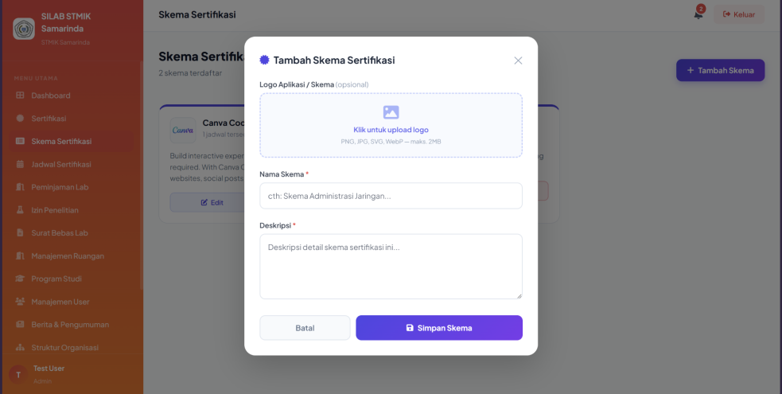

> **📷 Keterangan Gambar**: *Gambar 3.26 menampilkan Halaman mendaftar sertifikasi, pada* (Dimensi: 983x495 px)  
> **🔍 Analisis & Arti Gambar**:  
> Gambar ini merupakan tangkapan layar (screenshot) implementasi antarmuka pengguna (UI) sistem informasi, memperlihatkan tata letak visual, form input, tabel ringkasan data, dan navigasi menu.

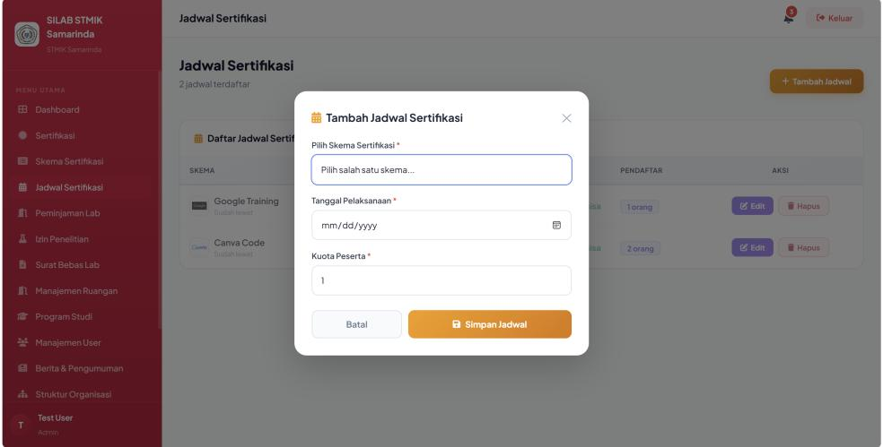

> **📷 Keterangan Gambar**: *Gambar 3. 27 Halaman Manajemen Sertifikasi Admin* (Dimensi: 984x499 px)  
> **🔍 Analisis & Arti Gambar**:  
> Gambar ini merupakan tangkapan layar (screenshot) implementasi antarmuka pengguna (UI) sistem informasi, memperlihatkan tata letak visual, form input, tabel ringkasan data, dan navigasi menu.

---

## 📄 Halaman 147

121 
 
 
Gambar 3. 29 Halaman Penilaian Kepala Lab 
 
Pada Gambar 3.29 menampilkan halaman penilaian kepala lab dengan 
memasukkan penilaian dan menentukan lulus dan tidak lulus dari mahasiswa serta 
memberikan catatan kepada mahasiswa dan tombol Submit. 
 
Gambar 3. 30 Hasil Cetak Sertifikat 
 
Fitur Pendaftaran ini merupakan solusi utama terhadap permasalahan pada 
kampus yang mengharuskan mahasiswanya mendaftar secara manual dengan 
datang ke kampus dan menyerahkan dokumen secara fisik yang dibutuhkan 
sehingga tidak terdokumentasinya berkas secara digital. Dengan adanya fitur ini, 
berkas-berkas yang diajukan mahasiswa dapat tersimpan dan terdokumentasi 
dengan baik melalui sistem. Selain itu, mahasiswa juga dapat memantau langsung

### 🖼️ Gambar pada Halaman 147

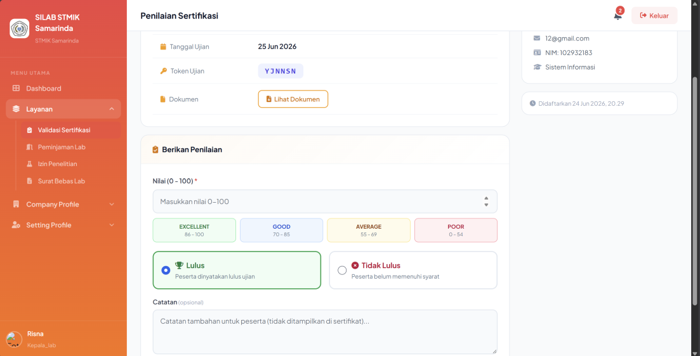

> **📷 Keterangan Gambar**: *Gambar 3. 29 Halaman Penilaian Kepala Lab* (Dimensi: 1103x562 px)  
> **🔍 Analisis & Arti Gambar**:  
> Gambar ini merupakan tangkapan layar (screenshot) implementasi antarmuka pengguna (UI) sistem informasi, memperlihatkan tata letak visual, form input, tabel ringkasan data, dan navigasi menu.

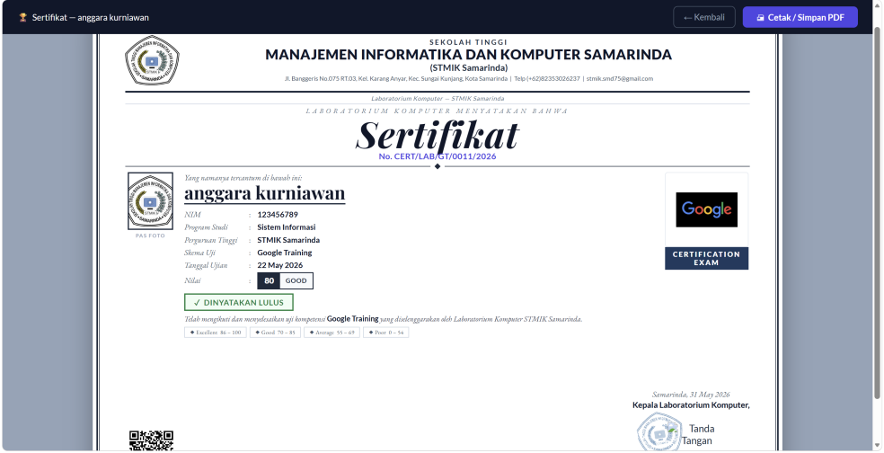

> **📷 Keterangan Gambar**: *Gambar 3.29 menampilkan halaman penilaian kepala lab dengan* (Dimensi: 984x504 px)  
> **🔍 Analisis & Arti Gambar**:  
> Gambar ini merupakan tangkapan layar (screenshot) implementasi antarmuka pengguna (UI) sistem informasi, memperlihatkan tata letak visual, form input, tabel ringkasan data, dan navigasi menu.

---

## 📄 Halaman 148

122 
 
perkembangan status pendaftaraannya melalui sistem yang menampilkan 
informasi. Dengan adanya sistem ini, mahasiswa dapat mengajukan sertifikasi dari 
mana saja secara mandiri, sehingga lebih menghemat waktu. 
 C.  
Refactor 2 
Pada tahap refactor di iterasi kedua, dilakukan pemeriksaan terhadap 
seluruh kode yang telah diimplementasikan untuk memastikan apakah ada bagian 
yang perlu diperbaiki atau disederhanakan. Setelah ditinjau, tidak ditemukan kode 
yang perlu diubah atau dioptimalkan karena semua fungsi sudah berjalan dengan 
baik dan sesuai kebutuhan. Oleh karena itu, pada iterasi ini tidak dilakukan proses 
refactoring atau pengoptimalan kode. 
3.4.4.4 System Testing 2 
Pengujian fungsionalitas sistem pada iterasi kedua dilakukan menggunakan 
metode Black Box Testing, yaitu dengan menjalankan sistem dan mengevaluasi 
apakah hasil yang diperoleh telah sesuai dengan kebutuhan yang diharapkan. Pada 
tahap System Testing iterasi kedua, pengujian dilakukan secara langsung oleh 
pengembang terhadap fitur layanan sertifikasi laboratorium pada sistem informasi 
laboratorium STMIK Samarinda. 
Pengujian dilakukan untuk memastikan bahwa proses pengelolaan jadwal 
sertifikasi, pendaftaran peserta, validasi data peserta, generate token ujian, serta 
pencetakan sertifikat dapat berjalan sesuai dengan kebutuhan sistem. Terdapat 
beberapa skenario pengujian pada iterasi kedua, dan Tabel 3.23 menampilkan salah 
satu skenario pengujian System Testing 2 pada fitur layanan sertifikasi 
laboratorium. 
Tabel 3. 23 System Testing 2 Layanan Sertifikasi Laboratorium

---

## 📄 Halaman 149

123 
 
No 
Test Case 
System Role 
System 
Navigation 
Testing 
Data 
Expected 
Result 
Status 
1 
Melakukan 
pendaftaran 
sertifikasi 
Mahasiswa 
1. Login ke 
dalam sistem  
2. Membuka 
menu sertifikasi  
3. Memilih 
jadwal 
sertifikasi  
4. Mengisi 
formulir 
pendaftaran  
5. Klik tombol 
daftar 
Data 
mahasiswa 
dan jadwal 
sertifikasi 
Sistem berhasil 
menyimpan data 
pendaftaran 
sertifikasi 
Passed 
2 
Melakukan 
verifikasi 
peserta 
sertifikasi 
Admin 
1. Login ke 
sistem  
2. Membuka 
menu verifikasi 
sertifikasi  
3. Memilih data 
peserta  
4. Klik tombol 
verifikasi 
Data 
peserta 
sertifikasi 
Sistem berhasil 
memvalidasi 
peserta 
sertifikasi 
Passed 
3 
Menginput 
hasil 
sertifikasi 
peserta 
Kepala 
Laboratoriu
m 
1. Login ke 
sistem  
2. Membuka 
menu hasil 
sertifikasi  
3. Menginput 
status kelulusan 
peserta 
Data hasil 
sertifikasi 
peserta 
Sistem berhasil 
menyimpan 
hasil sertifikasi 
peserta 
Passed 
4 
Mencetak 
sertifikat 
sertifikasi 
Mahasiswa 
1. Login ke 
sistem  
2. Membuka 
menu sertifikat  
3. Klik tombol 
cetak sertifikat 
Data 
peserta 
yang 
dinyatakan 
lulus 
Sistem berhasil 
menampilkan 
dan mencetak 
sertifikat 
Passed

---

## 📄 Halaman 150

124 
 
 
3.4.4.5 Retrospective 2 
Seluruh user Story pada iterasi keberhasil diimplementasikan. Modul 
sertifikasi telah berjalan lengkap mulai dari manajemen skema, jadwal, 
pendaftaran, verifikasi, hingga pencatatan hasil dan cetak sertifikat. 
Tabel 3. 24 Hasil Retrospective 2 
Faktor Keberhasilan 
Faktor Hambatan 
Fitur 
layanan 
sertifikasi 
yang 
dikembangkan terdapat implementasi 
CRUD sederhana. Hal ini menjadi 
faktor keberhasilan  
Hambatan pada Iterasi  ini adalah Token 
Ujian 
hanya 
untuk 
menampilkan 
Layanan dapat Berjalan sesuai dengan 
Alur Proses Bisnisnya berguna bagi 
mahasiswa dapat melakukan cetak 
sertifikasi. 
Hasil retrospective yang dilakukan bersama mitra pada tanggal 24 April 
2025 yang dihadiri oleh kepala lab membahas hasil evaluasi dari iterasi pertama 
dan iterasi kedua karena retrospective pada iterasi pertama tidak dapat 
dilaksanakan. Berdasarkan hasil evaluasi, implementasi fitur autentikasi telah 
berhasil sehingga pengguna dapat melakukan Login, registrasi, dan logout serta 
sistem mampu membedakan hak akses sesuai dengan peran (role) masing-masing. 
Selain itu, berdasarkan masukan dari mitra, ditambahkan ketentuan bahwa 
mahasiswa wajib melengkapi data profil sebelum dapat mengajukan layanan. Pada 
iterasi kedua, fitur layanan sertifikasi juga telah berhasil dikembangkan dengan 
implementasi operasi CRUD sesuai alur proses bisnis, sehingga mahasiswa dapat 
mengajukan layanan hingga mencetak sertifikat. Adapun hambatan yang ditemukan 
pada iterasi ini adalah fitur token ujian yang masih sebatas ditampilkan kepada 
pengguna dan belum diimplementasikan sebagai mekanisme validasi. 
3.4.5  Iterasi 3 Layanan Surat Bebas Laboratorium 
Iterasi ketiga berfokus pada pengembangan modul Surat Bebas 
Laboratorium. Modul ini memungkinkan mahasiswa mengajukan permohonan

---

## 📄 Halaman 151

125 
 
surat bebas lab secara daring sebagai syarat yudisium/kelulusan, dengan verifikasi 
dilakukan oleh Admin dan persetujuan akhir oleh Kepala Laboratorium. 
Tabel 3. 25 User Story Iterasi 3 
Kode 
As a 
I Want 
So That 
US-12 
Mahasiswa 
Saya ingin mengajukan 
surat bebas lab 
Saya dapat mendapatkan 
bukti 
tidak 
memiliki 
tanggungan di laboratorium 
US-13 
Admin 
Saya ingin memvalidasi 
permohonan 
surat 
bebas lab 
Saya dapat memeriksa dan 
memproses 
permohonan 
mahasiswa 
US-14 
Kepala Lab 
Saya ingin menyetujui 
atau 
menolak 
surat 
bebas lab 
Saya 
dapat 
memberikan 
keputusan 
akhir 
atas 
permohonan 
3.4.5.1 Iteration Initialization 3  
Tahap awal dari setiap iterasi dalam pengembangan sistem dimulai dengan 
proses Iteration Initialization pada iterasi ketiga bertujuan untuk memilih dan 
menentukan user Story prioritas selanjutnya yang akan difokuskan, sesuai dengan 
hasil pembagian tugas pada tahap Planning awal. Total Terdapat 3 user Story yang 
dikemabangkan pada iterasi ini ditampilkan pada Tabel Iteration Initialization 3.26  
berikut:   
Tabel 3. 26 Iteration Initialization 3 
Kode 
User Story 
Task 
Story 
Point 
US-12 
Mengajukan 
surat 
bebas lab 
Membuat halaman pengajuan dan 
riwayat surat bebas lab mahasiswa 
3 
US-13 
Memvalidasi 
permohonan 
Membuat 
halaman 
daftar 
permohonan untuk admin beserta 
aksi validasi 
2 
US-14 
Menyetujui/menolak 
Membuat 
halaman 
persetujuan 
Kepala Lab beserta fitur cetak surat 
3

---

## 📄 Halaman 152

126 
 
3.4.5.2 Design 3 
Pada tahap Design di iterasi ketiga dimulai dengan pembuatan ERD, serta 
rancangan antarmuka pengguna (user Interface) dari fitur yang akan 
dikembangkan. Desain ini mengacu pada user Story yang telah ditentukan pada 
iterasi ketiga, yaitu layanan surat bebas laboratorium untuk kebutuhan administrasi 
mahasiswa. 
A.  
Entity Relationship Diagram 3 
Gambar 3.31 di bawah ini menunjukkan Entity Relationship Diagram 
(ERD) yang dirancang untuk iterasi ketiga dalam proses pengembangan. ERD ini 
disusun berdasarkan user Story yang teah direncanakan untuk dikerjakan pada 
iterasi ketiga. 
 
   
Gambar 3. 31 ERD Iterasi 3

### 🖼️ Gambar pada Halaman 152

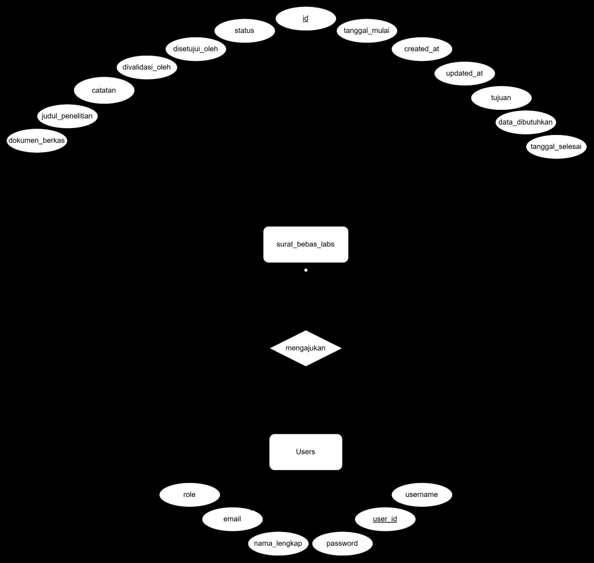

> **📷 Keterangan Gambar**: *Gambar 3.31 di bawah ini menunjukkan Entity Relationship Diagram* (Dimensi: 1032x980 px)  
> **🔍 Analisis & Arti Gambar**:  
> Gambar ini menyajikan diagram skema struktural perangkat lunak (Class Diagram / ERD) yang mendefinisikan struktur tabel/kelas, atribut kolom, method, dan relasi kardinalitas antar entitas basis data.

---

## 📄 Halaman 153

127 
 
Pada Gambar 3.31 ditunjukkan Entity Relationship Diagram (ERD) pada 
iterasi ketiga. Entitas surat_bebas_labs memiliki relasi dengan entitas users melalui 
atribut user_id yang digunakan untuk menghubungkan data pengajuan dengan 
mahasiswa yang melakukan permohonan surat bebas laboratorium. 
B.  
User Interface 3 
Berikut ini merupakan salah satu rancangan tampilan antarmuka pengguna 
(user Interface) untuk user Story yang dikerjakan pada iterasi ketiga. 
 
Gambar 3. 32 Mockup Antarmuka Surat Bebas Lab 
 Gambar 3.32 menampilkan rancangan antarmuka halaman Surat Bebas 
Laboratorium pada sistem informasi laboratorium STMIK Samarinda. Pada 
halaman ini, mahasiswa dapat melakukan pengajuan surat bebas laboratorium dan 
melihat riwayat pengajuan yang telah dilakukan. 
Antarmuka dirancang untuk menampilkan informasi status pengajuan 
secara jelas, seperti status menunggu, divalidasi, disetujui, atau ditolak. Selain itu, 
tersedia tombol cetak surat yang hanya dapat digunakan apabila pengajuan telah 
memperoleh persetujuan dari kepala laboratorium.

### 🖼️ Gambar pada Halaman 153

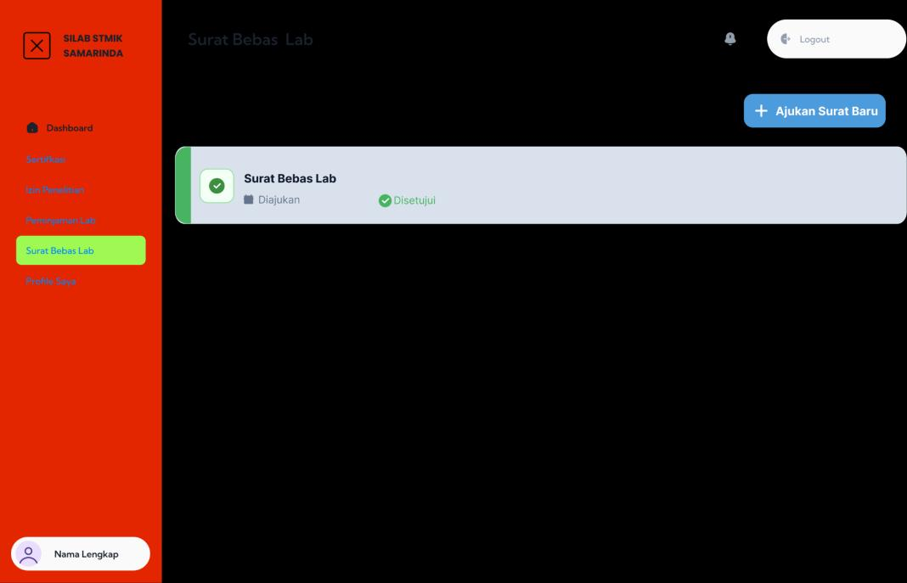

> **📷 Keterangan Gambar**: *Gambar 3.31 ditunjukkan Entity Relationship Diagram (ERD) pada* (Dimensi: 1068x687 px)  
> **🔍 Analisis & Arti Gambar**:  
> Gambar ini memuat lembar tanda tangan atau cap pengesahan resmi dari dosen pembimbing, penguji, atau koordinator program studi yang membuktikan keabsahan dokumen tugas akhir.

---

## 📄 Halaman 154

128 
 
3.4.5.3 Implementation 3 
Pada tahap Implementation di iterasi ketiga, pada fase iini, proses 
pengembangan dimulai dengan pelaksaan unit Testing  menggunakan PHPUnit 
yang tersedia dalam framework laravel. Pengujian ini betujuan untuk memasikan 
bahwa setiap fungsi dalam sistem dapat berjalan sesuai dengan yang diharapkan 
dan memenuhi tujuan dari fitur yang dikembangkan. Setelah pengujian awal 
dilakukan, pengembang mulai menulis kode program sesuai dengan kebutuhan 
fungsional sistem. Selama proses ini, dilakukan pula refactoring terhadap bagian 
kode yang dirasa kurang efisien atau sulit dipahami, guna menjaga keterbacaan 
serta kualitas kode agar lebih optimal dan mudah dikembangkan di masa 
mendatang. 
A.  
Unit Testing 3 
Pada tahap unit Testing pada iterasi ketiga, pengujian dilakukan 
menggunakan PHPUnit yang merupakan bagian dari framework Laravel. Pengujian 
ini bertujuan untuk memastikan bahwa fungsi-fungsi pada modul Surat Bebas 
Laboratorium berjalan sesuai dengan kebutuhan sistem yang telah dirancang. 
Pengujian dilakukan terhadap proses pengajuan surat bebas laboratorium oleh 
mahasiswa, validasi status pengajuan, serta proses pencetakan surat berdasarkan 
status persetujuan. Tabel 3.27  berikut menampilkan salah satu contoh kode 
pengujian unit yang dilakukan pada fitur Surat Bebas Laboratorium. Pada contoh 
ini, pengembang melakukan pengujian terhadap fitur pengajuan surat bebas 
laboratorium dan validasi akses pencetakan surat. 
Tabel 3. 27 Kode Unit Testing 3 Surat Bebas Lab 
tests/Unit/Controllers/SuratBebasLabTest.php 
001: <?php 
002: namespace Tests\Feature; 
003: use App\Models\JadwalSertifikasi; 
004: use App\Models\PendaftaranSertifikasi; 
005: use App\Models\User; 
006: use Illuminate\Foundation\Testing\RefreshDatabase; 
007: use Illuminate\Http\UploadedFile;

---

## 📄 Halaman 155

129 
 
tests/Unit/Controllers/SuratBebasLabTest.php 
008: use Illuminate\Support\Facades\Notification; 
009: use Illuminate\Support\Facades\Storage; 
010: use Tests\TestCase; 
011: class SertifikasiTest extends TestCase 
012: { 
013:     use RefreshDatabase; 
014:     protected function setUp(): void 
015:     { 
016:         parent::setUp(); 
017:         Notification::fake(); 
018:         Storage::fake('public'); 
019:     } 
020:     private function makeMahasiswa(bool $complete = true): 
User 
021:     { 
022:         /** @var User $user */ 
023:         $user = User::factory()->create([ 
024:             'role' => 'mahasiswa', 
025:             'profile_completed' => $complete, 
026:             'nim_nip' => $complete ? '20210001' : null, 
027:             'jurusan' => $complete ? 'Teknik Informatika' : 
null, 
028:             'foto_profil' => $complete ? 
'foto_profil/test.jpg' : null, 
029:         ]); 
030:         return $user; 
031:     } 
032:     public function 
test_mahasiswa_lengkap_bisa_lihat_jadwal_sertifikasi(): void 
033:     { 
034:         $this->actingAs($this->makeMahasiswa()); 
035:         $this->get(route('mahasiswa.sertifikasi.index'))-
>assertOk(); 
036:     } 
037:     public function 
test_mahasiswa_profil_belum_lengkap_diredirect_ke_profil(): void 
038:     { 
039:         $this->actingAs($this->makeMahasiswa(false));

---

## 📄 Halaman 156

130 
 
tests/Unit/Controllers/SuratBebasLabTest.php 
040:         $this->get(route('mahasiswa.sertifikasi.index')) 
041:             ->assertRedirect(route('profile.edit')); 
042:     } 
043:     public function 
test_bukan_mahasiswa_tidak_bisa_akses_halaman_sertifikasi(): 
void 
044:     { 
045:         /** @var User $dosen */ 
046:         $dosen = User::factory()->create(['role' => 
'dosen']); 
047:         $this->actingAs($dosen); 
048:         $this->get(route('mahasiswa.sertifikasi.index'))-
>assertForbidden(); 
049:     } 
050:     public function test_tamu_diredirect_ke_Login(): void 
051:     { 
052:         $this->get(route('mahasiswa.sertifikasi.index')) 
053:             ->assertRedirect(route('Login')); 
054:     } 
055:     public function 
test_mahasiswa_berhasil_daftar_ke_jadwal(): void 
056:     { 
057:         $user = $this->makeMahasiswa(); 
058:         $jadwal = JadwalSertifikasi::factory()-
>create(['kuota' => 10]); 
059:         $this->actingAs($user); 
060:         $response = $this-
>post(route('mahasiswa.sertifikasi.daftar.store', $jadwal), [ 
061:             'dokumen_berkas' => UploadedFile::fake()-
>create('berkas.pdf', 200, 'application/pdf'), 
062:         ]); 
063:         $response-
>assertRedirect(route('mahasiswa.sertifikasi.riwayat')); 
064:         $this->assertDatabaseHas('pendaftaran_sertifikasi', 
[ 
065:             'user_id' => $user->id, 
066:             'jadwal_id' => $jadwal->id, 
067:             'status' => 'menunggu',

---

## 📄 Halaman 157

131 
 
tests/Unit/Controllers/SuratBebasLabTest.php 
068:         ]); 
069:     } 
070:     public function 
test_daftar_sertifikasi_wajib_upload_dokumen(): void 
071:     { 
072:         $user = $this->makeMahasiswa(); 
073:         $jadwal = JadwalSertifikasi::factory()-
>create(['kuota' => 5]); 
074:         $this->actingAs($user); 
075:         $this-
>post(route('mahasiswa.sertifikasi.daftar.store', $jadwal), []) 
076:             ->assertSessionHasErrors(['dokumen_berkas']); 
077:     } 
078:     public function 
test_mahasiswa_bisa_lihat_riwayat_sertifikasi(): void 
079:     { 
080:         $this->actingAs($this->makeMahasiswa()); 
081:         $this->get(route('mahasiswa.sertifikasi.riwayat'))-
>assertOk(); 
082:     } 
083:     public function 
test_cetak_diizinkan_jika_status_lulus(): void 
084:     { 
085:         $user = $this->makeMahasiswa(); 
086:         $pendaftaran = PendaftaranSertifikasi::factory()-
>create([ 
087:             'user_id' => $user->id, 
088:             'status' => 'lulus', 
089:         ]); 
090:         $this->actingAs($user); 
091:         $this->get(route('mahasiswa.sertifikasi.cetak', 
$pendaftaran))->assertOk(); 
092:     } 
093:     public function 
test_cetak_diizinkan_jika_status_tidak_lulus(): void 
094:     { 
095:         $user = $this->makeMahasiswa();

---

## 📄 Halaman 158

132 
 
tests/Unit/Controllers/SuratBebasLabTest.php 
096:         $pendaftaran = PendaftaranSertifikasi::factory()-
>create([ 
097:             'user_id' => $user->id, 
098:             'status' => 'tidak_lulus', 
099:         ]); 
100:         $this->actingAs($user); 
101:         $this->get(route('mahasiswa.sertifikasi.cetak', 
$pendaftaran))->assertOk(); 
102:     } 
103:     public function 
test_cetak_diblokir_jika_status_menunggu(): void 
104:     { 
105:         $user = $this->makeMahasiswa(); 
106:         $pendaftaran = PendaftaranSertifikasi::factory()-
>create([ 
107:             'user_id' => $user->id, 
108:             'status' => 'menunggu', 
109:         ]); 
110:         $this->actingAs($user); 
111:         $this->get(route('mahasiswa.sertifikasi.cetak', 
$pendaftaran))->assertForbidden(); 
112:     } 
113:     public function 
test_cetak_diblokir_jika_status_diverifikasi(): void 
114:     { 
115:         $user = $this->makeMahasiswa(); 
116:         $pendaftaran = PendaftaranSertifikasi::factory()-
>create([ 
117:             'user_id' => $user->id, 
118:             'status' => 'diverifikasi', 
119:         ]); 
120:         $this->actingAs($user); 
121:         $this->get(route('mahasiswa.sertifikasi.cetak', 
$pendaftaran))->assertForbidden(); 
122:     } 
123:     public function 
test_mahasiswa_tidak_bisa_cetak_milik_orang_lain(): void 
124:     {

---

## 📄 Halaman 159

133 
 
tests/Unit/Controllers/SuratBebasLabTest.php 
125:         $user1 = $this->makeMahasiswa(); 
126:         $user2 = $this->makeMahasiswa(); 
127:         $pendaftaran = PendaftaranSertifikasi::factory()-
>create([ 
128:             'user_id' => $user2->id, 
129:             'status' => 'lulus', 
130:         ]); 
131:         $this->actingAs($user1); 
132:         $this->get(route('mahasiswa.sertifikasi.cetak', 
$pendaftaran))->assertForbidden(); 
133:     } 
134:     private function makeAdmin(): User 
135:     { 
136:         /** @var User $user */ 
137:         $user = User::factory()->create(['role' => 
'admin']); 
138:         return $user; 
139:     } 
140:     public function 
test_admin_bisa_lihat_daftar_pendaftaran_sertifikasi(): void 
141:     { 
142:         $this->actingAs($this->makeAdmin()); 
143:         $this->get(route('admin.sertifikasi.index'))-
>assertOk(); 
144:     } 
145:     public function 
test_non_admin_tidak_bisa_akses_sertifikasi_admin(): void 
146:     { 
147:         $mahasiswa = $this->makeMahasiswa(); 
148:         $this->actingAs($mahasiswa); 
149:         $this->get(route('admin.sertifikasi.index'))-
>assertForbidden(); 
150:     } 
151:     public function 
test_admin_berhasil_verifikasi_pendaftaran(): void 
152:     { 
153:         $admin = $this->makeAdmin();

---

## 📄 Halaman 160

134 
 
tests/Unit/Controllers/SuratBebasLabTest.php 
154:         $pendaftaran = PendaftaranSertifikasi::factory()-
>create(['status' => 'menunggu']); 
155:         $this->actingAs($admin); 
156:         $this->patch(route('admin.sertifikasi.verifikasi', 
$pendaftaran)) 
157:             ->assertRedirect(); 
158:         $this->assertDatabaseHas('pendaftaran_sertifikasi', 
[ 
159:             'id' => $pendaftaran->id, 
160:             'status' => 'diverifikasi', 
161:         ]); 
162:     } 
163:     public function 
test_admin_diblokir_dari_route_nilai_kepala_lab(): void 
164:     { 
165:         $admin = $this->makeAdmin(); 
166:         $pendaftaran = PendaftaranSertifikasi::factory()-
>create(['status' => 'diverifikasi']); 
167:         $this->actingAs($admin); 
168:         $this->patch(route('kepala_lab.sertifikasi.nilai', 
$pendaftaran), [ 
169:             'status' => 'lulus', 
170:             'nilai' => 85, 
171:         ])->assertForbidden(); 
172:     } 
173:     private function makeKepalaLab(): User 
174:     { 
175:         /** @var User $user */ 
176:         $user = User::factory()->create(['role' => 
'kepala_lab']); 
177:         return $user; 
178:     } 
179:     public function 
test_kepala_lab_bisa_lihat_daftar_sertifikasi(): void 
180:     { 
181:         $this->actingAs($this->makeKepalaLab()); 
182:         $this->get(route('kepala_lab.sertifikasi.index'))-
>assertOk();

---

## 📄 Halaman 161

135 
 
tests/Unit/Controllers/SuratBebasLabTest.php 
183:     } 
184:     public function 
test_kepala_lab_dapat_memberi_nilai_lulus(): void 
185:     { 
186:         $kepala = $this->makeKepalaLab(); 
187:         $pendaftaran = PendaftaranSertifikasi::factory()-
>create(['status' => 'diverifikasi']); 
188:         $this->actingAs($kepala); 
189:         $this->patch(route('kepala_lab.sertifikasi.nilai', 
$pendaftaran), [ 
190:             'status' => 'lulus', 
191:             'nilai' => 85, 
192:         ])->assertRedirect(); 
193:         $this->assertDatabaseHas('pendaftaran_sertifikasi', 
[ 
194:             'id' => $pendaftaran->id, 
195:             'status' => 'lulus', 
196:             'nilai' => 85, 
197:         ]); 
198:     } 
199:     public function 
test_kepala_lab_dapat_memberi_nilai_tidak_lulus(): void 
200:     { 
201:         $kepala = $this->makeKepalaLab(); 
202:         $pendaftaran = PendaftaranSertifikasi::factory()-
>create(['status' => 'diverifikasi']); 
203:         $this->actingAs($kepala); 
204:         $this->patch(route('kepala_lab.sertifikasi.nilai', 
$pendaftaran), [ 
205:             'status' => 'tidak_lulus', 
206:             'nilai' => 40, 
207:         ])->assertRedirect(); 
208:         $this->assertDatabaseHas('pendaftaran_sertifikasi', 
[ 
209:             'id' => $pendaftaran->id, 
210:             'status' => 'tidak_lulus', 
211:         ]); 
212:     }

---

## 📄 Halaman 162

136 
 
tests/Unit/Controllers/SuratBebasLabTest.php 
213:     public function test_nilai_wajib_diisi(): void 
214:     { 
215:         $kepala = $this->makeKepalaLab(); 
216:         $pendaftaran = PendaftaranSertifikasi::factory()-
>create(['status' => 'diverifikasi']); 
217:         $this->actingAs($kepala); 
218:         $this->patch(route('kepala_lab.sertifikasi.nilai', 
$pendaftaran), [ 
219:             'status' => 'lulus', 
220:         ])->assertSessionHasErrors(['nilai']); 
221:     } 
222:     public function 
test_status_nilai_harus_lulus_atau_tidak_lulus(): void 
223:     { 
224:         $kepala = $this->makeKepalaLab(); 
225:         $pendaftaran = PendaftaranSertifikasi::factory()-
>create(['status' => 'diverifikasi']); 
226:         $this->actingAs($kepala); 
227:         $this->patch(route('kepala_lab.sertifikasi.nilai', 
$pendaftaran), [ 
228:             'status' => 'menunggu', 
229:             'nilai' => 75, 
230:         ])->assertSessionHasErrors(['status']); 
231:     } 
232:     public function 
test_mahasiswa_tidak_bisa_akses_kepala_lab_sertifikasi(): void 
233:     { 
234:         $mahasiswa = $this->makeMahasiswa(); 
235:         $this->actingAs($mahasiswa); 
236:         $this->get(route('kepala_lab.sertifikasi.index'))-
>assertForbidden(); 
237:     } 
238: } 
Pengujian ini dilakukan untuk memastikan bahwa mahasiswa dapat melihat 
halaman pengajuan surat bebas laboratorium, melakukan pengajuan surat, serta 
memastikan bahwa proses pencetakan surat hanya dapat dilakukan apabila status

---

## 📄 Halaman 163

137 
 
pengajuan telah disetujui. Selain itu, pengujian juga memastikan bahwa sistem 
menolak akses pencetakan surat apabila status pengajuan masih menunggu proses 
validasi atau persetujuan.  
 
Gambar 3. 33 Hasil Unit Testing 3 (20 Tests, 20 Passed) 
Hasil pengujian pada Gambar 3.33 menunjukkan status “Pass” pada 
seluruh skenario pengujian yang dilakukan. Hal ini menunjukkan bahwa fungsi 
pada modul Surat Bebas Laboratorium telah berjalan sesuai dengan kebutuhan 
fungsional sistem.  
B.  
Code 3 
Setelah tahap unit Testing dilakukan, langkah berikutnya adalah 
pengembangan kode untuk fitur-fitur pada modul Surat Bebas Laboratorium. Pada 
tahap ini, pengembang menulis kode program untuk mengimplementasikan proses 
pengajuan surat bebas laboratorium, validasi permohonan, persetujuan kepala 
laboratorium, serta pencetakan surat secara digital sesuai dengan kebutuhan sistem 
yang telah dirancang. Implementasi 
pada 
iterasi 
ketiga 
difokuskan 
pada 
pengembangan layanan Surat Bebas Laboratorium untuk mengatasi proses 
administrasi yang sebelumnya masih dilakukan secara manual. Modul ini 
dikembangkan agar mahasiswa dapat mengajukan surat bebas laboratorium secara 
daring, sementara admin dan kepala laboratorium dapat melakukan proses validasi 
dan persetujuan secara terintegrasi melalui sistem. 
Tabel 3. 28 PseudoCode Surat Bebas Laboratorium

### 🖼️ Gambar pada Halaman 163

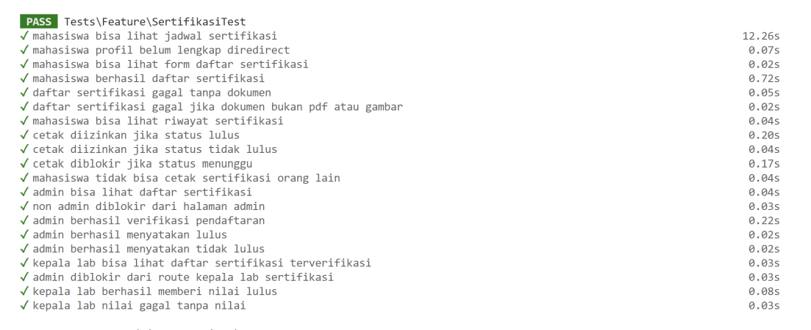

> **📷 Keterangan Gambar**: *Gambar 3. 33 Hasil Unit Testing 3 (20 Tests, 20 Passed)* (Dimensi: 1103x451 px)  
> **🔍 Analisis & Arti Gambar**:  
> Gambar ini memuat lembar tanda tangan atau cap pengesahan resmi dari dosen pembimbing, penguji, atau koordinator program studi yang membuktikan keabsahan dokumen tugas akhir.

---

## 📄 Halaman 164

138 
 
// FUNCTION: store (Pengajuan Surat Bebas Lab oleh Mahasiswa) 
// Tujuan: Mengajukan permohonan surat bebas laboratorium 
// Input: user yang sedang Login 
ambil data user yang sedang Login 
panggil SuratBebasLabService->submit(user) 
 
// Service memeriksa apakah mahasiswa memiliki tanggungan: 
 
// - Peminjaman lab yang belum selesai 
 
// - Izin penelitian yang masih aktif 
 
// - Pendaftaran sertifikasi yang belum selesai 
 
if (ada tanggungan aktif) then 
     lempar ValidationException dengan pesan spesifik 
 
end if 
 
buat SuratBebasLab baru dengan: 
     user_id = user.id 
     status  = 'menunggu' 
 
return surat yang baru dibuat 
if (terjadi ValidationException) then 
 
redirect ke halaman index dengan pesan error 
end if 
redirect ke halaman index dengan pesan sukses 
 // FUNCTION: cetak (Cetak Surat Bebas Lab) 
// Tujuan: Menghasilkan dokumen surat bebas lab yang siap cetak 
// Input: surat_id 
validasi kepemilikan: surat.user_id harus == user yang Login (403 
jika tidak) 
validasi status: surat.status harus 'disetujui' (403 jika belum) 
muat relasi user pada surat 
ambil data Kepala Lab dari tabel users (role = 'kepala_lab') 
tampilkan view cetak surat dengan data surat dan kepala_lab 
 
Tabel 3.28 di atas merupakan pseudocode untuk fungsi surat bebas lab 
Penjelasan lebih lanjut mengenai pseudocode tersebut disajikan pada Tabel 3.29 
berikut, yang menguraikan fungsi dalam implementasi tersebut 
 
Tabel 3. 29 Penjelasan PseudoCode Surat Bebas Lab 
Proses 
Penjelasan (Output)

---

## 📄 Halaman 165

139 
 
Pengajuan 
oleh 
mahasiswa 
Service memeriksa apakah mahasiswa bebas dari 
tanggungan. Jika ada tanggungan, pengajuan ditolak 
dengan pesan spesifik. 
Validasi oleh admin 
Admin memeriksa data dan mengubah status menjadi 
divalidasi. 
Persetujuan Kepala 
Lab 
Kepala Lab memberikan keputusan akhir: disetujui atau 
ditolak. 
Cetak surat 
Mahasiswa dapat mencetak surat bebas lab hanya jika 
status sudah disetujui. Surat menampilkan data 
mahasiswa dan tanda tangan Kepala Lab. 
 
Gambar 3. 34 Halaman Pengajuan Surat Bebas Lab 
 
Pada Gambar 3.34 menampilkan Halaman Pengajuan Surat Bebas Lab 
mahasiswa dapat langsung mengajukan surat bebas lab jika layanan peminjaman 
lab tidak ada peminjaman yang aktif, jika ada alur peminjaman lab belum selesai 
hingga verifikasi admin maka mahasiswa tidak dapat mengajukan surat bebas lab 
dan akan ada notifikasi harus menyelesaikan alur peminjaman laboratorium.

### 🖼️ Gambar pada Halaman 165

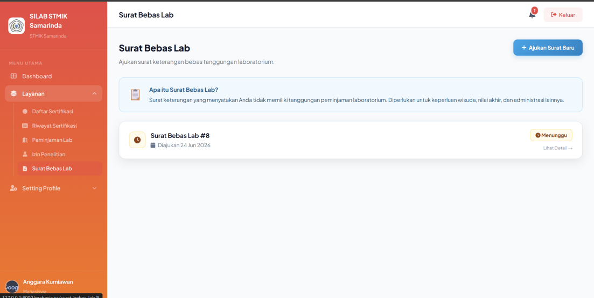

> **📷 Keterangan Gambar**: *Gambar 3. 34 Halaman Pengajuan Surat Bebas Lab* (Dimensi: 1103x555 px)  
> **🔍 Analisis & Arti Gambar**:  
> Gambar ini memuat lembar tanda tangan atau cap pengesahan resmi dari dosen pembimbing, penguji, atau koordinator program studi yang membuktikan keabsahan dokumen tugas akhir.

---

## 📄 Halaman 166

140 
 
 
Gambar 3. 35 Halaman Verifikasi Surat Bebas Lab Admin 
 
Pada Gambar 3.35 menampilkan Halaman verifikasi Admin bahwa 
mahasiswa tidak memiliki tanggungan peminjaman laboratorium atau masih ada 
tanggungan. 
 
Gambar 3. 36 Halaman Persetujuan Kepala Lab 
 
Pada Gambar 3.36 menampilkan Halaman Persetujuan Kepala Lab sehingga 
dapat memberikan feedback kepada mahasiswa bahwa proses pengajuan alur surat 
bebas lab telah selesai dan mahasiswa dapat menctak surat bebas lab. 
Fitur Pengajuan Surat bebas lab ini merupakan solusi dari permasalahan 
pada kampus yaitu tidak terdokumentasinya data-data peminjaman lab sehingga ada

### 🖼️ Gambar pada Halaman 166

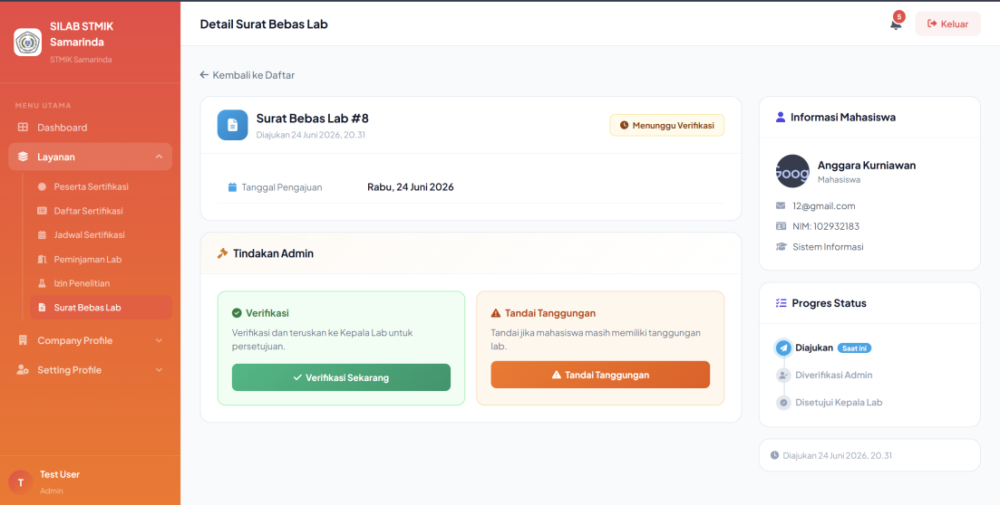

> **📷 Keterangan Gambar**: *Gambar 3. 35 Halaman Verifikasi Surat Bebas Lab Admin* (Dimensi: 1103x558 px)  
> **🔍 Analisis & Arti Gambar**:  
> Gambar ini memuat lembar tanda tangan atau cap pengesahan resmi dari dosen pembimbing, penguji, atau koordinator program studi yang membuktikan keabsahan dokumen tugas akhir.

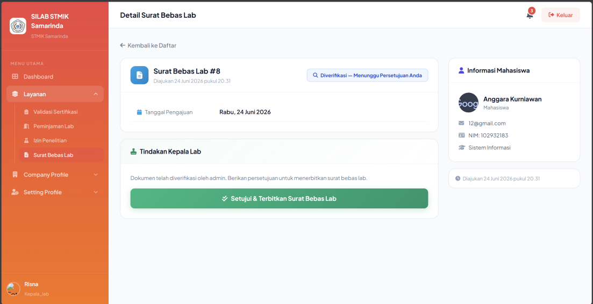

> **📷 Keterangan Gambar**: *Gambar 3.35 menampilkan Halaman verifikasi Admin bahwa* (Dimensi: 1103x566 px)  
> **🔍 Analisis & Arti Gambar**:  
> Gambar ini memuat lembar tanda tangan atau cap pengesahan resmi dari dosen pembimbing, penguji, atau koordinator program studi yang membuktikan keabsahan dokumen tugas akhir.

---

## 📄 Halaman 167

141 
 
kekurangan infomasi bagi mahasiswa yang mebutuhkan surat bebas lab untuk 
keperluan administrasi, Dengan adanya fitur ini, data-data peminjaman dapat 
terdokumentasi dengan baik sehingga tidak adanya miss informasi antara admin 
dan mahasiswa. Selain itu,  mahasiswa juga dapat memantau langsung 
perkembangan status pengajuannya melalui sistem yang menampilkan informasi. 
Dengan adanya sistem ini, mahasiswa dapat mengajukan sertifikasi dari mana saja 
secara mandiri, sehingga lebih menghemat waktu. 
 C.  
Refactor 
Pada tahap refactor di iterasi ketiga, dilakukan pemeriksaan terhadap 
seluruh kode yang telah diimplementasikan untuk memastikan apakah ada bagian 
yang perlu diperbaiki atau disederhanakan. Setelah ditinjau, tidak ditemukan kode 
yang perlu diubah atau dioptimalkan karena semua fungsi sudah berjalan dengan 
baik dan sesuai kebutuhan. Oleh karena itu, pada iterasi ini tidak dilakukan proses 
refactoring atau pengoptimalan kode. 
3.4.5.4 System Testing 3 
Pengujian fungsionalitas sistem pada iterasi ketiga dilakukan menggunakan 
metode Black Box Testing, yaitu dengan menjalankan sistem dan mengevaluasi 
apakah hasil yang diperoleh telah sesuai dengan kebutuhan yang diharapkan. Pada 
tahap System Testing iterasi ketiga, pengujian dilakukan secara langsung oleh 
pengembang terhadap fitur layanan Surat Bebas Laboratorium pada sistem 
informasi laboratorium STMIK Samarinda. 
Pengujian dilakukan untuk memastikan bahwa proses pengajuan surat bebas 
laboratorium, validasi permohonan oleh admin, persetujuan oleh kepala 
laboratorium, serta proses pencetakan surat dapat berjalan sesuai dengan kebutuhan 
sistem. Selain itu, pengujian juga dilakukan untuk memastikan bahwa mahasiswa 
yang masih memiliki tanggungan laboratorium tidak dapat mengajukan surat bebas 
laboratorium. Tabel 3.30 menampilkan salah satu skenario pengujian System 
Testing 3 pada fitur layanan Surat Bebas Laboratorium.

---

## 📄 Halaman 168

142 
 
Tabel 3. 30 System Testing 3  Surat Bebas Laboratorium 
No 
Test Case 
System Role 
System 
Navigation 
Testing 
Data 
Expected 
Result 
Status 
1 
Mengajukan 
surat bebas 
laboratorium 
Mahasiswa 
1. Login ke 
sistem  
2. Membuka 
menu Surat 
Bebas 
Laboratorium 
3. Klik 
tombol 
ajukan  
4. 
Konfirmasi 
pengajuan 
Data 
mahasiswa 
tanpa 
tanggungan 
laboratorium 
Sistem berhasil 
menyimpan 
pengajuan surat 
bebas 
laboratorium 
Passed 
2 
Pengajuan 
ditolak 
karena 
masih 
memiliki 
tanggungan 
Mahasiswa 
1. Login ke 
sistem  
2. Membuka 
menu Surat 
Bebas 
Laboratorium  
3.Klik 
tombol 
ajukan 
Data 
mahasiswa 
dengan 
tanggungan 
aktif 
Sistem menolak 
pengajuan dan 
menampilkan 
pesan validasi 
Passed 
3 
Memvalidas
i pengajuan 
surat bebas 
laboratorium 
Admin 
1. Login ke 
sistem  
2. Membuka 
halaman 
daftar 
pengajuan 
Data 
pengajuan 
surat bebas 
laboratorium 
Sistem berhasil 
mengubah 
status pengajuan 
menjadi 
divalidasi 
Passed

---

## 📄 Halaman 169

143 
 
No 
Test Case 
System Role 
System 
Navigation 
Testing 
Data 
Expected 
Result 
Status 
3. Memilih 
data 
pengajuan  
4. Klik 
tombol 
validasi 
4 
Menyetujui 
pengajuan 
surat bebas 
laboratorium 
Kepala 
Laboratorium 
1. Login ke 
sistem  
2. Membuka 
halaman 
persetujuan 
3. Memilih 
data 
pengajuan  
4. Klik 
tombol 
setujui 
Data 
pengajuan 
yang telah 
divalidasi 
Sistem berhasil 
mengubah 
status menjadi 
disetujui 
Passed 
5 
Menolak 
pengajuan 
surat bebas 
laboratorium 
Kepala 
Laboratorium 
1. Login ke 
sistem  
2. Membuka 
halaman 
persetujuan  
3. Memilih 
data 
pengajuan  
4. Klik 
tombol tolak 
Data 
pengajuan 
surat bebas 
laboratorium 
Sistem berhasil 
mengubah 
status pengajuan 
menjadi ditolak 
Passed

---

## 📄 Halaman 170

144 
 
No 
Test Case 
System Role 
System 
Navigation 
Testing 
Data 
Expected 
Result 
Status 
6 
Mencetak 
surat bebas 
laboratorium 
Mahasiswa 
1. Login ke 
sistem  
2. Membuka 
riwayat surat 
bebas 
laboratorium 
3. Klik 
tombol cetak 
surat 
Data surat 
dengan 
status 
disetujui 
Sistem berhasil 
menampilkan 
dokumen surat 
bebas 
laboratorium 
Passed 
3.4.5.5 Retrospective 3 
Seluruh user Story iterasi ketiga (US-11 hingga US-13) berhasil 
diimplementasikan. Fitur Surat Bebas Lab berjalan lengkap dengan alur berjenjang 
dari mahasiswa ke admin ke kepala lab. 
Tabel 3. 31 Hasil Retrospective 3 
Faktor Keberhasilan 
Faktor Hambatan 
Pada Iterasi ini Layanan Surat Bebas 
Lab berhasil dikembangkan dengan 
alur 
pengajuan, 
verifikasi 
admin, 
persetujuan kepala laboratorium, dan 
cetak surat. 
Hambatan pada iterasi ini terdapat 
pada proses pemeriksaan tanggungan 
peminjaman lab mahasiswa. Pada 
iterasi 
3, 
layanan 
peminjaman 
laboratorium belum dikembangkan. 
Oleh karena itu, pemeriksaan pada 
iterasi ini masih disesuaikan dengan 
data layanan yang sudah tersedia, dan 
akan dilengkapi kembali pada iterasi 
berikutnya setelah modul peminjaman 
lab selesai dikembangkan.

---

## 📄 Halaman 171

145 
 
 
Kemudian, Retrospective pada iterasi ketiga tidak dapat dilakukan karena 
pihak mitra berhalangan hadir pada jadwal yang telah ditentukan. Mengingat 
cakupan pengembangan pada iterasi ketiga hanya meliputi fitur Surat Bebas 
Laboratorium, maka evaluasi hasil iterasi ketiga akan dilaksanakan bersamaan pada 
tahap retrospective berikutnya. Oleh karena itu, proses pengembangan dapat 
langsung dilanjutkan ke iterasi berikutnya tanpa menghambat jalannya proyek. 
3.4.6 Iterasi 4 Layanan Izin Penelitian 
Iterasi keempat berfokus pada pengembangan layanan Izin Penelitian. 
Layanan ini memfasilitasi mahasiswa yang ingin melakukan penelitian Tugas Akhir 
di laboratorium untuk mengajukan permohonan izin secara daring, dengan proses 
verifikasi oleh Admin dan persetujuan akhir oleh Kepala Laboratorium. 
Tabel 3. 32 User Story Iterasi 4 
Kode 
As a 
I Want 
So That 
US-15 
Mahasiswa 
dan Dosen 
Saya ingin mengajukan 
izin 
penelitian 
di 
laboratorium 
Saya 
dapat 
melakukan 
riset/TA 
di 
fasilitas 
laboratorium/eksternal 
secara resmi 
US-16 
Admin 
Saya 
ingin 
memverifikasi 
permohonan 
izin 
penelitian 
Saya 
dapat 
memeriksa 
kelengkapan 
berkas 
permohonan 
US-17 
Kepala Lab 
Saya ingin menyetujui 
atau 
menolak 
izin 
penelitian 
Saya 
dapat 
memberikan 
keputusan 
akhir 
atas 
permohonan penelitian 
3.4.6.1 Iteration Initialization 4  
 
Tahap awal dari setiap iterasi dalam pengembangan sistem dimulai dengan 
proses Iteration initialization. Pada tahap ini, pengembang menentukan fitur-fitur

---

## 📄 Halaman 172

146 
 
yang akan dikerjakan serta menyusun daftar tugas yang perlu diselesaikan selama 
iterasi. Untuk iterasi keempat, fitur yang dipilih difokuskan pada proses layanan 
izin penelitian, sesuai dengan prioritas fungsional yang telah direncanakan. Total 
terdapat 3 user Story yang dikembangkan pada iterasi ini, sebagaimana ditampilkan 
pada Tabel 3.33. 
Tabel 3. 33 Iteration Initialization 4 
Kode 
User Story 
Task 
Story 
Point 
US-15 
Mengajukan 
izin 
penelitian 
Membuat form pengajuan (judul, 
tujuan, berkas, data dibutuhkan) dan 
halaman riwayat 
3 
US-16 
Memverifikasi 
permohonan 
Membuat 
halaman 
daftar 
permohonan admin dengan aksi 
verifikasi/tolak 
2 
US-17 
Menyetujui/menolak 
Membuat 
halaman 
persetujuan 
Kepala Lab dengan fitur cetak surat 
izin 
3 
  
3.4.6.2 Design 4 
Pada tahap Design di iterasi keempat dimulai dengan pembuatan ERD, serta 
ancangan antarmuka pengguna (user Interface) dan fitur-fitur yang akan 
dikembangkan. Desain ini mengacu pada user Story yang telah ditentukan pada 
iterasi keempat, yaitu layanan izin penelitian, melakukan pengajuan dan verifikasi 
pengajuan, persetujuan perizinan dan cetak surat 
A.  
Entity Relationship Diagram 4 
Gambar 3.37 di bawah ini menunjukkan Entity Relationship Diagram 
(ERD) yang dirancang untuk iterasi keempat dalam proses pengembangan. ERD ini

---

## 📄 Halaman 173

147 
 
disusun berdasarkan user Story  yang telah direncanakan untuk dikerjakan pada 
iterasi keemapt. Pada iterasi ini, tditambahkan entitas izin_penelian yang digunakan 
untuk menyimpan data permohonan yang diajukan oleh mahasiswa maupun dosen.  
 
Gambar 3. 37 ERD Iterasi 4 
Entitas izin_penelitians memiliki atribut id, user_id, judul_penelitian, 
tujuan, dokumen_berkas, data_dibutuhkan, status, catatan, dan timestamps. Entitas 
ini memiliki relasi many-to-one dengan entitas users melalui foreign key user_id, 
yang digunakan untuk menghubungkan data pengajuan izin penelitian dengan 
pengguna yang melakukan permohonan. 
B.  
User Interface 4 
Berikut ini merupakan salah satu rancangan tampilan antarmuka pengguna 
(user Interface) untuk user Story yang dikerjakan pada iterasi keempat.

### 🖼️ Gambar pada Halaman 173

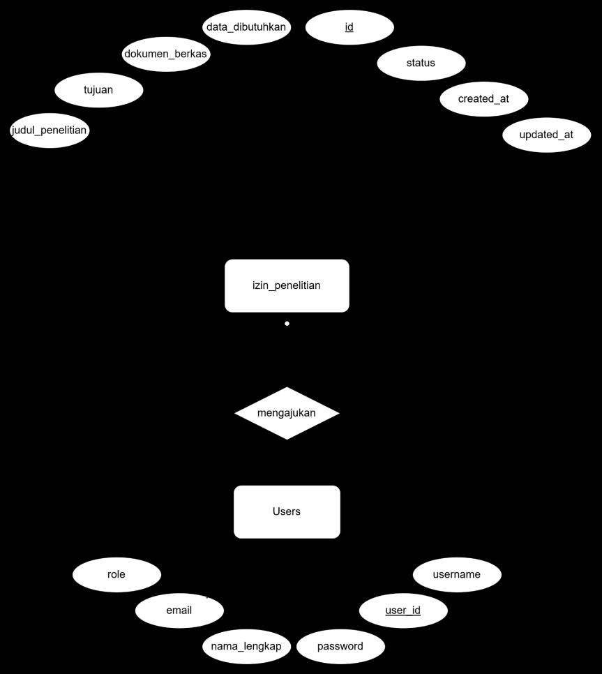

> **📷 Keterangan Gambar**: *Gambar 3. 37 ERD Iterasi 4* (Dimensi: 863x966 px)  
> **🔍 Analisis & Arti Gambar**:  
> Gambar ini menyajikan diagram skema struktural perangkat lunak (Class Diagram / ERD) yang mendefinisikan struktur tabel/kelas, atribut kolom, method, dan relasi kardinalitas antar entitas basis data.

---

## 📄 Halaman 174

148 
 
 
Gambar 3. 38 Mockup Antarmuka Pengajuan Izin Penelitian 
 
Gambar 3.38 merupakan mockup antarmuka halaman pengajuan izin 
penelitian, yang merupakan antarmuka yang memungkinkan pengguna untuk 
mengajukan izin penelitian. Pada halaman ini terdapat form input file yang 
disesuaikan dengan jenis berkas yang perlu diajukan terkati penelitian, karena pada 
proses ini jika pengguna berhasil melakukan pengajuan, form input akan berubah 
menjadi status “Menunggu Diverifikasi” menandakan bahwa berkas tersebut telah 
diajukan oleh mahasiswa/pengguna. 
3.4.6.3 Implementation 4 
Tahap Implementation merupakan langkah untuk merealisasikan rancangan 
sistem yang telah disusun pada tahap planning sebelumnya. Paa fase ini, poses 
pengembangan dimulai dengna pelaksaan unit Testing menggunakan PHPUnit 
yang tersedia framerwork Laravel. Pengujian ini bertujuan untuk memastikan 
bahwa setiap fungsi dalam sistem dapat berjalan sesaui dengan yang diharapkan 
dan memenuhi tujuan dari fitur yang dikembangkan. Setelah pengujian awal 
dilakukan, pengembang mulai menulis kode pogram sesuai dengan kebutuhan 
fungsional sistem. Selama proses ini, dilakukan pula refactoring terhadap bagian-
bagian kode yang dirasa kurang efisien atau sulit dipahami, guna menjaga

### 🖼️ Gambar pada Halaman 174

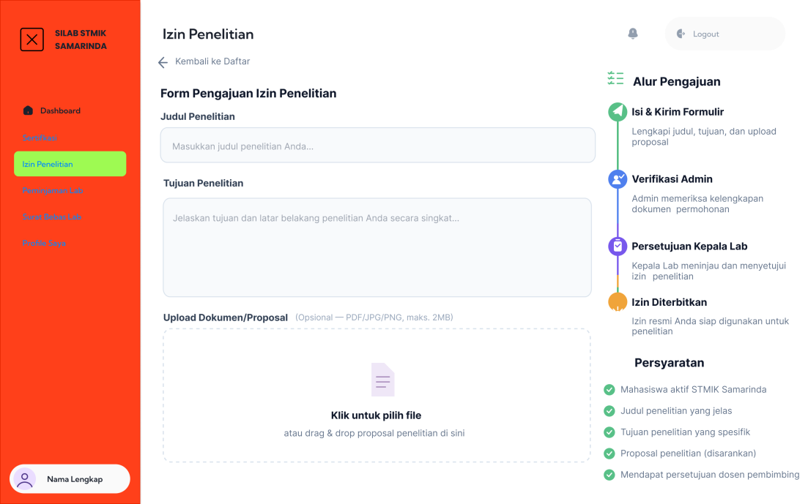

> **📷 Keterangan Gambar**: *Gambar 3. 38 Mockup Antarmuka Pengajuan Izin Penelitian* (Dimensi: 1103x689 px)  
> **🔍 Analisis & Arti Gambar**:  
> Gambar ini merupakan tangkapan layar (screenshot) implementasi antarmuka pengguna (UI) sistem informasi, memperlihatkan tata letak visual, form input, tabel ringkasan data, dan navigasi menu.

---

## 📄 Halaman 175

149 
 
keterbacaan serta kuaitas kode agar lebih optimal dan mudah dikembangkan dimasa 
mendatang. 
A. Unit Testing 4 
Pada tahap unit Testing pada iterasi keempat, pengujian dilakukan 
menggunakan PHPUnit uyang merupakan bagian dari framework laravel. 
Pengujian ini dilakukan untuk memastikan bahwa fungsi-fungsi dalam sistem 
berjalan dengan benar dan sesuai dengan kebutuhan yang telah dirancang. Tabel 
berikut menampilkan salah satu contoh kode pengajuan unit yang dilakukan pada 
iterasi keempat. 
Tabel 3. 34 Kode Unit Testing 4 Izin Penelitian 
tests/Unit/Controllers/IzinPenelitianTest.php 
001: <?php 
002: namespace Tests\Feature; 
003: use App\Models\IzinPenelitian; 
004: use App\Models\User; 
005: use Illuminate\Foundation\Testing\RefreshDatabase; 
006: use Illuminate\Http\UploadedFile; 
007: use Illuminate\Support\Facades\Notification; 
008: use Illuminate\Support\Facades\Storage; 
009: use Tests\TestCase; 
010: class IzinPenelitianTest extends TestCase 
011: { 
012:     use RefreshDatabase; 
013:     protected function setUp(): void 
014:     { 
015:         parent::setUp(); 
016:         Notification::fake(); 
017:         Storage::fake('public'); 
018:     } 
019:     private function makeMahasiswa(bool $complete = true): 
User 
020:     { 
021:         /** @var User $user */ 
022:         $user = User::factory()->create([ 
023:             'role'              => 'mahasiswa',

---

## 📄 Halaman 176

150 
 
tests/Unit/Controllers/IzinPenelitianTest.php 
024:             'profile_completed' => $complete, 
025:             'nim_nip'           => $complete ? '20210001' : 
null, 
026:             'jurusan'           => $complete ? 'Teknik 
Informatika' : null, 
027:             'foto_profil'       => $complete ? 
'foto_profil/test.jpg' : null, 
028:         ]); 
029:         return $user; 
030:     } 
031:     private function makeAdmin(): User 
032:     { 
033:         /** @var User $user */ 
034:         $user = User::factory()->create(['role' => 
'admin']); 
035:         return $user; 
036:     } 
037:     private function makeKepalaLab(): User 
038:     { 
039:         /** @var User $user */ 
040:         $user = User::factory()->create(['role' => 
'kepala_lab']); 
041:         return $user; 
042:     } 
043:     public function 
test_mahasiswa_bisa_akses_halaman_izin_penelitian(): void 
044:     { 
045:         $this->actingAs($this->makeMahasiswa()); 
046:         $this->get(route('mahasiswa.izin-
penelitian.index'))->assertOk(); 
047:     } 
048:     public function 
test_mahasiswa_profil_belum_lengkap_diredirect(): void 
049:     { 
050:         $this->actingAs($this->makeMahasiswa(false)); 
051:         $this->get(route('mahasiswa.izin-
penelitian.index'))

---

## 📄 Halaman 177

151 
 
tests/Unit/Controllers/IzinPenelitianTest.php 
052:             ->assertRedirect(route('profile.edit')); 
053:     } 
054:     public function 
test_mahasiswa_berhasil_ajukan_izin_penelitian(): void 
055:     { 
056:         $user = $this->makeMahasiswa(); 
057:         $this->actingAs($user); 
058:         $response = $this->post(route('mahasiswa.izin-
penelitian.store'), [ 
059:             'judul_penelitian' => 'Penelitian Sistem 
Informasi', 
060:             'tujuan'           => 'Untuk keperluan 
penelitian Tugas Akhir.', 
061:             'dokumen_berkas'   => UploadedFile::fake()-
>create('proposal.pdf', 200, 'application/pdf'), 
062:         ]); 
063:         $response->assertRedirect(); 
064:         $this->assertDatabaseHas('izin_penelitian', [ 
065:             'user_id' => $user->id, 
066:             'status'  => 'menunggu', 
067:         ]); 
068:     } 
069:     public function test_ajukan_izin_gagal_tanpa_judul(): 
void 
070:     { 
071:         $this->actingAs($this->makeMahasiswa()); 
072:         $this->post(route('mahasiswa.izin-
penelitian.store'), [ 
073:             'tanggal_mulai'   => now()->addDay()-
>toDateString(), 
074:             'tanggal_selesai' => now()->addDays(7)-
>toDateString(), 
075:             'deskripsi'       => 'Deskripsi.', 
076:         ])->assertSessionHasErrors(['judul_penelitian']); 
077:     } 
078:     public function test_ajukan_izin_gagal_tanpa_tujuan(): 
void

---

## 📄 Halaman 178

152 
 
tests/Unit/Controllers/IzinPenelitianTest.php 
079:     { 
080:         $this->actingAs($this->makeMahasiswa()); 
081:         $this->post(route('mahasiswa.izin-
penelitian.store'), [ 
082:             'judul_penelitian' => 'Judul', 
083:         ])->assertSessionHasErrors(['tujuan']); 
084:     } 
085:     public function 
test_mahasiswa_bisa_lihat_detail_izin_sendiri(): void 
086:     { 
087:         $user = $this->makeMahasiswa(); 
088:         $izin = IzinPenelitian::factory()-
>create(['user_id' => $user->id]); 
089:         $this->actingAs($user); 
090:         $this->get(route('mahasiswa.izin-penelitian.show', 
$izin))->assertOk(); 
091:     } 
092:     public function 
test_mahasiswa_tidak_bisa_lihat_izin_orang_lain(): void 
093:     { 
094:         $user1 = $this->makeMahasiswa(); 
095:         $user2 = $this->makeMahasiswa(); 
096:         $izin  = IzinPenelitian::factory()-
>create(['user_id' => $user2->id]); 
097:         $this->actingAs($user1); 
098:         $this->get(route('mahasiswa.izin-penelitian.show', 
$izin))->assertForbidden(); 
099:     } 
100:     public function 
test_cetak_diizinkan_jika_status_disetujui(): void 
101:     { 
102:         $user = $this->makeMahasiswa(); 
103:         $izin = IzinPenelitian::factory()->create([ 
104:             'user_id' => $user->id, 
105:             'status'  => 'disetujui' 
106:         ]); 
107:         $this->actingAs($user);

---

## 📄 Halaman 179

153 
 
tests/Unit/Controllers/IzinPenelitianTest.php 
108:         $this->get(route('mahasiswa.izin-penelitian.cetak', 
$izin))->assertOk(); 
109:     } 
110:     public function 
test_cetak_diblokir_jika_masih_menunggu(): void 
111:     { 
112:         $user = $this->makeMahasiswa(); 
113:         $izin = IzinPenelitian::factory()->create([ 
114:             'user_id' => $user->id, 
115:             'status'  => 'menunggu' 
116:         ]); 
117:         $this->actingAs($user); 
118:         $this->get(route('mahasiswa.izin-penelitian.cetak', 
$izin))->assertForbidden(); 
119:     } 
120:     public function test_cetak_diblokir_jika_ditolak(): 
void 
121:     { 
122:         $user = $this->makeMahasiswa(); 
123:         $izin = IzinPenelitian::factory()->create([ 
124:             'user_id' => $user->id, 
125:             'status'  => 'ditolak' 
126:         ]); 
127:         $this->actingAs($user); 
128:         $this->get(route('mahasiswa.izin-penelitian.cetak', 
$izin))->assertForbidden(); 
129:     } 
130:     public function 
test_mahasiswa_tidak_bisa_cetak_izin_orang_lain(): void 
131:     { 
132:         $user1 = $this->makeMahasiswa(); 
133:         $user2 = $this->makeMahasiswa(); 
134:         $izin  = IzinPenelitian::factory()->create([ 
135:             'user_id' => $user2->id, 
136:             'status'  => 'disetujui' 
137:         ]); 
138:         $this->actingAs($user1);

---

## 📄 Halaman 180

154 
 
tests/Unit/Controllers/IzinPenelitianTest.php 
139:         $this->get(route('mahasiswa.izin-penelitian.cetak', 
$izin))->assertForbidden(); 
140:     } 
141:     public function 
test_admin_bisa_lihat_daftar_izin_penelitian(): void 
142:     { 
143:         $this->actingAs($this->makeAdmin()); 
144:         $this->get(route('admin.izin-penelitian.index'))-
>assertOk(); 
145:     } 
146:     public function 
test_non_admin_diblokir_dari_halaman_admin(): void 
147:     { 
148:         /** @var User $dosen */ 
149:         $dosen = User::factory()->create(['role' => 
'dosen']); 
150:         $this->actingAs($dosen); 
151:         $this->get(route('admin.izin-penelitian.index'))-
>assertForbidden(); 
152:     } 
153:     public function test_admin_berhasil_verifikasi_izin(): 
void 
154:     { 
155:         $admin = $this->makeAdmin(); 
156:         $izin  = IzinPenelitian::factory()-
>create(['status' => 'menunggu']); 
157:         $this->actingAs($admin); 
158:         $this->post(route('admin.izin-
penelitian.verifikasi', $izin))->assertRedirect(); 
159:         $this->assertDatabaseHas('izin_penelitian', [ 
160:             'id'     => $izin->id, 
161:             'status' => 'diverifikasi', 
162:         ]); 
163:     } 
164:     public function 
test_admin_berhasil_tolak_izin_dengan_catatan(): void 
165:     {

---

## 📄 Halaman 181

155 
 
tests/Unit/Controllers/IzinPenelitianTest.php 
166:         $admin = $this->makeAdmin(); 
167:         $izin  = IzinPenelitian::factory()-
>create(['status' => 'menunggu']); 
168:         $this->actingAs($admin); 
169:         $this->post(route('admin.izin-penelitian.tolak', 
$izin), [ 
170:             'catatan_verifikasi' => 'Dokumen tidak 
lengkap.', 
171:         ])->assertRedirect(); 
172:         $this->assertDatabaseHas('izin_penelitian', [ 
173:             'id'     => $izin->id, 
174:             'status' => 'ditolak', 
175:         ]); 
176:     } 
177:     public function 
test_admin_tolak_gagal_tanpa_catatan_verifikasi(): void 
178:     { 
179:         $admin = $this->makeAdmin(); 
180:         $izin  = IzinPenelitian::factory()-
>create(['status' => 'menunggu']); 
181:         $this->actingAs($admin); 
182:         $this->post(route('admin.izin-penelitian.tolak', 
$izin), []) 
183:             -
>assertSessionHasErrors(['catatan_verifikasi']); 
184:     } 
185:     public function 
test_admin_bisa_lihat_detail_izin_penelitian(): void 
186:     { 
187:         $izin = IzinPenelitian::factory()->create(); 
188:         $this->actingAs($this->makeAdmin()); 
189:         $this->get(route('admin.izin-penelitian.show', 
$izin))->assertOk(); 
190:     } 
191:     public function 
test_kepala_lab_bisa_lihat_daftar_izin_penelitian(): void 
192:     {

---

## 📄 Halaman 182

156 
 
tests/Unit/Controllers/IzinPenelitianTest.php 
193:         $this->actingAs($this->makeKepalaLab()); 
194:         $this->get(route('kepala_lab.izin-
penelitian.index'))->assertOk(); 
195:     } 
196:     public function 
test_admin_diblokir_dari_route_kepala_lab_izin(): void 
197:     { 
198:         $this->actingAs($this->makeAdmin()); 
199:         $this->get(route('kepala_lab.izin-
penelitian.index'))->assertForbidden(); 
200:     } 
201:     public function 
test_kepala_lab_berhasil_setujui_izin(): void 
202:     { 
203:         $kepala = $this->makeKepalaLab(); 
204:         $izin   = IzinPenelitian::factory()-
>create(['status' => 'diverifikasi']); 
205:         $this->actingAs($kepala); 
206:         $this->post(route('kepala_lab.izin-
penelitian.setujui', $izin))->assertRedirect(); 
207:         $this->assertDatabaseHas('izin_penelitian', [ 
208:             'id'     => $izin->id, 
209:             'status' => 'disetujui', 
210:         ]); 
211:     } 
212:     public function 
test_kepala_lab_berhasil_tolak_izin_dengan_catatan(): void 
213:     { 
214:         $kepala = $this->makeKepalaLab(); 
215:         $izin   = IzinPenelitian::factory()-
>create(['status' => 'diverifikasi']); 
216:         $this->actingAs($kepala); 
217:         $this->post(route('kepala_lab.izin-
penelitian.tolak', $izin), [ 
218:             'catatan_verifikasi' => 'Judul tidak sesuai 
bidang.', 
219:         ])->assertRedirect();

---

## 📄 Halaman 183

157 
 
tests/Unit/Controllers/IzinPenelitianTest.php 
220:         $this->assertDatabaseHas('izin_penelitian', [ 
221:             'id'     => $izin->id, 
222:             'status' => 'ditolak', 
223:         ]); 
224:     } 
225:     public function 
test_kepala_lab_tolak_gagal_tanpa_catatan_verifikasi(): void 
226:     { 
227:         $kepala = $this->makeKepalaLab(); 
228:         $izin   = IzinPenelitian::factory()-
>create(['status' => 'diverifikasi']); 
229:         $this->actingAs($kepala); 
230:         $this->post(route('kepala_lab.izin-
penelitian.tolak', $izin), []) 
231:             -
>assertSessionHasErrors(['catatan_verifikasi']); 
232:     } 
233:     public function 
test_kepala_lab_tidak_bisa_setujui_izin_masih_menunggu(): void 
234:     { 
235:         $kepala = $this->makeKepalaLab(); 
236:         $izin   = IzinPenelitian::factory()-
>create(['status' => 'menunggu']); 
237:         $this->actingAs($kepala); 
238:         $this->post(route('kepala_lab.izin-
penelitian.setujui', $izin))->assertRedirect(); 
239:         $this->assertDatabaseHas('izin_penelitian', [ 
240:             'id'     => $izin->id, 
241:             'status' => 'menunggu', 
242:         ]); 
243:     } 
244: } 
Pengujian ini dilakukan untuk memastikan bahwa setiap fungsi dalam 
proses layanan izin penelitian berjalan sesuai dengan harapan. Berbagai skenario 
diuji, seperti menampilkan halaman pengajuan, menerima dan menolak pengajuan,

---

## 📄 Halaman 184

158 
 
memverifikasi berkas pengajuan,  menyetujui pengajuan dan cetak surat izin 
penelitian. 
 
Gambar 3. 39 Hasil Unit Testing 4 (23 Test, 23 Passed) 
Hasil pengujian pada gambar 3.39 di atas menunjukkan status “Pass” pada 
seluruh skema uji yang dibuat, yang menandakan bahwa setiap fungsi yang diuji 
telah bekerja sebagaimana mestinya. 
B. Code 4 
Setelah tahap unit Testing dilakukan, langkah berikutnya adalah 
pengembangan kode untuk fitur-fitur pada Layanan Izin Penelitian. Pada tahap ini, 
pengembang menulis kode program untuk mengimplementasikan proses pengajuan 
izin penelitian, verifikasi permohonan, persetujuan kepala laboratorium, serta 
pencetakan surat izin penelitian secara digital sesuai dengan kebutuhan sistem yang 
telah dirancang. 
Implementasi pada iterasi keempat difokuskan pada pengembangan layanan 
Izin Penelitian untuk mengatasi proses pengajuan izin penelitian yang sebelumnya 
masih dilakukan secara manual. Layanan ini dikembangkan agar mahasiswa 
maupun dosen dapat mengajukan izin penelitian secara daring, sementara admin 
dan kepala laboratorium dapat melakukan proses verifikasi dan persetujuan secara 
terintegrasi melalui sistem.

### 🖼️ Gambar pada Halaman 184

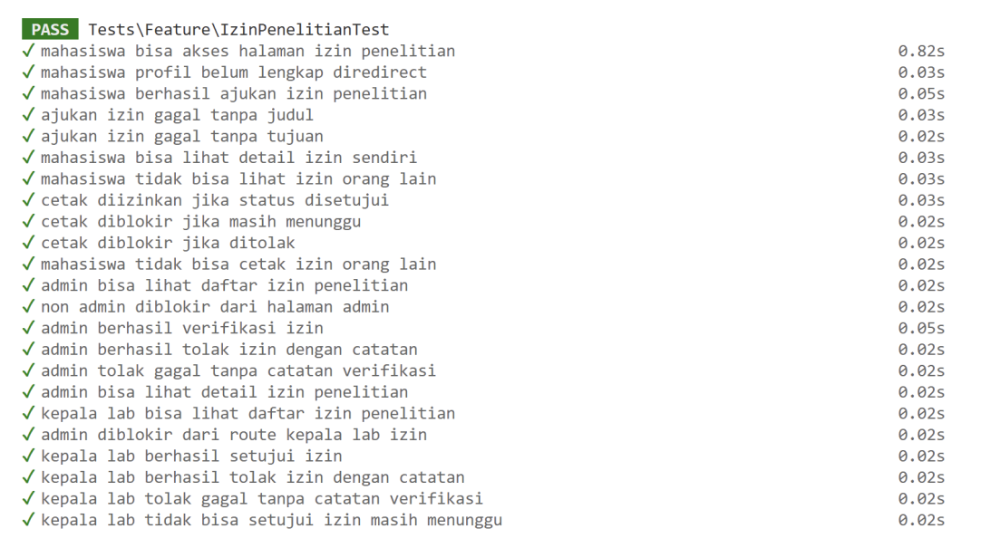

> **📷 Keterangan Gambar**: *Gambar 3. 39 Hasil Unit Testing 4 (23 Test, 23 Passed)* (Dimensi: 1103x605 px)  
> **🔍 Analisis & Arti Gambar**:  
> Gambar ini memuat lembar tanda tangan atau cap pengesahan resmi dari dosen pembimbing, penguji, atau koordinator program studi yang membuktikan keabsahan dokumen tugas akhir.

---

## 📄 Halaman 185

159 
 
Berikut merupakan salah satu contoh implementasi pada iterasi keempat 
yang direpresentasikan dalam bentuk PseudoCode sebagai gambaran logika pada 
Layanan Izin Penelitian. 
Tabel 3. 35 PseudoCode Izin Penelitian 
// FUNCTION: store (Pengajuan Izin Penelitian oleh Mahasiswa) 
// Tujuan: Menyimpan permohonan izin penelitian baru 
// Input: judul_penelitian, tujuan, dokumen_berkas (opsional), 
data_dibutuhkan (array) 
  
validasi input: 
 
judul_penelitian: wajib, maks 255 karakter 
 
tujuan: wajib 
 
dokumen_berkas: opsional, format pdf/jpg/png, maks 2MB 
 
data_dibutuhkan: array string (daftar alat/data yang 
dibutuhkan) 
if (ada dokumen_berkas yang diunggah) then 
 
simpan file ke storage 'izin_penelitian/public' 
 
path = lokasi file tersimpan 
end if 
buat IzinPenelitian baru dengan: 
 
user_id       
= user yang sedang Login 
 
judul_penelitian = input judul 
 
tujuan        
= input tujuan 
 
dokumen_berkas   = path file (atau null) 
 
data_dibutuhkan  = array data yang dibutuhkan (disimpan 
sebagai JSON) 
 
status        
= 'menunggu' 
redirect ke halaman index dengan pesan sukses 
  
  
// FUNCTION: cetak (Cetak Surat Izin Penelitian) 
// Tujuan: Menghasilkan dokumen surat izin penelitian resmi 
// Input: izin_penelitian_id 
  
validasi kepemilikan: izin.user_id harus == user yang Login (403 
jika tidak) 
validasi status: izin.status harus 'disetujui' (403 jika belum 
disetujui)

---

## 📄 Halaman 186

160 
 
muat relasi user pada izin 
ambil data Kepala Lab dari tabel users (role = 'kepala_lab') 
tampilkan view cetak surat izin dengan data izin dan kepala_lab 
 
Tabel 3.35 di atas merupakan pseudocode untuk fungsi layanan izin 
penelitian. Penjelasan lebih lanjut pseudocode tersebut disajikan pada Tabel 3.36 
berikut, yang menguraikan fungsi dalam implementasi tersebut. 
Tabel 3. 36 Penjelasan PseudoCode Izin Penelitian 
Proses 
Penjelasan (Output) 
Pengajuan 
oleh 
mahasiswa 
Data permohonan (judul, tujuan, data dibutuhkan) 
beserta berkas opsional disimpan ke database dengan 
status menunggu. 
Validasi 
kepemilikan 
Sistem mencegah mahasiswa melihat atau mencetak izin 
penelitian milik mahasiswa lain (HTTP 403 Forbidden). 
Validasi status cetak 
Surat izin hanya dapat dicetak jika status sudah disetujui 
oleh Kepala Laboratorium. 
Cetak surat izin 
Surat ditampilkan via Blade view dengan data 
mahasiswa, detail penelitian, dan tanda tangan Kepala 
Lab.

---

## 📄 Halaman 187

161 
 
 
Gambar 3. 40 Halaman Pengajuan Izin Penelitian 
 
Pada Gambar 3.40 menampilkan Halaman Pengajuan Izin Penelitian 
Dashboard Mahasiswa, Mahasiswa memasukkan berkas-berkas yang dibutuhkan 
untuk penelitian seperti Judul, Tujuan dan Dokumen/Proposal Penelitian jika ada. 
 
Gambar 3. 41 Halaman Manajemen Izin Penelitian Admin 
 
Pada Gambar 3.41 menampilakan Halaman Verifikasi Izin Penelitian 
Dashboard Admin, Dashboard Admin untuk memverifikasi berkas-berkas 
mahasiwa yang telah mengajukan Izin Penelitian dan memberikan pesetujuan untuk 
bisa ditandatangani oleh kepala lab.

### 🖼️ Gambar pada Halaman 187

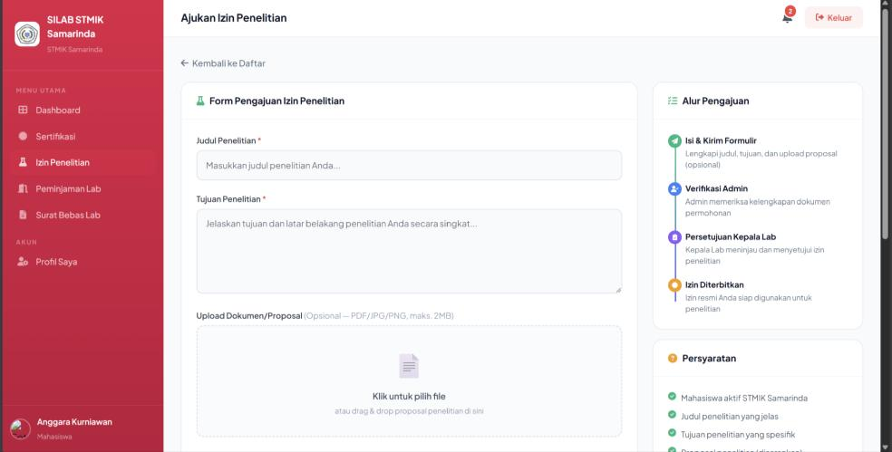

> **📷 Keterangan Gambar**: *Gambar 3. 40 Halaman Pengajuan Izin Penelitian* (Dimensi: 984x499 px)  
> **🔍 Analisis & Arti Gambar**:  
> Gambar ini merupakan tangkapan layar (screenshot) implementasi antarmuka pengguna (UI) sistem informasi, memperlihatkan tata letak visual, form input, tabel ringkasan data, dan navigasi menu.

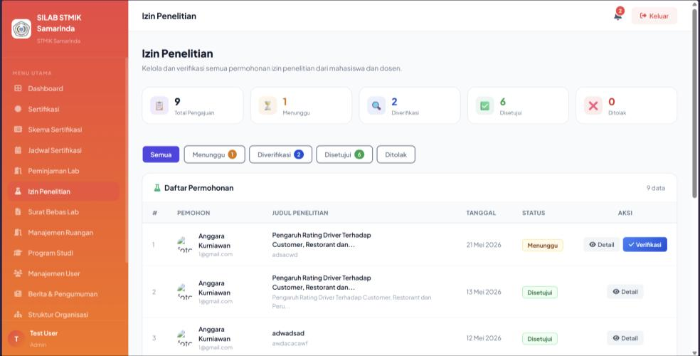

> **📷 Keterangan Gambar**: *Gambar 3.40 menampilkan Halaman Pengajuan Izin Penelitian* (Dimensi: 984x500 px)  
> **🔍 Analisis & Arti Gambar**:  
> Gambar ini merupakan tangkapan layar (screenshot) implementasi antarmuka pengguna (UI) sistem informasi, memperlihatkan tata letak visual, form input, tabel ringkasan data, dan navigasi menu.

---

## 📄 Halaman 188

162 
 
 
Gambar 3. 42 Halaman Manajemen Izin Penelitian Kepala Lab 
Pada Gambar 3.42 menampilkan Halaman Manajemen Izin Penelitian 
Dashboard Kepala Lab, Dashboard ini memberikan persetujuan untuk Izin 
Penelitian dan menjadi verifikasi Akhi dari Mahasiwa untuk dapat mencetak Surat 
Izin Penelitian. 
Fitur Pengajuan Izin Penelitian ini merupakan solusi dari permasalahan 
pada kampus yaitu tidak terdokumentasinya berkas-berkas mahasiswa yang 
mengajukan Izin, Dengan adanya fitur ini, berkas-berkas Izin Penelitian dapat 
terdokumentasi dengan baik sehingga tidak adanya miss informasi antara admin 
dan mahasiswa. Selain itu,  mahasiswa juga dapat memantau langsung 
perkembangan status pengajuannya melalui sistem yang menampilkan informasi. 
Dengan adanya sistem ini, mahasiswa dapat mengajukan sertifikasi dari mana saja 
secara mandiri, sehingga lebih menghemat waktu. 
C.  
Refactor 4 
Pada tahap refactor di iterasi kedua, dilakukan pemeriksaan terhadap 
seluruh kode yang telah diimplementasikan untuk memastikan apakah ada bagian 
yang perlu diperbaiki atau disederhanakan. Setelah ditinjau, tidak ditemukan kode 
yang perlu diubah atau dioptimalkan karena semua fungsi sudah berjalan dengan 
baik dan sesuai kebutuhan. Oleh karena itu, pada iterasi ini tidak dilakukan proses 
refactoring atau pengoptimalan kode.

### 🖼️ Gambar pada Halaman 188

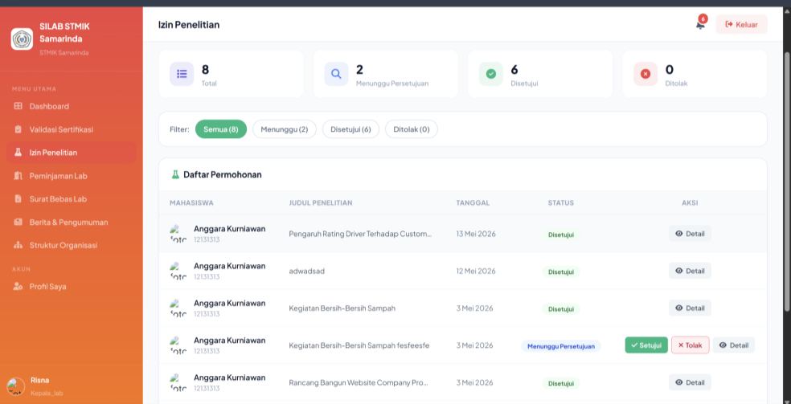

> **📷 Keterangan Gambar**: *Gambar 3. 42 Halaman Manajemen Izin Penelitian Kepala Lab* (Dimensi: 984x503 px)  
> **🔍 Analisis & Arti Gambar**:  
> Gambar ini memuat lembar tanda tangan atau cap pengesahan resmi dari dosen pembimbing, penguji, atau koordinator program studi yang membuktikan keabsahan dokumen tugas akhir.

---

## 📄 Halaman 189

163 
 
3.4.6.4 System Testing 4 
Pengujian fungsionalitas sistem pada iterasi keempat dilakukan 
menggunakan metode Black Box Testing, yaitu dengan menjalankan sistem dan 
mengevaluasi apakah hasil yang diperoleh telah sesuai dengan kebutuhan yang 
diharapkan. Pada tahap System Testing iterasi keempat, pengujian dilakukan secara 
langsung oleh pengembang terhadap fitur layanan Izin Penelitian pada sistem 
informasi laboratorium STMIK Samarinda. 
Pengujian dilakukan untuk memastikan bahwa proses pengajuan izin 
penelitian, verifikasi permohonan oleh admin, persetujuan oleh kepala 
laboratorium, serta proses pencetakan surat izin penelitian dapat berjalan sesuai 
dengan kebutuhan sistem. Selain itu, pengujian juga dilakukan untuk memastikan 
bahwa mahasiswa tidak dapat mengakses ataupun mencetak dokumen izin 
penelitian milik pengguna lain. Tabel 3.37 menampilkan salah satu skenario 
pengujian System Testing 4 pada fitur layanan Izin Penelitian. 
Tabel 3. 37 System Testing 4 Izin Penelitian 
No 
Test Case 
System Role 
System 
Navigation 
Testing 
Data 
Expected 
Result 
Status 
1 
Mengajukan 
izin 
penelitian 
Mahasiswa 
1. Login ke 
sistem  
2. Membuka 
menu izin 
penelitian  
3. Mengisi 
form 
pengajuan  
4. Klik tombol 
submit 
Judul 
penelitian, 
tujuan, data 
dibutuhkan
, dokumen 
pendukung 
Sistem 
berhasil 
menyimpan 
pengajuan izin 
penelitian 
Passed

---

## 📄 Halaman 190

164 
 
No 
Test Case 
System Role 
System 
Navigation 
Testing 
Data 
Expected 
Result 
Status 
2 
Memverifik
asi 
permohonan 
izin 
penelitian 
Admin 
1. Login ke 
sistem 
2. Membuka 
halaman 
manajemen 
izin penelitian  
3. Memilih 
data 
pengajuan  
4. Klik tombol 
verifikasi 
Data 
pengajuan 
izin 
penelitian 
Sistem 
berhasil 
mengubah 
status 
pengajuan 
menjadi 
diverifikasi 
Passed 
3 
Menyetujui 
pengajuan 
izin 
penelitian 
Kepala 
Laboratorium 
1. Login ke 
sistem  
2. Membuka 
halaman 
persetujuan 
izin penelitian  
3. Memilih 
data 
pengajuan 4. 
Klik tombol 
setujui 
Data 
pengajuan 
yang telah 
diverifikasi 
Sistem 
berhasil 
mengubah 
status 
pengajuan 
menjadi 
disetujui 
Passed 
4 
Menolak 
pengajuan 
izin 
penelitian 
Kepala 
Laboratorium 
1. Login ke 
sistem  
2. Membuka 
halaman 
persetujuan 
izin penelitian 
Data 
pengajuan 
izin 
penelitian 
Sistem 
berhasil 
mengubah 
status 
pengajuan 
Passed

---

## 📄 Halaman 191

165 
 
No 
Test Case 
System Role 
System 
Navigation 
Testing 
Data 
Expected 
Result 
Status 
3. Memilih 
data 
pengajuan 4. 
Klik tombol 
tolak 
menjadi 
ditolak 
5 
Mencetak 
surat izin 
penelitian 
Mahasiswa 
1. Login ke 
sistem  
2. Membuka 
riwayat izin 
penelitian  
3. Klik tombol 
cetak surat 
Data izin 
penelitian 
dengan 
status 
disetujui 
Sistem 
berhasil 
menampilkan 
dokumen surat 
izin penelitian 
Passed 
6 
Mengakses 
izin 
penelitian 
milik 
pengguna 
lain 
Mahasiswa 
1. Login ke 
sistem  
2. Membuka 
detail izin 
penelitian 
pengguna lain 
melalui URL 
Data izin 
penelitian 
milik 
pengguna 
lain 
Sistem 
menolak akses 
dan 
menampilkan 
status 
Passed 
3.4.6.5 Retrospective 4 
Seluruh user Story iterasi keempat terdapat Total 3 user Story yang berhasil 
diimplementasikan. Izin Penelitian berjalan lengkap dengan alur pengajuan, 
verifikasi, persetujuan, dan cetak surat.

---

## 📄 Halaman 192

166 
 
Tabel 3. 38 Hasil Retrospective 4 
Faktor Keberhasilan 
Faktor Hambatan 
Layanan 
izin 
penelitian 
berhasil 
dikembangkan untuk mahasiswa dan 
dosen. Pengguna dapat mengajukan 
izin penelitian, mengunggah dokumen 
pendukung, melihat status pengajuan, 
dan mencetak surat apabila sudah 
disetujui. Alur verifikasi admin dan 
persetujuan kepala laboratorium juga 
dapat diterapkan dengan baik. 
Hambatan pada iterasi ini adalah belum 
tersedianya 
fitur 
notifikasi 
pada 
Dashboard masing-masing pengguna. 
Berdasarkan 
masukan 
dari 
pihak 
laboratorium, diperlukan penambahan 
notifikasi 
agar 
pengguna 
dapat 
mengetahui informasi dan perubahan 
status layanan secara lebih cepat. 
 
Hasil retrospective yang dilakukan bersama mitra pada tanggal 15 Mei 2026 
yang dihadiri oleh Kepala Laboatorium dengan hasil adalah gabungan evaluasi dari 
iterasi ketiga dan iterasi keempat. Berdasarkan hasil evaluasi, fiur surat bebas 
laboratorium berhasil dikembangkan dengan alur pengajuan, verifikasi admin dan 
persetujuan kepala lab, hingga percetakan surat, dan fitur izin penelitian juga 
memiliki alur yang sama dengan alur pengajuan, verifikasi admin, dan persetujuan 
kepala lab. Adapun masukan yang diperoleh dari mitra adalah perlunya 
penyempurnaan proses pemeriksaan tanggungan peminjaman lab pada layanan 
surat bebas lab, yang akan dikembangkan setelah fitur peminjaman lab 
dikembangkan, serta mitra menambahkan fitur neotifikasi pada Dashboard masing-
masing role agar informasi dan perubahan status layanan dapat diterima dengan 
lebih cepat. 
3.4.7  Iterasi 5 Layanan Peminjaman Laboratorium 
Iterasi kelima merupakan iterasi terakhir dalam pengembangan SIMLAB. 
Fokus pada iterasi ini adalah pengembangan Layanan Peminjaman Laboratorium 
yang memungkinkan mahasiswa dan dosen mengajukan permohonan penggunaan 
ruangan laboratorium.

---

## 📄 Halaman 193

167 
 
Tabel 3. 39 User Story Iterasi 5 
Kode 
As a 
I Want 
So That 
US-18 
Mahasiswa 
dan Dosen 
Saya ingin mengajukan 
peminjaman 
ruangan 
laboratorium 
Saya dapat menggunakan 
fasilitas 
lab 
sesuai 
kebutuhan 
US-19 
Admin 
Saya 
ingin 
memverifikasi 
dan 
peminjaman 
Saya 
dapat 
mengelola 
penggunaan 
ruangan 
laboratorium 
US-20 
Kepala Lab 
Saya ingin menyetujui 
peminjaman 
laboratorium 
Saya dapat memberikan 
keputusan 
akhir 
atas 
peminjaman laboratorium 
US-21 
Mahasiswa 
dan Dosen 
Saya ingin mencetak 
bukti peminjaman 
Saya dapat bukti telah 
meminjam laboratorium  
US-22 
Mahasiswa 
dan Dosen 
Saya ingin melaporkan 
pengembalian ruangan 
Saya 
dapat 
menginformasikan bahwa 
ruangan 
telah 
selesai 
digunakan 
US-23 
Admin 
Saya 
ingin 
memverifikasi 
pengembalian ruangan 
laboratorium 
Saya 
dapat 
mengelola 
pengembalian 
ruangan 
laboratorium 
US-24 
Mahasiswa 
dan Dosen 
Saya ingin mencetak 
bukti 
pengembalian 
ruangan 
Saya dapat bukti telah 
mengembalikan 
laboratorium

---

## 📄 Halaman 194

168 
 
3.4.7.1 Iteration Initialization 5  
Tahap awal dari setiap iterasi dalam pengembangan sistem dimuali dengna 
proses Iteration intialization. Pada tahap ini, pengembang menentukan fitur-fitur 
yang akan dikerjakan serta menyusun datar tugas yang perlu diselesaikan selama 
iterasi. Untuk iterasi kelima, fitur yang dikembangkan adalah layanan peminjaman 
laboratorium, sesuai dengan prioritas fungsional yang telah direncanakan. Total 
terdapat 7 user Story yang ditampilkan pada Tabel 3.40 Tabel Iteration 
Initialization  berikut: 
Tabel 3. 40 Iteration Initialization 5 
Kode 
User Story 
Task 
Story 
Point 
US-18 
Mengajukan 
peminjaman 
Membuat form peminjaman dengan 
validasi jadwal dan upload surat 
keterangan 
3 
US-19 
Verifikasi 
peminjaman 
Membuat 
halaman 
manajemen 
peminjaman untuk admin dengan aksi 
verifikasi/tolak 
3 
US-20 
Persetujuan 
peminjaman 
Membuat 
halaman 
manajemen 
peminjaman untuk kepala lab dengan 
aksi setujui/tolak 
3 
US-21 
Cetak 
surat 
pinjaman 
Membuat fitur cetak surat peminjaman 
3 
US-22 
Pengembalian 
pinjaman 
Membuat fitur pengembalian ruangan 
laboratorium 
3 
US-23 
Verifikasi 
pengembalian 
Membuat 
halaman 
manajemen 
peminjaman untuk admin dengan fitur 
verifikasi pengembalian 
3

---

## 📄 Halaman 195

169 
 
Kode 
User Story 
Task 
Story 
Point 
US-24 
Cetak 
surat 
pengembalian 
ruangan 
Membuat 
fitur 
cetak 
surat 
pengembalian ruangan 
3 
3.4.7.2 Design 5 
Tahap perancangan pada iterasi kelima dimulai dengan pembuatan ERD, 
serta rancangan antarmuka pengguna (user Interface) dari fitur-fitur yang akan 
dikembangkan. Desain ini mengacu pada user Story yang telah ditentukan pada 
iterasi kelma, yaitu Layanan Peminjaman Laboratorium, melakukan pengajuan 
peminjaman, verifikasi peminjaman, persetujuan peminjaman, surat peminjaman, 
dan pengembalian peminjaman melalui sistem. 
A.  
Entity Relationship Diagram 5 
Gambar 3.43 di bawah ini menunjukkan Entity Relationship Diagram 
(ERD) yang dirancang untuk iterasi kelima dalam proses pengembangan. ERD ini 
disusun berdasarkan user Story yang telah direncanakan untuk dikerjakan pada 
iterasi kelima. Pada iterasi ini, terdapat penambahan beberapa entitas baru pada 
basis 
data 
untuk 
mendukung 
fitur-fitur 
yang 
dikembangkan. 
Entitas 
peminjaman_labs dan pengembalian_labs yang digunakan untuk menyimpan data 
pengajuan dan pengembalian peminjaman ruangan laboratorium oleh mahasiswa 
maupun dosen.

---

## 📄 Halaman 196

170 
 
   
Gambar 3. 43 ERD Iterasi 5 
 Pada Gambar 3.43 ditunjukkan struktur relasi database pada layanan 
Peminjaman Laboratorium. Struktur relasi ini dirancang untuk mendukung proses 
pengelolaan jadwal laboratorium secara digital, validasi benturan jadwal 
peminjaman, monitoring status peminjaman, hingga proses pengembalian 
laboratorium secara terintegrasi dalam sistem. 
B.  
User Interface 5 
Berikut ini merupakan salah satu rancangan tampilan antarmuka pengguna 
(user Interface) untuk user Story yang dikerjakan pada iterasi kelima.

### 🖼️ Gambar pada Halaman 196

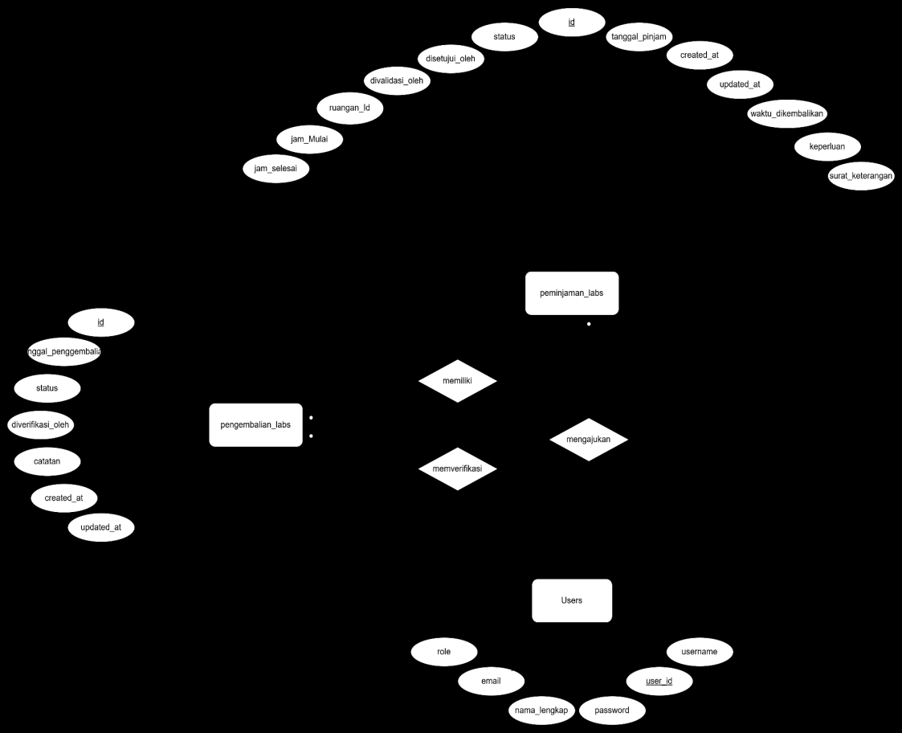

> **📷 Keterangan Gambar**: *Gambar 3. 43 ERD Iterasi 5* (Dimensi: 1123x912 px)  
> **🔍 Analisis & Arti Gambar**:  
> Gambar ini menyajikan diagram skema struktural perangkat lunak (Class Diagram / ERD) yang mendefinisikan struktur tabel/kelas, atribut kolom, method, dan relasi kardinalitas antar entitas basis data.

---

## 📄 Halaman 197

171 
 
 
Gambar 3. 44 Mockup Antarmuka Form Peminjaman Laboratorium 
 
Gambar 3.44 merupakan mockup antarmuka halaman pengajuan 
peminjaman lab, antarmuka yang memungkinkan pengguna untuk mengajukan 
peminjaman. Pada halaman ini terdapat form dan input file untuk kebutuhan 
peminjaman lab. 
3.4.7.3 Implementation 5 
Pada tahap Implementation di iterasi kelima, merealisasikan rancangan 
sistem yang telah disusun pada tahap planning sebelumnya. Pada fase ini, proses 
pengembangan dimulai dengan pelaksaan unit Testing menggunakan PHPUnit 
yang tersedia dalam framework laravel. Pengujian ini bertujuan untuk memastikan 
bahwa setiap fungsi dalam sistem dapat bekalan sesuai dengan yang diharapkan dan 
memenuhi tujuan dari fitur yang dikembangkan. Setelah pengujian awal dilakukan, 
pengembang mulai menulis kode program sesuai dengan kebutuhan fungsional 
sistem. Selama proses ini, dilakukan pula refactoring terhadap bagianbagian kode 
yang dirasa kurang efisien atau sulit dipahami, guna menjaga keterbacaan serta 
kualitas kode agar lebih optimal dan mudah dikembangkan di masa mendatang.

### 🖼️ Gambar pada Halaman 197

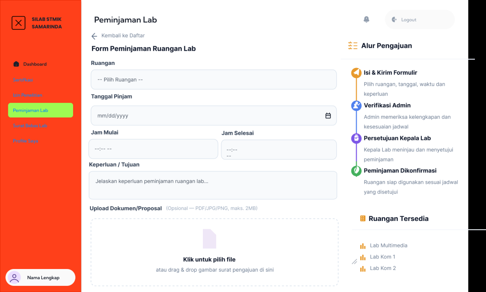

> **📷 Keterangan Gambar**: *Gambar 3. 44 Mockup Antarmuka Form Peminjaman Laboratorium* (Dimensi: 1097x661 px)  
> **🔍 Analisis & Arti Gambar**:  
> Gambar ini merupakan tangkapan layar (screenshot) implementasi antarmuka pengguna (UI) sistem informasi, memperlihatkan tata letak visual, form input, tabel ringkasan data, dan navigasi menu.

---

## 📄 Halaman 198

172 
 
A.  
Unit Testing 5 
Pada tahap unit Testing pada iterasi kelima, pengujian dilakukan 
menggunakan PHPUnit yang merupakan bagian dari framework Laravel. 
Pengujian ini bertujuan untuk memastikan bahwa fungsi-fungsi pada layanan 
Peminjaman Laboratorium berjalan sesuai dengan kebutuhan sistem yang telah 
dirancang. Tabel 3.41 berikut menampilkan salah satu contoh kode pengujian unit 
yang dilakukan pada fitur Peminjaman Laboratorium. Pada contoh ini, pengembang 
melakukan pengujian terhadap proses pengajuan peminjaman, pengecekan jadwal 
ruangan, dan pelaporan pengembalian laboratorium. 
Tabel 3. 41 Kode Unit Testing 5  Peminjaman Laboratorium 
tests/Unit/Controllers/PeminjamanLabTest.php 
001: <?php 
002: namespace Tests\Feature; 
003: use App\Models\PeminjamanLab; 
004: use App\Models\User; 
005: use Illuminate\Foundation\Testing\RefreshDatabase; 
006: use Illuminate\Support\Facades\Notification; 
007: use Tests\TestCase; 
008: class PeminjamanLabTest extends TestCase 
009: { 
010:     use RefreshDatabase; 
011:     protected function setUp(): void 
012:     { 
013:         parent::setUp(); 
014:         Notification::fake(); 
015:     } 
016:     private function makeMahasiswa(bool $complete = true): 
User 
017:     { 
018:         return User::factory()->create([ 
019:             'role'              => 'mahasiswa', 
020:             'profile_completed' => $complete, 
021:             'nim_nip'           => $complete ? '20210001' : 
null, 
022:             'jurusan'           => $complete ? 'Teknik 
Informatika' : null,

---

## 📄 Halaman 199

173 
 
tests/Unit/Controllers/PeminjamanLabTest.php 
023:             'foto_profil'       => $complete ? 
'foto_profil/test.jpg' : null, 
024:         ]); 
025:     } 
026:     private function makeDosen(): User 
027:     { 
028:         return User::factory()->create(['role' => 'dosen']); 
029:     } 
030:     private function makeAdmin(): User 
031:     { 
032:         return User::factory()->create(['role' => 'admin']); 
033:     } 
034:     private function makeKepalaLab(): User 
035:     { 
036:         return User::factory()->create(['role' => 
'kepala_lab']); 
037:     } 
038:     private function payload(): array 
039:     { 
040:         return [ 
041:             'ruangan'        => 'Lab Komputer A', 
042:             'tanggal_pinjam' => now()->addDay()-
>toDateString(), 
043:             'jam_mulai'      => '08:00', 
044:             'jam_selesai'    => '10:00', 
045:             'keperluan'      => 'Praktikum', 
046:         ]; 
047:     } 
048: 
 
 
 
 
public 
function 
test_mahasiswa_bisa_lihat_halaman_peminjaman(): void 
049:     { 
050:         $this->actingAs($this->makeMahasiswa()); 
051:         $this->get(route('mahasiswa.peminjaman-lab.index'))-
>assertOk(); 
052:     } 
053: 
 
 
 
 
public 
function 
test_mahasiswa_profil_belum_lengkap_diredirect(): void 
054:     {

---

## 📄 Halaman 200

174 
 
tests/Unit/Controllers/PeminjamanLabTest.php 
055:         $this->actingAs($this->makeMahasiswa(false)); 
056:         $this->get(route('mahasiswa.peminjaman-lab.index')) 
057:             ->assertRedirect(route('profile.edit')); 
058:     } 
059:     public function test_tamu_diredirect_ke_Login(): void 
060:     { 
061:         $this->get(route('mahasiswa.peminjaman-lab.index')) 
062:             ->assertRedirect(route('Login')); 
063:     } 
064: 
 
 
 
 
public 
function 
test_mahasiswa_berhasil_buat_peminjaman(): void 
065:     { 
066:         $user = $this->makeMahasiswa(); 
067:         $this->actingAs($user); 
068:         $this->post(route('mahasiswa.peminjaman-lab.store'), 
$this->payload()) 
069:             ->assertRedirect(); 
070:         $this->assertDatabaseHas('peminjaman_lab', [ 
071:             'user_id'  => $user->id, 
072:             'ruangan'  => 'Lab Komputer A', 
073:             'status'   => 'menunggu', 
074:         ]); 
075:     } 
076: 
 
 
 
 
public 
function 
test_mahasiswa_peminjaman_gagal_tanpa_keperluan(): void 
077:     { 
078:         $user = $this->makeMahasiswa(); 
079:         $this->actingAs($user); 
080:         $payload = $this->payload(); 
081:         unset($payload['keperluan']); 
082:         $this->post(route('mahasiswa.peminjaman-lab.store'), 
$payload) 
083:             ->assertSessionHasErrors(['keperluan']); 
084:     } 
085: 
 
 
 
 
public 
function 
test_mahasiswa_bisa_lihat_detail_peminjaman_sendiri(): void 
086:     { 
087:         $user       = $this->makeMahasiswa();

---

## 📄 Halaman 201

175 
 
tests/Unit/Controllers/PeminjamanLabTest.php 
088:         $peminjaman = PeminjamanLab::factory()-
>create(['user_id' => $user->id]); 
089:         $this->actingAs($user); 
090:         $this->get(route('mahasiswa.peminjaman-lab.show', 
$peminjaman))->assertOk(); 
091:     } 
092: 
 
 
 
 
public 
function 
test_mahasiswa_tidak_bisa_lihat_peminjaman_orang_lain(): void 
093:     { 
094:         $user1      = $this->makeMahasiswa(); 
095:         $user2      = $this->makeMahasiswa(); 
096:         $peminjaman = PeminjamanLab::factory()-
>create(['user_id' => $user2->id]); 
097:         $this->actingAs($user1); 
098:         $this->get(route('mahasiswa.peminjaman-lab.show', 
$peminjaman))->assertForbidden(); 
099:     } 
100: 
 
 
 
 
public 
function 
test_mahasiswa_bisa_kembalikan_peminjaman_disetujui(): void 
101: 
 
 
 
 
public 
function 
test_mahasiswa_bisa_kembalikan_peminjaman_disetujui(): void 
102:     { 
103:         $user       = $this->makeMahasiswa(); 
104:         $peminjaman = PeminjamanLab::factory()-
>create(['user_id' => $user->id, 'status' => 'disetujui']); 
105:         $this->actingAs($user); 
106:         $this->post(route('mahasiswa.peminjaman-
lab.kembalikan', $peminjaman))->assertRedirect(); 
107:         $this->assertDatabaseHas('peminjaman_lab', [ 
108:             'id'     => $peminjaman->id, 
109:             'status' => 'menunggu_kembali', 
110:         ]); 
111:     } 
112: 
 
 
 
 
public 
function 
test_mahasiswa_tidak_bisa_kembalikan_milik_orang_lain(): void 
113:     { 
114:         $user1      = $this->makeMahasiswa(); 
115:         $user2      = $this->makeMahasiswa();

---

## 📄 Halaman 202

176 
 
tests/Unit/Controllers/PeminjamanLabTest.php 
116:         $peminjaman = PeminjamanLab::factory()-
>create(['user_id' => $user2->id, 'status' => 'disetujui']); 
117:         $this->actingAs($user1); 
118:         $this->post(route('mahasiswa.peminjaman-
lab.kembalikan', $peminjaman))->assertForbidden(); 
119:     } 
120: 
 
 
 
 
public 
function 
test_mahasiswa_cetak_bukti_pinjam_jika_disetujui(): void 
121:     { 
122:         $user       = $this->makeMahasiswa(); 
123:         $peminjaman = PeminjamanLab::factory()-
>create(['user_id' => $user->id, 'status' => 'disetujui']); 
124:         $this->actingAs($user); 
125:         $this->get(route('mahasiswa.peminjaman-lab.cetak-
bukti-pinjam', $peminjaman))->assertOk(); 
126:     } 
127: 
 
 
 
 
public 
function 
test_mahasiswa_cetak_bukti_kembali_jika_dikembalikan(): void 
128:     { 
129:         $user       = $this->makeMahasiswa(); 
130:         $peminjaman = PeminjamanLab::factory()-
>create(['user_id' => $user->id, 'status' => 'dikembalikan']); 
131:         $this->actingAs($user); 
132:         $this->get(route('mahasiswa.peminjaman-lab.cetak-
bukti-kembali', $peminjaman))->assertOk(); 
133:     } 
134: 
 
 
 
 
public 
function 
test_dosen_bisa_lihat_halaman_peminjaman(): void 
135:     { 
136:         $this->actingAs($this->makeDosen()); 
137:         $this->get(route('dosen.peminjaman-lab.index'))-
>assertOk(); 
138:     } 
139: 
 
 
 
 
public 
function 
test_mahasiswa_diblokir_dari_route_dosen_peminjaman(): void 
140:     { 
141:         $this->actingAs($this->makeMahasiswa());

---

## 📄 Halaman 203

177 
 
tests/Unit/Controllers/PeminjamanLabTest.php 
142:         $this->get(route('dosen.peminjaman-lab.index'))-
>assertForbidden(); 
143:     } 
144:     public function test_dosen_berhasil_buat_peminjaman(): 
void 
145:     { 
146:         $dosen = $this->makeDosen(); 
147:         $this->actingAs($dosen); 
148:         $this->post(route('dosen.peminjaman-lab.store'), 
$this->payload()) 
149:             ->assertRedirect(); 
150:         $this->assertDatabaseHas('peminjaman_lab', [ 
151:             'user_id' => $dosen->id, 
152:             'ruangan' => 'Lab Komputer A', 
153:             'status'  => 'menunggu', 
154:         ]); 
155:     } 
156: 
 
 
 
 
public 
function 
test_dosen_tidak_bisa_lihat_peminjaman_orang_lain(): void 
157:     { 
158:         $dosen1     = $this->makeDosen(); 
159:         $dosen2     = $this->makeDosen(); 
160:         $peminjaman = PeminjamanLab::factory()-
>create(['user_id' => $dosen2->id]); 
161:         $this->actingAs($dosen1); 
162:         $this->get(route('dosen.peminjaman-lab.show', 
$peminjaman))->assertForbidden(); 
163:     } 
164: 
 
 
 
 
public 
function 
test_dosen_bisa_kembalikan_peminjaman_sendiri(): void 
165:     { 
166:         $dosen      = $this->makeDosen(); 
167:         $peminjaman = PeminjamanLab::factory()-
>create(['user_id' => $dosen->id, 'status' => 'disetujui']); 
168:         $this->actingAs($dosen); 
169:         $this->patch(route('dosen.peminjaman-lab.kembalikan', 
$peminjaman))->assertRedirect(); 
170:         $this->assertDatabaseHas('peminjaman_lab', [

---

## 📄 Halaman 204

178 
 
tests/Unit/Controllers/PeminjamanLabTest.php 
171:             'id'     => $peminjaman->id, 
172:             'status' => 'menunggu_kembali', 
173:         ]); 
174:     } 
175: 
 
 
 
 
public 
function 
test_dosen_tidak_bisa_kembalikan_milik_orang_lain(): void 
176:     { 
177:         $dosen1     = $this->makeDosen(); 
178:         $dosen2     = $this->makeDosen(); 
179:         $peminjaman = PeminjamanLab::factory()-
>create(['user_id' => $dosen2->id, 'status' => 'disetujui']); 
180:         $this->actingAs($dosen1); 
181:         $this->patch(route('dosen.peminjaman-lab.kembalikan', 
$peminjaman))->assertForbidden(); 
182:     } 
183: 
 
 
 
 
public 
function 
test_admin_bisa_lihat_daftar_peminjaman(): void 
184:     { 
185:         $this->actingAs($this->makeAdmin()); 
186:         $this->get(route('admin.peminjaman-lab.index'))-
>assertOk(); 
187:     } 
188: 
 
 
 
 
public 
function 
test_non_admin_diblokir_dari_halaman_admin_peminjaman(): void 
189:     { 
190:         $this->actingAs($this->makeDosen()); 
191:         $this->get(route('admin.peminjaman-lab.index'))-
>assertForbidden(); 
192:     } 
193: 
 
 
 
 
public 
function 
test_admin_berhasil_verifikasi_peminjaman(): void 
194:     { 
195:         $admin      = $this->makeAdmin(); 
196:         $peminjaman = PeminjamanLab::factory()-
>create(['status' => 'menunggu']); 
197:         $this->actingAs($admin); 
198:         $this->post(route('admin.peminjaman-lab.verifikasi', 
$peminjaman))->assertRedirect();

---

## 📄 Halaman 205

179 
 
tests/Unit/Controllers/PeminjamanLabTest.php 
199:         $this->assertDatabaseHas('peminjaman_lab', [ 
200:             'id'     => $peminjaman->id, 
201:             'status' => 'diverifikasi', 
202:         ]); 
203:     } 
204:     public function test_admin_berhasil_tolak_peminjaman(): 
void 
205:     { 
206:         $admin      = $this->makeAdmin(); 
207:         $peminjaman = PeminjamanLab::factory()-
>create(['status' => 'menunggu']); 
208:         $this->actingAs($admin); 
209:         $this->post(route('admin.peminjaman-lab.tolak', 
$peminjaman))->assertRedirect(); 
210:         $this->assertDatabaseHas('peminjaman_lab', [ 
211:             'id'     => $peminjaman->id, 
212:             'status' => 'ditolak', 
213:         ]); 
214:     } 
215: 
 
 
 
 
public 
function 
test_admin_berhasil_verifikasi_kembali_peminjaman(): void 
216:     { 
217:         $admin      = $this->makeAdmin(); 
218:         $peminjaman = PeminjamanLab::factory()-
>create(['status' => 'menunggu_kembali']); 
219:         $this->actingAs($admin); 
220:         $this->post(route('admin.peminjaman-lab.verifikasi-
kembali', $peminjaman))->assertRedirect(); 
221:         $this->assertDatabaseHas('peminjaman_lab', [ 
222:             'id'     => $peminjaman->id, 
223:             'status' => 'dikembalikan', 
224:         ]); 
225:     } 
226: 
 
 
 
 
public 
function 
test_kepala_lab_bisa_lihat_daftar_peminjaman(): void 
227:     { 
228:         $this->actingAs($this->makeKepalaLab());

---

## 📄 Halaman 206

180 
 
tests/Unit/Controllers/PeminjamanLabTest.php 
229:         $this->get(route('kepala_lab.peminjaman-lab.index'))-
>assertOk(); 
230:     } 
231: 
 
 
 
 
public 
function 
test_dosen_diblokir_dari_route_kepala_lab_peminjaman(): void 
232:     { 
233:         $this->actingAs($this->makeDosen()); 
234:         $this->get(route('kepala_lab.peminjaman-lab.index'))-
>assertForbidden(); 
235:     } 
236: 
 
 
 
 
public 
function 
test_kepala_lab_berhasil_setujui_peminjaman(): void 
237:     { 
238:         $kepala     = $this->makeKepalaLab(); 
239:         $peminjaman = PeminjamanLab::factory()-
>create(['status' => 'diverifikasi']); 
240:         $this->actingAs($kepala); 
241:         $this->post(route('kepala_lab.peminjaman-
lab.setujui', $peminjaman))->assertRedirect(); 
242:         $this->assertDatabaseHas('peminjaman_lab', [ 
243:             'id'     => $peminjaman->id, 
244:             'status' => 'disetujui', 
245:         ]); 
246:     } 
247: 
 
 
 
 
public 
function 
test_kepala_lab_berhasil_tolak_peminjaman(): void 
248:     { 
249:         $kepala     = $this->makeKepalaLab(); 
250:         $peminjaman = PeminjamanLab::factory()-
>create(['status' => 'diverifikasi']); 
251:         $this->actingAs($kepala); 
252:         $this->post(route('kepala_lab.peminjaman-lab.tolak', 
$peminjaman))->assertRedirect(); 
253:         $this->assertDatabaseHas('peminjaman_lab', [ 
254:             'id'     => $peminjaman->id, 
255:             'status' => 'ditolak', 
256:         ]); 
257:     }

---

## 📄 Halaman 207

181 
 
tests/Unit/Controllers/PeminjamanLabTest.php 
258: 
 
 
 
 
public 
function 
test_kepala_lab_tidak_bisa_setujui_peminjaman_masih_menunggu(): 
void 
259:     { 
260:         $kepala     = $this->makeKepalaLab(); 
261:         $peminjaman = PeminjamanLab::factory()-
>create(['status' => 'menunggu']); 
262:         $this->actingAs($kepala); 
263:         $this->post(route('kepala_lab.peminjaman-
lab.setujui', $peminjaman))->assertRedirect(); 
264:         $this->assertDatabaseHas('peminjaman_lab', [ 
265:             'id'     => $peminjaman->id, 
266:             'status' => 'menunggu', 
267:         ]); 
268:     } 
269: } 
  
Pengujian ini dilakukan untuk memastikan bahwa fitur peminjaman 
laboratorium berfungsi dengan benar melalui seluruh skenario yang melibatkan 
peran mahasiswa, dosen, admin, dan kepala laboratorium. Pengujian mencakup, 
verifikasi  terhadap input wajib seperti kolom keperluan, hingga pembatasan hak 
cetak bukti pinjam dan bukti kembali yang disesuaikan dengan status terkini. Selain 
itu, pengujian ini mengevaluasi integritAs alur perubahan data di dalam database 
secara menyeluruh, mulai dari pengajuan awal berstatus menunggu, tahap verifikasi 
oleh admin, persetujuan akhir oleh kepala laboratorium, hingga proses 
pengembalian fasilitas laboratorium yang berjalan sesuai dengan logika bisnis 
sistem.

---

## 📄 Halaman 208

182 
 
 
Gambar 3. 45 Hasil Unit Testing 5 (27 Tests, 27 Passed) 
Hasil pengujian pada gambar 3.45 di atas menunjukkan status “Pass” pada 
seluruh skema uji yang dibuat, yang menandakan bahwa setiap fungsi yang diuji 
telah bekerja sebagaimana mestinya. 
 B.  
Code 5 
Setelah tahap unit Testing dilakukan, langkah berikutnya adalah 
pengembangan kode untuk fitur-fitur pada layanan Peminjaman Laboratorium. 
Pada tahap ini, pengembang menulis kode program untuk mengimplementasikan 
proses pengajuan peminjaman laboratorium, pengecekan jadwal ruangan secara 
real-time, verifikasi peminjaman, pelaporan pengembalian ruangan, serta 
pencetakan bukti peminjaman dan pengembalian laboratorium secara digital sesuai 
dengan kebutuhan sistem yang telah dirancang. 
Implementasi pada iterasi kelima difokuskan pada pengembangan layanan 
Peminjaman Laboratorium untuk mengatasi proses peminjaman ruangan yang 
sebelumnya masih dilakukan secara manual dan belum memiliki validasi jadwal 
otomatis. Layanan ini dikembangkan agar mahasiswa maupun dosen dapat 
mengajukan peminjaman laboratorium secara daring, sementara admin dan kepala 
laboratorium dapat melakukan proses verifikasi dan persetujuan secara terintegrasi 
melalui sistem.

### 🖼️ Gambar pada Halaman 208

> **📷 Keterangan Gambar**: *Gambar 3. 45 Hasil Unit Testing 5 (27 Tests, 27 Passed)* (Dimensi: 1103x605 px)  
> **🔍 Analisis & Arti Gambar**:  
> Gambar ini memuat lembar tanda tangan atau cap pengesahan resmi dari dosen pembimbing, penguji, atau koordinator program studi yang membuktikan keabsahan dokumen tugas akhir.

---

## 📄 Halaman 209

183 
 
Selain itu, sistem juga dikembangkan dengan fitur pengecekan jadwal 
laboratorium secara real-time untuk membantu mencegah terjadinya benturan 
jadwal penggunaan ruangan laboratorium. 
Berikut merupakan salah satu contoh implementasi pada iterasi kelima 
yang direpresentasikan dalam bentuk PseudoCode sebagai gambaran logika pada 
layanan Peminjaman Laboratorium. 
Tabel 3. 42 PseudoCode Peminjaman Laboratorium 
// FUNCTION: store (Pengajuan Peminjaman Lab) 
// Tujuan: Menyimpan permohonan peminjaman ruangan laboratorium 
// Input: ruangan, tanggal_pinjam, jam_mulai, jam_selesai, 
keperluan, surat_keterangan 
  
validasi input: 
 
ruangan: wajib, maks 100 karakter 
 
ruangan: gunakan custom rule AvailableSchedule untuk cek 
jadwal bentrok: 
     query PeminjamanLab berdasarkan ruangan & tanggal 
     cek 
apakah 
ada 
peminjaman 
aktif 
(status: 
menunggu/diverifikasi/disetujui) 
     yang jam-nya tumpang tindih dengan jam_mulai & jam_selesai 
yang diajukan 
     if (ada jadwal bentrok) then gagalkan validasi end if 
 
tanggal_pinjam: wajib, format date, tidak boleh di masa lalu 
 
jam_mulai: wajib 
 
jam_selesai: wajib, harus setelah jam_mulai 
 
keperluan: wajib 
 
surat_keterangan: opsional, format pdf/jpg/png, maks 2MB 
if (ada surat_keterangan yang diunggah) then 
 
simpan file ke storage 'peminjaman/public' 
end if 
buat PeminjamanLab baru dengan semua data yang divalidasi dan 
status = 'menunggu' 
redirect ke halaman index dengan pesan sukses 
  
  
// FUNCTION: cekJadwal (Cek Ketersediaan Jadwal Ruangan)

---

## 📄 Halaman 210

184 
 
// Tujuan: Mengembalikan daftar slot waktu yang sudah terpakai 
untuk ruangan tertentu 
// Input: ruangan (query param), tanggal (query param) 
  
if (ruangan atau tanggal kosong) then 
 
kembalikan JSON array kosong 
end if 
query PeminjamanLab berdasarkan ruangan & tanggal_pinjam 
filter 
status: 
menunggu, 
diverifikasi, 
disetujui, 
menunggu_kembali 
urutkan berdasarkan jam_mulai 
kembalikan JSON berisi daftar slot: id, jam_mulai, jam_selesai, 
status, user_id, keperluan 
  
  
// FUNCTION: kembalikan (Pelaporan Pengembalian Ruangan) 
// Tujuan: Melaporkan bahwa ruangan telah selesai digunakan 
// Input: peminjaman_id 
  
validasi kepemilikan: peminjaman.user_id harus == user yang Login 
(403 jika tidak) 
validasi status: peminjaman.status harus 'disetujui' (403 jika 
belum disetujui) 
update PeminjamanLab: 
 
status          
= 'menunggu_kembali' 
 
waktu_dikembalikan = waktu sekarang 
redirect kembali dengan pesan "Pengembalian berhasil dilaporkan. 
Menunggu verifikasi admin." 
Tabel 3.42 di atas merupakan pseudocode untuk fitur peminjaman 
laboratorium. Penjelasan lebih lanjut pseudocode tersebut disajikan pada Tabel 3.43 
berikut, yang menguraikan fungsi dalam implementasi tersebut. 
Tabel 3. 43 Penjelasan PseudoCode Peminjaman Laboratorium 
Proses 
Penjelasan (Output) 
Validasi 
jadwal 
bentrok 
Custom rule AvailableSchedule memeriksa secara 
otomatis apakah ruangan sudah dipesan pada slot waktu

---

## 📄 Halaman 211

185 
 
Proses 
Penjelasan (Output) 
yang diajukan. Jika bentrok, pengajuan gagal dengan 
pesan error yang informatif. 
Penyimpanan 
peminjaman 
Data peminjaman disimpan ke database dengan status 
menunggu dan menunggu verifikasi dari Admin. 
Cek jadwal real-time Endpoint cekJadwal mengembalikan data JSON jadwal 
yang sudah terpakai sehingga mahasiswa dapat memilih 
slot yang masih kosong sebelum mengajukan. 
Pelaporan 
pengembalian 
Mahasiswa 
melaporkan 
bahwa 
ruangan 
telah 
dikembalikan. Status berubah ke menunggu_kembali 
hingga Admin mengonfirmasi. 
Cetak bukti 
Mahasiswa dapat mencetak bukti peminjaman dan bukti 
pengembalian sebagai dokumentasi resmi. 
 
Gambar 3. 46 Halaman Form Peminjaman Laboratorium 
 
Pada Gambar 3.46 menampilkan Halaman Peminjaman Lab Mahasiwa, 
Mahasiswa mengajukan peminjaman lab dengan mengisi Form Ruangan, Tanggal, 
Jam, Keperluan dan Surat Keterangan, serta terdapat alur pengajuan dan ruangan 
yang tersedia.

### 🖼️ Gambar pada Halaman 211

> **📷 Keterangan Gambar**: *Gambar 3. 46 Halaman Form Peminjaman Laboratorium* (Dimensi: 983x502 px)  
> **🔍 Analisis & Arti Gambar**:  
> Gambar ini merupakan tangkapan layar (screenshot) implementasi antarmuka pengguna (UI) sistem informasi, memperlihatkan tata letak visual, form input, tabel ringkasan data, dan navigasi menu.

---

## 📄 Halaman 212

186 
 
 
Gambar 3. 47 Halaman Verifikasi Admin 
Pada Gambar 3.47 menampilkan Halaman verifikasi Admin, Admin 
melakukan verifikasi dengan mengecek surat keterangan dan keperluan sehingga 
admin dapat memberikan persetujuan untuk melanjutkan alur peminjaman ke 
kepala lab. 
 
Gambar 3. 48 Halaman Verifikasi Kepala Lab 
 
Pada Gambar 3.48 menampilkan Halaman Verifikasi Kepala Lab, 
Menyetujui Permohonan Peminjaman Lab yang telah diverifikasi oleh Admin dan 
Mengembalikan Surat Cetak Bukti Peminjaman Lab Ke Mahasiswa.

### 🖼️ Gambar pada Halaman 212

> **📷 Keterangan Gambar**: *Gambar 3. 47 Halaman Verifikasi Admin* (Dimensi: 984x501 px)  
> **🔍 Analisis & Arti Gambar**:  
> Gambar ini memuat lembar tanda tangan atau cap pengesahan resmi dari dosen pembimbing, penguji, atau koordinator program studi yang membuktikan keabsahan dokumen tugas akhir.

> **📷 Keterangan Gambar**: *Gambar 3.47 menampilkan Halaman verifikasi Admin, Admin* (Dimensi: 1103x563 px)  
> **🔍 Analisis & Arti Gambar**:  
> Gambar ini memuat lembar tanda tangan atau cap pengesahan resmi dari dosen pembimbing, penguji, atau koordinator program studi yang membuktikan keabsahan dokumen tugas akhir.

---

## 📄 Halaman 213

187 
 
Fitur Peminjaman Lab ini merupakan solusi dari permasalahan pada kampus 
yaitu tidak terdokumentasinya berkas-berkas mahasiswa yang melakukan 
peminjaman lab sehingga terjadinya tumpang tindih data peminjaman lab 
mahasiswa, Dengan adanya fitur ini, data-data peminjaman lab dapat 
terdokumentasi dengan baik. Selain itu,  mahasiswa juga dapat memantau langsung 
perkembangan status peminjaman melalui sistem yang menampilkan informasi. 
Dengan adanya sistem ini, mahasiswa dapat mengajukan sertifikasi dari mana saja 
secara mandiri, sehingga lebih menghemat waktu. 
C.  
Refactor 5 
 
Pada iterasi kelima, dilakukan refactor terhadap mekanisme yang 
berhubungan dengan iterasi 3 yaitu surat bebas lab yaitu menambahkan Service 
untuk surat bebas lab, sistem memeriksa apakah pengguna masih memiliki 
tanggungan peminjaman laboratorium yang belum selesai. 
Tabel 3. 44 Refactor 5 – Controller Surat Bebas Lab 
app\Http\Controllers\AdminSuratBebasLabController.php 
public 
function 
verifikasi(Request 
$request, 
SuratBebasLab 
$surat) 
{ 
    $surat->update(['status' => 'diverifikasi']); 
    return back()->with('success', 'Surat bebas lab berhasil 
diverifikasi.'); 
} 
 
Tabel 3. 45 Refactor 5 - Surat Bebas Lab Service 
app\Services\SuratBebasLabService.php 
public function submit(User $user): SuratBebasLab 
{ 
    $hasTanggungan = PeminjamanLab::where('user_id', $user->id) 
        ->whereIn('status', ['disetujui', 'menunggu_kembali'])

---

## 📄 Halaman 214

188 
 
app\Services\SuratBebasLabService.php 
        ->exists(); 
 
    if ($hasTanggungan) { 
        throw ValidationException::withMessages([ 
            'error' => 'Anda masih memiliki tanggungan peminjaman 
lab aktif.', 
        ]); 
    } 
 
    return SuratBebasLab::create([ 
        'user_id' => $user->id, 
        'tanggal_pengajuan' => today(), 
        'status' => 'menunggu', 
    ]); 
} 
 
Pada perbaikan ini, logika bisnis service memudahkan untuk pemakaian 
jangka panjang, karena jika ada perubahan logika bisnis service dapat diubah. 
Refactor bertujuan untuk meningkatkan kerapihan dan mempermudah pencarian. 
3.4.7.4 System Testing 5 
Pengujian 
fungsionalitas 
sistem 
pada 
iterasi 
kelima 
dilakukan 
menggunakan metode Black Box Testing, yaitu dengan menjalankan sistem dan 
mengevaluasi apakah hasil yang diperoleh telah sesuai dengan kebutuhan yang 
diharapkan. Pada tahap System Testing iterasi kelima, pengujian dilakukan secara 
langsung oleh pengembang terhadap fitur layanan Peminjaman Laboratorium pada 
sistem informasi laboratorium STMIK Samarinda. 
Pengujian dilakukan untuk memastikan bahwa proses pengajuan 
peminjaman laboratorium, pengecekan jadwal ruangan secara real-time, verifikasi 
peminjaman, persetujuan peminjaman oleh kepala laboratorium, pelaporan 
pengembalian ruangan, serta proses pencetakan bukti peminjaman dan 
pengembalian dapat berjalan sesuai dengan kebutuhan sistem. Tabel 3.44

---

## 📄 Halaman 215

189 
 
menampilkan salah satu skenario pengujian System Testing 5 pada fitur layanan 
Peminjaman Laboratorium. 
Tabel 3. 46 System Testing 5 Peminjaman Laboratorium 
No 
Test Case 
System 
Role 
System 
Navigation 
Testing 
Data 
Expected 
Result 
Status 
1 
Mengajukan 
peminjaman 
laboratorium 
Mahasiswa 
dan Dosen 
1. Login ke 
sistem  
2. Membuka 
menu 
peminjaman 
laboratorium  
3. Mengisi 
form 
peminjaman 
4. Klik tombol 
submit 
Data ruangan, 
tanggal, jam, 
dan keperluan 
peminjaman 
Sistem berhasil 
menyimpan 
pengajuan 
peminjaman 
laboratorium 
Passed 
2 
Validasi 
benturan 
jadwal 
laboratorium 
Mahasiswa 
dan Dosen 
1. Membuka 
form 
peminjaman 
2. Memilih 
ruangan dan 
jadwal yang 
sudah 
digunakan 
Data jadwal 
laboratorium 
yang bentrok 
Sistem 
menolak 
pengajuan dan 
menampilkan 
pesan validasi 
jadwal bentrok 
Passed 
3 
Menampilkan 
jadwal 
ruangan 
secara real-
time 
Mahasiswa 
dan Dosen 
1. Membuka 
halaman 
peminjaman 
2. Memilih 
ruangan dan 
Data ruangan 
dan tanggal 
peminjaman 
Sistem berhasil 
menampilkan 
jadwal ruangan 
yang telah 
digunakan 
Passed

---

## 📄 Halaman 216

190 
 
No 
Test Case 
System 
Role 
System 
Navigation 
Testing 
Data 
Expected 
Result 
Status 
tanggal 
peminjaman 
4 
Memverifikasi 
peminjaman 
laboratorium 
Admin 
1. Login ke 
sistem  
2. Membuka 
halaman 
manajemen 
peminjaman 
3. Memilih 
data 
pengajuan  
4. Klik tombol 
verifikasi 
Data pengajuan 
peminjaman 
Sistem berhasil 
mengubah 
status 
peminjaman 
menjadi 
diverifikasi 
Passed 
5 
Menyetujui 
peminjaman 
laboratorium 
Kepala 
Laboratorium 
1. Login ke 
sistem  
2. Membuka 
halaman 
persetujuan 
peminjaman 
3. Memilih 
data 
pengajuan  
4. Klik tombol 
setujui 
Data pengajuan 
yang telah 
diverifikasi 
Sistem berhasil 
mengubah 
status 
peminjaman 
menjadi 
disetujui 
Passed 
6 
Melaporkan 
pengembalian 
laboratorium 
Mahasiswa 
dan Dosen 
1. Login ke 
sistem  
2. Membuka 
Data 
peminjaman 
Sistem berhasil 
mengubah 
status menjadi 
Passed

---

## 📄 Halaman 217

191 
 
No 
Test Case 
System 
Role 
System 
Navigation 
Testing 
Data 
Expected 
Result 
Status 
riwayat 
peminjaman 
3. Klik tombol 
pengembalian 
dengan status 
disetujui 
menunggu_ke
mbali 
7 
Memverifikasi 
pengembalian 
laboratorium 
Admin 
1. Login ke 
sistem  
2. Membuka 
halaman 
verifikasi 
pengembalian  
3. Klik tombol 
verifikasi 
Data 
pengembalian 
laboratorium 
Sistem berhasil 
mengubah 
status 
peminjaman 
menjadi selesai 
Passed 
8 
Mencetak 
bukti 
peminjaman 
laboratorium 
Mahasiswa 
dan Dosen 
1. Login ke 
sistem  
2. Membuka 
riwayat 
peminjaman  
3. Klik tombol 
cetak bukti 
Data 
peminjaman 
laboratorium 
Sistem berhasil 
menampilkan 
dokumen bukti 
peminjaman 
Passed 
9 
Mencetak 
bukti 
pengembalian 
laboratorium 
Mahasiswa 
dan Dosen 
1. Login ke 
sistem  
2. Membuka 
riwayat 
pengembalian 
3. Klik tombol 
cetak bukti 
Data 
pengembalian 
laboratorium 
Sistem berhasil 
menampilkan 
dokumen bukti 
pengembalian 
Passed

---

## 📄 Halaman 218

192 
 
3.4.7.5 Retrospective 5 
Seluruh user Story iterasi kelima terdapat Total 7 user Story yang berhasil 
diimplementasikan. Layanan Peminjaman Laboratorium merupakan layanan paling 
kompleks dalam pengembangan SIMLAB karena melibatkan validasi jadwal, 
namun berhasil diselesaikan. 
Tabel 3. 47 Hasil Retrospective 5 
Faktor Keberhasilan 
Faktor Hambatan 
Layanan peminjaman laboratorium 
berhasil dikembangkan dengan alur 
pengajuan, 
pemeriksaan 
jadwal, 
verifikasi admin, persetujuan kepala 
laboratorium, 
dan 
cetak 
surat 
peminjaman. 
Sistem 
juga 
dapat 
membantu 
mencegah 
terjadinya 
peminjaman ruangan pada jadwal yang 
sama. 
Hambatan pada iterasi ini terdapat pada 
proses pengecekan jadwal ruangan. 
Sistem 
harus 
memastikan 
bahwa 
jadwal peminjaman tidak bertabrakan 
dengan pengajuan lain yang sudah 
diproses. Oleh karena itu, pemeriksaan 
jadwal perlu dilakukan sebelum data 
peminjaman disimpan. 
Hasil retrospective yang dilakukan bersama mitra pada tanggal 25 Mei 2025 
yang dihadiri oleh kepala lab menunjukkan bahwa layanan Peminjaman 
Laboratorium telah berhasil dikembangkan sesuai dengan alur proses bisnis yang 
dirancang, mulai dari pengajuan peminjaman, pemeriksaan jadwal, verifikasi oleh 
admin, persetujuan kepala laboratorium, hingga pencetakan surat peminjaman. 
Selain itu, sistem juga telah mampu membantu mencegah terjadinya benturan 
jadwal peminjaman ruangan sehingga penggunaan laboratorium menjadi lebih 
teratur. Berdasarkan hasil evaluasi, mitra memberikan masukan terkait proses 
pengecekan jadwal ruangan agar sistem memastikan tidak terdapat jadwal 
peminjaman yang bertabrakan dengan pengajuan lain yang telah diproses sebelum 
data peminjaman disimpan. Masukan tersebut menjadi dasar penyempurnaan 
sistem untuk meningkatkan keandalan layanan peminjaman laboratorium.

---

## 📄 Halaman 219

193 
 
Pada iterasi kelima ini, seluruh rangkaian pengembangan sistem SIMLAB 
telah berhasil diselesaikan. Semua 24 user Story yang direncanakan telah 
diimplementasikan tanpa ada yang tertinggal, dengan total 84 Story point terpenuhi 
dalam 5 iterasi. Sistem yang dihasilkan telah menjawab seluruh kebutuhan mitra 
STMIK Samarinda, mencakup digitalisasi layanan peminjaman laboratorium, 
sertifikasi kompetensi, izin penelitian, dan surat bebas laboratorium. Dengan 
demikian, proses pengembangan menggunakan metode Personal Extreme 
Programming (PXP) dinyatakan selesai dan sistem siap untuk memasuki tahap 
pengujian penerimaan pengguna (User Acceptance Testing)  
3.4.8 Deployment 
Tahap Deployment pada Sistem Informasi Laboratorium untuk STMIK 
Samarinda. Infinity Hosting digunakan sebagai media sementara untuk sistem dapat 
digunakan secara publik, sehingga dapat diakses oleh pengguna dari berbagai 
lokasi. Untuk mendukung kelancaran penggunaan sistem, disiapkan sebuah 
guidebook digital  yang berisi panduan langkah-langkah penggunaan sistem. 
Guidebook ini bertujuan untuk memudahkan pengguna dalam memahami alur 
pengajuan layanan guidebook dapat ditemukan pada Lampiran D. 
Setelah sistem dimasukkan ke dalam Infinity Hosting, sistem dapat diakses 
online melalui subdomain yaitu simlab.great-site.net, diharapkan proses adaptasi 
pengguna terhadap sistem dapat berjalan dengan lebih mudah. 
3.4.9 User Training 
Tahap User Training merupakan tahapan terakhir dalam proses penelitian 
ini. Pada tahap ini dilakukan demonstrasi sistem kepada pihak STMIK Samarinda 
yang dilaksanakan melalui Google Meet pada tanggal 26 Mei 2026. Kegiatan ini 
bertujuan untuk memperkenalkan fitur-fitur yang telah dikembangkan serta 
memberikan pemahaman kepada calon pengguna mengenai cara menggunakan 
sistem. 
Demonstrasi dilakukan dengan menjelaskan alur penggunaan sistem 
berdasarkan peran masing-masing pengguna, yaitu mahasiswa, dosen, admin 
laboratorium, dan kepala laboratorium. Pada sesi ini ditunjukkan proses registrasi

---

## 📄 Halaman 220

194 
 
akun, Login, pengelolaan profil, pengajuan layanan sertifikasi, pengajuan surat 
bebas 
laboratorium, 
pengajuan 
izin 
penelitian, 
pengajuan 
peminjaman 
laboratorium, proses verifikasi oleh admin laboratorium, hingga proses persetujuan 
oleh kepala laboratorium. 
Gambar 3. 49 Link Halaman Website SIMLAB 
 
 
3. 4 
Jadwal Pembuatan Prototipe  
Pada bagian ini dijelaskan perencanaan waktu pelaksanaan proyek secara 
menyeluruh. Rencana jadwal mencakup kegiatan studi literatur, perancangan, 
implementasi, pengujian awal, hingga dokumentasi. Penyusunan jadwal dilakukan 
agar proses dan pembuatan prototipe dapat berlangsung secara terstruktur dan 
efisien. Jadwal disesuaikan dengan sub-bab tahapan pembuatan prototipe. Jadwal 
dapat ditampilkan dalam bentuk tabel mingguan atau diagram Gantt untuk 
memperjelas distribusi waktu tiap tahapan.  
Kegiatan 
Bulan 
Sep 
Okt 
Nov 
Des 
April 
Mei 
Juni 
1 2 3 4 1 2 3 4 1 2 3 4 1 2 3 4 1 2 3 4 1 2 3 4 1 
Mengidentifikasi Masalah 
Studi Literatur 
Requirements

### 🖼️ Gambar pada Halaman 220

> **📷 Keterangan Gambar**: *Gambar 3. 49 Link Halaman Website SIMLAB* (Dimensi: 1103x613 px)  
> **🔍 Analisis & Arti Gambar**:  
> Gambar ini memuat lembar tanda tangan atau cap pengesahan resmi dari dosen pembimbing, penguji, atau koordinator program studi yang membuktikan keabsahan dokumen tugas akhir.

---

## 📄 Halaman 221

195 
 
Planning 
Iteration Initialization 
Design 
Implementation 
System Testing 
Retrospective 
Deployment 
User Training 
Kesimpulan dan Saran

---

## 📄 Halaman 222

196 
 
Halaman ini sengaja dikosongkan

---

## 📄 Halaman 223

197 
 
BAB 4   
PENGUJIAN DAN EVALUASI 
  
Bab ini menyajikan ringkasan dan analisis hasil pengujian sistem SIMLAB 
secara menyeluruh. Hasil pengujian unit dan pengujian fungsional yang telah 
dilaksanakan secara rinci pada setiap iterasi di Bab 3 dirangkum pada bab ini untuk 
memberikan gambaran komprehensif tentang kualitas sistem. Pembahasan 
difokuskan pada evaluasi hasil. Keseluruhan pengujian bertujuan untuk 
memastikan bahwa sistem yang dibangun telah memenuhi kebutuhan fungsional, 
akurat dalam menghasilkan output, mudah digunakan, serta memiliki performa 
antarmuka yang baik.  
 
4.1  
Metode Pengujian 
Pengujian sistem SIMLAB dilakukan menggunakan dua metode yang 
saling melengkapi, yaitu pengujian fungsionalitas dan pengujian penerimaan 
pengguna (User Acceptance Testing/UAT). Kedua metode ini dipilih untuk 
memastikan bahwa sistem tidak hanya berfungsi secara teknis sesuai spesifikasi, 
tetapi juga dapat diterima dan digunakan dengan baik oleh pengguna akhir di 
lingkungan STMIK Samarinda.  
 4.1.1  Pengujian Fungsionalitas 
Pengujian fungsionalitas bertujuan untuk memverifikasi bahwa seluruh fitur 
dan alur kerja sistem berjalan sesuai dengan kebutuhan yang telah didefinisikan 
dalam user Story. Pengujian ini dilakukan menggunakan dua pendekatan: 
Pertama, Unit Testing, yaitu pengujian pada level komponen terkecil sistem 
untuk memastikan setiap fungsi, method, dan layanan bekerja secara individual 
dengan benar. Unit Testing dilaksanakan secara berkelanjutan pada setiap iterasi 
pengembangan sebagai bagian dari alur Personal Extreme Programming (PXP). 
Kedua, Black Box Testing, yaitu pengujian fungsional berbasis skenario 
yang berfokus pada kesesuaian antara input yang diberikan dengan output yang

---

## 📄 Halaman 224

198 
 
dihasilkan sistem, tanpa memperhatikan struktur internal kode. Setiap skenario 
pengujian dirancang berdasarkan user Story yang telah diimplementasikan dan 
mencakup skenario valid maupun tidak valid untuk memastikan sistem dapat 
menangani berbagai kondisi. 
4.1.2  Pengujian Penerimaan Pengguna 
User Acceptance Testing (UAT) merupakan tahap pengujian akhir yang 
melibatkan pengguna dari mitra penelitian, yaitu STMIK Samarinda. UAT 
bertujuan untuk mengukur tingkat penerimaan, kemudahan penggunaan (usability), 
dan kesesuaian sistem dengan kebutuhan operasional laboratorium. 
Pengujian ini dilakukan menggunakan instrumen kuesioner terstruktur yang 
mencakup dua aspek penilaian utama aspek fungsionalitas sistem yang diukur per 
peran pengguna (role-based), dan aspek usability serta antarmuka yang diukur 
secara umum untuk seluruh responden. Penilaian menggunakan skala Likert 1–5, 
di mana nilai 1 berarti Sangat Tidak Setuju dan nilai 5 berarti Sangat Setuju. 
Responden UAT terdiri dari empat aktor utama sistem, yaitu Mahasiswa, Dosen, 
Admin Laboratorium, dan Kepala Laboratorium STMIK Samarinda. 
4.2  
Pengujian Fungsionalitas dan Ketepatan Output 
Pengujian fungsionalitas dilaksanakan secara bertahap mengikuti alur 
iterasi pengembangan metode Personal Extreme Programming (PXP). Setiap 
iterasi menghasilkan fitur-fitur yang langsung diuji melalui unit Testing dan Black 
Box Testing sebelum dilanjutkan ke iterasi berikutnya. Pendekatan ini memastikan 
bahwa setiap komponen sistem terverifikasi sejak dini dan tidak ada akumulasi bug 
yang tidak terdeteksi hingga akhir pengembangan. 
4.2.1  Hasil Unit Testing 
Unit Testing dilaksanakan pada setiap iterasi untuk memverifikasi 
kebenaran logika pada level komponen. Seluruh method dan fungsi kritis yang 
diimplementasikan pada masing-masing iterasi diuji secara terisolasi untuk 
memastikan keluaran yang dihasilkan sesuai dengan yang diharapkan. Proses detail

---

## 📄 Halaman 225

199 
 
pelaksanaan unit Testing per iterasi telah dibahas pada Bab 3. Sebagai ringkasan 
evaluasi keseluruhan, rekapitulasi hasil unit Testing dari kelima iterasi disajikan 
pada Tabel 4.1 berikut. 
Berdasarkan Tabel 4.1, seluruh 97 skenario yang dilaksanakan selama lima 
iterasi pengembangan menunjukkan status Pass dengan persentase keberhasilan 
100%. Tidak ditemukan kegagalan pada satupun komponen logika program. Hasil 
ini membuktikan bahwa seluruh business logic pada level backend, seperti Validasi 
Tanggungan Peminjaman Lab dan Surat Bebas Lab pada Iterasi 5, Validasi sesuai 
dengan User Id, dan Pendeteksi Tabrakan Jadwal, telah berjalan secara akurat dan 
sesuai dengan spesifikasi kebutuhan sebelum diintegrasikan ke antarmuka 
pengguna. 
Tabel 4. 1 Hasil Unit Testing Keseluruhan 
No 
Iterasi 
Modul / Fitur 
yang Diuji 
Jumlah 
Skenario 
Passed 
Failed 
Persentase 
Keberhasilan 
(%) 
1 
Iterasi 1 Autentikasi, 
Validasi 
Domain 
Email, 
Company 
Profile 
7 
7 
0 
100% 
2 
Iterasi 2 Layanan 
Sertifikasi 
Kompetensi 
20 
20 
0 
100% 
3 
Iterasi 3 Layanan 
Surat 
Bebas 
Laboratorium 
23 
23 
0 
100% 
4 
Iterasi 4 Layanan 
Izin 
Penelitian 
27 
27 
0 
100%

---

## 📄 Halaman 226

200 
 
No 
Iterasi 
Modul / Fitur 
yang Diuji 
Jumlah 
Skenario 
Passed 
Failed 
Persentase 
Keberhasilan 
(%) 
5 
Iterasi 5 Layanan 
Peminjaman 
Laboratorium 
20 
20 
0 
100% 
 
 
TOTAL 
97 
97 
0 
100% 
4.2.2  Hasil Black Box Testing 
Black Box Testing dilaksanakan berbasis skenario untuk memverifikasi 
kesesuaian antara input dan output sistem secara fungsional. Setiap skenario 
dirancang untuk mencakup kondisi valid (data benar) dan kondisi tidak valid (data 
salah/kosong) guna memastikan sistem mampu menangani berbagai situasi 
penggunaan. Proses detail pelaksanaan skenario Black Box Testing pada setiap 
iterasi telah dibahas secara komprehensif pada Bab 3. Sebagai ringkasan evaluasi 
fungsional keseluruhan, rekapitulasi hasil Black Box Testing dari kelima iterasi 
disajikan pada Tabel 4.2 berikut. 
Tabel 4. 2 Rekapitulasi Hasil Black Box Testing Keseluruhan Iterasi 
No 
Iterasi 
Modul yang Diuji 
Jumlah 
Skenario 
Pass Fail Persentase 
1 Iterasi 1 
Autentikasi dan 
Company Profile 
5 
5 
0 
100% 
2 Iterasi 2 
Sertifikasi 
6 
6 
0 
100% 
3 Iterasi 3 
Surat Bebas 
Laboratorium 
6 
6 
0 
100% 
4 Iterasi 4 
Izin Penelitian 
6 
6 
0 
100% 
5 Iterasi 5 
Peminjaman 
Laboratorium 
12 
12 
0 
100% 
Total 
35 
35 
0 
100%

---

## 📄 Halaman 227

201 
 
4.2.2.1 Hasil Black Box Testing 
Pengujian 
fungsional 
iterasi 
pertama 
dilakukan 
dengan 
mensimulasikan skenario penggunaan fitur autentikasi dan company profile 
oleh semua aktor sistem. Tabel 4.3 menampilkan seluruh skenario pengujian 
beserta hasil aktualnya. 
Tabel 4. 3 Hasil Pengujian Blackbox Keseluruhan 
No Iterasi 
Test Case / 
Skenario 
Aktor 
Data 
Pengujian 
Hasil yang 
Diharapkan 
Hasil Aktual Status 
1 
Iterasi 
1 
Pengguna 
melakukan 
Login dengan 
email dan 
Password 
yang valid 
Semua 
Aktor 
Email dan 
Password 
pengguna 
terdaftar 
Pengguna 
masuk ke 
Dashboard 
sesuai role 
masing-
masing 
Pengguna 
diarahkan ke 
Dashboard 
yang sesuai 
Admin, 
Kepala Lab, 
Mahasiswa, 
Dosen 
Pass 
2 
Iterasi 
1 
Pengguna 
melakukan 
Login dengan 
email atau 
Password 
yang salah 
Semua 
Aktor 
Email benar, 
Password 
salah 
Sistem 
menampilkan 
pesan error 
autentikasi 
Sistem 
menampilkan 
pesan “Email 
atau Password 
salah” 
Pass 
3 
Iterasi 
1 
Pengguna 
melakukan 
registrasi akun 
dengan email 
domain 
institusi yang 
valid 
Mahasiswa 
Nama, NIM, 
email institusi, 
Password 
Sistem 
membuat akun 
dan 
mengirimkan 
email 
verifikasi 
Akun berhasil 
dibuat, email 
verifikasi 
terkirim 
Pass

---

## 📄 Halaman 228

202 
 
No Iterasi 
Test Case / 
Skenario 
Aktor 
Data 
Pengujian 
Hasil yang 
Diharapkan 
Hasil Aktual Status 
4 
Iterasi 
1 
Pengguna 
mencoba 
registrasi 
dengan email 
di luar domain 
institusi 
Mahasiswa 
Email non-
institusi, 
misalnya 
gmail.com 
Sistem 
menolak 
pendaftaran 
dan 
menampilkan 
pesan validasi 
Sistem 
menampilkan 
pesan “Email 
tidak sesuai 
domain 
institusi” 
Pass 
5 
Iterasi 
1 
Admin 
menambahkan 
data berita 
laboratorium 
baru 
Admin 
Judul berita, 
konten, 
gambar 
Data berita 
tersimpan dan 
ditampilkan 
pada company 
profile 
Berita berhasil 
disimpan dan 
muncul pada 
halaman 
publik 
Pass 
6 
Iterasi 
1 
Pengguna 
mengakses 
halaman 
company 
profile tanpa 
Login 
Publik 
URL halaman 
beranda 
laboratorium 
Halaman 
company 
profile dapat 
diakses tanpa 
autentikasi 
Halaman 
company 
profile 
berhasil 
ditampilkan 
Pass 
7 
Iterasi 
1 
Pengguna 
melakukan 
logout dari 
sistem 
Semua 
Aktor 
Klik tombol 
logout 
Session 
pengguna 
dihapus dan 
diarahkan ke 
halaman 
Login 
Pengguna 
berhasil keluar 
dan diarahkan 
ke halaman 
Login 
Pass 
8 
Iterasi 
2 
Mahasiswa 
mendaftar 
sertifikasi dan 
mengupload 
Mahasiswa 
Pilih jadwal 
sertifikasi, 
upload berkas 
PDF 
Data 
pendaftaran 
tersimpan 
dengan status 
Pendaftaran 
berhasil 
disimpan, 
status 
Pass

---

## 📄 Halaman 229

203 
 
No Iterasi 
Test Case / 
Skenario 
Aktor 
Data 
Pengujian 
Hasil yang 
Diharapkan 
Hasil Aktual Status 
berkas 
persyaratan 
“Menunggu 
Verifikasi” 
“Menunggu 
Verifikasi 
Admin” 
9 
Iterasi 
2 
Mahasiswa 
mencoba 
mendaftar 
pada jadwal 
yang kuotanya 
penuh 
Mahasiswa 
Pilih jadwal 
dengan sisa 
kuota 0 
Sistem 
menolak 
pendaftaran 
dan 
menampilkan 
pesan kuota 
habis 
Sistem 
menampilkan 
notifikasi 
“Kuota 
pendaftaran 
sudah penuh” 
Pass 
10 
Iterasi 
2 
Admin 
memverifikasi 
berkas peserta 
yang lengkap 
dan valid 
Admin 
Klik tombol 
“Verifikasi” 
pada data 
peserta 
Status berubah 
menjadi 
“Diverifikasi”, 
token ujian 
digenerate 
otomatis 
Status 
diperbarui, 
token ujian 6 
karakter 
berhasil 
digenerate 
Pass 
11 
Iterasi 
2 
Admin 
menolak 
berkas peserta 
yang tidak 
lengkap 
Admin 
Klik tombol 
“Tolak” 
dengan 
catatan alasan 
Status berubah 
menjadi 
“Ditolak”, 
mahasiswa 
mendapat 
notifikasi 
perbaikan 
Status berubah 
“Ditolak”, 
catatan alasan 
penolakan 
tersimpan 
Pass 
12 
Iterasi 
2 
Mahasiswa 
menggunakan 
token ujian 
pada hari 
Mahasiswa 
Input token 
ujian 6 
karakter yang 
valid 
Sistem 
mengizinkan 
mahasiswa 
mengikuti 
Mahasiswa 
berhasil 
mengakses 
Pass

---

## 📄 Halaman 230

204 
 
No Iterasi 
Test Case / 
Skenario 
Aktor 
Data 
Pengujian 
Hasil yang 
Diharapkan 
Hasil Aktual Status 
pelaksanaan 
sertifikasi 
ujian 
sertifikasi 
sesi ujian 
sertifikasi 
13 
Iterasi 
2 
Kepala Lab 
menginput 
hasil 
kelulusan 
peserta ujian 
sertifikasi 
Kepala Lab Pilih peserta, 
klik “Lulus” 
atau “Tidak 
Lulus” 
Status peserta 
berubah sesuai 
keputusan 
Kepala Lab 
Status berhasil 
diperbarui 
sesuai hasil 
penilaian 
Kepala Lab 
Pass 
14 
Iterasi 
2 
Mahasiswa 
mencetak 
sertifikat 
setelah 
dinyatakan 
lulus 
Mahasiswa 
Klik tombol 
“Cetak 
Sertifikat” 
pada riwayat 
sertifikasi 
Sistem 
menghasilkan 
dokumen 
sertifikat 
resmi dalam 
format cetak 
Sertifikat 
berhasil 
ditampilkan 
dan dapat 
dicetak 
Pass 
15 
Iterasi 
3 
Mahasiswa 
mengajukan 
surat bebas 
lab tanpa 
tanggungan 
aktif 
Mahasiswa 
Data 
mahasiswa 
tanpa 
pinjaman atau 
sertifikasi 
aktif 
Pengajuan 
tersimpan 
dengan status 
“Menunggu 
Validasi 
Admin” 
Pengajuan 
berhasil 
disimpan, 
status 
“Menunggu 
Validasi 
Admin” 
Pass 
16 
Iterasi 
3 
Mahasiswa 
mengajukan 
surat bebas 
lab saat masih 
memiliki 
Mahasiswa 
Data 
mahasiswa 
dengan 
peminjaman 
laboratorium 
aktif 
Sistem 
menolak 
pengajuan dan 
menampilkan 
pesan 
tanggungan 
Sistem 
menampilkan 
notifikasi 
“Anda masih 
memiliki 
tanggungan 
Pass

---

## 📄 Halaman 231

205 
 
No Iterasi 
Test Case / 
Skenario 
Aktor 
Data 
Pengujian 
Hasil yang 
Diharapkan 
Hasil Aktual Status 
tanggungan 
peminjaman 
peminjaman 
laboratorium” 
17 
Iterasi 
3 
Admin 
memvalidasi 
pengajuan 
surat bebas 
lab yang 
lengkap 
Admin 
Klik tombol 
“Validasi” 
pada data 
pengajuan 
Status berubah 
menjadi 
“Divalidasi”, 
pengajuan 
diteruskan ke 
Kepala Lab 
Status berhasil 
diperbarui 
menjadi 
“Divalidasi” 
Pass 
18 
Iterasi 
3 
Kepala Lab 
menyetujui 
pengajuan 
surat bebas 
laboratorium 
Kepala Lab Klik tombol 
“Setujui” pada 
data 
pengajuan 
yang telah 
divalidasi 
Status berubah 
“Disetujui”, 
tombol cetak 
aktif untuk 
mahasiswa 
Status berhasil 
diperbarui, 
tombol cetak 
muncul pada 
akun 
mahasiswa 
Pass 
19 
Iterasi 
3 
Kepala Lab 
menolak 
pengajuan 
surat bebas 
laboratorium 
Kepala Lab Klik tombol 
“Tolak” 
dengan alasan 
penolakan 
Status berubah 
“Ditolak”, 
mahasiswa 
dapat melihat 
alasan 
penolakan 
Status berhasil 
diperbarui 
menjadi 
“Ditolak” 
beserta catatan 
alasan 
Pass 
20 
Iterasi 
3 
Mahasiswa 
mencetak 
surat bebas 
laboratorium 
setelah 
disetujui 
Mahasiswa 
Klik tombol 
“Cetak Surat” 
pada status 
“Disetujui” 
Sistem 
menampilkan 
dokumen surat 
bebas 
laboratorium 
resmi 
Dokumen 
surat bebas 
laboratorium 
berhasil 
ditampilkan 
dan dicetak 
Pass

---

## 📄 Halaman 232

206 
 
No Iterasi 
Test Case / 
Skenario 
Aktor 
Data 
Pengujian 
Hasil yang 
Diharapkan 
Hasil Aktual Status 
21 
Iterasi 
4 
Mahasiswa 
mengajukan 
izin penelitian 
dengan data 
lengkap dan 
dokumen 
pendukung 
Mahasiswa/
Dosen 
Judul 
penelitian, 
tujuan, data 
dibutuhkan, 
berkas PDF 
opsional 
Pengajuan 
tersimpan 
dengan status 
“Menunggu 
Verifikasi 
Admin” 
Pengajuan 
berhasil 
disimpan, 
status 
“Menunggu 
Verifikasi 
Admin” 
Pass 
22 
Iterasi 
4 
Admin 
memverifikasi 
permohonan 
izin penelitian 
yang lengkap 
Admin 
Klik tombol 
“Verifikasi” 
pada data 
permohonan 
Status berubah 
menjadi 
“Diverifikasi”, 
diteruskan ke 
Kepala Lab 
Status berhasil 
diperbarui 
menjadi 
“Diverifikasi” 
Pass 
23 
Iterasi 
4 
Kepala Lab 
menyetujui 
permohonan 
izin penelitian 
Kepala Lab Klik tombol 
“Setujui” pada 
permohonan 
yang 
diverifikasi 
Status berubah 
“Disetujui”, 
tombol cetak 
surat aktif 
Status berhasil 
diperbarui, 
tombol cetak 
muncul pada 
akun pemohon 
Pass 
24 
Iterasi 
4 
Kepala Lab 
menolak 
permohonan 
izin penelitian 
dengan alasan 
Kepala Lab Klik tombol 
“Tolak” 
disertai 
catatan alasan 
penolakan 
Status berubah 
“Ditolak”, 
pemohon 
dapat melihat 
alasan 
penolakan 
Status berhasil 
diperbarui 
menjadi 
“Ditolak” 
beserta catatan 
Pass

---

## 📄 Halaman 233

207 
 
No Iterasi 
Test Case / 
Skenario 
Aktor 
Data 
Pengujian 
Hasil yang 
Diharapkan 
Hasil Aktual Status 
25 
Iterasi 
4 
Mahasiswa 
mencetak 
surat izin 
penelitian 
yang telah 
disetujui 
Mahasiswa/
Dosen 
Klik tombol 
“Cetak Surat 
Izin” pada 
status 
“Disetujui” 
Sistem 
menampilkan 
dokumen surat 
izin penelitian 
resmi 
Dokumen 
surat izin 
penelitian 
berhasil 
ditampilkan 
dan dicetak 
Pass 
26 
Iterasi 
4 
Mahasiswa 
mencoba 
mengakses 
izin penelitian 
milik 
pengguna lain 
melalui URL 
Mahasiswa 
Akses URL 
detail izin 
penelitian 
milik 
mahasiswa 
lain 
Sistem 
menolak akses 
dan 
menampilkan 
status HTTP 
403 Forbidden 
Sistem 
berhasil 
menampilkan 
halaman 403 
Forbidden 
Pass 
27 
Iterasi 
5 
Mahasiswa 
mengajukan 
peminjaman 
ruangan lab 
pada jadwal 
yang tersedia 
Mahasiswa/
Dosen 
Pilih ruangan, 
tanggal, jam 
mulai-selesai, 
keperluan, dan 
surat 
keterangan 
opsional 
Pengajuan 
tersimpan 
dengan status 
“Menunggu 
Verifikasi 
Admin” 
Pengajuan 
berhasil 
disimpan, 
status 
“Menunggu 
Verifikasi” 
Pass 
28 
Iterasi 
5 
Mahasiswa 
mengajukan 
peminjaman 
pada ruangan 
dan waktu 
yang sudah 
dibooking 
Mahasiswa/
Dosen 
Pilih ruangan 
dan jadwal 
yang sudah 
terisi oleh 
peminjaman 
lain 
Sistem 
otomatis 
menolak dan 
menampilkan 
notifikasi 
jadwal 
bentrok 
Sistem 
menampilkan 
pesan 
“Ruangan 
tidak tersedia 
pada jadwal 
yang dipilih” 
Pass

---

## 📄 Halaman 234

208 
 
No Iterasi 
Test Case / 
Skenario 
Aktor 
Data 
Pengujian 
Hasil yang 
Diharapkan 
Hasil Aktual Status 
29 
Iterasi 
5 
Sistem 
menampilkan 
jadwal 
ruangan yang 
sudah terpakai 
secara real-
time 
Mahasiswa/
Dosen 
Pilih ruangan 
dan tanggal 
pada form 
peminjaman 
Sistem 
mengirim data 
slot waktu 
yang sudah 
terpakai dalam 
format JSON 
Data jadwal 
terpakai 
ditampilkan 
secara real-
time tanpa 
reload 
halaman 
Pass 
30 
Iterasi 
5 
Admin 
memverifikasi 
pengajuan 
peminjaman 
laboratorium 
Admin 
Klik tombol 
“Verifikasi” 
pada data 
pengajuan 
peminjaman 
Status berubah 
menjadi 
“Diverifikasi”, 
diteruskan ke 
Kepala Lab 
Status berhasil 
diperbarui 
menjadi 
“Diverifikasi” 
Pass 
31 
Iterasi 
5 
Kepala Lab 
menyetujui 
pengajuan 
peminjaman 
laboratorium 
Kepala Lab Klik tombol 
“Setujui” pada 
data yang 
telah 
diverifikasi 
Status berubah 
“Disetujui”, 
tombol cetak 
bukti 
peminjaman 
aktif 
Status berhasil 
diperbarui, 
tombol cetak 
muncul pada 
akun pemohon 
Pass 
32 
Iterasi 
5 
Mahasiswa 
mencetak 
bukti 
peminjaman 
laboratorium 
Mahasiswa/
Dosen 
Klik tombol 
“Cetak Bukti 
Peminjaman” 
pada status 
“Disetujui” 
Sistem 
menampilkan 
dokumen 
bukti 
peminjaman 
laboratorium 
resmi 
Dokumen 
bukti 
peminjaman 
berhasil 
ditampilkan 
dan dicetak 
Pass 
33 
Iterasi 
5 
Mahasiswa 
melaporkan 
Mahasiswa/
Dosen 
Klik tombol 
“Laporkan 
Status berubah 
menjadi 
Status berhasil 
diperbarui, 
Pass

---

## 📄 Halaman 235

209 
 
No Iterasi 
Test Case / 
Skenario 
Aktor 
Data 
Pengujian 
Hasil yang 
Diharapkan 
Hasil Aktual Status 
pengembalian 
ruangan 
laboratorium 
Pengembalian
” pada 
peminjaman 
aktif 
“Menunggu 
Verifikasi 
Pengembalian
” oleh Admin 
Admin dapat 
melakukan 
verifikasi 
pengembalian 
34 
Iterasi 
5 
Admin 
memverifikasi 
pengembalian 
ruangan 
laboratorium 
Admin 
Klik tombol 
“Verifikasi 
Pengembalian
” pada data 
laporan 
Status 
berubah 
menjadi 
“Selesai”, 
ruangan 
tersedia 
kembali 
untuk 
dipinjam 
Status berhasil 
diperbarui 
menjadi 
“Selesai” 
Pass 
35 
Iterasi 
5 
Mahasiswa 
mencetak 
bukti 
pengembalian 
laboratorium 
Mahasiswa/
Dosen 
Klik tombol 
“Cetak Bukti 
Pengembalian
” pada status 
“Selesai” 
Sistem 
menampilkan 
dokumen 
bukti 
pengembalian 
laboratorium 
resmi 
Dokumen 
bukti 
pengembalian 
berhasil 
ditampilkan 
dan dicetak 
Pass 
 
4.2.3  Analisis Hasil Pengujian Fungsionalitas 
Berdasarkan hasil rekapitulasi pada Tabel 4.1 dan Tabel 4.2, seluruh test 
case pada unit Testing maupun Black Box Testing menunjukkan status Pass dengan 
persentase keberhasilan 100%. Hal ini membuktikan bahwa seluruh 24 user Story 
yang diimplementasikan dalam 5 iterasi dengan total 84 Story point telah berfungsi 
sesuai dengan spesifikasi yang ditetapkan.

---

## 📄 Halaman 236

210 
 
Tidak ditemukan adanya test case yang gagal pada seluruh rangkaian 
pengujian fungsional. Seluruh fitur utama sistem meliputi peminjaman 
laboratorium, sertifikasi kompetensi, izin penelitian, dan surat bebas laboratorium 
menghasilkan output yang tepat dan konsisten sesuai dengan skenario yang telah 
dirancang. Mekanisme validasi otomatis seperti pengecekan tumpang tindih jadwal 
dan verifikasi tanggungan peminjaman lab juga berjalan dengan benar pada seluruh 
skenario pengujian. 
4.3  
Pengujian User Acceptance Testing (UAT) 
Pengujian UAT dilakukan untuk mengukur tingkat reseptivitas pengguna 
terhadap sistem yang dikembangkan. Pengujian ini bertujuan untuk mengetahui 
sejauh mana sistem SIMLAB dapat diterima, dipahami, dan digunakan oleh 
pengguna nyata dalam konteks operasional laboratorium STMIK Samarinda. 
4.3.1  Pelaksanaan UAT 
Pelaksanaan UAT dilaksanakan melalui beberapa tahapan terstruktur. Telah 
dilakukan forum demo/presentasi sistem secara daring via Google Meet kepada 
seluruh peran pengguna (Mahasiswa, Dosen, Admin, dan Kepala Laboratorium) 
untuk menjelaskan alur dan fitur sistem yang dilaksanakan pada Tanggal 26 Mei 
2026. Kemudian responden diminta untuk mencoba sistem secara mandiri 
menggunakan akun dan data dummy yang disediakan. Setelah secara langsung 
mengikuti alur kerja sistem, responden mengisi kuesioner evaluasi UAT. 
Instrumen kuesioner disusun berdasarkan variabel pengujian yang mengacu 
pada penelitian terdahulu oleh Hermansah dkk. (2025) dan Hartono & Muin (2025), 
yang mencakup 3 variabel yaitu fungsionalitas/kinerja sistem serta pengalaman dan 
tampilan antarmuka. Pengukuran menggunakan skala Likert 1–5, di mana 1 = 
Sangat Tidak Setuju dan 5 = Sangat Setuju. Hasil penilaian kuesioner dihitung 
menggunakan rumus persentase (Nilai Mean / 5) x 100% untuk menentukan tingkat 
penerimaan pengguna. Interpretasi skor persentase mengacu pada Tabel 4.4 berikut:

---

## 📄 Halaman 237

211 
 
Tabel 4. 4 Interpretasi Skor Persentase UAT 
Keterangan 
Persentase 
Sangat Kurang Baik 0% – 20% 
Kurang Baik 
21% – 40% 
Cukup 
41% – 60% 
Baik 
61% – 80% 
Sangat Baik 
81% – 100% 
4.3.2  Hasil Pengujian Variabel Fungsionalitas dan Kinerja Sistem 
Variabel ini mengukur kesesuaian fitur sistem dalam memenuhi kebutuhan 
operasional dan menyelesaikan permasalahan manual yang diidentifikasi di Bab 1. 
Kuesioner pada variabel ini disesuaikan berdasarkan peran aktor. Mengingat 
jumlah responden pada masing-masing peran adalah 1 orang, maka perhitungan 
persentase dilakukan secara individual berdasarkan skor yang diberikan oleh 
masing-masing responden. Hasil perhitungan disajikan pada Tabel 4.5. 
Tabel 4. 5 Hasil Variabel Fungsionalitas dan Kinerja Sistem 
No 
Aktor 
Pertanyaan 
Skor 
Persentase 
(%) 
Rata-rata 
Variabel 
(%) 
Interpretasi 
1 
Mahasiswa 
A1. Mempercepat 
proses pengajuan 
layanan dibandingkan 
manual. 
5 
100% 
95% 
Sangat Baik

---

## 📄 Halaman 238

212 
 
No 
Aktor 
Pertanyaan 
Skor 
Persentase 
(%) 
Rata-rata 
Variabel 
(%) 
Interpretasi 
 
 
A2. Membantu 
menyelesaikan 
pengajuan surat/izin 
lebih cepat. 
5 
100% 
 
 
 
 
A3. Fitur pengecekan 
jadwal mencegah 
tumpang tindih. 
4 
80% 
 
 
 
 
A4. Fitur riwayat 
sertifikasi berjalan 
sesuai kebutuhan. 
5 
100% 
 
 
2 
Admin Lab 
A1. Mempercepat 
validasi data 
dibandingkan 
pencatatan Excel. 
5 
100% 
90% 
Sangat Baik 
 
 
A2. Deteksi otomatis 
jadwal pinjaman yang 
bertabrakan. 
5 
100% 
 
 
 
 
A3. Verifikasi berkas 
lebih terstruktur dalam 
satu platform. 
4 
80% 
 
 
 
 
A4. Pengelolaan data 
peserta sertifikasi lebih 
akurat. 
4 
80%

---

## 📄 Halaman 239

213 
 
No 
Aktor 
Pertanyaan 
Skor 
Persentase 
(%) 
Rata-rata 
Variabel 
(%) 
Interpretasi 
3 
Kepala Lab A1. Persetujuan 
dokumen digital lebih 
efisien. 
5 
100% 
90% 
Sangat Baik 
 
 
A2. Data ringkasan 
mempermudah 
pengambilan 
keputusan. 
4 
80% 
 
 
 
 
A3. Pelaporan 
memantau riwayat 
sertifikasi secara valid. 
4 
80% 
 
 
 
 
A4. Kontrol visibilitAs 
aktivitas dan jadwal 
lab baik. 
5 
100% 
 
 
4 
Dosen 
A1. Mempermudah 
pengajuan 
peminjaman lab secara 
mandiri. 
5 
100% 
90% 
Sangat Baik 
 
 
A2. Informasi jadwal 
membantu 
merencanakan 
kegiatan. 
4 
80% 
 
 
Berdasarkan Tabel 4.5, rata-rata persentase penerimaan pengguna pada 
variabel fungsionalitas dan kinerja sistem berada di kisaran 90% hingga 95% 
dengan kriteria interpretasi "Sangat Baik". Hal ini membuktikan bahwa sistem

---

## 📄 Halaman 240

214 
 
SIMLAB telah berhasil mengakomodasi kebutuhan spesifik setiap aktor dan 
mampu menyelesaikan permasalahan operasional manual yang selama ini terjadi. 
4.3.3 Hasil Pengujian Variabel Pengalaman dan Tampilan Antarmuka 
Variabel ini mengukur aspek usability (kemudahan navigasi, kejelasan 
visual, dan kepuasan pengguna). Kuesioner pada variabel ini diisi oleh keempat 
aktor dengan pertanyaan yang identik. Hasil perhitungan rata-rata dari seluruh 
responden disajikan pada Tabel 4.6. 
Tabel 4. 6 Hasil Variabel Pengalaman dan Tampilan Antarmuka 
Kode 
Pertanyaan 
Rata-
rata 
Skor 
Persentase 
(%) 
Interpretasi 
B1 
Sistem mudah dipahami tanpa 
perlu panduan tambahan. 
4.25 
85% 
Sangat Baik 
B2 
Pengguna dapat dengan mudah 
menemukan 
fitur 
yang 
dibutuhkan. 
4.50 
90% 
Sangat Baik 
B3 
Proses navigasi menu dalam 
sistem tidak membingungkan. 
4.50 
90% 
Sangat Baik 
B4 
Tampilan antarmuka menyajikan 
informasi dengan jelas. 
4.25 
85% 
Sangat Baik 
B5 
Pesan 
kesalahan/notifikasi 
muncul dengan jelas. 
4.00 
80% 
Baik 
 
Rata-rata 
Variabel 
Keseluruhan 
4.30 
86% 
Sangat Baik 
Berdasarkan Tabel 4.6, rata-rata persentase penerimaan pada variabel 
pengalaman dan tampilan antarmuka mencapai 86% dengan kriteria interpretasi

---

## 📄 Halaman 241

215 
 
"Sangat Baik". Hal ini menunjukkan bahwa arsitektur informasi, tata letak 
komponen antarmuka, serta mekanisme feedback pada sistem telah dirancang 
dengan baik dan mampu memberikan pengalaman pengguna yang positif. 
4.3.4  Rekapitulasi Hasil UAT dan Saran Responden 
Secara keseluruhan, rekapitulasi hasil pengujian UAT pada sistem SIMLAB 
disajikan pada Tabel 4.7. 
Tabel 4. 7 Rekapitulasi Hasil Pengujian UAT 
No 
Variabel Pengujian 
Rata-rata 
Persentase (%) 
Interpretasi 
1 
Fungsionalitas dan Kinerja 
Sistem 
91.25% 
Sangat Baik 
2 
Pengalaman 
dan 
Tampilan 
Antarmuka 
86% 
Sangat Baik 
Hasil pengujian menunjukkan bahwa sistem SIMLAB mendapatkan kriteria 
skor interpretasi "Sangat Baik" pada seluruh variabel. Hal ini mengindikasikan 
bahwa sistem informasi yang dikembangkan dapat diterima dan sanggup 
mendukung keberlangsungan kegiatan operasional laboratorium di STMIK 
Samarinda. 
Pada akhir sesi pengisian kuesioner, responden memberikan saran kualitatif. 
Dosen menyarankan agar sistem selanjutnya dipindahkan ke hosting berbayar untuk 
jaminan keamanan data, Admin menyarankan penambahan fitur notifikasi real-time 
(seperti WhatsApp Gateway). Saran ini menjadi rekomendasi untuk pengembangan 
versi sistem selanjutnya, mengingat batasan penelitian saat ini difokuskan pada 
empat fitur utama yang dirumuskan di Bab 1. 
4.4  
Evaluasi Pencapaian Sistem terhadap Rumusan Masalah 
Sub-bab ini membahas perbandingan kondisi before-after (sebelum dan 
sesudah sistem diterapkan) untuk memastikan bahwa keseluruhan proses

---

## 📄 Halaman 242

216 
 
pengembangan menggunakan metode Personal Extreme Programming (PXP) telah 
menjawab rumusan masalah di Bab 1. 
Berdasarkan ringkasan hasil pengujian fungsionalitas (Sub-bab 4.2) dan pengujian 
penerimaan pengguna (Sub-bab 4.3), sistem SIMLAB telah berhasil mencapai 
tujuan penelitian, yaitu: 
1. Mengatasi Proses Manual yang Tidak Efisien Sistem telah berhasil 
mendigitalisasi empat layanan utama. Hal ini dibuktikan dengan hasil UAT 
variabel fungsionalitas yang memperoleh persentase sebesar 91,25% 
(Sangat Baik). Mahasiswa dan dosen tidak lagi diwajibkan datang langsung 
ke kampus, dan proses persetujuan berjenjang kini dapat dilakukan secara 
daring. 
2. Mengatasi tumpang tindih jadwal peminjaman laboratorium melalui 
validasi ketersediaan jadwal secara otomatis terbukti 100% berhasil 
mendeteksi jadwal yang bentrok. Admin laboratorium juga memberikan 
penilaian yang Sangat Baik bahwa sistem otomatis ini jauh lebih akurat 
dibandingkan pencatatan manual Excel yang rentan human error. 
3. Keamanan 
dan 
Validitas 
Data 
Terjamin 
Sistem 
berhasil 
mengimplementasikan validasi akses sehingga mahasiswa tidak dapat 
mengakses data milik pengguna lain, serta memblokir pencetakan dokumen 
resmi sebelum mendapatkan persetujuan dari Kepala Laboratorium. 
Pada akhir iterasi kelima, seluruh user Story berhasil diimplementasikan 
dan lolos pengujian tanpa ada yang tertinggal. Oleh karena itu, iterasi pada 
penelitian ini dinyatakan selesai dan sistem SIMLAB telah siap diserahkan kepada 
pihak STMIK Samarinda.

---

## 📄 Halaman 243

217 
 
BAB 5 
PENUTUP  
 
5.1 
Kesimpulan  
Kesimpulan disusun berdasarkan analisis terhadap hasil pengujian dan 
evaluasi prototipe pada Bab 4. Penelitian ini berjudul "Rancang Bangun Sistem 
Informasi Layanan untuk Transformasi Digital Laboratorium pada STMIK 
Samarinda Menggunakan Metode Personal Extreme Programming" telah berhasil 
dilaksanakan dan memenuhi tujuan yang ditetapkan. Berdasarkan serangkaian 
proses pengembangan dan pengujian yang telah dilakukan, dapat ditarik 
kesimpulan sebagai berikut:  
1. Keberhasilan Implementasi Sistem. Prototipe Sistem Informasi Layanan 
Laboratorium berbasis web telah berhasil diimplementasikan sesuai dengan 
spesifikasi teknis yang direncanakan. Sistem dibangun menggunakan 
framework Laravel, basis data Mysql, dan antarmuka Vue.js dengan 
Tailwind CSS yang responsif. Empat fitur utama laboratorium, yaitu 
layanan sertifikasi, izin penelitian, peminjaman laboratorium, dan surat 
bebas laboratorium, telah berfungsi secara end-to-end dengan melibatkan 
empat aktor utama sistem, yaitu Mahasiswa, Dosen, Admin Laboratorium, 
dan 
Kepala 
Laboratorium. 
Seluruh 
24 
user 
Story 
berhasil 
diimplementasikan dalam 5 iterasi dengan total 84 Story point, dengan 
seluruh test case unit Testing maupun Black Box Testing menunjukkan 
status Passed 100%, serta tingkat penerimaan pengguna pada UAT 
mencapai rata-rata 4,56 dari skala maksimal 5,00 (91,25%) yang termasuk 
dalam kategori Sangat Baik. 
2. Efektivitas Metode Pengembangan. Penerapan metode Personal Extreme 
Programming (PXP) terbukti efektif dalam pengembangan perangkat lunak 
secara 
individu. 
Pendekatan 
iteratif 
dan 
fleksibel 
dalam 
PXP 
memungkinkan pengembang untuk beradaptasi terhadap perubahan

---

## 📄 Halaman 244

218 
 
kebutuhan yang terjadi selama proses diskusi dengan mitra di STMIK 
Samarinda, tanpa mengganggu alur pengembangan secara keseluruhan. 
5.2 
Rekomendasi  
Rekomendasi ditujukan sebagai saran untuk pengembangan lebih lanjut 
terhadap prototipe yang telah dirancang, agar sistem dapat memberikan manfaat 
yang lebih optimal dan berkelanjutan bagi institusi. Adapun rekomendasi untuk 
penyempurnaan dan pengembangan di masa mendatang adalah sebagai berikut:  
1. Integrasi Notifikasi Real-Time Sistem saat ini mengharuskan pengguna 
untuk melakukan Login guna memantau perubahan status pengajuan. 
Disarankan untuk mengintegrasikan API pihak ketiga (seperti WhatsApp 
Gateway atau SMTP Email) pada pengembangan selanjutnya, sehingga 
mahasiswa dapat menerima notifikasi otomatis (push notification) ketika 
pengajuannya 
ditolak, 
diverifikasi, 
atau 
disetujui 
oleh 
Kepala 
Laboratorium. 
2. Integrasi dengan Sistem Akademik Utama (SIAKAD) Saat ini, data 
mahasiswa masih bersifat lokal di dalam database sistem laboratorium. 
Untuk meningkatkan efisiensi, direkomendasikan agar sistem laboratorium 
ini terintegrasi langsung dengan database Sistem Informasi Akademik 
(SIAKAD) STMIK Samarinda. Dengan demikian, proses sinkronisasi data 
mahasiswa (seperti NIM, Nama, dan Status) dapat berjalan otomatis tanpa 
memerlukan input manual berulang oleh admin. 
3. Penguatan Aspek Keamanan Sistem Mengingat sistem ini menangani 
dokumen legal resmi kampus (Surat Bebas Lab, Izin Penelitian), penerapan 
keamanan perlu ditingkatkan sebelum di-deploy pada server publik 
institusi. Pengembangan selanjutnya dapat menerapkan Otentikasi Multi-
Faktor (2FA), pembatasan akses berdasarkan alamat IP untuk panel admin, 
serta pencatatan log audit secara detail untuk setiap aktivitas pencetakan 
dokumen. 
4. Perluasan Cakupan Fitur Inventaris Selain layanan administratif, 
pengembangan ke depan dapat memperluas modul dengan menambahkan 
fitur Manajemen Inventaris Aset Laboratorium (barang masuk, barang

---

## 📄 Halaman 245

219 
 
keluar, dan pemeliharaan komputer/perangkat). Dengan demikian, sistem 
akan berubah menjadi platform manajemen laboratorium yang benar-benar 
menyeluruh (comprehensive) dan siap dijadikan sebagai objek penelitian 
lanjutan oleh mahasiswa lain.

---

## 📄 Halaman 246

220 
 
Halaman ini sengaja dikosongkan

---

## 📄 Halaman 247

DAFTAR PUSTAKA  
 
Antar, S., Vo, B., No, X. I. V, Yudin, A., Maulana, I., Fitriani, A., Kasoni, D., & 
Aprilyani, F. (2025). Sistem Penerimaan Mahasiswa Baru Cerdas Berbasis 
Web. (1), 25–34. 
Apriyanti, N., Fitri Ana Wati, S., & Rezha Efrat Najaf, A. (2024). 
PEMANFAATAN METODOLOGI PXP DAN PENGUJIAN USER 
ACCEPTANCE TESTING (UAT) DALAM PENGEMBANGAN WEBSITE 
E-KAVLING. JATI (Jurnal Mahasiswa Teknik Informatika), 8(3), 3678–
3686. https://doi.org/10.36040/jati.v8i3.9766 
Ardianzah, D. H., Nuryasin, I., & Wiyono, B. S. (2022). Pengembangan Sistem 
Pengelolaan Peminjaman Auditorium Universitas Muhammadiyah Malang 
Berbasis Web Menggunakan Metode Personal Extreme Programming. 4(2), 
137–146. 
Ardianzah, D. heris. (2022). Pengembangan Sistem Pengelolaan Peminjaman 
Auditorium Universitas Muhammadiyah Malang Berbasis Web Menggunakan 
Metode Personal Extreme Programming. Jurnal Repositor, 4(3), 137–146. 
https://doi.org/10.22219/repositor.v4i4.1369 
Arif Ramadan, F., Taufiq Subagio, R., & Fahrudin, R. (2024). PEMBUATAN 
SISTEM 
MANAJEMEN 
LABORATORIUM 
BERBASIS 
WEB 
MENGGUNAKAN METODE RAPID APPLICATION DEVELOPMENT. 
JATI (Jurnal Mahasiswa Teknik Informatika), 8(6), 11143–11151. 
https://doi.org/10.36040/jati.v8i6.11236 
Aulia, S. C. I. (2022). PEMANFAATAN UML (UNIFIED MODELING 
LANGUAGE) DALAM PERANCANGAN SISTEM INFORMASI REKAM 
MEDIS SEDERHANA PADA KEGIATAN POSBINDU PTM. Jurnal Ilmiah 
Sains Dan Teknologi, 6(1), 38–44. https://doi.org/10.47080/saintek.v6i1.1665

---

## 📄 Halaman 248

Azhariyah, S., & Muhammad Mukhlis. (2024). Framework CSS: Tailwind CSS 
Untuk Front-End Website Store PT. XYZ. Jurnal Informatika, 3(1), 30–36. 
https://doi.org/10.57094/ji.v3i1.1601 
BAN-PT. (n.d.). 
Basmallah Ramadhani Aisyah Putri. (2024). Analisis dan Perancangan Sistem 
Informasi Manajemen Perpustakaan. Jupiter: Publikasi Ilmu Keteknikan 
Industri, 
Teknik 
Elektro 
Dan 
Informatika, 
3(1), 
103–113. 
https://doi.org/10.61132/jupiter.v3i1.666 
Fahrijal, T., & Hartawan, R. (2024). ANALISIS PERBANDINGAN EXTREME 
PROGRAMMING DENGAN PERSONAL EXTREME PROGRAMMING 
PADA IMPLEMENTASI SOFTWARE. Jurnal Manajamen Informatika 
Jayakarta, 
4(4), 
367–382. 
https://doi.org/10.52362/JMIJAYAKARTA.V4I4.1534 
Febrianto, A. R., & Wulansari, A. (2020). Pengembangan Sistem Pengelolaan dan 
Pemantauan Proyek dengan Metode Agile Pola Scrum. 6, 206–221. 
Hadiono, K., Candra, R., & Santi, N. (n.d.). MENYONGSONG TRANSFORMASI 
DIGITAL. 
Hana Unnisa, & Dr. Imam Sukwatus Suja’i M., S. (2021). Pengaruh Kualitas 
Layanan Dan Sarana Prasarana Lab Komputer Terhadap Kepuasan Mahasiswa 
(Studi Pada Mata Kuliah Aplikasi Komputer Mahasiswa Program Studi 
Pendidikan Ekonomi Universitas Bhinneka Pgri). Jurnal Ilmu-Ilmu Sosial, 
18(2). 
https://jurnal.stkippgritulungagung.ac.id/index.php/inspirasi/article/view/221
3 
Hasan, H. I., Marthasari, G. I., & Nuryasin, I. (2024). Implementasi Metode 
Personal Extreme Programming Dalam Pengembangan Sistem Administrasi 
Pelayanan Desa (Studi Kasus: Desa Bulangan Barat Kec. Pegantenan Kab.

---

## 📄 Halaman 249

Pamekasan). 
Jurnal 
Repositor, 
3(1). 
https://doi.org/10.22219/repositor.v3i1.31009 
Hasanah, F. N. (2020). Buku Ajar Rekayasa Perangkat Lunak. Umsida Press. 
https://doi.org/10.21070/2020/978-623-6833-89-6 
Hendartie, S., Jayanti, S., & Sutejo, H. (2023). PENGUJIAN APLIKASI 
PENERIMAAN MAHASISWA BARU (PMB) STMIK PALANGKARAYA 
MENGGUNAKAN BLACK BOX TESTING. Jurnal Sains Komputer Dan 
Teknologi Informasi, 5(2), 31–40. https://doi.org/10.33084/jsakti.v5i2.5021 
Hendra Admaja, Moch., & Pramono, A. (2025). PENGEMBANGAN LEARNING 
MANAGEMENT 
SYSTEM 
(LMS) 
MENGGUNAKAN 
PERSONAL 
EXTREME 
PROGRAMMING 
(PXP) 
PADA 
SMP 
NEGERI 
1 
KEDUNGADEM. JATI (Jurnal Mahasiswa Teknik Informatika), 9(2), 3484–
3492. https://doi.org/10.36040/jati.v9i2.13019 
Hermansah, L., Tjahjo Saputro, W., Studi Teknologi Informasi, P., Teknik, F., 
Muhamamdiyah Purworejo, U., Ahmad Dahlan, J. K., Purworejo, K., & 
Tengah, J. (n.d.). Sistemasi: Jurnal Sistem Informasi User Acceptance Testing 
Guna mengetahui Reseptivitas Pengguna terhadap Sistem Informasi 
Pelatihan Softskill User Acceptance Testing to Assess User Receptiveness 
Toward a Soft Skills Training Information System (Vol. 14, Number 5). 
Retrieved http://sistemasi.ftik.unisi.ac.id 
I Nengah Sweden, Anak Agung Gede Maharta Pemayun, Kadek Suar Wibawa, I 
Kadek Dwi Yatna Prayoga, I Dewa Made Laksana Putra, & Ni Luh Gede 
Midya Frangginie. (2022). Rancang Bangun Sistem Informasi Manajemen 
Layanan Laboratorium Berdasarkan Standar ISO 9126. TEMATIK, 9(2), 108–
118. https://doi.org/10.38204/tematik.v9i2.1028 
Kadek, N., Dwayani, M., Istri, A. A., Paramitha, I., Putu, I., & Suyasa, B. (2025). 
Volume 
24 ; 
Nomor 
1. 
Februari. 
https://ojs.trigunadharma.ac.id/index.php/jis/index

---

## 📄 Halaman 250

Kesuma, C., & Kholifah, D. N. (2019). SISTEM INFORMASI AKADEMIK 
BERBASIS WEB PADA LKP REJEKI CILACAP. EVOLUSI : Jurnal Sains 
Dan Manajemen, 7(1). https://doi.org/10.31294/evolusi.v7i1.5026 
Khafid, M. A., & Fahmi, I. (2022). Pengelolaan Laboratorium Komputer Dalam 
Mendukung Proses Pembelajaran di Madrasah Tsanawiyah (MTS) Nihayatul 
Amal Purwasari Karawang. Jurnal Ilmiah Wahana Pendidikan, 8(20), 387–
397. https://doi.org/10.5281/zenodo.7243130. 
Lestari, I., Rhodiyah LD, K., & Alfani Putera, M. I. (2023a). Rancang Bangun 
Research Profile Company Pada Universitas XYZ Menggunakan Metode 
Personal Extreme Programming. Jurnal Sistim Informasi Dan Teknologi, 
5(1), 50–56. https://doi.org/10.37034/jsisfotek.v5i1.182 
Lestari, I., Rhodiyah LD, K., & Alfani Putera, M. I. (2023b). Rancang Bangun 
Research Profile Company Pada Universitas XYZ Menggunakan Metode 
Personal Extreme Programming. Jurnal Sistim Informasi Dan Teknologi, 50–
56. https://doi.org/10.37034/jsisfotek.v5i1.182 
Muhammad Kharisma, Fathurrohim, M., & Catur Apriadi, B. (2023). 
PEMBANGUNAN 
SISTEM 
INFORMASI 
MANAJEMEN 
SURAT 
MENYURAT 
DENGAN 
METODE 
PERSONAL 
EXTREME 
PROGRAMMING (PXP) DI LINGKUNGAN INSTITUT TEKNOLOGI 
KALIMANTAN. SPECTA Journal of Technology, 6(3), 377–389. 
https://doi.org/10.35718/specta.v6i3.792 
Nova, S. H., Widodo, A. P., & Warsito, B. (2022). Analisis Metode Agile pada 
Pengembangan Sistem Informasi Berbasis Website: Systematic Literature 
Review. Techno.Com, 21(1), 139–148. https://doi.org/10.33633/tc.v21i1.5659 
Nugraha, M., Sakinah, L., Setiawan, R. A., & Mulyani, H. (2024). RANCANG 
BANGUN SISTEM INFORMASI PENERIMAAN MAHASISWA BARU 
BERBASIS WEB DENGAN MENGGUNAKAN FRAMEWORK LARAVEL. 
Jurnal 
Informatika 
Dan 
Teknik 
Elektro 
Terapan, 
12(2). 
https://doi.org/10.23960/jitet.v12i2.4179

---

## 📄 Halaman 251

Passa Putra, A. F., Yuniawan, D., & Lopulalan, K. (2021). PERANCANGAN 
WEBSITE 
LABORATORIUM 
FISIKA 
FAKULTAS 
TEKNIK 
UNIVERSITAS MERDEKA MALANG. Journal of Industrial View, 3(2), 
27–36. https://doi.org/10.26905/jiv.v3i2.6675 
Perdana, F. P., Supratman, E., & Saputra, D. R. (2024). Designing a Modern Web 
Interface with Vue.js and Tailwind for University Information System. 
Brilliance: 
Research 
of 
Artificial 
Intelligence, 
4(2), 
956–963. 
https://doi.org/10.47709/brilliance.v4i2.5409 
Permendikbudristek 53 Tahun 2023 Penjaminan Mutu PT. (n.d.). 
Pradana, M. R. A. (2024). PERAN TEKNOLOGI INFORMASI DALAM 
MENINGKATKAN EFEKTIVITAS MANAJEMEN PENDIDIKAN DI 
SEKOLAH. Jurnal Review Pendidikan Dan Pengajaran, 7(3), 6855–6860. 
https://doi.org/10.31004/JRPP.V7I3.29286 
Pricillia, T., & Zulfachmi. (2021). Perbandingan Metode Pengembangan Perangkat 
Lunak (Waterfall, Prototype, RAD). Jurnal Bangkit Indonesia, 10(1), 6–12. 
https://doi.org/10.52771/bangkitindonesia.v10i1.153 
Raditya, G., & Sembiring, F. (2024). PENERAPAN METODE AGILE DALAM 
PENGEMBANGAN WEBSITE GALERI FOTO BUS. Seminar Nasional 
Sistem Informasi Dan Manajemen Informatika Universitas Nusa Putra, 4, 36–
43. https://sismatik.nusaputra.ac.id/index.php/sismatik/article/view/289 
Rahmawati, L., & Sumarsono, S. (2024). Desain Pengembangan Website dengan 
Arsitektur Model View Controller pada Framework Laravel. Jurnal 
Teknologi  
Dan 
Sistem 
Informasi 
Bisnis, 
6(4), 
785–790. 
https://doi.org/10.47233/JTEKSIS.V6I4.1497 
Rokhim, D., Asrori, M., & Widarti, H. (2020). Pengembangan Virtual Laboratory 
Pada Praktikum Pemisahan Kimia Terintegrasi Telefon Pintar. JKTP: Jurnal 
Kajian 
Teknologi  
Pendidikan, 
3(2), 
216–226. 
https://doi.org/10.17977/um038v3i22020p216

---

## 📄 Halaman 252

Sadria, D., Hamza, S., & Sudin, S. (2023). Sistem Informasi Manejemen 
Laboratorium Program Studi Teknik Informatika UMMU Berbasis Web. 
JURNAL 
BIOSAINSTEK, 
5(2). 
https://doi.org/10.52046/biosainstek.v5i2.1644 
Sari, A. P., & Munir, M. (2024). Pemanfaatan Teknologi Digital dalam Inovasi 
Pembelajaran untuk Meningkatkan Efektivitas Kegiatan di Kelas. Digital 
Transformation 
Technology, 
4(2), 
977–983. 
https://doi.org/10.47709/digitech.v4i2.5127 
Ully, C. S., & Nugraheni, N. (2024). TEKNOLOGI BERPERAN PENTING 
DALAM PENDIDIKAN LANJUTAN KHUSUSNYA DI SEKOLAH 
DASAR. Jurnal Penelitian Pendidikan Indonesia (JPPI), 1(3), 133–141. 
https://doi.org/10.62017/JPPI.V1I3.986 
Widharma, I. S., Sukarata, P., Sajayasa, I., Sangka, I., & Sunaya, I. (2022). 
Perancangan Sistem Informasi Manajemen Laboratorium Otomasi Berbasis 
Web Dengan Metode Prototype. Jurnal Ilmiah Vastuwidya, 5(2), 10–16. 
https://doi.org/10.47532/jiv.v5i2.664 
Zuhairunisa, A. R., Muslimah Az-Zahra, H., & Syawli, A. (2025). Penerapan 
Metode Moscow dalam Menetapkan Prioritas Kebutuhan Sistem di SMPN 1 
Kedawung (Vol. 9, Number 4). http://j-ptiik.ub.ac.id 
Zulkahfi, M. R., Afirianto, T., & Akbar, M. A. (2025). Analisis Performa Load 
Time Halaman Statis antara Pendekatan Inertia dan REST API pada Laravel 
(Vol. 9, Number 6). http://j-ptiik.ub.ac.id

---

## 📄 Halaman 253

A-1 
 
LAMPIRAN A 
NOTULENSI WAWANCARA

### 🖼️ Gambar pada Halaman 253

> **📷 Keterangan Gambar**: *Visual/Diagram pada LAMPIRAN A* (Dimensi: 660x715 px)  
> **🔍 Analisis & Arti Gambar**:  
> Gambar pendukung/ilustrasi visual pada Halaman 253 yang merepresentasikan bagan, panduan antarmuka, formulir, atau materi teknis sesuai konteks bahasan: 'Visual/Diagram pada LAMPIRAN A'.

---

## 📄 Halaman 254

A-2

### 🖼️ Gambar pada Halaman 254

> **📷 Keterangan Gambar**: *Visual/Diagram pada Halaman 254* (Dimensi: 660x736 px)  
> **🔍 Analisis & Arti Gambar**:  
> Gambar ini merupakan tangkapan layar (screenshot) implementasi antarmuka pengguna (UI) sistem informasi, memperlihatkan tata letak visual, form input, tabel ringkasan data, dan navigasi menu.

---

## 📄 Halaman 255

A-3

### 🖼️ Gambar pada Halaman 255

> **📷 Keterangan Gambar**: *Visual/Diagram pada Halaman 255* (Dimensi: 647x973 px)  
> **🔍 Analisis & Arti Gambar**:  
> Gambar ini merupakan tangkapan layar (screenshot) implementasi antarmuka pengguna (UI) sistem informasi, memperlihatkan tata letak visual, form input, tabel ringkasan data, dan navigasi menu.

---

## 📄 Halaman 256

A-4

### 🖼️ Gambar pada Halaman 256

> **📷 Keterangan Gambar**: *Visual/Diagram pada Halaman 256* (Dimensi: 618x771 px)  
> **🔍 Analisis & Arti Gambar**:  
> Gambar ini merupakan tangkapan layar (screenshot) implementasi antarmuka pengguna (UI) sistem informasi, memperlihatkan tata letak visual, form input, tabel ringkasan data, dan navigasi menu.

---

## 📄 Halaman 257

A-5

### 🖼️ Gambar pada Halaman 257

> **📷 Keterangan Gambar**: *Visual/Diagram pada Halaman 257* (Dimensi: 761x874 px)  
> **🔍 Analisis & Arti Gambar**:  
> Gambar ini merupakan tangkapan layar (screenshot) implementasi antarmuka pengguna (UI) sistem informasi, memperlihatkan tata letak visual, form input, tabel ringkasan data, dan navigasi menu.

---

## 📄 Halaman 258

A-6

### 🖼️ Gambar pada Halaman 258

> **📷 Keterangan Gambar**: *Visual/Diagram pada Halaman 258* (Dimensi: 790x930 px)  
> **🔍 Analisis & Arti Gambar**:  
> Gambar ini merupakan tangkapan layar (screenshot) implementasi antarmuka pengguna (UI) sistem informasi, memperlihatkan tata letak visual, form input, tabel ringkasan data, dan navigasi menu.

---

## 📄 Halaman 259

A-7

### 🖼️ Gambar pada Halaman 259

> **📷 Keterangan Gambar**: *Visual/Diagram pada Halaman 259* (Dimensi: 952x916 px)  
> **🔍 Analisis & Arti Gambar**:  
> Gambar ini merupakan tangkapan layar (screenshot) implementasi antarmuka pengguna (UI) sistem informasi, memperlihatkan tata letak visual, form input, tabel ringkasan data, dan navigasi menu.

---

## 📄 Halaman 260

A-8 
 
Halaman ini sengaja dikosongkan

---

## 📄 Halaman 261

B-1 
 
LAMPIRAN B 
DOKUMENTASI

### 🖼️ Gambar pada Halaman 261

> **📷 Keterangan Gambar**: *Visual/Diagram pada LAMPIRAN B* (Dimensi: 1214x645 px)  
> **🔍 Analisis & Arti Gambar**:  
> Gambar pendukung/ilustrasi visual pada Halaman 261 yang merepresentasikan bagan, panduan antarmuka, formulir, atau materi teknis sesuai konteks bahasan: 'Visual/Diagram pada LAMPIRAN B'.

> **📷 Keterangan Gambar**: *Visual/Diagram pada LAMPIRAN B* (Dimensi: 1214x646 px)  
> **🔍 Analisis & Arti Gambar**:  
> Gambar pendukung/ilustrasi visual pada Halaman 261 yang merepresentasikan bagan, panduan antarmuka, formulir, atau materi teknis sesuai konteks bahasan: 'Visual/Diagram pada LAMPIRAN B'.

---

## 📄 Halaman 262

B-2 
 
Halaman ini sengaja dikosongkan

---

## 📄 Halaman 263

B-3

### 🖼️ Gambar pada Halaman 263

> **📷 Keterangan Gambar**: *Visual/Diagram pada Halaman 263* (Dimensi: 1214x644 px)  
> **🔍 Analisis & Arti Gambar**:  
> Gambar ini merupakan tangkapan layar (screenshot) implementasi antarmuka pengguna (UI) sistem informasi, memperlihatkan tata letak visual, form input, tabel ringkasan data, dan navigasi menu.

> **📷 Keterangan Gambar**: *Visual/Diagram pada Halaman 263* (Dimensi: 1214x646 px)  
> **🔍 Analisis & Arti Gambar**:  
> Gambar ini merupakan tangkapan layar (screenshot) implementasi antarmuka pengguna (UI) sistem informasi, memperlihatkan tata letak visual, form input, tabel ringkasan data, dan navigasi menu.

> **📷 Keterangan Gambar**: *Visual/Diagram pada Halaman 263* (Dimensi: 1214x641 px)  
> **🔍 Analisis & Arti Gambar**:  
> Gambar ini merupakan tangkapan layar (screenshot) implementasi antarmuka pengguna (UI) sistem informasi, memperlihatkan tata letak visual, form input, tabel ringkasan data, dan navigasi menu.

---

## 📄 Halaman 264

B-4 
 
Halaman ini sengaja dikosongkan

---

## 📄 Halaman 265

B-5

### 🖼️ Gambar pada Halaman 265

> **📷 Keterangan Gambar**: *Visual/Diagram pada Halaman 265* (Dimensi: 675x900 px)  
> **🔍 Analisis & Arti Gambar**:  
> Gambar ini merupakan tangkapan layar (screenshot) implementasi antarmuka pengguna (UI) sistem informasi, memperlihatkan tata letak visual, form input, tabel ringkasan data, dan navigasi menu.

> **📷 Keterangan Gambar**: *Visual/Diagram pada Halaman 265* (Dimensi: 678x508 px)  
> **🔍 Analisis & Arti Gambar**:  
> Gambar ini merupakan tangkapan layar (screenshot) implementasi antarmuka pengguna (UI) sistem informasi, memperlihatkan tata letak visual, form input, tabel ringkasan data, dan navigasi menu.

---

## 📄 Halaman 266

B-6 
 
Halaman ini sengaja dikosongkan

---

## 📄 Halaman 267

C-1 
 
LAMPIRAN C 
Berita Acara Serah Terima

### 🖼️ Gambar pada Halaman 267

> **📷 Keterangan Gambar**: *Visual/Diagram pada LAMPIRAN C* (Dimensi: 974x1288 px)  
> **🔍 Analisis & Arti Gambar**:  
> Gambar pendukung/ilustrasi visual pada Halaman 267 yang merepresentasikan bagan, panduan antarmuka, formulir, atau materi teknis sesuai konteks bahasan: 'Visual/Diagram pada LAMPIRAN C'.

---

## 📄 Halaman 268

C-2 
 
Halaman ini sengaja dikosongkan

---

## 📄 Halaman 269

D-1 
 
LAMPIRAN D 
DOKUMEN PENDUKUNG 
 
Dokumen User Manual : 
https://drive.google.com/file/d/1NtWNYHviRsSIm8Ib25OSoItv6EdMVV3V/vi
ew?usp=sharing 
Dokumen Blackbox Testing : 
https://drive.google.com/file/d/1_bzZRxdS763TmvH5j0n2-
v4EGdSsQiPO/view?usp=drive_link 
Dokumen Unit Testing : 
https://drive.google.com/drive/folders/1R2571AtNzwM_DwDwHgv7r1K36urC
nLXZ?usp=drive_link 
ERD System : 
https://drive.google.com/file/d/183WeUSO-
fJEh78wiv3vQqdpLNv3QjXIu/view?usp=drive_link 
Mockup System : 
https://www.figma.com/Design/xBmfbql37xsRFrQhlo1waw/Tugas-
Akhir?node-id=0-1&t=O8XTGiK8B3Xb3Vbr-1

---

## 📄 Halaman 270

E-1 
 
LAMPIRAN E 
RIWAYAT PENULIS 
 
Penulis bernama Anggara Kurniawan, dilahirkan di 
Balikpapan pada 23 November 2004. Penulis merupakan 
anak pertama dari dua bersaudara. Penulis telah menempuh 
pendidikan formal di SDN 002 Balikpapan, SMP N 19 
Balikpapan, dan SMA N 7 Balikpapan. Selanjutnya, penulis 
melanjutkan pendidikan tinggi di Program Studi Sistem 
Informasi, Institut Teknologi Kalimantan pada Tahun 2022 
dan terdaftar dengan NIM 10221074 Selama masa 
perkuliahan, penulis aktif dalam berbagai kegiatan non-akademik. Penulis terlibat 
dalam organisasi kemhasiswaan, yaitu sebagai Anggota Komisi II (Pengawasan) 
DPM SI ITK Parlemen Harmoni, dan Ketua Komisi II (Pengawasan) Parlemen 
Minerva. Selain itu penulis juga aktif dalam kepanitiaan, seperti INSPACE ITK 
2023 sebagai Staf Divisi Perkamjin dan sebagai Staf Ahli Divisi Perkamjin pada 
INSPACE ITK 2024, Penulis juga pernah mengikut Pendanaan Pemerintah yaitu 
P2MW 2024 dan Lolos ke Tahap Pendanaan Sampai Tahap Nasional yaitu KMI 
Expo di Kendari. Pada akhir masa studi, penulis memilih untuk memfokuskan diri 
pada topik pembangunan sistem informasi dengan membangun Sistem Informasi 
untuk mendukung layanan laboratorium pada STMIK Samarinda. Untuk keperluan 
penelian, penulis dapat dihubungi melalui email : anggarabppn@gmail.com.

### 🖼️ Gambar pada Halaman 270

> **📷 Keterangan Gambar**: *Visual/Diagram pada LAMPIRAN E* (Dimensi: 318x478 px)  
> **🔍 Analisis & Arti Gambar**:  
> Gambar ini menyajikan bagan hierarki struktur organisasi pada instansi/lokasi studi kasus, menggambarkan pembagian wewenang, bidang, dan tanggung jawab kerja para pemangku kepentingan.

---

