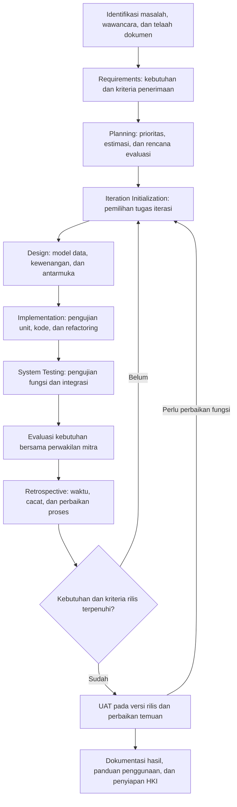

# BAB 1

## PENDAHULUAN

Bab ini menguraikan kebutuhan pengembangan prototipe sistem informasi manajemen operasional berbasis web untuk Bimbingan Belajar Artha Balikpapan. Pembahasan meliputi latar belakang, rumusan masalah, tujuan, batasan rancangan, manfaat, potensi dampak fungsional dan komersial, serta kerangka pelaksanaan Tugas Akhir.

## 1.1 Latar Belakang

Penyelenggaraan bimbingan belajar memerlukan pengelolaan data siswa, jadwal tentor, dan pembayaran yang saling berkaitan. Ketersediaan informasi tersebut diperlukan untuk mendukung pelayanan administrasi serta pengaturan kegiatan bimbingan. Pada Bimbingan Belajar RSDC, pengembangan sistem berbasis web mencakup registrasi, penjadwalan, kehadiran, dan verifikasi pembayaran (Gunawan dkk., 2025). Integrasi kegiatan administrasi juga diterapkan pada Bimbingan Belajar Bee Hive melalui pengelolaan data siswa, tentor, jadwal, pembayaran, dan laporan dalam satu sistem (Fajriansyah dkk., 2026).

Pencatatan digital menyediakan dasar untuk menelusuri transaksi dan menyusun laporan berdasarkan data yang tersimpan. Abadi dkk. (2025) mengembangkan aplikasi pencatatan pembayaran SPP dan penggajian guru pada bimbingan belajar, sedangkan Karpina dkk. (2025) mengembangkan sistem pembayaran kursus dengan pemantauan pembayaran dan rekap keuangan. Kedua penelitian tersebut menunjukkan contoh penerapan sistem untuk administrasi pembayaran di pendidikan nonformal. Pada lembaga yang memiliki beberapa cabang, rancangan serupa perlu disesuaikan dengan kewenangan pengguna cabang serta kebutuhan informasi pengelola pusat.

Bimbingan Belajar Artha Balikpapan merupakan mitra dalam pengembangan prototipe ini. Berdasarkan wawancara dengan pengelola, kegiatan layanan ARTHA mencakup delapan cabang yang memerlukan pencatatan kegiatan dan pelaporan kepada pengelola pusat.[^W2][^W3] Pengelolaan operasionalnya melibatkan penerimaan siswa, penempatan kelas, pengaturan jadwal tentor, dan administrasi pembayaran. Cakupan beberapa cabang tersebut menjadi dasar kebutuhan penyajian informasi per cabang sekaligus ringkasan informasi bagi pengelola pusat.

Berdasarkan wawancara dengan staf administrasi cabang, data siswa dan pembayaran masih dicatat menggunakan buku. Pendaftaran dapat disampaikan secara langsung maupun melalui WhatsApp, kemudian informasi yang diperlukan dicatat oleh staf administrasi.[^W4A] Jatuh tempo pembayaran SPP mengikuti tanggal mulai bimbingan masing-masing siswa, sedangkan tindak lanjut keterlambatan dilakukan dengan menghubungi wali murid atau mengingatkan siswa.[^W4B] Pemberian potongan biaya bagi siswa yang bersaudara juga melibatkan keterangan dari wali murid.[^W4A] Kebutuhan yang diturunkan dari alur tersebut adalah pencatatan identitas siswa, hubungan saudara, ketentuan biaya, serta riwayat pembayaran yang dapat ditelusuri oleh petugas berwenang.

Pada pelaporan pembayaran, staf administrasi menjelaskan bahwa catatan penerimaan dikumpulkan setiap hari, sedangkan buku pencatatan tetap disimpan di cabang. Rekap bulanan disusun terpisah dari pengumpulan penerimaan harian, dan bukti pembayaran melalui transfer diteruskan kepada pengelola yang menangani penerimaan pusat.[^W4C] Alur ini memerlukan keterkaitan antara transaksi siswa, laporan cabang, dan konfirmasi penerimaan di pusat. Oleh karena itu, dukungan sistem diarahkan pada penelusuran transaksi dan status pemeriksaannya.

Pengaturan kelas juga memerlukan informasi mengenai ruang, sesi bimbingan, dan penempatan siswa. Keterangan pengelola dan staf administrasi menunjukkan bahwa kapasitas ruang berbeda menurut ruang dan jenjang, serta penempatan dapat disesuaikan ke ruang atau sesi lain.[^W3K][^W4D] Kondisi tersebut menjadi dasar penyediaan informasi keterisian kelas berdasarkan kapasitas yang ditetapkan untuk setiap kelas. Pembagian jadwal tentor telah dilakukan oleh petugas di cabang, sehingga pencatatan lintas cabang dan peringatan konflik direncanakan untuk mendukung koordinasi serta pemeriksaan penugasan.[^W4E]

Penelitian pada bidang lain memberikan acuan untuk pengelolaan informasi pusat dan cabang. Ahadi dkk. (2025) mengembangkan sistem manajemen hotel dengan pembagian kewenangan pemilik dan penanggung jawab cabang serta penyajian laporan berdasarkan cabang. Ramadhan dan Widodo (2026), melalui studi akuntansi pada UMKM Rams Dimsum, membahas pemisahan pencatatan pusat dan cabang serta kebutuhan pelaporan transaksi yang terdokumentasi. Pada administrasi pendidikan, Hendri dkk. (2025) menyusun rancangan antarmuka pencatatan penerimaan SPP untuk mendukung keterlacakan catatan pembayaran. Ketiganya digunakan sebagai acuan yang saling melengkapi, dengan tetap memperhatikan perbedaan objek dan bentuk hasil penelitian.

Untuk pengelolaan jadwal, Khafidhoh dkk. (2026) mengembangkan sistem penjadwalan pada bimbingan belajar menggunakan algoritma genetika. Kabisatullah dan Noprisson (2026) menerapkan batasan kapasitas serta waktu yang tidak tumpang tindih dalam aplikasi manajemen ruang rapat. Pada pengendalian penerimaan, Sudirman dan Tristianti (2021) membahas rekonsiliasi catatan kas bank dengan rekening koran. Penelitian tersebut mendukung pertimbangan aturan jadwal, kapasitas, dan pencocokan transaksi, tetapi tidak mengharuskan ARTHA menggunakan algoritma penjadwalan otomatis atau mengimplementasikan sistem akuntansi secara menyeluruh.

Berdasarkan kebutuhan mitra dan penelitian yang dibandingkan, prototipe diarahkan pada integrasi pencatatan operasional cabang dengan pemantauan pusat. Rancangan mencakup data siswa, kelas dan kapasitasnya, pembayaran SPP, jadwal tentor, serta dasbor rekap penerimaan berdasarkan cabang dan periode. Admin Cabang direncanakan mengelola data cabangnya, sedangkan Super Admin dapat meninjau informasi seluruh cabang. Pengingat SPP dirancang melalui tautan WhatsApp yang dipicu oleh petugas, sementara pencocokan pembayaran transfer tetap memerlukan pemeriksaan terhadap penerimaan yang sah. Kontribusi rancangan terletak pada penyesuaian fungsi-fungsi tersebut dengan proses operasional ARTHA, termasuk kewenangan cabang, kebutuhan pemantauan pusat, dan kebijakan peringatan yang tetap mempertimbangkan keputusan pengelola.

Pengembangan prototipe direncanakan menggunakan metode *Personal Extreme Programming* (PxP). Dzhurov dkk. (2009) menjelaskan PxP sebagai proses pengembangan individual yang mempertahankan prinsip *Personal Software Process* dan mengadopsi praktik *Extreme Programming*, termasuk pengujian berkelanjutan, pencatatan pekerjaan, dan retrospektif. Metode ini dipertimbangkan berdasarkan pelaksanaan pengembangan oleh satu orang, kebutuhan pembagian pekerjaan menjadi modul, serta perlunya meninjau rincian proses bisnis melalui hasil pengembangan secara bertahap. Penerapan PxP pada pengembangan website transaksi juga dicontohkan oleh Apriyanti dkk. (2024), disertai pengujian fungsional dan penerimaan pengguna. Pada ARTHA, pencatatan estimasi, realisasi pekerjaan, cacat, dan hasil pengujian direncanakan untuk mendukung evaluasi setiap iterasi serta penyelesaian prototipe dalam jadwal Tugas Akhir.

Tugas Akhir ini bertujuan menghasilkan prototipe perangkat lunak yang dapat digunakan untuk menguji kesesuaian rancangan dengan kebutuhan operasional ARTHA. Pengembangan dilakukan melalui iterasi yang mendokumentasikan kebutuhan, hasil implementasi, pengujian, dan perbaikannya. Pengujian fungsional direncanakan menggunakan *black box testing*, sedangkan penerimaan pengguna dievaluasi melalui *User Acceptance Testing* (UAT) dengan perwakilan mitra. Pihak yang terlibat, jadwal pemberian umpan balik, dan skenario evaluasi akan ditetapkan bersama mitra pada tahap perencanaan.

## 1.2 Rumusan Masalah

Rumusan masalah disusun berdasarkan kebutuhan integrasi pencatatan cabang dan pemantauan pusat. Pertanyaan berikut menjadi dasar perancangan serta evaluasi prototipe.

1. Bagaimana merancang dan membangun prototipe sistem informasi manajemen operasional multicabang berbasis web menggunakan PxP untuk mengintegrasikan pencatatan siswa, kapasitas kelas, pembayaran SPP, dan jadwal tentor pada Bimbel Artha Balikpapan?
2. Bagaimana menyediakan pemantauan terpusat dengan pembatasan akses berdasarkan cabang serta penelusuran transaksi untuk mendukung pencocokan penerimaan pembayaran di tingkat pusat?
3. Bagaimana kesesuaian fungsi dan penerimaan pengguna terhadap prototipe berdasarkan *black box testing* dan UAT bersama perwakilan mitra?

## 1.3 Tujuan

Tujuan pengembangan diturunkan dari setiap rumusan masalah. Ketercapaian tujuan ditinjau melalui fungsi yang dihasilkan, hasil pengujian, dan evaluasi pengguna.

1. Merancang dan membangun prototipe sistem informasi manajemen operasional multicabang berbasis web menggunakan PxP yang mengintegrasikan pencatatan siswa, kapasitas kelas, pembayaran SPP, dan jadwal tentor pada Bimbel Artha Balikpapan.
2. Menghasilkan dasbor pemantauan pusat, pembatasan akses berdasarkan cabang, serta penelusuran transaksi yang mendukung pencocokan penerimaan pembayaran di tingkat pusat.
3. Mengevaluasi kesesuaian fungsi dan penerimaan pengguna terhadap prototipe melalui *black box testing* dan UAT bersama perwakilan mitra.

## 1.4 Batasan Rancangan

Pengembangan dibatasi pada administrasi operasional internal dan dukungan pemantauan pusat. Batasan berikut merupakan rancangan ruang lingkup yang akan divalidasi bersama mitra dan pembimbing sebelum ditetapkan sebagai kebutuhan implementasi.

1. Prototipe ditujukan untuk struktur delapan cabang ARTHA dengan dua peran pengguna, yaitu Admin Cabang dan Super Admin. Admin Cabang mengakses data sesuai cabang yang menjadi kewenangannya, sedangkan Super Admin mengelola data induk dan meninjau informasi seluruh cabang.
2. Fungsi utama mencakup pencatatan siswa dan kontak wali, data tentor, pengaturan kelas dan kapasitas, jadwal tentor, pembayaran SPP, serta laporan penerimaan. Data hubungan saudara dan penyesuaian biaya dicatat untuk mendukung penelusuran dasar penetapan biaya oleh pengelola.
3. Kapasitas ditetapkan berdasarkan kelas, ruang, dan sesi sesuai kebijakan mitra. Sistem menampilkan keterisian serta peringatan ketika rencana penempatan melampaui kapasitas yang ditetapkan, sedangkan keputusan penyesuaian ditangani oleh pengguna yang berwenang.
4. Jadwal tentor dicatat secara manual oleh petugas, dengan pemeriksaan waktu yang tumpang tindih pada jadwal tentor yang sama di seluruh cabang. Prototipe memberikan peringatan dan mencatat keputusan penanganannya, sedangkan penyusunan jadwal otomatis menggunakan algoritma optimasi berada di luar ruang lingkup.
5. Pembayaran mencakup pencatatan tunai dan transfer bank tanpa integrasi *payment gateway* pada rancangan ini. Bukti transfer yang dihimpun Admin Cabang digunakan sebagai dokumen pendukung, sedangkan konfirmasi penerimaan dilakukan oleh petugas yang berwenang memeriksa mutasi rekening dan tidak ditetapkan hanya berdasarkan gambar bukti transfer.
6. Dukungan rekonsiliasi dibatasi pada penelusuran transaksi SPP, rekap penerimaan dan setoran cabang, serta pencocokan transfer dengan catatan mutasi rekening yang diperiksa oleh petugas berwenang. Prototipe tidak melakukan koneksi otomatis ke rekening bank maupun menyusun jurnal penyesuaian dan laporan keuangan lengkap menurut standar akuntansi.
7. Pengingat pembayaran disiapkan berdasarkan tanggal jatuh tempo masing-masing siswa dan dikirim melalui tautan WhatsApp yang dibuka oleh petugas. Pengiriman tetap memerlukan tindakan petugas, sehingga tidak dikategorikan sebagai pengiriman otomatis terjadwal atau integrasi WhatsApp API.
8. Tentor, siswa, dan wali murid tidak diberikan akun pada prototipe ini. Informasi jadwal dan pembayaran disampaikan oleh petugas melalui mekanisme layanan yang ditetapkan mitra, sedangkan pembelajaran daring, bank soal, pelaporan nilai, dan penggajian tentor berada di luar ruang lingkup.
9. Prototipe berupa aplikasi web responsif dengan Laravel pada sisi layanan, MySQL sebagai basis data, serta Next.js pada sisi antarmuka. Pertukaran data antarkomponen direncanakan menggunakan RESTful API, dan aplikasi seluler khusus tidak dikembangkan.
10. Pembaruan dasbor mengikuti data yang telah disimpan dan dimuat dari sistem melalui jaringan yang tersedia. Istilah pemantauan terpusat dalam rancangan ini tidak menyatakan jaminan sinkronisasi seketika, ketersediaan tanpa gangguan, atau integrasi langsung dengan seluruh aktivitas di luar sistem.
11. Migrasi menyeluruh atas pembukuan historis tidak termasuk ruang lingkup. Data induk, status awal pembayaran, dan transaksi yang diperlukan untuk pengujian disiapkan bersama mitra agar skenario siswa lama dan siswa baru tetap dapat dievaluasi.
12. Pengujian mencakup fungsi utama, kewenangan akses cabang dan pusat, aturan kapasitas, peringatan jadwal, serta alur pemeriksaan pembayaran. Data uji mencakup representasi delapan cabang, sedangkan lokasi, pengguna, dan periode uji bersama mitra ditetapkan pada rencana pengujian dan tidak diasumsikan sebagai penerapan serentak di seluruh cabang.

## 1.5 Manfaat

Bagi Bimbel Artha Balikpapan, prototipe diharapkan menyediakan pencatatan siswa, kelas, jadwal, dan pembayaran yang dapat ditelusuri menurut cabang. Pengelola pusat diharapkan memperoleh ringkasan operasional untuk mendukung pemeriksaan laporan dan koordinasi dengan cabang.

Bagi Admin Cabang, prototipe diharapkan memudahkan pencarian riwayat siswa dan pembayaran serta pemeriksaan keterisian kelas. Bagi Super Admin, tersedianya rekap lintas cabang dan status pemeriksaan transaksi diharapkan membantu peninjauan penerimaan tanpa menggabungkan catatan secara terpisah untuk setiap kebutuhan informasi.

Bagi pengembangan keilmuan, pelaksanaan Tugas Akhir ini diharapkan menyediakan dokumentasi penerapan PxP pada sistem administrasi bimbingan belajar multicabang. Dokumentasi kebutuhan, iterasi, pengujian, dan evaluasi dapat digunakan sebagai bahan pembelajaran mengenai hubungan antara proses pengembangan individual dan kebutuhan pengguna pada kasus tersebut.

## 1.6 Potensi Dampak Fungsional/Komersial

Pada aspek fungsional, penerapan prototipe berpotensi mendukung penelusuran pembayaran, penyusunan rekap cabang, dan koordinasi penempatan kelas. Dampak tersebut bergantung pada kelengkapan input, ketepatan kewenangan pengguna, serta penggunaan sistem oleh petugas. Klaim pengurangan waktu kerja, kesalahan pencatatan, atau kerugian memerlukan pengukuran tersendiri apabila akan dinyatakan sebagai hasil pengembangan.

Pada aspek komersial, perangkat lunak ini berpotensi dikembangkan lebih lanjut untuk kebutuhan lembaga bimbingan belajar dengan proses operasional serupa. Pengembangan menjadi layanan berlangganan memerlukan kajian kebutuhan pasar, biaya operasional, keamanan data, serta dukungan pemeliharaan. Karena kajian tersebut berada di luar ruang lingkup Tugas Akhir, besarnya permintaan pasar dan keunggulan komersial belum dapat disimpulkan pada tahap proposal.

## 1.7 Kerangka Tugas Akhir

Kerangka Tugas Akhir disusun untuk menghubungkan identifikasi kebutuhan, proses pengembangan, dan evaluasi prototipe. Alur pada Gambar 1.1 menggunakan tujuh tahap PxP menurut Dzhurov dkk. (2009), dengan kegiatan validasi bersama mitra dan penyiapan luaran sebagai bagian pelaksanaan Tugas Akhir.

*Gambar 1.1 Kerangka pengembangan dan evaluasi prototipe ARTHA.*

1. Pada tahap kebutuhan (*requirements*), proses operasional ditelaah melalui wawancara dan dokumen mitra. Hasilnya dirumuskan menjadi kebutuhan fungsional, kebutuhan nonfungsional, dan kriteria penerimaan yang dapat diuji.
2. Pada tahap perencanaan (*planning*), kebutuhan diprioritaskan dan diuraikan menjadi tugas dengan estimasi waktu pengerjaan. Perwakilan evaluator, jadwal peninjauan, serta data dan sarana pengujian juga ditetapkan bersama mitra.
3. Pada tahap inisialisasi iterasi (*iteration initialization*), tugas dipilih berdasarkan prioritas dan kapasitas waktu pengembangan. Hasil yang diharapkan serta batas penyelesaian iterasi dicatat agar dapat dibandingkan dengan realisasinya.
4. Pada tahap perancangan (*design*), model data, kewenangan pengguna, aturan pembayaran, kapasitas, dan jadwal dirancang sesuai tugas iterasi. Pemodelan sistem dan rancangan antarmuka digunakan untuk memeriksa kesesuaian alur sebelum implementasi.
5. Pada tahap implementasi (*implementation*), pengujian unit disiapkan berdasarkan perilaku yang diharapkan, kemudian kode dikembangkan dan diperbaiki melalui *refactoring*. Penerapannya didokumentasikan pada log pekerjaan, catatan cacat, dan hasil pengujian untuk mendukung penelusuran setiap iterasi.
6. Pada tahap pengujian sistem (*system testing*), fungsi yang telah dikembangkan diuji menggunakan skenario *black box testing* dan pemeriksaan integrasi. Skenario mencakup kondisi normal, input tidak valid, pembatasan akses lintas cabang, konflik waktu, kapasitas, dan status pemeriksaan pembayaran.
7. Pada tahap retrospektif (*retrospective*), estimasi dan realisasi pekerjaan, cacat, serta usulan perbaikan proses dianalisis oleh pengembang. Umpan balik mitra yang diperoleh melalui peninjauan modul digunakan untuk memperbarui kebutuhan atau prioritas iterasi selanjutnya sesuai kesepakatan evaluasi.

Setelah fungsi pada versi rilis memenuhi kriteria pengujian, UAT dilaksanakan bersama perwakilan pengguna cabang dan pusat untuk menilai penerimaan terhadap skenario operasional. Hasilnya didokumentasikan sebagai bukti evaluasi mitra, disertai keterbatasan pengujian dan tindak lanjut temuan; penerimaan pengguna tidak diperlakukan sebagai bukti tunggal tercapainya seluruh persyaratan Tingkat Kesiapan Teknologi (TKT) 5.

Luaran yang direncanakan meliputi prototipe perangkat lunak, laporan Tugas Akhir, dokumentasi pengujian, dan panduan penggunaan. Penyiapan artikel ilmiah dan pendaftaran Hak Kekayaan Intelektual (HKI) dilakukan mengikuti ketentuan bentuk prototipe pada panduan program studi, sedangkan bukti lingkungan uji dan evaluasi mitra disiapkan untuk mendukung penilaian TKT yang dipersyaratkan.

## Daftar Pustaka yang Disitasi dalam Draf Bab 1

Abadi, R., Wasino dan Lina (2025) 'Perancangan aplikasi pembayaran SPP dan penggajian guru berbasis web pada bimbingan belajar', *Jurnal Teknologi dan Sistem Informasi Bisnis*, 7(1), hlm. 216-225. https://doi.org/10.47233/jteksis.v7i1.1666.

Ahadi, A.H., Pariyadi dan Djauhari, T. (2025) 'Pengembangan sistem informasi manajemen hotel multi-cabang berbasis web dengan framework Laravel', *Djtechno: Jurnal Teknologi Informasi*, 6(2), hlm. 758-773. https://doi.org/10.46576/djtechno.v6i2.7139.

Apriyanti, N., Wati, S.F.A. dan Najaf, A.R.E. (2024) 'Pemanfaatan metodologi PXP dan pengujian User Acceptance Testing (UAT) dalam pengembangan website e-kavling', *JATI (Jurnal Mahasiswa Teknik Informatika)*, 8(3), hlm. 3678-3686. https://doi.org/10.36040/jati.v8i3.9766.

Dzhurov, Y., Krasteva, I. dan Ilieva, S. (2009) 'Personal Extreme Programming - An Agile Process for Autonomous Developers', dalam *Proceedings of the International Conference on Software, Services and Semantic Technologies (S3T 2009)*. Sofia: Demetra EOOD, hlm. 252-259. Tersedia pada: https://research.uni-sofia.bg/handle/10506/647 (Diakses: 24 Oktober 2026).

Fajriansyah, S.N., Wijaya, M.S., Eryana, D.A., Safa, A., Pramadhan, H.R., Wicaksono, A., Baehaqi, M.I., Deivivi, F., Nurfajriansyah, D. dan Apandi, S. (2026) 'Pengembangan sistem informasi bimbingan belajar berbasis web untuk efisiensi operasional Bee Hive', *JRIS: Jurnal Rekayasa Informasi Swadharma*, 6(2), hlm. 115-126. https://doi.org/10.56486/jris.vol6no2.1346.

Gunawan, S.C., Nurwegiono, M. dan Setiawan, R. (2025) 'Sistem informasi bimbingan belajar RSDC berbasis website dengan menggunakan metode Waterfall untuk meningkatkan efisiensi administrasi', *RJTI Riau Jurnal Teknik Informatika*, 4(3), hlm. 424-435. https://doi.org/10.52158/rjti.v4i3.3655.

Hendri, Alghifari, M., Putri, H.Y., Rahayu, M. dan Nurmalasari (2025) 'Analisis sistem informasi akuntansi penerimaan kas (SPP) pada Yayasan Semesta Khatulistiwa', *JUSTIAN: Jurnal Sistem Informasi Akuntansi*, 6(2), hlm. 124-135. https://doi.org/10.31294/justian.v6i2.9114.

Kabisatullah, F. dan Noprisson, H. (2026) 'Pengembangan aplikasi RapaTrack untuk manajemen ruang rapat menggunakan Constraint Satisfaction Problem berbasis Android', *JUSIBI (Jurnal Sistem Informasi dan E-Bisnis)*, 8(2), hlm. 89-96. https://doi.org/10.54650/jusibi.v8i2.678.

Karpina, A., Akbar, Y., Lestari, W.A. dan Jamilah, F.N. (2025) 'Pengembangan sistem pembayaran pada website bimbingan belajar non-formal berbasis PHP MySQL di LOOP Coding BSD, Tangerang, Banten', *Jurnal JTIK (Jurnal Teknologi Informasi dan Komunikasi)*, 9(4), hlm. 1217-1223. https://doi.org/10.35870/jtik.v9i4.3846.

Khafidhoh, N., Febrianti, A.R. dan Sujono (2026) 'Sistem penjadwalan menggunakan algoritma genetika berbasis web', *Jurnal Teknologi Informasi: Jurnal Keilmuan dan Aplikasi Bidang Teknik Informatika*, 20(2), hlm. 15-20. https://doi.org/10.47111/jti.v20i2.24540.

Ramadhan, F. dan Widodo, H. (2026) 'Accounting Treatment Of Head Office And Branches Based On SAK EP: A Study on UMKM Rams Dimsum', *Indonesian Journal of Law and Economics Review*, 21(2). https://doi.org/10.21070/ijler.v21i2.1706.

Sudirman, B. dan Tristianti, M. (2021) 'Sistem informasi pengendalian kas bank dengan metode rekonsiliasi pada CV. Lisa Pratama berbasis client-server', *MEANS (Media Informasi Analisa dan Sistem)*, 6(2), hlm. 126-129. https://doi.org/10.54367/means.v6i2.1450.

## Penunjuk Bukti Wawancara untuk Draf Kerja

Penunjuk berikut digunakan untuk menelusuri fakta kasus selama penyusunan draf dan tidak menggantikan lampiran wawancara dalam proposal resmi. Tanggal wawancara dan identitas narasumber perlu dilengkapi berdasarkan bukti asli sebelum naskah dipindahkan ke dokumen pengajuan; tahun berkas atau tanggal pemeriksaan tidak digunakan sebagai pengganti tanggal wawancara.

[^W2]: Wawancara kedua dengan Om Anang, bagian 24:15 sampai 25:04 tentang pencatatan dan 43:35 sampai 43:53 tentang konteks cabang. Lihat [transkrip wawancara kedua](<C:/Users/ARIEL/OneDrive - MSFT/Documents/ARTHA/WAWANCARA/TRANSKRIP TEKS (TXT)/WAWANCARA KEDUA SKRIPSI (OM ANANG)_WITH_TIMESTAMPS.txt:378>).

[^W3]: Wawancara ketiga dengan Mama Radit, bagian 19:01 sampai 21:11 mengenai pembahasan delapan cabang. Lihat [transkrip wawancara ketiga](<C:/Users/ARIEL/OneDrive - MSFT/Documents/ARTHA/WAWANCARA/TRANSKRIP TEKS (TXT)/WAWANCARA KETIGA SKRIPSI (MAMA RADIT)_WITH_TIMESTAMPS.txt:248>).

[^W3K]: Wawancara ketiga, bagian 35:25 sampai 38:37 mengenai jumlah siswa dan pengaturan kelas. Lihat [pembahasan kapasitas](<C:/Users/ARIEL/OneDrive - MSFT/Documents/ARTHA/WAWANCARA/TRANSKRIP TEKS (TXT)/WAWANCARA KETIGA SKRIPSI (MAMA RADIT)_WITH_TIMESTAMPS.txt:468>).

[^W4A]: Wawancara staf frontdesk, bagian 20:06 sampai 20:51 mengenai potongan saudara, 21:21 sampai 22:09 mengenai buku, dan 22:48 sampai 23:18 mengenai pendaftaran. Lihat [transkrip frontdesk](<C:/Users/ARIEL/OneDrive - MSFT/Documents/ARTHA/WAWANCARA/TRANSKRIP TEKS (TXT)/WAWANCARA MITRA (FRONTDESK)_WITH_TIMESTAMPS.txt:395>).

[^W4B]: Wawancara staf frontdesk, bagian 58:19 sampai 59:25 mengenai jatuh tempo dan pengingat pembayaran. Lihat [alur pengingat SPP](<C:/Users/ARIEL/OneDrive - MSFT/Documents/ARTHA/WAWANCARA/TRANSKRIP TEKS (TXT)/WAWANCARA MITRA (FRONTDESK)_WITH_TIMESTAMPS.txt:1136>).

[^W4C]: Wawancara staf frontdesk, bagian 49:40 sampai 55:03 mengenai penyimpanan buku, laporan harian, pengiriman bukti transfer, dan rekap bulanan. Lihat [alur laporan dan penerimaan](<C:/Users/ARIEL/OneDrive - MSFT/Documents/ARTHA/WAWANCARA/TRANSKRIP TEKS (TXT)/WAWANCARA MITRA (FRONTDESK)_WITH_TIMESTAMPS.txt:960>).

[^W4D]: Wawancara staf frontdesk, bagian 44:08 sampai 46:30 mengenai penempatan siswa dan kapasitas beberapa ruang. Lihat [pengaturan ruang dan sesi](<C:/Users/ARIEL/OneDrive - MSFT/Documents/ARTHA/WAWANCARA/TRANSKRIP TEKS (TXT)/WAWANCARA MITRA (FRONTDESK)_WITH_TIMESTAMPS.txt:853>).

[^W4E]: Wawancara staf frontdesk, bagian 31:10 sampai 33:06 mengenai pembagian jadwal tentor. Lihat [pengaturan jadwal tentor](<C:/Users/ARIEL/OneDrive - MSFT/Documents/ARTHA/WAWANCARA/TRANSKRIP TEKS (TXT)/WAWANCARA MITRA (FRONTDESK)_WITH_TIMESTAMPS.txt:607>).
